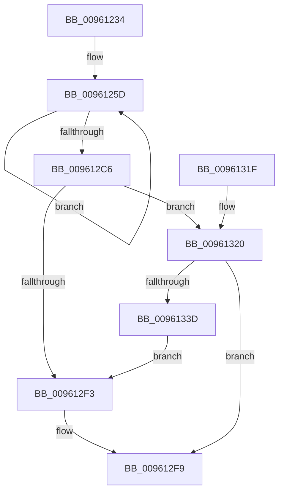

# PfSnPrefetchCacheEntryUpdate

- RVA: `0x00961234`–`0x0096133F` (길이 `267` bytes)
- VA: `0x0000000140961234`
- 실행 섹션: `PAGE`
- PDB 이름 있음: `예`; PDB Function 태그: `아니요`
- unwind 정보 RVA: `0x00093238`
- 디코드: `68`개 명령, `267/267` bytes 표시
- 미해석 바이트: `0` (있으면 어셈블리에 `.byte`로 보존)

> 이 문서는 커널 이미지의 기계어와 PDB 기호를 분석해 생성했습니다. 4번과 5번은 함수 원형과 자료형을 바이너리 사용 방식에서 추정한 C 해석이며 원본 소스 복구 결과는 아닙니다.

## 1. Dependencies

- 직접 호출 지점: **5**; 고유 호출 대상: **5**
- 직접 호출자로 확인된 함수: **1**
- RIP 상대 이미지 참조: **3**

### Outgoing calls
- `0x009612CD` → [PfResourceExclusiveAcquire](../../text/4A/PfResourceExclusiveAcquire_function_004A8F90.md) (function, `0x004A8F90`)
- `0x009612EA` → [memcmp](../../text/6C/memcmp_function_006C6B10.md) (function, `0x006C6B10`)
- `0x00961300` → [ExReleaseResourceLite](../../text/25/ExReleaseResourceLite_function_0025FA10.md) (function, `0x0025FA10`)
- `0x00961305` → [KeLeaveCriticalRegion](../../text/25/KeLeaveCriticalRegion_function_0025D8B0.md) (function, `0x0025D8B0`)
- `0x00961330` → [PfSnPrefetchCacheEntryGet](../95/PfSnPrefetchCacheEntryGet_function_0095F890.md) (function, `0x0095F890`)

### Direct callers
- [PfSnSetPrefetcherInformation](PfSnSetPrefetcherInformation_function_0096139C.md) at `0x009614F8`

### Static image references
- `0x009612C6` → RVA `0x00E672F0` (`.data`; read)
- `0x009612D2` → RVA `0x00E672E0` (`.data`; read)
- `0x00961323` → RVA `0x00E672C8` (`.data`; read)

## 2. Other-region calls and transfers

- 다른 실행 섹션으로 향하는 call: **4**
  - `0x009612CD` → [PfResourceExclusiveAcquire](../../text/4A/PfResourceExclusiveAcquire_function_004A8F90.md) (`PAGE` → `.text`)
  - `0x009612EA` → [memcmp](../../text/6C/memcmp_function_006C6B10.md) (`PAGE` → `.text`)
  - `0x00961300` → [ExReleaseResourceLite](../../text/25/ExReleaseResourceLite_function_0025FA10.md) (`PAGE` → `.text`)
  - `0x00961305` → [KeLeaveCriticalRegion](../../text/25/KeLeaveCriticalRegion_function_0025D8B0.md) (`PAGE` → `.text`)
- 별도 외부 분기/꼬리 이동을 확인하지 못했습니다.

## 3. Assembly (complete function range)

```asm
00961234  48 89 5C 24 08                  mov qword ptr [rsp + 8], rbx
00961239  48 89 6C 24 10                  mov qword ptr [rsp + 0x10], rbp
0096123E  48 89 74 24 18                  mov qword ptr [rsp + 0x18], rsi
00961243  57                              push rdi
00961244  48 83 EC 20                     sub rsp, 0x20
00961248  48 8D 79 04                     lea rdi, [rcx + 4]
0096124C  48 8B F1                        mov rsi, rcx
0096124F  4C 8B CF                        mov r9, rdi
00961252  BD 2F CB 04 00                  mov ebp, 0x4cb2f
00961257  41 BA 08 00 00 00               mov r10d, 8
0096125D  41 0F B6 01                     movzx eax, byte ptr [r9]
00961261  4D 8D 49 08                     lea r9, [r9 + 8]
00961265  48 6B D5 25                     imul rdx, rbp, 0x25
00961269  48 03 D0                        add rdx, rax
0096126C  41 0F B6 41 F9                  movzx eax, byte ptr [r9 - 7]
00961271  4C 6B C2 25                     imul r8, rdx, 0x25
00961275  4C 03 C0                        add r8, rax
00961278  41 0F B6 41 FA                  movzx eax, byte ptr [r9 - 6]
0096127D  49 6B C8 25                     imul rcx, r8, 0x25
00961281  48 03 C8                        add rcx, rax
00961284  41 0F B6 41 FB                  movzx eax, byte ptr [r9 - 5]
00961289  48 6B D1 25                     imul rdx, rcx, 0x25
0096128D  48 03 D0                        add rdx, rax
00961290  41 0F B6 41 FC                  movzx eax, byte ptr [r9 - 4]
00961295  48 6B CA 25                     imul rcx, rdx, 0x25
00961299  48 03 C8                        add rcx, rax
0096129C  41 0F B6 41 FD                  movzx eax, byte ptr [r9 - 3]
009612A1  48 6B D1 25                     imul rdx, rcx, 0x25
009612A5  48 03 D0                        add rdx, rax
009612A8  41 0F B6 41 FE                  movzx eax, byte ptr [r9 - 2]
009612AD  48 6B CA 25                     imul rcx, rdx, 0x25
009612B1  48 03 C8                        add rcx, rax
009612B4  41 0F B6 41 FF                  movzx eax, byte ptr [r9 - 1]
009612B9  48 6B E9 25                     imul rbp, rcx, 0x25
009612BD  48 03 E8                        add rbp, rax
009612C0  49 83 EA 01                     sub r10, 1
009612C4  75 97                           jne 0x14096125d
009612C6  48 8D 0D 23 60 50 00            lea rcx, [rip + 0x506023]
009612CD  E8 BE 7C B4 FF                  call 0x1404a8f90
009612D2  48 8B 1D 07 60 50 00            mov rbx, qword ptr [rip + 0x506007]
009612D9  41 B8 40 00 00 00               mov r8d, 0x40
009612DF  48 83 C3 F0                     add rbx, -0x10
009612E3  48 8B D7                        mov rdx, rdi
009612E6  48 8D 4B 20                     lea rcx, [rbx + 0x20]
009612EA  E8 21 58 D6 FF                  call 0x1406c6b10
009612EF  85 C0                           test eax, eax
009612F1  75 2D                           jne 0x140961320
009612F3  8B 56 44                        mov edx, dword ptr [rsi + 0x44]
009612F6  89 53 74                        mov dword ptr [rbx + 0x74], edx
009612F9  48 8D 0D F0 5F 50 00            lea rcx, [rip + 0x505ff0]
00961300  E8 0B E7 8F FF                  call 0x14025fa10
00961305  E8 A6 C5 8F FF                  call 0x14025d8b0
0096130A  48 8B 5C 24 30                  mov rbx, qword ptr [rsp + 0x30]
0096130F  48 8B 6C 24 38                  mov rbp, qword ptr [rsp + 0x38]
00961314  48 8B 74 24 40                  mov rsi, qword ptr [rsp + 0x40]
00961319  48 83 C4 20                     add rsp, 0x20
0096131D  5F                              pop rdi
0096131E  C3                              ret
0096131F  CC                              int3
00961320  45 33 C9                        xor r9d, r9d
00961323  48 8D 0D 9E 5F 50 00            lea rcx, [rip + 0x505f9e]
0096132A  4C 8B C5                        mov r8, rbp
0096132D  48 8B D7                        mov rdx, rdi
00961330  E8 5B E5 FF FF                  call 0x14095f890
00961335  48 8B D8                        mov rbx, rax
00961338  48 85 C0                        test rax, rax
0096133B  74 BC                           je 0x1409612f9
0096133D  EB B4                           jmp 0x1409612f3
```

## 4. C-style interpretation (structured pseudocode)

```c
__int64 __fastcall PfSnPrefetchCacheEntryUpdate(__int64 a1)
{
    __int64 result;
    __int64 v_r10;
    __int64 v_rbp;
    __int64 v_rbx;
    __int64 v_rsp;
    unsigned __int64 v_stack_p10;
    unsigned __int64 v_stack_p18;
    unsigned __int64 v_stack_p8;

    v_stack_p8 = v_rbx;
    v_stack_p10 = v_rbp;
    v_stack_p18 = v_rsi;
    v_rsp = (v_rsp) - (32);
loc_0096125D:
    a2 = (a2) * ((unsigned int)(0x4CB2FULL));
    a2 = (a2) + (*(unsigned __int8 *)(a1 + 4));
    a3 = (a3) * (a2);
    a3 = (a3) + (*(unsigned __int8 *)(a1 + 4 + 8 - 7));
    a1 = (a1) * (a3);
    a1 = (a1) + (*(unsigned __int8 *)(a1 + 4 + 8 - 6));
    a2 = (a2) * (a1);
    a2 = (a2) + (*(unsigned __int8 *)(a1 + 4 + 8 - 5));
    a1 = (a1) * (a2);
    a1 = (a1) + (*(unsigned __int8 *)(a1 + 4 + 8 - 4));
    a2 = (a2) * (a1);
    a2 = (a2) + (*(unsigned __int8 *)(a1 + 4 + 8 - 3));
    a1 = (a1) * (a2);
    a1 = (a1) + (*(unsigned __int8 *)(a1 + 4 + 8 - 2));
    v_rbp = ((unsigned int)(0x4CB2FULL)) * (a1);
    v_rbp = (v_rbp) + (*(unsigned __int8 *)(a1 + 4 + 8 - 1));
    v_r10 = (8) - (1);
    if (condition_is_not_equal) goto loc_0096125D;
    result = PfResourceExclusiveAcquire(v_rip + 5267491, a2, a3, a1 + 4 + 8);
    v_rbx = (*(unsigned __int64 *)(v_rip + 5267463)) + (-16);
    result = memcmp(v_rbx + 32, a1 + 4, 64, a1 + 4 + 8);
    if ((unsigned int)(result) != 0) goto loc_00961320;
loc_009612F3:
    *(unsigned int *)(v_rbx + 116) = (unsigned int)((unsigned int)(*(unsigned int *)(a1 + 68)));
loc_009612F9:
    result = ExReleaseResourceLite(v_rip + 5267440, (unsigned int)(*(unsigned int *)(a1 + 68)), 64, a1 + 4 + 8);
    result = KeLeaveCriticalRegion(v_rip + 5267440, (unsigned int)(*(unsigned int *)(a1 + 68)), 64, a1 + 4 + 8);
    v_rsp = (v_rsp) + (32);
    return result;
loc_00961320:
    a4 = 0;
    result = PfSnPrefetchCacheEntryGet(v_rip + 5267358, a1 + 4, v_stack_p10, a4);
    if (result == 0) goto loc_009612F9;
    goto loc_009612F3;
}
```

## 5. (Beta) C Style

```c
int64_t PfSnPrefetchCacheEntryUpdate(void *Arg1)
{
    uint8_t *arg1 = (uint8_t *)Arg1;

    int64_t result;
    int64_t local_r10;
    int64_t local_rbp;
    int64_t local_rbx;
    int64_t local_rsp;
    uint64_t v_stack_p10;
    uint64_t v_stack_p18;
    uint64_t v_stack_p8;

    v_stack_p8 = local_rbx;
    v_stack_p10 = local_rbp;
    v_stack_p18 = local_rsi;
    local_rsp = (local_rsp) - (32);
loc_0096125D:
    a2 = (a2) * ((uint32_t)(0x4CB2FULL));
    a2 = (a2) + (*(uint8_t *)(arg1 + 0x4));
    a3 = (a3) * (a2);
    a3 = (a3) + (*(uint8_t *)(arg1 + 0x4 + 0x8 - 0x7));
    Arg1 = (Arg1) * (a3);
    Arg1 = (Arg1) + (*(uint8_t *)(arg1 + 0x4 + 0x8 - 0x6));
    a2 = (a2) * (Arg1);
    a2 = (a2) + (*(uint8_t *)(arg1 + 0x4 + 0x8 - 0x5));
    Arg1 = (Arg1) * (a2);
    Arg1 = (Arg1) + (*(uint8_t *)(arg1 + 0x4 + 0x8 - 0x4));
    a2 = (a2) * (Arg1);
    a2 = (a2) + (*(uint8_t *)(arg1 + 0x4 + 0x8 - 0x3));
    Arg1 = (Arg1) * (a2);
    Arg1 = (Arg1) + (*(uint8_t *)(arg1 + 0x4 + 0x8 - 0x2));
    local_rbp = ((uint32_t)(0x4CB2FULL)) * (Arg1);
    local_rbp = (local_rbp) + (*(uint8_t *)(arg1 + 0x4 + 0x8 - 0x1));
    local_r10 = (8) - (1);
    if (condition_is_not_equal) goto loc_0096125D;
    result = PfResourceExclusiveAcquire(v_rip + 5267491, a2, a3, Arg1 + 4 + 8);
    local_rbx = (*(uint64_t *)(v_rip + 0x506007)) + (-16);
    result = memcmp(local_rbx + 32, Arg1 + 4, 64, Arg1 + 4 + 8);
    if ((uint32_t)(result) != 0) goto loc_00961320;
loc_009612F3:
    *(uint32_t *)(local_rbx + 0x74) = (uint32_t)((uint32_t)(*(uint32_t *)(arg1 + 0x44)));
loc_009612F9:
    result = ExReleaseResourceLite(v_rip + 5267440, (uint32_t)(*(uint32_t *)(arg1 + 0x44)), 64, Arg1 + 4 + 8);
    result = KeLeaveCriticalRegion(v_rip + 5267440, (uint32_t)(*(uint32_t *)(arg1 + 0x44)), 64, Arg1 + 4 + 8);
    local_rsp = (local_rsp) + (32);
    return result;
loc_00961320:
    a4 = 0;
    result = PfSnPrefetchCacheEntryGet(v_rip + 5267358, Arg1 + 4, v_stack_p10, a4);
    if (result == 0) goto loc_009612F9;
    goto loc_009612F3;
}
```

### 관측된 메모리 오프셋

구조체 형식이 확인되지 않은 접근은 인자 기준의 오프셋으로만 기록했습니다.

| 기준 인자 | 오프셋 표현 | 폭 (bit) | 접근 |
|---|---:|---:|---|
| `Arg1` | `- 0x7` | `8` | `R` |
| `Arg1` | `- 0x6` | `8` | `R` |
| `Arg1` | `- 0x5` | `8` | `R` |
| `Arg1` | `- 0x4` | `8` | `R` |
| `Arg1` | `- 0x3` | `8` | `R` |
| `Arg1` | `- 0x2` | `8` | `R` |
| `Arg1` | `- 0x1` | `8` | `R` |
| `Arg1` | `+ 0x0` | `8` | `R` |
| `Arg1` | `+ 0x4` | `64` | `R` |
| `Arg1` | `+ 0x8` | `64` | `R` |
| `Arg1` | `+ 0x44` | `32` | `R` |

## 6. Execution-region graph

[열기: 2D/3D 그래프와 함수 탐색 컨트롤 패널](../../../control-panel.html?section=page&rva=0x00961234&view=graph)

- 2D 그래프는 위에서 아래로 흐르고, 3D 그래프는 빈 공간을 드래그해 회전합니다. Shift+드래그는 이동, 휠은 확대·축소, 함수 노드 선택은 대상 보고서 이동입니다.

### Static fallback


