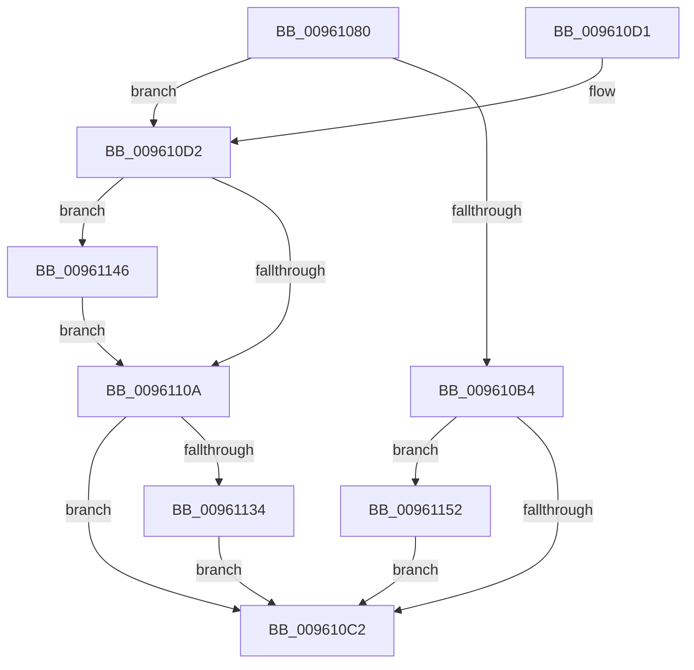

# PfSnPrefetchScenario

- RVA: `0x00961080`–`0x00961161` (길이 `225` bytes)
- VA: `0x0000000140961080`
- 실행 섹션: `PAGE`
- PDB 이름 있음: `예`; PDB Function 태그: `아니요`
- unwind 정보 RVA: `0x00093224`
- 디코드: `61`개 명령, `225/225` bytes 표시
- 미해석 바이트: `0` (있으면 어셈블리에 `.byte`로 보존)

> 이 문서는 커널 이미지의 기계어와 PDB 기호를 분석해 생성했습니다. 4번과 5번은 함수 원형과 자료형을 바이너리 사용 방식에서 추정한 C 해석이며 원본 소스 복구 결과는 아닙니다.

## 1. Dependencies

- 직접 호출 지점: **7**; 고유 호출 대상: **7**
- 직접 호출자로 확인된 함수: **1**
- RIP 상대 이미지 참조: **0**

### Outgoing calls
- `0x009610A7` → [ExAllocatePool2](../../poolcode/B8/ExAllocatePool2_function_00B820F0.md) (function, `0x00B820F0`)
- `0x009610EA` → [PfSnAsyncContextInitialize](PfSnAsyncContextInitialize_function_00961168.md) (function, `0x00961168`)
- `0x00961113` → [KeQueryPriorityThread](../../text/38/KeQueryPriorityThread_function_0038F4F0.md) (function, `0x0038F4F0`)
- `0x0096111E` → [ExQueueWorkItem](../../text/2F/ExQueueWorkItem_function_002F9520.md) (function, `0x002F9520`)
- `0x0096113C` → [ExfWaitForRundownProtectionRelease](../../text/2A/ExfWaitForRundownProtectionRelease_function_002A4CDC.md) (function, `0x002A4CDC`)
- `0x0096114B` → [ExfAcquireRundownProtection](../../text/34/ExfAcquireRundownProtection_function_0034C050.md) (function, `0x0034C050`)
- `0x00961157` → [ExFreePoolWithTag](../../poolcode/B8/ExFreePoolWithTag_function_00B82870.md) (function, `0x00B82870`)

### Direct callers
- [PfSnBeginScenario](../95/PfSnBeginScenario_function_0095EFC0.md) at `0x0095F1D3`

### Static image references
- 디코드된 RIP-relative 메모리 참조가 없습니다.

## 2. Other-region calls and transfers

- 다른 실행 섹션으로 향하는 call: **6**
  - `0x009610A7` → [ExAllocatePool2](../../poolcode/B8/ExAllocatePool2_function_00B820F0.md) (`PAGE` → `POOLCODE`)
  - `0x00961113` → [KeQueryPriorityThread](../../text/38/KeQueryPriorityThread_function_0038F4F0.md) (`PAGE` → `.text`)
  - `0x0096111E` → [ExQueueWorkItem](../../text/2F/ExQueueWorkItem_function_002F9520.md) (`PAGE` → `.text`)
  - `0x0096113C` → [ExfWaitForRundownProtectionRelease](../../text/2A/ExfWaitForRundownProtectionRelease_function_002A4CDC.md) (`PAGE` → `.text`)
  - `0x0096114B` → [ExfAcquireRundownProtection](../../text/34/ExfAcquireRundownProtection_function_0034C050.md) (`PAGE` → `.text`)
  - `0x00961157` → [ExFreePoolWithTag](../../poolcode/B8/ExFreePoolWithTag_function_00B82870.md) (`PAGE` → `POOLCODE`)
- 별도 외부 분기/꼬리 이동을 확인하지 못했습니다.

## 3. Assembly (complete function range)

```asm
00961080  48 89 5C 24 10                  mov qword ptr [rsp + 0x10], rbx
00961085  55                              push rbp
00961086  56                              push rsi
00961087  57                              push rdi
00961088  48 83 EC 20                     sub rsp, 0x20
0096108C  48 83 64 24 40 00               and qword ptr [rsp + 0x40], 0
00961092  8B DA                           mov ebx, edx
00961094  48 8B F9                        mov rdi, rcx
00961097  BA F8 00 00 00                  mov edx, 0xf8
0096109C  B9 40 00 00 00                  mov ecx, 0x40
009610A1  41 B8 43 63 50 61               mov r8d, 0x61506343
009610A7  E8 44 10 22 00                  call 0x140b820f0
009610AC  48 8B F0                        mov rsi, rax
009610AF  48 85 C0                        test rax, rax
009610B2  75 1E                           jne 0x1409610d2
009610B4  BB 9A 00 00 C0                  mov ebx, 0xc000009a
009610B9  48 85 FF                        test rdi, rdi
009610BC  0F 85 90 00 00 00               jne 0x140961152
009610C2  8B C3                           mov eax, ebx
009610C4  48 8B 5C 24 48                  mov rbx, qword ptr [rsp + 0x48]
009610C9  48 83 C4 20                     add rsp, 0x20
009610CD  5F                              pop rdi
009610CE  5E                              pop rsi
009610CF  5D                              pop rbp
009610D0  C3                              ret
009610D1  CC                              int3
009610D2  C1 EB 04                        shr ebx, 4
009610D5  4C 8D 44 24 40                  lea r8, [rsp + 0x40]
009610DA  BD 01 00 00 00                  mov ebp, 1
009610DF  48 8B D7                        mov rdx, rdi
009610E2  23 DD                           and ebx, ebp
009610E4  48 8B CE                        mov rcx, rsi
009610E7  44 8B CB                        mov r9d, ebx
009610EA  E8 79 00 00 00                  call 0x140961168
009610EF  0F 0D 4C 24 40                  prefetchw byte ptr [rsp + 0x40]
009610F4  48 8B 44 24 40                  mov rax, qword ptr [rsp + 0x40]
009610F9  48 83 E0 FE                     and rax, 0xfffffffffffffffe
009610FD  48 8D 48 02                     lea rcx, [rax + 2]
00961101  F0 48 0F B1 4C 24 40            lock cmpxchg qword ptr [rsp + 0x40], rcx
00961108  75 3C                           jne 0x140961146
0096110A  65 48 8B 0C 25 88 01 00 00      mov rcx, qword ptr gs:[0x188]
00961113  E8 D8 E3 A2 FF                  call 0x14038f4f0
00961118  48 8B CE                        mov rcx, rsi
0096111B  8D 50 20                        lea edx, [rax + 0x20]
0096111E  E8 FD 83 99 FF                  call 0x1402f9520
00961123  33 DB                           xor ebx, ebx
00961125  33 C0                           xor eax, eax
00961127  F0 48 0F B1 6C 24 40            lock cmpxchg qword ptr [rsp + 0x40], rbp
0096112E  48 83 F8 02                     cmp rax, 2
00961132  72 8E                           jb 0x1409610c2
00961134  48 8B D0                        mov rdx, rax
00961137  48 8D 4C 24 40                  lea rcx, [rsp + 0x40]
0096113C  E8 9B 3B 94 FF                  call 0x1402a4cdc
00961141  E9 7C FF FF FF                  jmp 0x1409610c2
00961146  48 8D 4C 24 40                  lea rcx, [rsp + 0x40]
0096114B  E8 00 AF 9E FF                  call 0x14034c050
00961150  EB B8                           jmp 0x14096110a
00961152  33 D2                           xor edx, edx
00961154  48 8B CF                        mov rcx, rdi
00961157  E8 14 17 22 00                  call 0x140b82870
0096115C  E9 61 FF FF FF                  jmp 0x1409610c2
```

## 4. C-style interpretation (structured pseudocode)

```c
__int64 __fastcall PfSnPrefetchScenario(__int64 a1, int a2)
{
    __int64 result;
    __int64 v_rbx;
    __int64 v_rsp;
    unsigned __int64 v_stack_p10;
    unsigned __int64 v_stack_p40;
    unsigned __int64 v_stack_p8;

    v_stack_p10 = v_rbx;
    v_rsp = (v_rsp) - (32);
    result = ExAllocatePool2(64, 248, (unsigned int)(0x61506343ULL), a4);
    if (result != 0) goto loc_009610D2;
    if (a1 != 0) goto loc_00961152;
loc_009610C2:
    v_rsp = (v_rsp) + (32);
    return (unsigned int)((unsigned int)((unsigned int)(0xC000009AULL)));
loc_009610D2:
    v_rbx = (unsigned int)((v_stack_p10) >> (4));
    v_rbx = (unsigned int)((v_rbx) & (1));
    result = PfSnAsyncContextInitialize(result, a1, v_stack_p40, (unsigned int)((unsigned int)(v_rbx)));
    result = (v_stack_p40) & (-2);
    if (condition_is_not_equal) goto loc_00961146;
loc_0096110A:
    result = KeQueryPriorityThread(*(unsigned __int64 *)(gs_base + (0 + 392)), a1, v_stack_p40, (unsigned int)((unsigned int)(v_rbx)));
    result = ExQueueWorkItem(result, result + 32, v_stack_p40, (unsigned int)((unsigned int)(v_rbx)));
    v_rbx = 0;
    result = 0;
    if (0 < 2) goto loc_009610C2;
    result = ExfWaitForRundownProtectionRelease(v_stack_p40, 0, v_stack_p40, (unsigned int)((unsigned int)(v_rbx)));
    goto loc_009610C2;
loc_00961146:
    result = ExfAcquireRundownProtection(v_stack_p40, 0, v_stack_p40, (unsigned int)((unsigned int)(v_rbx)));
    goto loc_0096110A;
loc_00961152:
    a2 = 0;
    result = ExFreePoolWithTag(a1, a2, v_stack_p40, (unsigned int)((unsigned int)(v_rbx)));
    goto loc_009610C2;
}
```

## 5. (Beta) C Style

```c
int64_t PfSnPrefetchScenario(int64_t Arg1, int32_t Arg2)
{
    int64_t result;
    int64_t local_rbx;
    int64_t local_rsp;
    uint64_t v_stack_p10;
    uint64_t v_stack_p40;
    uint64_t v_stack_p8;

    v_stack_p10 = local_rbx;
    local_rsp = (local_rsp) - (32);
    result = ExAllocatePool2(64, 248, (uint32_t)(0x61506343ULL), a4);
    if (result != 0) goto loc_009610D2;
    if (Arg1 != 0) goto loc_00961152;
loc_009610C2:
    local_rsp = (local_rsp) + (32);
    return (uint32_t)((uint32_t)((uint32_t)(0xC000009AULL)));
loc_009610D2:
    local_rbx = (uint32_t)((v_stack_p10) >> (4));
    local_rbx = (uint32_t)((local_rbx) & (1));
    result = PfSnAsyncContextInitialize(result, Arg1, v_stack_p40, (uint32_t)((uint32_t)(local_rbx)));
    result = (v_stack_p40) & (-2);
    if (condition_is_not_equal) goto loc_00961146;
loc_0096110A:
    result = KeQueryPriorityThread(*(uint64_t *)(gs_base + (0 + 0x188)), Arg1, v_stack_p40, (uint32_t)((uint32_t)(local_rbx)));
    result = ExQueueWorkItem(result, result + 32, v_stack_p40, (uint32_t)((uint32_t)(local_rbx)));
    local_rbx = 0;
    result = 0;
    if (0 < 2) goto loc_009610C2;
    result = ExfWaitForRundownProtectionRelease(v_stack_p40, 0, v_stack_p40, (uint32_t)((uint32_t)(local_rbx)));
    goto loc_009610C2;
loc_00961146:
    result = ExfAcquireRundownProtection(v_stack_p40, 0, v_stack_p40, (uint32_t)((uint32_t)(local_rbx)));
    goto loc_0096110A;
loc_00961152:
    Arg2 = 0;
    result = ExFreePoolWithTag(Arg1, Arg2, v_stack_p40, (uint32_t)((uint32_t)(local_rbx)));
    goto loc_009610C2;
}
```

## 6. Execution-region graph

[열기: 2D/3D 그래프와 함수 탐색 컨트롤 패널](../../../control-panel.html?section=page&rva=0x00961080&view=graph)

- 2D 그래프는 위에서 아래로 흐르고, 3D 그래프는 빈 공간을 드래그해 회전합니다. Shift+드래그는 이동, 휠은 확대·축소, 함수 노드 선택은 대상 보고서 이동입니다.

### Static fallback


