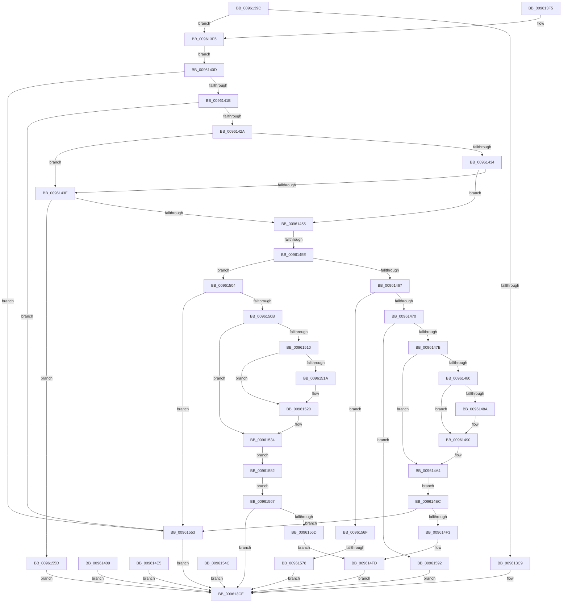

# PfSnSetPrefetcherInformation

- RVA: `0x0096139C`–`0x0096159C` (길이 `512` bytes)
- VA: `0x000000014096139C`
- 실행 섹션: `PAGE`
- PDB 이름 있음: `예`; PDB Function 태그: `예`
- unwind 정보 RVA: `0x00093250`
- 디코드: `125`개 명령, `512/512` bytes 표시
- 미해석 바이트: `0` (있으면 어셈블리에 `.byte`로 보존)

> 이 문서는 커널 이미지의 기계어와 PDB 기호를 분석해 생성했습니다. 4번과 5번은 함수 원형과 자료형을 바이너리 사용 방식에서 추정한 C 해석이며 원본 소스 복구 결과는 아닙니다.

## 1. Dependencies

- 직접 호출 지점: **6**; 고유 호출 대상: **5**
- 직접 호출자로 확인된 함수: **1**
- RIP 상대 이미지 참조: **2**

### Outgoing calls
- `0x009613DB` → [_security_check_cookie](../../text/6A/_security_check_cookie_function_006AC640.md) (function, `0x006AC640`)
- `0x00961448` → [SeSinglePrivilegeCheck](../87/SeSinglePrivilegeCheck_function_00871E20.md) (function, `0x00871E20`)
- `0x0096148A` → [ExRaiseDatatypeMisalignment](../89/ExRaiseDatatypeMisalignment_function_00899FD0.md) (function, `0x00899FD0`)
- `0x009614F8` → [PfSnPrefetchCacheEntryUpdate](PfSnPrefetchCacheEntryUpdate_function_00961234.md) (function, `0x00961234`)
- `0x0096151A` → [ExRaiseDatatypeMisalignment](../89/ExRaiseDatatypeMisalignment_function_00899FD0.md) (function, `0x00899FD0`)
- `0x00961587` → [PfSnOperationProcess](PfSnOperationProcess_function_009615A4.md) (function, `0x009615A4`)

### Direct callers
- [NtSetSystemInformation](../AF/NtSetSystemInformation_function_00AF4A60.md) at `0x00AF535B`

### Static image references
- `0x009613AE` → RVA `0x00E0A740` (`.data`; read)
- `0x00961441` → RVA `0x00FD9B08` (`PAGEDATA`; read)

## 2. Other-region calls and transfers

- 다른 실행 섹션으로 향하는 call: **1**
  - `0x009613DB` → [_security_check_cookie](../../text/6A/_security_check_cookie_function_006AC640.md) (`PAGE` → `.text`)
- call이 아닌 외부 분기/꼬리 이동: **2**
  - `0x00961458` → [sub_00B27DF8 + 0x5E](../B2/Unknown_function_00B27DF8.md) (`tail-transfer`)
  - `0x00961572` → [sub_00B27DF8](../B2/Unknown_function_00B27DF8.md) (`tail-transfer`)

## 3. Assembly (complete function range)

```asm
0096139C  48 89 5C 24 08                  mov qword ptr [rsp + 8], rbx
009613A1  48 89 74 24 18                  mov qword ptr [rsp + 0x18], rsi
009613A6  57                              push rdi
009613A7  48 81 EC D0 00 00 00            sub rsp, 0xd0
009613AE  48 8B 05 8B 93 4A 00            mov rax, qword ptr [rip + 0x4a938b]
009613B5  48 33 C4                        xor rax, rsp
009613B8  48 89 84 24 C0 00 00 00         mov qword ptr [rsp + 0xc0], rax
009613C0  41 8A F9                        mov dil, r9b
009613C3  41 83 F8 20                     cmp r8d, 0x20
009613C7  74 2D                           je 0x1409613f6
009613C9  BB 04 00 00 C0                  mov ebx, 0xc0000004
009613CE  8B C3                           mov eax, ebx
009613D0  48 8B 8C 24 C0 00 00 00         mov rcx, qword ptr [rsp + 0xc0]
009613D8  48 33 CC                        xor rcx, rsp
009613DB  E8 60 B2 D4 FF                  call 0x1406ac640
009613E0  4C 8D 9C 24 D0 00 00 00         lea r11, [rsp + 0xd0]
009613E8  49 8B 5B 10                     mov rbx, qword ptr [r11 + 0x10]
009613EC  49 8B 73 20                     mov rsi, qword ptr [r11 + 0x20]
009613F0  49 8B E3                        mov rsp, r11
009613F3  5F                              pop rdi
009613F4  C3                              ret
009613F5  CC                              int3
009613F6  0F 10 02                        movups xmm0, xmmword ptr [rdx]
009613F9  0F 11 44 24 20                  movups xmmword ptr [rsp + 0x20], xmm0
009613FE  0F 10 4A 10                     movups xmm1, xmmword ptr [rdx + 0x10]
00961402  0F 11 4C 24 30                  movups xmmword ptr [rsp + 0x30], xmm1
00961407  EB 04                           jmp 0x14096140d
00961409  8B D8                           mov ebx, eax
0096140B  EB C1                           jmp 0x1409613ce
0096140D  48 8B 44 24 20                  mov rax, qword ptr [rsp + 0x20]
00961412  83 F8 01                        cmp eax, 1
00961415  0F 85 38 01 00 00               jne 0x140961553
0096141B  48 C1 E8 20                     shr rax, 0x20
0096141F  3D 43 68 75 6B                  cmp eax, 0x6b756843
00961424  0F 85 29 01 00 00               jne 0x140961553
0096142A  48 8B 5C 24 28                  mov rbx, qword ptr [rsp + 0x28]
0096142F  83 FB 08                        cmp ebx, 8
00961432  77 0A                           ja 0x14096143e
00961434  B8 28 01 00 00                  mov eax, 0x128
00961439  0F A3 D8                        bt eax, ebx
0096143C  72 17                           jb 0x140961455
0096143E  40 8A D7                        mov dl, dil
00961441  48 8B 0D C0 86 67 00            mov rcx, qword ptr [rip + 0x6786c0]
00961448  E8 D3 09 F1 FF                  call 0x140871e20
0096144D  84 C0                           test al, al
0096144F  0F 84 08 01 00 00               je 0x14096155d
00961455  83 EB 03                        sub ebx, 3
00961458  0F 84 F8 69 1C 00               je 0x140b27e56
0096145E  83 EB 02                        sub ebx, 2
00961461  0F 84 9D 00 00 00               je 0x140961504
00961467  83 EB 01                        sub ebx, 1
0096146A  0F 85 FF 00 00 00               jne 0x14096156f
00961470  83 7C 24 38 48                  cmp dword ptr [rsp + 0x38], 0x48
00961475  0F 85 17 01 00 00               jne 0x140961592
0096147B  40 84 FF                        test dil, dil
0096147E  74 24                           je 0x1409614a4
00961480  48 8B 4C 24 30                  mov rcx, qword ptr [rsp + 0x30]
00961485  F6 C1 03                        test cl, 3
00961488  74 06                           je 0x140961490
0096148A  E8 41 8B F3 FF                  call 0x140899fd0
0096148F  CC                              int3
00961490  48 B8 00 00 FF FF FF 7F 00 00   movabs rax, 0x7fffffff0000
0096149A  48 3B C8                        cmp rcx, rax
0096149D  48 0F 43 C8                     cmovae rcx, rax
009614A1  90                              nop
009614A2  8A 01                           mov al, byte ptr [rcx]
009614A4  48 8B 44 24 30                  mov rax, qword ptr [rsp + 0x30]
009614A9  0F 10 00                        movups xmm0, xmmword ptr [rax]
009614AC  0F 29 44 24 70                  movaps xmmword ptr [rsp + 0x70], xmm0
009614B1  0F 10 48 10                     movups xmm1, xmmword ptr [rax + 0x10]
009614B5  0F 29 8C 24 80 00 00 00         movaps xmmword ptr [rsp + 0x80], xmm1
009614BD  0F 10 40 20                     movups xmm0, xmmword ptr [rax + 0x20]
009614C1  0F 29 84 24 90 00 00 00         movaps xmmword ptr [rsp + 0x90], xmm0
009614C9  0F 10 48 30                     movups xmm1, xmmword ptr [rax + 0x30]
009614CD  0F 29 8C 24 A0 00 00 00         movaps xmmword ptr [rsp + 0xa0], xmm1
009614D5  F2 0F 10 40 40                  movsd xmm0, qword ptr [rax + 0x40]
009614DA  F2 0F 11 84 24 B0 00 00 00      movsd qword ptr [rsp + 0xb0], xmm0
009614E3  EB 07                           jmp 0x1409614ec
009614E5  8B D8                           mov ebx, eax
009614E7  E9 E2 FE FF FF                  jmp 0x1409613ce
009614EC  83 7C 24 70 02                  cmp dword ptr [rsp + 0x70], 2
009614F1  75 60                           jne 0x140961553
009614F3  48 8D 4C 24 70                  lea rcx, [rsp + 0x70]
009614F8  E8 37 FD FF FF                  call 0x140961234
009614FD  33 DB                           xor ebx, ebx
009614FF  E9 CA FE FF FF                  jmp 0x1409613ce
00961504  83 7C 24 38 0C                  cmp dword ptr [rsp + 0x38], 0xc
00961509  75 48                           jne 0x140961553
0096150B  40 84 FF                        test dil, dil
0096150E  74 24                           je 0x140961534
00961510  48 8B 4C 24 30                  mov rcx, qword ptr [rsp + 0x30]
00961515  F6 C1 03                        test cl, 3
00961518  74 06                           je 0x140961520
0096151A  E8 B1 8A F3 FF                  call 0x140899fd0
0096151F  CC                              int3
00961520  48 B8 00 00 FF FF FF 7F 00 00   movabs rax, 0x7fffffff0000
0096152A  48 3B C8                        cmp rcx, rax
0096152D  48 0F 43 C8                     cmovae rcx, rax
00961531  90                              nop
00961532  8A 01                           mov al, byte ptr [rcx]
00961534  48 8B 44 24 30                  mov rax, qword ptr [rsp + 0x30]
00961539  F2 0F 10 00                     movsd xmm0, qword ptr [rax]
0096153D  F2 0F 11 44 24 20               movsd qword ptr [rsp + 0x20], xmm0
00961543  8B 40 08                        mov eax, dword ptr [rax + 8]
00961546  89 44 24 28                     mov dword ptr [rsp + 0x28], eax
0096154A  EB 36                           jmp 0x140961582
0096154C  8B D8                           mov ebx, eax
0096154E  E9 7B FE FF FF                  jmp 0x1409613ce
00961553  BB 0D 00 00 C0                  mov ebx, 0xc000000d
00961558  E9 71 FE FF FF                  jmp 0x1409613ce
0096155D  BB 22 00 00 C0                  mov ebx, 0xc0000022
00961562  E9 67 FE FF FF                  jmp 0x1409613ce
00961567  0F 88 61 FE FF FF               js 0x1409613ce
0096156D  EB 8E                           jmp 0x1409614fd
0096156F  83 FB 02                        cmp ebx, 2
00961572  0F 84 80 68 1C 00               je 0x140b27df8
00961578  BB 03 00 00 C0                  mov ebx, 0xc0000003
0096157D  E9 4C FE FF FF                  jmp 0x1409613ce
00961582  48 8D 4C 24 20                  lea rcx, [rsp + 0x20]
00961587  E8 18 00 00 00                  call 0x1409615a4
0096158C  8B D8                           mov ebx, eax
0096158E  85 C0                           test eax, eax
00961590  EB D5                           jmp 0x140961567
00961592  BB 06 02 00 C0                  mov ebx, 0xc0000206
00961597  E9 32 FE FF FF                  jmp 0x1409613ce
```

## 4. C-style interpretation (structured pseudocode)

```c
__int64 __fastcall PfSnSetPrefetcherInformation(__int64 a1, __int64 a2, int a3, unsigned __int8 a4)
{
    __int64 result;
    __int64 v_rbx;
    __int64 v_rsp;
    unsigned __int64 v_stack_m18;
    unsigned __int64 v_stack_m20;
    unsigned __int64 v_stack_m30;
    unsigned __int64 v_stack_m40;
    unsigned __int64 v_stack_m50;
    unsigned __int64 v_stack_m60;
    unsigned __int64 v_stack_m8;
    unsigned int v_stack_m98;
    unsigned __int64 v_stack_mA0;
    unsigned __int64 v_stack_mA8;
    unsigned __int64 v_stack_mB0;
    unsigned __int64 v_stack_p18;
    unsigned __int64 v_stack_p8;

    v_stack_p8 = v_rbx;
    v_stack_p18 = v_rsi;
    v_rsp = (v_rsp) - (208);
    result = (*(unsigned __int64 *)(v_rip + 4887435)) ^ (v_rsp);
    v_stack_m18 = result;
    if (a3 == 32) goto loc_009613F6;
loc_009613CE:
    a1 = (v_stack_m18) ^ (v_rsp);
    result = _security_check_cookie(a1, a2, a3, a4);
    return result;
loc_009613F6:
    v_stack_mB0 = v_xmm0;
    v_stack_mA0 = v_xmm1;
    goto loc_0096140D;
loc_0096140D:
    if (((unsigned int)(v_stack_mB0)) != 1) goto loc_00961553;
    result = (v_stack_mB0) >> (32);
    if (((unsigned int)(result)) != 0x6B756843ULL) goto loc_00961553;
    if (((unsigned int)(v_stack_mA8)) > 8) goto loc_0096143E;
    if (((unsigned int)(v_stack_mA8)) < 8) goto loc_00961455;
loc_0096143E:
    result = SeSinglePrivilegeCheck(*(unsigned __int64 *)(v_rip + 6784704), a4, a3, a4);
    if ((unsigned __int8)(result) == 0) goto loc_0096155D;
loc_00961455:
    v_rbx = (unsigned int)((v_stack_mA8) - (3));
    v_rbx = (unsigned int)((v_rbx) - (2));
    if (condition_is_equal) goto loc_00961504;
    v_rbx = (unsigned int)((v_rbx) - (1));
    if (condition_is_not_equal) goto loc_0096156F;
    if (v_stack_m98 != 72) goto loc_00961592;
    if (a4 == 0) goto loc_009614A4;
    if ((((unsigned __int8)(v_stack_mA0)) & (3)) != 0) {
        result = ExRaiseDatatypeMisalignment(v_stack_mA0, a4, a3, a4);
    }
    a1 = v_stack_mA0;
    if (v_stack_mA0 >= result) { a1 = result; }
loc_009614A4:
    v_stack_m60 = v_xmm0;
    v_stack_m50 = v_xmm1;
    v_stack_m40 = v_xmm0;
    v_stack_m30 = v_xmm1;
    v_stack_m20 = v_xmm0;
    goto loc_009614EC;
loc_009614EC:
    if (v_stack_m60 != 2) goto loc_00961553;
    result = PfSnPrefetchCacheEntryUpdate(v_stack_m60, a4, a3, a4);
loc_009614FD:
    v_rbx = 0;
    goto loc_009613CE;
loc_00961504:
    if (v_stack_m98 != 12) goto loc_00961553;
    if (a4 == 0) goto loc_00961534;
    if ((((unsigned __int8)(v_stack_mA0)) & (3)) != 0) {
        result = ExRaiseDatatypeMisalignment(v_stack_mA0, a4, a3, a4);
    }
    a1 = v_stack_mA0;
    if (v_stack_mA0 >= result) { a1 = result; }
loc_00961534:
    v_stack_mB0 = v_xmm0;
    v_stack_mA8 = (unsigned int)((unsigned int)(*(unsigned int *)(v_stack_mA0 + 8)));
    goto loc_00961582;
loc_00961553:
    goto loc_009613CE;
loc_0096155D:
    goto loc_009613CE;
loc_00961567:
    if (sign_flag) goto loc_009613CE;
    goto loc_009614FD;
loc_0096156F:
    goto loc_009613CE;
loc_00961582:
    result = PfSnOperationProcess(v_stack_mB0, a4, a3, a4);
    goto loc_00961567;
loc_00961592:
    goto loc_009613CE;
}
```

## 5. (Beta) C Style

```c
int64_t PfSnSetPrefetcherInformation(int64_t Arg1, void *Arg2, int32_t Arg3, uint8_t Arg4)
{
    uint8_t *arg2 = (uint8_t *)Arg2;

    int64_t result;
    int64_t local_rbx;
    int64_t local_rsp;
    uint64_t v_stack_m18;
    uint64_t v_stack_m20;
    uint64_t v_stack_m30;
    uint64_t v_stack_m40;
    uint64_t v_stack_m50;
    uint64_t v_stack_m60;
    uint64_t v_stack_m8;
    uint32_t v_stack_m98;
    uint64_t v_stack_mA0;
    uint64_t v_stack_mA8;
    uint64_t v_stack_mB0;
    uint64_t v_stack_p18;
    uint64_t v_stack_p8;

    v_stack_p8 = local_rbx;
    v_stack_p18 = local_rsi;
    local_rsp = (local_rsp) - (208);
    result = (*(uint64_t *)(v_rip + 0x4A938B)) ^ (local_rsp);
    v_stack_m18 = result;
    if (Arg3 == 32) goto loc_009613F6;
loc_009613CE:
    Arg1 = (v_stack_m18) ^ (local_rsp);
    result = _security_check_cookie(Arg1, Arg2, Arg3, Arg4);
    return result;
loc_009613F6:
    v_stack_mB0 = v_xmm0;
    v_stack_mA0 = v_xmm1;
    goto loc_0096140D;
loc_0096140D:
    if (((uint32_t)(v_stack_mB0)) != 1) goto loc_00961553;
    result = (v_stack_mB0) >> (32);
    if (((uint32_t)(result)) != 0x6B756843ULL) goto loc_00961553;
    if (((uint32_t)(v_stack_mA8)) > 8) goto loc_0096143E;
    if (((uint32_t)(v_stack_mA8)) < 8) goto loc_00961455;
loc_0096143E:
    result = SeSinglePrivilegeCheck(*(uint64_t *)(v_rip + 0x6786C0), Arg4, Arg3, Arg4);
    if ((uint8_t)(result) == 0) goto loc_0096155D;
loc_00961455:
    local_rbx = (uint32_t)((v_stack_mA8) - (3));
    local_rbx = (uint32_t)((local_rbx) - (2));
    if (condition_is_equal) goto loc_00961504;
    local_rbx = (uint32_t)((local_rbx) - (1));
    if (condition_is_not_equal) goto loc_0096156F;
    if (v_stack_m98 != 72) goto loc_00961592;
    if (Arg4 == 0) goto loc_009614A4;
    if ((((uint8_t)(v_stack_mA0)) & (3)) != 0) {
        result = ExRaiseDatatypeMisalignment(v_stack_mA0, Arg4, Arg3, Arg4);
    }
    Arg1 = v_stack_mA0;
    if (v_stack_mA0 >= result) { Arg1 = result; }
loc_009614A4:
    v_stack_m60 = v_xmm0;
    v_stack_m50 = v_xmm1;
    v_stack_m40 = v_xmm0;
    v_stack_m30 = v_xmm1;
    v_stack_m20 = v_xmm0;
    goto loc_009614EC;
loc_009614EC:
    if (v_stack_m60 != 2) goto loc_00961553;
    result = PfSnPrefetchCacheEntryUpdate(v_stack_m60, Arg4, Arg3, Arg4);
loc_009614FD:
    local_rbx = 0;
    goto loc_009613CE;
loc_00961504:
    if (v_stack_m98 != 12) goto loc_00961553;
    if (Arg4 == 0) goto loc_00961534;
    if ((((uint8_t)(v_stack_mA0)) & (3)) != 0) {
        result = ExRaiseDatatypeMisalignment(v_stack_mA0, Arg4, Arg3, Arg4);
    }
    Arg1 = v_stack_mA0;
    if (v_stack_mA0 >= result) { Arg1 = result; }
loc_00961534:
    v_stack_mB0 = v_xmm0;
    v_stack_mA8 = (uint32_t)((uint32_t)(*(uint32_t *)(v_stack_mA0 + 0x8)));
    goto loc_00961582;
loc_00961553:
    goto loc_009613CE;
loc_0096155D:
    goto loc_009613CE;
loc_00961567:
    if (sign_flag) goto loc_009613CE;
    goto loc_009614FD;
loc_0096156F:
    goto loc_009613CE;
loc_00961582:
    result = PfSnOperationProcess(v_stack_mB0, Arg4, Arg3, Arg4);
    goto loc_00961567;
loc_00961592:
    goto loc_009613CE;
}
```

### 관측된 메모리 오프셋

구조체 형식이 확인되지 않은 접근은 인자 기준의 오프셋으로만 기록했습니다.

| 기준 인자 | 오프셋 표현 | 폭 (bit) | 접근 |
|---|---:|---:|---|
| `Arg2` | `+ 0x0` | `128` | `R` |
| `Arg2` | `+ 0x10` | `128` | `R` |

## 6. Execution-region graph

[열기: 2D/3D 그래프와 함수 탐색 컨트롤 패널](../../../control-panel.html?section=page&rva=0x0096139C&view=graph)

- 2D 그래프는 위에서 아래로 흐르고, 3D 그래프는 빈 공간을 드래그해 회전합니다. Shift+드래그는 이동, 휠은 확대·축소, 함수 노드 선택은 대상 보고서 이동입니다.

### Static fallback


