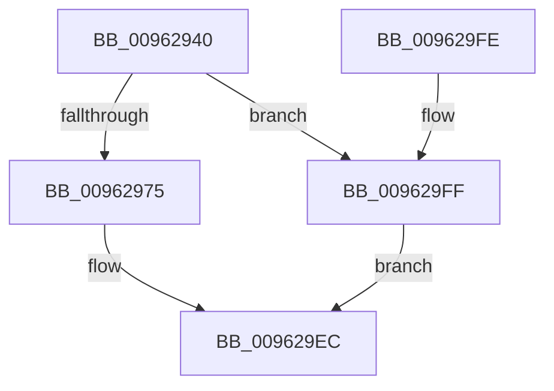

# PiAuDoesClientHaveAccess

- RVA: `0x00962940`–`0x00962A04` (길이 `196` bytes)
- VA: `0x0000000140962940`
- 실행 섹션: `PAGE`
- PDB 이름 있음: `예`; PDB Function 태그: `아니요`
- unwind 정보 RVA: `0x00093480`
- 디코드: `48`개 명령, `196/196` bytes 표시
- 미해석 바이트: `0` (있으면 어셈블리에 `.byte`로 보존)

> 이 문서는 커널 이미지의 기계어와 PDB 기호를 분석해 생성했습니다. 4번과 5번은 함수 원형과 자료형을 바이너리 사용 방식에서 추정한 C 해석이며 원본 소스 복구 결과는 아닙니다.

## 1. Dependencies

- 직접 호출 지점: **3**; 고유 호출 대상: **3**
- 직접 호출자로 확인된 함수: **23**
- RIP 상대 이미지 참조: **2**

### Outgoing calls
- `0x00962979` → [SeCaptureSubjectContext](../86/SeCaptureSubjectContext_function_0086B820.md) (function, `0x0086B820`)
- `0x009629CE` → [SeAccessCheck](../../text/3A/SeAccessCheck_function_003A6BC0.md) (function, `0x003A6BC0`)
- `0x009629DB` → [SeReleaseSubjectContext](../86/SeReleaseSubjectContext_function_0086B710.md) (function, `0x0086B710`)

### Direct callers
- [PiCMDeleteDeviceInterfaceKey](../70/PiCMDeleteDeviceInterfaceKey_function_007014E4.md) at `0x00701539`
- [PiCMCreateObject](../70/PiCMCreateObject_function_007015EC.md) at `0x00701647`
- [PiCMDeleteDevice](../70/PiCMDeleteDevice_function_007017A4.md) at `0x007017F9`
- [PiSwDispatch](../73/PiSwDispatch_function_0073AA90.md) at `0x0073ABB5`
- [PiCMValidateDeviceInstance](../8E/PiCMValidateDeviceInstance_function_008E799C.md) at `0x008E7DC3`
- [PiCMOpenClassKey](PiCMOpenClassKey_function_009617A8.md) at `0x009619C6`
- [PiCMOpenClassKey](PiCMOpenClassKey_function_009617A8.md) at `0x009619E7`
- [PiCMOpenDeviceInterfaceKey](PiCMOpenDeviceInterfaceKey_function_00961A3C.md) at `0x00961BD9`
- [PiCMOpenDeviceKey](PiCMOpenDeviceKey_function_00961C00.md) at `0x00961DB5`
- [PiCMOpenObjectKey](PiCMOpenObjectKey_function_00961E08.md) at `0x00962063`
- [PiCMSetObjectProperty](PiCMSetObjectProperty_function_00962564.md) at `0x00962629`
- [PiCMRegisterDeviceInterface](PiCMRegisterDeviceInterface_function_00962A94.md) at `0x00962B09`
- [PiCMSetRegistryProperty](PiCMSetRegistryProperty_function_00963118.md) at `0x00963187`
- [PiDqIrpPropertySet](PiDqIrpPropertySet_function_00963770.md) at `0x00963905`
- [PiDqIrpPropertySet](PiDqIrpPropertySet_function_00963770.md) at `0x00963A31`
- [PiCMDeviceAction](PiCMDeviceAction_function_0096488C.md) at `0x009649F3`
- [PiCMGetDeviceIdList](../A2/PiCMGetDeviceIdList_function_00A2BAAC.md) at `0x00A2BD20`
- [PiCMCreateDevice](../AC/PiCMCreateDevice_function_00ACB824.md) at `0x00ACB8CF`
- [PiCMQueryRemove](../AD/PiCMQueryRemove_function_00AD43F4.md) at `0x00AD4553`
- [PiCMQueryRemove](../AD/PiCMQueryRemove_function_00AD43F4.md) at `0x00AD4623`
- [PiCMQueryRemove](../AD/PiCMQueryRemove_function_00AD43F4.md) at `0x00AD4672`
- [PiCMQueryRemove](../AD/PiCMQueryRemove_function_00AD43F4.md) at `0x00AD46F3`
- [PiCMDeleteDeviceKey](../AD/PiCMDeleteDeviceKey_function_00AD6780.md) at `0x00AD67F4`
- [PiCMUnregisterDeviceInterface](../AD/PiCMUnregisterDeviceInterface_function_00AD9758.md) at `0x00AD97BA`
- [PiCMDeleteClassKey](../AD/PiCMDeleteClassKey_function_00AD9EB4.md) at `0x00AD9F0D`
- [PiCMDeleteObject](../AD/PiCMDeleteObject_function_00AD9FE4.md) at `0x00ADA03D`
- [PiCMSetDeviceProblem](../AD/PiCMSetDeviceProblem_function_00ADA9E0.md) at `0x00ADAA48`
- [sub_00B284C0](../B2/Unknown_function_00B284C0.md) at `0x00B284CE`
- [sub_00B284C0](../B2/Unknown_function_00B284C0.md) at `0x00B28603`

### Static image references
- `0x00962950` → RVA `0x00E663A8` (`.data`; read)
- `0x009629B0` → RVA `0x00012780` (`.rdata`; read)

## 2. Other-region calls and transfers

- 다른 실행 섹션으로 향하는 call: **1**
  - `0x009629CE` → [SeAccessCheck](../../text/3A/SeAccessCheck_function_003A6BC0.md) (`PAGE` → `.text`)
- 별도 외부 분기/꼬리 이동을 확인하지 못했습니다.

## 3. Assembly (complete function range)

```asm
00962940  48 8B C4                        mov rax, rsp
00962943  48 89 58 08                     mov qword ptr [rax + 8], rbx
00962947  48 89 70 20                     mov qword ptr [rax + 0x20], rsi
0096294B  57                              push rdi
0096294C  48 83 EC 70                     sub rsp, 0x70
00962950  48 8B 1D 51 3A 50 00            mov rbx, qword ptr [rip + 0x503a51]
00962957  33 F6                           xor esi, esi
00962959  89 70 18                        mov dword ptr [rax + 0x18], esi
0096295C  0F 57 C0                        xorps xmm0, xmm0
0096295F  89 70 10                        mov dword ptr [rax + 0x10], esi
00962962  8B F9                           mov edi, ecx
00962964  0F 11 40 D8                     movups xmmword ptr [rax - 0x28], xmm0
00962968  0F 11 40 E8                     movups xmmword ptr [rax - 0x18], xmm0
0096296C  48 85 DB                        test rbx, rbx
0096296F  0F 84 8A 00 00 00               je 0x1409629ff
00962975  48 8D 48 D8                     lea rcx, [rax - 0x28]
00962979  E8 A2 8E F0 FF                  call 0x14086b820
0096297E  65 48 8B 04 25 88 01 00 00      mov rax, qword ptr gs:[0x188]
00962987  44 8B CF                        mov r9d, edi
0096298A  45 33 C0                        xor r8d, r8d
0096298D  48 8B CB                        mov rcx, rbx
00962990  8A 90 32 02 00 00               mov dl, byte ptr [rax + 0x232]
00962996  48 8D 84 24 88 00 00 00         lea rax, [rsp + 0x88]
0096299E  48 89 44 24 48                  mov qword ptr [rsp + 0x48], rax
009629A3  48 8D 84 24 90 00 00 00         lea rax, [rsp + 0x90]
009629AB  48 89 44 24 40                  mov qword ptr [rsp + 0x40], rax
009629B0  48 8D 05 C9 FD 6A FF            lea rax, [rip - 0x950237]
009629B7  88 54 24 38                     mov byte ptr [rsp + 0x38], dl
009629BB  48 8D 54 24 50                  lea rdx, [rsp + 0x50]
009629C0  48 89 44 24 30                  mov qword ptr [rsp + 0x30], rax
009629C5  48 89 74 24 28                  mov qword ptr [rsp + 0x28], rsi
009629CA  89 74 24 20                     mov dword ptr [rsp + 0x20], esi
009629CE  E8 ED 41 A4 FF                  call 0x1403a6bc0
009629D3  48 8D 4C 24 50                  lea rcx, [rsp + 0x50]
009629D8  0F B6 D8                        movzx ebx, al
009629DB  E8 30 8D F0 FF                  call 0x14086b710
009629E0  39 B4 24 88 00 00 00            cmp dword ptr [rsp + 0x88], esi
009629E7  8B C3                           mov eax, ebx
009629E9  0F 4C C6                        cmovl eax, esi
009629EC  4C 8D 5C 24 70                  lea r11, [rsp + 0x70]
009629F1  49 8B 5B 10                     mov rbx, qword ptr [r11 + 0x10]
009629F5  49 8B 73 28                     mov rsi, qword ptr [r11 + 0x28]
009629F9  49 8B E3                        mov rsp, r11
009629FC  5F                              pop rdi
009629FD  C3                              ret
009629FE  CC                              int3
009629FF  40 8A C6                        mov al, sil
00962A02  EB E8                           jmp 0x1409629ec
```

## 4. C-style interpretation (structured pseudocode)

```c
__int64 __fastcall PiAuDoesClientHaveAccess(int a1, __int64 a2, int a3)
{
    __int64 result;
    __int64 v_rsi;
    __int64 v_rsp;
    unsigned __int64 v_stack_m28;
    unsigned __int64 v_stack_m30;
    unsigned __int64 v_stack_m38;
    unsigned __int8 v_stack_m40;
    unsigned __int64 v_stack_m48;
    unsigned __int64 v_stack_m50;
    unsigned int v_stack_m58;
    unsigned __int64 v_stack_m8;
    unsigned __int64 v_stack_p10;
    unsigned __int64 v_stack_p18;

    *(unsigned __int64 *)(v_rsp + 8) = v_rbx;
    *(unsigned __int64 *)(v_rsp + 32) = v_rsi;
    v_rsp = (v_rsp) - (112);
    v_rsi = 0;
    *(unsigned int *)(v_rsp + 24) = 0;
    *(unsigned int *)(v_rsp + 16) = 0;
    *(unsigned __int64 *)(v_rsp - 40) = v_xmm0;
    *(unsigned __int64 *)(v_rsp - 24) = v_xmm0;
    if (*(unsigned __int64 *)(v_rip + 5257809) == 0) goto loc_009629FF;
    result = SeCaptureSubjectContext(v_rsp - 40, a2, a3, a4);
    a3 = 0;
    v_stack_m30 = v_stack_p10;
    v_stack_m38 = v_stack_p18;
    v_stack_m40 = (unsigned __int8)(*(unsigned __int8 *)(*(unsigned __int64 *)(gs_base + (0 + 392)) + 562));
    v_stack_m48 = v_rip - 9765431;
    v_stack_m50 = 0;
    v_stack_m58 = 0;
    result = SeAccessCheck(*(unsigned __int64 *)(v_rip + 5257809), v_stack_m28, a3, (unsigned int)((unsigned int)((unsigned int)(a1))));
    result = SeReleaseSubjectContext(v_stack_m28, v_stack_m28, a3, (unsigned int)((unsigned int)((unsigned int)(a1))));
    result = (unsigned int)((unsigned int)((unsigned __int8)(result)));
    if (v_stack_p10 < 0) { result = 0; }
loc_009629EC:
    return result;
loc_009629FF:
    goto loc_009629EC;
}
```

## 5. (Beta) C Style

```c
int64_t PiAuDoesClientHaveAccess(int32_t Arg1, int64_t Arg2, int32_t Arg3)
{
    int64_t result;
    int64_t local_rsi;
    int64_t local_rsp;
    uint64_t v_stack_m28;
    uint64_t v_stack_m30;
    uint64_t v_stack_m38;
    uint8_t v_stack_m40;
    uint64_t v_stack_m48;
    uint64_t v_stack_m50;
    uint32_t v_stack_m58;
    uint64_t v_stack_m8;
    uint64_t v_stack_p10;
    uint64_t v_stack_p18;

    *(uint64_t *)(local_rsp + 0x8) = local_rbx;
    *(uint64_t *)(local_rsp + 0x20) = local_rsi;
    local_rsp = (local_rsp) - (112);
    local_rsi = 0;
    *(uint32_t *)(local_rsp + 0x18) = 0;
    *(uint32_t *)(local_rsp + 0x10) = 0;
    *(uint64_t *)(local_rsp - 0x28) = v_xmm0;
    *(uint64_t *)(local_rsp - 0x18) = v_xmm0;
    if (*(uint64_t *)(v_rip + 0x503A51) == 0) goto loc_009629FF;
    result = SeCaptureSubjectContext(local_rsp - 40, Arg2, Arg3, a4);
    Arg3 = 0;
    v_stack_m30 = v_stack_p10;
    v_stack_m38 = v_stack_p18;
    v_stack_m40 = (uint8_t)(*(uint8_t *)(*(uint64_t *)(gs_base + (0 + 0x188)) + 0x232));
    v_stack_m48 = v_rip - 9765431;
    v_stack_m50 = 0;
    v_stack_m58 = 0;
    result = SeAccessCheck(*(uint64_t *)(v_rip + 0x503A51), v_stack_m28, Arg3, (uint32_t)((uint32_t)((uint32_t)(Arg1))));
    result = SeReleaseSubjectContext(v_stack_m28, v_stack_m28, Arg3, (uint32_t)((uint32_t)((uint32_t)(Arg1))));
    result = (uint32_t)((uint32_t)((uint8_t)(result)));
    if (v_stack_p10 < 0) { result = 0; }
loc_009629EC:
    return result;
loc_009629FF:
    goto loc_009629EC;
}
```

## 6. Execution-region graph

[열기: 2D/3D 그래프와 함수 탐색 컨트롤 패널](../../../control-panel.html?section=page&rva=0x00962940&view=graph)

- 2D 그래프는 위에서 아래로 흐르고, 3D 그래프는 빈 공간을 드래그해 회전합니다. Shift+드래그는 이동, 휠은 확대·축소, 함수 노드 선택은 대상 보고서 이동입니다.

### Static fallback


