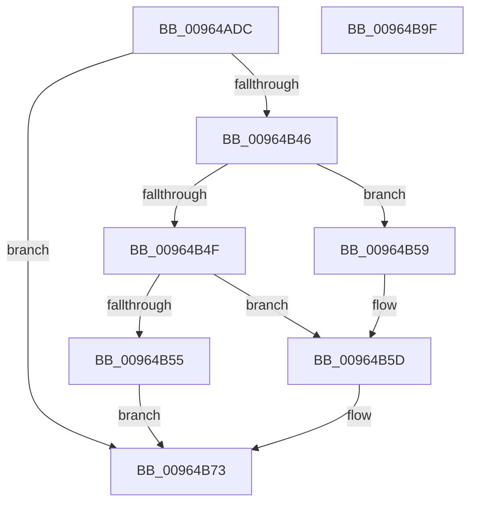

# PiAuDoesClientHavePrivilege

- RVA: `0x00964ADC`–`0x00964BA0` (길이 `196` bytes)
- VA: `0x0000000140964ADC`
- 실행 섹션: `PAGE`
- PDB 이름 있음: `예`; PDB Function 태그: `아니요`
- unwind 정보 RVA: `0x000936D0`
- 디코드: `52`개 명령, `196/196` bytes 표시
- 미해석 바이트: `0` (있으면 어셈블리에 `.byte`로 보존)

> 이 문서는 커널 이미지의 기계어와 PDB 기호를 분석해 생성했습니다. 4번과 5번은 함수 원형과 자료형을 바이너리 사용 방식에서 추정한 C 해석이며 원본 소스 복구 결과는 아닙니다.

## 1. Dependencies

- 직접 호출 지점: **4**; 고유 호출 대상: **4**
- 직접 호출자로 확인된 함수: **4**
- RIP 상대 이미지 참조: **1**

### Outgoing calls
- `0x00964B3C` → [SeCaptureSubjectContext](../86/SeCaptureSubjectContext_function_0086B820.md) (function, `0x0086B820`)
- `0x00964B6C` → [SepPrivilegeCheck](../../text/40/SepPrivilegeCheck_function_0040B6B0.md) (function, `0x0040B6B0`)
- `0x00964B77` → [SeReleaseSubjectContext](../86/SeReleaseSubjectContext_function_0086B710.md) (function, `0x0086B710`)
- `0x00964B85` → [_security_check_cookie](../../text/6A/_security_check_cookie_function_006AC640.md) (function, `0x006AC640`)

### Direct callers
- [PiCMDeviceAction](PiCMDeviceAction_function_0096488C.md) at `0x00964A05`
- [PiCMQueryRemove](../AD/PiCMQueryRemove_function_00AD43F4.md) at `0x00AD4563`
- [PiCMQueryRemove](../AD/PiCMQueryRemove_function_00AD43F4.md) at `0x00AD462F`
- [PiCMQueryRemove](../AD/PiCMQueryRemove_function_00AD43F4.md) at `0x00AD4680`
- [PiCMQueryRemove](../AD/PiCMQueryRemove_function_00AD43F4.md) at `0x00AD4705`
- [PiCMSetDeviceProblem](../AD/PiCMSetDeviceProblem_function_00ADA9E0.md) at `0x00ADAA55`
- [sub_00B284C0](../B2/Unknown_function_00B284C0.md) at `0x00B284E0`
- [sub_00B284C0](../B2/Unknown_function_00B284C0.md) at `0x00B28615`

### Static image references
- `0x00964AF1` → RVA `0x00E0A740` (`.data`; read)

## 2. Other-region calls and transfers

- 다른 실행 섹션으로 향하는 call: **2**
  - `0x00964B6C` → [SepPrivilegeCheck](../../text/40/SepPrivilegeCheck_function_0040B6B0.md) (`PAGE` → `.text`)
  - `0x00964B85` → [_security_check_cookie](../../text/6A/_security_check_cookie_function_006AC640.md) (`PAGE` → `.text`)
- 별도 외부 분기/꼬리 이동을 확인하지 못했습니다.

## 3. Assembly (complete function range)

```asm
00964ADC  48 89 5C 24 08                  mov qword ptr [rsp + 8], rbx
00964AE1  48 89 7C 24 10                  mov qword ptr [rsp + 0x10], rdi
00964AE6  55                              push rbp
00964AE7  48 8B EC                        mov rbp, rsp
00964AEA  48 81 EC 80 00 00 00            sub rsp, 0x80
00964AF1  48 8B 05 48 5C 4A 00            mov rax, qword ptr [rip + 0x4a5c48]
00964AF8  48 33 C4                        xor rax, rsp
00964AFB  48 89 45 F0                     mov qword ptr [rbp - 0x10], rax
00964AFF  65 48 8B 04 25 88 01 00 00      mov rax, qword ptr gs:[0x188]
00964B08  0F 57 C0                        xorps xmm0, xmm0
00964B0B  83 65 B4 00                     and dword ptr [rbp - 0x4c], 0
00964B0F  BB 01 00 00 00                  mov ebx, 1
00964B14  83 65 E8 00                     and dword ptr [rbp - 0x18], 0
00964B18  89 4D B0                        mov dword ptr [rbp - 0x50], ecx
00964B1B  48 8D 4D B8                     lea rcx, [rbp - 0x48]
00964B1F  40 8A B8 32 02 00 00            mov dil, byte ptr [rax + 0x232]
00964B26  48 8B 45 B0                     mov rax, qword ptr [rbp - 0x50]
00964B2A  48 89 45 E0                     mov qword ptr [rbp - 0x20], rax
00964B2E  0F 11 45 B8                     movups xmmword ptr [rbp - 0x48], xmm0
00964B32  89 5D D8                        mov dword ptr [rbp - 0x28], ebx
00964B35  0F 11 45 C8                     movups xmmword ptr [rbp - 0x38], xmm0
00964B39  89 5D DC                        mov dword ptr [rbp - 0x24], ebx
00964B3C  E8 DF 6C F0 FF                  call 0x14086b820
00964B41  40 84 FF                        test dil, dil
00964B44  74 2D                           je 0x140964b73
00964B46  48 8B 4D B8                     mov rcx, qword ptr [rbp - 0x48]
00964B4A  48 85 C9                        test rcx, rcx
00964B4D  74 0A                           je 0x140964b59
00964B4F  83 7D C0 02                     cmp dword ptr [rbp - 0x40], 2
00964B53  7D 08                           jge 0x140964b5d
00964B55  32 DB                           xor bl, bl
00964B57  EB 1A                           jmp 0x140964b73
00964B59  48 8B 4D C8                     mov rcx, qword ptr [rbp - 0x38]
00964B5D  44 8B CB                        mov r9d, ebx
00964B60  40 88 7C 24 20                  mov byte ptr [rsp + 0x20], dil
00964B65  44 8B C3                        mov r8d, ebx
00964B68  48 8D 55 E0                     lea rdx, [rbp - 0x20]
00964B6C  E8 3F 6B AA FF                  call 0x14040b6b0
00964B71  8A D8                           mov bl, al
00964B73  48 8D 4D B8                     lea rcx, [rbp - 0x48]
00964B77  E8 94 6B F0 FF                  call 0x14086b710
00964B7C  8A C3                           mov al, bl
00964B7E  48 8B 4D F0                     mov rcx, qword ptr [rbp - 0x10]
00964B82  48 33 CC                        xor rcx, rsp
00964B85  E8 B6 7A D4 FF                  call 0x1406ac640
00964B8A  4C 8D 9C 24 80 00 00 00         lea r11, [rsp + 0x80]
00964B92  49 8B 5B 10                     mov rbx, qword ptr [r11 + 0x10]
00964B96  49 8B 7B 18                     mov rdi, qword ptr [r11 + 0x18]
00964B9A  49 8B E3                        mov rsp, r11
00964B9D  5D                              pop rbp
00964B9E  C3                              ret
00964B9F  CC                              int3
```

## 4. C-style interpretation (structured pseudocode)

```c
__int64 __fastcall PiAuDoesClientHavePrivilege(int a1)
{
    __int64 result;
    __int64 v_rbx;
    __int64 v_rsp;
    unsigned __int64 v_stack_m18;
    unsigned int v_stack_m20;
    unsigned __int64 v_stack_m28;
    unsigned int v_stack_m2C;
    unsigned int v_stack_m30;
    unsigned __int64 v_stack_m40;
    unsigned int v_stack_m48;
    unsigned __int64 v_stack_m50;
    unsigned int v_stack_m54;
    unsigned int v_stack_m58;
    unsigned __int8 v_stack_m68;
    unsigned __int64 v_stack_m8;
    unsigned __int64 v_stack_p10;
    unsigned __int64 v_stack_p8;

    v_stack_p8 = v_rbx;
    v_stack_p10 = v_rdi;
    v_rsp = (v_rsp) - (128);
    result = (*(unsigned __int64 *)(v_rip + 4873288)) ^ (v_rsp);
    v_stack_m18 = result;
    v_stack_m58 = a1;
    v_stack_m28 = v_stack_m58;
    v_stack_m50 = v_xmm0;
    v_stack_m30 = 1;
    v_stack_m40 = v_xmm0;
    v_stack_m2C = 1;
    result = SeCaptureSubjectContext(v_stack_m50, a2, a3, a4);
    if ((unsigned __int8)(*(unsigned __int8 *)(*(unsigned __int64 *)(gs_base + (0 + 392)) + 562)) == 0) goto loc_00964B73;
    if (v_stack_m50 == 0) goto loc_00964B59;
    if (v_stack_m48 >= 2) goto loc_00964B5D;
    v_rbx = 0;
    goto loc_00964B73;
loc_00964B59:
loc_00964B5D:
    v_stack_m68 = (unsigned __int8)(*(unsigned __int8 *)(*(unsigned __int64 *)(gs_base + (0 + 392)) + 562));
    result = SepPrivilegeCheck(v_stack_m40, v_stack_m28, 0, 0);
loc_00964B73:
    result = SeReleaseSubjectContext(v_stack_m50, v_stack_m28, 0, 0);
    a1 = (v_stack_m18) ^ (v_rsp);
    result = _security_check_cookie(a1, v_stack_m28, 0, 0);
    return result;
}
```

## 5. (Beta) C Style

```c
int64_t PiAuDoesClientHavePrivilege(int32_t Arg1)
{
    int64_t result;
    int64_t local_rbx;
    int64_t local_rsp;
    uint64_t v_stack_m18;
    uint32_t v_stack_m20;
    uint64_t v_stack_m28;
    uint32_t v_stack_m2C;
    uint32_t v_stack_m30;
    uint64_t v_stack_m40;
    uint32_t v_stack_m48;
    uint64_t v_stack_m50;
    uint32_t v_stack_m54;
    uint32_t v_stack_m58;
    uint8_t v_stack_m68;
    uint64_t v_stack_m8;
    uint64_t v_stack_p10;
    uint64_t v_stack_p8;

    v_stack_p8 = local_rbx;
    v_stack_p10 = local_rdi;
    local_rsp = (local_rsp) - (128);
    result = (*(uint64_t *)(v_rip + 0x4A5C48)) ^ (local_rsp);
    v_stack_m18 = result;
    v_stack_m58 = Arg1;
    v_stack_m28 = v_stack_m58;
    v_stack_m50 = v_xmm0;
    v_stack_m30 = 1;
    v_stack_m40 = v_xmm0;
    v_stack_m2C = 1;
    result = SeCaptureSubjectContext(v_stack_m50, a2, a3, a4);
    if ((uint8_t)(*(uint8_t *)(*(uint64_t *)(gs_base + (0 + 0x188)) + 0x232)) == 0) goto loc_00964B73;
    if (v_stack_m50 == 0) goto loc_00964B59;
    if (v_stack_m48 >= 2) goto loc_00964B5D;
    local_rbx = 0;
    goto loc_00964B73;
loc_00964B59:
loc_00964B5D:
    v_stack_m68 = (uint8_t)(*(uint8_t *)(*(uint64_t *)(gs_base + (0 + 0x188)) + 0x232));
    result = SepPrivilegeCheck(v_stack_m40, v_stack_m28, 0, 0);
loc_00964B73:
    result = SeReleaseSubjectContext(v_stack_m50, v_stack_m28, 0, 0);
    Arg1 = (v_stack_m18) ^ (local_rsp);
    result = _security_check_cookie(Arg1, v_stack_m28, 0, 0);
    return result;
}
```

## 6. Execution-region graph

[열기: 2D/3D 그래프와 함수 탐색 컨트롤 패널](../../../control-panel.html?section=page&rva=0x00964ADC&view=graph)

- 2D 그래프는 위에서 아래로 흐르고, 3D 그래프는 빈 공간을 드래그해 회전합니다. Shift+드래그는 이동, 휠은 확대·축소, 함수 노드 선택은 대상 보고서 이동입니다.

### Static fallback


