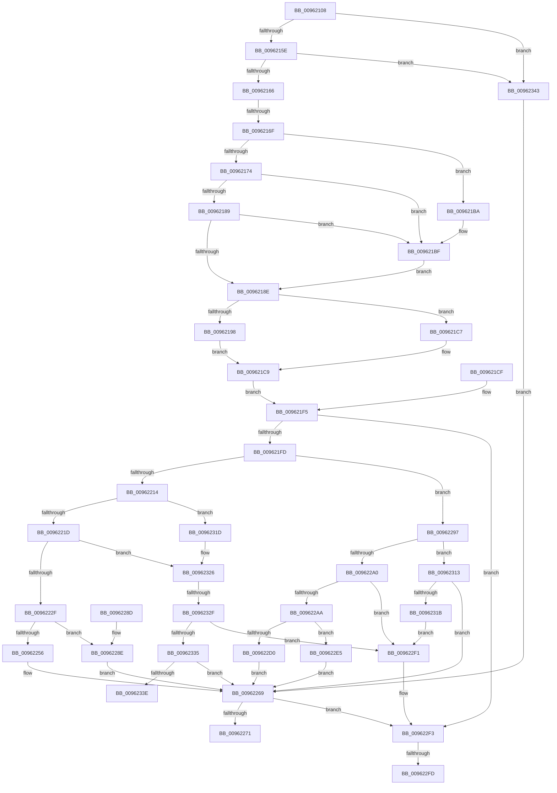

# PiCMCaptureRegistryInputData

- RVA: `0x00962108`–`0x0096234D` (길이 `581` bytes)
- VA: `0x0000000140962108`
- 실행 섹션: `PAGE`
- PDB 이름 있음: `예`; PDB Function 태그: `예`
- unwind 정보 RVA: `0x000933B0`
- 디코드: `156`개 명령, `581/581` bytes 표시
- 미해석 바이트: `0` (있으면 어셈블리에 `.byte`로 보존)

> 이 문서는 커널 이미지의 기계어와 PDB 기호를 분석해 생성했습니다. 4번과 5번은 함수 원형과 자료형을 바이너리 사용 방식에서 추정한 C 해석이며 원본 소스 복구 결과는 아닙니다.

## 1. Dependencies

- 직접 호출 지점: **5**; 고유 호출 대상: **4**
- 직접 호출자로 확인된 함수: **4**
- RIP 상대 이미지 참조: **0**

### Outgoing calls
- `0x009621BA` → [ExRaiseDatatypeMisalignment](../89/ExRaiseDatatypeMisalignment_function_00899FD0.md) (function, `0x00899FD0`)
- `0x00962207` → [Feature_KernelPnP_ObjectNameUpdates__private_IsEnabledDeviceUsageNoInline](../../text/4F/Feature_KernelPnP_ObjectNameUpdates__private_IsEnabledDeviceUsageNoInline_function_004F2E10.md) (function, `0x004F2E10`)
- `0x0096224B` → [PiControlMakeUserModeCallersCopy](../8E/PiControlMakeUserModeCallersCopy_function_008E4630.md) (function, `0x008E4630`)
- `0x009622C5` → [PiControlMakeUserModeCallersCopy](../8E/PiControlMakeUserModeCallersCopy_function_008E4630.md) (function, `0x008E4630`)
- `0x00962308` → [PiControlFreeUserModeCallersBuffer](../../text/44/PiControlFreeUserModeCallersBuffer_function_00448990.md) (function, `0x00448990`)

### Direct callers
- [PiCMOpenClassKey](PiCMOpenClassKey_function_009617A8.md) at `0x0096180F`
- [PiCMOpenDeviceInterfaceKey](PiCMOpenDeviceInterfaceKey_function_00961A3C.md) at `0x00961A9D`
- [PiCMOpenDeviceKey](PiCMOpenDeviceKey_function_00961C00.md) at `0x00961C66`
- [PiCMOpenObjectKey](PiCMOpenObjectKey_function_00961E08.md) at `0x00961E64`

### Static image references
- 디코드된 RIP-relative 메모리 참조가 없습니다.

## 2. Other-region calls and transfers

- 다른 실행 섹션으로 향하는 call: **2**
  - `0x00962207` → [Feature_KernelPnP_ObjectNameUpdates__private_IsEnabledDeviceUsageNoInline](../../text/4F/Feature_KernelPnP_ObjectNameUpdates__private_IsEnabledDeviceUsageNoInline_function_004F2E10.md) (`PAGE` → `.text`)
  - `0x00962308` → [PiControlFreeUserModeCallersBuffer](../../text/44/PiControlFreeUserModeCallersBuffer_function_00448990.md) (`PAGE` → `.text`)
- call이 아닌 외부 분기/꼬리 이동: **5**
  - `0x00962169` → [sub_00B27F7C](../B2/Unknown_function_00B27F7C.md) (`tail-transfer`)
  - `0x009622F7` → [sub_00B27F7C + 0xC0](../B2/Unknown_function_00B27F7C.md) (`tail-transfer`)
  - `0x0096230E` → [sub_00B27F7C + 0xC0](../B2/Unknown_function_00B27F7C.md) (`tail-transfer`)
  - `0x00962329` → [sub_00B27F7C + 0xB0](../B2/Unknown_function_00B27F7C.md) (`tail-transfer`)
  - `0x0096233E` → [sub_00B27F7C + 0xB0](../B2/Unknown_function_00B27F7C.md) (`tail-transfer`)

## 3. Assembly (complete function range)

```asm
00962108  48 89 5C 24 10                  mov qword ptr [rsp + 0x10], rbx
0096210D  48 89 74 24 18                  mov qword ptr [rsp + 0x18], rsi
00962112  4C 89 4C 24 20                  mov qword ptr [rsp + 0x20], r9
00962117  57                              push rdi
00962118  41 54                           push r12
0096211A  41 55                           push r13
0096211C  41 56                           push r14
0096211E  41 57                           push r15
00962120  48 83 EC 50                     sub rsp, 0x50
00962124  4D 8B F1                        mov r14, r9
00962127  4C 89 4C 24 40                  mov qword ptr [rsp + 0x40], r9
0096212C  33 FF                           xor edi, edi
0096212E  89 7C 24 38                     mov dword ptr [rsp + 0x38], edi
00962132  65 48 8B 04 25 88 01 00 00      mov rax, qword ptr gs:[0x188]
0096213B  44 8A A0 32 02 00 00            mov r12b, byte ptr [rax + 0x232]
00962142  44 88 A4 24 80 00 00 00         mov byte ptr [rsp + 0x80], r12b
0096214A  44 88 64 24 30                  mov byte ptr [rsp + 0x30], r12b
0096214F  8B DF                           mov ebx, edi
00962151  89 5C 24 34                     mov dword ptr [rsp + 0x34], ebx
00962155  48 85 C9                        test rcx, rcx
00962158  0F 84 E5 01 00 00               je 0x140962343
0096215E  85 D2                           test edx, edx
00962160  0F 84 DD 01 00 00               je 0x140962343
00962166  45 85 C0                        test r8d, r8d
00962169  0F 85 0D 5E 1C 00               jne 0x140b27f7c
0096216F  F6 C1 07                        test cl, 7
00962172  75 46                           jne 0x1409621ba
00962174  44 8B C2                        mov r8d, edx
00962177  4C 03 C1                        add r8, rcx
0096217A  48 B8 00 00 FF FF FF 7F 00 00   movabs rax, 0x7fffffff0000
00962184  4C 3B C0                        cmp r8, rax
00962187  77 36                           ja 0x1409621bf
00962189  4C 3B C1                        cmp r8, rcx
0096218C  72 31                           jb 0x1409621bf
0096218E  BE 0D 00 00 C0                  mov esi, 0xc000000d
00962193  83 FA 30                        cmp edx, 0x30
00962196  72 2F                           jb 0x1409621c7
00962198  0F 10 01                        movups xmm0, xmmword ptr [rcx]
0096219B  41 0F 11 01                     movups xmmword ptr [r9], xmm0
0096219F  0F 10 49 10                     movups xmm1, xmmword ptr [rcx + 0x10]
009621A3  41 0F 11 49 10                  movups xmmword ptr [r9 + 0x10], xmm1
009621A8  0F 10 41 20                     movups xmm0, xmmword ptr [rcx + 0x20]
009621AC  41 0F 11 41 20                  movups xmmword ptr [r9 + 0x20], xmm0
009621B1  41 83 39 30                     cmp dword ptr [r9], 0x30
009621B5  0F 45 DE                        cmovne ebx, esi
009621B8  EB 0F                           jmp 0x1409621c9
009621BA  E8 11 7E F3 FF                  call 0x140899fd0
009621BF  8A 00                           mov al, byte ptr [rax]
009621C1  8B 5C 24 34                     mov ebx, dword ptr [rsp + 0x34]
009621C5  EB C7                           jmp 0x14096218e
009621C7  8B DE                           mov ebx, esi
009621C9  89 5C 24 34                     mov dword ptr [rsp + 0x34], ebx
009621CD  EB 26                           jmp 0x1409621f5
009621CF  8B D8                           mov ebx, eax
009621D1  89 44 24 34                     mov dword ptr [rsp + 0x34], eax
009621D5  33 FF                           xor edi, edi
009621D7  BE 0D 00 00 C0                  mov esi, 0xc000000d
009621DC  4C 8B B4 24 98 00 00 00         mov r14, qword ptr [rsp + 0x98]
009621E4  89 7C 24 38                     mov dword ptr [rsp + 0x38], edi
009621E8  44 8A 64 24 30                  mov r12b, byte ptr [rsp + 0x30]
009621ED  44 88 A4 24 80 00 00 00         mov byte ptr [rsp + 0x80], r12b
009621F5  85 DB                           test ebx, ebx
009621F7  0F 88 F6 00 00 00               js 0x1409622f3
009621FD  4D 8D 7E 10                     lea r15, [r14 + 0x10]
00962201  4D 8B 2F                        mov r13, qword ptr [r15]
00962204  49 89 3F                        mov qword ptr [r15], rdi
00962207  E8 04 0C B9 FF                  call 0x1404f2e10
0096220C  85 C0                           test eax, eax
0096220E  0F 85 83 00 00 00               jne 0x140962297
00962214  4D 85 ED                        test r13, r13
00962217  0F 84 00 01 00 00               je 0x14096231d
0096221D  4D 8D 66 18                     lea r12, [r14 + 0x18]
00962221  45 8B 04 24                     mov r8d, dword ptr [r12]
00962225  41 83 F8 02                     cmp r8d, 2
00962229  0F 82 F7 00 00 00               jb 0x140962326
0096222F  8D 70 01                        lea esi, [rax + 1]
00962232  89 74 24 28                     mov dword ptr [rsp + 0x28], esi
00962236  8A 84 24 80 00 00 00            mov al, byte ptr [rsp + 0x80]
0096223D  88 44 24 20                     mov byte ptr [rsp + 0x20], al
00962241  44 8D 4E 01                     lea r9d, [rsi + 1]
00962245  49 8B D5                        mov rdx, r13
00962248  49 8B CF                        mov rcx, r15
0096224B  E8 E0 23 F8 FF                  call 0x1408e4630
00962250  8B D8                           mov ebx, eax
00962252  85 C0                           test eax, eax
00962254  78 38                           js 0x14096228e
00962256  89 74 24 38                     mov dword ptr [rsp + 0x38], esi
0096225A  41 8B 0C 24                     mov ecx, dword ptr [r12]
0096225E  48 D1 E9                        shr rcx, 1
00962261  49 8B 07                        mov rax, qword ptr [r15]
00962264  66 89 7C 48 FE                  mov word ptr [rax + rcx*2 - 2], di
00962269  85 DB                           test ebx, ebx
0096226B  0F 88 82 00 00 00               js 0x1409622f3
00962271  8B C3                           mov eax, ebx
00962273  4C 8D 5C 24 50                  lea r11, [rsp + 0x50]
00962278  49 8B 5B 38                     mov rbx, qword ptr [r11 + 0x38]
0096227C  49 8B 73 40                     mov rsi, qword ptr [r11 + 0x40]
00962280  49 8B E3                        mov rsp, r11
00962283  41 5F                           pop r15
00962285  41 5E                           pop r14
00962287  41 5D                           pop r13
00962289  41 5C                           pop r12
0096228B  5F                              pop rdi
0096228C  C3                              ret
0096228D  CC                              int3
0096228E  49 89 3F                        mov qword ptr [r15], rdi
00962291  41 89 3C 24                     mov dword ptr [r12], edi
00962295  EB D2                           jmp 0x140962269
00962297  41 8B 4E 18                     mov ecx, dword ptr [r14 + 0x18]
0096229B  4D 85 ED                        test r13, r13
0096229E  74 73                           je 0x140962313
009622A0  8D 41 FE                        lea eax, [rcx - 2]
009622A3  3D FD FF 00 00                  cmp eax, 0xfffd
009622A8  77 47                           ja 0x1409622f1
009622AA  BE 01 00 00 00                  mov esi, 1
009622AF  89 74 24 28                     mov dword ptr [rsp + 0x28], esi
009622B3  44 88 64 24 20                  mov byte ptr [rsp + 0x20], r12b
009622B8  44 8D 4E 01                     lea r9d, [rsi + 1]
009622BC  44 8B C1                        mov r8d, ecx
009622BF  49 8B D5                        mov rdx, r13
009622C2  49 8B CF                        mov rcx, r15
009622C5  E8 66 23 F8 FF                  call 0x1408e4630
009622CA  8B D8                           mov ebx, eax
009622CC  85 C0                           test eax, eax
009622CE  78 15                           js 0x1409622e5
009622D0  89 74 24 38                     mov dword ptr [rsp + 0x38], esi
009622D4  41 8B 56 18                     mov edx, dword ptr [r14 + 0x18]
009622D8  48 D1 EA                        shr rdx, 1
009622DB  49 8B 0F                        mov rcx, qword ptr [r15]
009622DE  66 89 7C 51 FE                  mov word ptr [rcx + rdx*2 - 2], di
009622E3  EB 84                           jmp 0x140962269
009622E5  49 89 3F                        mov qword ptr [r15], rdi
009622E8  41 89 7E 18                     mov dword ptr [r14 + 0x18], edi
009622EC  E9 78 FF FF FF                  jmp 0x140962269
009622F1  8B DE                           mov ebx, esi
009622F3  39 7C 24 38                     cmp dword ptr [rsp + 0x38], edi
009622F7  0F 84 3F 5D 1C 00               je 0x140b2803c
009622FD  49 8B 56 10                     mov rdx, qword ptr [r14 + 0x10]
00962301  8A 8C 24 80 00 00 00            mov cl, byte ptr [rsp + 0x80]
00962308  E8 83 66 AE FF                  call 0x140448990
0096230D  90                              nop
0096230E  E9 29 5D 1C 00                  jmp 0x140b2803c
00962313  85 C9                           test ecx, ecx
00962315  0F 84 4E FF FF FF               je 0x140962269
0096231B  EB D4                           jmp 0x1409622f1
0096231D  4C 8B 64 24 40                  mov r12, qword ptr [rsp + 0x40]
00962322  49 83 C4 18                     add r12, 0x18
00962326  4D 85 ED                        test r13, r13
00962329  0F 85 FD 5C 1C 00               jne 0x140b2802c
0096232F  41 39 3C 24                     cmp dword ptr [r12], edi
00962333  77 BC                           ja 0x1409622f1
00962335  4D 85 ED                        test r13, r13
00962338  0F 84 2B FF FF FF               je 0x140962269
0096233E  E9 E9 5C 1C 00                  jmp 0x140b2802c
00962343  BB 0D 00 00 C0                  mov ebx, 0xc000000d
00962348  E9 1C FF FF FF                  jmp 0x140962269
```

## 4. C-style interpretation (structured pseudocode)

```c
__int64 __fastcall PiCMCaptureRegistryInputData(__int64 a1, int a2, int a3, __int64 a4)
{
    __int64 result;
    __int64 v_r12;
    __int64 v_rbx;
    __int64 v_rdi;
    __int64 v_rsp;
    unsigned __int64 v_stack_m10;
    unsigned int v_stack_m18;
    unsigned __int64 v_stack_m28;
    unsigned __int8 v_stack_m30;
    unsigned __int64 v_stack_m38;
    unsigned int v_stack_m40;
    unsigned int v_stack_m44;
    unsigned __int8 v_stack_m48;
    unsigned int v_stack_m50;
    unsigned __int8 v_stack_m58;
    unsigned __int64 v_stack_p10;
    unsigned __int64 v_stack_p18;
    unsigned __int64 v_stack_p20;
    unsigned __int8 v_stack_p30;
    unsigned __int8 v_stack_p8;

    v_stack_p10 = v_rbx;
    v_stack_p18 = v_rsi;
    v_stack_p20 = a4;
    v_rsp = (v_rsp) - (80);
    v_stack_m38 = a4;
    v_rdi = 0;
    v_stack_m40 = 0;
    v_stack_p8 = (unsigned __int8)(*(unsigned __int8 *)(*(unsigned __int64 *)(gs_base + (0 + 392)) + 562));
    v_stack_m48 = (unsigned __int8)(*(unsigned __int8 *)(*(unsigned __int64 *)(gs_base + (0 + 392)) + 562));
    v_stack_m44 = 0;
    if (a1 == 0) goto loc_00962343;
    if (a2 == 0) goto loc_00962343;
    if ((((unsigned __int8)(a1)) & (7)) != 0) goto loc_009621BA;
    a3 = ((unsigned int)(a2)) + (a1);
    if (a3 > (*(unsigned __int64 *)(gs_base + (0 + 392)))) goto loc_009621BF;
    if (a3 < a1) goto loc_009621BF;
loc_0096218E:
    if (a2 < 48) goto loc_009621C7;
    *(unsigned __int64 *)(a4) = v_xmm0;
    *(unsigned __int64 *)(a4 + 16) = v_xmm1;
    *(unsigned __int64 *)(a4 + 32) = v_xmm0;
    v_rbx = 0;
    if ((*(unsigned int *)(a4)) != 48) { v_rbx = (unsigned int)((unsigned int)(0xC000000DULL)); }
    goto loc_009621C9;
loc_009621BA:
    result = ExRaiseDatatypeMisalignment(a1, a2, a3, a4);
loc_009621BF:
    goto loc_0096218E;
loc_009621C7:
loc_009621C9:
    v_stack_m44 = (unsigned int)((unsigned int)((unsigned int)((unsigned int)(0xC000000DULL))));
    goto loc_009621F5;
loc_009621F5:
    if (sign_flag) goto loc_009622F3;
    *(unsigned __int64 *)(a4 + 16) = 0;
    result = Feature_KernelPnP_ObjectNameUpdates__private_IsEnabledDeviceUsageNoInline(a1, a2, a3, a4);
    if ((unsigned int)(result) != 0) goto loc_00962297;
    if (*(unsigned __int64 *)(a4 + 16) == 0) goto loc_0096231D;
    if (((unsigned int)((unsigned int)(*(unsigned int *)(a4 + 24)))) < 2) goto loc_00962326;
    v_stack_m50 = (unsigned int)(result + 1);
    v_stack_m58 = (unsigned __int8)(v_stack_p8);
    result = PiControlMakeUserModeCallersCopy(a4 + 16, *(unsigned __int64 *)(a4 + 16), (unsigned int)(*(unsigned int *)(a4 + 24)), result + 1 + 1);
    if (sign_flag) goto loc_0096228E;
    v_stack_m40 = (unsigned int)(result + 1);
    a1 = ((unsigned int)(*(unsigned int *)(a4 + 24))) >> (1);
    *(unsigned __int16 *)(*(unsigned __int64 *)(a4 + 16) + a1 * 2 - 2) = 0;
loc_00962269:
    if (sign_flag) goto loc_009622F3;
    return (unsigned int)((unsigned int)((unsigned int)((unsigned int)(result))));
loc_0096228E:
    *(unsigned __int64 *)(a4 + 16) = 0;
    *(unsigned int *)(a4 + 24) = 0;
    goto loc_00962269;
loc_00962297:
    if (*(unsigned __int64 *)(a4 + 16) == 0) goto loc_00962313;
    if (((unsigned int)((unsigned int)(*(unsigned int *)(a4 + 24)) - 2)) > 0xFFFDULL) goto loc_009622F1;
    v_stack_m28 = 1;
    v_stack_m30 = (unsigned __int8)(a4 + 24);
    result = PiControlMakeUserModeCallersCopy(a4 + 16, *(unsigned __int64 *)(a4 + 16), (unsigned int)((unsigned int)((unsigned int)(*(unsigned int *)(a4 + 24)))), 1 + 1);
    if (sign_flag) goto loc_009622E5;
    v_stack_m18 = 1;
    a2 = ((unsigned int)(*(unsigned int *)(a4 + 24))) >> (1);
    *(unsigned __int16 *)(*(unsigned __int64 *)(a4 + 16) + a2 * 2 - 2) = 0;
    goto loc_00962269;
loc_009622E5:
    *(unsigned __int64 *)(a4 + 16) = 0;
    *(unsigned int *)(a4 + 24) = 0;
    goto loc_00962269;
loc_009622F1:
loc_009622F3:
    result = PiControlFreeUserModeCallersBuffer(v_stack_p30, *(unsigned __int64 *)(a4 + 16), (unsigned int)((unsigned int)((unsigned int)(*(unsigned int *)(a4 + 24)))), 1 + 1);
loc_00962313:
    if ((unsigned int)(v_stack_p30) == 0) goto loc_00962269;
    goto loc_009622F1;
loc_0096231D:
    v_r12 = (v_stack_m10) + (24);
loc_00962326:
    if ((*(unsigned int *)(v_r12)) > 0) goto loc_009622F1;
    if (*(unsigned __int64 *)(a4 + 16) == 0) goto loc_00962269;
loc_00962343:
    goto loc_00962269;
}
```

## 5. (Beta) C Style

```c
int64_t PiCMCaptureRegistryInputData(int64_t Arg1, int32_t Arg2, int32_t Arg3, void *Arg4)
{
    uint8_t *arg4 = (uint8_t *)Arg4;

    int64_t result;
    int64_t local_r12;
    int64_t local_rbx;
    int64_t local_rdi;
    int64_t local_rsp;
    uint64_t v_stack_m10;
    uint32_t v_stack_m18;
    uint64_t v_stack_m28;
    uint8_t v_stack_m30;
    uint64_t v_stack_m38;
    uint32_t v_stack_m40;
    uint32_t v_stack_m44;
    uint8_t v_stack_m48;
    uint32_t v_stack_m50;
    uint8_t v_stack_m58;
    uint64_t v_stack_p10;
    uint64_t v_stack_p18;
    uint64_t v_stack_p20;
    uint8_t v_stack_p30;
    uint8_t v_stack_p8;

    v_stack_p10 = local_rbx;
    v_stack_p18 = local_rsi;
    v_stack_p20 = Arg4;
    local_rsp = (local_rsp) - (80);
    v_stack_m38 = Arg4;
    local_rdi = 0;
    v_stack_m40 = 0;
    v_stack_p8 = (uint8_t)(*(uint8_t *)(*(uint64_t *)(gs_base + (0 + 0x188)) + 0x232));
    v_stack_m48 = (uint8_t)(*(uint8_t *)(*(uint64_t *)(gs_base + (0 + 0x188)) + 0x232));
    v_stack_m44 = 0;
    if (Arg1 == 0) goto loc_00962343;
    if (Arg2 == 0) goto loc_00962343;
    if ((((uint8_t)(Arg1)) & (7)) != 0) goto loc_009621BA;
    Arg3 = ((uint32_t)(Arg2)) + (Arg1);
    if (Arg3 > (*(uint64_t *)(gs_base + (0 + 0x188)))) goto loc_009621BF;
    if (Arg3 < Arg1) goto loc_009621BF;
loc_0096218E:
    if (Arg2 < 48) goto loc_009621C7;
    *(uint64_t *)(arg4) = v_xmm0;
    *(uint64_t *)(arg4 + 0x10) = v_xmm1;
    *(uint64_t *)(arg4 + 0x20) = v_xmm0;
    local_rbx = 0;
    if ((*(uint32_t *)(arg4)) != 48) { local_rbx = (uint32_t)((uint32_t)(0xC000000DULL)); }
    goto loc_009621C9;
loc_009621BA:
    result = ExRaiseDatatypeMisalignment(Arg1, Arg2, Arg3, Arg4);
loc_009621BF:
    goto loc_0096218E;
loc_009621C7:
loc_009621C9:
    v_stack_m44 = (uint32_t)((uint32_t)((uint32_t)((uint32_t)(0xC000000DULL))));
    goto loc_009621F5;
loc_009621F5:
    if (sign_flag) goto loc_009622F3;
    *(uint64_t *)(arg4 + 0x10) = 0;
    result = Feature_KernelPnP_ObjectNameUpdates__private_IsEnabledDeviceUsageNoInline(Arg1, Arg2, Arg3, Arg4);
    if ((uint32_t)(result) != 0) goto loc_00962297;
    if (*(uint64_t *)(arg4 + 0x10) == 0) goto loc_0096231D;
    if (((uint32_t)((uint32_t)(*(uint32_t *)(arg4 + 0x18)))) < 2) goto loc_00962326;
    v_stack_m50 = (uint32_t)(result + 1);
    v_stack_m58 = (uint8_t)(v_stack_p8);
    result = PiControlMakeUserModeCallersCopy(Arg4 + 16, *(uint64_t *)(arg4 + 0x10), (uint32_t)(*(uint32_t *)(arg4 + 0x18)), result + 1 + 1);
    if (sign_flag) goto loc_0096228E;
    v_stack_m40 = (uint32_t)(result + 1);
    Arg1 = ((uint32_t)(*(uint32_t *)(arg4 + 0x18))) >> (1);
    *(uint16_t *)(*(uint64_t *)(arg4 + 0x10) + Arg1 * 2 - 0x2) = 0;
loc_00962269:
    if (sign_flag) goto loc_009622F3;
    return (uint32_t)((uint32_t)((uint32_t)((uint32_t)(result))));
loc_0096228E:
    *(uint64_t *)(arg4 + 0x10) = 0;
    *(uint32_t *)(arg4 + 0x18) = 0;
    goto loc_00962269;
loc_00962297:
    if (*(uint64_t *)(arg4 + 0x10) == 0) goto loc_00962313;
    if (((uint32_t)((uint32_t)(*(uint32_t *)(arg4 + 0x18)) - 2)) > 0xFFFDULL) goto loc_009622F1;
    v_stack_m28 = 1;
    v_stack_m30 = (uint8_t)(Arg4 + 24);
    result = PiControlMakeUserModeCallersCopy(Arg4 + 16, *(uint64_t *)(arg4 + 0x10), (uint32_t)((uint32_t)((uint32_t)(*(uint32_t *)(arg4 + 0x18)))), 1 + 1);
    if (sign_flag) goto loc_009622E5;
    v_stack_m18 = 1;
    Arg2 = ((uint32_t)(*(uint32_t *)(arg4 + 0x18))) >> (1);
    *(uint16_t *)(*(uint64_t *)(arg4 + 0x10) + Arg2 * 2 - 0x2) = 0;
    goto loc_00962269;
loc_009622E5:
    *(uint64_t *)(arg4 + 0x10) = 0;
    *(uint32_t *)(arg4 + 0x18) = 0;
    goto loc_00962269;
loc_009622F1:
loc_009622F3:
    result = PiControlFreeUserModeCallersBuffer(v_stack_p30, *(uint64_t *)(arg4 + 0x10), (uint32_t)((uint32_t)((uint32_t)(*(uint32_t *)(arg4 + 0x18)))), 1 + 1);
loc_00962313:
    if ((uint32_t)(v_stack_p30) == 0) goto loc_00962269;
    goto loc_009622F1;
loc_0096231D:
    local_r12 = (v_stack_m10) + (24);
loc_00962326:
    if ((*(uint32_t *)(local_r12)) > 0) goto loc_009622F1;
    if (*(uint64_t *)(arg4 + 0x10) == 0) goto loc_00962269;
loc_00962343:
    goto loc_00962269;
}
```

### 관측된 메모리 오프셋

구조체 형식이 확인되지 않은 접근은 인자 기준의 오프셋으로만 기록했습니다.

| 기준 인자 | 오프셋 표현 | 폭 (bit) | 접근 |
|---|---:|---:|---|
| `Arg4` | `+ 0x0` | `32` | `R` |
| `Arg4` | `+ 0x0` | `32` | `W` |
| `Arg4` | `+ 0x0` | `64` | `R` |
| `Arg4` | `+ 0x0` | `64` | `W` |
| `Arg4` | `+ 0x10` | `64` | `R` |
| `Arg4` | `+ 0x18` | `32` | `R` |
| `Arg4` | `+ 0x18` | `32` | `W` |
| `Arg4` | `+ 0x18` | `64` | `R` |

## 6. Execution-region graph

[열기: 2D/3D 그래프와 함수 탐색 컨트롤 패널](../../../control-panel.html?section=page&rva=0x00962108&view=graph)

- 2D 그래프는 위에서 아래로 흐르고, 3D 그래프는 빈 공간을 드래그해 회전합니다. Shift+드래그는 이동, 휠은 확대·축소, 함수 노드 선택은 대상 보고서 이동입니다.

### Static fallback


