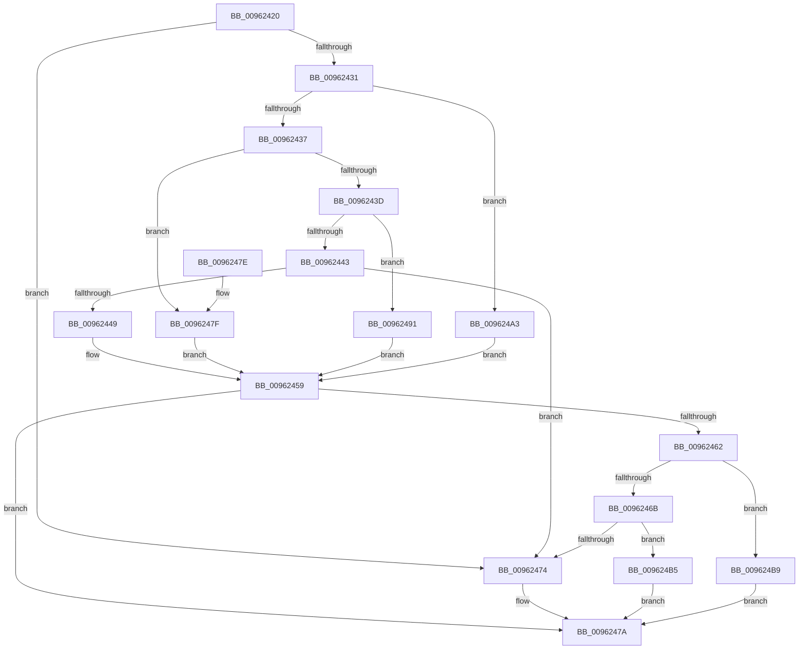

# PiCMConvertDeviceKeyType

- RVA: `0x00962420`–`0x009624BD` (길이 `157` bytes)
- VA: `0x0000000140962420`
- 실행 섹션: `PAGE`
- PDB 이름 있음: `예`; PDB Function 태그: `아니요`
- unwind 정보 RVA: `0x000DB714`
- 디코드: `43`개 명령, `157/157` bytes 표시
- 미해석 바이트: `0` (있으면 어셈블리에 `.byte`로 보존)

> 이 문서는 커널 이미지의 기계어와 PDB 기호를 분석해 생성했습니다. 4번과 5번은 함수 원형과 자료형을 바이너리 사용 방식에서 추정한 C 해석이며 원본 소스 복구 결과는 아닙니다.

## 1. Dependencies

- 직접 호출 지점: **0**; 고유 호출 대상: **0**
- 직접 호출자로 확인된 함수: **2**
- RIP 상대 이미지 참조: **0**

### Outgoing calls
- 직접 디코드된 call 명령이 없습니다.

### Direct callers
- [PiCMOpenDeviceKey](PiCMOpenDeviceKey_function_00961C00.md) at `0x00961CA3`
- [PiCMDeleteDeviceKey](../AD/PiCMDeleteDeviceKey_function_00AD6780.md) at `0x00AD683A`

### Static image references
- 디코드된 RIP-relative 메모리 참조가 없습니다.

## 2. Other-region calls and transfers

- 다른 실행 섹션으로 향하는 call: **0**
- 별도 외부 분기/꼬리 이동을 확인하지 못했습니다.

## 3. Assembly (complete function range)

```asm
00962420  45 33 C9                        xor r9d, r9d
00962423  44 0F B6 C1                     movzx r8d, cl
00962427  44 89 0A                        mov dword ptr [rdx], r9d
0096242A  44 8B D1                        mov r10d, ecx
0096242D  84 C9                           test cl, cl
0096242F  74 43                           je 0x140962474
00962431  41 83 E8 11                     sub r8d, 0x11
00962435  74 6C                           je 0x1409624a3
00962437  41 83 E8 01                     sub r8d, 1
0096243B  74 42                           je 0x14096247f
0096243D  41 83 E8 01                     sub r8d, 1
00962441  74 4E                           je 0x140962491
00962443  41 83 F8 01                     cmp r8d, 1
00962447  75 2B                           jne 0x140962474
00962449  C7 02 14 00 00 00               mov dword ptr [rdx], 0x14
0096244F  B9 14 02 00 00                  mov ecx, 0x214
00962454  B8 14 01 00 00                  mov eax, 0x114
00962459  41 81 E2 00 FF 00 00            and r10d, 0xff00
00962460  74 18                           je 0x14096247a
00962462  41 81 FA 00 01 00 00            cmp r10d, 0x100
00962469  74 4E                           je 0x1409624b9
0096246B  41 81 FA 00 02 00 00            cmp r10d, 0x200
00962472  74 41                           je 0x1409624b5
00962474  41 B9 0D 00 00 C0               mov r9d, 0xc000000d
0096247A  41 8B C1                        mov eax, r9d
0096247D  C3                              ret
0096247E  CC                              int3
0096247F  C7 02 12 00 00 00               mov dword ptr [rdx], 0x12
00962485  B9 12 02 00 00                  mov ecx, 0x212
0096248A  B8 12 01 00 00                  mov eax, 0x112
0096248F  EB C8                           jmp 0x140962459
00962491  C7 02 13 00 00 00               mov dword ptr [rdx], 0x13
00962497  B9 13 02 00 00                  mov ecx, 0x213
0096249C  B8 13 01 00 00                  mov eax, 0x113
009624A1  EB B6                           jmp 0x140962459
009624A3  C7 02 11 00 00 00               mov dword ptr [rdx], 0x11
009624A9  B9 11 02 00 00                  mov ecx, 0x211
009624AE  B8 11 01 00 00                  mov eax, 0x111
009624B3  EB A4                           jmp 0x140962459
009624B5  89 0A                           mov dword ptr [rdx], ecx
009624B7  EB C1                           jmp 0x14096247a
009624B9  89 02                           mov dword ptr [rdx], eax
009624BB  EB BD                           jmp 0x14096247a
```

## 4. C-style interpretation (structured pseudocode)

```c
__int64 __fastcall PiCMConvertDeviceKeyType(int a1, __int64 a2, __int64 a3, int a4)
{
    __int64 v_r10;

    a4 = 0;
    *(unsigned int *)(a2) = 0;
    if ((unsigned __int8)(a1) == 0) goto loc_00962474;
    a3 = (unsigned int)(((unsigned __int8)(a1)) - (17));
    if (condition_is_equal) goto loc_009624A3;
    a3 = (unsigned int)((a3) - (1));
    if (condition_is_equal) goto loc_0096247F;
    a3 = (unsigned int)((a3) - (1));
    if (condition_is_equal) goto loc_00962491;
    if (((unsigned int)(a3)) != 1) goto loc_00962474;
    *(unsigned int *)(a2) = 20;
loc_00962459:
    v_r10 = (unsigned int)(((unsigned int)(a1)) & (0xFF00ULL));
    if (condition_is_equal) goto loc_0096247A;
    if (((unsigned int)(v_r10)) == 256) goto loc_009624B9;
    if (((unsigned int)(v_r10)) == 512) goto loc_009624B5;
loc_00962474:
loc_0096247A:
    return (unsigned int)((unsigned int)((unsigned int)(0xC000000DULL)));
loc_0096247F:
    *(unsigned int *)(a2) = 18;
    goto loc_00962459;
loc_00962491:
    *(unsigned int *)(a2) = 19;
    goto loc_00962459;
loc_009624A3:
    *(unsigned int *)(a2) = 17;
    goto loc_00962459;
loc_009624B5:
    *(unsigned int *)(a2) = 529;
    goto loc_0096247A;
loc_009624B9:
    *(unsigned int *)(a2) = 273;
    goto loc_0096247A;
}
```

## 5. (Beta) C Style

```c
int64_t PiCMConvertDeviceKeyType(int32_t Arg1, void *Arg2, int64_t Arg3, int32_t Arg4)
{
    uint8_t *arg2 = (uint8_t *)Arg2;

    int64_t local_r10;

    Arg4 = 0;
    *(uint32_t *)(arg2) = 0;
    if ((uint8_t)(Arg1) == 0) goto loc_00962474;
    Arg3 = (uint32_t)(((uint8_t)(Arg1)) - (17));
    if (condition_is_equal) goto loc_009624A3;
    Arg3 = (uint32_t)((Arg3) - (1));
    if (condition_is_equal) goto loc_0096247F;
    Arg3 = (uint32_t)((Arg3) - (1));
    if (condition_is_equal) goto loc_00962491;
    if (((uint32_t)(Arg3)) != 1) goto loc_00962474;
    *(uint32_t *)(arg2) = 20;
loc_00962459:
    local_r10 = (uint32_t)(((uint32_t)(Arg1)) & (0xFF00ULL));
    if (condition_is_equal) goto loc_0096247A;
    if (((uint32_t)(local_r10)) == 256) goto loc_009624B9;
    if (((uint32_t)(local_r10)) == 512) goto loc_009624B5;
loc_00962474:
loc_0096247A:
    return (uint32_t)((uint32_t)((uint32_t)(0xC000000DULL)));
loc_0096247F:
    *(uint32_t *)(arg2) = 18;
    goto loc_00962459;
loc_00962491:
    *(uint32_t *)(arg2) = 19;
    goto loc_00962459;
loc_009624A3:
    *(uint32_t *)(arg2) = 17;
    goto loc_00962459;
loc_009624B5:
    *(uint32_t *)(arg2) = 529;
    goto loc_0096247A;
loc_009624B9:
    *(uint32_t *)(arg2) = 273;
    goto loc_0096247A;
}
```

### 관측된 메모리 오프셋

구조체 형식이 확인되지 않은 접근은 인자 기준의 오프셋으로만 기록했습니다.

| 기준 인자 | 오프셋 표현 | 폭 (bit) | 접근 |
|---|---:|---:|---|
| `Arg2` | `+ 0x0` | `32` | `W` |

## 6. Execution-region graph

[열기: 2D/3D 그래프와 함수 탐색 컨트롤 패널](../../../control-panel.html?section=page&rva=0x00962420&view=graph)

- 2D 그래프는 위에서 아래로 흐르고, 3D 그래프는 빈 공간을 드래그해 회전합니다. Shift+드래그는 이동, 휠은 확대·축소, 함수 노드 선택은 대상 보고서 이동입니다.

### Static fallback


