# PiCMConvertRegistryProperty

- RVA: `0x009632F0`–`0x00963560` (길이 `624` bytes)
- VA: `0x00000001409632F0`
- 실행 섹션: `PAGE`
- PDB 이름 있음: `예`; PDB Function 태그: `아니요`
- unwind 정보 RVA: `0x000DB714`
- 디코드: `214`개 명령, `624/624` bytes 표시
- 미해석 바이트: `2` (있으면 어셈블리에 `.byte`로 보존)

> 이 문서는 커널 이미지의 기계어와 PDB 기호를 분석해 생성했습니다. 4번과 5번은 함수 원형과 자료형을 바이너리 사용 방식에서 추정한 C 해석이며 원본 소스 복구 결과는 아닙니다.

## 1. Dependencies

- 직접 호출 지점: **0**; 고유 호출 대상: **0**
- 직접 호출자로 확인된 함수: **1**
- RIP 상대 이미지 참조: **2**

### Outgoing calls
- 직접 디코드된 call 명령이 없습니다.

### Direct callers
- [PiCMSetRegistryProperty](PiCMSetRegistryProperty_function_00963118.md) at `0x009631C3`

### Static image references
- `0x0096330E` → RVA `0x00000000` (`image boundary/outside`; read)
- `0x00963543` → RVA `0x-6E693483` (`image boundary/outside`; read/write)

## 2. Other-region calls and transfers

- 다른 실행 섹션으로 향하는 call: **0**
- 별도 외부 분기/꼬리 이동을 확인하지 못했습니다.

## 3. Assembly (complete function range)

```asm
009632F0  45 33 C0                        xor r8d, r8d
009632F3  83 F9 02                        cmp ecx, 2
009632F6  74 39                           je 0x140963331
009632F8  83 F9 09                        cmp ecx, 9
009632FB  74 3F                           je 0x14096333c
009632FD  83 F9 0A                        cmp ecx, 0xa
00963300  74 45                           je 0x140963347
00963302  83 F9 25                        cmp ecx, 0x25
00963305  0F 87 B2 01 00 00               ja 0x1409634bd
0096330B  48 63 C1                        movsxd rax, ecx
0096330E  4C 8D 0D EB CC 69 FF            lea r9, [rip - 0x963315]
00963315  41 8B 8C 81 C8 34 96 00         mov ecx, dword ptr [r9 + rax*4 + 0x9634c8]
0096331D  49 03 C9                        add rcx, r9
00963320  FF E1                           jmp rcx
00963322  CC                              int3
00963323  CC                              int3
00963324  CC                              int3
00963325  CC                              int3
00963326  C7 02 05 00 00 00               mov dword ptr [rdx], 5
0096332C  41 8B C0                        mov eax, r8d
0096332F  C3                              ret
00963330  CC                              int3
00963331  C7 02 02 00 00 00               mov dword ptr [rdx], 2
00963337  41 8B C0                        mov eax, r8d
0096333A  C3                              ret
0096333B  CC                              int3
0096333C  C7 02 09 00 00 00               mov dword ptr [rdx], 9
00963342  41 8B C0                        mov eax, r8d
00963345  C3                              ret
00963346  CC                              int3
00963347  C7 02 0A 00 00 00               mov dword ptr [rdx], 0xa
0096334D  41 8B C0                        mov eax, r8d
00963350  C3                              ret
00963351  CC                              int3
00963352  C7 02 01 00 00 00               mov dword ptr [rdx], 1
00963358  41 8B C0                        mov eax, r8d
0096335B  C3                              ret
0096335C  CC                              int3
0096335D  C7 02 03 00 00 00               mov dword ptr [rdx], 3
00963363  41 8B C0                        mov eax, r8d
00963366  C3                              ret
00963367  CC                              int3
00963368  C7 02 0D 00 00 00               mov dword ptr [rdx], 0xd
0096336E  41 8B C0                        mov eax, r8d
00963371  C3                              ret
00963372  CC                              int3
00963373  C7 02 0F 00 00 00               mov dword ptr [rdx], 0xf
00963379  41 8B C0                        mov eax, r8d
0096337C  C3                              ret
0096337D  CC                              int3
0096337E  C7 02 13 00 00 00               mov dword ptr [rdx], 0x13
00963384  41 8B C0                        mov eax, r8d
00963387  C3                              ret
00963388  CC                              int3
00963389  C7 02 08 00 00 00               mov dword ptr [rdx], 8
0096338F  41 8B C0                        mov eax, r8d
00963392  C3                              ret
00963393  CC                              int3
00963394  C7 02 0C 00 00 00               mov dword ptr [rdx], 0xc
0096339A  41 8B C0                        mov eax, r8d
0096339D  C3                              ret
0096339E  CC                              int3
0096339F  C7 02 12 00 00 00               mov dword ptr [rdx], 0x12
009633A5  41 8B C0                        mov eax, r8d
009633A8  C3                              ret
009633A9  CC                              int3
009633AA  C7 02 16 00 00 00               mov dword ptr [rdx], 0x16
009633B0  41 8B C0                        mov eax, r8d
009633B3  C3                              ret
009633B4  CC                              int3
009633B5  C7 02 0E 00 00 00               mov dword ptr [rdx], 0xe
009633BB  41 8B C0                        mov eax, r8d
009633BE  C3                              ret
009633BF  CC                              int3
009633C0  C7 02 15 00 00 00               mov dword ptr [rdx], 0x15
009633C6  41 8B C0                        mov eax, r8d
009633C9  C3                              ret
009633CA  CC                              int3
009633CB  C7 02 0B 00 00 00               mov dword ptr [rdx], 0xb
009633D1  41 8B C0                        mov eax, r8d
009633D4  C3                              ret
009633D5  CC                              int3
009633D6  C7 02 1D 00 00 00               mov dword ptr [rdx], 0x1d
009633DC  41 8B C0                        mov eax, r8d
009633DF  C3                              ret
009633E0  CC                              int3
009633E1  C7 02 17 00 00 00               mov dword ptr [rdx], 0x17
009633E7  41 8B C0                        mov eax, r8d
009633EA  C3                              ret
009633EB  CC                              int3
009633EC  C7 02 10 00 00 00               mov dword ptr [rdx], 0x10
009633F2  41 8B C0                        mov eax, r8d
009633F5  C3                              ret
009633F6  CC                              int3
009633F7  C7 02 23 00 00 00               mov dword ptr [rdx], 0x23
009633FD  41 8B C0                        mov eax, r8d
00963400  C3                              ret
00963401  CC                              int3
00963402  C7 02 07 00 00 00               mov dword ptr [rdx], 7
00963408  41 8B C0                        mov eax, r8d
0096340B  C3                              ret
0096340C  CC                              int3
0096340D  C7 02 1F 00 00 00               mov dword ptr [rdx], 0x1f
00963413  41 8B C0                        mov eax, r8d
00963416  C3                              ret
00963417  CC                              int3
00963418  C7 02 14 00 00 00               mov dword ptr [rdx], 0x14
0096341E  41 8B C0                        mov eax, r8d
00963421  C3                              ret
00963422  CC                              int3
00963423  C7 02 04 00 00 00               mov dword ptr [rdx], 4
00963429  41 8B C0                        mov eax, r8d
0096342C  C3                              ret
0096342D  CC                              int3
0096342E  C7 02 24 00 00 00               mov dword ptr [rdx], 0x24
00963434  41 8B C0                        mov eax, r8d
00963437  C3                              ret
00963438  CC                              int3
00963439  C7 02 1A 00 00 00               mov dword ptr [rdx], 0x1a
0096343F  41 8B C0                        mov eax, r8d
00963442  C3                              ret
00963443  CC                              int3
00963444  C7 02 06 00 00 00               mov dword ptr [rdx], 6
0096344A  41 8B C0                        mov eax, r8d
0096344D  C3                              ret
0096344E  CC                              int3
0096344F  C7 02 11 00 00 00               mov dword ptr [rdx], 0x11
00963455  41 8B C0                        mov eax, r8d
00963458  C3                              ret
00963459  CC                              int3
0096345A  C7 02 18 00 00 00               mov dword ptr [rdx], 0x18
00963460  41 8B C0                        mov eax, r8d
00963463  C3                              ret
00963464  CC                              int3
00963465  C7 02 19 00 00 00               mov dword ptr [rdx], 0x19
0096346B  41 8B C0                        mov eax, r8d
0096346E  C3                              ret
0096346F  CC                              int3
00963470  C7 02 1B 00 00 00               mov dword ptr [rdx], 0x1b
00963476  41 8B C0                        mov eax, r8d
00963479  C3                              ret
0096347A  CC                              int3
0096347B  C7 02 1C 00 00 00               mov dword ptr [rdx], 0x1c
00963481  41 8B C0                        mov eax, r8d
00963484  C3                              ret
00963485  CC                              int3
00963486  C7 02 1E 00 00 00               mov dword ptr [rdx], 0x1e
0096348C  41 8B C0                        mov eax, r8d
0096348F  C3                              ret
00963490  CC                              int3
00963491  C7 02 20 00 00 00               mov dword ptr [rdx], 0x20
00963497  41 8B C0                        mov eax, r8d
0096349A  C3                              ret
0096349B  CC                              int3
0096349C  C7 02 21 00 00 00               mov dword ptr [rdx], 0x21
009634A2  41 8B C0                        mov eax, r8d
009634A5  C3                              ret
009634A6  CC                              int3
009634A7  C7 02 22 00 00 00               mov dword ptr [rdx], 0x22
009634AD  41 8B C0                        mov eax, r8d
009634B0  C3                              ret
009634B1  CC                              int3
009634B2  C7 02 25 00 00 00               mov dword ptr [rdx], 0x25
009634B8  41 8B C0                        mov eax, r8d
009634BB  C3                              ret
009634BC  CC                              int3
009634BD  41 B8 0D 00 00 C0               mov r8d, 0xc000000d
009634C3  E9 6F FE FF FF                  jmp 0x140963337
009634C8  BD 34 96 00 52                  mov ebp, 0x52009634
009634CD  33 96 00 BD 34 96               xor edx, dword ptr [rsi - 0x69cb4300]
009634D3  00 5D 33                        add byte ptr [rbp + 0x33], bl
009634D6  96                              xchg esi, eax
009634D7  00 23                           add byte ptr [rbx], ah
009634D9  34 96                           xor al, 0x96
009634DB  00 26                           add byte ptr [rsi], ah
009634DD  33 96 00 44 34 96               xor edx, dword ptr [rsi - 0x69cbbc00]
009634E3  00 02                           add byte ptr [rdx], al
009634E5  34 96                           xor al, 0x96
009634E7  00 89 33 96 00 BD               add byte ptr [rcx - 0x42ff69cd], cl
009634ED  34 96                           xor al, 0x96
009634EF  00 BD 34 96 00 CB               add byte ptr [rbp - 0x34ff69cc], bh
009634F5  33 96 00 94 33 96               xor edx, dword ptr [rsi - 0x69cc6c00]
009634FB  00 68 33                        add byte ptr [rax + 0x33], ch
009634FE  96                              xchg esi, eax
009634FF  00 B5 33 96 00 73               add byte ptr [rbp + 0x73009633], dh
00963505  33 96 00 EC 33 96               xor edx, dword ptr [rsi - 0x69cc1400]
0096350B  00 4F 34                        add byte ptr [rdi + 0x34], cl
0096350E  96                              xchg esi, eax
0096350F  00 9F 33 96 00 7E               add byte ptr [rdi + 0x7e009633], bl
00963515  33 96 00 18 34 96               xor edx, dword ptr [rsi - 0x69cbe800]
0096351B  00 C0                           add al, al
0096351D  33 96 00 AA 33 96               xor edx, dword ptr [rsi - 0x69cc5600]
00963523  00 E1                           add cl, ah
00963525  33 96 00 5A 34 96               xor edx, dword ptr [rsi - 0x69cba600]
0096352B  00 65 34                        add byte ptr [rbp + 0x34], ah
0096352E  96                              xchg esi, eax
0096352F  00 39                           add byte ptr [rcx], bh
00963531  34 96                           xor al, 0x96
00963533  00 70 34                        add byte ptr [rax + 0x34], dh
00963536  96                              xchg esi, eax
00963537  00 7B 34                        add byte ptr [rbx + 0x34], bh
0096353A  96                              xchg esi, eax
0096353B  00 D6                           add dh, dl
0096353D  33 96 00 86 34 96               xor edx, dword ptr [rsi - 0x69cb7a00]
00963543  00 0D 34 96 00 91               add byte ptr [rip - 0x6eff69cc], cl
00963549  34 96                           xor al, 0x96
0096354B  00 9C 34 96 00 A7 34            add byte ptr [rsp + rsi + 0x34a70096], bl
00963552  96                              xchg esi, eax
00963553  00 F7                           add bh, dh
00963555  33 96 00 2E 34 96               xor edx, dword ptr [rsi - 0x69cbd200]
0096355B  00                              .byte 0x00
0096355C  B2 34                           mov dl, 0x34
0096355E  96                              xchg esi, eax
0096355F  00                              .byte 0x00
```

## 4. C-style interpretation (structured pseudocode)

```c
__int64 __fastcall PiCMConvertRegistryProperty(int a1, __int64 a2, int a3)
{
    a3 = 0;
    if (a1 == 2) goto loc_00963331;
    if (a1 == 9) goto loc_0096333C;
    if (a1 == 10) goto loc_00963347;
    if (a1 > 37) goto loc_009634BD;
    a1 = ((unsigned int)(*(unsigned int *)(v_rip - 9843477 + (int)(a1) * 4 + 9843912))) + (v_rip - 9843477);
loc_00963331:
    *(unsigned int *)(a2) = 2;
loc_00963337:
    return 0;
loc_0096333C:
    *(unsigned int *)(a2) = 9;
    return 0;
loc_00963347:
    *(unsigned int *)(a2) = 10;
    return 0;
loc_009634BD:
    goto loc_00963337;
}
```

## 5. (Beta) C Style

```c
int64_t PiCMConvertRegistryProperty(int32_t Arg1, void *Arg2, int32_t Arg3)
{
    uint8_t *arg2 = (uint8_t *)Arg2;

    Arg3 = 0;
    if (Arg1 == 2) goto loc_00963331;
    if (Arg1 == 9) goto loc_0096333C;
    if (Arg1 == 10) goto loc_00963347;
    if (Arg1 > 37) goto loc_009634BD;
    Arg1 = ((uint32_t)(*(uint32_t *)(v_rip - 0x963315 + (int32_t)(Arg1) * 4 + 0x9634C8))) + (v_rip - 9843477);
loc_00963331:
    *(uint32_t *)(arg2) = 2;
loc_00963337:
    return 0;
loc_0096333C:
    *(uint32_t *)(arg2) = 9;
    return 0;
loc_00963347:
    *(uint32_t *)(arg2) = 10;
    return 0;
loc_009634BD:
    goto loc_00963337;
}
```

### 관측된 메모리 오프셋

구조체 형식이 확인되지 않은 접근은 인자 기준의 오프셋으로만 기록했습니다.

| 기준 인자 | 오프셋 표현 | 폭 (bit) | 접근 |
|---|---:|---:|---|
| `Arg2` | `+ 0x0` | `32` | `W` |

## 6. Execution-region graph

[열기: 2D/3D 그래프와 함수 탐색 컨트롤 패널](../../../control-panel.html?section=page&rva=0x009632F0&view=graph)

- 2D 그래프는 위에서 아래로 흐르고, 3D 그래프는 빈 공간을 드래그해 회전합니다. Shift+드래그는 이동, 휠은 확대·축소, 함수 노드 선택은 대상 보고서 이동입니다.

### Static fallback

```mermaid
flowchart TD
  bb_009632F0[BB_009632F0]
  bb_009632F8[BB_009632F8]
  bb_009632FD[BB_009632FD]
  bb_00963302[BB_00963302]
  bb_0096330B[BB_0096330B]
  bb_00963322[BB_00963322]
  bb_00963330[BB_00963330]
  bb_00963331[BB_00963331]
  bb_00963337[BB_00963337]
  bb_0096333B[BB_0096333B]
  bb_0096333C[BB_0096333C]
  bb_00963346[BB_00963346]
  bb_00963347[BB_00963347]
  bb_00963351[BB_00963351]
  bb_0096335C[BB_0096335C]
  bb_00963367[BB_00963367]
  bb_00963372[BB_00963372]
  bb_0096337D[BB_0096337D]
  bb_00963388[BB_00963388]
  bb_00963393[BB_00963393]
  bb_0096339E[BB_0096339E]
  bb_009633A9[BB_009633A9]
  bb_009633B4[BB_009633B4]
  bb_009633BF[BB_009633BF]
  bb_009633CA[BB_009633CA]
  bb_009633D5[BB_009633D5]
  bb_009633E0[BB_009633E0]
  bb_009633EB[BB_009633EB]
  bb_009633F6[BB_009633F6]
  bb_00963401[BB_00963401]
  bb_0096340C[BB_0096340C]
  bb_00963417[BB_00963417]
  bb_00963422[BB_00963422]
  bb_0096342D[BB_0096342D]
  bb_00963438[BB_00963438]
  bb_00963443[BB_00963443]
  bb_0096344E[BB_0096344E]
  bb_00963459[BB_00963459]
  bb_00963464[BB_00963464]
  bb_0096346F[BB_0096346F]
  bb_0096347A[BB_0096347A]
  bb_00963485[BB_00963485]
  bb_00963490[BB_00963490]
  bb_0096349B[BB_0096349B]
  bb_009634A6[BB_009634A6]
  bb_009634B1[BB_009634B1]
  bb_009634BC[BB_009634BC]
  bb_009634BD[BB_009634BD]
  bb_009634C8[BB_009634C8]
  bb_009632F0 -->|branch| bb_00963331
  bb_009632F0 -->|fallthrough| bb_009632F8
  bb_009632F8 -->|branch| bb_0096333C
  bb_009632F8 -->|fallthrough| bb_009632FD
  bb_009632FD -->|branch| bb_00963347
  bb_009632FD -->|fallthrough| bb_00963302
  bb_00963302 -->|branch| bb_009634BD
  bb_00963302 -->|fallthrough| bb_0096330B
  bb_00963330 -->|flow| bb_00963331
  bb_00963331 -->|flow| bb_00963337
  bb_0096333B -->|flow| bb_0096333C
  bb_00963346 -->|flow| bb_00963347
  bb_009634BC -->|flow| bb_009634BD
  bb_009634BD -->|branch| bb_00963337
```


