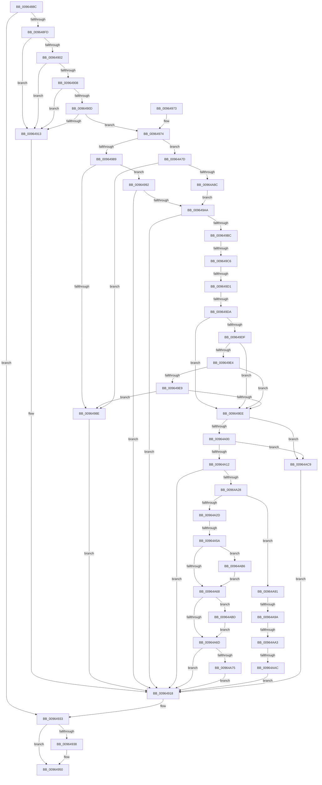

# PiCMDeviceAction

- RVA: `0x0096488C`–`0x00964AD3` (길이 `583` bytes)
- VA: `0x000000014096488C`
- 실행 섹션: `PAGE`
- PDB 이름 있음: `예`; PDB Function 태그: `예`
- unwind 정보 RVA: `0x0009369C`
- 디코드: `166`개 명령, `583/583` bytes 표시
- 미해석 바이트: `0` (있으면 어셈블리에 `.byte`로 보존)

> 이 문서는 커널 이미지의 기계어와 PDB 기호를 분석해 생성했습니다. 4번과 5번은 함수 원형과 자료형을 바이너리 사용 방식에서 추정한 C 해석이며 원본 소스 복구 결과는 아닙니다.

## 1. Dependencies

- 직접 호출 지점: **10**; 고유 호출 대상: **10**
- 직접 호출자로 확인된 함수: **1**
- RIP 상대 이미지 참조: **0**

### Outgoing calls
- `0x009648EE` → [PiCMCaptureObjectInputData](../8E/PiCMCaptureObjectInputData_function_008E8220.md) (function, `0x008E8220`)
- `0x0096492C` → [PiCMReturnBasicResultData](../8E/PiCMReturnBasicResultData_function_008E86E8.md) (function, `0x008E86E8`)
- `0x0096494B` → [PiControlFreeUserModeCallersBuffer](../../text/44/PiControlFreeUserModeCallersBuffer_function_00448990.md) (function, `0x00448990`)
- `0x009649AD` → [CmValidateDeviceName](../8F/CmValidateDeviceName_function_008F3CF0.md) (function, `0x008F3CF0`)
- `0x009649F3` → [PiAuDoesClientHaveAccess](PiAuDoesClientHaveAccess_function_00962940.md) (function, `0x00962940`)
- `0x00964A05` → [PiAuDoesClientHavePrivilege](PiAuDoesClientHavePrivilege_function_00964ADC.md) (function, `0x00964ADC`)
- `0x00964A19` → [RtlInitUnicodeStringEx](../../text/46/RtlInitUnicodeStringEx_function_00463960.md) (function, `0x00463960`)
- `0x00964A49` → [PnpDeviceObjectFromDeviceInstanceWithTag](../8E/PnpDeviceObjectFromDeviceInstanceWithTag_function_008E7490.md) (function, `0x008E7490`)
- `0x00964AB6` → [PnpDeleteDeviceActionRequest](../95/PnpDeleteDeviceActionRequest_function_00955284.md) (function, `0x00955284`)
- `0x00964AC2` → [ObfDereferenceObjectWithTag](../../text/2F/ObfDereferenceObjectWithTag_function_002F78E0.md) (function, `0x002F78E0`)

### Direct callers
- [PiCMHandleIoctl](../8E/PiCMHandleIoctl_function_008EB880.md) at `0x008EC2AD`

### Static image references
- 디코드된 RIP-relative 메모리 참조가 없습니다.

## 2. Other-region calls and transfers

- 다른 실행 섹션으로 향하는 call: **3**
  - `0x0096494B` → [PiControlFreeUserModeCallersBuffer](../../text/44/PiControlFreeUserModeCallersBuffer_function_00448990.md) (`PAGE` → `.text`)
  - `0x00964A19` → [RtlInitUnicodeStringEx](../../text/46/RtlInitUnicodeStringEx_function_00463960.md) (`PAGE` → `.text`)
  - `0x00964AC2` → [ObfDereferenceObjectWithTag](../../text/2F/ObfDereferenceObjectWithTag_function_002F78E0.md) (`PAGE` → `.text`)
- call이 아닌 외부 분기/꼬리 이동: **7**
  - `0x009649C0` → [sub_00B284C0](../B2/Unknown_function_00B284C0.md) (`tail-transfer`)
  - `0x009649CB` → [sub_00B284C0 + 0x13E](../B2/Unknown_function_00B284C0.md) (`tail-transfer`)
  - `0x009649D4` → [sub_00B284C0 + 0x13E](../B2/Unknown_function_00B284C0.md) (`tail-transfer`)
  - `0x00964A54` → [sub_00B284C0 + 0x85](../B2/Unknown_function_00B284C0.md) (`tail-transfer`)
  - `0x00964A94` → [sub_00B284C0 + 0x66](../B2/Unknown_function_00B284C0.md) (`tail-transfer`)
  - `0x00964A9D` → [sub_00B284C0 + 0x5F](../B2/Unknown_function_00B284C0.md) (`tail-transfer`)
  - `0x00964AA6` → [sub_00B284C0 + 0x58](../B2/Unknown_function_00B284C0.md) (`tail-transfer`)

## 3. Assembly (complete function range)

```asm
0096488C  48 8B C4                        mov rax, rsp
0096488F  48 89 58 08                     mov qword ptr [rax + 8], rbx
00964893  48 89 70 10                     mov qword ptr [rax + 0x10], rsi
00964897  48 89 78 18                     mov qword ptr [rax + 0x18], rdi
0096489B  55                              push rbp
0096489C  41 54                           push r12
0096489E  41 55                           push r13
009648A0  41 56                           push r14
009648A2  41 57                           push r15
009648A4  48 8D 68 B1                     lea rbp, [rax - 0x4f]
009648A8  48 81 EC B0 00 00 00            sub rsp, 0xb0
009648AF  83 65 BB 00                     and dword ptr [rbp - 0x45], 0
009648B3  33 C0                           xor eax, eax
009648B5  21 45 B7                        and dword ptr [rbp - 0x49], eax
009648B8  0F 57 C9                        xorps xmm1, xmm1
009648BB  83 65 DB 00                     and dword ptr [rbp - 0x25], 0
009648BF  45 8B E9                        mov r13d, r9d
009648C2  83 65 D7 00                     and dword ptr [rbp - 0x29], 0
009648C6  4C 8D 4D DF                     lea r9, [rbp - 0x21]
009648CA  48 89 45 FF                     mov qword ptr [rbp - 1], rax
009648CE  4D 8B E0                        mov r12, r8
009648D1  48 8B 45 7F                     mov rax, qword ptr [rbp + 0x7f]
009648D5  0F 57 C0                        xorps xmm0, xmm0
009648D8  44 8B 45 77                     mov r8d, dword ptr [rbp + 0x77]
009648DC  45 33 FF                        xor r15d, r15d
009648DF  0F 11 45 C7                     movups xmmword ptr [rbp - 0x39], xmm0
009648E3  83 20 00                        and dword ptr [rax], 0
009648E6  0F 11 4D DF                     movups xmmword ptr [rbp - 0x21], xmm1
009648EA  0F 11 4D EF                     movups xmmword ptr [rbp - 0x11], xmm1
009648EE  E8 2D 39 F8 FF                  call 0x1408e8220
009648F3  4C 8B 75 EF                     mov r14, qword ptr [rbp - 0x11]
009648F7  8B D8                           mov ebx, eax
009648F9  85 C0                           test eax, eax
009648FB  78 36                           js 0x140964933
009648FD  4D 85 F6                        test r14, r14
00964900  74 11                           je 0x140964913
00964902  83 7D E7 01                     cmp dword ptr [rbp - 0x19], 1
00964906  75 0B                           jne 0x140964913
00964908  4D 85 E4                        test r12, r12
0096490B  74 06                           je 0x140964913
0096490D  41 83 FD 08                     cmp r13d, 8
00964911  73 61                           jae 0x140964974
00964913  BB 0D 00 00 C0                  mov ebx, 0xc000000d
00964918  48 8B 45 7F                     mov rax, qword ptr [rbp + 0x7f]
0096491C  45 8B CD                        mov r9d, r13d
0096491F  8B 55 FF                        mov edx, dword ptr [rbp - 1]
00964922  4D 8B C4                        mov r8, r12
00964925  8B CB                           mov ecx, ebx
00964927  48 89 44 24 20                  mov qword ptr [rsp + 0x20], rax
0096492C  E8 B7 3D F8 FF                  call 0x1408e86e8
00964931  8B D8                           mov ebx, eax
00964933  4D 85 F6                        test r14, r14
00964936  74 18                           je 0x140964950
00964938  65 48 8B 0C 25 88 01 00 00      mov rcx, qword ptr gs:[0x188]
00964941  48 8B 55 EF                     mov rdx, qword ptr [rbp - 0x11]
00964945  8A 89 32 02 00 00               mov cl, byte ptr [rcx + 0x232]
0096494B  E8 40 40 AE FF                  call 0x140448990
00964950  4C 8D 9C 24 B0 00 00 00         lea r11, [rsp + 0xb0]
00964958  8B C3                           mov eax, ebx
0096495A  49 8B 5B 30                     mov rbx, qword ptr [r11 + 0x30]
0096495E  49 8B 73 38                     mov rsi, qword ptr [r11 + 0x38]
00964962  49 8B 7B 40                     mov rdi, qword ptr [r11 + 0x40]
00964966  49 8B E3                        mov rsp, r11
00964969  41 5F                           pop r15
0096496B  41 5E                           pop r14
0096496D  41 5D                           pop r13
0096496F  41 5C                           pop r12
00964971  5D                              pop rbp
00964972  C3                              ret
00964973  CC                              int3
00964974  44 8B 55 FB                     mov r10d, dword ptr [rbp - 5]
00964978  BF 0D 00 00 C0                  mov edi, 0xc000000d
0096497D  41 8B CA                        mov ecx, r10d
00964980  83 E9 01                        sub ecx, 1
00964983  0F 84 F4 00 00 00               je 0x140964a7d
00964989  83 F9 01                        cmp ecx, 1
0096498C  74 04                           je 0x140964992
0096498E  8B DF                           mov ebx, edi
00964990  EB 86                           jmp 0x140964918
00964992  44 8B 7D E3                     mov r15d, dword ptr [rbp - 0x1d]
00964996  41 8D 47 FF                     lea eax, [r15 - 1]
0096499A  83 F8 01                        cmp eax, 1
0096499D  0F 47 DF                        cmova ebx, edi
009649A0  33 F6                           xor esi, esi
009649A2  85 DB                           test ebx, ebx
009649A4  0F 88 6E FF FF FF               js 0x140964918
009649AA  49 8B D6                        mov rdx, r14
009649AD  E8 3E F3 F8 FF                  call 0x1408f3cf0
009649B2  8B D8                           mov ebx, eax
009649B4  85 C0                           test eax, eax
009649B6  0F 88 5C FF FF FF               js 0x140964918
009649BC  41 83 EA 01                     sub r10d, 1
009649C0  0F 85 FA 3A 1C 00               jne 0x140b284c0
009649C6  8B CE                           mov ecx, esi
009649C8  83 E9 01                        sub ecx, 1
009649CB  0F 84 2D 3C 1C 00               je 0x140b285fe
009649D1  83 E9 01                        sub ecx, 1
009649D4  0F 84 24 3C 1C 00               je 0x140b285fe
009649DA  83 E9 01                        sub ecx, 1
009649DD  74 0F                           je 0x1409649ee
009649DF  83 E9 01                        sub ecx, 1
009649E2  74 0A                           je 0x1409649ee
009649E4  83 E9 01                        sub ecx, 1
009649E7  74 05                           je 0x1409649ee
009649E9  83 F9 01                        cmp ecx, 1
009649EC  75 A0                           jne 0x14096498e
009649EE  B9 02 00 00 00                  mov ecx, 2
009649F3  E8 48 DF FF FF                  call 0x140962940
009649F8  84 C0                           test al, al
009649FA  0F 84 C9 00 00 00               je 0x140964ac9
00964A00  B9 0A 00 00 00                  mov ecx, 0xa
00964A05  E8 D2 00 00 00                  call 0x140964adc
00964A0A  84 C0                           test al, al
00964A0C  0F 84 B7 00 00 00               je 0x140964ac9
00964A12  49 8B D6                        mov rdx, r14
00964A15  48 8D 4D C7                     lea rcx, [rbp - 0x39]
00964A19  E8 42 EF AF FF                  call 0x140463960
00964A1E  8B D8                           mov ebx, eax
00964A20  85 C0                           test eax, eax
00964A22  0F 88 F0 FE FF FF               js 0x140964918
00964A28  83 EE 03                        sub esi, 3
00964A2B  75 64                           jne 0x140964a91
00964A2D  33 C0                           xor eax, eax
00964A2F  48 8D 4D C7                     lea rcx, [rbp - 0x39]
00964A33  48 21 45 BF                     and qword ptr [rbp - 0x41], rax
00964A37  0F 57 C0                        xorps xmm0, xmm0
00964A3A  BE 50 6E 70 43                  mov esi, 0x43706e50
00964A3F  48 89 45 17                     mov qword ptr [rbp + 0x17], rax
00964A43  8B D6                           mov edx, esi
00964A45  0F 11 45 07                     movups xmmword ptr [rbp + 7], xmm0
00964A49  E8 42 2A F8 FF                  call 0x1408e7490
00964A4E  48 8B F8                        mov rdi, rax
00964A51  48 85 C0                        test rax, rax
00964A54  0F 85 EB 3A 1C 00               jne 0x140b28545
00964A5A  BB 0E 00 00 C0                  mov ebx, 0xc000000e
00964A5F  48 8B 4D BF                     mov rcx, qword ptr [rbp - 0x41]
00964A63  48 85 C9                        test rcx, rcx
00964A66  75 4E                           jne 0x140964ab6
00964A68  48 85 FF                        test rdi, rdi
00964A6B  75 50                           jne 0x140964abd
00964A6D  85 DB                           test ebx, ebx
00964A6F  0F 88 A3 FE FF FF               js 0x140964918
00964A75  8B 5D B7                        mov ebx, dword ptr [rbp - 0x49]
00964A78  E9 9B FE FF FF                  jmp 0x140964918
00964A7D  8B 75 E3                        mov esi, dword ptr [rbp - 0x1d]
00964A80  8D 46 FF                        lea eax, [rsi - 1]
00964A83  83 F8 05                        cmp eax, 5
00964A86  0F 87 02 FF FF FF               ja 0x14096498e
00964A8C  E9 19 FF FF FF                  jmp 0x1409649aa
00964A91  83 EE 01                        sub esi, 1
00964A94  0F 84 8C 3A 1C 00               je 0x140b28526
00964A9A  83 EE 01                        sub esi, 1
00964A9D  0F 84 7C 3A 1C 00               je 0x140b2851f
00964AA3  83 FE 01                        cmp esi, 1
00964AA6  0F 84 6C 3A 1C 00               je 0x140b28518
00964AAC  8B DF                           mov ebx, edi
00964AAE  89 7D B7                        mov dword ptr [rbp - 0x49], edi
00964AB1  E9 62 FE FF FF                  jmp 0x140964918
00964AB6  E8 C9 07 FF FF                  call 0x140955284
00964ABB  EB AB                           jmp 0x140964a68
00964ABD  8B D6                           mov edx, esi
00964ABF  48 8B CF                        mov rcx, rdi
00964AC2  E8 19 2E 99 FF                  call 0x1402f78e0
00964AC7  EB A4                           jmp 0x140964a6d
00964AC9  BB 22 00 00 C0                  mov ebx, 0xc0000022
00964ACE  E9 45 FE FF FF                  jmp 0x140964918
```

## 4. C-style interpretation (structured pseudocode)

```c
__int64 __fastcall PiCMDeviceAction(__int64 a1, __int64 a2, __int64 a3, int a4)
{
    __int64 result;
    __int64 v_r10;
    __int64 v_r15;
    __int64 v_rbx;
    __int64 v_rsi;
    __int64 v_rsp;
    unsigned __int64 v_stack_m28;
    unsigned __int64 v_stack_mB8;

    *(unsigned __int64 *)(v_rsp + 8) = v_rbx;
    *(unsigned __int64 *)(v_rsp + 16) = v_rsi;
    *(unsigned __int64 *)(v_rsp + 24) = v_rdi;
    v_rsp = (v_rsp) - (176);
    result = 0;
    *(unsigned __int64 *)(v_rsp - 79 - 1) = 0;
    v_r15 = 0;
    *(unsigned __int64 *)(v_rsp - 79 - 57) = v_xmm0;
    *(unsigned __int64 *)(v_rsp - 79 - 33) = v_xmm1;
    *(unsigned __int64 *)(v_rsp - 79 - 17) = v_xmm1;
    result = PiCMCaptureObjectInputData(a1, a2, (unsigned int)(*(unsigned int *)(v_rsp - 79 + 119)), v_rsp - 79 - 33);
    if (sign_flag) goto loc_00964933;
    if (*(unsigned __int64 *)(v_rsp - 79 - 17) == 0) goto loc_00964913;
    if ((*(unsigned int *)(v_rsp - 79 - 25)) != 1) goto loc_00964913;
    if (a3 == 0) goto loc_00964913;
    if (((unsigned int)((unsigned int)(a4))) >= 8) goto loc_00964974;
loc_00964913:
loc_00964918:
    v_stack_mB8 = *(unsigned __int64 *)(v_rsp - 79 + 127);
    result = PiCMReturnBasicResultData((unsigned int)((unsigned int)((unsigned int)(0xC000000DULL))), (unsigned int)(*(unsigned int *)(v_rsp - 79 - 1)), a3, (unsigned int)((unsigned int)((unsigned int)(a4))));
loc_00964933:
    if (*(unsigned __int64 *)(v_rsp - 79 - 17) != 0) {
        a1 = *(unsigned __int64 *)(gs_base + (0 + 392));
        a2 = *(unsigned __int64 *)(v_rsp - 79 - 17);
        a1 = *(unsigned __int8 *)(a1 + 562);
        result = PiControlFreeUserModeCallersBuffer(a1, a2, a3, (unsigned int)((unsigned int)((unsigned int)(a4))));
    }
    return (unsigned int)((unsigned int)((unsigned int)((unsigned int)(result))));
loc_00964974:
    a1 = (unsigned int)(((unsigned int)((unsigned int)((unsigned int)(*(unsigned int *)(v_rsp - 79 - 5))))) - (1));
    if (condition_is_equal) goto loc_00964A7D;
    if (((unsigned int)(a1)) == 1) goto loc_00964992;
loc_0096498E:
    goto loc_00964918;
loc_00964992:
    v_rbx = (unsigned int)((unsigned int)((unsigned int)(0xC000000DULL)));
    if (((unsigned int)((unsigned int)(*(unsigned int *)(v_rsp - 79 - 29)) - 1)) > 1) { v_rbx = (unsigned int)((unsigned int)(0xC000000DULL)); }
    v_rsi = 0;
    if (sign_flag) goto loc_00964918;
loc_009649AA:
    result = CmValidateDeviceName(a1, *(unsigned __int64 *)(v_rsp - 79 - 17), a3, (unsigned int)((unsigned int)((unsigned int)(a4))));
    if (sign_flag) goto loc_00964918;
    v_r10 = (unsigned int)(((unsigned int)(*(unsigned int *)(v_rsp - 79 - 5))) - (1));
    a1 = (unsigned int)((0) - (1));
    a1 = (unsigned int)((a1) - (1));
    a1 = (unsigned int)((a1) - (1));
    if (condition_is_equal) goto loc_009649EE;
    a1 = (unsigned int)((a1) - (1));
    if (condition_is_equal) goto loc_009649EE;
    a1 = (unsigned int)((a1) - (1));
    if (condition_is_equal) goto loc_009649EE;
    if (((unsigned int)(a1)) != 1) goto loc_0096498E;
loc_009649EE:
    result = PiAuDoesClientHaveAccess(2, *(unsigned __int64 *)(v_rsp - 79 - 17), a3, (unsigned int)((unsigned int)((unsigned int)(a4))));
    if ((unsigned __int8)(result) == 0) goto loc_00964AC9;
    result = PiAuDoesClientHavePrivilege(10, *(unsigned __int64 *)(v_rsp - 79 - 17), a3, (unsigned int)((unsigned int)((unsigned int)(a4))));
    if ((unsigned __int8)(result) == 0) goto loc_00964AC9;
    result = RtlInitUnicodeStringEx(v_rsp - 79 - 57, *(unsigned __int64 *)(v_rsp - 79 - 17), a3, (unsigned int)((unsigned int)((unsigned int)(a4))));
    if (sign_flag) goto loc_00964918;
    v_rsi = (unsigned int)((v_rsi) - (3));
    if (condition_is_not_equal) goto loc_00964A91;
    result = 0;
    *(unsigned __int64 *)(v_rsp - 79 + 23) = 0;
    *(unsigned __int64 *)(v_rsp - 79 + 7) = v_xmm0;
    result = PnpDeviceObjectFromDeviceInstanceWithTag(v_rsp - 79 - 57, (unsigned int)((unsigned int)((unsigned int)(0x43706E50ULL))), a3, (unsigned int)((unsigned int)((unsigned int)(a4))));
    if (*(unsigned __int64 *)(v_rsp - 79 - 65) != 0) goto loc_00964AB6;
loc_00964A68:
    if (result != 0) goto loc_00964ABD;
loc_00964A6D:
    if (sign_flag) goto loc_00964918;
    goto loc_00964918;
loc_00964A7D:
    if (((unsigned int)((unsigned int)(*(unsigned int *)(v_rsp - 79 - 29)) - 1)) > 5) goto loc_0096498E;
    goto loc_009649AA;
loc_00964A91:
    v_rsi = (unsigned int)(((unsigned int)(*(unsigned int *)(v_rsp - 79 - 29))) - (1));
    v_rsi = (unsigned int)((v_rsi) - (1));
    *(unsigned int *)(v_rsp - 79 - 73) = (unsigned int)(result);
    goto loc_00964918;
loc_00964AB6:
    result = PnpDeleteDeviceActionRequest(*(unsigned __int64 *)(v_rsp - 79 - 65), (unsigned int)((unsigned int)((unsigned int)(0x43706E50ULL))), a3, (unsigned int)((unsigned int)((unsigned int)(a4))));
    goto loc_00964A68;
loc_00964ABD:
    result = ObfDereferenceObjectWithTag(result, (unsigned int)((unsigned int)(v_rsi)), a3, (unsigned int)((unsigned int)((unsigned int)(a4))));
    goto loc_00964A6D;
loc_00964AC9:
    goto loc_00964918;
}
```

## 5. (Beta) C Style

```c
int64_t PiCMDeviceAction(int64_t Arg1, int64_t Arg2, int64_t Arg3, int32_t Arg4)
{
    int64_t result;
    int64_t local_r10;
    int64_t local_r15;
    int64_t local_rbx;
    int64_t local_rsi;
    int64_t local_rsp;
    uint64_t v_stack_m28;
    uint64_t v_stack_mB8;

    *(uint64_t *)(local_rsp + 0x8) = local_rbx;
    *(uint64_t *)(local_rsp + 0x10) = local_rsi;
    *(uint64_t *)(local_rsp + 0x18) = local_rdi;
    local_rsp = (local_rsp) - (176);
    result = 0;
    *(uint64_t *)(local_rsp - 0x4F - 0x1) = 0;
    local_r15 = 0;
    *(uint64_t *)(local_rsp - 0x4F - 0x39) = v_xmm0;
    *(uint64_t *)(local_rsp - 0x4F - 0x21) = v_xmm1;
    *(uint64_t *)(local_rsp - 0x4F - 0x11) = v_xmm1;
    result = PiCMCaptureObjectInputData(Arg1, Arg2, (uint32_t)(*(uint32_t *)(local_rsp - 0x4F + 0x77)), local_rsp - 79 - 33);
    if (sign_flag) goto loc_00964933;
    if (*(uint64_t *)(local_rsp - 0x4F - 0x11) == 0) goto loc_00964913;
    if ((*(uint32_t *)(local_rsp - 0x4F - 0x19)) != 1) goto loc_00964913;
    if (Arg3 == 0) goto loc_00964913;
    if (((uint32_t)((uint32_t)(Arg4))) >= 8) goto loc_00964974;
loc_00964913:
loc_00964918:
    v_stack_mB8 = *(uint64_t *)(local_rsp - 0x4F + 0x7F);
    result = PiCMReturnBasicResultData((uint32_t)((uint32_t)((uint32_t)(0xC000000DULL))), (uint32_t)(*(uint32_t *)(local_rsp - 0x4F - 0x1)), Arg3, (uint32_t)((uint32_t)((uint32_t)(Arg4))));
loc_00964933:
    if (*(uint64_t *)(local_rsp - 0x4F - 0x11) != 0) {
        Arg1 = *(uint64_t *)(gs_base + (0 + 0x188));
        Arg2 = *(uint64_t *)(local_rsp - 0x4F - 0x11);
        Arg1 = *(uint8_t *)(Arg1 + 0x232);
        result = PiControlFreeUserModeCallersBuffer(Arg1, Arg2, Arg3, (uint32_t)((uint32_t)((uint32_t)(Arg4))));
    }
    return (uint32_t)((uint32_t)((uint32_t)((uint32_t)(result))));
loc_00964974:
    Arg1 = (uint32_t)(((uint32_t)((uint32_t)((uint32_t)(*(uint32_t *)(local_rsp - 0x4F - 0x5))))) - (1));
    if (condition_is_equal) goto loc_00964A7D;
    if (((uint32_t)(Arg1)) == 1) goto loc_00964992;
loc_0096498E:
    goto loc_00964918;
loc_00964992:
    local_rbx = (uint32_t)((uint32_t)((uint32_t)(0xC000000DULL)));
    if (((uint32_t)((uint32_t)(*(uint32_t *)(local_rsp - 0x4F - 0x1D)) - 1)) > 1) { local_rbx = (uint32_t)((uint32_t)(0xC000000DULL)); }
    local_rsi = 0;
    if (sign_flag) goto loc_00964918;
loc_009649AA:
    result = CmValidateDeviceName(Arg1, *(uint64_t *)(local_rsp - 0x4F - 0x11), Arg3, (uint32_t)((uint32_t)((uint32_t)(Arg4))));
    if (sign_flag) goto loc_00964918;
    local_r10 = (uint32_t)(((uint32_t)(*(uint32_t *)(local_rsp - 0x4F - 0x5))) - (1));
    Arg1 = (uint32_t)((0) - (1));
    Arg1 = (uint32_t)((Arg1) - (1));
    Arg1 = (uint32_t)((Arg1) - (1));
    if (condition_is_equal) goto loc_009649EE;
    Arg1 = (uint32_t)((Arg1) - (1));
    if (condition_is_equal) goto loc_009649EE;
    Arg1 = (uint32_t)((Arg1) - (1));
    if (condition_is_equal) goto loc_009649EE;
    if (((uint32_t)(Arg1)) != 1) goto loc_0096498E;
loc_009649EE:
    result = PiAuDoesClientHaveAccess(2, *(uint64_t *)(local_rsp - 0x4F - 0x11), Arg3, (uint32_t)((uint32_t)((uint32_t)(Arg4))));
    if ((uint8_t)(result) == 0) goto loc_00964AC9;
    result = PiAuDoesClientHavePrivilege(10, *(uint64_t *)(local_rsp - 0x4F - 0x11), Arg3, (uint32_t)((uint32_t)((uint32_t)(Arg4))));
    if ((uint8_t)(result) == 0) goto loc_00964AC9;
    result = RtlInitUnicodeStringEx(local_rsp - 79 - 57, *(uint64_t *)(local_rsp - 0x4F - 0x11), Arg3, (uint32_t)((uint32_t)((uint32_t)(Arg4))));
    if (sign_flag) goto loc_00964918;
    local_rsi = (uint32_t)((local_rsi) - (3));
    if (condition_is_not_equal) goto loc_00964A91;
    result = 0;
    *(uint64_t *)(local_rsp - 0x4F + 0x17) = 0;
    *(uint64_t *)(local_rsp - 0x4F + 0x7) = v_xmm0;
    result = PnpDeviceObjectFromDeviceInstanceWithTag(local_rsp - 79 - 57, (uint32_t)((uint32_t)((uint32_t)(0x43706E50ULL))), Arg3, (uint32_t)((uint32_t)((uint32_t)(Arg4))));
    if (*(uint64_t *)(local_rsp - 0x4F - 0x41) != 0) goto loc_00964AB6;
loc_00964A68:
    if (result != 0) goto loc_00964ABD;
loc_00964A6D:
    if (sign_flag) goto loc_00964918;
    goto loc_00964918;
loc_00964A7D:
    if (((uint32_t)((uint32_t)(*(uint32_t *)(local_rsp - 0x4F - 0x1D)) - 1)) > 5) goto loc_0096498E;
    goto loc_009649AA;
loc_00964A91:
    local_rsi = (uint32_t)(((uint32_t)(*(uint32_t *)(local_rsp - 0x4F - 0x1D))) - (1));
    local_rsi = (uint32_t)((local_rsi) - (1));
    *(uint32_t *)(local_rsp - 0x4F - 0x49) = (uint32_t)(result);
    goto loc_00964918;
loc_00964AB6:
    result = PnpDeleteDeviceActionRequest(*(uint64_t *)(local_rsp - 0x4F - 0x41), (uint32_t)((uint32_t)((uint32_t)(0x43706E50ULL))), Arg3, (uint32_t)((uint32_t)((uint32_t)(Arg4))));
    goto loc_00964A68;
loc_00964ABD:
    result = ObfDereferenceObjectWithTag(result, (uint32_t)((uint32_t)(local_rsi)), Arg3, (uint32_t)((uint32_t)((uint32_t)(Arg4))));
    goto loc_00964A6D;
loc_00964AC9:
    goto loc_00964918;
}
```

## 6. Execution-region graph

[열기: 2D/3D 그래프와 함수 탐색 컨트롤 패널](../../../control-panel.html?section=page&rva=0x0096488C&view=graph)

- 2D 그래프는 위에서 아래로 흐르고, 3D 그래프는 빈 공간을 드래그해 회전합니다. Shift+드래그는 이동, 휠은 확대·축소, 함수 노드 선택은 대상 보고서 이동입니다.

### Static fallback


