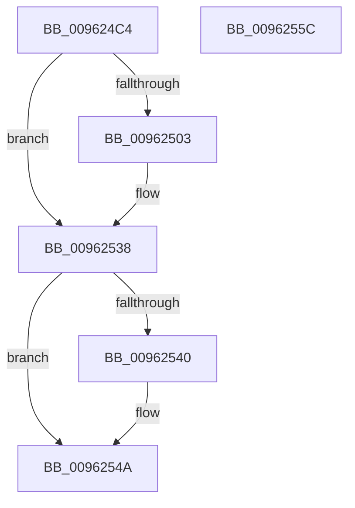

# PiCMDuplicateRegistryHandle

- RVA: `0x009624C4`–`0x0096255D` (길이 `153` bytes)
- VA: `0x00000001409624C4`
- 실행 섹션: `PAGE`
- PDB 이름 있음: `예`; PDB Function 태그: `아니요`
- unwind 정보 RVA: `0x00093428`
- 디코드: `40`개 명령, `153/153` bytes 표시
- 미해석 바이트: `0` (있으면 어셈블리에 `.byte`로 보존)

> 이 문서는 커널 이미지의 기계어와 PDB 기호를 분석해 생성했습니다. 4번과 5번은 함수 원형과 자료형을 바이너리 사용 방식에서 추정한 C 해석이며 원본 소스 복구 결과는 아닙니다.

## 1. Dependencies

- 직접 호출 지점: **3**; 고유 호출 대상: **3**
- 직접 호출자로 확인된 함수: **3**
- RIP 상대 이미지 참조: **1**

### Outgoing calls
- `0x009624F8` → [ObReferenceObjectByHandle](../86/ObReferenceObjectByHandle_function_00868DB0.md) (function, `0x00868DB0`)
- `0x00962531` → [ObOpenObjectByPointer](../8B/ObOpenObjectByPointer_function_008B7420.md) (function, `0x008B7420`)
- `0x00962545` → [ObfDereferenceObject](../../text/2F/ObfDereferenceObject_function_002F9350.md) (function, `0x002F9350`)

### Direct callers
- [PiCMOpenClassKey](PiCMOpenClassKey_function_009617A8.md) at `0x009618E7`
- [PiCMOpenDeviceInterfaceKey](PiCMOpenDeviceInterfaceKey_function_00961A3C.md) at `0x00961B35`
- [PiCMOpenDeviceKey](PiCMOpenDeviceKey_function_00961C00.md) at `0x00961D01`

### Static image references
- `0x009624EC` → RVA `0x00FC6AC0` (`ALMOSTRO`; read)

## 2. Other-region calls and transfers

- 다른 실행 섹션으로 향하는 call: **1**
  - `0x00962545` → [ObfDereferenceObject](../../text/2F/ObfDereferenceObject_function_002F9350.md) (`PAGE` → `.text`)
- 별도 외부 분기/꼬리 이동을 확인하지 못했습니다.

## 3. Assembly (complete function range)

```asm
009624C4  4C 8B DC                        mov r11, rsp
009624C7  49 89 6B 08                     mov qword ptr [r11 + 8], rbp
009624CB  49 89 73 10                     mov qword ptr [r11 + 0x10], rsi
009624CF  57                              push rdi
009624D0  48 83 EC 50                     sub rsp, 0x50
009624D4  49 83 63 D0 00                  and qword ptr [r11 - 0x30], 0
009624D9  49 8D 43 E8                     lea rax, [r11 - 0x18]
009624DD  49 83 63 E8 00                  and qword ptr [r11 - 0x18], 0
009624E2  41 8A F1                        mov sil, r9b
009624E5  41 8B E8                        mov ebp, r8d
009624E8  49 89 43 C8                     mov qword ptr [r11 - 0x38], rax
009624EC  4C 8B 05 CD 45 66 00            mov r8, qword ptr [rip + 0x6645cd]
009624F3  45 33 C9                        xor r9d, r9d
009624F6  33 D2                           xor edx, edx
009624F8  E8 B3 68 F0 FF                  call 0x140868db0
009624FD  8B F8                           mov edi, eax
009624FF  85 C0                           test eax, eax
00962501  78 35                           js 0x140962538
00962503  48 8B 84 24 80 00 00 00         mov rax, qword ptr [rsp + 0x80]
0096250B  44 8B CD                        mov r9d, ebp
0096250E  48 8B 4C 24 40                  mov rcx, qword ptr [rsp + 0x40]
00962513  45 33 C0                        xor r8d, r8d
00962516  48 89 44 24 30                  mov qword ptr [rsp + 0x30], rax
0096251B  BA 40 04 00 00                  mov edx, 0x440
00962520  48 8B 05 99 45 66 00            mov rax, qword ptr [rip + 0x664599]
00962527  40 88 74 24 28                  mov byte ptr [rsp + 0x28], sil
0096252C  48 89 44 24 20                  mov qword ptr [rsp + 0x20], rax
00962531  E8 EA 4E F5 FF                  call 0x1408b7420
00962536  8B F8                           mov edi, eax
00962538  48 83 7C 24 40 00               cmp qword ptr [rsp + 0x40], 0
0096253E  74 0A                           je 0x14096254a
00962540  48 8B 4C 24 40                  mov rcx, qword ptr [rsp + 0x40]
00962545  E8 06 6E 99 FF                  call 0x1402f9350
0096254A  48 8B 6C 24 60                  mov rbp, qword ptr [rsp + 0x60]
0096254F  8B C7                           mov eax, edi
00962551  48 8B 74 24 68                  mov rsi, qword ptr [rsp + 0x68]
00962556  48 83 C4 50                     add rsp, 0x50
0096255A  5F                              pop rdi
0096255B  C3                              ret
0096255C  CC                              int3
```

## 4. C-style interpretation (structured pseudocode)

```c
__int64 __fastcall PiCMDuplicateRegistryHandle(__int64 a1, int a2, int a3, int a4, __int64 a5)
{
    __int64 result;
    __int64 v_rdi;
    __int64 v_rsp;
    unsigned __int64 v_stack_m18;
    unsigned __int64 v_stack_m28;
    unsigned __int8 v_stack_m30;
    unsigned __int64 v_stack_m38;
    unsigned __int64 v_stack_p10;
    unsigned __int64 v_stack_p8;

    *(unsigned __int64 *)(v_rsp + 8) = v_rbp;
    *(unsigned __int64 *)(v_rsp + 16) = v_rsi;
    v_rsp = (v_rsp) - (80);
    *(unsigned __int64 *)(v_rsp - 56) = v_rsp - 24;
    a4 = 0;
    a2 = 0;
    result = ObReferenceObjectByHandle(a1, a2, *(unsigned __int64 *)(v_rip + 6702541), a4);
    v_rdi = (unsigned int)((unsigned int)(result));
    if (!(sign_flag)) {
        result = a5;
        a4 = (unsigned int)((unsigned int)(a3));
        a1 = v_stack_m18;
        a3 = 0;
        v_stack_m28 = result;
        a2 = 0x440ULL;
        result = *(unsigned __int64 *)(v_rip + 6702489);
        v_stack_m30 = (unsigned __int8)((unsigned __int8)(a4));
        v_stack_m38 = result;
        result = ObOpenObjectByPointer(a1, a2, a3, a4);
        v_rdi = (unsigned int)(result);
    }
    if (v_stack_m18 != 0) {
        a1 = v_stack_m18;
        result = ObfDereferenceObject(a1, a2, a3, a4);
    }
    v_rsp = (v_rsp) + (80);
    return (unsigned int)((unsigned int)(v_rdi));
}
```

## 5. (Beta) C Style

```c
int64_t PiCMDuplicateRegistryHandle(int64_t Arg1, int32_t Arg2, int32_t Arg3, int32_t Arg4, int64_t Arg5)
{
    int64_t result;
    int64_t local_rdi;
    int64_t local_rsp;
    uint64_t v_stack_m18;
    uint64_t v_stack_m28;
    uint8_t v_stack_m30;
    uint64_t v_stack_m38;
    uint64_t v_stack_p10;
    uint64_t v_stack_p8;

    *(uint64_t *)(local_rsp + 0x8) = local_rbp;
    *(uint64_t *)(local_rsp + 0x10) = local_rsi;
    local_rsp = (local_rsp) - (80);
    *(uint64_t *)(local_rsp - 0x38) = local_rsp - 24;
    Arg4 = 0;
    Arg2 = 0;
    result = ObReferenceObjectByHandle(Arg1, Arg2, *(uint64_t *)(v_rip + 0x6645CD), Arg4);
    local_rdi = (uint32_t)((uint32_t)(result));
    if (!(sign_flag)) {
        result = Arg5;
        Arg4 = (uint32_t)((uint32_t)(Arg3));
        Arg1 = v_stack_m18;
        Arg3 = 0;
        v_stack_m28 = result;
        Arg2 = 0x440ULL;
        result = *(uint64_t *)(v_rip + 0x664599);
        v_stack_m30 = (uint8_t)((uint8_t)(Arg4));
        v_stack_m38 = result;
        result = ObOpenObjectByPointer(Arg1, Arg2, Arg3, Arg4);
        local_rdi = (uint32_t)(result);
    }
    if (v_stack_m18 != 0) {
        Arg1 = v_stack_m18;
        result = ObfDereferenceObject(Arg1, Arg2, Arg3, Arg4);
    }
    local_rsp = (local_rsp) + (80);
    return (uint32_t)((uint32_t)(local_rdi));
}
```

## 6. Execution-region graph

[열기: 2D/3D 그래프와 함수 탐색 컨트롤 패널](../../../control-panel.html?section=page&rva=0x009624C4&view=graph)

- 2D 그래프는 위에서 아래로 흐르고, 3D 그래프는 빈 공간을 드래그해 회전합니다. Shift+드래그는 이동, 휠은 확대·축소, 함수 노드 선택은 대상 보고서 이동입니다.

### Static fallback


