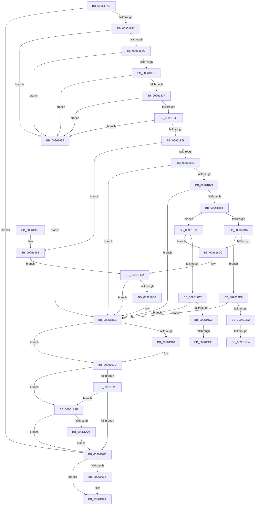

# PiCMOpenClassKey

- RVA: `0x009617A8`–`0x00961A34` (길이 `652` bytes)
- VA: `0x00000001409617A8`
- 실행 섹션: `PAGE`
- PDB 이름 있음: `예`; PDB Function 태그: `예`
- unwind 정보 RVA: `0x000932FC`
- 디코드: `167`개 명령, `652/652` bytes 표시
- 미해석 바이트: `0` (있으면 어셈블리에 `.byte`로 보존)

> 이 문서는 커널 이미지의 기계어와 PDB 기호를 분석해 생성했습니다. 4번과 5번은 함수 원형과 자료형을 바이너리 사용 방식에서 추정한 C 해석이며 원본 소스 복구 결과는 아닙니다.

## 1. Dependencies

- 직접 호출 지점: **14**; 고유 호출 대상: **12**
- 직접 호출자로 확인된 함수: **1**
- RIP 상대 이미지 참조: **1**

### Outgoing calls
- `0x0096180F` → [PiCMCaptureRegistryInputData](PiCMCaptureRegistryInputData_function_00962108.md) (function, `0x00962108`)
- `0x00961868` → [RtlInitUnicodeStringEx](../../text/46/RtlInitUnicodeStringEx_function_00463960.md) (function, `0x00463960`)
- `0x0096187E` → [RtlUpcaseUnicodeString](RtlUpcaseUnicodeString_function_00960780.md) (function, `0x00960780`)
- `0x009618BE` → [CmOpenCommonClassRegKey](../8E/CmOpenCommonClassRegKey_function_008EFF5C.md) (function, `0x008EFF5C`)
- `0x009618E7` → [PiCMDuplicateRegistryHandle](PiCMDuplicateRegistryHandle_function_009624C4.md) (function, `0x009624C4`)
- `0x00961908` → [PiCMReturnHandleResultData](PiCMReturnHandleResultData_function_00962354.md) (function, `0x00962354`)
- `0x00961918` → [ZwClose](../../text/6A/ZwClose_function_006AD2B0.md) (function, `0x006AD2B0`)
- `0x00961945` → [PiControlFreeUserModeCallersBuffer](../../text/44/PiControlFreeUserModeCallersBuffer_function_00448990.md) (function, `0x00448990`)
- `0x00961987` → [PnpCtxOpenContextBaseKey](PnpCtxOpenContextBaseKey_function_00962A0C.md) (function, `0x00962A0C`)
- `0x009619A5` → [CmOpenCommonClassRegKey](../8E/CmOpenCommonClassRegKey_function_008EFF5C.md) (function, `0x008EFF5C`)
- `0x009619C6` → [PiAuDoesClientHaveAccess](PiAuDoesClientHaveAccess_function_00962940.md) (function, `0x00962940`)
- `0x009619E7` → [PiAuDoesClientHaveAccess](PiAuDoesClientHaveAccess_function_00962940.md) (function, `0x00962940`)
- `0x00961A10` → [CmCreateInterfaceClass](../90/CmCreateInterfaceClass_function_00901838.md) (function, `0x00901838`)
- `0x00961A2A` → [ObCloseHandle](../8A/ObCloseHandle_function_008A1870.md) (function, `0x008A1870`)

### Direct callers
- [PiCMHandleIoctl](../8E/PiCMHandleIoctl_function_008EB880.md) at `0x008EC10D`

### Static image references
- `0x0096188B` → RVA `0x00E66398` (`.data`; read)

## 2. Other-region calls and transfers

- 다른 실행 섹션으로 향하는 call: **3**
  - `0x00961868` → [RtlInitUnicodeStringEx](../../text/46/RtlInitUnicodeStringEx_function_00463960.md) (`PAGE` → `.text`)
  - `0x00961918` → [ZwClose](../../text/6A/ZwClose_function_006AD2B0.md) (`PAGE` → `.text`)
  - `0x00961945` → [PiControlFreeUserModeCallersBuffer](../../text/44/PiControlFreeUserModeCallersBuffer_function_00448990.md) (`PAGE` → `.text`)
- call이 아닌 외부 분기/꼬리 이동: **4**
  - `0x009619CD` → [sub_00B27EF4 + 0xA](../B2/Unknown_function_00B27EF4.md) (`tail-transfer`)
  - `0x009619D3` → [sub_00B27EF4](../B2/Unknown_function_00B27EF4.md) (`tail-transfer`)
  - `0x009619EE` → [sub_00B27EF4](../B2/Unknown_function_00B27EF4.md) (`tail-transfer`)
  - `0x00961A16` → [sub_00B27EF4 + 0x2B](../B2/Unknown_function_00B27EF4.md) (`tail-transfer`)

## 3. Assembly (complete function range)

```asm
009617A8  48 8B C4                        mov rax, rsp
009617AB  48 89 58 08                     mov qword ptr [rax + 8], rbx
009617AF  48 89 70 10                     mov qword ptr [rax + 0x10], rsi
009617B3  48 89 78 18                     mov qword ptr [rax + 0x18], rdi
009617B7  55                              push rbp
009617B8  41 54                           push r12
009617BA  41 55                           push r13
009617BC  41 56                           push r14
009617BE  41 57                           push r15
009617C0  48 8D 68 B1                     lea rbp, [rax - 0x4f]
009617C4  48 81 EC 90 00 00 00            sub rsp, 0x90
009617CB  4C 8B 6D 7F                     mov r13, qword ptr [rbp + 0x7f]
009617CF  0F 57 C0                        xorps xmm0, xmm0
009617D2  48 83 65 7F 00                  and qword ptr [rbp + 0x7f], 0
009617D7  45 8B F1                        mov r14d, r9d
009617DA  48 83 65 D7 00                  and qword ptr [rbp - 0x29], 0
009617DF  4C 8D 4D EF                     lea r9, [rbp - 0x11]
009617E3  4D 8B F8                        mov r15, r8
009617E6  44 8B 45 77                     mov r8d, dword ptr [rbp + 0x77]
009617EA  41 83 65 00 00                  and dword ptr [r13], 0
009617EF  65 48 8B 04 25 88 01 00 00      mov rax, qword ptr gs:[0x188]
009617F8  0F 11 45 EF                     movups xmmword ptr [rbp - 0x11], xmm0
009617FC  0F 11 45 FF                     movups xmmword ptr [rbp - 1], xmm0
00961800  44 8A A0 32 02 00 00            mov r12b, byte ptr [rax + 0x232]
00961807  0F 11 45 0F                     movups xmmword ptr [rbp + 0xf], xmm0
0096180B  0F 11 45 DF                     movups xmmword ptr [rbp - 0x21], xmm0
0096180F  E8 F4 08 00 00                  call 0x140962108
00961814  48 8B 75 FF                     mov rsi, qword ptr [rbp - 1]
00961818  8B F8                           mov edi, eax
0096181A  85 C0                           test eax, eax
0096181C  0F 88 0B 01 00 00               js 0x14096192d
00961822  83 7D 13 00                     cmp dword ptr [rbp + 0x13], 0
00961826  0F 85 69 01 00 00               jne 0x140961995
0096182C  83 7D F3 00                     cmp dword ptr [rbp - 0xd], 0
00961830  0F 85 5F 01 00 00               jne 0x140961995
00961836  4D 85 FF                        test r15, r15
00961839  0F 84 56 01 00 00               je 0x140961995
0096183F  41 83 FE 10                     cmp r14d, 0x10
00961843  0F 82 4C 01 00 00               jb 0x140961995
00961849  8B 7D F7                        mov edi, dword ptr [rbp - 9]
0096184C  8D 47 FE                        lea eax, [rdi - 2]
0096184F  83 F8 01                        cmp eax, 1
00961852  0F 87 3D 01 00 00               ja 0x140961995
00961858  48 85 F6                        test rsi, rsi
0096185B  0F 84 0D 01 00 00               je 0x14096196e
00961861  48 8B D6                        mov rdx, rsi
00961864  48 8D 4D DF                     lea rcx, [rbp - 0x21]
00961868  E8 F3 20 B0 FF                  call 0x140463960
0096186D  8B D8                           mov ebx, eax
0096186F  85 C0                           test eax, eax
00961871  78 7B                           js 0x1409618ee
00961873  45 33 C0                        xor r8d, r8d
00961876  48 8D 55 DF                     lea rdx, [rbp - 0x21]
0096187A  48 8D 4D DF                     lea rcx, [rbp - 0x21]
0096187E  E8 FD EE FF FF                  call 0x140960780
00961883  33 D2                           xor edx, edx
00961885  8B D8                           mov ebx, eax
00961887  85 C0                           test eax, eax
00961889  78 63                           js 0x1409618ee
0096188B  48 8B 0D 06 4B 50 00            mov rcx, qword ptr [rip + 0x504b06]
00961892  48 8D 45 7F                     lea rax, [rbp + 0x7f]
00961896  48 89 54 24 38                  mov qword ptr [rsp + 0x38], rdx
0096189B  45 33 C9                        xor r9d, r9d
0096189E  48 89 44 24 30                  mov qword ptr [rsp + 0x30], rax
009618A3  83 FF 03                        cmp edi, 3
009618A6  8B 7D 0B                        mov edi, dword ptr [rbp + 0xb]
009618A9  88 54 24 28                     mov byte ptr [rsp + 0x28], dl
009618AD  48 8B D6                        mov rdx, rsi
009618B0  89 7C 24 20                     mov dword ptr [rsp + 0x20], edi
009618B4  0F 85 E5 00 00 00               jne 0x14096199f
009618BA  45 8D 41 40                     lea r8d, [r9 + 0x40]
009618BE  E8 99 E6 F8 FF                  call 0x1408eff5c
009618C3  8B D8                           mov ebx, eax
009618C5  3D 34 00 00 C0                  cmp eax, 0xc0000034
009618CA  0F 84 08 01 00 00               je 0x1409619d8
009618D0  85 DB                           test ebx, ebx
009618D2  78 1A                           js 0x1409618ee
009618D4  48 8B 4D 7F                     mov rcx, qword ptr [rbp + 0x7f]
009618D8  48 8D 45 D7                     lea rax, [rbp - 0x29]
009618DC  45 8A CC                        mov r9b, r12b
009618DF  48 89 44 24 20                  mov qword ptr [rsp + 0x20], rax
009618E4  44 8B C7                        mov r8d, edi
009618E7  E8 D8 0B 00 00                  call 0x1409624c4
009618EC  8B D8                           mov ebx, eax
009618EE  44 8B 45 17                     mov r8d, dword ptr [rbp + 0x17]
009618F2  4D 8B CF                        mov r9, r15
009618F5  4C 89 6C 24 28                  mov qword ptr [rsp + 0x28], r13
009618FA  8B CB                           mov ecx, ebx
009618FC  44 89 74 24 20                  mov dword ptr [rsp + 0x20], r14d
00961901  4C 8B 75 D7                     mov r14, qword ptr [rbp - 0x29]
00961905  49 8B D6                        mov rdx, r14
00961908  E8 47 0A 00 00                  call 0x140962354
0096190D  48 8B 4D 7F                     mov rcx, qword ptr [rbp + 0x7f]
00961911  8B F8                           mov edi, eax
00961913  48 85 C9                        test rcx, rcx
00961916  74 05                           je 0x14096191d
00961918  E8 93 B9 D4 FF                  call 0x1406ad2b0
0096191D  85 FF                           test edi, edi
0096191F  0F 88 F6 00 00 00               js 0x140961a1b
00961925  85 DB                           test ebx, ebx
00961927  0F 88 EE 00 00 00               js 0x140961a1b
0096192D  48 85 F6                        test rsi, rsi
00961930  74 18                           je 0x14096194a
00961932  65 48 8B 0C 25 88 01 00 00      mov rcx, qword ptr gs:[0x188]
0096193B  48 8B 55 FF                     mov rdx, qword ptr [rbp - 1]
0096193F  8A 89 32 02 00 00               mov cl, byte ptr [rcx + 0x232]
00961945  E8 46 70 AE FF                  call 0x140448990
0096194A  4C 8D 9C 24 90 00 00 00         lea r11, [rsp + 0x90]
00961952  8B C7                           mov eax, edi
00961954  49 8B 5B 30                     mov rbx, qword ptr [r11 + 0x30]
00961958  49 8B 73 38                     mov rsi, qword ptr [r11 + 0x38]
0096195C  49 8B 7B 40                     mov rdi, qword ptr [r11 + 0x40]
00961960  49 8B E3                        mov rsp, r11
00961963  41 5F                           pop r15
00961965  41 5E                           pop r14
00961967  41 5D                           pop r13
00961969  41 5C                           pop r12
0096196B  5D                              pop rbp
0096196C  C3                              ret
0096196D  CC                              int3
0096196E  83 EF 03                        sub edi, 3
00961971  48 8D 45 7F                     lea rax, [rbp + 0x7f]
00961975  F7 DF                           neg edi
00961977  48 89 44 24 20                  mov qword ptr [rsp + 0x20], rax
0096197C  8B 7D 0B                        mov edi, dword ptr [rbp + 0xb]
0096197F  44 8B CF                        mov r9d, edi
00961982  1B D2                           sbb edx, edx
00961984  83 C2 08                        add edx, 8
00961987  E8 80 10 00 00                  call 0x140962a0c
0096198C  8B D8                           mov ebx, eax
0096198E  85 C0                           test eax, eax
00961990  E9 3D FF FF FF                  jmp 0x1409618d2
00961995  BB 0D 00 00 C0                  mov ebx, 0xc000000d
0096199A  E9 4F FF FF FF                  jmp 0x1409618ee
0096199F  41 B8 20 00 00 00               mov r8d, 0x20
009619A5  E8 B2 E5 F8 FF                  call 0x1408eff5c
009619AA  8B D8                           mov ebx, eax
009619AC  3D 34 00 00 C0                  cmp eax, 0xc0000034
009619B1  0F 85 19 FF FF FF               jne 0x1409618d0
009619B7  83 7D 0F 01                     cmp dword ptr [rbp + 0xf], 1
009619BB  0F 85 2D FF FF FF               jne 0x1409618ee
009619C1  B9 02 00 00 00                  mov ecx, 2
009619C6  E8 75 0F 00 00                  call 0x140962940
009619CB  84 C0                           test al, al
009619CD  0F 85 2B 65 1C 00               jne 0x140b27efe
009619D3  E9 1C 65 1C 00                  jmp 0x140b27ef4
009619D8  83 7D 0F 01                     cmp dword ptr [rbp + 0xf], 1
009619DC  0F 85 0C FF FF FF               jne 0x1409618ee
009619E2  B9 02 00 00 00                  mov ecx, 2
009619E7  E8 54 0F 00 00                  call 0x140962940
009619EC  84 C0                           test al, al
009619EE  0F 84 00 65 1C 00               je 0x140b27ef4
009619F4  83 64 24 28 00                  and dword ptr [rsp + 0x28], 0
009619F9  4C 8D 4D 7F                     lea r9, [rbp + 0x7f]
009619FD  48 83 64 24 20 00               and qword ptr [rsp + 0x20], 0
00961A03  44 8B C7                        mov r8d, edi
00961A06  48 8B 0D 8B 49 50 00            mov rcx, qword ptr [rip + 0x50498b]
00961A0D  48 8B D6                        mov rdx, rsi
00961A10  E8 23 FE F9 FF                  call 0x140901838
00961A15  90                              nop
00961A16  E9 04 65 1C 00                  jmp 0x140b27f1f
00961A1B  4D 85 F6                        test r14, r14
00961A1E  0F 84 09 FF FF FF               je 0x14096192d
00961A24  41 8A D4                        mov dl, r12b
00961A27  49 8B CE                        mov rcx, r14
00961A2A  E8 41 FE F3 FF                  call 0x1408a1870
00961A2F  E9 F9 FE FF FF                  jmp 0x14096192d
```

## 4. C-style interpretation (structured pseudocode)

```c
__int64 __fastcall PiCMOpenClassKey(__int64 a1, __int64 a2, __int64 a3, int a4)
{
    __int64 result;
    __int64 v_rbx;
    __int64 v_rdi;
    __int64 v_rsp;
    unsigned __int64 v_stack_m28;
    unsigned int v_stack_m68;
    unsigned __int64 v_stack_m70;
    unsigned __int64 v_stack_m80;
    unsigned __int64 v_stack_m88;
    unsigned __int8 v_stack_m90;
    unsigned int v_stack_m98;

    *(unsigned __int64 *)(v_rsp + 8) = v_rbx;
    *(unsigned __int64 *)(v_rsp + 16) = v_rsi;
    *(unsigned __int64 *)(v_rsp + 24) = v_rdi;
    v_rsp = (v_rsp) - (144);
    *(unsigned __int64 *)(v_rsp - 79 - 17) = v_xmm0;
    *(unsigned __int64 *)(v_rsp - 79 - 1) = v_xmm0;
    *(unsigned __int64 *)(v_rsp - 79 + 15) = v_xmm0;
    *(unsigned __int64 *)(v_rsp - 79 - 33) = v_xmm0;
    result = PiCMCaptureRegistryInputData(a1, a2, (unsigned int)(*(unsigned int *)(v_rsp - 79 + 119)), v_rsp - 79 - 17);
    if (sign_flag) goto loc_0096192D;
    if ((*(unsigned int *)(v_rsp - 79 + 19)) != 0) goto loc_00961995;
    if ((*(unsigned int *)(v_rsp - 79 - 13)) != 0) goto loc_00961995;
    if (a3 == 0) goto loc_00961995;
    if (((unsigned int)((unsigned int)(a4))) < 16) goto loc_00961995;
    if (((unsigned int)((unsigned int)(*(unsigned int *)(v_rsp - 79 - 9)) - 2)) > 1) goto loc_00961995;
    if (*(unsigned __int64 *)(v_rsp - 79 - 1) == 0) goto loc_0096196E;
    result = RtlInitUnicodeStringEx(v_rsp - 79 - 33, *(unsigned __int64 *)(v_rsp - 79 - 1), (unsigned int)(*(unsigned int *)(v_rsp - 79 + 119)), v_rsp - 79 - 17);
    if (sign_flag) goto loc_009618EE;
    a3 = 0;
    result = RtlUpcaseUnicodeString(v_rsp - 79 - 33, v_rsp - 79 - 33, a3, v_rsp - 79 - 17);
    a2 = 0;
    if (sign_flag) goto loc_009618EE;
    v_stack_m80 = 0;
    a4 = 0;
    v_stack_m88 = v_rsp - 79 + 127;
    v_stack_m90 = 0;
    v_stack_m98 = (unsigned int)((unsigned int)(*(unsigned int *)(v_rsp - 79 + 11)));
    if (((unsigned int)((unsigned int)(*(unsigned int *)(v_rsp - 79 - 9)))) != 3) goto loc_0096199F;
    result = CmOpenCommonClassRegKey(*(unsigned __int64 *)(v_rip + 5262086), *(unsigned __int64 *)(v_rsp - 79 - 1), a4 + 64, a4);
    if (((unsigned int)(result)) == 0xC0000034ULL) goto loc_009619D8;
loc_009618D0:
loc_009618D2:
    v_rbx = (unsigned int)((unsigned int)(result));
    if (!(sign_flag)) {
        a1 = *(unsigned __int64 *)(v_rsp - 79 + 127);
        result = v_rsp - 79 - 41;
        a4 = (unsigned __int8)(*(unsigned __int8 *)(*(unsigned __int64 *)(gs_base + (0 + 392)) + 562));
        v_stack_m98 = result;
        a3 = (unsigned int)((unsigned int)(*(unsigned int *)(v_rsp - 79 + 11)));
        result = PiCMDuplicateRegistryHandle(a1, *(unsigned __int64 *)(v_rsp - 79 - 1), a3, a4);
        v_rbx = (unsigned int)(result);
    }
    v_stack_m90 = *(unsigned __int64 *)(v_rsp - 79 + 127);
    v_stack_m98 = (unsigned int)((unsigned int)(a4));
    result = PiCMReturnHandleResultData((unsigned int)((unsigned int)(v_rbx)), *(unsigned __int64 *)(v_rsp - 79 - 41), (unsigned int)(*(unsigned int *)(v_rsp - 79 + 23)), a3);
    if (*(unsigned __int64 *)(v_rsp - 79 + 127) != 0) {
        result = ZwClose(*(unsigned __int64 *)(v_rsp - 79 + 127), *(unsigned __int64 *)(v_rsp - 79 - 41), (unsigned int)(*(unsigned int *)(v_rsp - 79 + 23)), a3);
    }
    if (sign_flag) goto loc_00961A1B;
    if (sign_flag) goto loc_00961A1B;
loc_0096192D:
    if (*(unsigned __int64 *)(v_rsp - 79 - 1) != 0) {
        a1 = *(unsigned __int64 *)(gs_base + (0 + 392));
        a2 = *(unsigned __int64 *)(v_rsp - 79 - 1);
        a1 = *(unsigned __int8 *)(a1 + 562);
        result = PiControlFreeUserModeCallersBuffer(a1, a2, (unsigned int)(*(unsigned int *)(v_rsp - 79 + 23)), a3);
    }
    return (unsigned int)((unsigned int)((unsigned int)((unsigned int)(result))));
loc_0096196E:
    v_rdi = (unsigned int)((*(unsigned __int64 *)(v_stack_m28 + 64)) - (3));
    v_rdi = (unsigned int)(-(v_rdi));
    v_stack_m70 = v_rsp - 79 + 127;
    a2 = (unsigned int)((a2) + (8));
    result = PnpCtxOpenContextBaseKey(a1, a2, (unsigned int)(*(unsigned int *)(v_rsp - 79 + 23)), (unsigned int)((unsigned int)((unsigned int)(*(unsigned int *)(v_rsp - 79 + 11)))));
    goto loc_009618D2;
loc_00961995:
    goto loc_009618EE;
loc_0096199F:
    result = CmOpenCommonClassRegKey(a1, a2, 32, (unsigned int)((unsigned int)((unsigned int)(*(unsigned int *)(v_rsp - 79 + 11)))));
    if (((unsigned int)(result)) != 0xC0000034ULL) goto loc_009618D0;
    if ((*(unsigned int *)(v_rsp - 79 + 15)) != 1) goto loc_009618EE;
    result = PiAuDoesClientHaveAccess(2, a2, 32, (unsigned int)((unsigned int)((unsigned int)(*(unsigned int *)(v_rsp - 79 + 11)))));
loc_009619D8:
    if ((*(unsigned int *)(v_rsp - 79 + 15)) != 1) goto loc_009618EE;
    result = PiAuDoesClientHaveAccess(2, a2, 32, (unsigned int)((unsigned int)((unsigned int)(*(unsigned int *)(v_rsp - 79 + 11)))));
    result = CmCreateInterfaceClass(*(unsigned __int64 *)(v_rip + 5261707), *(unsigned __int64 *)(v_stack_m28 + 56), (unsigned int)((unsigned int)((unsigned int)(*(unsigned int *)(v_rsp - 79 + 11)))), v_rsp - 79 + 127);
loc_00961A1B:
    if (*(unsigned __int64 *)(v_rsp - 79 - 41) == 0) goto loc_0096192D;
    result = ObCloseHandle(*(unsigned __int64 *)(v_rsp - 79 - 41), (unsigned __int8)(*(unsigned __int8 *)(*(unsigned __int64 *)(gs_base + (0 + 392)) + 562)), (unsigned int)((unsigned int)((unsigned int)(*(unsigned int *)(v_rsp - 79 + 11)))), v_rsp - 79 + 127);
    goto loc_0096192D;
}
```

## 5. (Beta) C Style

```c
int64_t PiCMOpenClassKey(int64_t Arg1, int64_t Arg2, int64_t Arg3, int32_t Arg4)
{
    int64_t result;
    int64_t local_rbx;
    int64_t local_rdi;
    int64_t local_rsp;
    uint64_t v_stack_m28;
    uint32_t v_stack_m68;
    uint64_t v_stack_m70;
    uint64_t v_stack_m80;
    uint64_t v_stack_m88;
    uint8_t v_stack_m90;
    uint32_t v_stack_m98;

    *(uint64_t *)(local_rsp + 0x8) = local_rbx;
    *(uint64_t *)(local_rsp + 0x10) = local_rsi;
    *(uint64_t *)(local_rsp + 0x18) = local_rdi;
    local_rsp = (local_rsp) - (144);
    *(uint64_t *)(local_rsp - 0x4F - 0x11) = v_xmm0;
    *(uint64_t *)(local_rsp - 0x4F - 0x1) = v_xmm0;
    *(uint64_t *)(local_rsp - 0x4F + 0xF) = v_xmm0;
    *(uint64_t *)(local_rsp - 0x4F - 0x21) = v_xmm0;
    result = PiCMCaptureRegistryInputData(Arg1, Arg2, (uint32_t)(*(uint32_t *)(local_rsp - 0x4F + 0x77)), local_rsp - 79 - 17);
    if (sign_flag) goto loc_0096192D;
    if ((*(uint32_t *)(local_rsp - 0x4F + 0x13)) != 0) goto loc_00961995;
    if ((*(uint32_t *)(local_rsp - 0x4F - 0xD)) != 0) goto loc_00961995;
    if (Arg3 == 0) goto loc_00961995;
    if (((uint32_t)((uint32_t)(Arg4))) < 16) goto loc_00961995;
    if (((uint32_t)((uint32_t)(*(uint32_t *)(local_rsp - 0x4F - 0x9)) - 2)) > 1) goto loc_00961995;
    if (*(uint64_t *)(local_rsp - 0x4F - 0x1) == 0) goto loc_0096196E;
    result = RtlInitUnicodeStringEx(local_rsp - 79 - 33, *(uint64_t *)(local_rsp - 0x4F - 0x1), (uint32_t)(*(uint32_t *)(local_rsp - 0x4F + 0x77)), local_rsp - 79 - 17);
    if (sign_flag) goto loc_009618EE;
    Arg3 = 0;
    result = RtlUpcaseUnicodeString(local_rsp - 79 - 33, local_rsp - 79 - 33, Arg3, local_rsp - 79 - 17);
    Arg2 = 0;
    if (sign_flag) goto loc_009618EE;
    v_stack_m80 = 0;
    Arg4 = 0;
    v_stack_m88 = local_rsp - 79 + 127;
    v_stack_m90 = 0;
    v_stack_m98 = (uint32_t)((uint32_t)(*(uint32_t *)(local_rsp - 0x4F + 0xB)));
    if (((uint32_t)((uint32_t)(*(uint32_t *)(local_rsp - 0x4F - 0x9)))) != 3) goto loc_0096199F;
    result = CmOpenCommonClassRegKey(*(uint64_t *)(v_rip + 0x504B06), *(uint64_t *)(local_rsp - 0x4F - 0x1), Arg4 + 64, Arg4);
    if (((uint32_t)(result)) == 0xC0000034ULL) goto loc_009619D8;
loc_009618D0:
loc_009618D2:
    local_rbx = (uint32_t)((uint32_t)(result));
    if (!(sign_flag)) {
        Arg1 = *(uint64_t *)(local_rsp - 0x4F + 0x7F);
        result = local_rsp - 79 - 41;
        Arg4 = (uint8_t)(*(uint8_t *)(*(uint64_t *)(gs_base + (0 + 0x188)) + 0x232));
        v_stack_m98 = result;
        Arg3 = (uint32_t)((uint32_t)(*(uint32_t *)(local_rsp - 0x4F + 0xB)));
        result = PiCMDuplicateRegistryHandle(Arg1, *(uint64_t *)(local_rsp - 0x4F - 0x1), Arg3, Arg4);
        local_rbx = (uint32_t)(result);
    }
    v_stack_m90 = *(uint64_t *)(local_rsp - 0x4F + 0x7F);
    v_stack_m98 = (uint32_t)((uint32_t)(Arg4));
    result = PiCMReturnHandleResultData((uint32_t)((uint32_t)(local_rbx)), *(uint64_t *)(local_rsp - 0x4F - 0x29), (uint32_t)(*(uint32_t *)(local_rsp - 0x4F + 0x17)), Arg3);
    if (*(uint64_t *)(local_rsp - 0x4F + 0x7F) != 0) {
        result = ZwClose(*(uint64_t *)(local_rsp - 0x4F + 0x7F), *(uint64_t *)(local_rsp - 0x4F - 0x29), (uint32_t)(*(uint32_t *)(local_rsp - 0x4F + 0x17)), Arg3);
    }
    if (sign_flag) goto loc_00961A1B;
    if (sign_flag) goto loc_00961A1B;
loc_0096192D:
    if (*(uint64_t *)(local_rsp - 0x4F - 0x1) != 0) {
        Arg1 = *(uint64_t *)(gs_base + (0 + 0x188));
        Arg2 = *(uint64_t *)(local_rsp - 0x4F - 0x1);
        Arg1 = *(uint8_t *)(Arg1 + 0x232);
        result = PiControlFreeUserModeCallersBuffer(Arg1, Arg2, (uint32_t)(*(uint32_t *)(local_rsp - 0x4F + 0x17)), Arg3);
    }
    return (uint32_t)((uint32_t)((uint32_t)((uint32_t)(result))));
loc_0096196E:
    local_rdi = (uint32_t)((*(uint64_t *)(v_stack_m28 + 0x40)) - (3));
    local_rdi = (uint32_t)(-(local_rdi));
    v_stack_m70 = local_rsp - 79 + 127;
    Arg2 = (uint32_t)((Arg2) + (8));
    result = PnpCtxOpenContextBaseKey(Arg1, Arg2, (uint32_t)(*(uint32_t *)(local_rsp - 0x4F + 0x17)), (uint32_t)((uint32_t)((uint32_t)(*(uint32_t *)(local_rsp - 0x4F + 0xB)))));
    goto loc_009618D2;
loc_00961995:
    goto loc_009618EE;
loc_0096199F:
    result = CmOpenCommonClassRegKey(Arg1, Arg2, 32, (uint32_t)((uint32_t)((uint32_t)(*(uint32_t *)(local_rsp - 0x4F + 0xB)))));
    if (((uint32_t)(result)) != 0xC0000034ULL) goto loc_009618D0;
    if ((*(uint32_t *)(local_rsp - 0x4F + 0xF)) != 1) goto loc_009618EE;
    result = PiAuDoesClientHaveAccess(2, Arg2, 32, (uint32_t)((uint32_t)((uint32_t)(*(uint32_t *)(local_rsp - 0x4F + 0xB)))));
loc_009619D8:
    if ((*(uint32_t *)(local_rsp - 0x4F + 0xF)) != 1) goto loc_009618EE;
    result = PiAuDoesClientHaveAccess(2, Arg2, 32, (uint32_t)((uint32_t)((uint32_t)(*(uint32_t *)(local_rsp - 0x4F + 0xB)))));
    result = CmCreateInterfaceClass(*(uint64_t *)(v_rip + 0x50498B), *(uint64_t *)(v_stack_m28 + 0x38), (uint32_t)((uint32_t)((uint32_t)(*(uint32_t *)(local_rsp - 0x4F + 0xB)))), local_rsp - 79 + 127);
loc_00961A1B:
    if (*(uint64_t *)(local_rsp - 0x4F - 0x29) == 0) goto loc_0096192D;
    result = ObCloseHandle(*(uint64_t *)(local_rsp - 0x4F - 0x29), (uint8_t)(*(uint8_t *)(*(uint64_t *)(gs_base + (0 + 0x188)) + 0x232)), (uint32_t)((uint32_t)((uint32_t)(*(uint32_t *)(local_rsp - 0x4F + 0xB)))), local_rsp - 79 + 127);
    goto loc_0096192D;
}
```

## 6. Execution-region graph

[열기: 2D/3D 그래프와 함수 탐색 컨트롤 패널](../../../control-panel.html?section=page&rva=0x009617A8&view=graph)

- 2D 그래프는 위에서 아래로 흐르고, 3D 그래프는 빈 공간을 드래그해 회전합니다. Shift+드래그는 이동, 휠은 확대·축소, 함수 노드 선택은 대상 보고서 이동입니다.

### Static fallback


