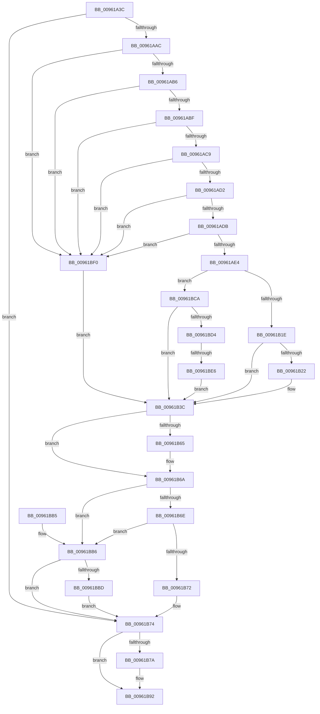

# PiCMOpenDeviceInterfaceKey

- RVA: `0x00961A3C`–`0x00961BFA` (길이 `446` bytes)
- VA: `0x0000000140961A3C`
- 실행 섹션: `PAGE`
- PDB 이름 있음: `예`; PDB Function 태그: `예`
- unwind 정보 RVA: `0x00093330`
- 디코드: `116`개 명령, `446/446` bytes 표시
- 미해석 바이트: `0` (있으면 어셈블리에 `.byte`로 보존)

> 이 문서는 커널 이미지의 기계어와 PDB 기호를 분석해 생성했습니다. 4번과 5번은 함수 원형과 자료형을 바이너리 사용 방식에서 추정한 C 해석이며 원본 소스 복구 결과는 아닙니다.

## 1. Dependencies

- 직접 호출 지점: **8**; 고유 호출 대상: **8**
- 직접 호출자로 확인된 함수: **1**
- RIP 상대 이미지 참조: **1**

### Outgoing calls
- `0x00961A9D` → [PiCMCaptureRegistryInputData](PiCMCaptureRegistryInputData_function_00962108.md) (function, `0x00962108`)
- `0x00961B0C` → [_CmOpenDeviceInterfaceRegKey](../8F/_CmOpenDeviceInterfaceRegKey_function_008F31F4.md) (function, `0x008F31F4`)
- `0x00961B35` → [PiCMDuplicateRegistryHandle](PiCMDuplicateRegistryHandle_function_009624C4.md) (function, `0x009624C4`)
- `0x00961B55` → [PiCMReturnHandleResultData](PiCMReturnHandleResultData_function_00962354.md) (function, `0x00962354`)
- `0x00961B65` → [ZwClose](../../text/6A/ZwClose_function_006AD2B0.md) (function, `0x006AD2B0`)
- `0x00961B8D` → [PiControlFreeUserModeCallersBuffer](../../text/44/PiControlFreeUserModeCallersBuffer_function_00448990.md) (function, `0x00448990`)
- `0x00961BC3` → [ObCloseHandle](../8A/ObCloseHandle_function_008A1870.md) (function, `0x008A1870`)
- `0x00961BD9` → [PiAuDoesClientHaveAccess](PiAuDoesClientHaveAccess_function_00962940.md) (function, `0x00962940`)

### Direct callers
- [PiCMHandleIoctl](../8E/PiCMHandleIoctl_function_008EB880.md) at `0x008EC00A`

### Static image references
- `0x00961AF3` → RVA `0x00E66398` (`.data`; read)

## 2. Other-region calls and transfers

- 다른 실행 섹션으로 향하는 call: **2**
  - `0x00961B65` → [ZwClose](../../text/6A/ZwClose_function_006AD2B0.md) (`PAGE` → `.text`)
  - `0x00961B8D` → [PiControlFreeUserModeCallersBuffer](../../text/44/PiControlFreeUserModeCallersBuffer_function_00448990.md) (`PAGE` → `.text`)
- call이 아닌 외부 분기/꼬리 이동: **1**
  - `0x00961BE0` → [sub_00B27F26](../B2/Unknown_function_00B27F26.md) (`tail-transfer`)

## 3. Assembly (complete function range)

```asm
00961A3C  48 8B C4                        mov rax, rsp
00961A3F  48 89 58 08                     mov qword ptr [rax + 8], rbx
00961A43  48 89 70 10                     mov qword ptr [rax + 0x10], rsi
00961A47  48 89 78 18                     mov qword ptr [rax + 0x18], rdi
00961A4B  4C 89 60 20                     mov qword ptr [rax + 0x20], r12
00961A4F  55                              push rbp
00961A50  41 55                           push r13
00961A52  41 57                           push r15
00961A54  48 8B EC                        mov rbp, rsp
00961A57  48 81 EC 80 00 00 00            sub rsp, 0x80
00961A5E  4C 8B 6D 48                     mov r13, qword ptr [rbp + 0x48]
00961A62  0F 57 C0                        xorps xmm0, xmm0
00961A65  33 DB                           xor ebx, ebx
00961A67  41 8B F1                        mov esi, r9d
00961A6A  48 89 5D 48                     mov qword ptr [rbp + 0x48], rbx
00961A6E  4C 8D 4D C8                     lea r9, [rbp - 0x38]
00961A72  4D 8B F8                        mov r15, r8
00961A75  48 89 5D C0                     mov qword ptr [rbp - 0x40], rbx
00961A79  44 8B 45 40                     mov r8d, dword ptr [rbp + 0x40]
00961A7D  41 89 5D 00                     mov dword ptr [r13], ebx
00961A81  65 48 8B 04 25 88 01 00 00      mov rax, qword ptr gs:[0x188]
00961A8A  0F 11 45 C8                     movups xmmword ptr [rbp - 0x38], xmm0
00961A8E  0F 11 45 D8                     movups xmmword ptr [rbp - 0x28], xmm0
00961A92  44 8A A0 32 02 00 00            mov r12b, byte ptr [rax + 0x232]
00961A99  0F 11 45 E8                     movups xmmword ptr [rbp - 0x18], xmm0
00961A9D  E8 66 06 00 00                  call 0x140962108
00961AA2  8B F8                           mov edi, eax
00961AA4  85 C0                           test eax, eax
00961AA6  0F 88 C8 00 00 00               js 0x140961b74
00961AAC  48 39 5D D8                     cmp qword ptr [rbp - 0x28], rbx
00961AB0  0F 84 3A 01 00 00               je 0x140961bf0
00961AB6  39 5D CC                        cmp dword ptr [rbp - 0x34], ebx
00961AB9  0F 85 31 01 00 00               jne 0x140961bf0
00961ABF  83 7D D0 04                     cmp dword ptr [rbp - 0x30], 4
00961AC3  0F 85 27 01 00 00               jne 0x140961bf0
00961AC9  39 5D EC                        cmp dword ptr [rbp - 0x14], ebx
00961ACC  0F 85 1E 01 00 00               jne 0x140961bf0
00961AD2  4D 85 FF                        test r15, r15
00961AD5  0F 84 15 01 00 00               je 0x140961bf0
00961ADB  83 FE 10                        cmp esi, 0x10
00961ADE  0F 82 0C 01 00 00               jb 0x140961bf0
00961AE4  8B 7D E4                        mov edi, dword ptr [rbp - 0x1c]
00961AE7  48 8D 45 48                     lea rax, [rbp + 0x48]
00961AEB  48 8B 55 D8                     mov rdx, qword ptr [rbp - 0x28]
00961AEF  44 8D 43 32                     lea r8d, [rbx + 0x32]
00961AF3  48 8B 0D 9E 48 50 00            mov rcx, qword ptr [rip + 0x50489e]
00961AFA  48 89 5C 24 38                  mov qword ptr [rsp + 0x38], rbx
00961AFF  48 89 44 24 30                  mov qword ptr [rsp + 0x30], rax
00961B04  88 5C 24 28                     mov byte ptr [rsp + 0x28], bl
00961B08  89 7C 24 20                     mov dword ptr [rsp + 0x20], edi
00961B0C  E8 E3 16 F9 FF                  call 0x1408f31f4
00961B11  8B D8                           mov ebx, eax
00961B13  3D 34 00 00 C0                  cmp eax, 0xc0000034
00961B18  0F 84 AC 00 00 00               je 0x140961bca
00961B1E  85 DB                           test ebx, ebx
00961B20  78 1A                           js 0x140961b3c
00961B22  48 8B 4D 48                     mov rcx, qword ptr [rbp + 0x48]
00961B26  48 8D 45 C0                     lea rax, [rbp - 0x40]
00961B2A  45 8A CC                        mov r9b, r12b
00961B2D  48 89 44 24 20                  mov qword ptr [rsp + 0x20], rax
00961B32  44 8B C7                        mov r8d, edi
00961B35  E8 8A 09 00 00                  call 0x1409624c4
00961B3A  8B D8                           mov ebx, eax
00961B3C  44 8B 45 F0                     mov r8d, dword ptr [rbp - 0x10]
00961B40  4D 8B CF                        mov r9, r15
00961B43  4C 89 6C 24 28                  mov qword ptr [rsp + 0x28], r13
00961B48  8B CB                           mov ecx, ebx
00961B4A  89 74 24 20                     mov dword ptr [rsp + 0x20], esi
00961B4E  48 8B 75 C0                     mov rsi, qword ptr [rbp - 0x40]
00961B52  48 8B D6                        mov rdx, rsi
00961B55  E8 FA 07 00 00                  call 0x140962354
00961B5A  48 8B 4D 48                     mov rcx, qword ptr [rbp + 0x48]
00961B5E  8B F8                           mov edi, eax
00961B60  48 85 C9                        test rcx, rcx
00961B63  74 05                           je 0x140961b6a
00961B65  E8 46 B7 D4 FF                  call 0x1406ad2b0
00961B6A  85 FF                           test edi, edi
00961B6C  78 48                           js 0x140961bb6
00961B6E  85 DB                           test ebx, ebx
00961B70  78 44                           js 0x140961bb6
00961B72  33 DB                           xor ebx, ebx
00961B74  48 39 5D D8                     cmp qword ptr [rbp - 0x28], rbx
00961B78  74 18                           je 0x140961b92
00961B7A  65 48 8B 0C 25 88 01 00 00      mov rcx, qword ptr gs:[0x188]
00961B83  48 8B 55 D8                     mov rdx, qword ptr [rbp - 0x28]
00961B87  8A 89 32 02 00 00               mov cl, byte ptr [rcx + 0x232]
00961B8D  E8 FE 6D AE FF                  call 0x140448990
00961B92  4C 8D 9C 24 80 00 00 00         lea r11, [rsp + 0x80]
00961B9A  8B C7                           mov eax, edi
00961B9C  49 8B 5B 20                     mov rbx, qword ptr [r11 + 0x20]
00961BA0  49 8B 73 28                     mov rsi, qword ptr [r11 + 0x28]
00961BA4  49 8B 7B 30                     mov rdi, qword ptr [r11 + 0x30]
00961BA8  4D 8B 63 38                     mov r12, qword ptr [r11 + 0x38]
00961BAC  49 8B E3                        mov rsp, r11
00961BAF  41 5F                           pop r15
00961BB1  41 5D                           pop r13
00961BB3  5D                              pop rbp
00961BB4  C3                              ret
00961BB5  CC                              int3
00961BB6  33 DB                           xor ebx, ebx
00961BB8  48 85 F6                        test rsi, rsi
00961BBB  74 B7                           je 0x140961b74
00961BBD  41 8A D4                        mov dl, r12b
00961BC0  48 8B CE                        mov rcx, rsi
00961BC3  E8 A8 FC F3 FF                  call 0x1408a1870
00961BC8  EB AA                           jmp 0x140961b74
00961BCA  83 7D E8 01                     cmp dword ptr [rbp - 0x18], 1
00961BCE  0F 85 68 FF FF FF               jne 0x140961b3c
00961BD4  B9 02 00 00 00                  mov ecx, 2
00961BD9  E8 62 0D 00 00                  call 0x140962940
00961BDE  84 C0                           test al, al
00961BE0  0F 85 40 63 1C 00               jne 0x140b27f26
00961BE6  BB 22 00 00 C0                  mov ebx, 0xc0000022
00961BEB  E9 4C FF FF FF                  jmp 0x140961b3c
00961BF0  BB 0D 00 00 C0                  mov ebx, 0xc000000d
00961BF5  E9 42 FF FF FF                  jmp 0x140961b3c
```

## 4. C-style interpretation (structured pseudocode)

```c
__int64 __fastcall PiCMOpenDeviceInterfaceKey(__int64 a1, __int64 a2, __int64 a3, int a4, unsigned int a5, __int64 a6)
{
    __int64 result;
    __int64 v_rbx;
    __int64 v_rsp;
    unsigned __int64 v_stack_m18;
    unsigned int v_stack_m28;
    unsigned int v_stack_m2C;
    unsigned __int64 v_stack_m30;
    unsigned int v_stack_m34;
    unsigned __int64 v_stack_m40;
    unsigned int v_stack_m48;
    unsigned int v_stack_m4C;
    unsigned __int64 v_stack_m50;
    unsigned __int64 v_stack_m58;
    unsigned __int64 v_stack_m60;
    unsigned __int64 v_stack_m68;
    unsigned __int8 v_stack_m70;
    unsigned int v_stack_m78;
    unsigned __int64 v_stack_p30;

    *(unsigned __int64 *)(v_rsp + 8) = v_rbx;
    *(unsigned __int64 *)(v_rsp + 16) = v_rsi;
    *(unsigned __int64 *)(v_rsp + 24) = v_rdi;
    *(unsigned __int64 *)(v_rsp + 32) = v_r12;
    v_rsp = (v_rsp) - (128);
    v_rbx = 0;
    v_stack_p30 = 0;
    v_stack_m58 = 0;
    *(unsigned int *)(a6) = 0;
    v_stack_m50 = v_xmm0;
    v_stack_m40 = v_xmm0;
    v_stack_m30 = v_xmm0;
    result = PiCMCaptureRegistryInputData(a1, a2, (unsigned int)(a5), v_stack_m50);
    if (sign_flag) goto loc_00961B74;
    if (v_stack_m40 == 0) goto loc_00961BF0;
    if (v_stack_m4C != 0) goto loc_00961BF0;
    if (v_stack_m48 != 4) goto loc_00961BF0;
    if (v_stack_m2C != 0) goto loc_00961BF0;
    if (a3 == 0) goto loc_00961BF0;
    if (((unsigned int)((unsigned int)(a4))) < 16) goto loc_00961BF0;
    v_stack_m60 = 0;
    v_stack_m68 = a6;
    v_stack_m70 = 0;
    v_stack_m78 = (unsigned int)((unsigned int)(v_stack_m34));
    result = _CmOpenDeviceInterfaceRegKey(*(unsigned __int64 *)(v_rip + 5261470), v_stack_m40, v_rbx + 50, v_stack_m50);
    if (((unsigned int)(result)) == 0xC0000034ULL) goto loc_00961BCA;
    v_rbx = (unsigned int)((unsigned int)(result));
    if (!(sign_flag)) {
        a1 = a6;
        result = v_stack_m58;
        a4 = (unsigned __int8)(*(unsigned __int8 *)(*(unsigned __int64 *)(gs_base + (0 + 392)) + 562));
        v_stack_m78 = result;
        a3 = (unsigned int)((unsigned int)(v_stack_m34));
        result = PiCMDuplicateRegistryHandle(a1, v_stack_m40, a3, a4);
        v_rbx = (unsigned int)(result);
    }
    v_stack_m70 = a6;
    v_stack_m78 = (unsigned int)((unsigned int)(a4));
    result = PiCMReturnHandleResultData((unsigned int)((unsigned int)(v_rbx)), v_stack_m58, (unsigned int)(v_stack_m28), a3);
    if (a6 != 0) {
        result = ZwClose(a6, v_stack_m58, (unsigned int)(v_stack_m28), a3);
    }
    if (sign_flag) goto loc_00961BB6;
    if (sign_flag) goto loc_00961BB6;
    v_rbx = 0;
loc_00961B74:
    if (v_stack_m40 != 0) {
        a1 = *(unsigned __int64 *)(gs_base + (0 + 392));
        a2 = v_stack_m40;
        a1 = *(unsigned __int8 *)(a1 + 562);
        result = PiControlFreeUserModeCallersBuffer(a1, a2, (unsigned int)(v_stack_m28), a3);
    }
    return (unsigned int)((unsigned int)((unsigned int)((unsigned int)(result))));
loc_00961BB6:
    v_rbx = 0;
    if (*(unsigned __int64 *)(v_stack_m18 + 40) == 0) goto loc_00961B74;
    result = ObCloseHandle(*(unsigned __int64 *)(v_stack_m18 + 40), (unsigned __int8)(*(unsigned __int64 *)(v_stack_m18 + 56)), (unsigned int)(v_stack_m28), a3);
    goto loc_00961B74;
loc_00961BCA:
    if (v_stack_m30 != 1) goto loc_00961B3C;
    result = PiAuDoesClientHaveAccess(2, (unsigned __int8)(*(unsigned __int64 *)(v_stack_m18 + 56)), (unsigned int)(v_stack_m28), a3);
    goto loc_00961B3C;
loc_00961BF0:
    goto loc_00961B3C;
}
```

## 5. (Beta) C Style

```c
int64_t PiCMOpenDeviceInterfaceKey(int64_t Arg1, int64_t Arg2, int64_t Arg3, int32_t Arg4, uint32_t Arg5, void *Arg6)
{
    uint8_t *arg6 = (uint8_t *)Arg6;

    int64_t result;
    int64_t local_rbx;
    int64_t local_rsp;
    uint64_t v_stack_m18;
    uint32_t v_stack_m28;
    uint32_t v_stack_m2C;
    uint64_t v_stack_m30;
    uint32_t v_stack_m34;
    uint64_t v_stack_m40;
    uint32_t v_stack_m48;
    uint32_t v_stack_m4C;
    uint64_t v_stack_m50;
    uint64_t v_stack_m58;
    uint64_t v_stack_m60;
    uint64_t v_stack_m68;
    uint8_t v_stack_m70;
    uint32_t v_stack_m78;
    uint64_t v_stack_p30;

    *(uint64_t *)(local_rsp + 0x8) = local_rbx;
    *(uint64_t *)(local_rsp + 0x10) = local_rsi;
    *(uint64_t *)(local_rsp + 0x18) = local_rdi;
    *(uint64_t *)(local_rsp + 0x20) = local_r12;
    local_rsp = (local_rsp) - (128);
    local_rbx = 0;
    v_stack_p30 = 0;
    v_stack_m58 = 0;
    *(uint32_t *)(arg6) = 0;
    v_stack_m50 = v_xmm0;
    v_stack_m40 = v_xmm0;
    v_stack_m30 = v_xmm0;
    result = PiCMCaptureRegistryInputData(Arg1, Arg2, (uint32_t)(Arg5), v_stack_m50);
    if (sign_flag) goto loc_00961B74;
    if (v_stack_m40 == 0) goto loc_00961BF0;
    if (v_stack_m4C != 0) goto loc_00961BF0;
    if (v_stack_m48 != 4) goto loc_00961BF0;
    if (v_stack_m2C != 0) goto loc_00961BF0;
    if (Arg3 == 0) goto loc_00961BF0;
    if (((uint32_t)((uint32_t)(Arg4))) < 16) goto loc_00961BF0;
    v_stack_m60 = 0;
    v_stack_m68 = Arg6;
    v_stack_m70 = 0;
    v_stack_m78 = (uint32_t)((uint32_t)(v_stack_m34));
    result = _CmOpenDeviceInterfaceRegKey(*(uint64_t *)(v_rip + 0x50489E), v_stack_m40, local_rbx + 50, v_stack_m50);
    if (((uint32_t)(result)) == 0xC0000034ULL) goto loc_00961BCA;
    local_rbx = (uint32_t)((uint32_t)(result));
    if (!(sign_flag)) {
        Arg1 = Arg6;
        result = v_stack_m58;
        Arg4 = (uint8_t)(*(uint8_t *)(*(uint64_t *)(gs_base + (0 + 0x188)) + 0x232));
        v_stack_m78 = result;
        Arg3 = (uint32_t)((uint32_t)(v_stack_m34));
        result = PiCMDuplicateRegistryHandle(Arg1, v_stack_m40, Arg3, Arg4);
        local_rbx = (uint32_t)(result);
    }
    v_stack_m70 = Arg6;
    v_stack_m78 = (uint32_t)((uint32_t)(Arg4));
    result = PiCMReturnHandleResultData((uint32_t)((uint32_t)(local_rbx)), v_stack_m58, (uint32_t)(v_stack_m28), Arg3);
    if (Arg6 != NULL) {
        result = ZwClose(Arg6, v_stack_m58, (uint32_t)(v_stack_m28), Arg3);
    }
    if (sign_flag) goto loc_00961BB6;
    if (sign_flag) goto loc_00961BB6;
    local_rbx = 0;
loc_00961B74:
    if (v_stack_m40 != 0) {
        Arg1 = *(uint64_t *)(gs_base + (0 + 0x188));
        Arg2 = v_stack_m40;
        Arg1 = *(uint8_t *)(Arg1 + 0x232);
        result = PiControlFreeUserModeCallersBuffer(Arg1, Arg2, (uint32_t)(v_stack_m28), Arg3);
    }
    return (uint32_t)((uint32_t)((uint32_t)((uint32_t)(result))));
loc_00961BB6:
    local_rbx = 0;
    if (*(uint64_t *)(v_stack_m18 + 0x28) == 0) goto loc_00961B74;
    result = ObCloseHandle(*(uint64_t *)(v_stack_m18 + 0x28), (uint8_t)(*(uint64_t *)(v_stack_m18 + 0x38)), (uint32_t)(v_stack_m28), Arg3);
    goto loc_00961B74;
loc_00961BCA:
    if (v_stack_m30 != 1) goto loc_00961B3C;
    result = PiAuDoesClientHaveAccess(2, (uint8_t)(*(uint64_t *)(v_stack_m18 + 0x38)), (uint32_t)(v_stack_m28), Arg3);
    goto loc_00961B3C;
loc_00961BF0:
    goto loc_00961B3C;
}
```

### 관측된 메모리 오프셋

구조체 형식이 확인되지 않은 접근은 인자 기준의 오프셋으로만 기록했습니다.

| 기준 인자 | 오프셋 표현 | 폭 (bit) | 접근 |
|---|---:|---:|---|
| `Arg6` | `+ 0x0` | `32` | `W` |

## 6. Execution-region graph

[열기: 2D/3D 그래프와 함수 탐색 컨트롤 패널](../../../control-panel.html?section=page&rva=0x00961A3C&view=graph)

- 2D 그래프는 위에서 아래로 흐르고, 3D 그래프는 빈 공간을 드래그해 회전합니다. Shift+드래그는 이동, 휠은 확대·축소, 함수 노드 선택은 대상 보고서 이동입니다.

### Static fallback


