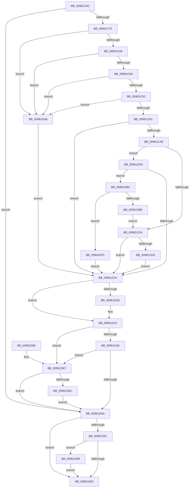

# PiCMOpenDeviceKey

- RVA: `0x00961C00`–`0x00961DFF` (길이 `511` bytes)
- VA: `0x0000000140961C00`
- 실행 섹션: `PAGE`
- PDB 이름 있음: `예`; PDB Function 태그: `아니요`
- unwind 정보 RVA: `0x00093360`
- 디코드: `133`개 명령, `511/511` bytes 표시
- 미해석 바이트: `0` (있으면 어셈블리에 `.byte`로 보존)

> 이 문서는 커널 이미지의 기계어와 PDB 기호를 분석해 생성했습니다. 4번과 5번은 함수 원형과 자료형을 바이너리 사용 방식에서 추정한 C 해석이며 원본 소스 복구 결과는 아닙니다.

## 1. Dependencies

- 직접 호출 지점: **10**; 고유 호출 대상: **9**
- 직접 호출자로 확인된 함수: **1**
- RIP 상대 이미지 참조: **1**

### Outgoing calls
- `0x00961C66` → [PiCMCaptureRegistryInputData](PiCMCaptureRegistryInputData_function_00962108.md) (function, `0x00962108`)
- `0x00961CA3` → [PiCMConvertDeviceKeyType](PiCMConvertDeviceKeyType_function_00962420.md) (function, `0x00962420`)
- `0x00961CDC` → [_CmOpenDeviceRegKey](../8E/_CmOpenDeviceRegKey_function_008EE540.md) (function, `0x008EE540`)
- `0x00961D01` → [PiCMDuplicateRegistryHandle](PiCMDuplicateRegistryHandle_function_009624C4.md) (function, `0x009624C4`)
- `0x00961D2D` → [PiCMReturnHandleResultData](PiCMReturnHandleResultData_function_00962354.md) (function, `0x00962354`)
- `0x00961D3D` → [ZwClose](../../text/6A/ZwClose_function_006AD2B0.md) (function, `0x006AD2B0`)
- `0x00961D92` → [ObCloseHandle](../8A/ObCloseHandle_function_008A1870.md) (function, `0x008A1870`)
- `0x00961D9F` → [ExFreePoolWithTag](../../poolcode/B8/ExFreePoolWithTag_function_00B82870.md) (function, `0x00B82870`)
- `0x00961DB5` → [PiAuDoesClientHaveAccess](PiAuDoesClientHaveAccess_function_00962940.md) (function, `0x00962940`)
- `0x00961DE9` → [_CmOpenDeviceRegKey](../8E/_CmOpenDeviceRegKey_function_008EE540.md) (function, `0x008EE540`)

### Direct callers
- [PiCMHandleIoctl](../8E/PiCMHandleIoctl_function_008EB880.md) at `0x008EBE77`

### Static image references
- `0x00961CC7` → RVA `0x00E66398` (`.data`; read)

## 2. Other-region calls and transfers

- 다른 실행 섹션으로 향하는 call: **2**
  - `0x00961D3D` → [ZwClose](../../text/6A/ZwClose_function_006AD2B0.md) (`PAGE` → `.text`)
  - `0x00961D9F` → [ExFreePoolWithTag](../../poolcode/B8/ExFreePoolWithTag_function_00B82870.md) (`PAGE` → `POOLCODE`)
- 별도 외부 분기/꼬리 이동을 확인하지 못했습니다.

## 3. Assembly (complete function range)

```asm
00961C00  48 8B C4                        mov rax, rsp
00961C03  48 89 58 08                     mov qword ptr [rax + 8], rbx
00961C07  48 89 70 10                     mov qword ptr [rax + 0x10], rsi
00961C0B  48 89 78 18                     mov qword ptr [rax + 0x18], rdi
00961C0F  4C 89 60 20                     mov qword ptr [rax + 0x20], r12
00961C13  55                              push rbp
00961C14  41 55                           push r13
00961C16  41 57                           push r15
00961C18  48 8B EC                        mov rbp, rsp
00961C1B  48 81 EC 80 00 00 00            sub rsp, 0x80
00961C22  48 83 65 C0 00                  and qword ptr [rbp - 0x40], 0
00961C27  0F 57 C0                        xorps xmm0, xmm0
00961C2A  4C 8B 6D 48                     mov r13, qword ptr [rbp + 0x48]
00961C2E  41 8B F1                        mov esi, r9d
00961C31  48 83 65 C8 00                  and qword ptr [rbp - 0x38], 0
00961C36  4C 8D 4D D0                     lea r9, [rbp - 0x30]
00961C3A  83 65 48 00                     and dword ptr [rbp + 0x48], 0
00961C3E  4D 8B F8                        mov r15, r8
00961C41  44 8B 45 40                     mov r8d, dword ptr [rbp + 0x40]
00961C45  41 83 65 00 00                  and dword ptr [r13], 0
00961C4A  65 48 8B 04 25 88 01 00 00      mov rax, qword ptr gs:[0x188]
00961C53  0F 11 45 D0                     movups xmmword ptr [rbp - 0x30], xmm0
00961C57  0F 11 45 E0                     movups xmmword ptr [rbp - 0x20], xmm0
00961C5B  44 8A A0 32 02 00 00            mov r12b, byte ptr [rax + 0x232]
00961C62  0F 11 45 F0                     movups xmmword ptr [rbp - 0x10], xmm0
00961C66  E8 9D 04 00 00                  call 0x140962108
00961C6B  8B F8                           mov edi, eax
00961C6D  85 C0                           test eax, eax
00961C6F  0F 88 D5 00 00 00               js 0x140961d4a
00961C75  48 83 7D E0 00                  cmp qword ptr [rbp - 0x20], 0
00961C7A  0F 84 26 01 00 00               je 0x140961da6
00961C80  83 7D D8 01                     cmp dword ptr [rbp - 0x28], 1
00961C84  0F 85 1C 01 00 00               jne 0x140961da6
00961C8A  4D 85 FF                        test r15, r15
00961C8D  0F 84 13 01 00 00               je 0x140961da6
00961C93  83 FE 10                        cmp esi, 0x10
00961C96  0F 82 0A 01 00 00               jb 0x140961da6
00961C9C  8B 4D D4                        mov ecx, dword ptr [rbp - 0x2c]
00961C9F  48 8D 55 48                     lea rdx, [rbp + 0x48]
00961CA3  E8 78 07 00 00                  call 0x140962420
00961CA8  8B D8                           mov ebx, eax
00961CAA  85 C0                           test eax, eax
00961CAC  78 66                           js 0x140961d14
00961CAE  48 83 64 24 38 00               and qword ptr [rsp + 0x38], 0
00961CB4  48 8D 45 C0                     lea rax, [rbp - 0x40]
00961CB8  8B 7D EC                        mov edi, dword ptr [rbp - 0x14]
00961CBB  44 8B 4D F4                     mov r9d, dword ptr [rbp - 0xc]
00961CBF  44 8B 45 48                     mov r8d, dword ptr [rbp + 0x48]
00961CC3  48 8B 55 E0                     mov rdx, qword ptr [rbp - 0x20]
00961CC7  48 8B 0D CA 46 50 00            mov rcx, qword ptr [rip + 0x5046ca]
00961CCE  48 89 44 24 30                  mov qword ptr [rsp + 0x30], rax
00961CD3  C6 44 24 28 00                  mov byte ptr [rsp + 0x28], 0
00961CD8  89 7C 24 20                     mov dword ptr [rsp + 0x20], edi
00961CDC  E8 5F C8 F8 FF                  call 0x1408ee540
00961CE1  8B D8                           mov ebx, eax
00961CE3  3D 34 00 00 C0                  cmp eax, 0xc0000034
00961CE8  74 20                           je 0x140961d0a
00961CEA  85 DB                           test ebx, ebx
00961CEC  78 26                           js 0x140961d14
00961CEE  48 8B 4D C0                     mov rcx, qword ptr [rbp - 0x40]
00961CF2  48 8D 45 C8                     lea rax, [rbp - 0x38]
00961CF6  45 8A CC                        mov r9b, r12b
00961CF9  48 89 44 24 20                  mov qword ptr [rsp + 0x20], rax
00961CFE  44 8B C7                        mov r8d, edi
00961D01  E8 BE 07 00 00                  call 0x1409624c4
00961D06  8B D8                           mov ebx, eax
00961D08  EB 0A                           jmp 0x140961d14
00961D0A  83 7D F0 01                     cmp dword ptr [rbp - 0x10], 1
00961D0E  0F 84 9C 00 00 00               je 0x140961db0
00961D14  44 8B 45 F8                     mov r8d, dword ptr [rbp - 8]
00961D18  4D 8B CF                        mov r9, r15
00961D1B  4C 89 6C 24 28                  mov qword ptr [rsp + 0x28], r13
00961D20  8B CB                           mov ecx, ebx
00961D22  89 74 24 20                     mov dword ptr [rsp + 0x20], esi
00961D26  48 8B 75 C8                     mov rsi, qword ptr [rbp - 0x38]
00961D2A  48 8B D6                        mov rdx, rsi
00961D2D  E8 22 06 00 00                  call 0x140962354
00961D32  48 8B 4D C0                     mov rcx, qword ptr [rbp - 0x40]
00961D36  8B F8                           mov edi, eax
00961D38  48 85 C9                        test rcx, rcx
00961D3B  74 05                           je 0x140961d42
00961D3D  E8 6E B5 D4 FF                  call 0x1406ad2b0
00961D42  85 FF                           test edi, edi
00961D44  78 41                           js 0x140961d87
00961D46  85 DB                           test ebx, ebx
00961D48  78 3D                           js 0x140961d87
00961D4A  48 83 7D E0 00                  cmp qword ptr [rbp - 0x20], 0
00961D4F  74 12                           je 0x140961d63
00961D51  65 48 8B 04 25 88 01 00 00      mov rax, qword ptr gs:[0x188]
00961D5A  80 B8 32 02 00 00 00            cmp byte ptr [rax + 0x232], 0
00961D61  75 36                           jne 0x140961d99
00961D63  4C 8D 9C 24 80 00 00 00         lea r11, [rsp + 0x80]
00961D6B  8B C7                           mov eax, edi
00961D6D  49 8B 5B 20                     mov rbx, qword ptr [r11 + 0x20]
00961D71  49 8B 73 28                     mov rsi, qword ptr [r11 + 0x28]
00961D75  49 8B 7B 30                     mov rdi, qword ptr [r11 + 0x30]
00961D79  4D 8B 63 38                     mov r12, qword ptr [r11 + 0x38]
00961D7D  49 8B E3                        mov rsp, r11
00961D80  41 5F                           pop r15
00961D82  41 5D                           pop r13
00961D84  5D                              pop rbp
00961D85  C3                              ret
00961D86  CC                              int3
00961D87  48 85 F6                        test rsi, rsi
00961D8A  74 BE                           je 0x140961d4a
00961D8C  41 8A D4                        mov dl, r12b
00961D8F  48 8B CE                        mov rcx, rsi
00961D92  E8 D9 FA F3 FF                  call 0x1408a1870
00961D97  EB B1                           jmp 0x140961d4a
00961D99  48 8B 4D E0                     mov rcx, qword ptr [rbp - 0x20]
00961D9D  33 D2                           xor edx, edx
00961D9F  E8 CC 0A 22 00                  call 0x140b82870
00961DA4  EB BD                           jmp 0x140961d63
00961DA6  BB 0D 00 00 C0                  mov ebx, 0xc000000d
00961DAB  E9 64 FF FF FF                  jmp 0x140961d14
00961DB0  B9 02 00 00 00                  mov ecx, 2
00961DB5  E8 86 0B 00 00                  call 0x140962940
00961DBA  84 C0                           test al, al
00961DBC  74 37                           je 0x140961df5
00961DBE  48 83 64 24 38 00               and qword ptr [rsp + 0x38], 0
00961DC4  48 8D 45 C0                     lea rax, [rbp - 0x40]
00961DC8  44 8B 4D F4                     mov r9d, dword ptr [rbp - 0xc]
00961DCC  44 8B 45 48                     mov r8d, dword ptr [rbp + 0x48]
00961DD0  48 8B 55 E0                     mov rdx, qword ptr [rbp - 0x20]
00961DD4  48 8B 0D BD 45 50 00            mov rcx, qword ptr [rip + 0x5045bd]
00961DDB  48 89 44 24 30                  mov qword ptr [rsp + 0x30], rax
00961DE0  C6 44 24 28 01                  mov byte ptr [rsp + 0x28], 1
00961DE5  89 7C 24 20                     mov dword ptr [rsp + 0x20], edi
00961DE9  E8 52 C7 F8 FF                  call 0x1408ee540
00961DEE  8B D8                           mov ebx, eax
00961DF0  E9 F5 FE FF FF                  jmp 0x140961cea
00961DF5  BB 22 00 00 C0                  mov ebx, 0xc0000022
00961DFA  E9 15 FF FF FF                  jmp 0x140961d14
```

## 4. C-style interpretation (structured pseudocode)

```c
__int64 __fastcall PiCMOpenDeviceKey(__int64 a1, __int64 a2, __int64 a3, int a4, unsigned int a5, unsigned int a6)
{
    __int64 result;
    __int64 v_rsp;
    unsigned __int64 v_stack_m18;
    unsigned int v_stack_m20;
    unsigned int v_stack_m24;
    unsigned __int64 v_stack_m28;
    unsigned int v_stack_m2C;
    unsigned __int64 v_stack_m38;
    unsigned int v_stack_m40;
    unsigned int v_stack_m44;
    unsigned __int64 v_stack_m48;
    unsigned __int64 v_stack_m50;
    unsigned __int64 v_stack_m58;
    unsigned __int64 v_stack_m60;
    unsigned __int64 v_stack_m68;
    unsigned __int8 v_stack_m70;
    unsigned int v_stack_m78;

    *(unsigned __int64 *)(v_rsp + 8) = v_rbx;
    *(unsigned __int64 *)(v_rsp + 16) = v_rsi;
    *(unsigned __int64 *)(v_rsp + 24) = v_rdi;
    *(unsigned __int64 *)(v_rsp + 32) = v_r12;
    v_rsp = (v_rsp) - (128);
    v_stack_m48 = v_xmm0;
    v_stack_m38 = v_xmm0;
    v_stack_m28 = v_xmm0;
    result = PiCMCaptureRegistryInputData(a1, a2, (unsigned int)(a5), v_stack_m48);
    if (sign_flag) goto loc_00961D4A;
    if (v_stack_m38 == 0) goto loc_00961DA6;
    if (v_stack_m40 != 1) goto loc_00961DA6;
    if (a3 == 0) goto loc_00961DA6;
    if (((unsigned int)((unsigned int)(a4))) < 16) goto loc_00961DA6;
    result = PiCMConvertDeviceKeyType((unsigned int)(v_stack_m44), a6, (unsigned int)(a5), v_stack_m48);
    if (sign_flag) goto loc_00961D14;
    v_stack_m68 = v_stack_m58;
    v_stack_m70 = 0;
    v_stack_m78 = (unsigned int)((unsigned int)(v_stack_m2C));
    result = _CmOpenDeviceRegKey(*(unsigned __int64 *)(v_rip + 5261002), v_stack_m38, (unsigned int)(a6), (unsigned int)(v_stack_m24));
    if (((unsigned int)(result)) == 0xC0000034ULL) goto loc_00961D0A;
loc_00961CEA:
    if (sign_flag) goto loc_00961D14;
    v_stack_m78 = v_stack_m50;
    result = PiCMDuplicateRegistryHandle(v_stack_m58, v_stack_m38, (unsigned int)((unsigned int)((unsigned int)(v_stack_m2C))), (unsigned __int8)(*(unsigned __int8 *)(*(unsigned __int64 *)(gs_base + (0 + 392)) + 562)));
    goto loc_00961D14;
loc_00961D0A:
    if (v_stack_m28 == 1) goto loc_00961DB0;
loc_00961D14:
    v_stack_m70 = a6;
    v_stack_m78 = (unsigned int)((unsigned int)(a4));
    result = PiCMReturnHandleResultData((unsigned int)((unsigned int)((unsigned int)((unsigned int)(result)))), v_stack_m50, (unsigned int)(v_stack_m20), a3);
    if (v_stack_m58 != 0) {
        result = ZwClose(v_stack_m58, v_stack_m50, (unsigned int)(v_stack_m20), a3);
    }
    if (sign_flag) goto loc_00961D87;
    if (sign_flag) goto loc_00961D87;
loc_00961D4A:
    if (v_stack_m38 == 0) goto loc_00961D63;
    if ((*(unsigned __int8 *)(*(unsigned __int64 *)(gs_base + (0 + 392)) + 562)) != 0) goto loc_00961D99;
loc_00961D63:
    return (unsigned int)((unsigned int)((unsigned int)((unsigned int)(result))));
loc_00961D87:
    if (*(unsigned __int64 *)(v_stack_m18 + 40) == 0) goto loc_00961D4A;
    result = ObCloseHandle(*(unsigned __int64 *)(v_stack_m18 + 40), (unsigned __int8)(*(unsigned __int64 *)(v_stack_m18 + 56)), (unsigned int)(v_stack_m20), a3);
    goto loc_00961D4A;
loc_00961D99:
    a2 = 0;
    result = ExFreePoolWithTag(v_stack_m38, a2, (unsigned int)(v_stack_m20), a3);
    goto loc_00961D63;
loc_00961DA6:
    goto loc_00961D14;
loc_00961DB0:
    result = PiAuDoesClientHaveAccess(2, a2, (unsigned int)(v_stack_m20), a3);
    if ((unsigned __int8)(result) == 0) goto loc_00961DF5;
    v_stack_m50 = v_stack_m58;
    v_stack_m58 = 1;
    v_stack_m60 = (unsigned int)(*(unsigned __int64 *)(v_stack_m18 + 48));
    result = _CmOpenDeviceRegKey(*(unsigned __int64 *)(v_rip + 5260733), v_stack_m38, (unsigned int)(a6), (unsigned int)(v_stack_m24));
    goto loc_00961CEA;
loc_00961DF5:
    goto loc_00961D14;
}
```

## 5. (Beta) C Style

```c
int64_t PiCMOpenDeviceKey(int64_t Arg1, int64_t Arg2, int64_t Arg3, int32_t Arg4, uint32_t Arg5, void *Arg6)
{
    uint8_t *arg6 = (uint8_t *)Arg6;

    int64_t result;
    int64_t local_rsp;
    uint64_t v_stack_m18;
    uint32_t v_stack_m20;
    uint32_t v_stack_m24;
    uint64_t v_stack_m28;
    uint32_t v_stack_m2C;
    uint64_t v_stack_m38;
    uint32_t v_stack_m40;
    uint32_t v_stack_m44;
    uint64_t v_stack_m48;
    uint64_t v_stack_m50;
    uint64_t v_stack_m58;
    uint64_t v_stack_m60;
    uint64_t v_stack_m68;
    uint8_t v_stack_m70;
    uint32_t v_stack_m78;

    *(uint64_t *)(local_rsp + 0x8) = local_rbx;
    *(uint64_t *)(local_rsp + 0x10) = local_rsi;
    *(uint64_t *)(local_rsp + 0x18) = local_rdi;
    *(uint64_t *)(local_rsp + 0x20) = local_r12;
    local_rsp = (local_rsp) - (128);
    v_stack_m48 = v_xmm0;
    v_stack_m38 = v_xmm0;
    v_stack_m28 = v_xmm0;
    result = PiCMCaptureRegistryInputData(Arg1, Arg2, (uint32_t)(Arg5), v_stack_m48);
    if (sign_flag) goto loc_00961D4A;
    if (v_stack_m38 == 0) goto loc_00961DA6;
    if (v_stack_m40 != 1) goto loc_00961DA6;
    if (Arg3 == 0) goto loc_00961DA6;
    if (((uint32_t)((uint32_t)(Arg4))) < 16) goto loc_00961DA6;
    result = PiCMConvertDeviceKeyType((uint32_t)(v_stack_m44), Arg6, (uint32_t)(Arg5), v_stack_m48);
    if (sign_flag) goto loc_00961D14;
    v_stack_m68 = v_stack_m58;
    v_stack_m70 = 0;
    v_stack_m78 = (uint32_t)((uint32_t)(v_stack_m2C));
    result = _CmOpenDeviceRegKey(*(uint64_t *)(v_rip + 0x5046CA), v_stack_m38, (uint32_t)(Arg6), (uint32_t)(v_stack_m24));
    if (((uint32_t)(result)) == 0xC0000034ULL) goto loc_00961D0A;
loc_00961CEA:
    if (sign_flag) goto loc_00961D14;
    v_stack_m78 = v_stack_m50;
    result = PiCMDuplicateRegistryHandle(v_stack_m58, v_stack_m38, (uint32_t)((uint32_t)((uint32_t)(v_stack_m2C))), (uint8_t)(*(uint8_t *)(*(uint64_t *)(gs_base + (0 + 0x188)) + 0x232)));
    goto loc_00961D14;
loc_00961D0A:
    if (v_stack_m28 == 1) goto loc_00961DB0;
loc_00961D14:
    v_stack_m70 = Arg6;
    v_stack_m78 = (uint32_t)((uint32_t)(Arg4));
    result = PiCMReturnHandleResultData((uint32_t)((uint32_t)((uint32_t)((uint32_t)(result)))), v_stack_m50, (uint32_t)(v_stack_m20), Arg3);
    if (v_stack_m58 != 0) {
        result = ZwClose(v_stack_m58, v_stack_m50, (uint32_t)(v_stack_m20), Arg3);
    }
    if (sign_flag) goto loc_00961D87;
    if (sign_flag) goto loc_00961D87;
loc_00961D4A:
    if (v_stack_m38 == 0) goto loc_00961D63;
    if ((*(uint8_t *)(*(uint64_t *)(gs_base + (0 + 0x188)) + 0x232)) != 0) goto loc_00961D99;
loc_00961D63:
    return (uint32_t)((uint32_t)((uint32_t)((uint32_t)(result))));
loc_00961D87:
    if (*(uint64_t *)(v_stack_m18 + 0x28) == 0) goto loc_00961D4A;
    result = ObCloseHandle(*(uint64_t *)(v_stack_m18 + 0x28), (uint8_t)(*(uint64_t *)(v_stack_m18 + 0x38)), (uint32_t)(v_stack_m20), Arg3);
    goto loc_00961D4A;
loc_00961D99:
    Arg2 = 0;
    result = ExFreePoolWithTag(v_stack_m38, Arg2, (uint32_t)(v_stack_m20), Arg3);
    goto loc_00961D63;
loc_00961DA6:
    goto loc_00961D14;
loc_00961DB0:
    result = PiAuDoesClientHaveAccess(2, Arg2, (uint32_t)(v_stack_m20), Arg3);
    if ((uint8_t)(result) == 0) goto loc_00961DF5;
    v_stack_m50 = v_stack_m58;
    v_stack_m58 = 1;
    v_stack_m60 = (uint32_t)(*(uint64_t *)(v_stack_m18 + 0x30));
    result = _CmOpenDeviceRegKey(*(uint64_t *)(v_rip + 0x5045BD), v_stack_m38, (uint32_t)(Arg6), (uint32_t)(v_stack_m24));
    goto loc_00961CEA;
loc_00961DF5:
    goto loc_00961D14;
}
```

### 관측된 메모리 오프셋

구조체 형식이 확인되지 않은 접근은 인자 기준의 오프셋으로만 기록했습니다.

| 기준 인자 | 오프셋 표현 | 폭 (bit) | 접근 |
|---|---:|---:|---|
| `Arg6` | `+ 0x0` | `32` | `R/W` |

## 6. Execution-region graph

[열기: 2D/3D 그래프와 함수 탐색 컨트롤 패널](../../../control-panel.html?section=page&rva=0x00961C00&view=graph)

- 2D 그래프는 위에서 아래로 흐르고, 3D 그래프는 빈 공간을 드래그해 회전합니다. Shift+드래그는 이동, 휠은 확대·축소, 함수 노드 선택은 대상 보고서 이동입니다.

### Static fallback


