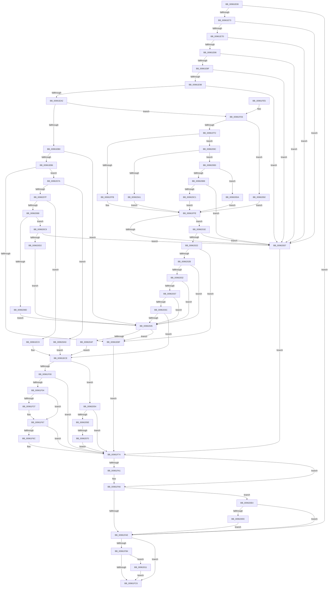

# PiCMOpenObjectKey

- RVA: `0x00961E08`–`0x009620FF` (길이 `759` bytes)
- VA: `0x0000000140961E08`
- 실행 섹션: `PAGE`
- PDB 이름 있음: `예`; PDB Function 태그: `예`
- unwind 정보 RVA: `0x00093380`
- 디코드: `192`개 명령, `759/759` bytes 표시
- 미해석 바이트: `0` (있으면 어셈블리에 `.byte`로 보존)

> 이 문서는 커널 이미지의 기계어와 PDB 기호를 분석해 생성했습니다. 4번과 5번은 함수 원형과 자료형을 바이너리 사용 방식에서 추정한 C 해석이며 원본 소스 복구 결과는 아닙니다.

## 1. Dependencies

- 직접 호출 지점: **10**; 고유 호출 대상: **10**
- 직접 호출자로 확인된 함수: **1**
- RIP 상대 이미지 참조: **3**

### Outgoing calls
- `0x00961E64` → [PiCMCaptureRegistryInputData](PiCMCaptureRegistryInputData_function_00962108.md) (function, `0x00962108`)
- `0x00961EEE` → [PnpOpenObjectRegKey](../8E/PnpOpenObjectRegKey_function_008E15E8.md) (function, `0x008E15E8`)
- `0x00961F28` → [ObReferenceObjectByHandle](../86/ObReferenceObjectByHandle_function_00868DB0.md) (function, `0x00868DB0`)
- `0x00961F60` → [ObOpenObjectByPointer](../8B/ObOpenObjectByPointer_function_008B7420.md) (function, `0x008B7420`)
- `0x00961F6F` → [ObfDereferenceObject](../../text/2F/ObfDereferenceObject_function_002F9350.md) (function, `0x002F9350`)
- `0x00961F8F` → [PiCMReturnHandleResultData](PiCMReturnHandleResultData_function_00962354.md) (function, `0x00962354`)
- `0x00961FA1` → [ZwClose](../../text/6A/ZwClose_function_006AD2B0.md) (function, `0x006AD2B0`)
- `0x00962017` → [ExFreePoolWithTag](../../poolcode/B8/ExFreePoolWithTag_function_00B82870.md) (function, `0x00B82870`)
- `0x00962063` → [PiAuDoesClientHaveAccess](PiAuDoesClientHaveAccess_function_00962940.md) (function, `0x00962940`)
- `0x009620F5` → [ObCloseHandle](../8A/ObCloseHandle_function_008A1870.md) (function, `0x008A1870`)

### Direct callers
- [PiCMHandleIoctl](../8E/PiCMHandleIoctl_function_008EB880.md) at `0x008EBE30`

### Static image references
- `0x00961EDD` → RVA `0x00E66398` (`.data`; read)
- `0x00961F04` → RVA `0x00FC6AC0` (`ALMOSTRO`; read)
- `0x00961FFE` → RVA `0x00E663D0` (`.data`; read)

## 2. Other-region calls and transfers

- 다른 실행 섹션으로 향하는 call: **3**
  - `0x00961F6F` → [ObfDereferenceObject](../../text/2F/ObfDereferenceObject_function_002F9350.md) (`PAGE` → `.text`)
  - `0x00961FA1` → [ZwClose](../../text/6A/ZwClose_function_006AD2B0.md) (`PAGE` → `.text`)
  - `0x00962017` → [ExFreePoolWithTag](../../poolcode/B8/ExFreePoolWithTag_function_00B82870.md) (`PAGE` → `POOLCODE`)
- call이 아닌 외부 분기/꼬리 이동: **1**
  - `0x0096206A` → [sub_00B27F5C](../B2/Unknown_function_00B27F5C.md) (`tail-transfer`)

## 3. Assembly (complete function range)

```asm
00961E08  48 8B C4                        mov rax, rsp
00961E0B  48 89 58 08                     mov qword ptr [rax + 8], rbx
00961E0F  48 89 78 10                     mov qword ptr [rax + 0x10], rdi
00961E13  4C 89 60 18                     mov qword ptr [rax + 0x18], r12
00961E17  55                              push rbp
00961E18  41 55                           push r13
00961E1A  41 57                           push r15
00961E1C  48 8D 68 B1                     lea rbp, [rax - 0x4f]
00961E20  48 81 EC 90 00 00 00            sub rsp, 0x90
00961E27  48 8B 45 7F                     mov rax, qword ptr [rbp + 0x7f]
00961E2B  0F 57 C0                        xorps xmm0, xmm0
00961E2E  33 FF                           xor edi, edi
00961E30  45 8B F9                        mov r15d, r9d
00961E33  48 89 7D EF                     mov qword ptr [rbp - 0x11], rdi
00961E37  4C 8D 4D FF                     lea r9, [rbp - 1]
00961E3B  4D 8B E0                        mov r12, r8
00961E3E  48 89 7D F7                     mov qword ptr [rbp - 9], rdi
00961E42  44 8B 45 77                     mov r8d, dword ptr [rbp + 0x77]
00961E46  89 38                           mov dword ptr [rax], edi
00961E48  65 48 8B 04 25 88 01 00 00      mov rax, qword ptr gs:[0x188]
00961E51  0F 11 45 FF                     movups xmmword ptr [rbp - 1], xmm0
00961E55  0F 11 45 0F                     movups xmmword ptr [rbp + 0xf], xmm0
00961E59  44 8A A8 32 02 00 00            mov r13b, byte ptr [rax + 0x232]
00961E60  0F 11 45 1F                     movups xmmword ptr [rbp + 0x1f], xmm0
00961E64  E8 9F 02 00 00                  call 0x140962108
00961E69  8B D8                           mov ebx, eax
00961E6B  85 C0                           test eax, eax
00961E6D  0F 88 3B 01 00 00               js 0x140961fae
00961E73  48 39 7D 0F                     cmp qword ptr [rbp + 0xf], rdi
00961E77  0F 84 8A 01 00 00               je 0x140962007
00961E7D  39 7D 03                        cmp dword ptr [rbp + 3], edi
00961E80  0F 85 81 01 00 00               jne 0x140962007
00961E86  39 7D 23                        cmp dword ptr [rbp + 0x23], edi
00961E89  0F 85 78 01 00 00               jne 0x140962007
00961E8F  4D 85 E4                        test r12, r12
00961E92  0F 84 6F 01 00 00               je 0x140962007
00961E98  41 83 FF 10                     cmp r15d, 0x10
00961E9C  0F 82 65 01 00 00               jb 0x140962007
00961EA2  8B 4D 07                        mov ecx, dword ptr [rbp + 7]
00961EA5  8D 5F 06                        lea ebx, [rdi + 6]
00961EA8  3B CB                           cmp ecx, ebx
00961EAA  0F 8F 36 01 00 00               jg 0x140961fe6
00961EB0  0F 84 8F 01 00 00               je 0x140962045
00961EB6  83 E9 01                        sub ecx, 1
00961EB9  0F 85 BB 01 00 00               jne 0x14096207a
00961EBF  BF BB 00 00 C0                  mov edi, 0xc00000bb
00961EC4  E9 AB 00 00 00                  jmp 0x140961f74
00961EC9  BB 04 00 00 00                  mov ebx, 4
00961ECE  44 8B 4D 1B                     mov r9d, dword ptr [rbp + 0x1b]
00961ED2  48 8D 45 EF                     lea rax, [rbp - 0x11]
00961ED6  48 8B 55 0F                     mov rdx, qword ptr [rbp + 0xf]
00961EDA  44 8B C3                        mov r8d, ebx
00961EDD  48 8B 0D B4 44 50 00            mov rcx, qword ptr [rip + 0x5044b4]
00961EE4  48 89 44 24 28                  mov qword ptr [rsp + 0x28], rax
00961EE9  40 88 7C 24 20                  mov byte ptr [rsp + 0x20], dil
00961EEE  E8 F5 F6 F7 FF                  call 0x1408e15e8
00961EF3  8B F8                           mov edi, eax
00961EF5  3D 34 00 00 C0                  cmp eax, 0xc0000034
00961EFA  0F 84 54 01 00 00               je 0x140962054
00961F00  85 FF                           test edi, edi
00961F02  78 70                           js 0x140961f74
00961F04  4C 8B 05 B5 4B 66 00            mov r8, qword ptr [rip + 0x664bb5]
00961F0B  48 8D 45 E7                     lea rax, [rbp - 0x19]
00961F0F  48 83 64 24 28 00               and qword ptr [rsp + 0x28], 0
00961F15  45 33 C9                        xor r9d, r9d
00961F18  48 8B 4D EF                     mov rcx, qword ptr [rbp - 0x11]
00961F1C  33 D2                           xor edx, edx
00961F1E  48 83 65 E7 00                  and qword ptr [rbp - 0x19], 0
00961F23  48 89 44 24 20                  mov qword ptr [rsp + 0x20], rax
00961F28  E8 83 6E F0 FF                  call 0x140868db0
00961F2D  48 8B 5D E7                     mov rbx, qword ptr [rbp - 0x19]
00961F31  8B F8                           mov edi, eax
00961F33  85 C0                           test eax, eax
00961F35  78 30                           js 0x140961f67
00961F37  44 8B 4D 1B                     mov r9d, dword ptr [rbp + 0x1b]
00961F3B  48 8D 45 F7                     lea rax, [rbp - 9]
00961F3F  48 89 44 24 30                  mov qword ptr [rsp + 0x30], rax
00961F44  45 33 C0                        xor r8d, r8d
00961F47  48 8B 05 72 4B 66 00            mov rax, qword ptr [rip + 0x664b72]
00961F4E  BA 40 04 00 00                  mov edx, 0x440
00961F53  44 88 6C 24 28                  mov byte ptr [rsp + 0x28], r13b
00961F58  48 8B CB                        mov rcx, rbx
00961F5B  48 89 44 24 20                  mov qword ptr [rsp + 0x20], rax
00961F60  E8 BB 54 F5 FF                  call 0x1408b7420
00961F65  8B F8                           mov edi, eax
00961F67  48 85 DB                        test rbx, rbx
00961F6A  74 08                           je 0x140961f74
00961F6C  48 8B CB                        mov rcx, rbx
00961F6F  E8 DC 73 99 FF                  call 0x1402f9350
00961F74  48 8B 45 7F                     mov rax, qword ptr [rbp + 0x7f]
00961F78  4D 8B CC                        mov r9, r12
00961F7B  44 8B 45 27                     mov r8d, dword ptr [rbp + 0x27]
00961F7F  8B CF                           mov ecx, edi
00961F81  48 8B 55 F7                     mov rdx, qword ptr [rbp - 9]
00961F85  48 89 44 24 28                  mov qword ptr [rsp + 0x28], rax
00961F8A  44 89 7C 24 20                  mov dword ptr [rsp + 0x20], r15d
00961F8F  E8 C0 03 00 00                  call 0x140962354
00961F94  48 8B 4D EF                     mov rcx, qword ptr [rbp - 0x11]
00961F98  33 FF                           xor edi, edi
00961F9A  8B D8                           mov ebx, eax
00961F9C  48 85 C9                        test rcx, rcx
00961F9F  74 05                           je 0x140961fa6
00961FA1  E8 0A B3 D4 FF                  call 0x1406ad2b0
00961FA6  85 DB                           test ebx, ebx
00961FA8  0F 88 36 01 00 00               js 0x1409620e4
00961FAE  48 39 7D 0F                     cmp qword ptr [rbp + 0xf], rdi
00961FB2  74 12                           je 0x140961fc6
00961FB4  65 48 8B 04 25 88 01 00 00      mov rax, qword ptr gs:[0x188]
00961FBD  40 38 B8 32 02 00 00            cmp byte ptr [rax + 0x232], dil
00961FC4  75 4B                           jne 0x140962011
00961FC6  4C 8D 9C 24 90 00 00 00         lea r11, [rsp + 0x90]
00961FCE  8B C3                           mov eax, ebx
00961FD0  49 8B 5B 20                     mov rbx, qword ptr [r11 + 0x20]
00961FD4  49 8B 7B 28                     mov rdi, qword ptr [r11 + 0x28]
00961FD8  4D 8B 63 30                     mov r12, qword ptr [r11 + 0x30]
00961FDC  49 8B E3                        mov rsp, r11
00961FDF  41 5F                           pop r15
00961FE1  41 5D                           pop r13
00961FE3  5D                              pop rbp
00961FE4  C3                              ret
00961FE5  CC                              int3
00961FE6  81 E9 01 00 01 00               sub ecx, 0x10001
00961FEC  0F 84 A0 00 00 00               je 0x140962092
00961FF2  83 E9 01                        sub ecx, 1
00961FF5  0F 85 A1 00 00 00               jne 0x14096209c
00961FFB  8D 59 08                        lea ebx, [rcx + 8]
00961FFE  48 39 3D CB 43 50 00            cmp qword ptr [rip + 0x5043cb], rdi
00962005  75 17                           jne 0x14096201e
00962007  BF 0D 00 00 C0                  mov edi, 0xc000000d
0096200C  E9 63 FF FF FF                  jmp 0x140961f74
00962011  48 8B 4D 0F                     mov rcx, qword ptr [rbp + 0xf]
00962015  33 D2                           xor edx, edx
00962017  E8 54 08 22 00                  call 0x140b82870
0096201C  EB A8                           jmp 0x140961fc6
0096201E  85 DB                           test ebx, ebx
00962020  74 E5                           je 0x140962007
00962022  83 FB 01                        cmp ebx, 1
00962025  0F 84 94 FE FF FF               je 0x140961ebf
0096202B  8B CB                           mov ecx, ebx
0096202D  83 E9 01                        sub ecx, 1
00962030  74 13                           je 0x140962045
00962032  83 E9 02                        sub ecx, 2
00962035  74 0E                           je 0x140962045
00962037  83 E9 02                        sub ecx, 2
0096203A  74 09                           je 0x140962045
0096203C  83 F9 01                        cmp ecx, 1
0096203F  0F 85 89 FE FF FF               jne 0x140961ece
00962045  83 7D 1F 01                     cmp dword ptr [rbp + 0x1f], 1
00962049  0F 84 70 FE FF FF               je 0x140961ebf
0096204F  E9 7A FE FF FF                  jmp 0x140961ece
00962054  83 7D 1F 01                     cmp dword ptr [rbp + 0x1f], 1
00962058  0F 85 16 FF FF FF               jne 0x140961f74
0096205E  B9 02 00 00 00                  mov ecx, 2
00962063  E8 D8 08 00 00                  call 0x140962940
00962068  84 C0                           test al, al
0096206A  0F 85 EC 5E 1C 00               jne 0x140b27f5c
00962070  BF 22 00 00 C0                  mov edi, 0xc0000022
00962075  E9 FA FE FF FF                  jmp 0x140961f74
0096207A  83 E9 01                        sub ecx, 1
0096207D  74 2A                           je 0x1409620a9
0096207F  83 E9 01                        sub ecx, 1
00962082  0F 84 41 FE FF FF               je 0x140961ec9
00962088  83 E9 01                        sub ecx, 1
0096208B  75 3C                           jne 0x1409620c9
0096208D  8D 59 03                        lea ebx, [rcx + 3]
00962090  EB B3                           jmp 0x140962045
00962092  BB 07 00 00 00                  mov ebx, 7
00962097  E9 62 FF FF FF                  jmp 0x140961ffe
0096209C  83 E9 01                        sub ecx, 1
0096209F  75 12                           jne 0x1409620b3
009620A1  8D 59 09                        lea ebx, [rcx + 9]
009620A4  E9 55 FF FF FF                  jmp 0x140961ffe
009620A9  BB 02 00 00 00                  mov ebx, 2
009620AE  E9 1B FE FF FF                  jmp 0x140961ece
009620B3  83 E9 01                        sub ecx, 1
009620B6  74 22                           je 0x1409620da
009620B8  83 F9 01                        cmp ecx, 1
009620BB  0F 85 46 FF FF FF               jne 0x140962007
009620C1  8D 59 0A                        lea ebx, [rcx + 0xa]
009620C4  E9 35 FF FF FF                  jmp 0x140961ffe
009620C9  83 F9 01                        cmp ecx, 1
009620CC  0F 85 35 FF FF FF               jne 0x140962007
009620D2  8D 59 04                        lea ebx, [rcx + 4]
009620D5  E9 6B FF FF FF                  jmp 0x140962045
009620DA  BB 0A 00 00 00                  mov ebx, 0xa
009620DF  E9 1A FF FF FF                  jmp 0x140961ffe
009620E4  48 39 7D F7                     cmp qword ptr [rbp - 9], rdi
009620E8  0F 84 C0 FE FF FF               je 0x140961fae
009620EE  48 8B 4D F7                     mov rcx, qword ptr [rbp - 9]
009620F2  41 8A D5                        mov dl, r13b
009620F5  E8 76 F7 F3 FF                  call 0x1408a1870
009620FA  E9 AF FE FF FF                  jmp 0x140961fae
```

## 4. C-style interpretation (structured pseudocode)

```c
__int64 __fastcall PiCMOpenObjectKey(__int64 a1, __int64 a2, __int64 a3, int a4)
{
    __int64 result;
    __int64 v_rdi;
    __int64 v_rsp;
    unsigned __int64 v_stack_m18;
    unsigned __int64 v_stack_m78;
    unsigned __int64 v_stack_m80;
    unsigned __int8 v_stack_m88;

    *(unsigned __int64 *)(v_rsp + 8) = v_rbx;
    *(unsigned __int64 *)(v_rsp + 16) = v_rdi;
    *(unsigned __int64 *)(v_rsp + 24) = v_r12;
    v_rsp = (v_rsp) - (144);
    v_rdi = 0;
    *(unsigned __int64 *)(v_rsp - 79 - 17) = 0;
    *(unsigned __int64 *)(v_rsp - 79 - 9) = 0;
    *(unsigned int *)(*(unsigned __int64 *)(v_rsp - 79 + 127)) = 0;
    *(unsigned __int64 *)(v_rsp - 79 - 1) = v_xmm0;
    *(unsigned __int64 *)(v_rsp - 79 + 15) = v_xmm0;
    *(unsigned __int64 *)(v_rsp - 79 + 31) = v_xmm0;
    result = PiCMCaptureRegistryInputData(a1, a2, (unsigned int)(*(unsigned int *)(v_rsp - 79 + 119)), v_rsp - 79 - 1);
    if (sign_flag) goto loc_00961FAE;
    if ((*(unsigned __int64 *)(v_rsp - 79 + 15)) == 0) goto loc_00962007;
    if ((*(unsigned int *)(v_rsp - 79 + 3)) != 0) goto loc_00962007;
    if ((*(unsigned int *)(v_rsp - 79 + 35)) != 0) goto loc_00962007;
    if (a3 == 0) goto loc_00962007;
    if (((unsigned int)((unsigned int)(a4))) < 16) goto loc_00962007;
    if (((unsigned int)((unsigned int)(*(unsigned int *)(v_rsp - 79 + 7)))) > ((unsigned int)(v_rdi + 6))) goto loc_00961FE6;
    if (((unsigned int)((unsigned int)(*(unsigned int *)(v_rsp - 79 + 7)))) == ((unsigned int)(v_rdi + 6))) goto loc_00962045;
    a1 = (unsigned int)(((unsigned int)(*(unsigned int *)(v_rsp - 79 + 7))) - (1));
    if (condition_is_not_equal) goto loc_0096207A;
loc_00961EBF:
    goto loc_00961F74;
loc_00961EC9:
loc_00961ECE:
    v_stack_m80 = v_rsp - 79 - 17;
    v_stack_m88 = (unsigned __int8)((unsigned int)(0xC00000BBULL));
    result = PnpOpenObjectRegKey(*(unsigned __int64 *)(v_rip + 5260468), *(unsigned __int64 *)(v_rsp - 79 + 15), 4, (unsigned int)(*(unsigned int *)(v_rsp - 79 + 27)));
    if (((unsigned int)(result)) == 0xC0000034ULL) goto loc_00962054;
    if (sign_flag) goto loc_00961F74;
    a4 = 0;
    a2 = 0;
    v_stack_m88 = v_rsp - 79 - 25;
    result = ObReferenceObjectByHandle(*(unsigned __int64 *)(v_rsp - 79 - 17), a2, *(unsigned __int64 *)(v_rip + 6704053), a4);
    v_rdi = (unsigned int)((unsigned int)(result));
    if (!(sign_flag)) {
        a4 = *(unsigned int *)(v_rsp - 79 + 27);
        result = v_rsp - 79 - 9;
        v_stack_m78 = result;
        a3 = 0;
        result = *(unsigned __int64 *)(v_rip + 6703986);
        a2 = 0x440ULL;
        v_stack_m80 = (unsigned __int8)(*(unsigned __int8 *)(*(unsigned __int64 *)(gs_base + (0 + 392)) + 562));
        a1 = *(unsigned __int64 *)(v_rsp - 79 - 25);
        v_stack_m88 = result;
        result = ObOpenObjectByPointer(a1, a2, a3, a4);
        v_rdi = (unsigned int)(result);
    }
    if (*(unsigned __int64 *)(v_rsp - 79 - 25) != 0) {
        a1 = *(unsigned __int64 *)(v_rsp - 79 - 25);
        result = ObfDereferenceObject(a1, a2, a3, a4);
    }
    v_stack_m80 = *(unsigned __int64 *)(v_rsp - 79 + 127);
    v_stack_m88 = (unsigned int)((unsigned int)(a4));
    result = PiCMReturnHandleResultData((unsigned int)((unsigned int)(v_rdi)), *(unsigned __int64 *)(v_rsp - 79 - 9), (unsigned int)(*(unsigned int *)(v_rsp - 79 + 39)), 0);
    v_rdi = 0;
    if (*(unsigned __int64 *)(v_rsp - 79 - 17) != 0) {
        result = ZwClose(*(unsigned __int64 *)(v_rsp - 79 - 17), *(unsigned __int64 *)(v_rsp - 79 - 9), (unsigned int)(*(unsigned int *)(v_rsp - 79 + 39)), 0);
    }
    if (sign_flag) goto loc_009620E4;
loc_00961FAE:
    if ((*(unsigned __int64 *)(v_rsp - 79 + 15)) == 0) goto loc_00961FC6;
    if ((*(unsigned __int8 *)(*(unsigned __int64 *)(gs_base + (0 + 392)) + 562)) != 0) goto loc_00962011;
loc_00961FC6:
    return (unsigned int)((unsigned int)((unsigned int)((unsigned int)(result))));
loc_00961FE6:
    a1 = (unsigned int)((*(unsigned __int64 *)(v_rsp - 79 - 17)) - (0x10001ULL));
    if (condition_is_equal) goto loc_00962092;
    a1 = (unsigned int)((a1) - (1));
    if (condition_is_not_equal) goto loc_0096209C;
loc_00961FFE:
    if ((*(unsigned __int64 *)(v_rip + 5260235)) != (*(unsigned __int64 *)(v_stack_m18 + 40))) goto loc_0096201E;
loc_00962007:
    goto loc_00961F74;
loc_00962011:
    a2 = 0;
    result = ExFreePoolWithTag(*(unsigned __int64 *)(v_rsp - 79 + 15), a2, (unsigned int)(*(unsigned int *)(v_rsp - 79 + 39)), 0);
    goto loc_00961FC6;
loc_0096201E:
    if ((unsigned int)(a1 + 8) == 0) goto loc_00962007;
    if (((unsigned int)(a1 + 8)) == 1) goto loc_00961EBF;
    a1 = (unsigned int)(((unsigned int)((unsigned int)(a1 + 8))) - (1));
    if (condition_is_equal) goto loc_00962045;
    a1 = (unsigned int)((a1) - (2));
    if (condition_is_equal) goto loc_00962045;
    a1 = (unsigned int)((a1) - (2));
    if (condition_is_equal) goto loc_00962045;
    if (((unsigned int)(a1)) != 1) goto loc_00961ECE;
loc_00962045:
    if ((*(unsigned int *)(v_rsp - 79 + 31)) == 1) goto loc_00961EBF;
    goto loc_00961ECE;
loc_00962054:
    if ((*(unsigned int *)(v_rsp - 79 + 31)) != 1) goto loc_00961F74;
    result = PiAuDoesClientHaveAccess(2, a2, (unsigned int)(*(unsigned int *)(v_rsp - 79 + 39)), 0);
    goto loc_00961F74;
loc_0096207A:
    a1 = (unsigned int)((2) - (1));
    if (condition_is_equal) goto loc_009620A9;
    a1 = (unsigned int)((a1) - (1));
    if (condition_is_equal) goto loc_00961EC9;
    a1 = (unsigned int)((a1) - (1));
    if (condition_is_not_equal) goto loc_009620C9;
    goto loc_00962045;
loc_00962092:
    goto loc_00961FFE;
loc_0096209C:
    a1 = (unsigned int)((a1) - (1));
    if (condition_is_not_equal) goto loc_009620B3;
    goto loc_00961FFE;
loc_009620A9:
    goto loc_00961ECE;
loc_009620B3:
    a1 = (unsigned int)((a1) - (1));
    if (condition_is_equal) goto loc_009620DA;
    if (((unsigned int)(a1)) != 1) goto loc_00962007;
    goto loc_00961FFE;
loc_009620C9:
    if (((unsigned int)(a1)) != 1) goto loc_00962007;
    goto loc_00962045;
loc_009620DA:
    goto loc_00961FFE;
loc_009620E4:
    if ((*(unsigned __int64 *)(v_rsp - 79 - 9)) == ((unsigned int)(0xC0000022ULL))) goto loc_00961FAE;
    result = ObCloseHandle(*(unsigned __int64 *)(v_rsp - 79 - 9), (unsigned __int8)(*(unsigned __int8 *)(*(unsigned __int64 *)(gs_base + (0 + 392)) + 562)), (unsigned int)(*(unsigned int *)(v_rsp - 79 + 39)), 0);
    goto loc_00961FAE;
}
```

## 5. (Beta) C Style

```c
int64_t PiCMOpenObjectKey(int64_t Arg1, int64_t Arg2, int64_t Arg3, int32_t Arg4)
{
    int64_t result;
    int64_t local_rdi;
    int64_t local_rsp;
    uint64_t v_stack_m18;
    uint64_t v_stack_m78;
    uint64_t v_stack_m80;
    uint8_t v_stack_m88;

    *(uint64_t *)(local_rsp + 0x8) = local_rbx;
    *(uint64_t *)(local_rsp + 0x10) = local_rdi;
    *(uint64_t *)(local_rsp + 0x18) = local_r12;
    local_rsp = (local_rsp) - (144);
    local_rdi = 0;
    *(uint64_t *)(local_rsp - 0x4F - 0x11) = 0;
    *(uint64_t *)(local_rsp - 0x4F - 0x9) = 0;
    *(uint32_t *)(*(uint64_t *)(local_rsp - 0x4F + 0x7F)) = 0;
    *(uint64_t *)(local_rsp - 0x4F - 0x1) = v_xmm0;
    *(uint64_t *)(local_rsp - 0x4F + 0xF) = v_xmm0;
    *(uint64_t *)(local_rsp - 0x4F + 0x1F) = v_xmm0;
    result = PiCMCaptureRegistryInputData(Arg1, Arg2, (uint32_t)(*(uint32_t *)(local_rsp - 0x4F + 0x77)), local_rsp - 79 - 1);
    if (sign_flag) goto loc_00961FAE;
    if ((*(uint64_t *)(local_rsp - 0x4F + 0xF)) == 0) goto loc_00962007;
    if ((*(uint32_t *)(local_rsp - 0x4F + 0x3)) != 0) goto loc_00962007;
    if ((*(uint32_t *)(local_rsp - 0x4F + 0x23)) != 0) goto loc_00962007;
    if (Arg3 == 0) goto loc_00962007;
    if (((uint32_t)((uint32_t)(Arg4))) < 16) goto loc_00962007;
    if (((uint32_t)((uint32_t)(*(uint32_t *)(local_rsp - 0x4F + 0x7)))) > ((uint32_t)(local_rdi + 6))) goto loc_00961FE6;
    if (((uint32_t)((uint32_t)(*(uint32_t *)(local_rsp - 0x4F + 0x7)))) == ((uint32_t)(local_rdi + 6))) goto loc_00962045;
    Arg1 = (uint32_t)(((uint32_t)(*(uint32_t *)(local_rsp - 0x4F + 0x7))) - (1));
    if (condition_is_not_equal) goto loc_0096207A;
loc_00961EBF:
    goto loc_00961F74;
loc_00961EC9:
loc_00961ECE:
    v_stack_m80 = local_rsp - 79 - 17;
    v_stack_m88 = (uint8_t)((uint32_t)(0xC00000BBULL));
    result = PnpOpenObjectRegKey(*(uint64_t *)(v_rip + 0x5044B4), *(uint64_t *)(local_rsp - 0x4F + 0xF), 4, (uint32_t)(*(uint32_t *)(local_rsp - 0x4F + 0x1B)));
    if (((uint32_t)(result)) == 0xC0000034ULL) goto loc_00962054;
    if (sign_flag) goto loc_00961F74;
    Arg4 = 0;
    Arg2 = 0;
    v_stack_m88 = local_rsp - 79 - 25;
    result = ObReferenceObjectByHandle(*(uint64_t *)(local_rsp - 0x4F - 0x11), Arg2, *(uint64_t *)(v_rip + 0x664BB5), Arg4);
    local_rdi = (uint32_t)((uint32_t)(result));
    if (!(sign_flag)) {
        Arg4 = *(uint32_t *)(local_rsp - 0x4F + 0x1B);
        result = local_rsp - 79 - 9;
        v_stack_m78 = result;
        Arg3 = 0;
        result = *(uint64_t *)(v_rip + 0x664B72);
        Arg2 = 0x440ULL;
        v_stack_m80 = (uint8_t)(*(uint8_t *)(*(uint64_t *)(gs_base + (0 + 0x188)) + 0x232));
        Arg1 = *(uint64_t *)(local_rsp - 0x4F - 0x19);
        v_stack_m88 = result;
        result = ObOpenObjectByPointer(Arg1, Arg2, Arg3, Arg4);
        local_rdi = (uint32_t)(result);
    }
    if (*(uint64_t *)(local_rsp - 0x4F - 0x19) != 0) {
        Arg1 = *(uint64_t *)(local_rsp - 0x4F - 0x19);
        result = ObfDereferenceObject(Arg1, Arg2, Arg3, Arg4);
    }
    v_stack_m80 = *(uint64_t *)(local_rsp - 0x4F + 0x7F);
    v_stack_m88 = (uint32_t)((uint32_t)(Arg4));
    result = PiCMReturnHandleResultData((uint32_t)((uint32_t)(local_rdi)), *(uint64_t *)(local_rsp - 0x4F - 0x9), (uint32_t)(*(uint32_t *)(local_rsp - 0x4F + 0x27)), 0);
    local_rdi = 0;
    if (*(uint64_t *)(local_rsp - 0x4F - 0x11) != 0) {
        result = ZwClose(*(uint64_t *)(local_rsp - 0x4F - 0x11), *(uint64_t *)(local_rsp - 0x4F - 0x9), (uint32_t)(*(uint32_t *)(local_rsp - 0x4F + 0x27)), 0);
    }
    if (sign_flag) goto loc_009620E4;
loc_00961FAE:
    if ((*(uint64_t *)(local_rsp - 0x4F + 0xF)) == 0) goto loc_00961FC6;
    if ((*(uint8_t *)(*(uint64_t *)(gs_base + (0 + 0x188)) + 0x232)) != 0) goto loc_00962011;
loc_00961FC6:
    return (uint32_t)((uint32_t)((uint32_t)((uint32_t)(result))));
loc_00961FE6:
    Arg1 = (uint32_t)((*(uint64_t *)(local_rsp - 0x4F - 0x11)) - (0x10001ULL));
    if (condition_is_equal) goto loc_00962092;
    Arg1 = (uint32_t)((Arg1) - (1));
    if (condition_is_not_equal) goto loc_0096209C;
loc_00961FFE:
    if ((*(uint64_t *)(v_rip + 0x5043CB)) != (*(uint64_t *)(v_stack_m18 + 0x28))) goto loc_0096201E;
loc_00962007:
    goto loc_00961F74;
loc_00962011:
    Arg2 = 0;
    result = ExFreePoolWithTag(*(uint64_t *)(local_rsp - 0x4F + 0xF), Arg2, (uint32_t)(*(uint32_t *)(local_rsp - 0x4F + 0x27)), 0);
    goto loc_00961FC6;
loc_0096201E:
    if ((uint32_t)(Arg1 + 8) == 0) goto loc_00962007;
    if (((uint32_t)(Arg1 + 8)) == 1) goto loc_00961EBF;
    Arg1 = (uint32_t)(((uint32_t)((uint32_t)(Arg1 + 8))) - (1));
    if (condition_is_equal) goto loc_00962045;
    Arg1 = (uint32_t)((Arg1) - (2));
    if (condition_is_equal) goto loc_00962045;
    Arg1 = (uint32_t)((Arg1) - (2));
    if (condition_is_equal) goto loc_00962045;
    if (((uint32_t)(Arg1)) != 1) goto loc_00961ECE;
loc_00962045:
    if ((*(uint32_t *)(local_rsp - 0x4F + 0x1F)) == 1) goto loc_00961EBF;
    goto loc_00961ECE;
loc_00962054:
    if ((*(uint32_t *)(local_rsp - 0x4F + 0x1F)) != 1) goto loc_00961F74;
    result = PiAuDoesClientHaveAccess(2, Arg2, (uint32_t)(*(uint32_t *)(local_rsp - 0x4F + 0x27)), 0);
    goto loc_00961F74;
loc_0096207A:
    Arg1 = (uint32_t)((2) - (1));
    if (condition_is_equal) goto loc_009620A9;
    Arg1 = (uint32_t)((Arg1) - (1));
    if (condition_is_equal) goto loc_00961EC9;
    Arg1 = (uint32_t)((Arg1) - (1));
    if (condition_is_not_equal) goto loc_009620C9;
    goto loc_00962045;
loc_00962092:
    goto loc_00961FFE;
loc_0096209C:
    Arg1 = (uint32_t)((Arg1) - (1));
    if (condition_is_not_equal) goto loc_009620B3;
    goto loc_00961FFE;
loc_009620A9:
    goto loc_00961ECE;
loc_009620B3:
    Arg1 = (uint32_t)((Arg1) - (1));
    if (condition_is_equal) goto loc_009620DA;
    if (((uint32_t)(Arg1)) != 1) goto loc_00962007;
    goto loc_00961FFE;
loc_009620C9:
    if (((uint32_t)(Arg1)) != 1) goto loc_00962007;
    goto loc_00962045;
loc_009620DA:
    goto loc_00961FFE;
loc_009620E4:
    if ((*(uint64_t *)(local_rsp - 0x4F - 0x9)) == ((uint32_t)(0xC0000022ULL))) goto loc_00961FAE;
    result = ObCloseHandle(*(uint64_t *)(local_rsp - 0x4F - 0x9), (uint8_t)(*(uint8_t *)(*(uint64_t *)(gs_base + (0 + 0x188)) + 0x232)), (uint32_t)(*(uint32_t *)(local_rsp - 0x4F + 0x27)), 0);
    goto loc_00961FAE;
}
```

## 6. Execution-region graph

[열기: 2D/3D 그래프와 함수 탐색 컨트롤 패널](../../../control-panel.html?section=page&rva=0x00961E08&view=graph)

- 2D 그래프는 위에서 아래로 흐르고, 3D 그래프는 빈 공간을 드래그해 회전합니다. Shift+드래그는 이동, 휠은 확대·축소, 함수 노드 선택은 대상 보고서 이동입니다.

### Static fallback


