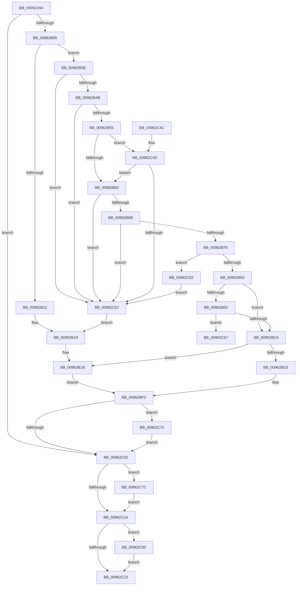

# PiCMRegisterDeviceInterface

- RVA: `0x00962A94`–`0x00962C8E` (길이 `506` bytes)
- VA: `0x0000000140962A94`
- 실행 섹션: `PAGE`
- PDB 이름 있음: `예`; PDB Function 태그: `예`
- unwind 정보 RVA: `0x000934A8`
- 디코드: `138`개 명령, `506/506` bytes 표시
- 미해석 바이트: `0` (있으면 어셈블리에 `.byte`로 보존)

> 이 문서는 커널 이미지의 기계어와 PDB 기호를 분석해 생성했습니다. 4번과 5번은 함수 원형과 자료형을 바이너리 사용 방식에서 추정한 C 해석이며 원본 소스 복구 결과는 아닙니다.

## 1. Dependencies

- 직접 호출 지점: **9**; 고유 호출 대상: **8**
- 직접 호출자로 확인된 함수: **1**
- RIP 상대 이미지 참조: **1**

### Outgoing calls
- `0x00962AF6` → [PiCMCaptureRegisterInterfaceInputData](PiCMCaptureRegisterInterfaceInputData_function_00962C94.md) (function, `0x00962C94`)
- `0x00962B09` → [PiAuDoesClientHaveAccess](PiAuDoesClientHaveAccess_function_00962940.md) (function, `0x00962940`)
- `0x00962B86` → [CmValidateDeviceName](../8F/CmValidateDeviceName_function_008F3CF0.md) (function, `0x008F3CF0`)
- `0x00962BAD` → [IopRegisterDeviceInterface](../95/IopRegisterDeviceInterface_function_009501B0.md) (function, `0x009501B0`)
- `0x00962BF6` → [PiCMReturnBufferResultData](../8E/PiCMReturnBufferResultData_function_008ED6D0.md) (function, `0x008ED6D0`)
- `0x00962C2C` → [_security_check_cookie](../../text/6A/_security_check_cookie_function_006AC640.md) (function, `0x006AC640`)
- `0x00962C75` → [ExFreePoolWithTag](../../poolcode/B8/ExFreePoolWithTag_function_00B82870.md) (function, `0x00B82870`)
- `0x00962C7E` → [PiControlFreeUserModeCallersBuffer](../../text/44/PiControlFreeUserModeCallersBuffer_function_00448990.md) (function, `0x00448990`)
- `0x00962C87` → [PiControlFreeUserModeCallersBuffer](../../text/44/PiControlFreeUserModeCallersBuffer_function_00448990.md) (function, `0x00448990`)

### Direct callers
- [PiCMHandleIoctl](../8E/PiCMHandleIoctl_function_008EB880.md) at `0x008EC235`

### Static image references
- `0x00962AB0` → RVA `0x00E0A740` (`.data`; read)

## 2. Other-region calls and transfers

- 다른 실행 섹션으로 향하는 call: **4**
  - `0x00962C2C` → [_security_check_cookie](../../text/6A/_security_check_cookie_function_006AC640.md) (`PAGE` → `.text`)
  - `0x00962C75` → [ExFreePoolWithTag](../../poolcode/B8/ExFreePoolWithTag_function_00B82870.md) (`PAGE` → `POOLCODE`)
  - `0x00962C7E` → [PiControlFreeUserModeCallersBuffer](../../text/44/PiControlFreeUserModeCallersBuffer_function_00448990.md) (`PAGE` → `.text`)
  - `0x00962C87` → [PiControlFreeUserModeCallersBuffer](../../text/44/PiControlFreeUserModeCallersBuffer_function_00448990.md) (`PAGE` → `.text`)
- call이 아닌 외부 분기/꼬리 이동: **1**
  - `0x00962C6B` → [sub_00B28082](../B2/Unknown_function_00B28082.md) (`tail-transfer`)

## 3. Assembly (complete function range)

```asm
00962A94  48 89 5C 24 20                  mov qword ptr [rsp + 0x20], rbx
00962A99  55                              push rbp
00962A9A  56                              push rsi
00962A9B  57                              push rdi
00962A9C  41 54                           push r12
00962A9E  41 55                           push r13
00962AA0  41 56                           push r14
00962AA2  41 57                           push r15
00962AA4  48 8D 6C 24 E9                  lea rbp, [rsp - 0x17]
00962AA9  48 81 EC A0 00 00 00            sub rsp, 0xa0
00962AB0  48 8B 05 89 7C 4A 00            mov rax, qword ptr [rip + 0x4a7c89]
00962AB7  48 33 C4                        xor rax, rsp
00962ABA  48 89 45 07                     mov qword ptr [rbp + 7], rax
00962ABE  4C 8B 6D 7F                     mov r13, qword ptr [rbp + 0x7f]
00962AC2  0F 57 C0                        xorps xmm0, xmm0
00962AC5  45 33 FF                        xor r15d, r15d
00962AC8  45 8B F1                        mov r14d, r9d
00962ACB  4D 8B E0                        mov r12, r8
00962ACE  4C 89 7D C7                     mov qword ptr [rbp - 0x39], r15
00962AD2  44 8B 45 77                     mov r8d, dword ptr [rbp + 0x77]
00962AD6  4C 8D 4D CF                     lea r9, [rbp - 0x31]
00962ADA  33 C0                           xor eax, eax
00962ADC  45 89 7D 00                     mov dword ptr [r13], r15d
00962AE0  0F 11 45 CF                     movups xmmword ptr [rbp - 0x31], xmm0
00962AE4  48 89 45 FF                     mov qword ptr [rbp - 1], rax
00962AE8  41 8B DF                        mov ebx, r15d
00962AEB  0F 11 45 DF                     movups xmmword ptr [rbp - 0x21], xmm0
00962AEF  41 8B FF                        mov edi, r15d
00962AF2  0F 11 45 EF                     movups xmmword ptr [rbp - 0x11], xmm0
00962AF6  E8 99 01 00 00                  call 0x140962c94
00962AFB  8B F0                           mov esi, eax
00962AFD  85 C0                           test eax, eax
00962AFF  0F 88 FD 00 00 00               js 0x140962c02
00962B05  41 8D 4F 02                     lea ecx, [r15 + 2]
00962B09  E8 32 FE FF FF                  call 0x140962940
00962B0E  84 C0                           test al, al
00962B10  75 2C                           jne 0x140962b3e
00962B12  41 BA 22 00 00 C0               mov r10d, 0xc0000022
00962B18  41 8B D7                        mov edx, r15d
00962B1B  8B 45 03                        mov eax, dword ptr [rbp + 3]
00962B1E  45 33 C9                        xor r9d, r9d
00962B21  4C 89 6C 24 40                  mov qword ptr [rsp + 0x40], r13
00962B26  44 89 74 24 38                  mov dword ptr [rsp + 0x38], r14d
00962B2B  4C 89 64 24 30                  mov qword ptr [rsp + 0x30], r12
00962B30  89 44 24 28                     mov dword ptr [rsp + 0x28], eax
00962B34  44 89 7C 24 20                  mov dword ptr [rsp + 0x20], r15d
00962B39  E9 B2 00 00 00                  jmp 0x140962bf0
00962B3E  4C 8B 5D E7                     mov r11, qword ptr [rbp - 0x19]
00962B42  4D 85 DB                        test r11, r11
00962B45  0F 84 0C 01 00 00               je 0x140962c57
00962B4B  44 39 7D D3                     cmp dword ptr [rbp - 0x2d], r15d
00962B4F  0F 85 02 01 00 00               jne 0x140962c57
00962B55  48 8B 75 F7                     mov rsi, qword ptr [rbp - 9]
00962B59  48 85 F6                        test rsi, rsi
00962B5C  0F 85 EB 00 00 00               jne 0x140962c4d
00962B62  4D 85 E4                        test r12, r12
00962B65  0F 84 EC 00 00 00               je 0x140962c57
00962B6B  41 83 FE 14                     cmp r14d, 0x14
00962B6F  0F 82 E2 00 00 00               jb 0x140962c57
00962B75  45 8D 7E EC                     lea r15d, [r14 - 0x14]
00962B79  41 83 FF 02                     cmp r15d, 2
00962B7D  0F 82 DF 00 00 00               jb 0x140962c62
00962B83  49 8B D3                        mov rdx, r11
00962B86  E8 65 11 F9 FF                  call 0x1408f3cf0
00962B8B  44 8B D0                        mov r10d, eax
00962B8E  85 C0                           test eax, eax
00962B90  78 32                           js 0x140962bc4
00962B92  48 21 5C 24 28                  and qword ptr [rsp + 0x28], rbx
00962B97  48 8D 45 C7                     lea rax, [rbp - 0x39]
00962B9B  41 B1 01                        mov r9b, 1
00962B9E  48 89 44 24 20                  mov qword ptr [rsp + 0x20], rax
00962BA3  4C 8B C6                        mov r8, rsi
00962BA6  48 8D 55 D7                     lea rdx, [rbp - 0x29]
00962BAA  49 8B CB                        mov rcx, r11
00962BAD  E8 FE D5 FE FF                  call 0x1409501b0
00962BB2  48 8B 7D C7                     mov rdi, qword ptr [rbp - 0x39]
00962BB6  44 8B D0                        mov r10d, eax
00962BB9  33 C0                           xor eax, eax
00962BBB  45 85 D2                        test r10d, r10d
00962BBE  0F 89 A3 00 00 00               jns 0x140962c67
00962BC4  45 33 FF                        xor r15d, r15d
00962BC7  8D 14 1B                        lea edx, [rbx + rbx]
00962BCA  45 85 D2                        test r10d, r10d
00962BCD  0F 88 48 FF FF FF               js 0x140962b1b
00962BD3  8B 45 03                        mov eax, dword ptr [rbp + 3]
00962BD6  4C 8B CF                        mov r9, rdi
00962BD9  4C 89 6C 24 40                  mov qword ptr [rsp + 0x40], r13
00962BDE  44 89 74 24 38                  mov dword ptr [rsp + 0x38], r14d
00962BE3  4C 89 64 24 30                  mov qword ptr [rsp + 0x30], r12
00962BE8  89 44 24 28                     mov dword ptr [rsp + 0x28], eax
00962BEC  89 54 24 20                     mov dword ptr [rsp + 0x20], edx
00962BF0  45 33 C0                        xor r8d, r8d
00962BF3  41 8B CA                        mov ecx, r10d
00962BF6  E8 D5 AA F8 FF                  call 0x1408ed6d0
00962BFB  8B F0                           mov esi, eax
00962BFD  48 85 FF                        test rdi, rdi
00962C00  75 6E                           jne 0x140962c70
00962C02  65 48 8B 04 25 88 01 00 00      mov rax, qword ptr gs:[0x188]
00962C0B  48 8B 55 E7                     mov rdx, qword ptr [rbp - 0x19]
00962C0F  8A 98 32 02 00 00               mov bl, byte ptr [rax + 0x232]
00962C15  48 85 D2                        test rdx, rdx
00962C18  75 62                           jne 0x140962c7c
00962C1A  48 8B 55 F7                     mov rdx, qword ptr [rbp - 9]
00962C1E  48 85 D2                        test rdx, rdx
00962C21  75 62                           jne 0x140962c85
00962C23  8B C6                           mov eax, esi
00962C25  48 8B 4D 07                     mov rcx, qword ptr [rbp + 7]
00962C29  48 33 CC                        xor rcx, rsp
00962C2C  E8 0F 9A D4 FF                  call 0x1406ac640
00962C31  48 8B 9C 24 F8 00 00 00         mov rbx, qword ptr [rsp + 0xf8]
00962C39  48 81 C4 A0 00 00 00            add rsp, 0xa0
00962C40  41 5F                           pop r15
00962C42  41 5E                           pop r14
00962C44  41 5D                           pop r13
00962C46  41 5C                           pop r12
00962C48  5F                              pop rdi
00962C49  5E                              pop rsi
00962C4A  5D                              pop rbp
00962C4B  C3                              ret
00962C4C  CC                              int3
00962C4D  83 7D FF 02                     cmp dword ptr [rbp - 1], 2
00962C51  0F 83 0B FF FF FF               jae 0x140962b62
00962C57  41 BA 0D 00 00 C0               mov r10d, 0xc000000d
00962C5D  E9 B6 FE FF FF                  jmp 0x140962b18
00962C62  45 33 FF                        xor r15d, r15d
00962C65  EB F0                           jmp 0x140962c57
00962C67  48 83 CB FF                     or rbx, 0xffffffffffffffff
00962C6B  E9 12 54 1C 00                  jmp 0x140b28082
00962C70  33 D2                           xor edx, edx
00962C72  48 8B CF                        mov rcx, rdi
00962C75  E8 F6 FB 21 00                  call 0x140b82870
00962C7A  EB 86                           jmp 0x140962c02
00962C7C  8A CB                           mov cl, bl
00962C7E  E8 0D 5D AE FF                  call 0x140448990
00962C83  EB 95                           jmp 0x140962c1a
00962C85  8A CB                           mov cl, bl
00962C87  E8 04 5D AE FF                  call 0x140448990
00962C8C  EB 95                           jmp 0x140962c23
```

## 4. C-style interpretation (structured pseudocode)

```c
__int64 __fastcall PiCMRegisterDeviceInterface(__int64 a1, __int64 a2, __int64 a3, int a4, unsigned int a5, __int64 a6)
{
    __int64 result;
    __int64 v_r15;
    __int64 v_rbx;
    __int64 v_rsp;
    unsigned __int64 v_stack_m48;
    unsigned int v_stack_m4C;
    unsigned __int64 v_stack_m4F;
    unsigned __int64 v_stack_m50;
    unsigned __int64 v_stack_m58;
    unsigned __int64 v_stack_m60;
    unsigned __int64 v_stack_m68;
    unsigned __int64 v_stack_m70;
    unsigned __int64 v_stack_m78;
    unsigned int v_stack_m7C;
    unsigned __int64 v_stack_m80;
    unsigned __int64 v_stack_m88;
    unsigned __int64 v_stack_m98;
    unsigned int v_stack_mA0;
    unsigned __int64 v_stack_mA8;
    unsigned int v_stack_mB0;
    unsigned int v_stack_mB8;
    unsigned __int64 v_stack_p20;

    v_stack_p20 = v_rbx;
    v_rsp = (v_rsp) - (160);
    result = (*(unsigned __int64 *)(v_rip + 4881545)) ^ (v_rsp);
    v_stack_m48 = result;
    v_r15 = 0;
    v_stack_m88 = 0;
    result = 0;
    *(unsigned int *)(a6) = 0;
    v_stack_m80 = v_xmm0;
    v_stack_m50 = 0;
    v_stack_m70 = v_xmm0;
    v_stack_m60 = v_xmm0;
    result = PiCMCaptureRegisterInterfaceInputData(a1, a2, (unsigned int)(a5), v_stack_m80);
    if (sign_flag) goto loc_00962C02;
    result = PiAuDoesClientHaveAccess(v_r15 + 2, a2, (unsigned int)(a5), v_stack_m80);
    if ((unsigned __int8)(result) != 0) goto loc_00962B3E;
loc_00962B18:
loc_00962B1B:
    a4 = 0;
    v_stack_m98 = a6;
    v_stack_mA0 = (unsigned int)((unsigned int)(a4));
    v_stack_mA8 = a3;
    v_stack_mB0 = (unsigned int)((unsigned int)(v_stack_m4C));
    v_stack_mB8 = 0;
    goto loc_00962BF0;
loc_00962B3E:
    if (v_stack_m68 == 0) goto loc_00962C57;
    if (v_stack_m7C != 0) goto loc_00962C57;
    if (v_stack_m58 != 0) goto loc_00962C4D;
loc_00962B62:
    if (a3 == 0) goto loc_00962C57;
    if (((unsigned int)((unsigned int)(a4))) < 20) goto loc_00962C57;
    if (((unsigned int)((unsigned int)(a4) - 20)) < 2) goto loc_00962C62;
    result = CmValidateDeviceName(v_r15 + 2, v_stack_m68, (unsigned int)(a5), a4);
    if (sign_flag) goto loc_00962BC4;
    v_stack_mB8 = v_stack_m88;
    result = IopRegisterDeviceInterface(v_stack_m68, v_stack_m78, v_stack_m58, 1);
    result = 0;
    if (!sign_flag) goto loc_00962C67;
loc_00962BC4:
    v_r15 = 0;
    if (sign_flag) goto loc_00962B1B;
    v_stack_m98 = a6;
    v_stack_mA0 = (unsigned int)((unsigned int)(a4));
    v_stack_mA8 = a3;
    v_stack_mB0 = (unsigned int)((unsigned int)(v_stack_m4C));
    v_stack_mB8 = (unsigned int)(0 + 0 * 1);
loc_00962BF0:
    a3 = 0;
    result = PiCMReturnBufferResultData((unsigned int)((unsigned int)((unsigned int)((unsigned int)(result)))), 0 + 0 * 1, a3, v_stack_m88);
    if (v_stack_m88 != 0) goto loc_00962C70;
loc_00962C02:
    if (v_stack_m68 != 0) goto loc_00962C7C;
loc_00962C1A:
    if (v_stack_m58 != 0) goto loc_00962C85;
loc_00962C23:
    a1 = (v_stack_m48) ^ (v_rsp);
    result = _security_check_cookie(a1, v_stack_m58, a3, v_stack_m88);
    v_rsp = (v_rsp) + (160);
    return result;
loc_00962C4D:
    if (v_stack_m50 >= 2) goto loc_00962B62;
loc_00962C57:
    goto loc_00962B18;
loc_00962C62:
    v_r15 = 0;
    goto loc_00962C57;
loc_00962C67:
    v_rbx = (v_stack_p20) | (-1);
loc_00962C70:
    a2 = 0;
    result = ExFreePoolWithTag(v_stack_m88, a2, a3, v_stack_m88);
    goto loc_00962C02;
loc_00962C7C:
    result = PiControlFreeUserModeCallersBuffer((unsigned __int8)(v_rbx), a2, a3, v_stack_m88);
    goto loc_00962C1A;
loc_00962C85:
    result = PiControlFreeUserModeCallersBuffer((unsigned __int8)(v_rbx), a2, a3, v_stack_m88);
    goto loc_00962C23;
}
```

## 5. (Beta) C Style

```c
int64_t PiCMRegisterDeviceInterface(int64_t Arg1, int64_t Arg2, int64_t Arg3, int32_t Arg4, uint32_t Arg5, void *Arg6)
{
    uint8_t *arg6 = (uint8_t *)Arg6;

    int64_t result;
    int64_t local_r15;
    int64_t local_rbx;
    int64_t local_rsp;
    uint64_t v_stack_m48;
    uint32_t v_stack_m4C;
    uint64_t v_stack_m4F;
    uint64_t v_stack_m50;
    uint64_t v_stack_m58;
    uint64_t v_stack_m60;
    uint64_t v_stack_m68;
    uint64_t v_stack_m70;
    uint64_t v_stack_m78;
    uint32_t v_stack_m7C;
    uint64_t v_stack_m80;
    uint64_t v_stack_m88;
    uint64_t v_stack_m98;
    uint32_t v_stack_mA0;
    uint64_t v_stack_mA8;
    uint32_t v_stack_mB0;
    uint32_t v_stack_mB8;
    uint64_t v_stack_p20;

    v_stack_p20 = local_rbx;
    local_rsp = (local_rsp) - (160);
    result = (*(uint64_t *)(v_rip + 0x4A7C89)) ^ (local_rsp);
    v_stack_m48 = result;
    local_r15 = 0;
    v_stack_m88 = 0;
    result = 0;
    *(uint32_t *)(arg6) = 0;
    v_stack_m80 = v_xmm0;
    v_stack_m50 = 0;
    v_stack_m70 = v_xmm0;
    v_stack_m60 = v_xmm0;
    result = PiCMCaptureRegisterInterfaceInputData(Arg1, Arg2, (uint32_t)(Arg5), v_stack_m80);
    if (sign_flag) goto loc_00962C02;
    result = PiAuDoesClientHaveAccess(local_r15 + 2, Arg2, (uint32_t)(Arg5), v_stack_m80);
    if ((uint8_t)(result) != 0) goto loc_00962B3E;
loc_00962B18:
loc_00962B1B:
    Arg4 = 0;
    v_stack_m98 = Arg6;
    v_stack_mA0 = (uint32_t)((uint32_t)(Arg4));
    v_stack_mA8 = Arg3;
    v_stack_mB0 = (uint32_t)((uint32_t)(v_stack_m4C));
    v_stack_mB8 = 0;
    goto loc_00962BF0;
loc_00962B3E:
    if (v_stack_m68 == 0) goto loc_00962C57;
    if (v_stack_m7C != 0) goto loc_00962C57;
    if (v_stack_m58 != 0) goto loc_00962C4D;
loc_00962B62:
    if (Arg3 == 0) goto loc_00962C57;
    if (((uint32_t)((uint32_t)(Arg4))) < 20) goto loc_00962C57;
    if (((uint32_t)((uint32_t)(Arg4) - 20)) < 2) goto loc_00962C62;
    result = CmValidateDeviceName(local_r15 + 2, v_stack_m68, (uint32_t)(Arg5), Arg4);
    if (sign_flag) goto loc_00962BC4;
    v_stack_mB8 = v_stack_m88;
    result = IopRegisterDeviceInterface(v_stack_m68, v_stack_m78, v_stack_m58, 1);
    result = 0;
    if (!sign_flag) goto loc_00962C67;
loc_00962BC4:
    local_r15 = 0;
    if (sign_flag) goto loc_00962B1B;
    v_stack_m98 = Arg6;
    v_stack_mA0 = (uint32_t)((uint32_t)(Arg4));
    v_stack_mA8 = Arg3;
    v_stack_mB0 = (uint32_t)((uint32_t)(v_stack_m4C));
    v_stack_mB8 = (uint32_t)(0 + 0 * 1);
loc_00962BF0:
    Arg3 = 0;
    result = PiCMReturnBufferResultData((uint32_t)((uint32_t)((uint32_t)((uint32_t)(result)))), 0 + 0 * 1, Arg3, v_stack_m88);
    if (v_stack_m88 != 0) goto loc_00962C70;
loc_00962C02:
    if (v_stack_m68 != 0) goto loc_00962C7C;
loc_00962C1A:
    if (v_stack_m58 != 0) goto loc_00962C85;
loc_00962C23:
    Arg1 = (v_stack_m48) ^ (local_rsp);
    result = _security_check_cookie(Arg1, v_stack_m58, Arg3, v_stack_m88);
    local_rsp = (local_rsp) + (160);
    return result;
loc_00962C4D:
    if (v_stack_m50 >= 2) goto loc_00962B62;
loc_00962C57:
    goto loc_00962B18;
loc_00962C62:
    local_r15 = 0;
    goto loc_00962C57;
loc_00962C67:
    local_rbx = (v_stack_p20) | (-1);
loc_00962C70:
    Arg2 = 0;
    result = ExFreePoolWithTag(v_stack_m88, Arg2, Arg3, v_stack_m88);
    goto loc_00962C02;
loc_00962C7C:
    result = PiControlFreeUserModeCallersBuffer((uint8_t)(local_rbx), Arg2, Arg3, v_stack_m88);
    goto loc_00962C1A;
loc_00962C85:
    result = PiControlFreeUserModeCallersBuffer((uint8_t)(local_rbx), Arg2, Arg3, v_stack_m88);
    goto loc_00962C23;
}
```

### 관측된 메모리 오프셋

구조체 형식이 확인되지 않은 접근은 인자 기준의 오프셋으로만 기록했습니다.

| 기준 인자 | 오프셋 표현 | 폭 (bit) | 접근 |
|---|---:|---:|---|
| `Arg6` | `+ 0x0` | `32` | `W` |

## 6. Execution-region graph

[열기: 2D/3D 그래프와 함수 탐색 컨트롤 패널](../../../control-panel.html?section=page&rva=0x00962A94&view=graph)

- 2D 그래프는 위에서 아래로 흐르고, 3D 그래프는 빈 공간을 드래그해 회전합니다. Shift+드래그는 이동, 휠은 확대·축소, 함수 노드 선택은 대상 보고서 이동입니다.

### Static fallback


