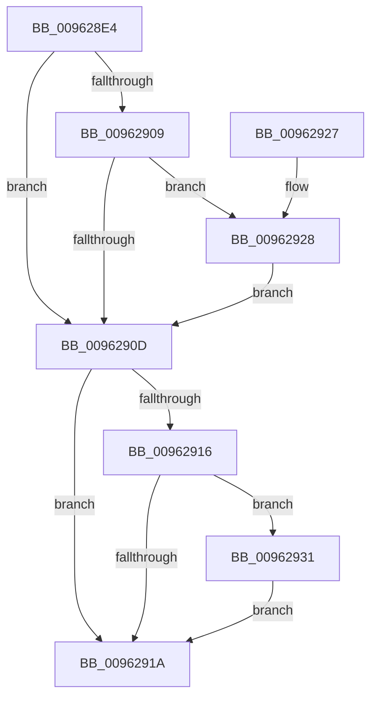

# PiCMReleasePropertyInputData

- RVA: `0x009628E4`–`0x0096293A` (길이 `86` bytes)
- VA: `0x00000001409628E4`
- 실행 섹션: `PAGE`
- PDB 이름 있음: `예`; PDB Function 태그: `아니요`
- unwind 정보 RVA: `0x00093470`
- 디코드: `28`개 명령, `86/86` bytes 표시
- 미해석 바이트: `0` (있으면 어셈블리에 `.byte`로 보존)

> 이 문서는 커널 이미지의 기계어와 PDB 기호를 분석해 생성했습니다. 4번과 5번은 함수 원형과 자료형을 바이너리 사용 방식에서 추정한 C 해석이며 원본 소스 복구 결과는 아닙니다.

## 1. Dependencies

- 직접 호출 지점: **2**; 고유 호출 대상: **1**
- 직접 호출자로 확인된 함수: **1**
- RIP 상대 이미지 참조: **0**

### Outgoing calls
- `0x0096292A` → [ExFreePoolWithTag](../../poolcode/B8/ExFreePoolWithTag_function_00B82870.md) (function, `0x00B82870`)
- `0x00962933` → [ExFreePoolWithTag](../../poolcode/B8/ExFreePoolWithTag_function_00B82870.md) (function, `0x00B82870`)

### Direct callers
- [PiCMSetObjectProperty](PiCMSetObjectProperty_function_00962564.md) at `0x00962711`

### Static image references
- 디코드된 RIP-relative 메모리 참조가 없습니다.

## 2. Other-region calls and transfers

- 다른 실행 섹션으로 향하는 call: **2**
  - `0x0096292A` → [ExFreePoolWithTag](../../poolcode/B8/ExFreePoolWithTag_function_00B82870.md) (`PAGE` → `POOLCODE`)
  - `0x00962933` → [ExFreePoolWithTag](../../poolcode/B8/ExFreePoolWithTag_function_00B82870.md) (`PAGE` → `POOLCODE`)
- 별도 외부 분기/꼬리 이동을 확인하지 못했습니다.

## 3. Assembly (complete function range)

```asm
009628E4  48 89 5C 24 08                  mov qword ptr [rsp + 8], rbx
009628E9  57                              push rdi
009628EA  48 83 EC 20                     sub rsp, 0x20
009628EE  65 48 8B 04 25 88 01 00 00      mov rax, qword ptr gs:[0x188]
009628F7  48 8B F9                        mov rdi, rcx
009628FA  48 8B 49 10                     mov rcx, qword ptr [rcx + 0x10]
009628FE  8A 98 32 02 00 00               mov bl, byte ptr [rax + 0x232]
00962904  48 85 C9                        test rcx, rcx
00962907  74 04                           je 0x14096290d
00962909  84 DB                           test bl, bl
0096290B  75 1B                           jne 0x140962928
0096290D  48 8B 4F 38                     mov rcx, qword ptr [rdi + 0x38]
00962911  48 85 C9                        test rcx, rcx
00962914  74 04                           je 0x14096291a
00962916  84 DB                           test bl, bl
00962918  75 17                           jne 0x140962931
0096291A  48 8B 5C 24 30                  mov rbx, qword ptr [rsp + 0x30]
0096291F  33 C0                           xor eax, eax
00962921  48 83 C4 20                     add rsp, 0x20
00962925  5F                              pop rdi
00962926  C3                              ret
00962927  CC                              int3
00962928  33 D2                           xor edx, edx
0096292A  E8 41 FF 21 00                  call 0x140b82870
0096292F  EB DC                           jmp 0x14096290d
00962931  33 D2                           xor edx, edx
00962933  E8 38 FF 21 00                  call 0x140b82870
00962938  EB E0                           jmp 0x14096291a
```

## 4. C-style interpretation (structured pseudocode)

```c
__int64 __fastcall PiCMReleasePropertyInputData(__int64 a1, int a2)
{
    __int64 result;
    __int64 v_rsp;
    unsigned __int64 v_stack_p8;

    v_stack_p8 = v_rbx;
    v_rsp = (v_rsp) - (32);
    if (*(unsigned __int64 *)(a1 + 16) == 0) goto loc_0096290D;
    if ((unsigned __int8)(*(unsigned __int8 *)(*(unsigned __int64 *)(gs_base + (0 + 392)) + 562)) != 0) goto loc_00962928;
loc_0096290D:
    if (*(unsigned __int64 *)(a1 + 56) == 0) goto loc_0096291A;
    if ((unsigned __int8)(*(unsigned __int8 *)(*(unsigned __int64 *)(gs_base + (0 + 392)) + 562)) != 0) goto loc_00962931;
loc_0096291A:
    result = 0;
    v_rsp = (v_rsp) + (32);
    return result;
loc_00962928:
    a2 = 0;
    result = ExFreePoolWithTag(*(unsigned __int64 *)(a1 + 56), a2, a3, a4);
    goto loc_0096290D;
loc_00962931:
    a2 = 0;
    result = ExFreePoolWithTag(*(unsigned __int64 *)(a1 + 56), a2, a3, a4);
    goto loc_0096291A;
}
```

## 5. (Beta) C Style

```c
int64_t PiCMReleasePropertyInputData(void *Arg1, int32_t Arg2)
{
    uint8_t *arg1 = (uint8_t *)Arg1;

    int64_t result;
    int64_t local_rsp;
    uint64_t v_stack_p8;

    v_stack_p8 = local_rbx;
    local_rsp = (local_rsp) - (32);
    if (*(uint64_t *)(arg1 + 0x10) == 0) goto loc_0096290D;
    if ((uint8_t)(*(uint8_t *)(*(uint64_t *)(gs_base + (0 + 0x188)) + 0x232)) != 0) goto loc_00962928;
loc_0096290D:
    if (*(uint64_t *)(arg1 + 0x38) == 0) goto loc_0096291A;
    if ((uint8_t)(*(uint8_t *)(*(uint64_t *)(gs_base + (0 + 0x188)) + 0x232)) != 0) goto loc_00962931;
loc_0096291A:
    result = 0;
    local_rsp = (local_rsp) + (32);
    return result;
loc_00962928:
    Arg2 = 0;
    result = ExFreePoolWithTag(*(uint64_t *)(arg1 + 0x38), Arg2, a3, a4);
    goto loc_0096290D;
loc_00962931:
    Arg2 = 0;
    result = ExFreePoolWithTag(*(uint64_t *)(arg1 + 0x38), Arg2, a3, a4);
    goto loc_0096291A;
}
```

### 관측된 메모리 오프셋

구조체 형식이 확인되지 않은 접근은 인자 기준의 오프셋으로만 기록했습니다.

| 기준 인자 | 오프셋 표현 | 폭 (bit) | 접근 |
|---|---:|---:|---|
| `Arg1` | `+ 0x10` | `64` | `R` |
| `Arg1` | `+ 0x38` | `64` | `R` |

## 6. Execution-region graph

[열기: 2D/3D 그래프와 함수 탐색 컨트롤 패널](../../../control-panel.html?section=page&rva=0x009628E4&view=graph)

- 2D 그래프는 위에서 아래로 흐르고, 3D 그래프는 빈 공간을 드래그해 회전합니다. Shift+드래그는 이동, 휠은 확대·축소, 함수 노드 선택은 대상 보고서 이동입니다.

### Static fallback


