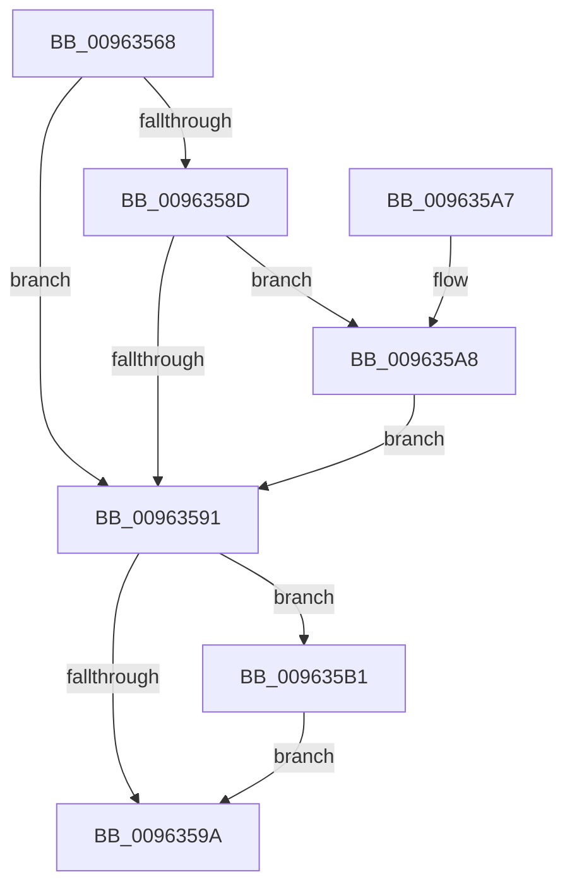

# PiCMReleaseRegistryPropertyInputData

- RVA: `0x00963568`–`0x009635BA` (길이 `82` bytes)
- VA: `0x0000000140963568`
- 실행 섹션: `PAGE`
- PDB 이름 있음: `예`; PDB Function 태그: `아니요`
- unwind 정보 RVA: `0x00093470`
- 디코드: `26`개 명령, `82/82` bytes 표시
- 미해석 바이트: `0` (있으면 어셈블리에 `.byte`로 보존)

> 이 문서는 커널 이미지의 기계어와 PDB 기호를 분석해 생성했습니다. 4번과 5번은 함수 원형과 자료형을 바이너리 사용 방식에서 추정한 C 해석이며 원본 소스 복구 결과는 아닙니다.

## 1. Dependencies

- 직접 호출 지점: **2**; 고유 호출 대상: **2**
- 직접 호출자로 확인된 함수: **1**
- RIP 상대 이미지 참조: **0**

### Outgoing calls
- `0x009635AA` → [ExFreePoolWithTag](../../poolcode/B8/ExFreePoolWithTag_function_00B82870.md) (function, `0x00B82870`)
- `0x009635B3` → [PiControlFreeUserModeCallersBuffer](../../text/44/PiControlFreeUserModeCallersBuffer_function_00448990.md) (function, `0x00448990`)

### Direct callers
- [PiCMSetRegistryProperty](PiCMSetRegistryProperty_function_00963118.md) at `0x0096323D`

### Static image references
- 디코드된 RIP-relative 메모리 참조가 없습니다.

## 2. Other-region calls and transfers

- 다른 실행 섹션으로 향하는 call: **2**
  - `0x009635AA` → [ExFreePoolWithTag](../../poolcode/B8/ExFreePoolWithTag_function_00B82870.md) (`PAGE` → `POOLCODE`)
  - `0x009635B3` → [PiControlFreeUserModeCallersBuffer](../../text/44/PiControlFreeUserModeCallersBuffer_function_00448990.md) (`PAGE` → `.text`)
- 별도 외부 분기/꼬리 이동을 확인하지 못했습니다.

## 3. Assembly (complete function range)

```asm
00963568  48 89 5C 24 08                  mov qword ptr [rsp + 8], rbx
0096356D  57                              push rdi
0096356E  48 83 EC 20                     sub rsp, 0x20
00963572  65 48 8B 04 25 88 01 00 00      mov rax, qword ptr gs:[0x188]
0096357B  48 8B F9                        mov rdi, rcx
0096357E  48 8B 49 10                     mov rcx, qword ptr [rcx + 0x10]
00963582  8A 98 32 02 00 00               mov bl, byte ptr [rax + 0x232]
00963588  48 85 C9                        test rcx, rcx
0096358B  74 04                           je 0x140963591
0096358D  84 DB                           test bl, bl
0096358F  75 17                           jne 0x1409635a8
00963591  48 8B 57 28                     mov rdx, qword ptr [rdi + 0x28]
00963595  48 85 D2                        test rdx, rdx
00963598  75 17                           jne 0x1409635b1
0096359A  48 8B 5C 24 30                  mov rbx, qword ptr [rsp + 0x30]
0096359F  33 C0                           xor eax, eax
009635A1  48 83 C4 20                     add rsp, 0x20
009635A5  5F                              pop rdi
009635A6  C3                              ret
009635A7  CC                              int3
009635A8  33 D2                           xor edx, edx
009635AA  E8 C1 F2 21 00                  call 0x140b82870
009635AF  EB E0                           jmp 0x140963591
009635B1  8A CB                           mov cl, bl
009635B3  E8 D8 53 AE FF                  call 0x140448990
009635B8  EB E0                           jmp 0x14096359a
```

## 4. C-style interpretation (structured pseudocode)

```c
__int64 __fastcall PiCMReleaseRegistryPropertyInputData(__int64 a1)
{
    __int64 result;
    __int64 v_rsp;
    unsigned __int64 v_stack_p8;

    v_stack_p8 = v_rbx;
    v_rsp = (v_rsp) - (32);
    if (*(unsigned __int64 *)(a1 + 16) == 0) goto loc_00963591;
    if ((unsigned __int8)(*(unsigned __int8 *)(*(unsigned __int64 *)(gs_base + (0 + 392)) + 562)) != 0) goto loc_009635A8;
loc_00963591:
    if (*(unsigned __int64 *)(a1 + 40) != 0) goto loc_009635B1;
loc_0096359A:
    result = 0;
    v_rsp = (v_rsp) + (32);
    return result;
loc_009635A8:
    a2 = 0;
    result = ExFreePoolWithTag(*(unsigned __int64 *)(a1 + 16), a2, a3, a4);
    goto loc_00963591;
loc_009635B1:
    result = PiControlFreeUserModeCallersBuffer((unsigned __int8)(v_stack_p8), a2, a3, a4);
    goto loc_0096359A;
}
```

## 5. (Beta) C Style

```c
int64_t PiCMReleaseRegistryPropertyInputData(void *Arg1)
{
    uint8_t *arg1 = (uint8_t *)Arg1;

    int64_t result;
    int64_t local_rsp;
    uint64_t v_stack_p8;

    v_stack_p8 = local_rbx;
    local_rsp = (local_rsp) - (32);
    if (*(uint64_t *)(arg1 + 0x10) == 0) goto loc_00963591;
    if ((uint8_t)(*(uint8_t *)(*(uint64_t *)(gs_base + (0 + 0x188)) + 0x232)) != 0) goto loc_009635A8;
loc_00963591:
    if (*(uint64_t *)(arg1 + 0x28) != 0) goto loc_009635B1;
loc_0096359A:
    result = 0;
    local_rsp = (local_rsp) + (32);
    return result;
loc_009635A8:
    a2 = 0;
    result = ExFreePoolWithTag(*(uint64_t *)(arg1 + 0x10), a2, a3, a4);
    goto loc_00963591;
loc_009635B1:
    result = PiControlFreeUserModeCallersBuffer((uint8_t)(v_stack_p8), a2, a3, a4);
    goto loc_0096359A;
}
```

### 관측된 메모리 오프셋

구조체 형식이 확인되지 않은 접근은 인자 기준의 오프셋으로만 기록했습니다.

| 기준 인자 | 오프셋 표현 | 폭 (bit) | 접근 |
|---|---:|---:|---|
| `Arg1` | `+ 0x10` | `64` | `R` |
| `Arg1` | `+ 0x28` | `64` | `R` |

## 6. Execution-region graph

[열기: 2D/3D 그래프와 함수 탐색 컨트롤 패널](../../../control-panel.html?section=page&rva=0x00963568&view=graph)

- 2D 그래프는 위에서 아래로 흐르고, 3D 그래프는 빈 공간을 드래그해 회전합니다. Shift+드래그는 이동, 휠은 확대·축소, 함수 노드 선택은 대상 보고서 이동입니다.

### Static fallback


