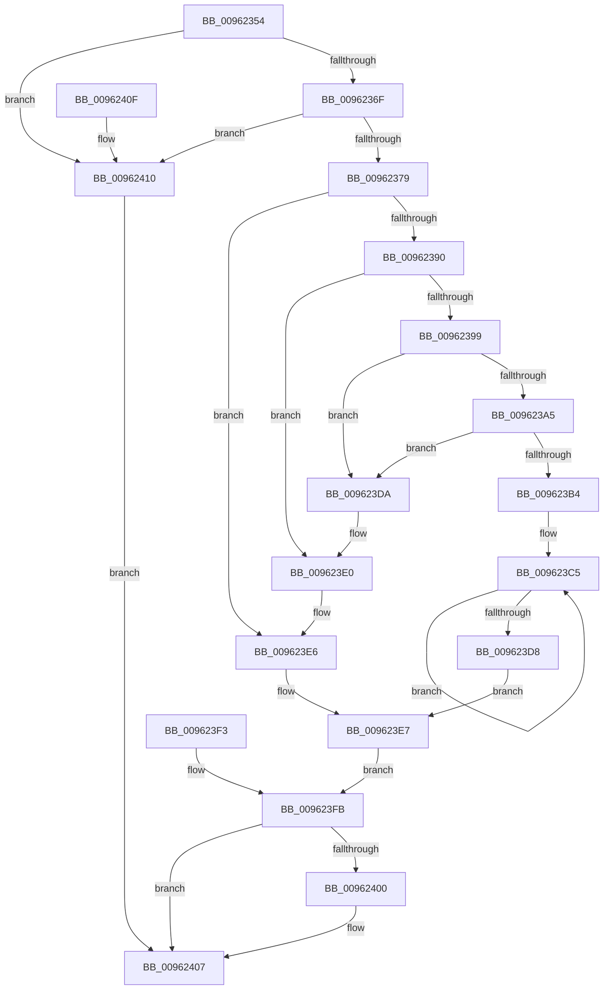

# PiCMReturnHandleResultData

- RVA: `0x00962354`–`0x00962418` (길이 `196` bytes)
- VA: `0x0000000140962354`
- 실행 섹션: `PAGE`
- PDB 이름 있음: `예`; PDB Function 태그: `아니요`
- unwind 정보 RVA: `0x00093404`
- 디코드: `53`개 명령, `196/196` bytes 표시
- 미해석 바이트: `0` (있으면 어셈블리에 `.byte`로 보존)

> 이 문서는 커널 이미지의 기계어와 PDB 기호를 분석해 생성했습니다. 4번과 5번은 함수 원형과 자료형을 바이너리 사용 방식에서 추정한 C 해석이며 원본 소스 복구 결과는 아닙니다.

## 1. Dependencies

- 직접 호출 지점: **2**; 고유 호출 대상: **2**
- 직접 호출자로 확인된 함수: **4**
- RIP 상대 이미지 참조: **0**

### Outgoing calls
- `0x009623DA` → [ExRaiseAccessViolation](../8E/ExRaiseAccessViolation_function_008E9240.md) (function, `0x008E9240`)
- `0x009623E0` → [ExRaiseDatatypeMisalignment](../89/ExRaiseDatatypeMisalignment_function_00899FD0.md) (function, `0x00899FD0`)

### Direct callers
- [PiCMOpenClassKey](PiCMOpenClassKey_function_009617A8.md) at `0x00961908`
- [PiCMOpenDeviceInterfaceKey](PiCMOpenDeviceInterfaceKey_function_00961A3C.md) at `0x00961B55`
- [PiCMOpenDeviceKey](PiCMOpenDeviceKey_function_00961C00.md) at `0x00961D2D`
- [PiCMOpenObjectKey](PiCMOpenObjectKey_function_00961E08.md) at `0x00961F8F`

### Static image references
- 디코드된 RIP-relative 메모리 참조가 없습니다.

## 2. Other-region calls and transfers

- 다른 실행 섹션으로 향하는 call: **0**
- 별도 외부 분기/꼬리 이동을 확인하지 못했습니다.

## 3. Assembly (complete function range)

```asm
00962354  48 83 EC 38                     sub rsp, 0x38
00962358  4C 8B 5C 24 68                  mov r11, qword ptr [rsp + 0x68]
0096235D  41 83 23 00                     and dword ptr [r11], 0
00962361  45 33 D2                        xor r10d, r10d
00962364  83 7C 24 60 10                  cmp dword ptr [rsp + 0x60], 0x10
00962369  0F 82 A1 00 00 00               jb 0x140962410
0096236F  41 83 F8 10                     cmp r8d, 0x10
00962373  0F 85 97 00 00 00               jne 0x140962410
00962379  44 89 44 24 20                  mov dword ptr [rsp + 0x20], r8d
0096237E  89 4C 24 24                     mov dword ptr [rsp + 0x24], ecx
00962382  48 89 54 24 28                  mov qword ptr [rsp + 0x28], rdx
00962387  8B 44 24 60                     mov eax, dword ptr [rsp + 0x60]
0096238B  48 85 C0                        test rax, rax
0096238E  74 56                           je 0x1409623e6
00962390  49 8B D1                        mov rdx, r9
00962393  41 F6 C1 03                     test r9b, 3
00962397  75 47                           jne 0x1409623e0
00962399  49 8D 49 FF                     lea rcx, [r9 - 1]
0096239D  48 03 C8                        add rcx, rax
009623A0  4C 3B C9                        cmp r9, rcx
009623A3  77 35                           ja 0x1409623da
009623A5  48 B8 00 00 FF FF FF 7F 00 00   movabs rax, 0x7fffffff0000
009623AF  48 3B C8                        cmp rcx, rax
009623B2  73 26                           jae 0x1409623da
009623B4  49 C7 C0 00 F0 FF FF            mov r8, 0xfffffffffffff000
009623BB  49 23 C8                        and rcx, r8
009623BE  48 81 C1 00 10 00 00            add rcx, 0x1000
009623C5  8A 02                           mov al, byte ptr [rdx]
009623C7  88 02                           mov byte ptr [rdx], al
009623C9  49 23 D0                        and rdx, r8
009623CC  48 81 C2 00 10 00 00            add rdx, 0x1000
009623D3  48 3B D1                        cmp rdx, rcx
009623D6  75 ED                           jne 0x1409623c5
009623D8  EB 0D                           jmp 0x1409623e7
009623DA  E8 61 6E F8 FF                  call 0x1408e9240
009623DF  CC                              int3
009623E0  E8 EB 7B F3 FF                  call 0x140899fd0
009623E5  CC                              int3
009623E6  90                              nop
009623E7  0F 10 44 24 20                  movups xmm0, xmmword ptr [rsp + 0x20]
009623EC  F3 41 0F 7F 01                  movdqu xmmword ptr [r9], xmm0
009623F1  EB 08                           jmp 0x1409623fb
009623F3  44 8B D0                        mov r10d, eax
009623F6  4C 8B 5C 24 68                  mov r11, qword ptr [rsp + 0x68]
009623FB  45 85 D2                        test r10d, r10d
009623FE  78 07                           js 0x140962407
00962400  41 C7 03 10 00 00 00            mov dword ptr [r11], 0x10
00962407  41 8B C2                        mov eax, r10d
0096240A  48 83 C4 38                     add rsp, 0x38
0096240E  C3                              ret
0096240F  CC                              int3
00962410  41 BA 0D 00 00 C0               mov r10d, 0xc000000d
00962416  EB EF                           jmp 0x140962407
```

## 4. C-style interpretation (structured pseudocode)

```c
__int64 __fastcall PiCMReturnHandleResultData(int a1, __int64 a2, int a3, __int64 a4, unsigned int a5, __int64 a6)
{
    __int64 result;
    __int64 v_r10;
    __int64 v_rsp;
    unsigned __int64 v_stack_m10;
    unsigned int v_stack_m14;
    unsigned int v_stack_m18;
    unsigned __int64 v_stack_p30;

    v_rsp = (v_rsp) - (56);
    v_r10 = 0;
    if (a5 < 16) goto loc_00962410;
    if (a3 != 16) goto loc_00962410;
    v_stack_m18 = a3;
    v_stack_m14 = a1;
    v_stack_m10 = a2;
    if ((unsigned int)(a5) == 0) goto loc_009623E6;
    if ((((unsigned __int8)(a4)) & (3)) != 0) goto loc_009623E0;
    a1 = (a4 - 1) + ((unsigned int)(a5));
    if (a4 > a1) goto loc_009623DA;
    if (a1 >= ((unsigned int)(a5))) goto loc_009623DA;
    a1 = (a1) & (0xFFFFFFFFFFFFF000ULL);
    a1 = (a1) + (0x1000ULL);
loc_009623C5:
    *(unsigned __int8 *)(a4) = (unsigned __int8)(*(unsigned __int8 *)(a4));
    a2 = (a4) & (0xFFFFFFFFFFFFF000ULL);
    a2 = (a2) + (0x1000ULL);
    if (a2 != a1) goto loc_009623C5;
    goto loc_009623E7;
loc_009623DA:
    result = ExRaiseAccessViolation(a1, a2, 0xFFFFFFFFFFFFF000ULL, a4);
loc_009623E0:
    result = ExRaiseDatatypeMisalignment(a1, a2, 0xFFFFFFFFFFFFF000ULL, a4);
loc_009623E6:
loc_009623E7:
    *(unsigned __int64 *)(a4) = v_xmm0;
    goto loc_009623FB;
loc_009623FB:
    if (!(sign_flag)) {
        *(unsigned int *)(a6) = 16;
    }
    v_rsp = (v_rsp) + (56);
    return 0;
loc_00962410:
    goto loc_00962407;
}
```

## 5. (Beta) C Style

```c
int64_t PiCMReturnHandleResultData(int32_t Arg1, int64_t Arg2, int32_t Arg3, int64_t Arg4, uint32_t Arg5, void *Arg6)
{
    uint8_t *arg6 = (uint8_t *)Arg6;

    int64_t result;
    int64_t local_r10;
    int64_t local_rsp;
    uint64_t v_stack_m10;
    uint32_t v_stack_m14;
    uint32_t v_stack_m18;
    uint64_t v_stack_p30;

    local_rsp = (local_rsp) - (56);
    local_r10 = 0;
    if (Arg5 < 16) goto loc_00962410;
    if (Arg3 != 16) goto loc_00962410;
    v_stack_m18 = Arg3;
    v_stack_m14 = Arg1;
    v_stack_m10 = Arg2;
    if ((uint32_t)(Arg5) == 0) goto loc_009623E6;
    if ((((uint8_t)(Arg4)) & (3)) != 0) goto loc_009623E0;
    Arg1 = (Arg4 - 1) + ((uint32_t)(Arg5));
    if (Arg4 > Arg1) goto loc_009623DA;
    if (Arg1 >= ((uint32_t)(Arg5))) goto loc_009623DA;
    Arg1 = (Arg1) & (0xFFFFFFFFFFFFF000ULL);
    Arg1 = (Arg1) + (0x1000ULL);
loc_009623C5:
    *(uint8_t *)(Arg4) = (uint8_t)(*(uint8_t *)(Arg4));
    Arg2 = (Arg4) & (0xFFFFFFFFFFFFF000ULL);
    Arg2 = (Arg2) + (0x1000ULL);
    if (Arg2 != Arg1) goto loc_009623C5;
    goto loc_009623E7;
loc_009623DA:
    result = ExRaiseAccessViolation(Arg1, Arg2, 0xFFFFFFFFFFFFF000ULL, Arg4);
loc_009623E0:
    result = ExRaiseDatatypeMisalignment(Arg1, Arg2, 0xFFFFFFFFFFFFF000ULL, Arg4);
loc_009623E6:
loc_009623E7:
    *(uint64_t *)(Arg4) = v_xmm0;
    goto loc_009623FB;
loc_009623FB:
    if (!(sign_flag)) {
        *(uint32_t *)(arg6) = 16;
    }
    local_rsp = (local_rsp) + (56);
    return 0;
loc_00962410:
    goto loc_00962407;
}
```

### 관측된 메모리 오프셋

구조체 형식이 확인되지 않은 접근은 인자 기준의 오프셋으로만 기록했습니다.

| 기준 인자 | 오프셋 표현 | 폭 (bit) | 접근 |
|---|---:|---:|---|
| `Arg6` | `+ 0x0` | `32` | `R/W` |

## 6. Execution-region graph

[열기: 2D/3D 그래프와 함수 탐색 컨트롤 패널](../../../control-panel.html?section=page&rva=0x00962354&view=graph)

- 2D 그래프는 위에서 아래로 흐르고, 3D 그래프는 빈 공간을 드래그해 회전합니다. Shift+드래그는 이동, 휠은 확대·축소, 함수 노드 선택은 대상 보고서 이동입니다.

### Static fallback


