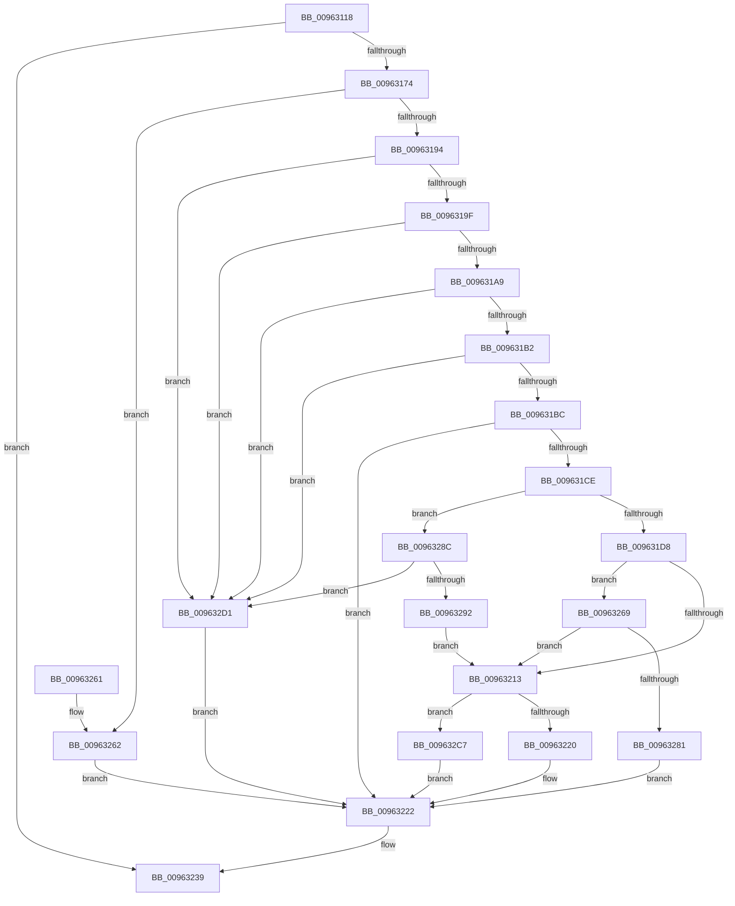

# PiCMSetRegistryProperty

- RVA: `0x00963118`–`0x009632DB` (길이 `451` bytes)
- VA: `0x0000000140963118`
- 실행 섹션: `PAGE`
- PDB 이름 있음: `예`; PDB Function 태그: `아니요`
- unwind 정보 RVA: `0x00093524`
- 디코드: `123`개 명령, `451/451` bytes 표시
- 미해석 바이트: `0` (있으면 어셈블리에 `.byte`로 보존)

> 이 문서는 커널 이미지의 기계어와 PDB 기호를 분석해 생성했습니다. 4번과 5번은 함수 원형과 자료형을 바이너리 사용 방식에서 추정한 C 해석이며 원본 소스 복구 결과는 아닙니다.

## 1. Dependencies

- 직접 호출 지점: **9**; 고유 호출 대상: **9**
- 직접 호출자로 확인된 함수: **1**
- RIP 상대 이미지 참조: **1**

### Outgoing calls
- `0x00963165` → [PiCMCaptureRegistryPropertyInputData](../8E/PiCMCaptureRegistryPropertyInputData_function_008ED078.md) (function, `0x008ED078`)
- `0x00963187` → [PiAuDoesClientHaveAccess](PiAuDoesClientHaveAccess_function_00962940.md) (function, `0x00962940`)
- `0x009631C3` → [PiCMConvertRegistryProperty](PiCMConvertRegistryProperty_function_009632F0.md) (function, `0x009632F0`)
- `0x00963206` → [PiPnpRtlSetDeviceRegProperty](PiPnpRtlSetDeviceRegProperty_function_0096360C.md) (function, `0x0096360C`)
- `0x00963232` → [PiCMReturnBasicResultData](../8E/PiCMReturnBasicResultData_function_008E86E8.md) (function, `0x008E86E8`)
- `0x0096323D` → [PiCMReleaseRegistryPropertyInputData](PiCMReleaseRegistryPropertyInputData_function_00963568.md) (function, `0x00963568`)
- `0x00963278` → [RtlInitUnicodeStringEx](../../text/46/RtlInitUnicodeStringEx_function_00463960.md) (function, `0x00463960`)
- `0x00963285` → [PnpSetDeviceInstancePropertyChangeEventFromDeviceInstance](../../text/49/PnpSetDeviceInstancePropertyChangeEventFromDeviceInstance_function_00493500.md) (function, `0x00493500`)
- `0x009632BB` → [CmSetInstallerClassRegProp](../82/CmSetInstallerClassRegProp_function_0082AA90.md) (function, `0x0082AA90`)

### Direct callers
- [PiCMHandleIoctl](../8E/PiCMHandleIoctl_function_008EB880.md) at `0x008EC1E5`

### Static image references
- `0x009631EB` → RVA `0x00E66398` (`.data`; read)

## 2. Other-region calls and transfers

- 다른 실행 섹션으로 향하는 call: **2**
  - `0x00963278` → [RtlInitUnicodeStringEx](../../text/46/RtlInitUnicodeStringEx_function_00463960.md) (`PAGE` → `.text`)
  - `0x00963285` → [PnpSetDeviceInstancePropertyChangeEventFromDeviceInstance](../../text/49/PnpSetDeviceInstancePropertyChangeEventFromDeviceInstance_function_00493500.md) (`PAGE` → `.text`)
- 별도 외부 분기/꼬리 이동을 확인하지 못했습니다.

## 3. Assembly (complete function range)

```asm
00963118  48 8B C4                        mov rax, rsp
0096311B  48 89 58 08                     mov qword ptr [rax + 8], rbx
0096311F  48 89 78 10                     mov qword ptr [rax + 0x10], rdi
00963123  4C 89 60 18                     mov qword ptr [rax + 0x18], r12
00963127  55                              push rbp
00963128  41 56                           push r14
0096312A  41 57                           push r15
0096312C  48 8D 68 B1                     lea rbp, [rax - 0x4f]
00963130  48 81 EC 90 00 00 00            sub rsp, 0x90
00963137  4C 8B 65 7F                     mov r12, qword ptr [rbp + 0x7f]
0096313B  0F 57 C0                        xorps xmm0, xmm0
0096313E  33 C0                           xor eax, eax
00963140  45 8B F1                        mov r14d, r9d
00963143  21 45 7F                        and dword ptr [rbp + 0x7f], eax
00963146  4C 8D 4D F7                     lea r9, [rbp - 9]
0096314A  4D 8B F8                        mov r15, r8
0096314D  48 89 45 27                     mov qword ptr [rbp + 0x27], rax
00963151  44 8B 45 77                     mov r8d, dword ptr [rbp + 0x77]
00963155  41 21 04 24                     and dword ptr [r12], eax
00963159  0F 11 45 F7                     movups xmmword ptr [rbp - 9], xmm0
0096315D  0F 11 45 07                     movups xmmword ptr [rbp + 7], xmm0
00963161  0F 11 45 17                     movups xmmword ptr [rbp + 0x17], xmm0
00963165  E8 0E 9F F8 FF                  call 0x1408ed078
0096316A  8B D8                           mov ebx, eax
0096316C  85 C0                           test eax, eax
0096316E  0F 88 C5 00 00 00               js 0x140963239
00963174  33 C0                           xor eax, eax
00963176  83 7D 13 0D                     cmp dword ptr [rbp + 0x13], 0xd
0096317A  0F 94 C0                        sete al
0096317D  F7 D8                           neg eax
0096317F  1B C9                           sbb ecx, ecx
00963181  83 E1 3E                        and ecx, 0x3e
00963184  83 C1 02                        add ecx, 2
00963187  E8 B4 F7 FF FF                  call 0x140962940
0096318C  84 C0                           test al, al
0096318E  0F 84 CE 00 00 00               je 0x140963262
00963194  48 83 7D 07 00                  cmp qword ptr [rbp + 7], 0
00963199  0F 84 32 01 00 00               je 0x1409632d1
0096319F  83 7D FB 00                     cmp dword ptr [rbp - 5], 0
009631A3  0F 85 28 01 00 00               jne 0x1409632d1
009631A9  4D 85 FF                        test r15, r15
009631AC  0F 84 1F 01 00 00               je 0x1409632d1
009631B2  41 83 FE 08                     cmp r14d, 8
009631B6  0F 82 15 01 00 00               jb 0x1409632d1
009631BC  8B 4D 13                        mov ecx, dword ptr [rbp + 0x13]
009631BF  48 8D 55 7F                     lea rdx, [rbp + 0x7f]
009631C3  E8 28 01 00 00                  call 0x1409632f0
009631C8  8B D8                           mov ebx, eax
009631CA  85 C0                           test eax, eax
009631CC  78 54                           js 0x140963222
009631CE  83 7D FF 01                     cmp dword ptr [rbp - 1], 1
009631D2  0F 85 B4 00 00 00               jne 0x14096328c
009631D8  83 64 24 38 00                  and dword ptr [rsp + 0x38], 0
009631DD  45 33 C0                        xor r8d, r8d
009631E0  8B 45 27                        mov eax, dword ptr [rbp + 0x27]
009631E3  44 8B 4D 7F                     mov r9d, dword ptr [rbp + 0x7f]
009631E7  48 8B 55 07                     mov rdx, qword ptr [rbp + 7]
009631EB  48 8B 0D A6 31 50 00            mov rcx, qword ptr [rip + 0x5031a6]
009631F2  89 44 24 30                     mov dword ptr [rsp + 0x30], eax
009631F6  48 8B 45 1F                     mov rax, qword ptr [rbp + 0x1f]
009631FA  48 89 44 24 28                  mov qword ptr [rsp + 0x28], rax
009631FF  8B 45 17                        mov eax, dword ptr [rbp + 0x17]
00963202  89 44 24 20                     mov dword ptr [rsp + 0x20], eax
00963206  E8 01 04 00 00                  call 0x14096360c
0096320B  8B F8                           mov edi, eax
0096320D  8B D8                           mov ebx, eax
0096320F  85 C0                           test eax, eax
00963211  79 56                           jns 0x140963269
00963213  BB 22 00 00 C0                  mov ebx, 0xc0000022
00963218  3B FB                           cmp edi, ebx
0096321A  0F 84 A7 00 00 00               je 0x1409632c7
00963220  8B DF                           mov ebx, edi
00963222  8B 55 2B                        mov edx, dword ptr [rbp + 0x2b]
00963225  45 8B CE                        mov r9d, r14d
00963228  4D 8B C7                        mov r8, r15
0096322B  4C 89 64 24 20                  mov qword ptr [rsp + 0x20], r12
00963230  8B CB                           mov ecx, ebx
00963232  E8 B1 54 F8 FF                  call 0x1408e86e8
00963237  8B D8                           mov ebx, eax
00963239  48 8D 4D F7                     lea rcx, [rbp - 9]
0096323D  E8 26 03 00 00                  call 0x140963568
00963242  4C 8D 9C 24 90 00 00 00         lea r11, [rsp + 0x90]
0096324A  8B C3                           mov eax, ebx
0096324C  49 8B 5B 20                     mov rbx, qword ptr [r11 + 0x20]
00963250  49 8B 7B 28                     mov rdi, qword ptr [r11 + 0x28]
00963254  4D 8B 63 30                     mov r12, qword ptr [r11 + 0x30]
00963258  49 8B E3                        mov rsp, r11
0096325B  41 5F                           pop r15
0096325D  41 5E                           pop r14
0096325F  5D                              pop rbp
00963260  C3                              ret
00963261  CC                              int3
00963262  BB 22 00 00 C0                  mov ebx, 0xc0000022
00963267  EB B9                           jmp 0x140963222
00963269  48 8B 55 07                     mov rdx, qword ptr [rbp + 7]
0096326D  48 8D 4D E7                     lea rcx, [rbp - 0x19]
00963271  0F 57 C0                        xorps xmm0, xmm0
00963274  0F 11 45 E7                     movups xmmword ptr [rbp - 0x19], xmm0
00963278  E8 E3 06 B0 FF                  call 0x140463960
0096327D  85 C0                           test eax, eax
0096327F  78 92                           js 0x140963213
00963281  48 8D 4D E7                     lea rcx, [rbp - 0x19]
00963285  E8 76 02 B3 FF                  call 0x140493500
0096328A  EB 96                           jmp 0x140963222
0096328C  83 7D FF 02                     cmp dword ptr [rbp - 1], 2
00963290  75 3F                           jne 0x1409632d1
00963292  8B 45 27                        mov eax, dword ptr [rbp + 0x27]
00963295  45 33 C0                        xor r8d, r8d
00963298  44 8B 4D 7F                     mov r9d, dword ptr [rbp + 0x7f]
0096329C  48 8B 55 07                     mov rdx, qword ptr [rbp + 7]
009632A0  48 8B 0D F1 30 50 00            mov rcx, qword ptr [rip + 0x5030f1]
009632A7  89 44 24 30                     mov dword ptr [rsp + 0x30], eax
009632AB  48 8B 45 1F                     mov rax, qword ptr [rbp + 0x1f]
009632AF  48 89 44 24 28                  mov qword ptr [rsp + 0x28], rax
009632B4  8B 45 17                        mov eax, dword ptr [rbp + 0x17]
009632B7  89 44 24 20                     mov dword ptr [rsp + 0x20], eax
009632BB  E8 D0 77 EC FF                  call 0x14082aa90
009632C0  8B F8                           mov edi, eax
009632C2  E9 4C FF FF FF                  jmp 0x140963213
009632C7  BB 30 02 00 C0                  mov ebx, 0xc0000230
009632CC  E9 51 FF FF FF                  jmp 0x140963222
009632D1  BB 0D 00 00 C0                  mov ebx, 0xc000000d
009632D6  E9 47 FF FF FF                  jmp 0x140963222
```

## 4. C-style interpretation (structured pseudocode)

```c
__int64 __fastcall PiCMSetRegistryProperty(int a1, __int64 a2, __int64 a3, int a4)
{
    __int64 result;
    __int64 v_rsp;
    unsigned __int64 v_stack_m18;
    unsigned int v_stack_m60;
    unsigned __int64 v_stack_m68;
    unsigned int v_stack_m70;
    unsigned int v_stack_m78;
    unsigned __int64 v_stack_m80;
    unsigned int v_stack_m88;

    *(unsigned __int64 *)(v_rsp + 8) = v_rbx;
    *(unsigned __int64 *)(v_rsp + 16) = v_rdi;
    *(unsigned __int64 *)(v_rsp + 24) = v_r12;
    v_rsp = (v_rsp) - (144);
    result = 0;
    *(unsigned __int64 *)(v_rsp - 79 + 39) = 0;
    *(unsigned __int64 *)(v_rsp - 79 - 9) = v_xmm0;
    *(unsigned __int64 *)(v_rsp - 79 + 7) = v_xmm0;
    *(unsigned __int64 *)(v_rsp - 79 + 23) = v_xmm0;
    result = PiCMCaptureRegistryPropertyInputData(a1, a2, (unsigned int)(*(unsigned int *)(v_rsp - 79 + 119)), v_rsp - 79 - 9);
    if (sign_flag) goto loc_00963239;
    result = 0;
    result = ((*(unsigned int *)(v_rsp - 79 + 19)) == 13) ? 1 : 0;
    result = (unsigned int)(-(result));
    a1 = (unsigned int)((a1) & (62));
    a1 = (unsigned int)((a1) + (2));
    result = PiAuDoesClientHaveAccess(a1, a2, (unsigned int)(*(unsigned int *)(v_rsp - 79 + 119)), v_rsp - 79 - 9);
    if ((unsigned __int8)(result) == 0) goto loc_00963262;
    if ((*(unsigned __int64 *)(v_rsp - 79 + 7)) == 0) goto loc_009632D1;
    if ((*(unsigned int *)(v_rsp - 79 - 5)) != 0) goto loc_009632D1;
    if (a3 == 0) goto loc_009632D1;
    if (((unsigned int)((unsigned int)(a4))) < 8) goto loc_009632D1;
    result = PiCMConvertRegistryProperty((unsigned int)(*(unsigned int *)(v_rsp - 79 + 19)), v_rsp - 79 + 127, (unsigned int)(*(unsigned int *)(v_rsp - 79 + 119)), v_rsp - 79 - 9);
    if (sign_flag) goto loc_00963222;
    if ((*(unsigned int *)(v_rsp - 79 - 1)) != 1) goto loc_0096328C;
    a3 = 0;
    v_stack_m78 = (unsigned int)((unsigned int)(*(unsigned int *)(v_rsp - 79 + 39)));
    v_stack_m80 = *(unsigned __int64 *)(v_rsp - 79 + 31);
    v_stack_m88 = (unsigned int)((unsigned int)(*(unsigned int *)(v_rsp - 79 + 23)));
    result = PiPnpRtlSetDeviceRegProperty(*(unsigned __int64 *)(v_rip + 5255590), *(unsigned __int64 *)(v_rsp - 79 + 7), a3, (unsigned int)(*(unsigned int *)(v_rsp - 79 + 127)));
    if (!sign_flag) goto loc_00963269;
loc_00963213:
    if (((unsigned int)((unsigned int)((unsigned int)(result)))) == ((unsigned int)((unsigned int)(0xC0000022ULL)))) goto loc_009632C7;
loc_00963222:
    v_stack_m88 = *(unsigned __int64 *)(v_rsp - 79 + 127);
    result = PiCMReturnBasicResultData((unsigned int)((unsigned int)((unsigned int)((unsigned int)((unsigned int)((unsigned int)(result)))))), (unsigned int)(*(unsigned int *)(v_rsp - 79 + 43)), 0, (unsigned int)((unsigned int)((unsigned int)(a4))));
loc_00963239:
    result = PiCMReleaseRegistryPropertyInputData(v_rsp - 79 - 9, (unsigned int)(*(unsigned int *)(v_rsp - 79 + 43)), 0, (unsigned int)((unsigned int)((unsigned int)(a4))));
    return (unsigned int)((unsigned int)((unsigned int)((unsigned int)(result))));
loc_00963262:
    goto loc_00963222;
loc_00963269:
    *(unsigned __int64 *)(v_rsp - 79 - 25) = v_xmm0;
    result = RtlInitUnicodeStringEx(v_rsp - 79 - 25, *(unsigned __int64 *)(v_rsp - 79 + 7), 0, (unsigned int)((unsigned int)((unsigned int)(a4))));
    if (sign_flag) goto loc_00963213;
    result = PnpSetDeviceInstancePropertyChangeEventFromDeviceInstance(v_rsp - 79 - 25, *(unsigned __int64 *)(v_rsp - 79 + 7), 0, (unsigned int)((unsigned int)((unsigned int)(a4))));
    goto loc_00963222;
loc_0096328C:
    if ((*(unsigned int *)(v_rsp - 79 - 1)) != 2) goto loc_009632D1;
    a3 = 0;
    v_stack_m60 = (unsigned int)((unsigned int)(*(unsigned int *)(v_rsp - 79 + 39)));
    v_stack_m68 = *(unsigned __int64 *)(v_rsp - 79 + 31);
    v_stack_m70 = (unsigned int)((unsigned int)(*(unsigned int *)(v_rsp - 79 + 23)));
    result = CmSetInstallerClassRegProp(*(unsigned __int64 *)(v_rip + 5255409), *(unsigned __int64 *)(v_rsp - 79 + 7), a3, (unsigned int)(*(unsigned int *)(v_rsp - 79 + 127)));
    goto loc_00963213;
loc_009632C7:
    goto loc_00963222;
loc_009632D1:
    goto loc_00963222;
}
```

## 5. (Beta) C Style

```c
int64_t PiCMSetRegistryProperty(int32_t Arg1, int64_t Arg2, int64_t Arg3, int32_t Arg4)
{
    int64_t result;
    int64_t local_rsp;
    uint64_t v_stack_m18;
    uint32_t v_stack_m60;
    uint64_t v_stack_m68;
    uint32_t v_stack_m70;
    uint32_t v_stack_m78;
    uint64_t v_stack_m80;
    uint32_t v_stack_m88;

    *(uint64_t *)(local_rsp + 0x8) = local_rbx;
    *(uint64_t *)(local_rsp + 0x10) = local_rdi;
    *(uint64_t *)(local_rsp + 0x18) = local_r12;
    local_rsp = (local_rsp) - (144);
    result = 0;
    *(uint64_t *)(local_rsp - 0x4F + 0x27) = 0;
    *(uint64_t *)(local_rsp - 0x4F - 0x9) = v_xmm0;
    *(uint64_t *)(local_rsp - 0x4F + 0x7) = v_xmm0;
    *(uint64_t *)(local_rsp - 0x4F + 0x17) = v_xmm0;
    result = PiCMCaptureRegistryPropertyInputData(Arg1, Arg2, (uint32_t)(*(uint32_t *)(local_rsp - 0x4F + 0x77)), local_rsp - 79 - 9);
    if (sign_flag) goto loc_00963239;
    result = 0;
    result = ((*(uint32_t *)(local_rsp - 0x4F + 0x13)) == 13) ? 1 : 0;
    result = (uint32_t)(-(result));
    Arg1 = (uint32_t)((Arg1) & (62));
    Arg1 = (uint32_t)((Arg1) + (2));
    result = PiAuDoesClientHaveAccess(Arg1, Arg2, (uint32_t)(*(uint32_t *)(local_rsp - 0x4F + 0x77)), local_rsp - 79 - 9);
    if ((uint8_t)(result) == 0) goto loc_00963262;
    if ((*(uint64_t *)(local_rsp - 0x4F + 0x7)) == 0) goto loc_009632D1;
    if ((*(uint32_t *)(local_rsp - 0x4F - 0x5)) != 0) goto loc_009632D1;
    if (Arg3 == 0) goto loc_009632D1;
    if (((uint32_t)((uint32_t)(Arg4))) < 8) goto loc_009632D1;
    result = PiCMConvertRegistryProperty((uint32_t)(*(uint32_t *)(local_rsp - 0x4F + 0x13)), local_rsp - 79 + 127, (uint32_t)(*(uint32_t *)(local_rsp - 0x4F + 0x77)), local_rsp - 79 - 9);
    if (sign_flag) goto loc_00963222;
    if ((*(uint32_t *)(local_rsp - 0x4F - 0x1)) != 1) goto loc_0096328C;
    Arg3 = 0;
    v_stack_m78 = (uint32_t)((uint32_t)(*(uint32_t *)(local_rsp - 0x4F + 0x27)));
    v_stack_m80 = *(uint64_t *)(local_rsp - 0x4F + 0x1F);
    v_stack_m88 = (uint32_t)((uint32_t)(*(uint32_t *)(local_rsp - 0x4F + 0x17)));
    result = PiPnpRtlSetDeviceRegProperty(*(uint64_t *)(v_rip + 0x5031A6), *(uint64_t *)(local_rsp - 0x4F + 0x7), Arg3, (uint32_t)(*(uint32_t *)(local_rsp - 0x4F + 0x7F)));
    if (!sign_flag) goto loc_00963269;
loc_00963213:
    if (((uint32_t)((uint32_t)((uint32_t)(result)))) == ((uint32_t)((uint32_t)(0xC0000022ULL)))) goto loc_009632C7;
loc_00963222:
    v_stack_m88 = *(uint64_t *)(local_rsp - 0x4F + 0x7F);
    result = PiCMReturnBasicResultData((uint32_t)((uint32_t)((uint32_t)((uint32_t)((uint32_t)((uint32_t)(result)))))), (uint32_t)(*(uint32_t *)(local_rsp - 0x4F + 0x2B)), 0, (uint32_t)((uint32_t)((uint32_t)(Arg4))));
loc_00963239:
    result = PiCMReleaseRegistryPropertyInputData(local_rsp - 79 - 9, (uint32_t)(*(uint32_t *)(local_rsp - 0x4F + 0x2B)), 0, (uint32_t)((uint32_t)((uint32_t)(Arg4))));
    return (uint32_t)((uint32_t)((uint32_t)((uint32_t)(result))));
loc_00963262:
    goto loc_00963222;
loc_00963269:
    *(uint64_t *)(local_rsp - 0x4F - 0x19) = v_xmm0;
    result = RtlInitUnicodeStringEx(local_rsp - 79 - 25, *(uint64_t *)(local_rsp - 0x4F + 0x7), 0, (uint32_t)((uint32_t)((uint32_t)(Arg4))));
    if (sign_flag) goto loc_00963213;
    result = PnpSetDeviceInstancePropertyChangeEventFromDeviceInstance(local_rsp - 79 - 25, *(uint64_t *)(local_rsp - 0x4F + 0x7), 0, (uint32_t)((uint32_t)((uint32_t)(Arg4))));
    goto loc_00963222;
loc_0096328C:
    if ((*(uint32_t *)(local_rsp - 0x4F - 0x1)) != 2) goto loc_009632D1;
    Arg3 = 0;
    v_stack_m60 = (uint32_t)((uint32_t)(*(uint32_t *)(local_rsp - 0x4F + 0x27)));
    v_stack_m68 = *(uint64_t *)(local_rsp - 0x4F + 0x1F);
    v_stack_m70 = (uint32_t)((uint32_t)(*(uint32_t *)(local_rsp - 0x4F + 0x17)));
    result = CmSetInstallerClassRegProp(*(uint64_t *)(v_rip + 0x5030F1), *(uint64_t *)(local_rsp - 0x4F + 0x7), Arg3, (uint32_t)(*(uint32_t *)(local_rsp - 0x4F + 0x7F)));
    goto loc_00963213;
loc_009632C7:
    goto loc_00963222;
loc_009632D1:
    goto loc_00963222;
}
```

## 6. Execution-region graph

[열기: 2D/3D 그래프와 함수 탐색 컨트롤 패널](../../../control-panel.html?section=page&rva=0x00963118&view=graph)

- 2D 그래프는 위에서 아래로 흐르고, 3D 그래프는 빈 공간을 드래그해 회전합니다. Shift+드래그는 이동, 휠은 확대·축소, 함수 노드 선택은 대상 보고서 이동입니다.

### Static fallback


