# PiDevCfgClearDeviceMigrationNode

- RVA: `0x00965780`–`0x00965AD0` (길이 `848` bytes)
- VA: `0x0000000140965780`
- 실행 섹션: `PAGE`
- PDB 이름 있음: `예`; PDB Function 태그: `예`
- unwind 정보 RVA: `0x0009379C`
- 디코드: `194`개 명령, `848/848` bytes 표시
- 미해석 바이트: `0` (있으면 어셈블리에 `.byte`로 보존)

> 이 문서는 커널 이미지의 기계어와 PDB 기호를 분석해 생성했습니다. 4번과 5번은 함수 원형과 자료형을 바이너리 사용 방식에서 추정한 C 해석이며 원본 소스 복구 결과는 아닙니다.

## 1. Dependencies

- 직접 호출 지점: **18**; 고유 호출 대상: **11**
- 직접 호출자로 확인된 함수: **2**
- RIP 상대 이미지 참조: **6**

### Outgoing calls
- `0x00965820` → [_RegRtlOpenKeyTransacted](../8E/_RegRtlOpenKeyTransacted_function_008EF810.md) (function, `0x008EF810`)
- `0x00965847` → [memset](../../text/6C/memset_function_006C6C40.md) (function, `0x006C6C40`)
- `0x009658C7` → [RtlpQueryRegistryValues](../8C/RtlpQueryRegistryValues_function_008C9050.md) (function, `0x008C9050`)
- `0x00965900` → [ZwClose](../../text/6A/ZwClose_function_006AD2B0.md) (function, `0x006AD2B0`)
- `0x00965914` → [PnpCtxRegDeletePath](PnpCtxRegDeletePath_function_00965AD8.md) (function, `0x00965AD8`)
- `0x0096597A` → [_RegRtlOpenKeyTransacted](../8E/_RegRtlOpenKeyTransacted_function_008EF810.md) (function, `0x008EF810`)
- `0x0096598B` → [PnpCtxRegDeleteValue](../8F/PnpCtxRegDeleteValue_function_008FE5E0.md) (function, `0x008FE5E0`)
- `0x00965995` → [ZwClose](../../text/6A/ZwClose_function_006AD2B0.md) (function, `0x006AD2B0`)
- `0x009659A6` → [PnpCtxRegDeletePath](PnpCtxRegDeletePath_function_00965AD8.md) (function, `0x00965AD8`)
- `0x009659C0` → [ExFreePool](../../poolcode/B8/ExFreePool_function_00B82850.md) (function, `0x00B82850`)
- `0x009659DA` → [ExFreePool](../../poolcode/B8/ExFreePool_function_00B82850.md) (function, `0x00B82850`)
- `0x009659FE` → [_security_check_cookie](../../text/6A/_security_check_cookie_function_006AC640.md) (function, `0x006AC640`)
- `0x00965A45` → [RtlFreeAnsiString](../9C/RtlFreeAnsiString_function_009C0800.md) (function, `0x009C0800`)
- `0x00965A57` → [PnpValidateMultiSzData](../../text/4B/PnpValidateMultiSzData_function_004BD294.md) (function, `0x004BD294`)
- `0x00965A69` → [RtlFreeAnsiString](../9C/RtlFreeAnsiString_function_009C0800.md) (function, `0x009C0800`)
- `0x00965A76` → [PnpCtxRegDeleteValue](../8F/PnpCtxRegDeleteValue_function_008FE5E0.md) (function, `0x008FE5E0`)
- `0x00965AAE` → [PnpCtxRegOpenKey](../8E/PnpCtxRegOpenKey_function_008EF7B8.md) (function, `0x008EF7B8`)
- `0x00965AC6` → [ZwClose](../../text/6A/ZwClose_function_006AD2B0.md) (function, `0x006AD2B0`)

### Direct callers
- [PiDevCfgFindDeviceMigrationNode](../73/PiDevCfgFindDeviceMigrationNode_function_00732920.md) at `0x00732B6B`
- [PiDevCfgMigrateDevice](PiDevCfgMigrateDevice_function_00963E60.md) at `0x00964254`
- [PiDevCfgMigrateDevice](PiDevCfgMigrateDevice_function_00963E60.md) at `0x009642C1`

### Static image references
- `0x0096579E` → RVA `0x00E0A740` (`.data`; read)
- `0x009657AC` → RVA `0x00E66398` (`.data`; read)
- `0x00965851` → RVA `0x00AFF310` (` ?? ::NNGAKEGL::`string'`; read)
- `0x0096587D` → RVA `0x00AFD240` (` ?? ::NNGAKEGL::`string'`; read)
- `0x009658A0` → RVA `0x00AFF420` (` ?? ::NNGAKEGL::`string'`; read)
- `0x00965A90` → RVA `0x00AFF270` (` ?? ::NNGAKEGL::`string'`; read)

## 2. Other-region calls and transfers

- 다른 실행 섹션으로 향하는 call: **8**
  - `0x00965847` → [memset](../../text/6C/memset_function_006C6C40.md) (`PAGE` → `.text`)
  - `0x00965900` → [ZwClose](../../text/6A/ZwClose_function_006AD2B0.md) (`PAGE` → `.text`)
  - `0x00965995` → [ZwClose](../../text/6A/ZwClose_function_006AD2B0.md) (`PAGE` → `.text`)
  - `0x009659C0` → [ExFreePool](../../poolcode/B8/ExFreePool_function_00B82850.md) (`PAGE` → `POOLCODE`)
  - `0x009659DA` → [ExFreePool](../../poolcode/B8/ExFreePool_function_00B82850.md) (`PAGE` → `POOLCODE`)
  - `0x009659FE` → [_security_check_cookie](../../text/6A/_security_check_cookie_function_006AC640.md) (`PAGE` → `.text`)
  - `0x00965A57` → [PnpValidateMultiSzData](../../text/4B/PnpValidateMultiSzData_function_004BD294.md) (`PAGE` → `.text`)
  - `0x00965AC6` → [ZwClose](../../text/6A/ZwClose_function_006AD2B0.md) (`PAGE` → `.text`)
- call이 아닌 외부 분기/꼬리 이동: **3**
  - `0x00965A87` → [sub_00B28770 + 0x14](../B2/Unknown_function_00B28770.md) (`tail-transfer`)
  - `0x00965AB8` → [sub_00B28770](../B2/Unknown_function_00B28770.md) (`tail-transfer`)
  - `0x00965AC1` → [sub_00B28770 + 0xB](../B2/Unknown_function_00B28770.md) (`tail-transfer`)

## 3. Assembly (complete function range)

```asm
00965780  48 89 5C 24 18                  mov qword ptr [rsp + 0x18], rbx
00965785  48 89 74 24 20                  mov qword ptr [rsp + 0x20], rsi
0096578A  55                              push rbp
0096578B  57                              push rdi
0096578C  41 54                           push r12
0096578E  41 56                           push r14
00965790  41 57                           push r15
00965792  48 8D 6C 24 A0                  lea rbp, [rsp - 0x60]
00965797  48 81 EC 60 01 00 00            sub rsp, 0x160
0096579E  48 8B 05 9B 4F 4A 00            mov rax, qword ptr [rip + 0x4a4f9b]
009657A5  48 33 C4                        xor rax, rsp
009657A8  48 89 45 50                     mov qword ptr [rbp + 0x50], rax
009657AC  48 8B 05 E5 0B 50 00            mov rax, qword ptr [rip + 0x500be5]
009657B3  45 33 E4                        xor r12d, r12d
009657B6  4C 8B 51 08                     mov r10, qword ptr [rcx + 8]
009657BA  4C 8B FA                        mov r15, rdx
009657BD  4C 89 64 24 48                  mov qword ptr [rsp + 0x48], r12
009657C2  4C 8B F1                        mov r14, rcx
009657C5  4C 89 64 24 60                  mov qword ptr [rsp + 0x60], r12
009657CA  4C 89 64 24 68                  mov qword ptr [rsp + 0x68], r12
009657CF  4C 89 64 24 30                  mov qword ptr [rsp + 0x30], r12
009657D4  4C 89 64 24 38                  mov qword ptr [rsp + 0x38], r12
009657D9  4C 89 64 24 50                  mov qword ptr [rsp + 0x50], r12
009657DE  4C 89 64 24 58                  mov qword ptr [rsp + 0x58], r12
009657E3  44 89 64 24 40                  mov dword ptr [rsp + 0x40], r12d
009657E8  48 85 C0                        test rax, rax
009657EB  0F 84 2F 02 00 00               je 0x140965a20
009657F1  48 8B 80 E0 00 00 00            mov rax, qword ptr [rax + 0xe0]
009657F8  48 85 C0                        test rax, rax
009657FB  0F 84 1F 02 00 00               je 0x140965a20
00965801  48 8B 48 08                     mov rcx, qword ptr [rax + 8]
00965805  48 89 4C 24 28                  mov qword ptr [rsp + 0x28], rcx
0096580A  48 8D 44 24 48                  lea rax, [rsp + 0x48]
0096580F  49 8B CA                        mov rcx, r10
00965812  48 89 44 24 20                  mov qword ptr [rsp + 0x20], rax
00965817  41 B9 19 00 02 00               mov r9d, 0x20019
0096581D  45 33 C0                        xor r8d, r8d
00965820  E8 EB 9F F8 FF                  call 0x1408ef810
00965825  8B F0                           mov esi, eax
00965827  3D 34 00 00 C0                  cmp eax, 0xc0000034
0096582C  0F 84 FE 01 00 00               je 0x140965a30
00965832  85 C0                           test eax, eax
00965834  0F 88 7C 01 00 00               js 0x1409659b6
0096583A  33 D2                           xor edx, edx
0096583C  48 8D 4C 24 70                  lea rcx, [rsp + 0x70]
00965841  41 B8 E0 00 00 00               mov r8d, 0xe0
00965847  E8 F4 13 D6 FF                  call 0x1406c6c40
0096584C  48 8B 54 24 48                  mov rdx, qword ptr [rsp + 0x48]
00965851  48 8D 05 B8 9A 19 00            lea rax, [rip + 0x199ab8]
00965858  48 89 45 80                     mov qword ptr [rbp - 0x80], rax
0096585C  4C 8D 44 24 70                  lea r8, [rsp + 0x70]
00965861  B9 20 01 00 00                  mov ecx, 0x120
00965866  C7 45 90 00 00 00 01            mov dword ptr [rbp - 0x70], 0x1000000
0096586D  48 8D 44 24 30                  lea rax, [rsp + 0x30]
00965872  89 4C 24 78                     mov dword ptr [rsp + 0x78], ecx
00965876  48 89 45 88                     mov qword ptr [rbp - 0x78], rax
0096587A  45 33 C9                        xor r9d, r9d
0096587D  48 8D 05 BC 79 19 00            lea rax, [rip + 0x1979bc]
00965884  89 4D E8                        mov dword ptr [rbp - 0x18], ecx
00965887  48 89 45 B8                     mov qword ptr [rbp - 0x48], rax
0096588B  B9 00 00 00 C0                  mov ecx, 0xc0000000
00965890  48 8D 44 24 50                  lea rax, [rsp + 0x50]
00965895  C7 45 C8 00 00 00 07            mov dword ptr [rbp - 0x38], 0x7000000
0096589C  48 89 45 C0                     mov qword ptr [rbp - 0x40], rax
009658A0  48 8D 05 79 9B 19 00            lea rax, [rip + 0x199b79]
009658A7  48 89 45 F0                     mov qword ptr [rbp - 0x10], rax
009658AB  48 8D 44 24 40                  lea rax, [rsp + 0x40]
009658B0  48 89 45 F8                     mov qword ptr [rbp - 8], rax
009658B4  C7 45 B0 30 01 00 00            mov dword ptr [rbp - 0x50], 0x130
009658BB  C7 45 00 00 00 00 04            mov dword ptr [rbp], 0x4000000
009658C2  C6 44 24 28 01                  mov byte ptr [rsp + 0x28], 1
009658C7  E8 84 37 F6 FF                  call 0x1408c9050
009658CC  8B F0                           mov esi, eax
009658CE  85 C0                           test eax, eax
009658D0  0F 88 E0 00 00 00               js 0x1409659b6
009658D6  66 44 39 64 24 30               cmp word ptr [rsp + 0x30], r12w
009658DC  0F 84 53 01 00 00               je 0x140965a35
009658E2  48 8B 5C 24 58                  mov rbx, qword ptr [rsp + 0x58]
009658E7  48 85 DB                        test rbx, rbx
009658EA  0F 85 5F 01 00 00               jne 0x140965a4f
009658F0  44 39 64 24 40                  cmp dword ptr [rsp + 0x40], r12d
009658F5  0F 85 35 01 00 00               jne 0x140965a30
009658FB  48 8B 4C 24 48                  mov rcx, qword ptr [rsp + 0x48]
00965900  E8 AB 79 D4 FF                  call 0x1406ad2b0
00965905  49 8B 56 08                     mov rdx, qword ptr [r14 + 8]
00965909  41 B1 01                        mov r9b, 1
0096590C  4D 8B C7                        mov r8, r15
0096590F  4C 89 64 24 48                  mov qword ptr [rsp + 0x48], r12
00965914  E8 BF 01 00 00                  call 0x140965ad8
00965919  49 8B 56 18                     mov rdx, qword ptr [r14 + 0x18]
0096591D  48 85 D2                        test rdx, rdx
00965920  0F 85 4D 01 00 00               jne 0x140965a73
00965926  4D 8B 56 10                     mov r10, qword ptr [r14 + 0x10]
0096592A  4D 85 D2                        test r10, r10
0096592D  74 7C                           je 0x1409659ab
0096592F  4C 39 64 24 38                  cmp qword ptr [rsp + 0x38], r12
00965934  74 75                           je 0x1409659ab
00965936  48 8B 05 5B 0A 50 00            mov rax, qword ptr [rip + 0x500a5b]
0096593D  48 85 C0                        test rax, rax
00965940  0F 84 E2 00 00 00               je 0x140965a28
00965946  48 8B 88 E0 00 00 00            mov rcx, qword ptr [rax + 0xe0]
0096594D  48 85 C9                        test rcx, rcx
00965950  0F 84 D2 00 00 00               je 0x140965a28
00965956  48 8B 41 08                     mov rax, qword ptr [rcx + 8]
0096595A  48 8B 54 24 38                  mov rdx, qword ptr [rsp + 0x38]
0096595F  41 B9 3F 00 0F 00               mov r9d, 0xf003f
00965965  48 89 44 24 28                  mov qword ptr [rsp + 0x28], rax
0096596A  45 33 C0                        xor r8d, r8d
0096596D  48 8D 44 24 60                  lea rax, [rsp + 0x60]
00965972  49 8B CA                        mov rcx, r10
00965975  48 89 44 24 20                  mov qword ptr [rsp + 0x20], rax
0096597A  E8 91 9E F8 FF                  call 0x1408ef810
0096597F  85 C0                           test eax, eax
00965981  78 17                           js 0x14096599a
00965983  48 8B 54 24 60                  mov rdx, qword ptr [rsp + 0x60]
00965988  4D 8B C7                        mov r8, r15
0096598B  E8 50 8C F9 FF                  call 0x1408fe5e0
00965990  48 8B 4C 24 60                  mov rcx, qword ptr [rsp + 0x60]
00965995  E8 16 79 D4 FF                  call 0x1406ad2b0
0096599A  4C 8B 44 24 38                  mov r8, qword ptr [rsp + 0x38]
0096599F  45 33 C9                        xor r9d, r9d
009659A2  49 8B 56 10                     mov rdx, qword ptr [r14 + 0x10]
009659A6  E8 2D 01 00 00                  call 0x140965ad8
009659AB  4C 39 64 24 58                  cmp qword ptr [rsp + 0x58], r12
009659B0  0F 85 CA 00 00 00               jne 0x140965a80
009659B6  48 8B 4C 24 38                  mov rcx, qword ptr [rsp + 0x38]
009659BB  48 85 C9                        test rcx, rcx
009659BE  74 0D                           je 0x1409659cd
009659C0  E8 8B CE 21 00                  call 0x140b82850
009659C5  0F 57 C0                        xorps xmm0, xmm0
009659C8  0F 11 44 24 30                  movups xmmword ptr [rsp + 0x30], xmm0
009659CD  48 8B 5C 24 58                  mov rbx, qword ptr [rsp + 0x58]
009659D2  48 85 DB                        test rbx, rbx
009659D5  74 10                           je 0x1409659e7
009659D7  48 8B CB                        mov rcx, rbx
009659DA  E8 71 CE 21 00                  call 0x140b82850
009659DF  0F 57 C0                        xorps xmm0, xmm0
009659E2  0F 11 44 24 50                  movups xmmword ptr [rsp + 0x50], xmm0
009659E7  48 8B 4C 24 48                  mov rcx, qword ptr [rsp + 0x48]
009659EC  48 85 C9                        test rcx, rcx
009659EF  0F 85 D1 00 00 00               jne 0x140965ac6
009659F5  8B C6                           mov eax, esi
009659F7  48 8B 4D 50                     mov rcx, qword ptr [rbp + 0x50]
009659FB  48 33 CC                        xor rcx, rsp
009659FE  E8 3D 6C D4 FF                  call 0x1406ac640
00965A03  4C 8D 9C 24 60 01 00 00         lea r11, [rsp + 0x160]
00965A0B  49 8B 5B 40                     mov rbx, qword ptr [r11 + 0x40]
00965A0F  49 8B 73 48                     mov rsi, qword ptr [r11 + 0x48]
00965A13  49 8B E3                        mov rsp, r11
00965A16  41 5F                           pop r15
00965A18  41 5E                           pop r14
00965A1A  41 5C                           pop r12
00965A1C  5F                              pop rdi
00965A1D  5D                              pop rbp
00965A1E  C3                              ret
00965A1F  CC                              int3
00965A20  49 8B CC                        mov rcx, r12
00965A23  E9 DD FD FF FF                  jmp 0x140965805
00965A28  49 8B C4                        mov rax, r12
00965A2B  E9 2A FF FF FF                  jmp 0x14096595a
00965A30  41 8B F4                        mov esi, r12d
00965A33  EB 81                           jmp 0x1409659b6
00965A35  4C 39 64 24 38                  cmp qword ptr [rsp + 0x38], r12
00965A3A  0F 84 A2 FE FF FF               je 0x1409658e2
00965A40  48 8D 4C 24 30                  lea rcx, [rsp + 0x30]
00965A45  E8 B6 AD 05 00                  call 0x1409c0800
00965A4A  E9 93 FE FF FF                  jmp 0x1409658e2
00965A4F  0F B7 54 24 50                  movzx edx, word ptr [rsp + 0x50]
00965A54  48 8B CB                        mov rcx, rbx
00965A57  E8 38 78 B5 FF                  call 0x1404bd294
00965A5C  84 C0                           test al, al
00965A5E  0F 85 8C FE FF FF               jne 0x1409658f0
00965A64  48 8D 4C 24 50                  lea rcx, [rsp + 0x50]
00965A69  E8 92 AD 05 00                  call 0x1409c0800
00965A6E  E9 7D FE FF FF                  jmp 0x1409658f0
00965A73  4D 8B C7                        mov r8, r15
00965A76  E8 65 8B F9 FF                  call 0x1408fe5e0
00965A7B  E9 A6 FE FF FF                  jmp 0x140965926
00965A80  49 8D 7E 20                     lea rdi, [r14 + 0x20]
00965A84  4C 39 27                        cmp qword ptr [rdi], r12
00965A87  0F 85 F7 2C 1C 00               jne 0x140b28784
00965A8D  49 8B 16                        mov rdx, qword ptr [r14]
00965A90  4C 8D 05 D9 97 19 00            lea r8, [rip + 0x1997d9]
00965A97  48 8B 0D FA 08 50 00            mov rcx, qword ptr [rip + 0x5008fa]
00965A9E  45 33 C9                        xor r9d, r9d
00965AA1  48 89 7C 24 28                  mov qword ptr [rsp + 0x28], rdi
00965AA6  C7 44 24 20 3F 00 0F 00         mov dword ptr [rsp + 0x20], 0xf003f
00965AAE  E8 05 9D F8 FF                  call 0x1408ef7b8
00965AB3  3D 34 00 00 C0                  cmp eax, 0xc0000034
00965AB8  0F 85 B2 2C 1C 00               jne 0x140b28770
00965ABE  4C 89 27                        mov qword ptr [rdi], r12
00965AC1  E9 B5 2C 1C 00                  jmp 0x140b2877b
00965AC6  E8 E5 77 D4 FF                  call 0x1406ad2b0
00965ACB  E9 25 FF FF FF                  jmp 0x1409659f5
```

## 4. C-style interpretation (structured pseudocode)

```c
__int64 __fastcall PiDevCfgClearDeviceMigrationNode(__int64 a1, __int64 a2, int a3)
{
    __int64 result;
    __int64 v_r12;
    __int64 v_rsp;
    unsigned __int64 v_stack_m100;
    unsigned __int64 v_stack_m108;
    unsigned int v_stack_m110;
    unsigned __int64 v_stack_m118;
    unsigned __int64 v_stack_m120;
    unsigned __int64 v_stack_m128;
    unsigned __int64 v_stack_m130;
    unsigned __int64 v_stack_m138;
    unsigned __int64 v_stack_m140;
    unsigned int v_stack_m148;
    unsigned __int64 v_stack_m150;
    unsigned __int64 v_stack_m158;
    unsigned __int64 v_stack_m160;
    unsigned __int64 v_stack_m168;
    unsigned __int64 v_stack_m28;
    unsigned __int64 v_stack_m38;
    unsigned __int64 v_stack_m88;
    unsigned __int64 v_stack_m90;
    unsigned __int64 v_stack_m98;
    unsigned int v_stack_mA0;
    unsigned int v_stack_mC0;
    unsigned __int64 v_stack_mC8;
    unsigned __int64 v_stack_mD0;
    unsigned int v_stack_mD8;
    unsigned int v_stack_mF8;
    unsigned __int64 v_stack_p18;
    unsigned __int64 v_stack_p20;

    v_stack_p18 = v_rbx;
    v_stack_p20 = v_rsi;
    v_rsp = (v_rsp) - (352);
    result = (*(unsigned __int64 *)(v_rip + 4870043)) ^ (v_rsp);
    v_stack_m38 = result;
    v_r12 = 0;
    v_stack_m140 = 0;
    v_stack_m128 = 0;
    v_stack_m120 = 0;
    v_stack_m158 = 0;
    v_stack_m150 = 0;
    v_stack_m138 = 0;
    v_stack_m130 = 0;
    v_stack_m148 = 0;
    if (*(unsigned __int64 *)(v_rip + 5245925) == 0) goto loc_00965A20;
    if (*(unsigned __int64 *)(*(unsigned __int64 *)(v_rip + 5245925) + 224) == 0) goto loc_00965A20;
loc_00965805:
    v_stack_m160 = *(unsigned __int64 *)(*(unsigned __int64 *)(*(unsigned __int64 *)(v_rip + 5245925) + 224) + 8);
    v_stack_m168 = v_stack_m140;
    a3 = 0;
    result = _RegRtlOpenKeyTransacted(*(unsigned __int64 *)(a1 + 8), a2, a3, (unsigned int)(0x20019ULL));
    if (((unsigned int)(result)) == 0xC0000034ULL) goto loc_00965A30;
    if (sign_flag) goto loc_009659B6;
    a2 = 0;
    result = memset(v_stack_m118, a2, 224, (unsigned int)(0x20019ULL));
    v_stack_m108 = v_rip + 1678008;
    v_stack_mF8 = 0x1000000ULL;
    v_stack_m110 = 288;
    v_stack_m100 = v_stack_m158;
    a4 = 0;
    v_stack_mA0 = 288;
    v_stack_mD0 = v_rip + 1669564;
    v_stack_mC0 = 0x7000000ULL;
    v_stack_mC8 = v_stack_m138;
    v_stack_m98 = v_rip + 1678201;
    v_stack_m90 = v_stack_m148;
    v_stack_mD8 = 304;
    v_stack_m88 = 0x4000000ULL;
    v_stack_m160 = 1;
    result = RtlpQueryRegistryValues((unsigned int)(0xC0000000ULL), v_stack_m140, v_stack_m118, a4);
    if (sign_flag) goto loc_009659B6;
    if (v_stack_m158 == 0) goto loc_00965A35;
loc_009658E2:
    if (v_stack_m130 != 0) goto loc_00965A4F;
loc_009658F0:
    if (v_stack_m148 != 0) goto loc_00965A30;
    result = ZwClose(v_stack_m140, v_stack_m140, v_stack_m118, a4);
    v_stack_m140 = 0;
    result = PnpCtxRegDeletePath(v_stack_m140, *(unsigned __int64 *)(a1 + 8), 0, 1);
    if (*(unsigned __int64 *)(a1 + 24) != 0) goto loc_00965A73;
loc_00965926:
    if (*(unsigned __int64 *)(a1 + 16) == 0) goto loc_009659AB;
    if (v_stack_m150 == 0) goto loc_009659AB;
    if (*(unsigned __int64 *)(v_rip + 5245531) == 0) goto loc_00965A28;
    if (*(unsigned __int64 *)(*(unsigned __int64 *)(v_rip + 5245531) + 224) == 0) goto loc_00965A28;
loc_0096595A:
    v_stack_m160 = *(unsigned __int64 *)(*(unsigned __int64 *)(*(unsigned __int64 *)(v_rip + 5245531) + 224) + 8);
    a3 = 0;
    v_stack_m168 = v_stack_m128;
    result = _RegRtlOpenKeyTransacted(*(unsigned __int64 *)(a1 + 16), v_stack_m150, a3, (unsigned int)(0xF003FULL));
    if (!(sign_flag)) {
        a2 = v_stack_m128;
        a3 = a2;
        result = PnpCtxRegDeleteValue(*(unsigned __int64 *)(a1 + 16), a2, a3, (unsigned int)(0xF003FULL));
        a1 = v_stack_m128;
        result = ZwClose(a1, a2, a3, (unsigned int)(0xF003FULL));
    }
    a4 = 0;
    result = PnpCtxRegDeletePath(a1, *(unsigned __int64 *)(a1 + 16), v_stack_m150, a4);
loc_009659AB:
    if (v_stack_m130 != 0) goto loc_00965A80;
loc_009659B6:
    if (v_stack_m150 != 0) {
        result = ExFreePool(v_stack_m150, *(unsigned __int64 *)(a1 + 16), v_stack_m150, a4);
        v_stack_m158 = v_xmm0;
    }
    if (v_stack_m130 != 0) {
        a1 = v_stack_m130;
        result = ExFreePool(a1, *(unsigned __int64 *)(a1 + 16), v_stack_m150, a4);
        v_stack_m138 = v_xmm0;
    }
    if (v_stack_m140 != 0) goto loc_00965AC6;
loc_009659F5:
    a1 = (v_stack_m38) ^ (v_rsp);
    result = _security_check_cookie(a1, *(unsigned __int64 *)(a1 + 16), v_stack_m150, a4);
    return result;
loc_00965A20:
    goto loc_00965805;
loc_00965A28:
    goto loc_0096595A;
loc_00965A30:
    goto loc_009659B6;
loc_00965A35:
    if (v_stack_m128 == 0) goto loc_009658E2;
    result = RtlFreeAnsiString(v_stack_m130, *(unsigned __int64 *)(a1 + 16), v_stack_m150, a4);
    goto loc_009658E2;
loc_00965A4F:
    result = PnpValidateMultiSzData(*(unsigned __int64 *)(v_stack_m28 + 64), v_stack_m110, v_stack_m150, a4);
    if ((unsigned __int8)(result) != 0) goto loc_009658F0;
    result = RtlFreeAnsiString(v_stack_m110, v_stack_m110, v_stack_m150, a4);
    goto loc_009658F0;
loc_00965A73:
    result = PnpCtxRegDeleteValue(v_stack_m110, v_stack_m110, a2, a4);
    goto loc_00965926;
loc_00965A80:
    a4 = 0;
    v_stack_m138 = a1 + 32;
    v_stack_m140 = 0xF003FULL;
    result = PnpCtxRegOpenKey(*(unsigned __int64 *)(v_rip + 5245178), *(unsigned __int64 *)(a1), v_rip + 1677273, a4);
    *(unsigned __int64 *)(a1 + 32) = 0;
loc_00965AC6:
    result = ZwClose(*(unsigned __int64 *)(v_rip + 5245178), *(unsigned __int64 *)(a1), v_rip + 1677273, a4);
    goto loc_009659F5;
}
```

## 5. (Beta) C Style

```c
int64_t PiDevCfgClearDeviceMigrationNode(void *Arg1, int64_t Arg2, int32_t Arg3)
{
    uint8_t *arg1 = (uint8_t *)Arg1;

    int64_t result;
    int64_t local_r12;
    int64_t local_rsp;
    uint64_t v_stack_m100;
    uint64_t v_stack_m108;
    uint32_t v_stack_m110;
    uint64_t v_stack_m118;
    uint64_t v_stack_m120;
    uint64_t v_stack_m128;
    uint64_t v_stack_m130;
    uint64_t v_stack_m138;
    uint64_t v_stack_m140;
    uint32_t v_stack_m148;
    uint64_t v_stack_m150;
    uint64_t v_stack_m158;
    uint64_t v_stack_m160;
    uint64_t v_stack_m168;
    uint64_t v_stack_m28;
    uint64_t v_stack_m38;
    uint64_t v_stack_m88;
    uint64_t v_stack_m90;
    uint64_t v_stack_m98;
    uint32_t v_stack_mA0;
    uint32_t v_stack_mC0;
    uint64_t v_stack_mC8;
    uint64_t v_stack_mD0;
    uint32_t v_stack_mD8;
    uint32_t v_stack_mF8;
    uint64_t v_stack_p18;
    uint64_t v_stack_p20;

    v_stack_p18 = local_rbx;
    v_stack_p20 = local_rsi;
    local_rsp = (local_rsp) - (352);
    result = (*(uint64_t *)(v_rip + 0x4A4F9B)) ^ (local_rsp);
    v_stack_m38 = result;
    local_r12 = 0;
    v_stack_m140 = 0;
    v_stack_m128 = 0;
    v_stack_m120 = 0;
    v_stack_m158 = 0;
    v_stack_m150 = 0;
    v_stack_m138 = 0;
    v_stack_m130 = 0;
    v_stack_m148 = 0;
    if (*(uint64_t *)(v_rip + 0x500BE5) == 0) goto loc_00965A20;
    if (*(uint64_t *)(*(uint64_t *)(v_rip + 0x500BE5) + 0xE0) == 0) goto loc_00965A20;
loc_00965805:
    v_stack_m160 = *(uint64_t *)(*(uint64_t *)(*(uint64_t *)(v_rip + 0x500BE5) + 0xE0) + 0x8);
    v_stack_m168 = v_stack_m140;
    Arg3 = 0;
    result = _RegRtlOpenKeyTransacted(*(uint64_t *)(arg1 + 0x8), Arg2, Arg3, (uint32_t)(0x20019ULL));
    if (((uint32_t)(result)) == 0xC0000034ULL) goto loc_00965A30;
    if (sign_flag) goto loc_009659B6;
    Arg2 = 0;
    result = memset(v_stack_m118, Arg2, 224, (uint32_t)(0x20019ULL));
    v_stack_m108 = v_rip + 1678008;
    v_stack_mF8 = 0x1000000ULL;
    v_stack_m110 = 288;
    v_stack_m100 = v_stack_m158;
    a4 = 0;
    v_stack_mA0 = 288;
    v_stack_mD0 = v_rip + 1669564;
    v_stack_mC0 = 0x7000000ULL;
    v_stack_mC8 = v_stack_m138;
    v_stack_m98 = v_rip + 1678201;
    v_stack_m90 = v_stack_m148;
    v_stack_mD8 = 304;
    v_stack_m88 = 0x4000000ULL;
    v_stack_m160 = 1;
    result = RtlpQueryRegistryValues((uint32_t)(0xC0000000ULL), v_stack_m140, v_stack_m118, a4);
    if (sign_flag) goto loc_009659B6;
    if (v_stack_m158 == 0) goto loc_00965A35;
loc_009658E2:
    if (v_stack_m130 != 0) goto loc_00965A4F;
loc_009658F0:
    if (v_stack_m148 != 0) goto loc_00965A30;
    result = ZwClose(v_stack_m140, v_stack_m140, v_stack_m118, a4);
    v_stack_m140 = 0;
    result = PnpCtxRegDeletePath(v_stack_m140, *(uint64_t *)(arg1 + 0x8), 0, 1);
    if (*(uint64_t *)(arg1 + 0x18) != 0) goto loc_00965A73;
loc_00965926:
    if (*(uint64_t *)(arg1 + 0x10) == 0) goto loc_009659AB;
    if (v_stack_m150 == 0) goto loc_009659AB;
    if (*(uint64_t *)(v_rip + 0x500A5B) == 0) goto loc_00965A28;
    if (*(uint64_t *)(*(uint64_t *)(v_rip + 0x500A5B) + 0xE0) == 0) goto loc_00965A28;
loc_0096595A:
    v_stack_m160 = *(uint64_t *)(*(uint64_t *)(*(uint64_t *)(v_rip + 0x500A5B) + 0xE0) + 0x8);
    Arg3 = 0;
    v_stack_m168 = v_stack_m128;
    result = _RegRtlOpenKeyTransacted(*(uint64_t *)(arg1 + 0x10), v_stack_m150, Arg3, (uint32_t)(0xF003FULL));
    if (!(sign_flag)) {
        Arg2 = v_stack_m128;
        Arg3 = Arg2;
        result = PnpCtxRegDeleteValue(*(uint64_t *)(arg1 + 0x10), Arg2, Arg3, (uint32_t)(0xF003FULL));
        Arg1 = v_stack_m128;
        result = ZwClose(Arg1, Arg2, Arg3, (uint32_t)(0xF003FULL));
    }
    a4 = 0;
    result = PnpCtxRegDeletePath(Arg1, *(uint64_t *)(arg1 + 0x10), v_stack_m150, a4);
loc_009659AB:
    if (v_stack_m130 != 0) goto loc_00965A80;
loc_009659B6:
    if (v_stack_m150 != 0) {
        result = ExFreePool(v_stack_m150, *(uint64_t *)(arg1 + 0x10), v_stack_m150, a4);
        v_stack_m158 = v_xmm0;
    }
    if (v_stack_m130 != 0) {
        Arg1 = v_stack_m130;
        result = ExFreePool(Arg1, *(uint64_t *)(arg1 + 0x10), v_stack_m150, a4);
        v_stack_m138 = v_xmm0;
    }
    if (v_stack_m140 != 0) goto loc_00965AC6;
loc_009659F5:
    Arg1 = (v_stack_m38) ^ (local_rsp);
    result = _security_check_cookie(Arg1, *(uint64_t *)(arg1 + 0x10), v_stack_m150, a4);
    return result;
loc_00965A20:
    goto loc_00965805;
loc_00965A28:
    goto loc_0096595A;
loc_00965A30:
    goto loc_009659B6;
loc_00965A35:
    if (v_stack_m128 == 0) goto loc_009658E2;
    result = RtlFreeAnsiString(v_stack_m130, *(uint64_t *)(arg1 + 0x10), v_stack_m150, a4);
    goto loc_009658E2;
loc_00965A4F:
    result = PnpValidateMultiSzData(*(uint64_t *)(v_stack_m28 + 0x40), v_stack_m110, v_stack_m150, a4);
    if ((uint8_t)(result) != 0) goto loc_009658F0;
    result = RtlFreeAnsiString(v_stack_m110, v_stack_m110, v_stack_m150, a4);
    goto loc_009658F0;
loc_00965A73:
    result = PnpCtxRegDeleteValue(v_stack_m110, v_stack_m110, Arg2, a4);
    goto loc_00965926;
loc_00965A80:
    a4 = 0;
    v_stack_m138 = Arg1 + 32;
    v_stack_m140 = 0xF003FULL;
    result = PnpCtxRegOpenKey(*(uint64_t *)(v_rip + 0x5008FA), *(uint64_t *)(arg1), v_rip + 1677273, a4);
    *(uint64_t *)(arg1 + 0x20) = 0;
loc_00965AC6:
    result = ZwClose(*(uint64_t *)(v_rip + 0x5008FA), *(uint64_t *)(arg1), v_rip + 1677273, a4);
    goto loc_009659F5;
}
```

### 관측된 메모리 오프셋

구조체 형식이 확인되지 않은 접근은 인자 기준의 오프셋으로만 기록했습니다.

| 기준 인자 | 오프셋 표현 | 폭 (bit) | 접근 |
|---|---:|---:|---|
| `Arg1` | `+ 0x0` | `64` | `R` |
| `Arg1` | `+ 0x0` | `64` | `W` |
| `Arg1` | `+ 0x8` | `64` | `R` |
| `Arg1` | `+ 0x10` | `64` | `R` |
| `Arg1` | `+ 0x18` | `64` | `R` |
| `Arg1` | `+ 0x20` | `64` | `R` |

## 6. Execution-region graph

[열기: 2D/3D 그래프와 함수 탐색 컨트롤 패널](../../../control-panel.html?section=page&rva=0x00965780&view=graph)

- 2D 그래프는 위에서 아래로 흐르고, 3D 그래프는 빈 공간을 드래그해 회전합니다. Shift+드래그는 이동, 휠은 확대·축소, 함수 노드 선택은 대상 보고서 이동입니다.

### Static fallback

```mermaid
flowchart TD
  bb_00965780[BB_00965780]
  bb_009657F1[BB_009657F1]
  bb_00965801[BB_00965801]
  bb_00965805[BB_00965805]
  bb_00965832[BB_00965832]
  bb_0096583A[BB_0096583A]
  bb_009658D6[BB_009658D6]
  bb_009658E2[BB_009658E2]
  bb_009658F0[BB_009658F0]
  bb_009658FB[BB_009658FB]
  bb_00965926[BB_00965926]
  bb_0096592F[BB_0096592F]
  bb_00965936[BB_00965936]
  bb_00965946[BB_00965946]
  bb_00965956[BB_00965956]
  bb_0096595A[BB_0096595A]
  bb_00965983[BB_00965983]
  bb_0096599A[BB_0096599A]
  bb_009659AB[BB_009659AB]
  bb_009659B6[BB_009659B6]
  bb_009659C0[BB_009659C0]
  bb_009659CD[BB_009659CD]
  bb_009659D7[BB_009659D7]
  bb_009659E7[BB_009659E7]
  bb_009659F5[BB_009659F5]
  bb_00965A1F[BB_00965A1F]
  bb_00965A20[BB_00965A20]
  bb_00965A28[BB_00965A28]
  bb_00965A30[BB_00965A30]
  bb_00965A35[BB_00965A35]
  bb_00965A40[BB_00965A40]
  bb_00965A4F[BB_00965A4F]
  bb_00965A64[BB_00965A64]
  bb_00965A73[BB_00965A73]
  bb_00965A80[BB_00965A80]
  bb_00965A8D[BB_00965A8D]
  bb_00965ABE[BB_00965ABE]
  bb_00965AC6[BB_00965AC6]
  bb_00965780 -->|branch| bb_00965A20
  bb_00965780 -->|fallthrough| bb_009657F1
  bb_009657F1 -->|branch| bb_00965A20
  bb_009657F1 -->|fallthrough| bb_00965801
  bb_00965801 -->|flow| bb_00965805
  bb_00965805 -->|branch| bb_00965A30
  bb_00965805 -->|fallthrough| bb_00965832
  bb_00965832 -->|branch| bb_009659B6
  bb_00965832 -->|fallthrough| bb_0096583A
  bb_0096583A -->|branch| bb_009659B6
  bb_0096583A -->|fallthrough| bb_009658D6
  bb_009658D6 -->|branch| bb_00965A35
  bb_009658D6 -->|fallthrough| bb_009658E2
  bb_009658E2 -->|branch| bb_00965A4F
  bb_009658E2 -->|fallthrough| bb_009658F0
  bb_009658F0 -->|branch| bb_00965A30
  bb_009658F0 -->|fallthrough| bb_009658FB
  bb_009658FB -->|branch| bb_00965A73
  bb_009658FB -->|fallthrough| bb_00965926
  bb_00965926 -->|branch| bb_009659AB
  bb_00965926 -->|fallthrough| bb_0096592F
  bb_0096592F -->|branch| bb_009659AB
  bb_0096592F -->|fallthrough| bb_00965936
  bb_00965936 -->|branch| bb_00965A28
  bb_00965936 -->|fallthrough| bb_00965946
  bb_00965946 -->|branch| bb_00965A28
  bb_00965946 -->|fallthrough| bb_00965956
  bb_00965956 -->|flow| bb_0096595A
  bb_0096595A -->|branch| bb_0096599A
  bb_0096595A -->|fallthrough| bb_00965983
  bb_00965983 -->|flow| bb_0096599A
  bb_0096599A -->|flow| bb_009659AB
  bb_009659AB -->|branch| bb_00965A80
  bb_009659AB -->|fallthrough| bb_009659B6
  bb_009659B6 -->|branch| bb_009659CD
  bb_009659B6 -->|fallthrough| bb_009659C0
  bb_009659C0 -->|flow| bb_009659CD
  bb_009659CD -->|branch| bb_009659E7
  bb_009659CD -->|fallthrough| bb_009659D7
  bb_009659D7 -->|flow| bb_009659E7
  bb_009659E7 -->|branch| bb_00965AC6
  bb_009659E7 -->|fallthrough| bb_009659F5
  bb_00965A1F -->|flow| bb_00965A20
  bb_00965A20 -->|branch| bb_00965805
  bb_00965A28 -->|branch| bb_0096595A
  bb_00965A30 -->|branch| bb_009659B6
  bb_00965A35 -->|branch| bb_009658E2
  bb_00965A35 -->|fallthrough| bb_00965A40
  bb_00965A40 -->|branch| bb_009658E2
  bb_00965A4F -->|branch| bb_009658F0
  bb_00965A4F -->|fallthrough| bb_00965A64
  bb_00965A64 -->|branch| bb_009658F0
  bb_00965A73 -->|branch| bb_00965926
  bb_00965A80 -->|fallthrough| bb_00965A8D
  bb_00965A8D -->|fallthrough| bb_00965ABE
  bb_00965AC6 -->|branch| bb_009659F5
```


