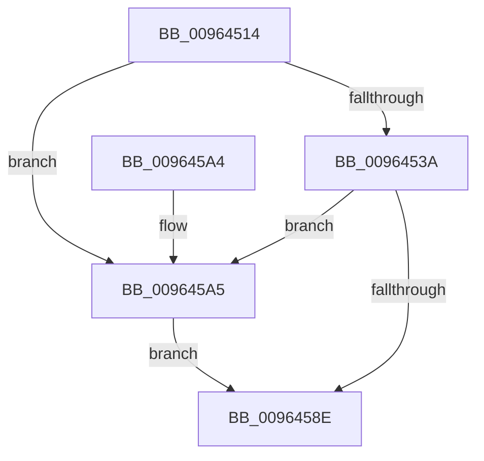

# PiDevCfgConfigureDeviceDriverConfiguration

- RVA: `0x00964514`–`0x009645D2` (길이 `190` bytes)
- VA: `0x0000000140964514`
- 실행 섹션: `PAGE`
- PDB 이름 있음: `예`; PDB Function 태그: `아니요`
- unwind 정보 RVA: `0x00093654`
- 디코드: `50`개 명령, `190/190` bytes 표시
- 미해석 바이트: `0` (있으면 어셈블리에 `.byte`로 보존)

> 이 문서는 커널 이미지의 기계어와 PDB 기호를 분석해 생성했습니다. 4번과 5번은 함수 원형과 자료형을 바이너리 사용 방식에서 추정한 C 해석이며 원본 소스 복구 결과는 아닙니다.

## 1. Dependencies

- 직접 호출 지점: **2**; 고유 호출 대상: **2**
- 직접 호출자로 확인된 함수: **2**
- RIP 상대 이미지 참조: **1**

### Outgoing calls
- `0x00964585` → [PiDevCfgCopyObjectProperties](PiDevCfgCopyObjectProperties_function_009645D8.md) (function, `0x009645D8`)
- `0x009645CB` → [PiDevCfgConfigureDeviceKeys](PiDevCfgConfigureDeviceKeys_function_00964BA8.md) (function, `0x00964BA8`)

### Direct callers
- [PiDevCfgConfigureDeviceDriver](PiDevCfgConfigureDeviceDriver_function_00963ABC.md) at `0x00963B0F`
- [PiDevCfgMigrateDevice](PiDevCfgMigrateDevice_function_00963E60.md) at `0x00964076`

### Static image references
- `0x00964572` → RVA `0x00E66398` (`.data`; read)

## 2. Other-region calls and transfers

- 다른 실행 섹션으로 향하는 call: **0**
- 별도 외부 분기/꼬리 이동을 확인하지 못했습니다.

## 3. Assembly (complete function range)

```asm
00964514  4C 8B DC                        mov r11, rsp
00964517  49 89 5B 08                     mov qword ptr [r11 + 8], rbx
0096451B  49 89 6B 10                     mov qword ptr [r11 + 0x10], rbp
0096451F  49 89 73 18                     mov qword ptr [r11 + 0x18], rsi
00964523  57                              push rdi
00964524  48 83 EC 60                     sub rsp, 0x60
00964528  41 8B D9                        mov ebx, r9d
0096452B  49 8B F0                        mov rsi, r8
0096452E  48 8B FA                        mov rdi, rdx
00964531  48 8B E9                        mov rbp, rcx
00964534  41 F6 C1 01                     test r9b, 1
00964538  74 6B                           je 0x1409645a5
0096453A  8B 02                           mov eax, dword ptr [rdx]
0096453C  4D 8B C8                        mov r9, r8
0096453F  83 E0 01                        and eax, 1
00964542  45 33 C0                        xor r8d, r8d
00964545  C1 E0 11                        shl eax, 0x11
00964548  89 44 24 50                     mov dword ptr [rsp + 0x50], eax
0096454C  48 8B 84 24 98 00 00 00         mov rax, qword ptr [rsp + 0x98]
00964554  49 89 43 E0                     mov qword ptr [r11 - 0x20], rax
00964558  48 8B 84 24 90 00 00 00         mov rax, qword ptr [rsp + 0x90]
00964560  49 89 43 D8                     mov qword ptr [r11 - 0x28], rax
00964564  48 8B 42 10                     mov rax, qword ptr [rdx + 0x10]
00964568  33 D2                           xor edx, edx
0096456A  49 89 43 D0                     mov qword ptr [r11 - 0x30], rax
0096456E  48 8B 41 30                     mov rax, qword ptr [rcx + 0x30]
00964572  48 8B 0D 1F 1E 50 00            mov rcx, qword ptr [rip + 0x501e1f]
00964579  C7 44 24 30 01 00 00 00         mov dword ptr [rsp + 0x30], 1
00964581  49 89 43 C0                     mov qword ptr [r11 - 0x40], rax
00964585  E8 4E 00 00 00                  call 0x1409645d8
0096458A  85 C0                           test eax, eax
0096458C  79 17                           jns 0x1409645a5
0096458E  4C 8D 5C 24 60                  lea r11, [rsp + 0x60]
00964593  49 8B 5B 10                     mov rbx, qword ptr [r11 + 0x10]
00964597  49 8B 6B 18                     mov rbp, qword ptr [r11 + 0x18]
0096459B  49 8B 73 20                     mov rsi, qword ptr [r11 + 0x20]
0096459F  49 8B E3                        mov rsp, r11
009645A2  5F                              pop rdi
009645A3  C3                              ret
009645A4  CC                              int3
009645A5  48 8B 84 24 A8 00 00 00         mov rax, qword ptr [rsp + 0xa8]
009645AD  44 8B CB                        mov r9d, ebx
009645B0  48 89 44 24 28                  mov qword ptr [rsp + 0x28], rax
009645B5  4C 8B C6                        mov r8, rsi
009645B8  48 8B 84 24 A0 00 00 00         mov rax, qword ptr [rsp + 0xa0]
009645C0  48 8B D7                        mov rdx, rdi
009645C3  48 8B CD                        mov rcx, rbp
009645C6  48 89 44 24 20                  mov qword ptr [rsp + 0x20], rax
009645CB  E8 D8 05 00 00                  call 0x140964ba8
009645D0  EB BC                           jmp 0x14096458e
```

## 4. C-style interpretation (structured pseudocode)

```c
__int64 __fastcall PiDevCfgConfigureDeviceDriverConfiguration(__int64 a1, __int64 a2, __int64 a3, int a4, __int64 a5, __int64 a6, __int64 a7, __int64 a8)
{
    __int64 result;
    __int64 v_rsp;
    unsigned int v_stack_m18;
    unsigned int v_stack_m38;
    unsigned __int64 v_stack_m40;
    unsigned __int64 v_stack_m8;

    *(unsigned __int64 *)(v_rsp + 8) = v_rbx;
    *(unsigned __int64 *)(v_rsp + 16) = v_rbp;
    *(unsigned __int64 *)(v_rsp + 24) = v_rsi;
    v_rsp = (v_rsp) - (96);
    if ((((unsigned __int8)(a4)) & (1)) == 0) goto loc_009645A5;
    result = (unsigned int)(((unsigned int)(*(unsigned int *)(a2))) & (1));
    a3 = 0;
    result = (unsigned int)((result) << (17));
    v_stack_m18 = (unsigned int)(result);
    *(unsigned __int64 *)(v_rsp - 32) = a6;
    *(unsigned __int64 *)(v_rsp - 40) = a5;
    a2 = 0;
    *(unsigned __int64 *)(v_rsp - 48) = *(unsigned __int64 *)(a2 + 16);
    v_stack_m38 = 1;
    *(unsigned __int64 *)(v_rsp - 64) = *(unsigned __int64 *)(a1 + 48);
    result = PiDevCfgCopyObjectProperties(*(unsigned __int64 *)(v_rip + 5250591), a2, a3, a3);
    if (!sign_flag) goto loc_009645A5;
loc_0096458E:
    return result;
loc_009645A5:
    v_stack_m38 = a8;
    v_stack_m40 = a7;
    result = PiDevCfgConfigureDeviceKeys(*(unsigned __int64 *)(v_stack_m8 + 24), 0, *(unsigned __int64 *)(v_stack_m8 + 32), (unsigned int)((unsigned int)(*(unsigned __int64 *)(v_stack_m8 + 16))));
    goto loc_0096458E;
}
```

## 5. (Beta) C Style

```c
int64_t PiDevCfgConfigureDeviceDriverConfiguration(void *Arg1, void *Arg2, int64_t Arg3, int32_t Arg4, int64_t Arg5, int64_t Arg6, int64_t Arg7, int64_t Arg8)
{
    uint8_t *arg1 = (uint8_t *)Arg1;
    uint8_t *arg2 = (uint8_t *)Arg2;

    int64_t result;
    int64_t local_rsp;
    uint32_t v_stack_m18;
    uint32_t v_stack_m38;
    uint64_t v_stack_m40;
    uint64_t v_stack_m8;

    *(uint64_t *)(local_rsp + 0x8) = local_rbx;
    *(uint64_t *)(local_rsp + 0x10) = local_rbp;
    *(uint64_t *)(local_rsp + 0x18) = local_rsi;
    local_rsp = (local_rsp) - (96);
    if ((((uint8_t)(Arg4)) & (1)) == 0) goto loc_009645A5;
    result = (uint32_t)(((uint32_t)(*(uint32_t *)(arg2))) & (1));
    Arg3 = 0;
    result = (uint32_t)((result) << (17));
    v_stack_m18 = (uint32_t)(result);
    *(uint64_t *)(local_rsp - 0x20) = Arg6;
    *(uint64_t *)(local_rsp - 0x28) = Arg5;
    Arg2 = 0;
    *(uint64_t *)(local_rsp - 0x30) = *(uint64_t *)(arg2 + 0x10);
    v_stack_m38 = 1;
    *(uint64_t *)(local_rsp - 0x40) = *(uint64_t *)(arg1 + 0x30);
    result = PiDevCfgCopyObjectProperties(*(uint64_t *)(v_rip + 0x501E1F), Arg2, Arg3, Arg3);
    if (!sign_flag) goto loc_009645A5;
loc_0096458E:
    return result;
loc_009645A5:
    v_stack_m38 = Arg8;
    v_stack_m40 = Arg7;
    result = PiDevCfgConfigureDeviceKeys(*(uint64_t *)(v_stack_m8 + 0x18), 0, *(uint64_t *)(v_stack_m8 + 0x20), (uint32_t)((uint32_t)(*(uint64_t *)(v_stack_m8 + 0x10))));
    goto loc_0096458E;
}
```

### 관측된 메모리 오프셋

구조체 형식이 확인되지 않은 접근은 인자 기준의 오프셋으로만 기록했습니다.

| 기준 인자 | 오프셋 표현 | 폭 (bit) | 접근 |
|---|---:|---:|---|
| `Arg1` | `+ 0x30` | `64` | `R` |
| `Arg2` | `+ 0x0` | `32` | `R` |
| `Arg2` | `+ 0x10` | `64` | `R` |

## 6. Execution-region graph

[열기: 2D/3D 그래프와 함수 탐색 컨트롤 패널](../../../control-panel.html?section=page&rva=0x00964514&view=graph)

- 2D 그래프는 위에서 아래로 흐르고, 3D 그래프는 빈 공간을 드래그해 회전합니다. Shift+드래그는 이동, 휠은 확대·축소, 함수 노드 선택은 대상 보고서 이동입니다.

### Static fallback


