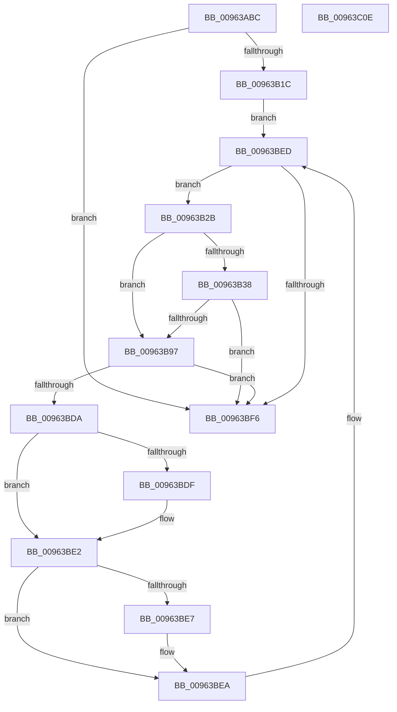

# PiDevCfgConfigureDeviceDriver

- RVA: `0x00963ABC`–`0x00963C0F` (길이 `339` bytes)
- VA: `0x0000000140963ABC`
- 실행 섹션: `PAGE`
- PDB 이름 있음: `예`; PDB Function 태그: `아니요`
- unwind 정보 RVA: `0x000935BC`
- 디코드: `89`개 명령, `339/339` bytes 표시
- 미해석 바이트: `0` (있으면 어셈블리에 `.byte`로 보존)

> 이 문서는 커널 이미지의 기계어와 PDB 기호를 분석해 생성했습니다. 4번과 5번은 함수 원형과 자료형을 바이너리 사용 방식에서 추정한 C 해석이며 원본 소스 복구 결과는 아닙니다.

## 1. Dependencies

- 직접 호출 지점: **3**; 고유 호출 대상: **3**
- 직접 호출자로 확인된 함수: **2**
- RIP 상대 이미지 참조: **2**

### Outgoing calls
- `0x00963B0F` → [PiDevCfgConfigureDeviceDriverConfiguration](PiDevCfgConfigureDeviceDriverConfiguration_function_00964514.md) (function, `0x00964514`)
- `0x00963B8E` → [PiDevCfgCopyObjectProperties](PiDevCfgCopyObjectProperties_function_009645D8.md) (function, `0x009645D8`)
- `0x00963BC4` → [PiDevCfgConfigureDeviceKeys](PiDevCfgConfigureDeviceKeys_function_00964BA8.md) (function, `0x00964BA8`)

### Direct callers
- [PpDevCfgProcessDeviceExtensions](../73/PpDevCfgProcessDeviceExtensions_function_00736C2C.md) at `0x0073711B`
- [PiDevCfgConfigureDevice](../97/PiDevCfgConfigureDevice_function_00977BB4.md) at `0x00979AE6`
- [PiDevCfgConfigureDevice](../97/PiDevCfgConfigureDevice_function_00977BB4.md) at `0x00979B37`

### Static image references
- `0x00963B54` → RVA `0x00732490` (`PiDevCfgConfigurePropertyMatchCallback`; read)
- `0x00963B69` → RVA `0x00E66398` (`.data`; read)

## 2. Other-region calls and transfers

- 다른 실행 섹션으로 향하는 call: **0**
- 별도 외부 분기/꼬리 이동을 확인하지 못했습니다.

## 3. Assembly (complete function range)

```asm
00963ABC  48 8B C4                        mov rax, rsp
00963ABF  48 89 58 20                     mov qword ptr [rax + 0x20], rbx
00963AC3  48 89 50 10                     mov qword ptr [rax + 0x10], rdx
00963AC7  48 89 48 08                     mov qword ptr [rax + 8], rcx
00963ACB  55                              push rbp
00963ACC  56                              push rsi
00963ACD  57                              push rdi
00963ACE  41 54                           push r12
00963AD0  41 55                           push r13
00963AD2  41 56                           push r14
00963AD4  41 57                           push r15
00963AD6  48 83 EC 70                     sub rsp, 0x70
00963ADA  48 8B B4 24 D0 00 00 00         mov rsi, qword ptr [rsp + 0xd0]
00963AE2  45 33 E4                        xor r12d, r12d
00963AE5  48 89 70 90                     mov qword ptr [rax - 0x70], rsi
00963AE9  49 8B F9                        mov rdi, r9
00963AEC  4C 89 48 88                     mov qword ptr [rax - 0x78], r9
00963AF0  4D 8B F0                        mov r14, r8
00963AF3  4C 21 60 80                     and qword ptr [rax - 0x80], r12
00963AF7  45 33 FF                        xor r15d, r15d
00963AFA  4D 8B 40 20                     mov r8, qword ptr [r8 + 0x20]
00963AFE  41 83 C9 FF                     or r9d, 0xffffffff
00963B02  4C 21 64 24 20                  and qword ptr [rsp + 0x20], r12
00963B07  44 89 78 18                     mov dword ptr [rax + 0x18], r15d
00963B0B  44 89 60 B8                     mov dword ptr [rax - 0x48], r12d
00963B0F  E8 00 0A 00 00                  call 0x140964514
00963B14  85 C0                           test eax, eax
00963B16  0F 88 DA 00 00 00               js 0x140963bf6
00963B1C  49 81 C6 80 01 00 00            add r14, 0x180
00963B23  49 8B 1E                        mov rbx, qword ptr [r14]
00963B26  E9 C2 00 00 00                  jmp 0x140963bed
00963B2B  8B 6B 68                        mov ebp, dword ptr [rbx + 0x68]
00963B2E  4C 8B 6B 20                     mov r13, qword ptr [rbx + 0x20]
00963B32  40 F6 C5 01                     test bpl, 1
00963B36  74 5F                           je 0x140963b97
00963B38  48 8B 8C 24 B8 00 00 00         mov rcx, qword ptr [rsp + 0xb8]
00963B40  4D 8B CD                        mov r9, r13
00963B43  45 33 C0                        xor r8d, r8d
00963B46  33 D2                           xor edx, edx
00963B48  8B 01                           mov eax, dword ptr [rcx]
00963B4A  83 E0 01                        and eax, 1
00963B4D  C1 E0 11                        shl eax, 0x11
00963B50  89 44 24 50                     mov dword ptr [rsp + 0x50], eax
00963B54  48 8D 05 35 E9 DC FF            lea rax, [rip - 0x2316cb]
00963B5B  48 89 5C 24 48                  mov qword ptr [rsp + 0x48], rbx
00963B60  48 89 44 24 40                  mov qword ptr [rsp + 0x40], rax
00963B65  48 8B 41 10                     mov rax, qword ptr [rcx + 0x10]
00963B69  48 8B 0D 28 28 50 00            mov rcx, qword ptr [rip + 0x502828]
00963B70  48 89 44 24 38                  mov qword ptr [rsp + 0x38], rax
00963B75  48 8B 84 24 B0 00 00 00         mov rax, qword ptr [rsp + 0xb0]
00963B7D  C7 44 24 30 01 00 00 00         mov dword ptr [rsp + 0x30], 1
00963B85  48 8B 40 30                     mov rax, qword ptr [rax + 0x30]
00963B89  48 89 44 24 28                  mov qword ptr [rsp + 0x28], rax
00963B8E  E8 45 0A 00 00                  call 0x1409645d8
00963B93  85 C0                           test eax, eax
00963B95  78 5F                           js 0x140963bf6
00963B97  48 8B 94 24 B8 00 00 00         mov rdx, qword ptr [rsp + 0xb8]
00963B9F  48 8D 44 24 60                  lea rax, [rsp + 0x60]
00963BA4  48 8B 8C 24 B0 00 00 00         mov rcx, qword ptr [rsp + 0xb0]
00963BAC  44 8B CD                        mov r9d, ebp
00963BAF  48 89 44 24 28                  mov qword ptr [rsp + 0x28], rax
00963BB4  4D 8B C5                        mov r8, r13
00963BB7  48 8D 84 24 C0 00 00 00         lea rax, [rsp + 0xc0]
00963BBF  48 89 44 24 20                  mov qword ptr [rsp + 0x20], rax
00963BC4  E8 DF 0F 00 00                  call 0x140964ba8
00963BC9  44 8B BC 24 C0 00 00 00         mov r15d, dword ptr [rsp + 0xc0]
00963BD1  44 8B 64 24 60                  mov r12d, dword ptr [rsp + 0x60]
00963BD6  85 C0                           test eax, eax
00963BD8  78 1C                           js 0x140963bf6
00963BDA  48 85 FF                        test rdi, rdi
00963BDD  74 03                           je 0x140963be2
00963BDF  44 09 3F                        or dword ptr [rdi], r15d
00963BE2  48 85 F6                        test rsi, rsi
00963BE5  74 03                           je 0x140963bea
00963BE7  44 09 26                        or dword ptr [rsi], r12d
00963BEA  48 8B 1B                        mov rbx, qword ptr [rbx]
00963BED  49 3B DE                        cmp rbx, r14
00963BF0  0F 85 35 FF FF FF               jne 0x140963b2b
00963BF6  48 8B 9C 24 C8 00 00 00         mov rbx, qword ptr [rsp + 0xc8]
00963BFE  48 83 C4 70                     add rsp, 0x70
00963C02  41 5F                           pop r15
00963C04  41 5E                           pop r14
00963C06  41 5D                           pop r13
00963C08  41 5C                           pop r12
00963C0A  5F                              pop rdi
00963C0B  5E                              pop rsi
00963C0C  5D                              pop rbp
00963C0D  C3                              ret
00963C0E  CC                              int3
```

## 4. C-style interpretation (structured pseudocode)

```c
__int64 __fastcall PiDevCfgConfigureDeviceDriver(__int64 a1, __int64 a2, __int64 a3, __int64 a4, __int64 a5)
{
    __int64 result;
    __int64 v_r12;
    __int64 v_r14;
    __int64 v_r15;
    __int64 v_rsp;
    unsigned __int64 v_stack_m48;
    unsigned int v_stack_m58;
    unsigned __int64 v_stack_m60;
    unsigned __int64 v_stack_m68;
    unsigned __int64 v_stack_m70;
    unsigned int v_stack_m78;
    unsigned __int64 v_stack_m80;
    unsigned __int64 v_stack_m88;
    unsigned __int64 v_stack_p10;
    unsigned __int64 v_stack_p18;
    unsigned __int64 v_stack_p20;
    unsigned __int64 v_stack_p8;

    *(unsigned __int64 *)(v_rsp + 32) = v_rbx;
    *(unsigned __int64 *)(v_rsp + 16) = a2;
    *(unsigned __int64 *)(v_rsp + 8) = a1;
    v_rsp = (v_rsp) - (112);
    v_r12 = 0;
    *(unsigned __int64 *)(v_rsp - 112) = a5;
    *(unsigned __int64 *)(v_rsp - 120) = a4;
    v_r15 = 0;
    a4 = (unsigned int)((a4) | (0xFFFFFFFFULL));
    *(unsigned int *)(v_rsp + 24) = 0;
    *(unsigned int *)(v_rsp - 72) = 0;
    result = PiDevCfgConfigureDeviceDriverConfiguration(a1, a2, *(unsigned __int64 *)(a3 + 32), a4);
    if (sign_flag) goto loc_00963BF6;
    v_r14 = (a3) + (384);
    goto loc_00963BED;
loc_00963B2B:
    if ((((unsigned __int8)((unsigned int)(*(unsigned int *)(*(unsigned __int64 *)(v_r14) + 104)))) & (1)) == 0) goto loc_00963B97;
    a3 = 0;
    a2 = 0;
    result = (unsigned int)(((unsigned int)(*(unsigned int *)(v_stack_p10))) & (1));
    result = (unsigned int)((result) << (17));
    v_stack_m58 = (unsigned int)(result);
    v_stack_m60 = *(unsigned __int64 *)(v_r14);
    v_stack_m68 = v_rip - 2299595;
    v_stack_m70 = *(unsigned __int64 *)(v_stack_p10 + 16);
    v_stack_m78 = 1;
    v_stack_m80 = *(unsigned __int64 *)(v_stack_p8 + 48);
    result = PiDevCfgCopyObjectProperties(*(unsigned __int64 *)(v_rip + 5253160), a2, a3, *(unsigned __int64 *)(*(unsigned __int64 *)(v_r14) + 32));
    if (sign_flag) goto loc_00963BF6;
loc_00963B97:
    v_stack_m80 = v_stack_m48;
    v_stack_m88 = v_stack_p18;
    result = PiDevCfgConfigureDeviceKeys(v_stack_p8, v_stack_p10, *(unsigned __int64 *)(*(unsigned __int64 *)(v_r14) + 32), (unsigned int)((unsigned int)((unsigned int)(*(unsigned int *)(*(unsigned __int64 *)(v_r14) + 104)))));
    if (sign_flag) goto loc_00963BF6;
    if (a4 != 0) {
    }
    if (a5 != 0) {
    }
loc_00963BED:
    if ((*(unsigned __int64 *)(*(unsigned __int64 *)(v_r14))) != v_r14) goto loc_00963B2B;
loc_00963BF6:
    v_rsp = (v_rsp) + (112);
    return result;
}
```

## 5. (Beta) C Style

```c
int64_t PiDevCfgConfigureDeviceDriver(int64_t Arg1, int64_t Arg2, void *Arg3, int64_t Arg4, int64_t Arg5)
{
    uint8_t *arg3 = (uint8_t *)Arg3;

    int64_t result;
    int64_t local_r12;
    int64_t local_r14;
    int64_t local_r15;
    int64_t local_rsp;
    uint64_t v_stack_m48;
    uint32_t v_stack_m58;
    uint64_t v_stack_m60;
    uint64_t v_stack_m68;
    uint64_t v_stack_m70;
    uint32_t v_stack_m78;
    uint64_t v_stack_m80;
    uint64_t v_stack_m88;
    uint64_t v_stack_p10;
    uint64_t v_stack_p18;
    uint64_t v_stack_p20;
    uint64_t v_stack_p8;

    *(uint64_t *)(local_rsp + 0x20) = local_rbx;
    *(uint64_t *)(local_rsp + 0x10) = Arg2;
    *(uint64_t *)(local_rsp + 0x8) = Arg1;
    local_rsp = (local_rsp) - (112);
    local_r12 = 0;
    *(uint64_t *)(local_rsp - 0x70) = Arg5;
    *(uint64_t *)(local_rsp - 0x78) = Arg4;
    local_r15 = 0;
    Arg4 = (uint32_t)((Arg4) | (0xFFFFFFFFULL));
    *(uint32_t *)(local_rsp + 0x18) = 0;
    *(uint32_t *)(local_rsp - 0x48) = 0;
    result = PiDevCfgConfigureDeviceDriverConfiguration(Arg1, Arg2, *(uint64_t *)(arg3 + 0x20), Arg4);
    if (sign_flag) goto loc_00963BF6;
    local_r14 = (Arg3) + (384);
    goto loc_00963BED;
loc_00963B2B:
    if ((((uint8_t)((uint32_t)(*(uint32_t *)(*(uint64_t *)(local_r14) + 0x68)))) & (1)) == 0) goto loc_00963B97;
    Arg3 = 0;
    Arg2 = 0;
    result = (uint32_t)(((uint32_t)(*(uint32_t *)(v_stack_p10))) & (1));
    result = (uint32_t)((result) << (17));
    v_stack_m58 = (uint32_t)(result);
    v_stack_m60 = *(uint64_t *)(local_r14);
    v_stack_m68 = v_rip - 2299595;
    v_stack_m70 = *(uint64_t *)(v_stack_p10 + 0x10);
    v_stack_m78 = 1;
    v_stack_m80 = *(uint64_t *)(v_stack_p8 + 0x30);
    result = PiDevCfgCopyObjectProperties(*(uint64_t *)(v_rip + 0x502828), Arg2, Arg3, *(uint64_t *)(*(uint64_t *)(local_r14) + 0x20));
    if (sign_flag) goto loc_00963BF6;
loc_00963B97:
    v_stack_m80 = v_stack_m48;
    v_stack_m88 = v_stack_p18;
    result = PiDevCfgConfigureDeviceKeys(v_stack_p8, v_stack_p10, *(uint64_t *)(*(uint64_t *)(local_r14) + 0x20), (uint32_t)((uint32_t)((uint32_t)(*(uint32_t *)(*(uint64_t *)(local_r14) + 0x68)))));
    if (sign_flag) goto loc_00963BF6;
    if (Arg4 != 0) {
    }
    if (Arg5 != 0) {
    }
loc_00963BED:
    if ((*(uint64_t *)(*(uint64_t *)(local_r14))) != local_r14) goto loc_00963B2B;
loc_00963BF6:
    local_rsp = (local_rsp) + (112);
    return result;
}
```

### 관측된 메모리 오프셋

구조체 형식이 확인되지 않은 접근은 인자 기준의 오프셋으로만 기록했습니다.

| 기준 인자 | 오프셋 표현 | 폭 (bit) | 접근 |
|---|---:|---:|---|
| `Arg3` | `+ 0x0` | `64` | `R` |
| `Arg3` | `+ 0x20` | `64` | `R` |

## 6. Execution-region graph

[열기: 2D/3D 그래프와 함수 탐색 컨트롤 패널](../../../control-panel.html?section=page&rva=0x00963ABC&view=graph)

- 2D 그래프는 위에서 아래로 흐르고, 3D 그래프는 빈 공간을 드래그해 회전합니다. Shift+드래그는 이동, 휠은 확대·축소, 함수 노드 선택은 대상 보고서 이동입니다.

### Static fallback


