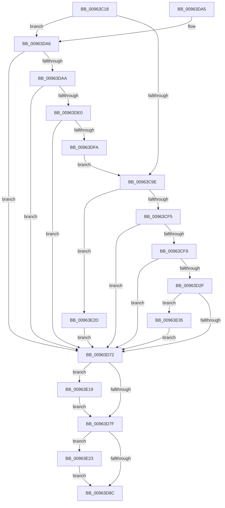

# PiDevCfgConfigureDeviceInterface

- RVA: `0x00963C18`–`0x00963E57` (길이 `575` bytes)
- VA: `0x0000000140963C18`
- 실행 섹션: `PAGE`
- PDB 이름 있음: `예`; PDB Function 태그: `아니요`
- unwind 정보 RVA: `0x000935D8`
- 디코드: `138`개 명령, `575/575` bytes 표시
- 미해석 바이트: `0` (있으면 어셈블리에 `.byte`로 보존)

> 이 문서는 커널 이미지의 기계어와 PDB 기호를 분석해 생성했습니다. 4번과 5번은 함수 원형과 자료형을 바이너리 사용 방식에서 추정한 C 해석이며 원본 소스 복구 결과는 아닙니다.

## 1. Dependencies

- 직접 호출 지점: **13**; 고유 호출 대상: **7**
- 직접 호출자로 확인된 함수: **3**
- RIP 상대 이미지 참조: **3**

### Outgoing calls
- `0x00963C52` → [RtlInitUnicodeString](../../text/42/RtlInitUnicodeString_function_0042A780.md) (function, `0x0042A780`)
- `0x00963C8C` → [ZwOpenKey](../../text/6A/ZwOpenKey_function_006AD310.md) (function, `0x006AD310`)
- `0x00963CA9` → [RtlInitUnicodeString](../../text/42/RtlInitUnicodeString_function_0042A780.md) (function, `0x0042A780`)
- `0x00963CE3` → [ZwOpenKey](../../text/6A/ZwOpenKey_function_006AD310.md) (function, `0x006AD310`)
- `0x00963D24` → [_CmOpenDeviceInterfaceRegKey](../8F/_CmOpenDeviceInterfaceRegKey_function_008F31F4.md) (function, `0x008F31F4`)
- `0x00963D63` → [PiDevCfgCopyObjectProperties](PiDevCfgCopyObjectProperties_function_009645D8.md) (function, `0x009645D8`)
- `0x00963DD5` → [_CmOpenDeviceInterfaceRegKey](../8F/_CmOpenDeviceInterfaceRegKey_function_008F31F4.md) (function, `0x008F31F4`)
- `0x00963DEB` → [PiDevCfgCopyDeviceKeys](../99/PiDevCfgCopyDeviceKeys_function_00995E1C.md) (function, `0x00995E1C`)
- `0x00963DFE` → [ZwClose](../../text/6A/ZwClose_function_006AD2B0.md) (function, `0x006AD2B0`)
- `0x00963E0B` → [ZwClose](../../text/6A/ZwClose_function_006AD2B0.md) (function, `0x006AD2B0`)
- `0x00963E19` → [ZwClose](../../text/6A/ZwClose_function_006AD2B0.md) (function, `0x006AD2B0`)
- `0x00963E23` → [ZwClose](../../text/6A/ZwClose_function_006AD2B0.md) (function, `0x006AD2B0`)
- `0x00963E4B` → [PiDevCfgCopyDeviceProperties](../70/PiDevCfgCopyDeviceProperties_function_007044F0.md) (function, `0x007044F0`)

### Direct callers
- [PiDevCfgConfigureDeviceInterfaceCallback](../../text/5A/PiDevCfgConfigureDeviceInterfaceCallback_function_005A7D30.md) at `0x005A7D4D`
- [PiDevCfgConfigureDeviceInterfaces](../A9/PiDevCfgConfigureDeviceInterfaces_function_00A90060.md) at `0x00A903AE`
- [sub_00B467A6](../B4/Unknown_function_00B467A6.md) at `0x00B46908`

### Static image references
- `0x00963C39` → RVA `0x00AFE540` (` ?? ::NNGAKEGL::`string'`; read)
- `0x00963C9E` → RVA `0x00AFCD40` (` ?? ::NNGAKEGL::`string'`; read)
- `0x00963CF9` → RVA `0x00E66398` (`.data`; read)

## 2. Other-region calls and transfers

- 다른 실행 섹션으로 향하는 call: **8**
  - `0x00963C52` → [RtlInitUnicodeString](../../text/42/RtlInitUnicodeString_function_0042A780.md) (`PAGE` → `.text`)
  - `0x00963C8C` → [ZwOpenKey](../../text/6A/ZwOpenKey_function_006AD310.md) (`PAGE` → `.text`)
  - `0x00963CA9` → [RtlInitUnicodeString](../../text/42/RtlInitUnicodeString_function_0042A780.md) (`PAGE` → `.text`)
  - `0x00963CE3` → [ZwOpenKey](../../text/6A/ZwOpenKey_function_006AD310.md) (`PAGE` → `.text`)
  - `0x00963DFE` → [ZwClose](../../text/6A/ZwClose_function_006AD2B0.md) (`PAGE` → `.text`)
  - `0x00963E0B` → [ZwClose](../../text/6A/ZwClose_function_006AD2B0.md) (`PAGE` → `.text`)
  - `0x00963E19` → [ZwClose](../../text/6A/ZwClose_function_006AD2B0.md) (`PAGE` → `.text`)
  - `0x00963E23` → [ZwClose](../../text/6A/ZwClose_function_006AD2B0.md) (`PAGE` → `.text`)
- 별도 외부 분기/꼬리 이동을 확인하지 못했습니다.

## 3. Assembly (complete function range)

```asm
00963C18  48 89 5C 24 08                  mov qword ptr [rsp + 8], rbx
00963C1D  55                              push rbp
00963C1E  56                              push rsi
00963C1F  57                              push rdi
00963C20  41 56                           push r14
00963C22  41 57                           push r15
00963C24  48 8D 6C 24 C9                  lea rbp, [rsp - 0x37]
00963C29  48 81 EC A0 00 00 00            sub rsp, 0xa0
00963C30  4C 8B F2                        mov r14, rdx
00963C33  48 8B F9                        mov rdi, rcx
00963C36  0F 57 C0                        xorps xmm0, xmm0
00963C39  48 8D 15 00 A9 19 00            lea rdx, [rip + 0x19a900]
00963C40  45 33 FF                        xor r15d, r15d
00963C43  48 8D 4D F7                     lea rcx, [rbp - 9]
00963C47  4C 89 7D 7F                     mov qword ptr [rbp + 0x7f], r15
00963C4B  49 8B F0                        mov rsi, r8
00963C4E  0F 11 45 F7                     movups xmmword ptr [rbp - 9], xmm0
00963C52  E8 29 6B AC FF                  call 0x14042a780
00963C57  48 8D 45 F7                     lea rax, [rbp - 9]
00963C5B  48 C7 45 07 30 00 00 00         mov qword ptr [rbp + 7], 0x30
00963C63  0F 57 C0                        xorps xmm0, xmm0
00963C66  48 89 45 17                     mov qword ptr [rbp + 0x17], rax
00963C6A  4C 8D 45 07                     lea r8, [rbp + 7]
00963C6E  48 C7 45 1F 40 02 00 00         mov qword ptr [rbp + 0x1f], 0x240
00963C76  BA 19 00 02 00                  mov edx, 0x20019
00963C7B  4C 89 7D 6F                     mov qword ptr [rbp + 0x6f], r15
00963C7F  48 8D 4D 6F                     lea rcx, [rbp + 0x6f]
00963C83  4C 89 75 0F                     mov qword ptr [rbp + 0xf], r14
00963C87  F3 0F 7F 45 27                  movdqu xmmword ptr [rbp + 0x27], xmm0
00963C8C  E8 7F 96 D4 FF                  call 0x1406ad310
00963C91  8B D8                           mov ebx, eax
00963C93  3D 34 00 00 C0                  cmp eax, 0xc0000034
00963C98  0F 85 08 01 00 00               jne 0x140963da6
00963C9E  48 8D 15 9B 90 19 00            lea rdx, [rip + 0x19909b]
00963CA5  48 8D 4D F7                     lea rcx, [rbp - 9]
00963CA9  E8 D2 6A AC FF                  call 0x14042a780
00963CAE  48 8D 45 F7                     lea rax, [rbp - 9]
00963CB2  48 C7 45 07 30 00 00 00         mov qword ptr [rbp + 7], 0x30
00963CBA  0F 57 C0                        xorps xmm0, xmm0
00963CBD  48 89 45 17                     mov qword ptr [rbp + 0x17], rax
00963CC1  4C 8D 45 07                     lea r8, [rbp + 7]
00963CC5  48 C7 45 1F 40 02 00 00         mov qword ptr [rbp + 0x1f], 0x240
00963CCD  BA 19 00 02 00                  mov edx, 0x20019
00963CD2  4C 89 7D 6F                     mov qword ptr [rbp + 0x6f], r15
00963CD6  48 8D 4D 6F                     lea rcx, [rbp + 0x6f]
00963CDA  4C 89 75 0F                     mov qword ptr [rbp + 0xf], r14
00963CDE  F3 0F 7F 45 27                  movdqu xmmword ptr [rbp + 0x27], xmm0
00963CE3  E8 28 96 D4 FF                  call 0x1406ad310
00963CE8  8B D8                           mov ebx, eax
00963CEA  3D 34 00 00 C0                  cmp eax, 0xc0000034
00963CEF  0F 84 38 01 00 00               je 0x140963e2d
00963CF5  85 C0                           test eax, eax
00963CF7  78 79                           js 0x140963d72
00963CF9  48 8B 0D 98 26 50 00            mov rcx, qword ptr [rip + 0x502698]
00963D00  48 8D 45 7F                     lea rax, [rbp + 0x7f]
00963D04  4C 89 7C 24 38                  mov qword ptr [rsp + 0x38], r15
00963D09  41 B8 30 00 00 00               mov r8d, 0x30
00963D0F  48 89 44 24 30                  mov qword ptr [rsp + 0x30], rax
00963D14  48 8B D7                        mov rdx, rdi
00963D17  44 88 7C 24 28                  mov byte ptr [rsp + 0x28], r15b
00963D1C  C7 44 24 20 3F 00 0F 00         mov dword ptr [rsp + 0x20], 0xf003f
00963D24  E8 CB F4 F8 FF                  call 0x1408f31f4
00963D29  8B D8                           mov ebx, eax
00963D2B  85 C0                           test eax, eax
00963D2D  78 43                           js 0x140963d72
00963D2F  48 8B 45 7F                     mov rax, qword ptr [rbp + 0x7f]
00963D33  4D 8B CE                        mov r9, r14
00963D36  48 8B 0D 5B 26 50 00            mov rcx, qword ptr [rip + 0x50265b]
00963D3D  45 33 C0                        xor r8d, r8d
00963D40  44 89 7C 24 50                  mov dword ptr [rsp + 0x50], r15d
00963D45  33 D2                           xor edx, edx
00963D47  4C 89 7C 24 48                  mov qword ptr [rsp + 0x48], r15
00963D4C  4C 89 7C 24 40                  mov qword ptr [rsp + 0x40], r15
00963D51  48 89 44 24 38                  mov qword ptr [rsp + 0x38], rax
00963D56  C7 44 24 30 03 00 00 00         mov dword ptr [rsp + 0x30], 3
00963D5E  48 89 7C 24 28                  mov qword ptr [rsp + 0x28], rdi
00963D63  E8 70 08 00 00                  call 0x1409645d8
00963D68  8B D8                           mov ebx, eax
00963D6A  85 C0                           test eax, eax
00963D6C  0F 89 C3 00 00 00               jns 0x140963e35
00963D72  48 8B 4D 6F                     mov rcx, qword ptr [rbp + 0x6f]
00963D76  48 85 C9                        test rcx, rcx
00963D79  0F 85 9A 00 00 00               jne 0x140963e19
00963D7F  48 8B 4D 7F                     mov rcx, qword ptr [rbp + 0x7f]
00963D83  48 85 C9                        test rcx, rcx
00963D86  0F 85 97 00 00 00               jne 0x140963e23
00963D8C  8B C3                           mov eax, ebx
00963D8E  48 8B 9C 24 D0 00 00 00         mov rbx, qword ptr [rsp + 0xd0]
00963D96  48 81 C4 A0 00 00 00            add rsp, 0xa0
00963D9D  41 5F                           pop r15
00963D9F  41 5E                           pop r14
00963DA1  5F                              pop rdi
00963DA2  5E                              pop rsi
00963DA3  5D                              pop rbp
00963DA4  C3                              ret
00963DA5  CC                              int3
00963DA6  85 C0                           test eax, eax
00963DA8  78 C8                           js 0x140963d72
00963DAA  48 8B 0D E7 25 50 00            mov rcx, qword ptr [rip + 0x5025e7]
00963DB1  48 8D 45 7F                     lea rax, [rbp + 0x7f]
00963DB5  4C 89 7C 24 38                  mov qword ptr [rsp + 0x38], r15
00963DBA  41 B8 32 00 00 00               mov r8d, 0x32
00963DC0  48 89 44 24 30                  mov qword ptr [rsp + 0x30], rax
00963DC5  48 8B D7                        mov rdx, rdi
00963DC8  C6 44 24 28 01                  mov byte ptr [rsp + 0x28], 1
00963DCD  C7 44 24 20 3F 00 0F 00         mov dword ptr [rsp + 0x20], 0xf003f
00963DD5  E8 1A F4 F8 FF                  call 0x1408f31f4
00963DDA  8B D8                           mov ebx, eax
00963DDC  85 C0                           test eax, eax
00963DDE  78 92                           js 0x140963d72
00963DE0  48 8B 55 7F                     mov rdx, qword ptr [rbp + 0x7f]
00963DE4  4C 8B CE                        mov r9, rsi
00963DE7  48 8B 4D 6F                     mov rcx, qword ptr [rbp + 0x6f]
00963DEB  E8 2C 20 03 00                  call 0x140995e1c
00963DF0  8B D8                           mov ebx, eax
00963DF2  85 C0                           test eax, eax
00963DF4  0F 88 78 FF FF FF               js 0x140963d72
00963DFA  48 8B 4D 6F                     mov rcx, qword ptr [rbp + 0x6f]
00963DFE  E8 AD 94 D4 FF                  call 0x1406ad2b0
00963E03  48 8B 4D 7F                     mov rcx, qword ptr [rbp + 0x7f]
00963E07  4C 89 7D 6F                     mov qword ptr [rbp + 0x6f], r15
00963E0B  E8 A0 94 D4 FF                  call 0x1406ad2b0
00963E10  4C 89 7D 7F                     mov qword ptr [rbp + 0x7f], r15
00963E14  E9 85 FE FF FF                  jmp 0x140963c9e
00963E19  E8 92 94 D4 FF                  call 0x1406ad2b0
00963E1E  E9 5C FF FF FF                  jmp 0x140963d7f
00963E23  E8 88 94 D4 FF                  call 0x1406ad2b0
00963E28  E9 5F FF FF FF                  jmp 0x140963d8c
00963E2D  41 8B DF                        mov ebx, r15d
00963E30  E9 3D FF FF FF                  jmp 0x140963d72
00963E35  48 8B 55 7F                     mov rdx, qword ptr [rbp + 0x7f]
00963E39  41 B9 03 00 00 00               mov r9d, 3
00963E3F  48 8B 4D 6F                     mov rcx, qword ptr [rbp + 0x6f]
00963E43  4C 8B C7                        mov r8, rdi
00963E46  48 89 74 24 28                  mov qword ptr [rsp + 0x28], rsi
00963E4B  E8 A0 06 DA FF                  call 0x1407044f0
00963E50  8B D8                           mov ebx, eax
00963E52  E9 1B FF FF FF                  jmp 0x140963d72
```

## 4. C-style interpretation (structured pseudocode)

```c
__int64 __fastcall PiDevCfgConfigureDeviceInterface(__int64 a1, __int64 a2, __int64 a3)
{
    __int64 result;
    __int64 v_r15;
    __int64 v_rsp;
    unsigned __int64 v_stack_m38;
    unsigned __int64 v_stack_m40;
    unsigned __int64 v_stack_m48;
    unsigned __int64 v_stack_m50;
    unsigned __int64 v_stack_m58;
    unsigned __int64 v_stack_m5F;
    unsigned __int64 v_stack_m68;
    unsigned int v_stack_m78;
    unsigned __int64 v_stack_m80;
    unsigned __int64 v_stack_m88;
    unsigned __int64 v_stack_m90;
    unsigned __int64 v_stack_m98;
    unsigned __int8 v_stack_mA0;
    unsigned int v_stack_mA8;
    unsigned __int64 v_stack_p10;
    unsigned __int64 v_stack_p20;
    unsigned __int8 v_stack_p28;
    unsigned __int64 v_stack_p30;
    unsigned __int64 v_stack_p38;
    unsigned __int64 v_stack_p8;

    v_stack_p8 = v_rbx;
    v_rsp = (v_rsp) - (160);
    v_r15 = 0;
    v_stack_p20 = 0;
    v_stack_m68 = v_xmm0;
    result = RtlInitUnicodeString(v_stack_m68, v_rip + 1681664, a3, a4);
    v_stack_m58 = 48;
    v_stack_m48 = v_stack_m68;
    v_stack_m40 = 576;
    v_stack_p10 = 0;
    v_stack_m50 = a2;
    v_stack_m38 = v_xmm0;
    result = ZwOpenKey(v_stack_p10, (unsigned int)(0x20019ULL), v_stack_m58, a4);
    if (((unsigned int)(result)) != 0xC0000034ULL) goto loc_00963DA6;
loc_00963C9E:
    result = RtlInitUnicodeString(v_stack_m68, v_rip + 1675419, v_stack_m58, a4);
    v_stack_m58 = 48;
    v_stack_m48 = v_stack_m68;
    v_stack_m40 = 576;
    v_stack_p10 = 0;
    v_stack_m50 = a2;
    v_stack_m38 = v_xmm0;
    result = ZwOpenKey(v_stack_p10, (unsigned int)(0x20019ULL), v_stack_m58, a4);
    if (((unsigned int)(result)) == 0xC0000034ULL) goto loc_00963E2D;
    if (sign_flag) goto loc_00963D72;
    v_stack_m90 = 0;
    v_stack_m98 = v_stack_p20;
    v_stack_mA0 = 0;
    v_stack_mA8 = 0xF003FULL;
    result = _CmOpenDeviceInterfaceRegKey(*(unsigned __int64 *)(v_rip + 5252760), a1, 48, a4);
    if (sign_flag) goto loc_00963D72;
    a3 = 0;
    v_stack_m78 = 0;
    a2 = 0;
    v_stack_m80 = 0;
    v_stack_m88 = 0;
    v_stack_m90 = v_stack_p20;
    v_stack_m98 = 3;
    v_stack_mA0 = a1;
    result = PiDevCfgCopyObjectProperties(*(unsigned __int64 *)(v_rip + 5252699), a2, a3, a2);
    if (!sign_flag) goto loc_00963E35;
loc_00963D72:
    if (v_stack_p10 != 0) goto loc_00963E19;
loc_00963D7F:
    if (v_stack_p20 != 0) goto loc_00963E23;
loc_00963D8C:
    v_rsp = (v_rsp) + (160);
    return (unsigned int)((unsigned int)((unsigned int)((unsigned int)(result))));
loc_00963DA6:
    if (sign_flag) goto loc_00963D72;
    v_stack_p38 = 0;
    v_stack_p30 = v_stack_p20;
    v_stack_p28 = 1;
    v_stack_p20 = 0xF003FULL;
    result = _CmOpenDeviceInterfaceRegKey(*(unsigned __int64 *)(v_rip + 5252583), a1, 50, a2);
    if (sign_flag) goto loc_00963D72;
    result = PiDevCfgCopyDeviceKeys(v_stack_p10, v_stack_p20, 50, 0);
    if (sign_flag) goto loc_00963D72;
    result = ZwClose(v_stack_p10, v_stack_p20, 50, 0);
    v_stack_p10 = 0;
    result = ZwClose(v_stack_p20, v_stack_p20, 50, 0);
    v_stack_p20 = 0;
    goto loc_00963C9E;
loc_00963E19:
    result = ZwClose(v_stack_p20, v_stack_p20, 50, 0);
    goto loc_00963D7F;
loc_00963E23:
    result = ZwClose(v_stack_p20, v_stack_p20, 50, 0);
    goto loc_00963D8C;
loc_00963E2D:
    goto loc_00963D72;
loc_00963E35:
    v_stack_p28 = 0;
    result = PiDevCfgCopyDeviceProperties(v_stack_p10, v_stack_p20, a1, 3);
    goto loc_00963D72;
}
```

## 5. (Beta) C Style

```c
int64_t PiDevCfgConfigureDeviceInterface(int64_t Arg1, int64_t Arg2, int64_t Arg3)
{
    int64_t result;
    int64_t local_r15;
    int64_t local_rsp;
    uint64_t v_stack_m38;
    uint64_t v_stack_m40;
    uint64_t v_stack_m48;
    uint64_t v_stack_m50;
    uint64_t v_stack_m58;
    uint64_t v_stack_m5F;
    uint64_t v_stack_m68;
    uint32_t v_stack_m78;
    uint64_t v_stack_m80;
    uint64_t v_stack_m88;
    uint64_t v_stack_m90;
    uint64_t v_stack_m98;
    uint8_t v_stack_mA0;
    uint32_t v_stack_mA8;
    uint64_t v_stack_p10;
    uint64_t v_stack_p20;
    uint8_t v_stack_p28;
    uint64_t v_stack_p30;
    uint64_t v_stack_p38;
    uint64_t v_stack_p8;

    v_stack_p8 = local_rbx;
    local_rsp = (local_rsp) - (160);
    local_r15 = 0;
    v_stack_p20 = 0;
    v_stack_m68 = v_xmm0;
    result = RtlInitUnicodeString(v_stack_m68, v_rip + 1681664, Arg3, a4);
    v_stack_m58 = 48;
    v_stack_m48 = v_stack_m68;
    v_stack_m40 = 576;
    v_stack_p10 = 0;
    v_stack_m50 = Arg2;
    v_stack_m38 = v_xmm0;
    result = ZwOpenKey(v_stack_p10, (uint32_t)(0x20019ULL), v_stack_m58, a4);
    if (((uint32_t)(result)) != 0xC0000034ULL) goto loc_00963DA6;
loc_00963C9E:
    result = RtlInitUnicodeString(v_stack_m68, v_rip + 1675419, v_stack_m58, a4);
    v_stack_m58 = 48;
    v_stack_m48 = v_stack_m68;
    v_stack_m40 = 576;
    v_stack_p10 = 0;
    v_stack_m50 = Arg2;
    v_stack_m38 = v_xmm0;
    result = ZwOpenKey(v_stack_p10, (uint32_t)(0x20019ULL), v_stack_m58, a4);
    if (((uint32_t)(result)) == 0xC0000034ULL) goto loc_00963E2D;
    if (sign_flag) goto loc_00963D72;
    v_stack_m90 = 0;
    v_stack_m98 = v_stack_p20;
    v_stack_mA0 = 0;
    v_stack_mA8 = 0xF003FULL;
    result = _CmOpenDeviceInterfaceRegKey(*(uint64_t *)(v_rip + 0x502698), Arg1, 48, a4);
    if (sign_flag) goto loc_00963D72;
    Arg3 = 0;
    v_stack_m78 = 0;
    Arg2 = 0;
    v_stack_m80 = 0;
    v_stack_m88 = 0;
    v_stack_m90 = v_stack_p20;
    v_stack_m98 = 3;
    v_stack_mA0 = Arg1;
    result = PiDevCfgCopyObjectProperties(*(uint64_t *)(v_rip + 0x50265B), Arg2, Arg3, Arg2);
    if (!sign_flag) goto loc_00963E35;
loc_00963D72:
    if (v_stack_p10 != 0) goto loc_00963E19;
loc_00963D7F:
    if (v_stack_p20 != 0) goto loc_00963E23;
loc_00963D8C:
    local_rsp = (local_rsp) + (160);
    return (uint32_t)((uint32_t)((uint32_t)((uint32_t)(result))));
loc_00963DA6:
    if (sign_flag) goto loc_00963D72;
    v_stack_p38 = 0;
    v_stack_p30 = v_stack_p20;
    v_stack_p28 = 1;
    v_stack_p20 = 0xF003FULL;
    result = _CmOpenDeviceInterfaceRegKey(*(uint64_t *)(v_rip + 0x5025E7), Arg1, 50, Arg2);
    if (sign_flag) goto loc_00963D72;
    result = PiDevCfgCopyDeviceKeys(v_stack_p10, v_stack_p20, 50, 0);
    if (sign_flag) goto loc_00963D72;
    result = ZwClose(v_stack_p10, v_stack_p20, 50, 0);
    v_stack_p10 = 0;
    result = ZwClose(v_stack_p20, v_stack_p20, 50, 0);
    v_stack_p20 = 0;
    goto loc_00963C9E;
loc_00963E19:
    result = ZwClose(v_stack_p20, v_stack_p20, 50, 0);
    goto loc_00963D7F;
loc_00963E23:
    result = ZwClose(v_stack_p20, v_stack_p20, 50, 0);
    goto loc_00963D8C;
loc_00963E2D:
    goto loc_00963D72;
loc_00963E35:
    v_stack_p28 = 0;
    result = PiDevCfgCopyDeviceProperties(v_stack_p10, v_stack_p20, Arg1, 3);
    goto loc_00963D72;
}
```

## 6. Execution-region graph

[열기: 2D/3D 그래프와 함수 탐색 컨트롤 패널](../../../control-panel.html?section=page&rva=0x00963C18&view=graph)

- 2D 그래프는 위에서 아래로 흐르고, 3D 그래프는 빈 공간을 드래그해 회전합니다. Shift+드래그는 이동, 휠은 확대·축소, 함수 노드 선택은 대상 보고서 이동입니다.

### Static fallback


