# PiDevCfgConfigureDeviceKeys

- RVA: `0x00964BA8`–`0x00964DF9` (길이 `593` bytes)
- VA: `0x0000000140964BA8`
- 실행 섹션: `PAGE`
- PDB 이름 있음: `예`; PDB Function 태그: `아니요`
- unwind 정보 RVA: `0x000936EC`
- 디코드: `166`개 명령, `593/593` bytes 표시
- 미해석 바이트: `0` (있으면 어셈블리에 `.byte`로 보존)

> 이 문서는 커널 이미지의 기계어와 PDB 기호를 분석해 생성했습니다. 4번과 5번은 함수 원형과 자료형을 바이너리 사용 방식에서 추정한 C 해석이며 원본 소스 복구 결과는 아닙니다.

## 1. Dependencies

- 직접 호출 지점: **17**; 고유 호출 대상: **11**
- 직접 호출자로 확인된 함수: **6**
- RIP 상대 이미지 참조: **5**

### Outgoing calls
- `0x00964C10` → [PiDevCfgInitResolveContext](PiDevCfgInitResolveContext_function_00965178.md) (function, `0x00965178`)
- `0x00964C45` → [PiDevCfgEnumDeviceKeys](PiDevCfgEnumDeviceKeys_function_00964EE8.md) (function, `0x00964EE8`)
- `0x00964C65` → [PiDevCfgConfigureDeviceInterfaces](../A9/PiDevCfgConfigureDeviceInterfaces_function_00A90060.md) (function, `0x00A90060`)
- `0x00964C81` → [PiDevCfgConfigureSoftwareDevices](PiDevCfgConfigureSoftwareDevices_function_009652EC.md) (function, `0x009652EC`)
- `0x00964C9E` → [PiDevCfgConfigureDeviceFilters](../AA/PiDevCfgConfigureDeviceFilters_function_00AA67DC.md) (function, `0x00AA67DC`)
- `0x00964CF7` → [ZwOpenKey](../../text/6A/ZwOpenKey_function_006AD310.md) (function, `0x006AD310`)
- `0x00964D1C` → [PiDevCfgQueryResolveValue](../../text/5A/PiDevCfgQueryResolveValue_function_005A801C.md) (function, `0x005A801C`)
- `0x00964D29` → [PnpValidateRegistryDword](../../text/4D/PnpValidateRegistryDword_function_004D109C.md) (function, `0x004D109C`)
- `0x00964D40` → [ExFreePoolWithTag](../../poolcode/B8/ExFreePoolWithTag_function_00B82870.md) (function, `0x00B82870`)
- `0x00964D58` → [PiDevCfgQueryResolveValue](../../text/5A/PiDevCfgQueryResolveValue_function_005A801C.md) (function, `0x005A801C`)
- `0x00964D65` → [PnpValidateRegistryDword](../../text/4D/PnpValidateRegistryDword_function_004D109C.md) (function, `0x004D109C`)
- `0x00964D7C` → [ExFreePoolWithTag](../../poolcode/B8/ExFreePoolWithTag_function_00B82870.md) (function, `0x00B82870`)
- `0x00964D99` → [PiDevCfgQueryResolveValue](../../text/5A/PiDevCfgQueryResolveValue_function_005A801C.md) (function, `0x005A801C`)
- `0x00964DA6` → [PnpValidateRegistryDword](../../text/4D/PnpValidateRegistryDword_function_004D109C.md) (function, `0x004D109C`)
- `0x00964DB9` → [ExFreePoolWithTag](../../poolcode/B8/ExFreePoolWithTag_function_00B82870.md) (function, `0x00B82870`)
- `0x00964DC2` → [PiDevCfgFreeResolveContext](PiDevCfgFreeResolveContext_function_00964E00.md) (function, `0x00964E00`)
- `0x00964DD0` → [ZwClose](../../text/6A/ZwClose_function_006AD2B0.md) (function, `0x006AD2B0`)

### Direct callers
- [PpDevCfgProcessDeviceClass](../73/PpDevCfgProcessDeviceClass_function_00736824.md) at `0x00736AC5`
- [PiDevCfgConfigureDeviceDriver](PiDevCfgConfigureDeviceDriver_function_00963ABC.md) at `0x00963BC4`
- [PiDevCfgConfigureDeviceDriverConfiguration](PiDevCfgConfigureDeviceDriverConfiguration_function_00964514.md) at `0x009645CB`
- [PiDevCfgConfigureDevice](../97/PiDevCfgConfigureDevice_function_00977BB4.md) at `0x00979C31`
- [PiDevCfgConfigureDeviceLocation](../AA/PiDevCfgConfigureDeviceLocation_function_00AA88C0.md) at `0x00AA8B85`
- [sub_00B47D18](../B4/Unknown_function_00B47D18.md) at `0x00B47D58`

### Static image references
- `0x00964C2E` → RVA `0x00A99890` (`PiDevCfgConfigureDeviceKeyCallback`; read)
- `0x00964CB1` → RVA `0x00AFF2C0` (` ?? ::NNGAKEGL::`string'`; read)
- `0x00964D11` → RVA `0x00AFF0F0` (` ?? ::NNGAKEGL::`string'`; read)
- `0x00964D4D` → RVA `0x00AFF2D0` (` ?? ::NNGAKEGL::`string'`; read)
- `0x00964D8E` → RVA `0x00AFEE50` (` ?? ::NNGAKEGL::`string'`; read)

## 2. Other-region calls and transfers

- 다른 실행 섹션으로 향하는 call: **11**
  - `0x00964CF7` → [ZwOpenKey](../../text/6A/ZwOpenKey_function_006AD310.md) (`PAGE` → `.text`)
  - `0x00964D1C` → [PiDevCfgQueryResolveValue](../../text/5A/PiDevCfgQueryResolveValue_function_005A801C.md) (`PAGE` → `.text`)
  - `0x00964D29` → [PnpValidateRegistryDword](../../text/4D/PnpValidateRegistryDword_function_004D109C.md) (`PAGE` → `.text`)
  - `0x00964D40` → [ExFreePoolWithTag](../../poolcode/B8/ExFreePoolWithTag_function_00B82870.md) (`PAGE` → `POOLCODE`)
  - `0x00964D58` → [PiDevCfgQueryResolveValue](../../text/5A/PiDevCfgQueryResolveValue_function_005A801C.md) (`PAGE` → `.text`)
  - `0x00964D65` → [PnpValidateRegistryDword](../../text/4D/PnpValidateRegistryDword_function_004D109C.md) (`PAGE` → `.text`)
  - `0x00964D7C` → [ExFreePoolWithTag](../../poolcode/B8/ExFreePoolWithTag_function_00B82870.md) (`PAGE` → `POOLCODE`)
  - `0x00964D99` → [PiDevCfgQueryResolveValue](../../text/5A/PiDevCfgQueryResolveValue_function_005A801C.md) (`PAGE` → `.text`)
  - `0x00964DA6` → [PnpValidateRegistryDword](../../text/4D/PnpValidateRegistryDword_function_004D109C.md) (`PAGE` → `.text`)
  - `0x00964DB9` → [ExFreePoolWithTag](../../poolcode/B8/ExFreePoolWithTag_function_00B82870.md) (`PAGE` → `POOLCODE`)
  - `0x00964DD0` → [ZwClose](../../text/6A/ZwClose_function_006AD2B0.md) (`PAGE` → `.text`)
- 별도 외부 분기/꼬리 이동을 확인하지 못했습니다.

## 3. Assembly (complete function range)

```asm
00964BA8  48 8B C4                        mov rax, rsp
00964BAB  48 89 58 08                     mov qword ptr [rax + 8], rbx
00964BAF  48 89 70 10                     mov qword ptr [rax + 0x10], rsi
00964BB3  48 89 78 18                     mov qword ptr [rax + 0x18], rdi
00964BB7  55                              push rbp
00964BB8  41 54                           push r12
00964BBA  41 55                           push r13
00964BBC  41 56                           push r14
00964BBE  41 57                           push r15
00964BC0  48 8D 68 B1                     lea rbp, [rax - 0x4f]
00964BC4  48 81 EC B0 00 00 00            sub rsp, 0xb0
00964BCB  48 8B 75 77                     mov rsi, qword ptr [rbp + 0x77]
00964BCF  33 C0                           xor eax, eax
00964BD1  48 89 45 BF                     mov qword ptr [rbp - 0x41], rax
00964BD5  0F 57 C9                        xorps xmm1, xmm1
00964BD8  48 89 45 B7                     mov qword ptr [rbp - 0x49], rax
00964BDC  0F 57 C0                        xorps xmm0, xmm0
00964BDF  45 8B F9                        mov r15d, r9d
00964BE2  4D 8B F0                        mov r14, r8
00964BE5  4C 8B EA                        mov r13, rdx
00964BE8  4C 8B E1                        mov r12, rcx
00964BEB  0F 11 45 C7                     movups xmmword ptr [rbp - 0x39], xmm0
00964BEF  0F 11 4D D7                     movups xmmword ptr [rbp - 0x29], xmm1
00964BF3  0F 11 4D E7                     movups xmmword ptr [rbp - 0x19], xmm1
00964BF7  48 85 F6                        test rsi, rsi
00964BFA  74 02                           je 0x140964bfe
00964BFC  89 06                           mov dword ptr [rsi], eax
00964BFE  48 8B 5D 7F                     mov rbx, qword ptr [rbp + 0x7f]
00964C02  48 85 DB                        test rbx, rbx
00964C05  74 02                           je 0x140964c09
00964C07  89 03                           mov dword ptr [rbx], eax
00964C09  4C 8D 45 D7                     lea r8, [rbp - 0x29]
00964C0D  49 8B D6                        mov rdx, r14
00964C10  E8 63 05 00 00                  call 0x140965178
00964C15  8B F8                           mov edi, eax
00964C17  85 C0                           test eax, eax
00964C19  0F 88 9F 01 00 00               js 0x140964dbe
00964C1F  48 8D 45 D7                     lea rax, [rbp - 0x29]
00964C23  45 8B CF                        mov r9d, r15d
00964C26  48 89 44 24 30                  mov qword ptr [rsp + 0x30], rax
00964C2B  4D 8B C6                        mov r8, r14
00964C2E  48 8D 05 5B 4C 13 00            lea rax, [rip + 0x134c5b]
00964C35  49 8B D5                        mov rdx, r13
00964C38  48 89 44 24 28                  mov qword ptr [rsp + 0x28], rax
00964C3D  49 8B CC                        mov rcx, r12
00964C40  C6 44 24 20 01                  mov byte ptr [rsp + 0x20], 1
00964C45  E8 9E 02 00 00                  call 0x140964ee8
00964C4A  8B F8                           mov edi, eax
00964C4C  85 C0                           test eax, eax
00964C4E  0F 88 6A 01 00 00               js 0x140964dbe
00964C54  41 F6 C7 08                     test r15b, 8
00964C58  74 1A                           je 0x140964c74
00964C5A  49 8B 4D 08                     mov rcx, qword ptr [r13 + 8]
00964C5E  4C 8D 45 D7                     lea r8, [rbp - 0x29]
00964C62  49 8B D6                        mov rdx, r14
00964C65  E8 F6 B3 12 00                  call 0x140a90060
00964C6A  8B F8                           mov edi, eax
00964C6C  85 C0                           test eax, eax
00964C6E  0F 88 4A 01 00 00               js 0x140964dbe
00964C74  41 F6 C7 10                     test r15b, 0x10
00964C78  74 16                           je 0x140964c90
00964C7A  49 8B 4D 10                     mov rcx, qword ptr [r13 + 0x10]
00964C7E  49 8B D6                        mov rdx, r14
00964C81  E8 66 06 00 00                  call 0x1409652ec
00964C86  8B F8                           mov edi, eax
00964C88  85 C0                           test eax, eax
00964C8A  0F 88 2E 01 00 00               js 0x140964dbe
00964C90  41 0F BA E7 09                  bt r15d, 9
00964C95  73 16                           jae 0x140964cad
00964C97  49 8B 4D 10                     mov rcx, qword ptr [r13 + 0x10]
00964C9B  49 8B D6                        mov rdx, r14
00964C9E  E8 39 1B 14 00                  call 0x140aa67dc
00964CA3  8B F8                           mov edi, eax
00964CA5  85 C0                           test eax, eax
00964CA7  0F 88 11 01 00 00               js 0x140964dbe
00964CAD  83 65 13 00                     and dword ptr [rbp + 0x13], 0
00964CB1  48 8D 05 08 A6 19 00            lea rax, [rip + 0x19a608]
00964CB8  48 89 45 CF                     mov qword ptr [rbp - 0x31], rax
00964CBC  4C 8D 45 F7                     lea r8, [rbp - 9]
00964CC0  48 8D 45 C7                     lea rax, [rbp - 0x39]
00964CC4  48 C7 45 F7 30 00 00 00         mov qword ptr [rbp - 9], 0x30
00964CCC  83 65 FB 00                     and dword ptr [rbp - 5], 0
00964CD0  48 8D 4D BF                     lea rcx, [rbp - 0x41]
00964CD4  0F 57 C0                        xorps xmm0, xmm0
00964CD7  48 89 45 07                     mov qword ptr [rbp + 7], rax
00964CDB  BA 19 00 02 00                  mov edx, 0x20019
00964CE0  C7 45 C7 0C 00 0E 00            mov dword ptr [rbp - 0x39], 0xe000c
00964CE7  4C 89 75 FF                     mov qword ptr [rbp - 1], r14
00964CEB  C7 45 0F 40 02 00 00            mov dword ptr [rbp + 0xf], 0x240
00964CF2  F3 0F 7F 45 17                  movdqu xmmword ptr [rbp + 0x17], xmm0
00964CF7  E8 14 86 D4 FF                  call 0x1406ad310
00964CFC  85 C0                           test eax, eax
00964CFE  0F 88 BA 00 00 00               js 0x140964dbe
00964D04  48 85 DB                        test rbx, rbx
00964D07  74 78                           je 0x140964d81
00964D09  48 8B 55 BF                     mov rdx, qword ptr [rbp - 0x41]
00964D0D  4C 8D 4D B7                     lea r9, [rbp - 0x49]
00964D11  4C 8D 05 D8 A3 19 00            lea r8, [rip + 0x19a3d8]
00964D18  48 8D 4D D7                     lea rcx, [rbp - 0x29]
00964D1C  E8 FB 32 C4 FF                  call 0x1405a801c
00964D21  85 C0                           test eax, eax
00964D23  78 20                           js 0x140964d45
00964D25  48 8B 4D B7                     mov rcx, qword ptr [rbp - 0x49]
00964D29  E8 6E C3 B6 FF                  call 0x1404d109c
00964D2E  84 C0                           test al, al
00964D30  74 0C                           je 0x140964d3e
00964D32  8B 41 08                        mov eax, dword ptr [rcx + 8]
00964D35  83 3C 08 00                     cmp dword ptr [rax + rcx], 0
00964D39  74 03                           je 0x140964d3e
00964D3B  83 0B 40                        or dword ptr [rbx], 0x40
00964D3E  33 D2                           xor edx, edx
00964D40  E8 2B DB 21 00                  call 0x140b82870
00964D45  48 8B 55 BF                     mov rdx, qword ptr [rbp - 0x41]
00964D49  4C 8D 4D B7                     lea r9, [rbp - 0x49]
00964D4D  4C 8D 05 7C A5 19 00            lea r8, [rip + 0x19a57c]
00964D54  48 8D 4D D7                     lea rcx, [rbp - 0x29]
00964D58  E8 BF 32 C4 FF                  call 0x1405a801c
00964D5D  85 C0                           test eax, eax
00964D5F  78 20                           js 0x140964d81
00964D61  48 8B 4D B7                     mov rcx, qword ptr [rbp - 0x49]
00964D65  E8 32 C3 B6 FF                  call 0x1404d109c
00964D6A  84 C0                           test al, al
00964D6C  74 0C                           je 0x140964d7a
00964D6E  8B 41 08                        mov eax, dword ptr [rcx + 8]
00964D71  83 3C 08 00                     cmp dword ptr [rax + rcx], 0
00964D75  74 03                           je 0x140964d7a
00964D77  83 0B 02                        or dword ptr [rbx], 2
00964D7A  33 D2                           xor edx, edx
00964D7C  E8 EF DA 21 00                  call 0x140b82870
00964D81  48 85 F6                        test rsi, rsi
00964D84  74 38                           je 0x140964dbe
00964D86  48 8B 55 BF                     mov rdx, qword ptr [rbp - 0x41]
00964D8A  4C 8D 4D B7                     lea r9, [rbp - 0x49]
00964D8E  4C 8D 05 BB A0 19 00            lea r8, [rip + 0x19a0bb]
00964D95  48 8D 4D D7                     lea rcx, [rbp - 0x29]
00964D99  E8 7E 32 C4 FF                  call 0x1405a801c
00964D9E  85 C0                           test eax, eax
00964DA0  78 1C                           js 0x140964dbe
00964DA2  48 8B 4D B7                     mov rcx, qword ptr [rbp - 0x49]
00964DA6  E8 F1 C2 B6 FF                  call 0x1404d109c
00964DAB  84 C0                           test al, al
00964DAD  74 08                           je 0x140964db7
00964DAF  8B 41 08                        mov eax, dword ptr [rcx + 8]
00964DB2  8B 14 08                        mov edx, dword ptr [rax + rcx]
00964DB5  09 16                           or dword ptr [rsi], edx
00964DB7  33 D2                           xor edx, edx
00964DB9  E8 B2 DA 21 00                  call 0x140b82870
00964DBE  48 8D 4D D7                     lea rcx, [rbp - 0x29]
00964DC2  E8 39 00 00 00                  call 0x140964e00
00964DC7  48 8B 4D BF                     mov rcx, qword ptr [rbp - 0x41]
00964DCB  48 85 C9                        test rcx, rcx
00964DCE  74 05                           je 0x140964dd5
00964DD0  E8 DB 84 D4 FF                  call 0x1406ad2b0
00964DD5  4C 8D 9C 24 B0 00 00 00         lea r11, [rsp + 0xb0]
00964DDD  8B C7                           mov eax, edi
00964DDF  49 8B 5B 30                     mov rbx, qword ptr [r11 + 0x30]
00964DE3  49 8B 73 38                     mov rsi, qword ptr [r11 + 0x38]
00964DE7  49 8B 7B 40                     mov rdi, qword ptr [r11 + 0x40]
00964DEB  49 8B E3                        mov rsp, r11
00964DEE  41 5F                           pop r15
00964DF0  41 5E                           pop r14
00964DF2  41 5D                           pop r13
00964DF4  41 5C                           pop r12
00964DF6  5D                              pop rbp
00964DF7  C3                              ret
00964DF8  CC                              int3
```

## 4. C-style interpretation (structured pseudocode)

```c
__int64 __fastcall PiDevCfgConfigureDeviceKeys(__int64 a1, __int64 a2, __int64 a3, int a4)
{
    __int64 result;
    __int64 v_rsp;
    unsigned __int64 v_stack_m28;
    unsigned __int64 v_stack_mA8;
    unsigned __int64 v_stack_mB0;
    unsigned __int8 v_stack_mB8;

    *(unsigned __int64 *)(v_rsp + 8) = v_rbx;
    *(unsigned __int64 *)(v_rsp + 16) = v_rsi;
    *(unsigned __int64 *)(v_rsp + 24) = v_rdi;
    v_rsp = (v_rsp) - (176);
    result = 0;
    *(unsigned __int64 *)(v_rsp - 79 - 65) = 0;
    *(unsigned __int64 *)(v_rsp - 79 - 73) = 0;
    *(unsigned __int64 *)(v_rsp - 79 - 57) = v_xmm0;
    *(unsigned __int64 *)(v_rsp - 79 - 41) = v_xmm1;
    *(unsigned __int64 *)(v_rsp - 79 - 25) = v_xmm1;
    if (*(unsigned __int64 *)(v_rsp - 79 + 119) != 0) {
        *(unsigned int *)(*(unsigned __int64 *)(v_rsp - 79 + 119)) = 0;
    }
    if (*(unsigned __int64 *)(v_rsp - 79 + 127) != 0) {
        *(unsigned int *)(*(unsigned __int64 *)(v_rsp - 79 + 127)) = 0;
    }
    result = PiDevCfgInitResolveContext(a1, a3, v_rsp - 79 - 41, a4);
    if (sign_flag) goto loc_00964DBE;
    v_stack_mA8 = v_rsp - 79 - 41;
    v_stack_mB0 = v_rip + 1264731;
    v_stack_mB8 = 1;
    result = PiDevCfgEnumDeviceKeys(a1, a2, a3, (unsigned int)((unsigned int)((unsigned int)(a4))));
    if (sign_flag) goto loc_00964DBE;
    if ((((unsigned __int8)((unsigned int)(a4))) & (8)) == 0) goto loc_00964C74;
    result = PiDevCfgConfigureDeviceInterfaces(*(unsigned __int64 *)(a2 + 8), a3, v_rsp - 79 - 41, (unsigned int)((unsigned int)((unsigned int)(a4))));
    if (sign_flag) goto loc_00964DBE;
loc_00964C74:
    if ((((unsigned __int8)((unsigned int)(a4))) & (16)) == 0) goto loc_00964C90;
    result = PiDevCfgConfigureSoftwareDevices(*(unsigned __int64 *)(a2 + 16), a3, v_rsp - 79 - 41, (unsigned int)((unsigned int)((unsigned int)(a4))));
    if (sign_flag) goto loc_00964DBE;
loc_00964C90:
    if (condition_is_above_or_equal) goto loc_00964CAD;
    result = PiDevCfgConfigureDeviceFilters(*(unsigned __int64 *)(a2 + 16), a3, v_rsp - 79 - 41, (unsigned int)((unsigned int)((unsigned int)(a4))));
    if (sign_flag) goto loc_00964DBE;
loc_00964CAD:
    *(unsigned __int64 *)(v_rsp - 79 - 49) = v_rip + 1680904;
    *(unsigned __int64 *)(v_rsp - 79 - 9) = 48;
    *(unsigned __int64 *)(v_rsp - 79 + 7) = v_rsp - 79 - 57;
    *(unsigned int *)(v_rsp - 79 - 57) = 0xE000CULL;
    *(unsigned __int64 *)(v_rsp - 79 - 1) = a3;
    *(unsigned int *)(v_rsp - 79 + 15) = 576;
    *(unsigned __int64 *)(v_rsp - 79 + 23) = v_xmm0;
    result = ZwOpenKey(v_rsp - 79 - 65, (unsigned int)(0x20019ULL), v_rsp - 79 - 9, (unsigned int)((unsigned int)((unsigned int)(a4))));
    if (sign_flag) goto loc_00964DBE;
    if (*(unsigned __int64 *)(v_rsp - 79 + 127) == 0) goto loc_00964D81;
    result = PiDevCfgQueryResolveValue(v_rsp - 79 - 41, *(unsigned __int64 *)(v_rsp - 79 - 65), v_rip + 1680344, v_rsp - 79 - 73);
    if (sign_flag) goto loc_00964D45;
    result = PnpValidateRegistryDword(*(unsigned __int64 *)(v_rsp - 79 - 73), *(unsigned __int64 *)(v_rsp - 79 - 65), v_rip + 1680344, v_rsp - 79 - 73);
    if ((unsigned __int8)(result) == 0) goto loc_00964D3E;
    if ((*(unsigned int *)((unsigned int)(*(unsigned int *)(*(unsigned __int64 *)(v_rsp - 79 - 73) + 8)) + *(unsigned __int64 *)(v_rsp - 79 - 73) * 1)) != 0) {
    }
    a2 = 0;
    result = ExFreePoolWithTag(*(unsigned __int64 *)(v_rsp - 79 - 73), a2, v_rip + 1680344, v_rsp - 79 - 73);
loc_00964D45:
    result = PiDevCfgQueryResolveValue(v_rsp - 79 - 41, *(unsigned __int64 *)(v_rsp - 79 - 65), v_rip + 1680764, v_rsp - 79 - 73);
    if (sign_flag) goto loc_00964D81;
    result = PnpValidateRegistryDword(*(unsigned __int64 *)(v_rsp - 79 - 73), *(unsigned __int64 *)(v_rsp - 79 - 65), v_rip + 1680764, v_rsp - 79 - 73);
    if ((unsigned __int8)(result) == 0) goto loc_00964D7A;
    if ((*(unsigned int *)((unsigned int)(*(unsigned int *)(*(unsigned __int64 *)(v_rsp - 79 - 73) + 8)) + *(unsigned __int64 *)(v_rsp - 79 - 73) * 1)) != 0) {
    }
    a2 = 0;
    result = ExFreePoolWithTag(*(unsigned __int64 *)(v_rsp - 79 - 73), a2, v_rip + 1680764, v_rsp - 79 - 73);
loc_00964D81:
    if (*(unsigned __int64 *)(v_rsp - 79 + 119) == 0) goto loc_00964DBE;
    result = PiDevCfgQueryResolveValue(v_rsp - 79 - 41, *(unsigned __int64 *)(v_rsp - 79 - 65), v_rip + 1679547, v_rsp - 79 - 73);
    if (sign_flag) goto loc_00964DBE;
    result = PnpValidateRegistryDword(*(unsigned __int64 *)(v_rsp - 79 - 73), *(unsigned __int64 *)(v_rsp - 79 - 65), v_rip + 1679547, v_rsp - 79 - 73);
    if ((unsigned __int8)(result) != 0) {
        result = *(unsigned int *)(*(unsigned __int64 *)(v_rsp - 79 - 73) + 8);
        a2 = *(unsigned int *)(result + *(unsigned __int64 *)(v_rsp - 79 - 73) * 1);
    }
    a2 = 0;
    result = ExFreePoolWithTag(*(unsigned __int64 *)(v_rsp - 79 - 73), a2, v_rip + 1679547, v_rsp - 79 - 73);
loc_00964DBE:
    result = PiDevCfgFreeResolveContext(v_rsp - 79 - 41, a2, v_rip + 1679547, v_rsp - 79 - 73);
    if (*(unsigned __int64 *)(v_rsp - 79 - 65) != 0) {
        result = ZwClose(*(unsigned __int64 *)(v_rsp - 79 - 65), a2, v_rip + 1679547, v_rsp - 79 - 73);
    }
    return (unsigned int)((unsigned int)((unsigned int)((unsigned int)(result))));
}
```

## 5. (Beta) C Style

```c
int64_t PiDevCfgConfigureDeviceKeys(int64_t Arg1, void *Arg2, int64_t Arg3, int32_t Arg4)
{
    uint8_t *arg2 = (uint8_t *)Arg2;

    int64_t result;
    int64_t local_rsp;
    uint64_t v_stack_m28;
    uint64_t v_stack_mA8;
    uint64_t v_stack_mB0;
    uint8_t v_stack_mB8;

    *(uint64_t *)(local_rsp + 0x8) = local_rbx;
    *(uint64_t *)(local_rsp + 0x10) = local_rsi;
    *(uint64_t *)(local_rsp + 0x18) = local_rdi;
    local_rsp = (local_rsp) - (176);
    result = 0;
    *(uint64_t *)(local_rsp - 0x4F - 0x41) = 0;
    *(uint64_t *)(local_rsp - 0x4F - 0x49) = 0;
    *(uint64_t *)(local_rsp - 0x4F - 0x39) = v_xmm0;
    *(uint64_t *)(local_rsp - 0x4F - 0x29) = v_xmm1;
    *(uint64_t *)(local_rsp - 0x4F - 0x19) = v_xmm1;
    if (*(uint64_t *)(local_rsp - 0x4F + 0x77) != 0) {
        *(uint32_t *)(*(uint64_t *)(local_rsp - 0x4F + 0x77)) = 0;
    }
    if (*(uint64_t *)(local_rsp - 0x4F + 0x7F) != 0) {
        *(uint32_t *)(*(uint64_t *)(local_rsp - 0x4F + 0x7F)) = 0;
    }
    result = PiDevCfgInitResolveContext(Arg1, Arg3, local_rsp - 79 - 41, Arg4);
    if (sign_flag) goto loc_00964DBE;
    v_stack_mA8 = local_rsp - 79 - 41;
    v_stack_mB0 = v_rip + 1264731;
    v_stack_mB8 = 1;
    result = PiDevCfgEnumDeviceKeys(Arg1, Arg2, Arg3, (uint32_t)((uint32_t)((uint32_t)(Arg4))));
    if (sign_flag) goto loc_00964DBE;
    if ((((uint8_t)((uint32_t)(Arg4))) & (8)) == 0) goto loc_00964C74;
    result = PiDevCfgConfigureDeviceInterfaces(*(uint64_t *)(arg2 + 0x8), Arg3, local_rsp - 79 - 41, (uint32_t)((uint32_t)((uint32_t)(Arg4))));
    if (sign_flag) goto loc_00964DBE;
loc_00964C74:
    if ((((uint8_t)((uint32_t)(Arg4))) & (16)) == 0) goto loc_00964C90;
    result = PiDevCfgConfigureSoftwareDevices(*(uint64_t *)(arg2 + 0x10), Arg3, local_rsp - 79 - 41, (uint32_t)((uint32_t)((uint32_t)(Arg4))));
    if (sign_flag) goto loc_00964DBE;
loc_00964C90:
    if (condition_is_above_or_equal) goto loc_00964CAD;
    result = PiDevCfgConfigureDeviceFilters(*(uint64_t *)(arg2 + 0x10), Arg3, local_rsp - 79 - 41, (uint32_t)((uint32_t)((uint32_t)(Arg4))));
    if (sign_flag) goto loc_00964DBE;
loc_00964CAD:
    *(uint64_t *)(local_rsp - 0x4F - 0x31) = v_rip + 1680904;
    *(uint64_t *)(local_rsp - 0x4F - 0x9) = 48;
    *(uint64_t *)(local_rsp - 0x4F + 0x7) = local_rsp - 79 - 57;
    *(uint32_t *)(local_rsp - 0x4F - 0x39) = 0xE000CULL;
    *(uint64_t *)(local_rsp - 0x4F - 0x1) = Arg3;
    *(uint32_t *)(local_rsp - 0x4F + 0xF) = 576;
    *(uint64_t *)(local_rsp - 0x4F + 0x17) = v_xmm0;
    result = ZwOpenKey(local_rsp - 79 - 65, (uint32_t)(0x20019ULL), local_rsp - 79 - 9, (uint32_t)((uint32_t)((uint32_t)(Arg4))));
    if (sign_flag) goto loc_00964DBE;
    if (*(uint64_t *)(local_rsp - 0x4F + 0x7F) == 0) goto loc_00964D81;
    result = PiDevCfgQueryResolveValue(local_rsp - 79 - 41, *(uint64_t *)(local_rsp - 0x4F - 0x41), v_rip + 1680344, local_rsp - 79 - 73);
    if (sign_flag) goto loc_00964D45;
    result = PnpValidateRegistryDword(*(uint64_t *)(local_rsp - 0x4F - 0x49), *(uint64_t *)(local_rsp - 0x4F - 0x41), v_rip + 1680344, local_rsp - 79 - 73);
    if ((uint8_t)(result) == 0) goto loc_00964D3E;
    if ((*(uint32_t *)((uint32_t)(*(uint32_t *)(*(uint64_t *)(local_rsp - 0x4F - 0x49) + 0x8)) + *(uint64_t *)(local_rsp - 0x4F - 0x49) * 1)) != 0) {
    }
    Arg2 = 0;
    result = ExFreePoolWithTag(*(uint64_t *)(local_rsp - 0x4F - 0x49), Arg2, v_rip + 1680344, local_rsp - 79 - 73);
loc_00964D45:
    result = PiDevCfgQueryResolveValue(local_rsp - 79 - 41, *(uint64_t *)(local_rsp - 0x4F - 0x41), v_rip + 1680764, local_rsp - 79 - 73);
    if (sign_flag) goto loc_00964D81;
    result = PnpValidateRegistryDword(*(uint64_t *)(local_rsp - 0x4F - 0x49), *(uint64_t *)(local_rsp - 0x4F - 0x41), v_rip + 1680764, local_rsp - 79 - 73);
    if ((uint8_t)(result) == 0) goto loc_00964D7A;
    if ((*(uint32_t *)((uint32_t)(*(uint32_t *)(*(uint64_t *)(local_rsp - 0x4F - 0x49) + 0x8)) + *(uint64_t *)(local_rsp - 0x4F - 0x49) * 1)) != 0) {
    }
    Arg2 = 0;
    result = ExFreePoolWithTag(*(uint64_t *)(local_rsp - 0x4F - 0x49), Arg2, v_rip + 1680764, local_rsp - 79 - 73);
loc_00964D81:
    if (*(uint64_t *)(local_rsp - 0x4F + 0x77) == 0) goto loc_00964DBE;
    result = PiDevCfgQueryResolveValue(local_rsp - 79 - 41, *(uint64_t *)(local_rsp - 0x4F - 0x41), v_rip + 1679547, local_rsp - 79 - 73);
    if (sign_flag) goto loc_00964DBE;
    result = PnpValidateRegistryDword(*(uint64_t *)(local_rsp - 0x4F - 0x49), *(uint64_t *)(local_rsp - 0x4F - 0x41), v_rip + 1679547, local_rsp - 79 - 73);
    if ((uint8_t)(result) != 0) {
        result = *(uint32_t *)(*(uint64_t *)(local_rsp - 0x4F - 0x49) + 0x8);
        Arg2 = *(uint32_t *)(result + *(uint64_t *)(local_rsp - 0x4F - 0x49) * 1);
    }
    Arg2 = 0;
    result = ExFreePoolWithTag(*(uint64_t *)(local_rsp - 0x4F - 0x49), Arg2, v_rip + 1679547, local_rsp - 79 - 73);
loc_00964DBE:
    result = PiDevCfgFreeResolveContext(local_rsp - 79 - 41, Arg2, v_rip + 1679547, local_rsp - 79 - 73);
    if (*(uint64_t *)(local_rsp - 0x4F - 0x41) != 0) {
        result = ZwClose(*(uint64_t *)(local_rsp - 0x4F - 0x41), Arg2, v_rip + 1679547, local_rsp - 79 - 73);
    }
    return (uint32_t)((uint32_t)((uint32_t)((uint32_t)(result))));
}
```

### 관측된 메모리 오프셋

구조체 형식이 확인되지 않은 접근은 인자 기준의 오프셋으로만 기록했습니다.

| 기준 인자 | 오프셋 표현 | 폭 (bit) | 접근 |
|---|---:|---:|---|
| `Arg2` | `+ 0x8` | `64` | `R` |
| `Arg2` | `+ 0x10` | `64` | `R` |

## 6. Execution-region graph

[열기: 2D/3D 그래프와 함수 탐색 컨트롤 패널](../../../control-panel.html?section=page&rva=0x00964BA8&view=graph)

- 2D 그래프는 위에서 아래로 흐르고, 3D 그래프는 빈 공간을 드래그해 회전합니다. Shift+드래그는 이동, 휠은 확대·축소, 함수 노드 선택은 대상 보고서 이동입니다.

### Static fallback

```mermaid
flowchart TD
  bb_00964BA8[BB_00964BA8]
  bb_00964BFC[BB_00964BFC]
  bb_00964BFE[BB_00964BFE]
  bb_00964C07[BB_00964C07]
  bb_00964C09[BB_00964C09]
  bb_00964C1F[BB_00964C1F]
  bb_00964C54[BB_00964C54]
  bb_00964C5A[BB_00964C5A]
  bb_00964C74[BB_00964C74]
  bb_00964C7A[BB_00964C7A]
  bb_00964C90[BB_00964C90]
  bb_00964C97[BB_00964C97]
  bb_00964CAD[BB_00964CAD]
  bb_00964D04[BB_00964D04]
  bb_00964D09[BB_00964D09]
  bb_00964D25[BB_00964D25]
  bb_00964D32[BB_00964D32]
  bb_00964D3B[BB_00964D3B]
  bb_00964D3E[BB_00964D3E]
  bb_00964D45[BB_00964D45]
  bb_00964D61[BB_00964D61]
  bb_00964D6E[BB_00964D6E]
  bb_00964D77[BB_00964D77]
  bb_00964D7A[BB_00964D7A]
  bb_00964D81[BB_00964D81]
  bb_00964D86[BB_00964D86]
  bb_00964DA2[BB_00964DA2]
  bb_00964DAF[BB_00964DAF]
  bb_00964DB7[BB_00964DB7]
  bb_00964DBE[BB_00964DBE]
  bb_00964DD0[BB_00964DD0]
  bb_00964DD5[BB_00964DD5]
  bb_00964DF8[BB_00964DF8]
  bb_00964BA8 -->|branch| bb_00964BFE
  bb_00964BA8 -->|fallthrough| bb_00964BFC
  bb_00964BFC -->|flow| bb_00964BFE
  bb_00964BFE -->|branch| bb_00964C09
  bb_00964BFE -->|fallthrough| bb_00964C07
  bb_00964C07 -->|flow| bb_00964C09
  bb_00964C09 -->|branch| bb_00964DBE
  bb_00964C09 -->|fallthrough| bb_00964C1F
  bb_00964C1F -->|branch| bb_00964DBE
  bb_00964C1F -->|fallthrough| bb_00964C54
  bb_00964C54 -->|branch| bb_00964C74
  bb_00964C54 -->|fallthrough| bb_00964C5A
  bb_00964C5A -->|branch| bb_00964DBE
  bb_00964C5A -->|fallthrough| bb_00964C74
  bb_00964C74 -->|branch| bb_00964C90
  bb_00964C74 -->|fallthrough| bb_00964C7A
  bb_00964C7A -->|branch| bb_00964DBE
  bb_00964C7A -->|fallthrough| bb_00964C90
  bb_00964C90 -->|branch| bb_00964CAD
  bb_00964C90 -->|fallthrough| bb_00964C97
  bb_00964C97 -->|branch| bb_00964DBE
  bb_00964C97 -->|fallthrough| bb_00964CAD
  bb_00964CAD -->|branch| bb_00964DBE
  bb_00964CAD -->|fallthrough| bb_00964D04
  bb_00964D04 -->|branch| bb_00964D81
  bb_00964D04 -->|fallthrough| bb_00964D09
  bb_00964D09 -->|branch| bb_00964D45
  bb_00964D09 -->|fallthrough| bb_00964D25
  bb_00964D25 -->|branch| bb_00964D3E
  bb_00964D25 -->|fallthrough| bb_00964D32
  bb_00964D32 -->|branch| bb_00964D3E
  bb_00964D32 -->|fallthrough| bb_00964D3B
  bb_00964D3B -->|flow| bb_00964D3E
  bb_00964D3E -->|flow| bb_00964D45
  bb_00964D45 -->|branch| bb_00964D81
  bb_00964D45 -->|fallthrough| bb_00964D61
  bb_00964D61 -->|branch| bb_00964D7A
  bb_00964D61 -->|fallthrough| bb_00964D6E
  bb_00964D6E -->|branch| bb_00964D7A
  bb_00964D6E -->|fallthrough| bb_00964D77
  bb_00964D77 -->|flow| bb_00964D7A
  bb_00964D7A -->|flow| bb_00964D81
  bb_00964D81 -->|branch| bb_00964DBE
  bb_00964D81 -->|fallthrough| bb_00964D86
  bb_00964D86 -->|branch| bb_00964DBE
  bb_00964D86 -->|fallthrough| bb_00964DA2
  bb_00964DA2 -->|branch| bb_00964DB7
  bb_00964DA2 -->|fallthrough| bb_00964DAF
  bb_00964DAF -->|flow| bb_00964DB7
  bb_00964DB7 -->|flow| bb_00964DBE
  bb_00964DBE -->|branch| bb_00964DD5
  bb_00964DBE -->|fallthrough| bb_00964DD0
  bb_00964DD0 -->|flow| bb_00964DD5
```


