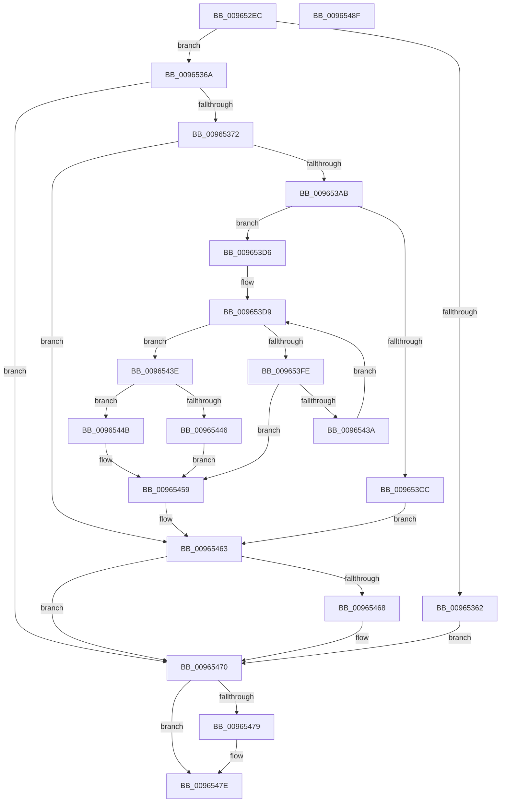

# PiDevCfgConfigureSoftwareDevices

- RVA: `0x009652EC`–`0x00965490` (길이 `420` bytes)
- VA: `0x00000001409652EC`
- 실행 섹션: `PAGE`
- PDB 이름 있음: `예`; PDB Function 태그: `아니요`
- unwind 정보 RVA: `0x0009375C`
- 디코드: `117`개 명령, `420/420` bytes 표시
- 미해석 바이트: `0` (있으면 어셈블리에 `.byte`로 보존)

> 이 문서는 커널 이미지의 기계어와 PDB 기호를 분석해 생성했습니다. 4번과 5번은 함수 원형과 자료형을 바이너리 사용 방식에서 추정한 C 해석이며 원본 소스 복구 결과는 아닙니다.

## 1. Dependencies

- 직접 호출 지점: **9**; 고유 호출 대상: **8**
- 직접 호출자로 확인된 함수: **1**
- RIP 상대 이미지 참조: **2**

### Outgoing calls
- `0x00965354` → [ZwOpenKey](../../text/6A/ZwOpenKey_function_006AD310.md) (function, `0x006AD310`)
- `0x00965398` → [IopCreateRegistryKeyEx](../A8/IopCreateRegistryKeyEx_function_00A89038.md) (function, `0x00A89038`)
- `0x009653BF` → [ExAllocatePool2](../../poolcode/B8/ExAllocatePool2_function_00B820F0.md) (function, `0x00B820F0`)
- `0x009653F3` → [ZwEnumerateKey](../../text/6A/ZwEnumerateKey_function_006AD710.md) (function, `0x006AD710`)
- `0x0096541B` → [PnpCtxRegDeleteTree](PnpCtxRegDeleteTree_function_00965CC8.md) (function, `0x00965CC8`)
- `0x0096542F` → [PnpCtxRegCopyTree](../82/PnpCtxRegCopyTree_function_008291EC.md) (function, `0x008291EC`)
- `0x0096545E` → [ExFreePoolWithTag](../../poolcode/B8/ExFreePoolWithTag_function_00B82870.md) (function, `0x00B82870`)
- `0x0096546B` → [ZwClose](../../text/6A/ZwClose_function_006AD2B0.md) (function, `0x006AD2B0`)
- `0x00965479` → [ZwClose](../../text/6A/ZwClose_function_006AD2B0.md) (function, `0x006AD2B0`)

### Direct callers
- [PiDevCfgConfigureDeviceKeys](PiDevCfgConfigureDeviceKeys_function_00964BA8.md) at `0x00964C81`

### Static image references
- `0x0096531B` → RVA `0x00AFD740` (` ?? ::NNGAKEGL::`string'`; read)
- `0x00965414` → RVA `0x00E66398` (`.data`; read)

## 2. Other-region calls and transfers

- 다른 실행 섹션으로 향하는 call: **6**
  - `0x00965354` → [ZwOpenKey](../../text/6A/ZwOpenKey_function_006AD310.md) (`PAGE` → `.text`)
  - `0x009653BF` → [ExAllocatePool2](../../poolcode/B8/ExAllocatePool2_function_00B820F0.md) (`PAGE` → `POOLCODE`)
  - `0x009653F3` → [ZwEnumerateKey](../../text/6A/ZwEnumerateKey_function_006AD710.md) (`PAGE` → `.text`)
  - `0x0096545E` → [ExFreePoolWithTag](../../poolcode/B8/ExFreePoolWithTag_function_00B82870.md) (`PAGE` → `POOLCODE`)
  - `0x0096546B` → [ZwClose](../../text/6A/ZwClose_function_006AD2B0.md) (`PAGE` → `.text`)
  - `0x00965479` → [ZwClose](../../text/6A/ZwClose_function_006AD2B0.md) (`PAGE` → `.text`)
- 별도 외부 분기/꼬리 이동을 확인하지 못했습니다.

## 3. Assembly (complete function range)

```asm
009652EC  40 55                           push rbp
009652EE  53                              push rbx
009652EF  56                              push rsi
009652F0  57                              push rdi
009652F1  41 54                           push r12
009652F3  41 56                           push r14
009652F5  41 57                           push r15
009652F7  48 8B EC                        mov rbp, rsp
009652FA  48 83 EC 70                     sub rsp, 0x70
009652FE  45 33 FF                        xor r15d, r15d
00965301  48 89 55 D8                     mov qword ptr [rbp - 0x28], rdx
00965305  48 8B F9                        mov rdi, rcx
00965308  4C 89 7D 58                     mov qword ptr [rbp + 0x58], r15
0096530C  48 8D 45 C0                     lea rax, [rbp - 0x40]
00965310  44 89 7D 48                     mov dword ptr [rbp + 0x48], r15d
00965314  0F 57 C0                        xorps xmm0, xmm0
00965317  4C 89 7D 50                     mov qword ptr [rbp + 0x50], r15
0096531B  48 8D 35 1E 84 19 00            lea rsi, [rip + 0x19841e]
00965322  48 89 45 E0                     mov qword ptr [rbp - 0x20], rax
00965326  BA 19 00 02 00                  mov edx, 0x20019
0096532B  48 89 75 C8                     mov qword ptr [rbp - 0x38], rsi
0096532F  48 8D 4D 50                     lea rcx, [rbp + 0x50]
00965333  48 C7 45 C0 0E 00 10 00         mov qword ptr [rbp - 0x40], 0x10000e
0096533B  4C 8D 45 D0                     lea r8, [rbp - 0x30]
0096533F  48 C7 45 D0 30 00 00 00         mov qword ptr [rbp - 0x30], 0x30
00965347  F3 0F 7F 45 F0                  movdqu xmmword ptr [rbp - 0x10], xmm0
0096534C  48 C7 45 E8 40 02 00 00         mov qword ptr [rbp - 0x18], 0x240
00965354  E8 B7 7F D4 FF                  call 0x1406ad310
00965359  8B D8                           mov ebx, eax
0096535B  3D 34 00 00 C0                  cmp eax, 0xc0000034
00965360  75 08                           jne 0x14096536a
00965362  41 8B DF                        mov ebx, r15d
00965365  E9 06 01 00 00                  jmp 0x140965470
0096536A  85 C0                           test eax, eax
0096536C  0F 88 FE 00 00 00               js 0x140965470
00965372  4C 89 7C 24 28                  mov qword ptr [rsp + 0x28], r15
00965377  4C 8D 45 C0                     lea r8, [rbp - 0x40]
0096537B  41 B9 3F 00 0F 00               mov r9d, 0xf003f
00965381  44 89 7C 24 20                  mov dword ptr [rsp + 0x20], r15d
00965386  48 8B D7                        mov rdx, rdi
00965389  C7 45 C0 0E 00 10 00            mov dword ptr [rbp - 0x40], 0x10000e
00965390  48 8D 4D 58                     lea rcx, [rbp + 0x58]
00965394  48 89 75 C8                     mov qword ptr [rbp - 0x38], rsi
00965398  E8 9B 3C 12 00                  call 0x140a89038
0096539D  4C 8B 75 58                     mov r14, qword ptr [rbp + 0x58]
009653A1  8B D8                           mov ebx, eax
009653A3  85 C0                           test eax, eax
009653A5  0F 88 B8 00 00 00               js 0x140965463
009653AB  41 BC 20 02 00 00               mov r12d, 0x220
009653B1  41 B8 50 70 64 63               mov r8d, 0x63647050
009653B7  41 8B D4                        mov edx, r12d
009653BA  B9 00 01 00 00                  mov ecx, 0x100
009653BF  E8 2C CD 21 00                  call 0x140b820f0
009653C4  48 8B F8                        mov rdi, rax
009653C7  48 85 C0                        test rax, rax
009653CA  75 0A                           jne 0x1409653d6
009653CC  BB 9A 00 00 C0                  mov ebx, 0xc000009a
009653D1  E9 8D 00 00 00                  jmp 0x140965463
009653D6  41 8B F7                        mov esi, r15d
009653D9  48 8B 4D 50                     mov rcx, qword ptr [rbp + 0x50]
009653DD  48 8D 45 48                     lea rax, [rbp + 0x48]
009653E1  48 89 44 24 28                  mov qword ptr [rsp + 0x28], rax
009653E6  4C 8B CF                        mov r9, rdi
009653E9  45 33 C0                        xor r8d, r8d
009653EC  44 89 64 24 20                  mov dword ptr [rsp + 0x20], r12d
009653F1  8B D6                           mov edx, esi
009653F3  E8 18 83 D4 FF                  call 0x1406ad710
009653F8  8B D8                           mov ebx, eax
009653FA  85 C0                           test eax, eax
009653FC  78 40                           js 0x14096543e
009653FE  8B 47 0C                        mov eax, dword ptr [rdi + 0xc]
00965401  48 8D 5F 10                     lea rbx, [rdi + 0x10]
00965405  48 D1 E8                        shr rax, 1
00965408  4C 8B C3                        mov r8, rbx
0096540B  49 8B D6                        mov rdx, r14
0096540E  66 44 89 7C 47 10               mov word ptr [rdi + rax*2 + 0x10], r15w
00965414  48 8B 0D 7D 0F 50 00            mov rcx, qword ptr [rip + 0x500f7d]
0096541B  E8 A8 08 00 00                  call 0x140965cc8
00965420  48 8B 55 50                     mov rdx, qword ptr [rbp + 0x50]
00965424  4D 8B CE                        mov r9, r14
00965427  4C 8B C3                        mov r8, rbx
0096542A  48 89 5C 24 20                  mov qword ptr [rsp + 0x20], rbx
0096542F  E8 B8 3D EC FF                  call 0x1408291ec
00965434  8B D8                           mov ebx, eax
00965436  85 C0                           test eax, eax
00965438  78 1F                           js 0x140965459
0096543A  FF C6                           inc esi
0096543C  EB 9B                           jmp 0x1409653d9
0096543E  81 FB 1A 00 00 80               cmp ebx, 0x8000001a
00965444  75 05                           jne 0x14096544b
00965446  41 8B DF                        mov ebx, r15d
00965449  EB 0E                           jmp 0x140965459
0096544B  81 FB 05 00 00 80               cmp ebx, 0x80000005
00965451  B8 33 00 00 C0                  mov eax, 0xc0000033
00965456  0F 44 D8                        cmove ebx, eax
00965459  33 D2                           xor edx, edx
0096545B  48 8B CF                        mov rcx, rdi
0096545E  E8 0D D4 21 00                  call 0x140b82870
00965463  4D 85 F6                        test r14, r14
00965466  74 08                           je 0x140965470
00965468  49 8B CE                        mov rcx, r14
0096546B  E8 40 7E D4 FF                  call 0x1406ad2b0
00965470  48 8B 4D 50                     mov rcx, qword ptr [rbp + 0x50]
00965474  48 85 C9                        test rcx, rcx
00965477  74 05                           je 0x14096547e
00965479  E8 32 7E D4 FF                  call 0x1406ad2b0
0096547E  8B C3                           mov eax, ebx
00965480  48 83 C4 70                     add rsp, 0x70
00965484  41 5F                           pop r15
00965486  41 5E                           pop r14
00965488  41 5C                           pop r12
0096548A  5F                              pop rdi
0096548B  5E                              pop rsi
0096548C  5B                              pop rbx
0096548D  5D                              pop rbp
0096548E  C3                              ret
0096548F  CC                              int3
```

## 4. C-style interpretation (structured pseudocode)

```c
__int64 __fastcall PiDevCfgConfigureSoftwareDevices(__int64 a1, __int64 a2)
{
    __int64 result;
    __int64 v_r15;
    __int64 v_rbx;
    __int64 v_rsi;
    __int64 v_rsp;
    unsigned __int64 v_stack_m48;
    unsigned __int64 v_stack_m50;
    unsigned __int64 v_stack_m58;
    unsigned __int64 v_stack_m60;
    unsigned __int64 v_stack_m68;
    unsigned __int64 v_stack_m70;
    unsigned __int64 v_stack_m78;
    unsigned __int64 v_stack_m80;
    unsigned int v_stack_m88;
    unsigned int v_stack_p10;
    unsigned __int64 v_stack_p18;
    unsigned __int64 v_stack_p20;

    v_rsp = (v_rsp) - (112);
    v_r15 = 0;
    v_stack_m60 = a2;
    v_stack_p20 = 0;
    v_stack_p10 = 0;
    v_stack_p18 = 0;
    v_stack_m58 = v_stack_m78;
    v_stack_m70 = v_rip + 1672222;
    v_stack_m78 = 0x10000EULL;
    v_stack_m68 = 48;
    v_stack_m48 = v_xmm0;
    v_stack_m50 = 576;
    result = ZwOpenKey(v_stack_p18, (unsigned int)(0x20019ULL), v_stack_m68, a4);
    if (((unsigned int)(result)) != 0xC0000034ULL) goto loc_0096536A;
    goto loc_00965470;
loc_0096536A:
    if (sign_flag) goto loc_00965470;
    v_stack_m80 = 0;
    v_stack_m88 = 0;
    v_stack_m78 = 0x10000EULL;
    v_stack_m70 = v_rip + 1672222;
    result = IopCreateRegistryKeyEx(v_stack_p20, a1, v_stack_m78, (unsigned int)(0xF003FULL));
    if (sign_flag) goto loc_00965463;
    result = ExAllocatePool2(256, 544, (unsigned int)(0x63647050ULL), (unsigned int)(0xF003FULL));
    if (result != 0) goto loc_009653D6;
    goto loc_00965463;
loc_009653D6:
loc_009653D9:
    v_stack_m80 = v_stack_p10;
    a3 = 0;
    v_stack_m88 = 544;
    result = ZwEnumerateKey(v_stack_p18, 0, a3, result);
    if (sign_flag) goto loc_0096543E;
    result = ((unsigned int)(*(unsigned int *)(result + 12))) >> (1);
    *(unsigned __int16 *)(result + result * 2 + 16) = 0;
    result = PnpCtxRegDeleteTree(*(unsigned __int64 *)(v_rip + 5246845), v_stack_p20, result + 16, result);
    v_stack_m88 = result + 16;
    result = PnpCtxRegCopyTree(*(unsigned __int64 *)(v_rip + 5246845), v_stack_p18, result + 16, v_stack_p20);
    if (sign_flag) goto loc_00965459;
    v_rsi = (unsigned int)((0) + 1);
    goto loc_009653D9;
loc_0096543E:
    if (((unsigned int)((unsigned int)((unsigned int)(result)))) != 0x8000001AULL) goto loc_0096544B;
    goto loc_00965459;
loc_0096544B:
    v_rbx = 0;
    if (0 == 0x80000005ULL) { v_rbx = (unsigned int)((unsigned int)(0xC0000033ULL)); }
loc_00965459:
    a2 = 0;
    result = ExFreePoolWithTag(result, a2, result + 16, v_stack_p20);
loc_00965463:
    if (v_stack_p20 != 0) {
        a1 = v_stack_p20;
        result = ZwClose(a1, a2, result + 16, v_stack_p20);
    }
    if (v_stack_p18 != 0) {
        result = ZwClose(v_stack_p18, a2, result + 16, v_stack_p20);
    }
    v_rsp = (v_rsp) + (112);
    return (unsigned int)((unsigned int)(v_rbx));
}
```

## 5. (Beta) C Style

```c
int64_t PiDevCfgConfigureSoftwareDevices(int64_t Arg1, int64_t Arg2)
{
    int64_t result;
    int64_t local_r15;
    int64_t local_rbx;
    int64_t local_rsi;
    int64_t local_rsp;
    uint64_t v_stack_m48;
    uint64_t v_stack_m50;
    uint64_t v_stack_m58;
    uint64_t v_stack_m60;
    uint64_t v_stack_m68;
    uint64_t v_stack_m70;
    uint64_t v_stack_m78;
    uint64_t v_stack_m80;
    uint32_t v_stack_m88;
    uint32_t v_stack_p10;
    uint64_t v_stack_p18;
    uint64_t v_stack_p20;

    local_rsp = (local_rsp) - (112);
    local_r15 = 0;
    v_stack_m60 = Arg2;
    v_stack_p20 = 0;
    v_stack_p10 = 0;
    v_stack_p18 = 0;
    v_stack_m58 = v_stack_m78;
    v_stack_m70 = v_rip + 1672222;
    v_stack_m78 = 0x10000EULL;
    v_stack_m68 = 48;
    v_stack_m48 = v_xmm0;
    v_stack_m50 = 576;
    result = ZwOpenKey(v_stack_p18, (uint32_t)(0x20019ULL), v_stack_m68, a4);
    if (((uint32_t)(result)) != 0xC0000034ULL) goto loc_0096536A;
    goto loc_00965470;
loc_0096536A:
    if (sign_flag) goto loc_00965470;
    v_stack_m80 = 0;
    v_stack_m88 = 0;
    v_stack_m78 = 0x10000EULL;
    v_stack_m70 = v_rip + 1672222;
    result = IopCreateRegistryKeyEx(v_stack_p20, Arg1, v_stack_m78, (uint32_t)(0xF003FULL));
    if (sign_flag) goto loc_00965463;
    result = ExAllocatePool2(256, 544, (uint32_t)(0x63647050ULL), (uint32_t)(0xF003FULL));
    if (result != 0) goto loc_009653D6;
    goto loc_00965463;
loc_009653D6:
loc_009653D9:
    v_stack_m80 = v_stack_p10;
    a3 = 0;
    v_stack_m88 = 544;
    result = ZwEnumerateKey(v_stack_p18, 0, a3, result);
    if (sign_flag) goto loc_0096543E;
    result = ((uint32_t)(*(uint32_t *)(result + 0xC))) >> (1);
    *(uint16_t *)(result + result * 2 + 0x10) = 0;
    result = PnpCtxRegDeleteTree(*(uint64_t *)(v_rip + 0x500F7D), v_stack_p20, result + 16, result);
    v_stack_m88 = result + 16;
    result = PnpCtxRegCopyTree(*(uint64_t *)(v_rip + 0x500F7D), v_stack_p18, result + 16, v_stack_p20);
    if (sign_flag) goto loc_00965459;
    local_rsi = (uint32_t)((0) + 1);
    goto loc_009653D9;
loc_0096543E:
    if (((uint32_t)((uint32_t)((uint32_t)(result)))) != 0x8000001AULL) goto loc_0096544B;
    goto loc_00965459;
loc_0096544B:
    local_rbx = 0;
    if (0 == 0x80000005ULL) { local_rbx = (uint32_t)((uint32_t)(0xC0000033ULL)); }
loc_00965459:
    Arg2 = 0;
    result = ExFreePoolWithTag(result, Arg2, result + 16, v_stack_p20);
loc_00965463:
    if (v_stack_p20 != 0) {
        Arg1 = v_stack_p20;
        result = ZwClose(Arg1, Arg2, result + 16, v_stack_p20);
    }
    if (v_stack_p18 != 0) {
        result = ZwClose(v_stack_p18, Arg2, result + 16, v_stack_p20);
    }
    local_rsp = (local_rsp) + (112);
    return (uint32_t)((uint32_t)(local_rbx));
}
```

## 6. Execution-region graph

[열기: 2D/3D 그래프와 함수 탐색 컨트롤 패널](../../../control-panel.html?section=page&rva=0x009652EC&view=graph)

- 2D 그래프는 위에서 아래로 흐르고, 3D 그래프는 빈 공간을 드래그해 회전합니다. Shift+드래그는 이동, 휠은 확대·축소, 함수 노드 선택은 대상 보고서 이동입니다.

### Static fallback


