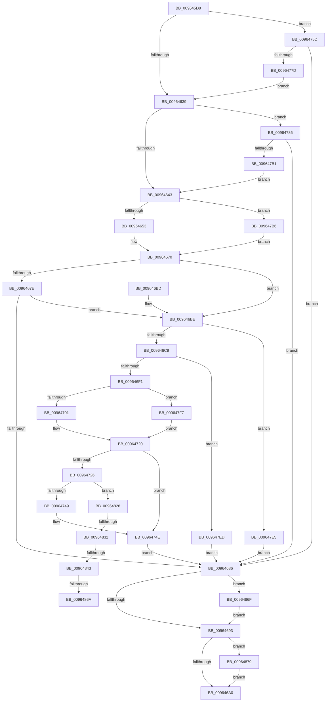

# PiDevCfgCopyObjectProperties

- RVA: `0x009645D8`–`0x00964883` (길이 `683` bytes)
- VA: `0x00000001409645D8`
- 실행 섹션: `PAGE`
- PDB 이름 있음: `예`; PDB Function 태그: `예`
- unwind 정보 RVA: `0x0009366C`
- 디코드: `172`개 명령, `683/683` bytes 표시
- 미해석 바이트: `0` (있으면 어셈블리에 `.byte`로 보존)

> 이 문서는 커널 이미지의 기계어와 PDB 기호를 분석해 생성했습니다. 4번과 5번은 함수 원형과 자료형을 바이너리 사용 방식에서 추정한 C 해석이며 원본 소스 복구 결과는 아닙니다.

## 1. Dependencies

- 직접 호출 지점: **12**; 고유 호출 대상: **7**
- 직접 호출자로 확인된 함수: **4**
- RIP 상대 이미지 참조: **1**

### Outgoing calls
- `0x0096466B` → [PnpGetGenericStorePropertyKeys](../99/PnpGetGenericStorePropertyKeys_function_00992378.md) (function, `0x00992378`)
- `0x009646DC` → [ExAllocatePool2](../../poolcode/B8/ExAllocatePool2_function_00B820F0.md) (function, `0x00B820F0`)
- `0x0096471B` → [PnpGetGenericStorePropertyKeys](../99/PnpGetGenericStorePropertyKeys_function_00992378.md) (function, `0x00992378`)
- `0x00964738` → [ExAllocatePool2](../../poolcode/B8/ExAllocatePool2_function_00B820F0.md) (function, `0x00B820F0`)
- `0x00964753` → [ExFreePoolWithTag](../../poolcode/B8/ExFreePoolWithTag_function_00B82870.md) (function, `0x00B82870`)
- `0x0096476E` → [PnpOpenObjectRegKey](../8E/PnpOpenObjectRegKey_function_008E15E8.md) (function, `0x008E15E8`)
- `0x009647A2` → [PnpOpenObjectRegKey](../8E/PnpOpenObjectRegKey_function_008E15E8.md) (function, `0x008E15E8`)
- `0x009647DB` → [PnpGetObjectPropertyKeys](../99/PnpGetObjectPropertyKeys_function_009919B4.md) (function, `0x009919B4`)
- `0x0096481E` → [PnpGetObjectPropertyKeys](../99/PnpGetObjectPropertyKeys_function_009919B4.md) (function, `0x009919B4`)
- `0x0096485D` → [guard_dispatch_icall](../../text/6B/guard_dispatch_icall_function_006BAAD0.md) (function, `0x006BAAD0`)
- `0x0096486F` → [ZwClose](../../text/6A/ZwClose_function_006AD2B0.md) (function, `0x006AD2B0`)
- `0x00964879` → [ZwClose](../../text/6A/ZwClose_function_006AD2B0.md) (function, `0x006AD2B0`)

### Direct callers
- [PiDevCfgInitDriverDatabaseCallback](../73/PiDevCfgInitDriverDatabaseCallback_function_00733958.md) at `0x00733B21`
- [PiDevCfgConfigureDeviceDriver](PiDevCfgConfigureDeviceDriver_function_00963ABC.md) at `0x00963B8E`
- [PiDevCfgConfigureDeviceInterface](PiDevCfgConfigureDeviceInterface_function_00963C18.md) at `0x00963D63`
- [PiDevCfgConfigureDeviceDriverConfiguration](PiDevCfgConfigureDeviceDriverConfiguration_function_00964514.md) at `0x00964585`

### Static image references
- `0x009645F9` → RVA `0x00E66398` (`.data`; read)

## 2. Other-region calls and transfers

- 다른 실행 섹션으로 향하는 call: **6**
  - `0x009646DC` → [ExAllocatePool2](../../poolcode/B8/ExAllocatePool2_function_00B820F0.md) (`PAGE` → `POOLCODE`)
  - `0x00964738` → [ExAllocatePool2](../../poolcode/B8/ExAllocatePool2_function_00B820F0.md) (`PAGE` → `POOLCODE`)
  - `0x00964753` → [ExFreePoolWithTag](../../poolcode/B8/ExFreePoolWithTag_function_00B82870.md) (`PAGE` → `POOLCODE`)
  - `0x0096485D` → [guard_dispatch_icall](../../text/6B/guard_dispatch_icall_function_006BAAD0.md) (`PAGE` → `.text`)
  - `0x0096486F` → [ZwClose](../../text/6A/ZwClose_function_006AD2B0.md) (`PAGE` → `.text`)
  - `0x00964879` → [ZwClose](../../text/6A/ZwClose_function_006AD2B0.md) (`PAGE` → `.text`)
- call이 아닌 외부 분기/꼬리 이동: **4**
  - `0x0096482C` → [sub_00B2834C + 0x15C](../B2/Unknown_function_00B2834C.md) (`tail-transfer`)
  - `0x0096483D` → [sub_00B2834C](../B2/Unknown_function_00B2834C.md) (`tail-transfer`)
  - `0x00964864` → [sub_00B2834C](../B2/Unknown_function_00B2834C.md) (`tail-transfer`)
  - `0x0096486A` → [sub_00B2834C + 0x148](../B2/Unknown_function_00B2834C.md) (`tail-transfer`)

## 3. Assembly (complete function range)

```asm
009645D8  48 89 5C 24 08                  mov qword ptr [rsp + 8], rbx
009645DD  48 89 54 24 10                  mov qword ptr [rsp + 0x10], rdx
009645E2  55                              push rbp
009645E3  56                              push rsi
009645E4  57                              push rdi
009645E5  41 54                           push r12
009645E7  41 55                           push r13
009645E9  41 56                           push r14
009645EB  41 57                           push r15
009645ED  48 8D 6C 24 F9                  lea rbp, [rsp - 7]
009645F2  48 81 EC 90 00 00 00            sub rsp, 0x90
009645F9  48 8B 05 98 1D 50 00            mov rax, qword ptr [rip + 0x501d98]
00964600  45 33 E4                        xor r12d, r12d
00964603  48 89 45 FF                     mov qword ptr [rbp - 1], rax
00964607  49 8B F1                        mov rsi, r9
0096460A  4C 89 65 EF                     mov qword ptr [rbp - 0x11], r12
0096460E  45 8B F0                        mov r14d, r8d
00964611  4C 89 65 F7                     mov qword ptr [rbp - 9], r12
00964615  48 8B FA                        mov rdi, rdx
00964618  44 89 65 5F                     mov dword ptr [rbp + 0x5f], r12d
0096461C  4C 8B E9                        mov r13, rcx
0096461F  C7 45 DB 01 00 00 00            mov dword ptr [rbp - 0x25], 1
00964626  41 BF 01 00 00 02               mov r15d, 0x2000001
0096462C  44 89 65 67                     mov dword ptr [rbp + 0x67], r12d
00964630  4D 85 C9                        test r9, r9
00964633  0F 84 24 01 00 00               je 0x14096475d
00964639  4C 39 65 7F                     cmp qword ptr [rbp + 0x7f], r12
0096463D  0F 84 43 01 00 00               je 0x140964786
00964643  48 8D 45 5F                     lea rax, [rbp + 0x5f]
00964647  49 8B CD                        mov rcx, r13
0096464A  45 85 F6                        test r14d, r14d
0096464D  0F 85 63 01 00 00               jne 0x1409647b6
00964653  48 89 44 24 30                  mov qword ptr [rsp + 0x30], rax
00964658  45 33 C9                        xor r9d, r9d
0096465B  44 89 64 24 28                  mov dword ptr [rsp + 0x28], r12d
00964660  45 33 C0                        xor r8d, r8d
00964663  48 8B D6                        mov rdx, rsi
00964666  4C 89 64 24 20                  mov qword ptr [rsp + 0x20], r12
0096466B  E8 08 DD 02 00                  call 0x140992378
00964670  B9 00 00 00 80                  mov ecx, 0x80000000
00964675  8B D8                           mov ebx, eax
00964677  8D 04 08                        lea eax, [rax + rcx]
0096467A  85 C1                           test ecx, eax
0096467C  75 40                           jne 0x1409646be
0096467E  81 FB 23 00 00 C0               cmp ebx, 0xc0000023
00964684  74 38                           je 0x1409646be
00964686  48 8B 4D EF                     mov rcx, qword ptr [rbp - 0x11]
0096468A  48 85 C9                        test rcx, rcx
0096468D  0F 85 DC 01 00 00               jne 0x14096486f
00964693  48 8B 4D F7                     mov rcx, qword ptr [rbp - 9]
00964697  48 85 C9                        test rcx, rcx
0096469A  0F 85 D9 01 00 00               jne 0x140964879
009646A0  8B C3                           mov eax, ebx
009646A2  48 8B 9C 24 D0 00 00 00         mov rbx, qword ptr [rsp + 0xd0]
009646AA  48 81 C4 90 00 00 00            add rsp, 0x90
009646B1  41 5F                           pop r15
009646B3  41 5E                           pop r14
009646B5  41 5D                           pop r13
009646B7  41 5C                           pop r12
009646B9  5F                              pop rdi
009646BA  5E                              pop rsi
009646BB  5D                              pop rbp
009646BC  C3                              ret
009646BD  CC                              int3
009646BE  8B 45 5F                        mov eax, dword ptr [rbp + 0x5f]
009646C1  85 C0                           test eax, eax
009646C3  0F 84 1C 01 00 00               je 0x1409647e5
009646C9  48 8D 14 80                     lea rdx, [rax + rax*4]
009646CD  B9 00 01 00 00                  mov ecx, 0x100
009646D2  48 C1 E2 02                     shl rdx, 2
009646D6  41 B8 50 70 64 63               mov r8d, 0x63647050
009646DC  E8 0F DA 21 00                  call 0x140b820f0
009646E1  48 89 45 E7                     mov qword ptr [rbp - 0x19], rax
009646E5  4C 8B F8                        mov r15, rax
009646E8  48 85 C0                        test rax, rax
009646EB  0F 84 FC 00 00 00               je 0x1409647ed
009646F1  48 8D 45 5F                     lea rax, [rbp + 0x5f]
009646F5  49 8B CD                        mov rcx, r13
009646F8  45 85 F6                        test r14d, r14d
009646FB  0F 85 F6 00 00 00               jne 0x1409647f7
00964701  48 89 44 24 30                  mov qword ptr [rsp + 0x30], rax
00964706  45 33 C9                        xor r9d, r9d
00964709  8B 45 5F                        mov eax, dword ptr [rbp + 0x5f]
0096470C  45 33 C0                        xor r8d, r8d
0096470F  89 44 24 28                     mov dword ptr [rsp + 0x28], eax
00964713  48 8B D6                        mov rdx, rsi
00964716  4C 89 7C 24 20                  mov qword ptr [rsp + 0x20], r15
0096471B  E8 58 DC 02 00                  call 0x140992378
00964720  8B D8                           mov ebx, eax
00964722  85 C0                           test eax, eax
00964724  78 28                           js 0x14096474e
00964726  B8 00 01 00 00                  mov eax, 0x100
0096472B  41 B8 50 70 64 63               mov r8d, 0x63647050
00964731  8B D0                           mov edx, eax
00964733  89 45 D7                        mov dword ptr [rbp - 0x29], eax
00964736  8B C8                           mov ecx, eax
00964738  E8 B3 D9 21 00                  call 0x140b820f0
0096473D  48 8B F8                        mov rdi, rax
00964740  48 85 C0                        test rax, rax
00964743  0F 85 DF 00 00 00               jne 0x140964828
00964749  BB 9A 00 00 C0                  mov ebx, 0xc000009a
0096474E  33 D2                           xor edx, edx
00964750  49 8B CF                        mov rcx, r15
00964753  E8 18 E1 21 00                  call 0x140b82870
00964758  E9 29 FF FF FF                  jmp 0x140964686
0096475D  48 8D 45 EF                     lea rax, [rbp - 0x11]
00964761  45 8B CF                        mov r9d, r15d
00964764  48 89 44 24 28                  mov qword ptr [rsp + 0x28], rax
00964769  44 88 64 24 20                  mov byte ptr [rsp + 0x20], r12b
0096476E  E8 75 CE F7 FF                  call 0x1408e15e8
00964773  8B D8                           mov ebx, eax
00964775  85 C0                           test eax, eax
00964777  0F 88 09 FF FF FF               js 0x140964686
0096477D  48 8B 45 FF                     mov rax, qword ptr [rbp - 1]
00964781  E9 B3 FE FF FF                  jmp 0x140964639
00964786  44 8B 45 77                     mov r8d, dword ptr [rbp + 0x77]
0096478A  48 8D 4D F7                     lea rcx, [rbp - 9]
0096478E  48 8B 55 6F                     mov rdx, qword ptr [rbp + 0x6f]
00964792  45 8B CF                        mov r9d, r15d
00964795  48 89 4C 24 28                  mov qword ptr [rsp + 0x28], rcx
0096479A  48 8B C8                        mov rcx, rax
0096479D  44 88 64 24 20                  mov byte ptr [rsp + 0x20], r12b
009647A2  E8 41 CE F7 FF                  call 0x1408e15e8
009647A7  8B D8                           mov ebx, eax
009647A9  85 C0                           test eax, eax
009647AB  0F 88 D5 FE FF FF               js 0x140964686
009647B1  E9 8D FE FF FF                  jmp 0x140964643
009647B6  4C 8B 4D EF                     mov r9, qword ptr [rbp - 0x11]
009647BA  48 85 F6                        test rsi, rsi
009647BD  48 89 44 24 40                  mov qword ptr [rsp + 0x40], rax
009647C2  45 8B C6                        mov r8d, r14d
009647C5  44 89 64 24 38                  mov dword ptr [rsp + 0x38], r12d
009647CA  4C 0F 45 CE                     cmovne r9, rsi
009647CE  4C 89 64 24 30                  mov qword ptr [rsp + 0x30], r12
009647D3  48 8B D7                        mov rdx, rdi
009647D6  44 88 64 24 28                  mov byte ptr [rsp + 0x28], r12b
009647DB  E8 D4 D1 02 00                  call 0x1409919b4
009647E0  E9 8B FE FF FF                  jmp 0x140964670
009647E5  41 8B DC                        mov ebx, r12d
009647E8  E9 99 FE FF FF                  jmp 0x140964686
009647ED  BB 9A 00 00 C0                  mov ebx, 0xc000009a
009647F2  E9 8F FE FF FF                  jmp 0x140964686
009647F7  4C 8B 4D EF                     mov r9, qword ptr [rbp - 0x11]
009647FB  48 85 F6                        test rsi, rsi
009647FE  48 89 44 24 40                  mov qword ptr [rsp + 0x40], rax
00964803  45 8B C6                        mov r8d, r14d
00964806  8B 45 5F                        mov eax, dword ptr [rbp + 0x5f]
00964809  4C 0F 45 CE                     cmovne r9, rsi
0096480D  89 44 24 38                     mov dword ptr [rsp + 0x38], eax
00964811  48 8B D7                        mov rdx, rdi
00964814  4C 89 7C 24 30                  mov qword ptr [rsp + 0x30], r15
00964819  44 88 64 24 28                  mov byte ptr [rsp + 0x28], r12b
0096481E  E8 91 D1 02 00                  call 0x1409919b4
00964823  E9 F8 FE FF FF                  jmp 0x140964720
00964828  44 3B 65 5F                     cmp r12d, dword ptr [rbp + 0x5f]
0096482C  0F 83 76 3C 1C 00               jae 0x140b284a8
00964832  48 83 BD 87 00 00 00 00         cmp qword ptr [rbp + 0x87], 0
0096483A  45 8B FC                        mov r15d, r12d
0096483D  0F 84 09 3B 1C 00               je 0x140b2834c
00964843  48 8B 4D E7                     mov rcx, qword ptr [rbp - 0x19]
00964847  4B 8D 04 BF                     lea rax, [r15 + r15*4]
0096484B  48 8B 95 8F 00 00 00            mov rdx, qword ptr [rbp + 0x8f]
00964852  48 8D 0C 81                     lea rcx, [rcx + rax*4]
00964856  48 8B 85 87 00 00 00            mov rax, qword ptr [rbp + 0x87]
0096485D  E8 6E 62 D5 FF                  call 0x1406baad0
00964862  84 C0                           test al, al
00964864  0F 85 E2 3A 1C 00               jne 0x140b2834c
0096486A  E9 25 3C 1C 00                  jmp 0x140b28494
0096486F  E8 3C 8A D4 FF                  call 0x1406ad2b0
00964874  E9 1A FE FF FF                  jmp 0x140964693
00964879  E8 32 8A D4 FF                  call 0x1406ad2b0
0096487E  E9 1D FE FF FF                  jmp 0x1409646a0
```

## 4. C-style interpretation (structured pseudocode)

```c
__int64 __fastcall PiDevCfgCopyObjectProperties(__int64 a1, __int64 a2, int a3, __int64 a4, __int64 a5, __int64 a6, unsigned int a7, __int64 a8, __int64 a9, __int64 a10)
{
    __int64 result;
    __int64 v_r12;
    __int64 v_rsp;
    unsigned __int64 v_stack_m3F;
    unsigned __int64 v_stack_m40;
    unsigned __int64 v_stack_m48;
    unsigned __int64 v_stack_m50;
    unsigned __int64 v_stack_m58;
    unsigned int v_stack_m64;
    unsigned int v_stack_m68;
    unsigned __int64 v_stack_m98;
    unsigned int v_stack_mA0;
    unsigned __int64 v_stack_mA8;
    unsigned __int64 v_stack_p10;
    unsigned int v_stack_p20;
    unsigned int v_stack_p28;
    unsigned __int64 v_stack_p30;
    unsigned int v_stack_p38;
    unsigned __int64 v_stack_p40;
    unsigned __int64 v_stack_p8;

    v_stack_p8 = v_rbx;
    v_stack_p10 = a2;
    v_rsp = (v_rsp) - (144);
    v_r12 = 0;
    v_stack_m40 = *(unsigned __int64 *)(v_rip + 5250456);
    v_stack_m50 = 0;
    v_stack_m48 = 0;
    v_stack_p20 = 0;
    v_stack_m64 = 1;
    v_stack_p28 = 0;
    if (a4 == 0) goto loc_0096475D;
loc_00964639:
    if (a8 == 0) goto loc_00964786;
loc_00964643:
    if ((unsigned int)((unsigned int)(a3)) != 0) goto loc_009647B6;
    v_stack_m98 = v_stack_p20;
    a4 = 0;
    v_stack_mA0 = 0;
    a3 = 0;
    v_stack_mA8 = 0;
    result = PnpGetGenericStorePropertyKeys(a1, 0, a3, a4);
loc_00964670:
    if ((((unsigned int)((unsigned int)(0x80000000ULL))) & ((unsigned int)(result + (unsigned int)(0x80000000ULL) * 1))) != 0) goto loc_009646BE;
    if (((unsigned int)((unsigned int)((unsigned int)(result)))) == 0xC0000023ULL) goto loc_009646BE;
loc_00964686:
    if (v_stack_m50 != 0) goto loc_0096486F;
loc_00964693:
    if (v_stack_m48 != 0) goto loc_00964879;
loc_009646A0:
    v_rsp = (v_rsp) + (144);
    return (unsigned int)((unsigned int)((unsigned int)((unsigned int)(result))));
loc_009646BE:
    if ((unsigned int)((unsigned int)(v_stack_p20)) == 0) goto loc_009647E5;
    a2 = ((unsigned int)(v_stack_p20) + (unsigned int)(v_stack_p20) * 4) << (2);
    result = ExAllocatePool2(256, a2, (unsigned int)(0x63647050ULL), a4);
    v_stack_m58 = result;
    if (result == 0) goto loc_009647ED;
    if ((unsigned int)((unsigned int)(a3)) != 0) goto loc_009647F7;
    v_stack_p30 = v_stack_p20;
    a4 = 0;
    a3 = 0;
    v_stack_p28 = (unsigned int)((unsigned int)(v_stack_p20));
    v_stack_p20 = result;
    result = PnpGetGenericStorePropertyKeys(a1, 0, a3, a4);
loc_00964720:
    if (sign_flag) goto loc_0096474E;
    v_stack_m68 = 256;
    result = ExAllocatePool2(256, 256, (unsigned int)(0x63647050ULL), a4);
    if (result != 0) goto loc_00964828;
loc_0096474E:
    a2 = 0;
    result = ExFreePoolWithTag(result, a2, (unsigned int)(0x63647050ULL), a4);
    goto loc_00964686;
loc_0096475D:
    v_stack_p28 = v_stack_m50;
    v_stack_p20 = 0;
    result = PnpOpenObjectRegKey(result, a2, (unsigned int)(0x63647050ULL), (unsigned int)((unsigned int)(result)));
    if (sign_flag) goto loc_00964686;
    goto loc_00964639;
loc_00964786:
    v_stack_p28 = v_stack_m48;
    v_stack_p20 = 0;
    result = PnpOpenObjectRegKey(v_stack_m40, a6, (unsigned int)(a7), (unsigned int)((unsigned int)(result)));
    if (sign_flag) goto loc_00964686;
    goto loc_00964643;
loc_009647B6:
    v_stack_p40 = result;
    v_stack_p38 = 0;
    a4 = v_stack_m50;
    if (0 != 0) { a4 = 0; }
    v_stack_p30 = 0;
    v_stack_p28 = 0;
    result = PnpGetObjectPropertyKeys(v_stack_m40, result, (unsigned int)((unsigned int)((unsigned int)(a3))), a4);
    goto loc_00964670;
loc_009647E5:
    goto loc_00964686;
loc_009647ED:
    goto loc_00964686;
loc_009647F7:
    v_stack_p40 = result;
    a4 = v_stack_m50;
    if (a4 != 0) { a4 = a4; }
    v_stack_p38 = (unsigned int)((unsigned int)(v_stack_p20));
    v_stack_p30 = result;
    v_stack_p28 = 0;
    result = PnpGetObjectPropertyKeys(v_stack_m40, result, (unsigned int)((unsigned int)((unsigned int)(a3))), a4);
    goto loc_00964720;
loc_00964828:
    result = guard_dispatch_icall(v_stack_m58 + 0 + 0 * 4 * 4, a10, (unsigned int)((unsigned int)((unsigned int)(a3))), a4);
loc_0096486F:
    result = ZwClose(v_stack_m58 + 0 + 0 * 4 * 4, a10, (unsigned int)((unsigned int)((unsigned int)(a3))), a4);
    goto loc_00964693;
loc_00964879:
    result = ZwClose(v_stack_m58 + 0 + 0 * 4 * 4, a10, (unsigned int)((unsigned int)((unsigned int)(a3))), a4);
    goto loc_009646A0;
}
```

## 5. (Beta) C Style

```c
int64_t PiDevCfgCopyObjectProperties(int64_t Arg1, int64_t Arg2, int32_t Arg3, int64_t Arg4, uint64_t Arg5, int64_t Arg6, uint32_t Arg7, int64_t Arg8, int64_t Arg9, int64_t Arg10)
{
    int64_t result;
    int64_t local_r12;
    int64_t local_rsp;
    uint64_t v_stack_m3F;
    uint64_t v_stack_m40;
    uint64_t v_stack_m48;
    uint64_t v_stack_m50;
    uint64_t v_stack_m58;
    uint32_t v_stack_m64;
    uint32_t v_stack_m68;
    uint64_t v_stack_m98;
    uint32_t v_stack_mA0;
    uint64_t v_stack_mA8;
    uint64_t v_stack_p10;
    uint32_t v_stack_p20;
    uint32_t v_stack_p28;
    uint64_t v_stack_p30;
    uint32_t v_stack_p38;
    uint64_t v_stack_p40;
    uint64_t v_stack_p8;

    v_stack_p8 = local_rbx;
    v_stack_p10 = Arg2;
    local_rsp = (local_rsp) - (144);
    local_r12 = 0;
    v_stack_m40 = *(uint64_t *)(v_rip + 0x501D98);
    v_stack_m50 = 0;
    v_stack_m48 = 0;
    v_stack_p20 = 0;
    v_stack_m64 = 1;
    v_stack_p28 = 0;
    if (Arg4 == 0) goto loc_0096475D;
loc_00964639:
    if (Arg8 == 0) goto loc_00964786;
loc_00964643:
    if ((uint32_t)((uint32_t)(Arg3)) != 0) goto loc_009647B6;
    v_stack_m98 = v_stack_p20;
    Arg4 = 0;
    v_stack_mA0 = 0;
    Arg3 = 0;
    v_stack_mA8 = 0;
    result = PnpGetGenericStorePropertyKeys(Arg1, 0, Arg3, Arg4);
loc_00964670:
    if ((((uint32_t)((uint32_t)(0x80000000ULL))) & ((uint32_t)(result + (uint32_t)(0x80000000ULL) * 1))) != 0) goto loc_009646BE;
    if (((uint32_t)((uint32_t)((uint32_t)(result)))) == 0xC0000023ULL) goto loc_009646BE;
loc_00964686:
    if (v_stack_m50 != 0) goto loc_0096486F;
loc_00964693:
    if (v_stack_m48 != 0) goto loc_00964879;
loc_009646A0:
    local_rsp = (local_rsp) + (144);
    return (uint32_t)((uint32_t)((uint32_t)((uint32_t)(result))));
loc_009646BE:
    if ((uint32_t)((uint32_t)(v_stack_p20)) == 0) goto loc_009647E5;
    Arg2 = ((uint32_t)(v_stack_p20) + (uint32_t)(v_stack_p20) * 4) << (2);
    result = ExAllocatePool2(256, Arg2, (uint32_t)(0x63647050ULL), Arg4);
    v_stack_m58 = result;
    if (result == 0) goto loc_009647ED;
    if ((uint32_t)((uint32_t)(Arg3)) != 0) goto loc_009647F7;
    v_stack_p30 = v_stack_p20;
    Arg4 = 0;
    Arg3 = 0;
    v_stack_p28 = (uint32_t)((uint32_t)(v_stack_p20));
    v_stack_p20 = result;
    result = PnpGetGenericStorePropertyKeys(Arg1, 0, Arg3, Arg4);
loc_00964720:
    if (sign_flag) goto loc_0096474E;
    v_stack_m68 = 256;
    result = ExAllocatePool2(256, 256, (uint32_t)(0x63647050ULL), Arg4);
    if (result != 0) goto loc_00964828;
loc_0096474E:
    Arg2 = 0;
    result = ExFreePoolWithTag(result, Arg2, (uint32_t)(0x63647050ULL), Arg4);
    goto loc_00964686;
loc_0096475D:
    v_stack_p28 = v_stack_m50;
    v_stack_p20 = 0;
    result = PnpOpenObjectRegKey(result, Arg2, (uint32_t)(0x63647050ULL), (uint32_t)((uint32_t)(result)));
    if (sign_flag) goto loc_00964686;
    goto loc_00964639;
loc_00964786:
    v_stack_p28 = v_stack_m48;
    v_stack_p20 = 0;
    result = PnpOpenObjectRegKey(v_stack_m40, Arg6, (uint32_t)(Arg7), (uint32_t)((uint32_t)(result)));
    if (sign_flag) goto loc_00964686;
    goto loc_00964643;
loc_009647B6:
    v_stack_p40 = result;
    v_stack_p38 = 0;
    Arg4 = v_stack_m50;
    if (0 != 0) { Arg4 = 0; }
    v_stack_p30 = 0;
    v_stack_p28 = 0;
    result = PnpGetObjectPropertyKeys(v_stack_m40, result, (uint32_t)((uint32_t)((uint32_t)(Arg3))), Arg4);
    goto loc_00964670;
loc_009647E5:
    goto loc_00964686;
loc_009647ED:
    goto loc_00964686;
loc_009647F7:
    v_stack_p40 = result;
    Arg4 = v_stack_m50;
    if (Arg4 != 0) { Arg4 = Arg4; }
    v_stack_p38 = (uint32_t)((uint32_t)(v_stack_p20));
    v_stack_p30 = result;
    v_stack_p28 = 0;
    result = PnpGetObjectPropertyKeys(v_stack_m40, result, (uint32_t)((uint32_t)((uint32_t)(Arg3))), Arg4);
    goto loc_00964720;
loc_00964828:
    result = guard_dispatch_icall(v_stack_m58 + 0 + 0 * 4 * 4, Arg10, (uint32_t)((uint32_t)((uint32_t)(Arg3))), Arg4);
loc_0096486F:
    result = ZwClose(v_stack_m58 + 0 + 0 * 4 * 4, Arg10, (uint32_t)((uint32_t)((uint32_t)(Arg3))), Arg4);
    goto loc_00964693;
loc_00964879:
    result = ZwClose(v_stack_m58 + 0 + 0 * 4 * 4, Arg10, (uint32_t)((uint32_t)((uint32_t)(Arg3))), Arg4);
    goto loc_009646A0;
}
```

## 6. Execution-region graph

[열기: 2D/3D 그래프와 함수 탐색 컨트롤 패널](../../../control-panel.html?section=page&rva=0x009645D8&view=graph)

- 2D 그래프는 위에서 아래로 흐르고, 3D 그래프는 빈 공간을 드래그해 회전합니다. Shift+드래그는 이동, 휠은 확대·축소, 함수 노드 선택은 대상 보고서 이동입니다.

### Static fallback


