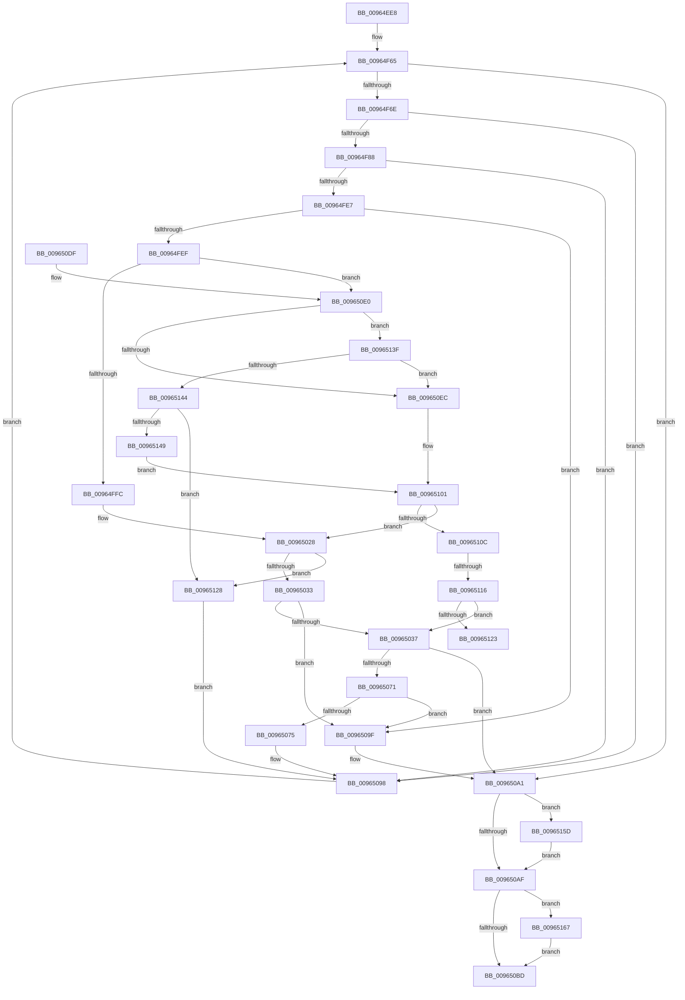

# PiDevCfgEnumDeviceKeys

- RVA: `0x00964EE8`–`0x00965171` (길이 `649` bytes)
- VA: `0x0000000140964EE8`
- 실행 섹션: `PAGE`
- PDB 이름 있음: `예`; PDB Function 태그: `예`
- unwind 정보 RVA: `0x00093710`
- 디코드: `160`개 명령, `649/649` bytes 표시
- 미해석 바이트: `0` (있으면 어셈블리에 `.byte`로 보존)

> 이 문서는 커널 이미지의 기계어와 PDB 기호를 분석해 생성했습니다. 4번과 5번은 함수 원형과 자료형을 바이너리 사용 방식에서 추정한 C 해석이며 원본 소스 복구 결과는 아닙니다.

## 1. Dependencies

- 직접 호출 지점: **13**; 고유 호출 대상: **9**
- 직접 호출자로 확인된 함수: **2**
- RIP 상대 이미지 참조: **3**

### Outgoing calls
- `0x00964F90` → [RtlInitUnicodeString](../../text/42/RtlInitUnicodeString_function_0042A780.md) (function, `0x0042A780`)
- `0x00964FD4` → [ZwOpenKey](../../text/6A/ZwOpenKey_function_006AD310.md) (function, `0x006AD310`)
- `0x00965023` → [_CmOpenDeviceRegKey](../8E/_CmOpenDeviceRegKey_function_008EE540.md) (function, `0x008EE540`)
- `0x00965065` → [guard_dispatch_icall](../../text/6B/guard_dispatch_icall_function_006BAAD0.md) (function, `0x006BAAD0`)
- `0x0096507A` → [ZwClose](../../text/6A/ZwClose_function_006AD2B0.md) (function, `0x006AD2B0`)
- `0x0096508B` → [ZwClose](../../text/6A/ZwClose_function_006AD2B0.md) (function, `0x006AD2B0`)
- `0x009650C6` → [_security_check_cookie](../../text/6A/_security_check_cookie_function_006AC640.md) (function, `0x006AC640`)
- `0x009650E3` → [CmIsStateSeparationEnabled](../../text/4A/CmIsStateSeparationEnabled_function_004A4754.md) (function, `0x004A4754`)
- `0x009650FC` → [PnpCtxOpenContextBaseKey](PnpCtxOpenContextBaseKey_function_00962A0C.md) (function, `0x00962A0C`)
- `0x0096512D` → [ZwClose](../../text/6A/ZwClose_function_006AD2B0.md) (function, `0x006AD2B0`)
- `0x00965156` → [PnpCtxOpenContextNodeBaseKey](../82/PnpCtxOpenContextNodeBaseKey_function_00828F14.md) (function, `0x00828F14`)
- `0x0096515D` → [ZwClose](../../text/6A/ZwClose_function_006AD2B0.md) (function, `0x006AD2B0`)
- `0x00965167` → [ZwClose](../../text/6A/ZwClose_function_006AD2B0.md) (function, `0x006AD2B0`)

### Direct callers
- [PiDevCfgResetDeviceKeys](../73/PiDevCfgResetDeviceKeys_function_00735924.md) at `0x007359A7`
- [PiDevCfgConfigureDeviceKeys](PiDevCfgConfigureDeviceKeys_function_00964BA8.md) at `0x00964C45`

### Static image references
- `0x00964F01` → RVA `0x00E0A740` (`.data`; read)
- `0x00964F70` → RVA `0x00B4D840` (`PAGE`; read)
- `0x00965005` → RVA `0x00E66398` (`.data`; read)

## 2. Other-region calls and transfers

- 다른 실행 섹션으로 향하는 call: **10**
  - `0x00964F90` → [RtlInitUnicodeString](../../text/42/RtlInitUnicodeString_function_0042A780.md) (`PAGE` → `.text`)
  - `0x00964FD4` → [ZwOpenKey](../../text/6A/ZwOpenKey_function_006AD310.md) (`PAGE` → `.text`)
  - `0x00965065` → [guard_dispatch_icall](../../text/6B/guard_dispatch_icall_function_006BAAD0.md) (`PAGE` → `.text`)
  - `0x0096507A` → [ZwClose](../../text/6A/ZwClose_function_006AD2B0.md) (`PAGE` → `.text`)
  - `0x0096508B` → [ZwClose](../../text/6A/ZwClose_function_006AD2B0.md) (`PAGE` → `.text`)
  - `0x009650C6` → [_security_check_cookie](../../text/6A/_security_check_cookie_function_006AC640.md) (`PAGE` → `.text`)
  - `0x009650E3` → [CmIsStateSeparationEnabled](../../text/4A/CmIsStateSeparationEnabled_function_004A4754.md) (`PAGE` → `.text`)
  - `0x0096512D` → [ZwClose](../../text/6A/ZwClose_function_006AD2B0.md) (`PAGE` → `.text`)
  - `0x0096515D` → [ZwClose](../../text/6A/ZwClose_function_006AD2B0.md) (`PAGE` → `.text`)
  - `0x00965167` → [ZwClose](../../text/6A/ZwClose_function_006AD2B0.md) (`PAGE` → `.text`)
- call이 아닌 외부 분기/꼬리 이동: **2**
  - `0x00965110` → [sub_00B286C8](../B2/Unknown_function_00B286C8.md) (`tail-transfer`)
  - `0x00965123` → [sub_00B286C8 + 0x62](../B2/Unknown_function_00B286C8.md) (`tail-transfer`)

## 3. Assembly (complete function range)

```asm
00964EE8  40 55                           push rbp
00964EEA  53                              push rbx
00964EEB  56                              push rsi
00964EEC  57                              push rdi
00964EED  41 54                           push r12
00964EEF  41 55                           push r13
00964EF1  41 56                           push r14
00964EF3  41 57                           push r15
00964EF5  48 8D 6C 24 D8                  lea rbp, [rsp - 0x28]
00964EFA  48 81 EC 28 01 00 00            sub rsp, 0x128
00964F01  48 8B 05 38 58 4A 00            mov rax, qword ptr [rip + 0x4a5838]
00964F08  48 33 C4                        xor rax, rsp
00964F0B  48 89 45 10                     mov qword ptr [rbp + 0x10], rax
00964F0F  48 8B 85 98 00 00 00            mov rax, qword ptr [rbp + 0x98]
00964F16  45 8B F9                        mov r15d, r9d
00964F19  44 8A A5 90 00 00 00            mov r12b, byte ptr [rbp + 0x90]
00964F20  45 33 C9                        xor r9d, r9d
00964F23  48 89 45 80                     mov qword ptr [rbp - 0x80], rax
00964F27  0F 57 C0                        xorps xmm0, xmm0
00964F2A  48 8B 85 A0 00 00 00            mov rax, qword ptr [rbp + 0xa0]
00964F31  4C 8B F2                        mov r14, rdx
00964F34  48 89 44 24 78                  mov qword ptr [rsp + 0x78], rax
00964F39  4C 8B E9                        mov r13, rcx
00964F3C  4C 89 44 24 70                  mov qword ptr [rsp + 0x70], r8
00964F41  41 8B F9                        mov edi, r9d
00964F44  0F 11 44 24 60                  movups xmmword ptr [rsp + 0x60], xmm0
00964F49  4C 89 4C 24 48                  mov qword ptr [rsp + 0x48], r9
00964F4E  41 8B F1                        mov esi, r9d
00964F51  4C 89 4C 24 40                  mov qword ptr [rsp + 0x40], r9
00964F56  4C 89 4C 24 58                  mov qword ptr [rsp + 0x58], r9
00964F5B  44 89 4C 24 50                  mov dword ptr [rsp + 0x50], r9d
00964F60  44 89 4C 24 54                  mov dword ptr [rsp + 0x54], r9d
00964F65  83 FE 07                        cmp esi, 7
00964F68  0F 83 33 01 00 00               jae 0x1409650a1
00964F6E  8B DE                           mov ebx, esi
00964F70  48 8D 05 C9 88 1E 00            lea rax, [rip + 0x1e88c9]
00964F77  48 C1 E3 05                     shl rbx, 5
00964F7B  48 03 D8                        add rbx, rax
00964F7E  44 85 7B 08                     test dword ptr [rbx + 8], r15d
00964F82  0F 84 10 01 00 00               je 0x140965098
00964F88  48 8B 13                        mov rdx, qword ptr [rbx]
00964F8B  48 8D 4C 24 60                  lea rcx, [rsp + 0x60]
00964F90  E8 EB 57 AC FF                  call 0x14042a780
00964F95  33 C0                           xor eax, eax
00964F97  48 C7 45 88 30 00 00 00         mov qword ptr [rbp - 0x78], 0x30
00964F9F  48 89 44 24 48                  mov qword ptr [rsp + 0x48], rax
00964FA4  4C 8D 45 88                     lea r8, [rbp - 0x78]
00964FA8  48 8B 44 24 70                  mov rax, qword ptr [rsp + 0x70]
00964FAD  48 8D 4C 24 48                  lea rcx, [rsp + 0x48]
00964FB2  48 89 45 90                     mov qword ptr [rbp - 0x70], rax
00964FB6  0F 57 C0                        xorps xmm0, xmm0
00964FB9  48 8D 44 24 60                  lea rax, [rsp + 0x60]
00964FBE  48 C7 45 A0 40 02 00 00         mov qword ptr [rbp - 0x60], 0x240
00964FC6  BA 19 00 02 00                  mov edx, 0x20019
00964FCB  48 89 45 98                     mov qword ptr [rbp - 0x68], rax
00964FCF  F3 0F 7F 45 A8                  movdqu xmmword ptr [rbp - 0x58], xmm0
00964FD4  E8 37 83 D4 FF                  call 0x1406ad310
00964FD9  45 33 C9                        xor r9d, r9d
00964FDC  3D 34 00 00 C0                  cmp eax, 0xc0000034
00964FE1  0F 84 B1 00 00 00               je 0x140965098
00964FE7  85 C0                           test eax, eax
00964FE9  0F 88 B0 00 00 00               js 0x14096509f
00964FEF  44 8B 43 10                     mov r8d, dword ptr [rbx + 0x10]
00964FF3  45 85 C0                        test r8d, r8d
00964FF6  0F 84 E4 00 00 00               je 0x1409650e0
00964FFC  49 8B 56 08                     mov rdx, qword ptr [r14 + 8]
00965000  48 8D 44 24 40                  lea rax, [rsp + 0x40]
00965005  48 8B 0D 8C 13 50 00            mov rcx, qword ptr [rip + 0x50138c]
0096500C  4C 89 4C 24 38                  mov qword ptr [rsp + 0x38], r9
00965011  48 89 44 24 30                  mov qword ptr [rsp + 0x30], rax
00965016  44 88 64 24 28                  mov byte ptr [rsp + 0x28], r12b
0096501B  C7 44 24 20 3F 00 0F 00         mov dword ptr [rsp + 0x20], 0xf003f
00965023  E8 18 95 F8 FF                  call 0x1408ee540
00965028  3D 34 00 00 C0                  cmp eax, 0xc0000034
0096502D  0F 84 F5 00 00 00               je 0x140965128
00965033  85 C0                           test eax, eax
00965035  78 68                           js 0x14096509f
00965037  48 8B 44 24 40                  mov rax, qword ptr [rsp + 0x40]
0096503C  48 8B 4C 24 78                  mov rcx, qword ptr [rsp + 0x78]
00965041  45 8B CF                        mov r9d, r15d
00965044  48 89 4C 24 30                  mov qword ptr [rsp + 0x30], rcx
00965049  4C 8B C3                        mov r8, rbx
0096504C  48 89 44 24 28                  mov qword ptr [rsp + 0x28], rax
00965051  49 8B D6                        mov rdx, r14
00965054  48 8B 44 24 48                  mov rax, qword ptr [rsp + 0x48]
00965059  49 8B CD                        mov rcx, r13
0096505C  48 89 44 24 20                  mov qword ptr [rsp + 0x20], rax
00965061  48 8B 45 80                     mov rax, qword ptr [rbp - 0x80]
00965065  E8 66 5A D5 FF                  call 0x1406baad0
0096506A  3D 40 02 00 C0                  cmp eax, 0xc0000240
0096506F  74 30                           je 0x1409650a1
00965071  85 C0                           test eax, eax
00965073  78 2A                           js 0x14096509f
00965075  48 8B 4C 24 48                  mov rcx, qword ptr [rsp + 0x48]
0096507A  E8 31 82 D4 FF                  call 0x1406ad2b0
0096507F  48 8B 4C 24 40                  mov rcx, qword ptr [rsp + 0x40]
00965084  33 C0                           xor eax, eax
00965086  48 89 44 24 48                  mov qword ptr [rsp + 0x48], rax
0096508B  E8 20 82 D4 FF                  call 0x1406ad2b0
00965090  45 33 C9                        xor r9d, r9d
00965093  4C 89 4C 24 40                  mov qword ptr [rsp + 0x40], r9
00965098  FF C6                           inc esi
0096509A  E9 C6 FE FF FF                  jmp 0x140964f65
0096509F  8B F8                           mov edi, eax
009650A1  48 8B 4C 24 48                  mov rcx, qword ptr [rsp + 0x48]
009650A6  48 85 C9                        test rcx, rcx
009650A9  0F 85 AE 00 00 00               jne 0x14096515d
009650AF  48 8B 4C 24 40                  mov rcx, qword ptr [rsp + 0x40]
009650B4  48 85 C9                        test rcx, rcx
009650B7  0F 85 AA 00 00 00               jne 0x140965167
009650BD  8B C7                           mov eax, edi
009650BF  48 8B 4D 10                     mov rcx, qword ptr [rbp + 0x10]
009650C3  48 33 CC                        xor rcx, rsp
009650C6  E8 75 75 D4 FF                  call 0x1406ac640
009650CB  48 81 C4 28 01 00 00            add rsp, 0x128
009650D2  41 5F                           pop r15
009650D4  41 5E                           pop r14
009650D6  41 5D                           pop r13
009650D8  41 5C                           pop r12
009650DA  5F                              pop rdi
009650DB  5E                              pop rsi
009650DC  5B                              pop rbx
009650DD  5D                              pop rbp
009650DE  C3                              ret
009650DF  CC                              int3
009650E0  8B 53 0C                        mov edx, dword ptr [rbx + 0xc]
009650E3  E8 6C F6 B3 FF                  call 0x1404a4754
009650E8  84 C0                           test al, al
009650EA  75 53                           jne 0x14096513f
009650EC  48 8D 44 24 40                  lea rax, [rsp + 0x40]
009650F1  41 B9 3F 00 0F 00               mov r9d, 0xf003f
009650F7  48 89 44 24 20                  mov qword ptr [rsp + 0x20], rax
009650FC  E8 0B D9 FF FF                  call 0x140962a0c
00965101  45 33 C9                        xor r9d, r9d
00965104  85 C0                           test eax, eax
00965106  0F 88 1C FF FF FF               js 0x140965028
0096510C  83 7B 0C 07                     cmp dword ptr [rbx + 0xc], 7
00965110  0F 84 B2 35 1C 00               je 0x140b286c8
00965116  48 8B 53 18                     mov rdx, qword ptr [rbx + 0x18]
0096511A  48 85 D2                        test rdx, rdx
0096511D  0F 84 14 FF FF FF               je 0x140965037
00965123  E9 02 36 1C 00                  jmp 0x140b2872a
00965128  48 8B 4C 24 48                  mov rcx, qword ptr [rsp + 0x48]
0096512D  E8 7E 81 D4 FF                  call 0x1406ad2b0
00965132  45 33 C9                        xor r9d, r9d
00965135  4C 89 4C 24 48                  mov qword ptr [rsp + 0x48], r9
0096513A  E9 59 FF FF FF                  jmp 0x140965098
0096513F  83 FA 04                        cmp edx, 4
00965142  74 A8                           je 0x1409650ec
00965144  83 FA 06                        cmp edx, 6
00965147  74 DF                           je 0x140965128
00965149  48 8D 44 24 40                  lea rax, [rsp + 0x40]
0096514E  44 8B CA                        mov r9d, edx
00965151  48 89 44 24 30                  mov qword ptr [rsp + 0x30], rax
00965156  E8 B9 3D EC FF                  call 0x140828f14
0096515B  EB A4                           jmp 0x140965101
0096515D  E8 4E 81 D4 FF                  call 0x1406ad2b0
00965162  E9 48 FF FF FF                  jmp 0x1409650af
00965167  E8 44 81 D4 FF                  call 0x1406ad2b0
0096516C  E9 4C FF FF FF                  jmp 0x1409650bd
```

## 4. C-style interpretation (structured pseudocode)

```c
__int64 __fastcall PiDevCfgEnumDeviceKeys(__int64 a1, __int64 a2, __int64 a3, int a4, unsigned __int8 a5, __int64 a6, __int64 a7)
{
    __int64 result;
    __int64 v_rbx;
    __int64 v_rsi;
    __int64 v_rsp;
    unsigned __int64 v_stack_m108;
    unsigned __int64 v_stack_m110;
    unsigned int v_stack_m114;
    unsigned int v_stack_m118;
    unsigned __int64 v_stack_m120;
    unsigned __int64 v_stack_m128;
    unsigned __int64 v_stack_m130;
    unsigned __int64 v_stack_m138;
    unsigned __int8 v_stack_m140;
    unsigned int v_stack_m148;
    unsigned __int64 v_stack_m58;
    unsigned __int64 v_stack_m68;
    unsigned __int64 v_stack_mC0;
    unsigned __int64 v_stack_mC8;
    unsigned __int64 v_stack_mD0;
    unsigned __int64 v_stack_mD8;
    unsigned __int64 v_stack_mE0;
    unsigned __int64 v_stack_mE8;
    unsigned __int64 v_stack_mF0;
    unsigned __int64 v_stack_mF8;
    unsigned __int64 v_stack_p20;
    unsigned __int64 v_stack_p30;
    unsigned __int64 v_stack_p40;
    unsigned __int64 v_stack_p48;

    v_rsp = (v_rsp) - (296);
    result = (*(unsigned __int64 *)(v_rip + 4872248)) ^ (v_rsp);
    v_stack_m58 = result;
    a4 = 0;
    v_stack_mE8 = a6;
    v_stack_mF0 = a7;
    v_stack_mF8 = a3;
    v_stack_m108 = v_xmm0;
    v_stack_m120 = 0;
    v_stack_m128 = 0;
    v_stack_m110 = 0;
    v_stack_m118 = 0;
    v_stack_m114 = 0;
loc_00964F65:
    if (0 >= 7) goto loc_009650A1;
    v_rbx = (0) << (5);
    v_rbx = (v_rbx) + (v_rip + 2001097);
    if (((*(unsigned int *)(v_rbx + 8)) & ((unsigned int)((unsigned int)(a4)))) == 0) goto loc_00965098;
    result = RtlInitUnicodeString(v_stack_m108, *(unsigned __int64 *)(v_rbx), a3, a4);
    result = 0;
    v_stack_mE0 = 48;
    v_stack_m120 = 0;
    v_stack_mD8 = v_stack_mF8;
    v_stack_mC8 = 576;
    v_stack_mD0 = v_stack_m108;
    v_stack_mC0 = v_xmm0;
    result = ZwOpenKey(v_stack_m120, (unsigned int)(0x20019ULL), v_stack_mE0, a4);
    a4 = 0;
    if (((unsigned int)(result)) == 0xC0000034ULL) goto loc_00965098;
    if (sign_flag) goto loc_0096509F;
    if ((unsigned int)((unsigned int)(*(unsigned int *)(v_rbx + 16))) == 0) goto loc_009650E0;
    v_stack_m130 = 0;
    v_stack_m138 = v_stack_m128;
    v_stack_m140 = a5;
    v_stack_m148 = 0xF003FULL;
    result = _CmOpenDeviceRegKey(*(unsigned __int64 *)(v_rip + 5247884), *(unsigned __int64 *)(a2 + 8), (unsigned int)(*(unsigned int *)(v_rbx + 16)), a4);
loc_00965028:
    if (((unsigned int)(result)) == 0xC0000034ULL) goto loc_00965128;
    if (sign_flag) goto loc_0096509F;
loc_00965037:
    v_stack_m138 = v_stack_mF0;
    v_stack_m140 = v_stack_m128;
    v_stack_m148 = v_stack_m120;
    result = guard_dispatch_icall(a1, a2, v_rbx, (unsigned int)((unsigned int)((unsigned int)(a4))));
    if (((unsigned int)(result)) == 0xC0000240ULL) goto loc_009650A1;
    if (sign_flag) goto loc_0096509F;
    result = ZwClose(v_stack_m120, a2, v_rbx, (unsigned int)((unsigned int)((unsigned int)(a4))));
    result = 0;
    v_stack_m120 = 0;
    result = ZwClose(v_stack_m128, a2, v_rbx, (unsigned int)((unsigned int)((unsigned int)(a4))));
    a4 = 0;
    v_stack_m128 = 0;
loc_00965098:
    v_rsi = (unsigned int)((0) + 1);
    goto loc_00964F65;
loc_0096509F:
loc_009650A1:
    if (v_stack_m120 != 0) goto loc_0096515D;
loc_009650AF:
    if (v_stack_m128 != 0) goto loc_00965167;
loc_009650BD:
    a1 = (v_stack_m58) ^ (v_rsp);
    result = _security_check_cookie(a1, a2, v_rbx, a4);
    v_rsp = (v_rsp) + (296);
    return result;
loc_009650E0:
    result = CmIsStateSeparationEnabled(a1, (unsigned int)(*(unsigned int *)(v_rbx + 12)), v_rbx, a4);
    if ((unsigned __int8)(result) != 0) goto loc_0096513F;
loc_009650EC:
    v_stack_p20 = v_stack_p40;
    result = PnpCtxOpenContextBaseKey(a1, (unsigned int)(*(unsigned int *)(v_rbx + 12)), v_rbx, (unsigned int)(0xF003FULL));
loc_00965101:
    a4 = 0;
    if (sign_flag) goto loc_00965028;
    if (*(unsigned __int64 *)(v_rbx + 24) == 0) goto loc_00965037;
loc_00965128:
    result = ZwClose(v_stack_p48, *(unsigned __int64 *)(v_rbx + 24), v_rbx, a4);
    a4 = 0;
    v_stack_p48 = 0;
    goto loc_00965098;
loc_0096513F:
    if (((unsigned int)(*(unsigned __int64 *)(v_rbx + 24))) == 4) goto loc_009650EC;
    if (((unsigned int)(*(unsigned __int64 *)(v_rbx + 24))) == 6) goto loc_00965128;
    v_stack_p30 = v_stack_p40;
    result = PnpCtxOpenContextNodeBaseKey(v_stack_p48, *(unsigned __int64 *)(v_rbx + 24), v_rbx, (unsigned int)((unsigned int)(*(unsigned __int64 *)(v_rbx + 24))));
    goto loc_00965101;
loc_0096515D:
    result = ZwClose(v_stack_p48, *(unsigned __int64 *)(v_rbx + 24), v_rbx, (unsigned int)((unsigned int)(*(unsigned __int64 *)(v_rbx + 24))));
    goto loc_009650AF;
loc_00965167:
    result = ZwClose(v_stack_p48, *(unsigned __int64 *)(v_rbx + 24), v_rbx, (unsigned int)((unsigned int)(*(unsigned __int64 *)(v_rbx + 24))));
    goto loc_009650BD;
}
```

## 5. (Beta) C Style

```c
int64_t PiDevCfgEnumDeviceKeys(int64_t Arg1, void *Arg2, int64_t Arg3, int32_t Arg4, uint8_t Arg5, int64_t Arg6, int64_t Arg7)
{
    uint8_t *arg2 = (uint8_t *)Arg2;

    int64_t result;
    int64_t local_rbx;
    int64_t local_rsi;
    int64_t local_rsp;
    uint64_t v_stack_m108;
    uint64_t v_stack_m110;
    uint32_t v_stack_m114;
    uint32_t v_stack_m118;
    uint64_t v_stack_m120;
    uint64_t v_stack_m128;
    uint64_t v_stack_m130;
    uint64_t v_stack_m138;
    uint8_t v_stack_m140;
    uint32_t v_stack_m148;
    uint64_t v_stack_m58;
    uint64_t v_stack_m68;
    uint64_t v_stack_mC0;
    uint64_t v_stack_mC8;
    uint64_t v_stack_mD0;
    uint64_t v_stack_mD8;
    uint64_t v_stack_mE0;
    uint64_t v_stack_mE8;
    uint64_t v_stack_mF0;
    uint64_t v_stack_mF8;
    uint64_t v_stack_p20;
    uint64_t v_stack_p30;
    uint64_t v_stack_p40;
    uint64_t v_stack_p48;

    local_rsp = (local_rsp) - (296);
    result = (*(uint64_t *)(v_rip + 0x4A5838)) ^ (local_rsp);
    v_stack_m58 = result;
    Arg4 = 0;
    v_stack_mE8 = Arg6;
    v_stack_mF0 = Arg7;
    v_stack_mF8 = Arg3;
    v_stack_m108 = v_xmm0;
    v_stack_m120 = 0;
    v_stack_m128 = 0;
    v_stack_m110 = 0;
    v_stack_m118 = 0;
    v_stack_m114 = 0;
loc_00964F65:
    if (0 >= 7) goto loc_009650A1;
    local_rbx = (0) << (5);
    local_rbx = (local_rbx) + (v_rip + 2001097);
    if (((*(uint32_t *)(local_rbx + 0x8)) & ((uint32_t)((uint32_t)(Arg4)))) == 0) goto loc_00965098;
    result = RtlInitUnicodeString(v_stack_m108, *(uint64_t *)(local_rbx), Arg3, Arg4);
    result = 0;
    v_stack_mE0 = 48;
    v_stack_m120 = 0;
    v_stack_mD8 = v_stack_mF8;
    v_stack_mC8 = 576;
    v_stack_mD0 = v_stack_m108;
    v_stack_mC0 = v_xmm0;
    result = ZwOpenKey(v_stack_m120, (uint32_t)(0x20019ULL), v_stack_mE0, Arg4);
    Arg4 = 0;
    if (((uint32_t)(result)) == 0xC0000034ULL) goto loc_00965098;
    if (sign_flag) goto loc_0096509F;
    if ((uint32_t)((uint32_t)(*(uint32_t *)(local_rbx + 0x10))) == 0) goto loc_009650E0;
    v_stack_m130 = 0;
    v_stack_m138 = v_stack_m128;
    v_stack_m140 = Arg5;
    v_stack_m148 = 0xF003FULL;
    result = _CmOpenDeviceRegKey(*(uint64_t *)(v_rip + 0x50138C), *(uint64_t *)(arg2 + 0x8), (uint32_t)(*(uint32_t *)(local_rbx + 0x10)), Arg4);
loc_00965028:
    if (((uint32_t)(result)) == 0xC0000034ULL) goto loc_00965128;
    if (sign_flag) goto loc_0096509F;
loc_00965037:
    v_stack_m138 = v_stack_mF0;
    v_stack_m140 = v_stack_m128;
    v_stack_m148 = v_stack_m120;
    result = guard_dispatch_icall(Arg1, Arg2, local_rbx, (uint32_t)((uint32_t)((uint32_t)(Arg4))));
    if (((uint32_t)(result)) == 0xC0000240ULL) goto loc_009650A1;
    if (sign_flag) goto loc_0096509F;
    result = ZwClose(v_stack_m120, Arg2, local_rbx, (uint32_t)((uint32_t)((uint32_t)(Arg4))));
    result = 0;
    v_stack_m120 = 0;
    result = ZwClose(v_stack_m128, Arg2, local_rbx, (uint32_t)((uint32_t)((uint32_t)(Arg4))));
    Arg4 = 0;
    v_stack_m128 = 0;
loc_00965098:
    local_rsi = (uint32_t)((0) + 1);
    goto loc_00964F65;
loc_0096509F:
loc_009650A1:
    if (v_stack_m120 != 0) goto loc_0096515D;
loc_009650AF:
    if (v_stack_m128 != 0) goto loc_00965167;
loc_009650BD:
    Arg1 = (v_stack_m58) ^ (local_rsp);
    result = _security_check_cookie(Arg1, Arg2, local_rbx, Arg4);
    local_rsp = (local_rsp) + (296);
    return result;
loc_009650E0:
    result = CmIsStateSeparationEnabled(Arg1, (uint32_t)(*(uint32_t *)(local_rbx + 0xC)), local_rbx, Arg4);
    if ((uint8_t)(result) != 0) goto loc_0096513F;
loc_009650EC:
    v_stack_p20 = v_stack_p40;
    result = PnpCtxOpenContextBaseKey(Arg1, (uint32_t)(*(uint32_t *)(local_rbx + 0xC)), local_rbx, (uint32_t)(0xF003FULL));
loc_00965101:
    Arg4 = 0;
    if (sign_flag) goto loc_00965028;
    if (*(uint64_t *)(local_rbx + 0x18) == 0) goto loc_00965037;
loc_00965128:
    result = ZwClose(v_stack_p48, *(uint64_t *)(local_rbx + 0x18), local_rbx, Arg4);
    Arg4 = 0;
    v_stack_p48 = 0;
    goto loc_00965098;
loc_0096513F:
    if (((uint32_t)(*(uint64_t *)(local_rbx + 0x18))) == 4) goto loc_009650EC;
    if (((uint32_t)(*(uint64_t *)(local_rbx + 0x18))) == 6) goto loc_00965128;
    v_stack_p30 = v_stack_p40;
    result = PnpCtxOpenContextNodeBaseKey(v_stack_p48, *(uint64_t *)(local_rbx + 0x18), local_rbx, (uint32_t)((uint32_t)(*(uint64_t *)(local_rbx + 0x18))));
    goto loc_00965101;
loc_0096515D:
    result = ZwClose(v_stack_p48, *(uint64_t *)(local_rbx + 0x18), local_rbx, (uint32_t)((uint32_t)(*(uint64_t *)(local_rbx + 0x18))));
    goto loc_009650AF;
loc_00965167:
    result = ZwClose(v_stack_p48, *(uint64_t *)(local_rbx + 0x18), local_rbx, (uint32_t)((uint32_t)(*(uint64_t *)(local_rbx + 0x18))));
    goto loc_009650BD;
}
```

### 관측된 메모리 오프셋

구조체 형식이 확인되지 않은 접근은 인자 기준의 오프셋으로만 기록했습니다.

| 기준 인자 | 오프셋 표현 | 폭 (bit) | 접근 |
|---|---:|---:|---|
| `Arg2` | `+ 0x8` | `64` | `R` |

## 6. Execution-region graph

[열기: 2D/3D 그래프와 함수 탐색 컨트롤 패널](../../../control-panel.html?section=page&rva=0x00964EE8&view=graph)

- 2D 그래프는 위에서 아래로 흐르고, 3D 그래프는 빈 공간을 드래그해 회전합니다. Shift+드래그는 이동, 휠은 확대·축소, 함수 노드 선택은 대상 보고서 이동입니다.

### Static fallback


