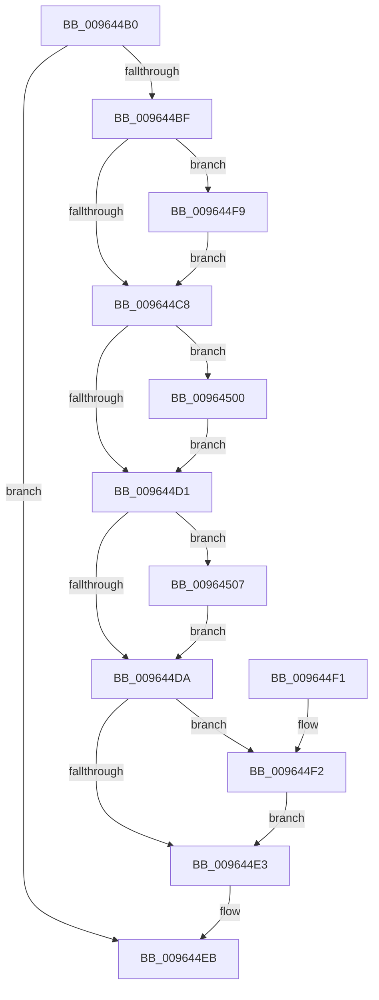

# PiDevCfgFreeMigrationContext

- RVA: `0x009644B0`–`0x0096450E` (길이 `94` bytes)
- VA: `0x00000001409644B0`
- 실행 섹션: `PAGE`
- PDB 이름 있음: `예`; PDB Function 태그: `아니요`
- unwind 정보 RVA: `0x00085560`
- 디코드: `31`개 명령, `94/94` bytes 표시
- 미해석 바이트: `0` (있으면 어셈블리에 `.byte`로 보존)

> 이 문서는 커널 이미지의 기계어와 PDB 기호를 분석해 생성했습니다. 4번과 5번은 함수 원형과 자료형을 바이너리 사용 방식에서 추정한 C 해석이며 원본 소스 복구 결과는 아닙니다.

## 1. Dependencies

- 직접 호출 지점: **5**; 고유 호출 대상: **1**
- 직접 호출자로 확인된 함수: **2**
- RIP 상대 이미지 참조: **0**

### Outgoing calls
- `0x009644E6` → [ZwClose](../../text/6A/ZwClose_function_006AD2B0.md) (function, `0x006AD2B0`)
- `0x009644F2` → [ZwClose](../../text/6A/ZwClose_function_006AD2B0.md) (function, `0x006AD2B0`)
- `0x009644F9` → [ZwClose](../../text/6A/ZwClose_function_006AD2B0.md) (function, `0x006AD2B0`)
- `0x00964500` → [ZwClose](../../text/6A/ZwClose_function_006AD2B0.md) (function, `0x006AD2B0`)
- `0x00964507` → [ZwClose](../../text/6A/ZwClose_function_006AD2B0.md) (function, `0x006AD2B0`)

### Direct callers
- [PiDevCfgMigrateDevice](PiDevCfgMigrateDevice_function_00963E60.md) at `0x009640D2`
- [PiDevCfgInitMigrationContext](PiDevCfgInitMigrationContext_function_009642E0.md) at `0x00964428`

### Static image references
- 디코드된 RIP-relative 메모리 참조가 없습니다.

## 2. Other-region calls and transfers

- 다른 실행 섹션으로 향하는 call: **5**
  - `0x009644E6` → [ZwClose](../../text/6A/ZwClose_function_006AD2B0.md) (`PAGE` → `.text`)
  - `0x009644F2` → [ZwClose](../../text/6A/ZwClose_function_006AD2B0.md) (`PAGE` → `.text`)
  - `0x009644F9` → [ZwClose](../../text/6A/ZwClose_function_006AD2B0.md) (`PAGE` → `.text`)
  - `0x00964500` → [ZwClose](../../text/6A/ZwClose_function_006AD2B0.md) (`PAGE` → `.text`)
  - `0x00964507` → [ZwClose](../../text/6A/ZwClose_function_006AD2B0.md) (`PAGE` → `.text`)
- 별도 외부 분기/꼬리 이동을 확인하지 못했습니다.

## 3. Assembly (complete function range)

```asm
009644B0  40 53                           push rbx
009644B2  48 83 EC 20                     sub rsp, 0x20
009644B6  48 83 39 00                     cmp qword ptr [rcx], 0
009644BA  48 8B D9                        mov rbx, rcx
009644BD  74 2C                           je 0x1409644eb
009644BF  48 8B 49 18                     mov rcx, qword ptr [rcx + 0x18]
009644C3  48 85 C9                        test rcx, rcx
009644C6  75 31                           jne 0x1409644f9
009644C8  48 8B 4B 10                     mov rcx, qword ptr [rbx + 0x10]
009644CC  48 85 C9                        test rcx, rcx
009644CF  75 2F                           jne 0x140964500
009644D1  48 8B 4B 20                     mov rcx, qword ptr [rbx + 0x20]
009644D5  48 85 C9                        test rcx, rcx
009644D8  75 2D                           jne 0x140964507
009644DA  48 8B 4B 08                     mov rcx, qword ptr [rbx + 8]
009644DE  48 85 C9                        test rcx, rcx
009644E1  75 0F                           jne 0x1409644f2
009644E3  48 8B 0B                        mov rcx, qword ptr [rbx]
009644E6  E8 C5 8D D4 FF                  call 0x1406ad2b0
009644EB  48 83 C4 20                     add rsp, 0x20
009644EF  5B                              pop rbx
009644F0  C3                              ret
009644F1  CC                              int3
009644F2  E8 B9 8D D4 FF                  call 0x1406ad2b0
009644F7  EB EA                           jmp 0x1409644e3
009644F9  E8 B2 8D D4 FF                  call 0x1406ad2b0
009644FE  EB C8                           jmp 0x1409644c8
00964500  E8 AB 8D D4 FF                  call 0x1406ad2b0
00964505  EB CA                           jmp 0x1409644d1
00964507  E8 A4 8D D4 FF                  call 0x1406ad2b0
0096450C  EB CC                           jmp 0x1409644da
```

## 4. C-style interpretation (structured pseudocode)

```c
__int64 __fastcall PiDevCfgFreeMigrationContext(__int64 a1)
{
    __int64 result;
    __int64 v_rsp;

    v_rsp = (v_rsp) - (32);
    if ((*(unsigned __int64 *)(a1)) == 0) goto loc_009644EB;
    if (*(unsigned __int64 *)(a1 + 24) != 0) goto loc_009644F9;
loc_009644C8:
    if (*(unsigned __int64 *)(a1 + 16) != 0) goto loc_00964500;
loc_009644D1:
    if (*(unsigned __int64 *)(a1 + 32) != 0) goto loc_00964507;
loc_009644DA:
    if (*(unsigned __int64 *)(a1 + 8) != 0) goto loc_009644F2;
loc_009644E3:
    result = ZwClose(*(unsigned __int64 *)(a1), a2, a3, a4);
loc_009644EB:
    v_rsp = (v_rsp) + (32);
    return result;
loc_009644F2:
    result = ZwClose(*(unsigned __int64 *)(a1), a2, a3, a4);
    goto loc_009644E3;
loc_009644F9:
    result = ZwClose(*(unsigned __int64 *)(a1), a2, a3, a4);
    goto loc_009644C8;
loc_00964500:
    result = ZwClose(*(unsigned __int64 *)(a1), a2, a3, a4);
    goto loc_009644D1;
loc_00964507:
    result = ZwClose(*(unsigned __int64 *)(a1), a2, a3, a4);
    goto loc_009644DA;
}
```

## 5. (Beta) C Style

```c
int64_t PiDevCfgFreeMigrationContext(void *Arg1)
{
    uint8_t *arg1 = (uint8_t *)Arg1;

    int64_t result;
    int64_t local_rsp;

    local_rsp = (local_rsp) - (32);
    if ((*(uint64_t *)(arg1)) == 0) goto loc_009644EB;
    if (*(uint64_t *)(arg1 + 0x18) != 0) goto loc_009644F9;
loc_009644C8:
    if (*(uint64_t *)(arg1 + 0x10) != 0) goto loc_00964500;
loc_009644D1:
    if (*(uint64_t *)(arg1 + 0x20) != 0) goto loc_00964507;
loc_009644DA:
    if (*(uint64_t *)(arg1 + 0x8) != 0) goto loc_009644F2;
loc_009644E3:
    result = ZwClose(*(uint64_t *)(arg1), a2, a3, a4);
loc_009644EB:
    local_rsp = (local_rsp) + (32);
    return result;
loc_009644F2:
    result = ZwClose(*(uint64_t *)(arg1), a2, a3, a4);
    goto loc_009644E3;
loc_009644F9:
    result = ZwClose(*(uint64_t *)(arg1), a2, a3, a4);
    goto loc_009644C8;
loc_00964500:
    result = ZwClose(*(uint64_t *)(arg1), a2, a3, a4);
    goto loc_009644D1;
loc_00964507:
    result = ZwClose(*(uint64_t *)(arg1), a2, a3, a4);
    goto loc_009644DA;
}
```

### 관측된 메모리 오프셋

구조체 형식이 확인되지 않은 접근은 인자 기준의 오프셋으로만 기록했습니다.

| 기준 인자 | 오프셋 표현 | 폭 (bit) | 접근 |
|---|---:|---:|---|
| `Arg1` | `+ 0x0` | `64` | `R` |
| `Arg1` | `+ 0x8` | `64` | `R` |
| `Arg1` | `+ 0x10` | `64` | `R` |
| `Arg1` | `+ 0x18` | `64` | `R` |
| `Arg1` | `+ 0x20` | `64` | `R` |

## 6. Execution-region graph

[열기: 2D/3D 그래프와 함수 탐색 컨트롤 패널](../../../control-panel.html?section=page&rva=0x009644B0&view=graph)

- 2D 그래프는 위에서 아래로 흐르고, 3D 그래프는 빈 공간을 드래그해 회전합니다. Shift+드래그는 이동, 휠은 확대·축소, 함수 노드 선택은 대상 보고서 이동입니다.

### Static fallback


