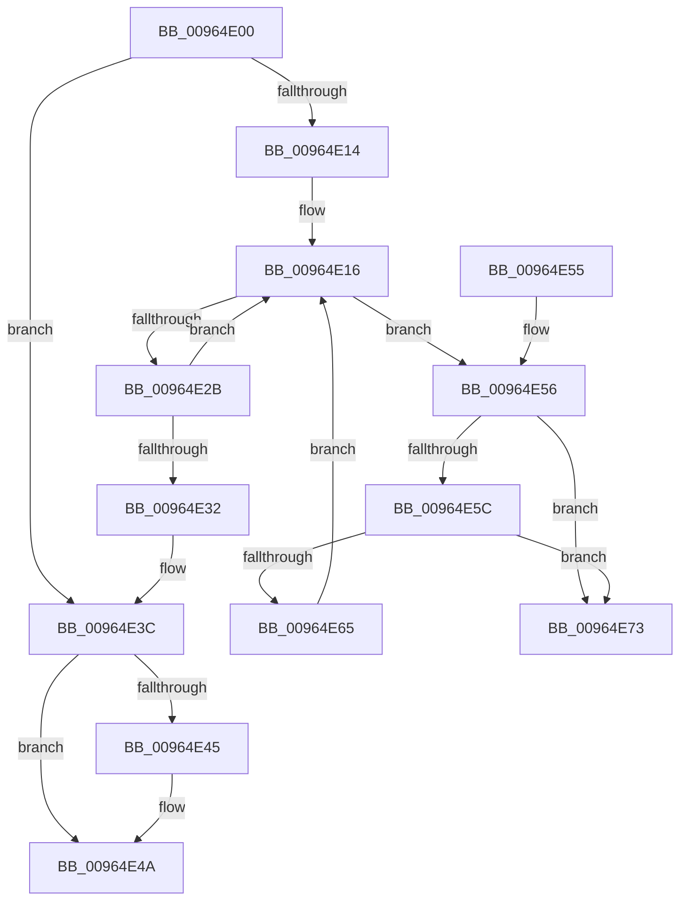

# PiDevCfgFreeResolveContext

- RVA: `0x00964E00`–`0x00964E7A` (길이 `122` bytes)
- VA: `0x0000000140964E00`
- 실행 섹션: `PAGE`
- PDB 이름 있음: `예`; PDB Function 태그: `아니요`
- unwind 정보 RVA: `0x0006E554`
- 디코드: `40`개 명령, `122/122` bytes 표시
- 미해석 바이트: `0` (있으면 어셈블리에 `.byte`로 보존)

> 이 문서는 커널 이미지의 기계어와 PDB 기호를 분석해 생성했습니다. 4번과 5번은 함수 원형과 자료형을 바이너리 사용 방식에서 추정한 C 해석이며 원본 소스 복구 결과는 아닙니다.

## 1. Dependencies

- 직접 호출 지점: **3**; 고유 호출 대상: **3**
- 직접 호출자로 확인된 함수: **3**
- RIP 상대 이미지 참조: **0**

### Outgoing calls
- `0x00964E37` → [ExFreePoolWithTag](../../poolcode/B8/ExFreePoolWithTag_function_00B82870.md) (function, `0x00B82870`)
- `0x00964E45` → [ZwClose](../../text/6A/ZwClose_function_006AD2B0.md) (function, `0x006AD2B0`)
- `0x00964E6C` → [PiDevCfgFreeVariable](PiDevCfgFreeVariable_function_00964E80.md) (function, `0x00964E80`)

### Direct callers
- [PiDevCfgConfigureDeviceKeys](PiDevCfgConfigureDeviceKeys_function_00964BA8.md) at `0x00964DC2`
- [PiDevCfgInitResolveContext](PiDevCfgInitResolveContext_function_00965178.md) at `0x009652C8`
- [PiDevCfgVerifyDeviceAllowed](PiDevCfgVerifyDeviceAllowed_function_009664E4.md) at `0x009665C3`

### Static image references
- 디코드된 RIP-relative 메모리 참조가 없습니다.

## 2. Other-region calls and transfers

- 다른 실행 섹션으로 향하는 call: **2**
  - `0x00964E37` → [ExFreePoolWithTag](../../poolcode/B8/ExFreePoolWithTag_function_00B82870.md) (`PAGE` → `POOLCODE`)
  - `0x00964E45` → [ZwClose](../../text/6A/ZwClose_function_006AD2B0.md) (`PAGE` → `.text`)
- 별도 외부 분기/꼬리 이동을 확인하지 못했습니다.

## 3. Assembly (complete function range)

```asm
00964E00  48 89 5C 24 08                  mov qword ptr [rsp + 8], rbx
00964E05  57                              push rdi
00964E06  48 83 EC 20                     sub rsp, 0x20
00964E0A  48 83 79 18 00                  cmp qword ptr [rcx + 0x18], 0
00964E0F  48 8B F9                        mov rdi, rcx
00964E12  74 28                           je 0x140964e3c
00964E14  33 DB                           xor ebx, ebx
00964E16  4C 8B 47 18                     mov r8, qword ptr [rdi + 0x18]
00964E1A  8B D3                           mov edx, ebx
00964E1C  48 C1 E2 04                     shl rdx, 4
00964E20  49 03 D0                        add rdx, r8
00964E23  48 8B 0A                        mov rcx, qword ptr [rdx]
00964E26  48 3B CA                        cmp rcx, rdx
00964E29  75 2B                           jne 0x140964e56
00964E2B  FF C3                           inc ebx
00964E2D  83 FB 7F                        cmp ebx, 0x7f
00964E30  72 E4                           jb 0x140964e16
00964E32  33 D2                           xor edx, edx
00964E34  49 8B C8                        mov rcx, r8
00964E37  E8 34 DA 21 00                  call 0x140b82870
00964E3C  48 8B 4F 10                     mov rcx, qword ptr [rdi + 0x10]
00964E40  48 85 C9                        test rcx, rcx
00964E43  74 05                           je 0x140964e4a
00964E45  E8 66 84 D4 FF                  call 0x1406ad2b0
00964E4A  48 8B 5C 24 30                  mov rbx, qword ptr [rsp + 0x30]
00964E4F  48 83 C4 20                     add rsp, 0x20
00964E53  5F                              pop rdi
00964E54  C3                              ret
00964E55  CC                              int3
00964E56  48 39 51 08                     cmp qword ptr [rcx + 8], rdx
00964E5A  75 17                           jne 0x140964e73
00964E5C  48 8B 01                        mov rax, qword ptr [rcx]
00964E5F  48 39 48 08                     cmp qword ptr [rax + 8], rcx
00964E63  75 0E                           jne 0x140964e73
00964E65  48 89 02                        mov qword ptr [rdx], rax
00964E68  48 89 50 08                     mov qword ptr [rax + 8], rdx
00964E6C  E8 0F 00 00 00                  call 0x140964e80
00964E71  EB A3                           jmp 0x140964e16
00964E73  B9 03 00 00 00                  mov ecx, 3
00964E78  CD 29                           int 0x29
```

## 4. C-style interpretation (structured pseudocode)

```c
__int64 __fastcall PiDevCfgFreeResolveContext(__int64 a1)
{
    __int64 result;
    __int64 v_rbx;
    __int64 v_rsp;
    unsigned __int64 v_stack_p8;

    v_stack_p8 = v_rbx;
    v_rsp = (v_rsp) - (32);
    if ((*(unsigned __int64 *)(a1 + 24)) == 0) goto loc_00964E3C;
    v_rbx = 0;
loc_00964E16:
    a2 = (0) << (4);
    a2 = (a2) + (*(unsigned __int64 *)(a1 + 24));
    if ((*(unsigned __int64 *)(a2)) != a2) goto loc_00964E56;
    v_rbx = (unsigned int)((v_rbx) + 1);
    if (((unsigned int)(v_rbx)) < 127) goto loc_00964E16;
    a2 = 0;
    result = ExFreePoolWithTag(*(unsigned __int64 *)(a1 + 24), a2, *(unsigned __int64 *)(a1 + 24), a4);
loc_00964E3C:
    if (*(unsigned __int64 *)(a1 + 16) != 0) {
        result = ZwClose(*(unsigned __int64 *)(a1 + 16), a2, *(unsigned __int64 *)(a1 + 24), a4);
    }
    v_rsp = (v_rsp) + (32);
    return result;
loc_00964E56:
    if ((*(unsigned __int64 *)(*(unsigned __int64 *)(a1 + 16) + 8)) != 0) goto loc_00964E73;
    if ((*(unsigned __int64 *)(*(unsigned __int64 *)(*(unsigned __int64 *)(a1 + 16)) + 8)) != (*(unsigned __int64 *)(a1 + 16))) goto loc_00964E73;
    *(unsigned __int64 *)(a2) = *(unsigned __int64 *)(*(unsigned __int64 *)(a1 + 16));
    *(unsigned __int64 *)(*(unsigned __int64 *)(*(unsigned __int64 *)(a1 + 16)) + 8) = 0;
    result = PiDevCfgFreeVariable(*(unsigned __int64 *)(a1 + 16), a2, *(unsigned __int64 *)(a1 + 24), a4);
    goto loc_00964E16;
loc_00964E73:
    return result;
}
```

## 5. (Beta) C Style

```c
int64_t PiDevCfgFreeResolveContext(void *Arg1)
{
    uint8_t *arg1 = (uint8_t *)Arg1;

    int64_t result;
    int64_t local_rbx;
    int64_t local_rsp;
    uint64_t v_stack_p8;

    v_stack_p8 = local_rbx;
    local_rsp = (local_rsp) - (32);
    if ((*(uint64_t *)(arg1 + 0x18)) == 0) goto loc_00964E3C;
    local_rbx = 0;
loc_00964E16:
    a2 = (0) << (4);
    a2 = (a2) + (*(uint64_t *)(arg1 + 0x18));
    if ((*(uint64_t *)(a2)) != a2) goto loc_00964E56;
    local_rbx = (uint32_t)((local_rbx) + 1);
    if (((uint32_t)(local_rbx)) < 127) goto loc_00964E16;
    a2 = 0;
    result = ExFreePoolWithTag(*(uint64_t *)(arg1 + 0x18), a2, *(uint64_t *)(arg1 + 0x18), a4);
loc_00964E3C:
    if (*(uint64_t *)(arg1 + 0x10) != 0) {
        result = ZwClose(*(uint64_t *)(arg1 + 0x10), a2, *(uint64_t *)(arg1 + 0x18), a4);
    }
    local_rsp = (local_rsp) + (32);
    return result;
loc_00964E56:
    if ((*(uint64_t *)(*(uint64_t *)(arg1 + 0x10) + 0x8)) != 0) goto loc_00964E73;
    if ((*(uint64_t *)(*(uint64_t *)(*(uint64_t *)(arg1 + 0x10)) + 0x8)) != (*(uint64_t *)(arg1 + 0x10))) goto loc_00964E73;
    *(uint64_t *)(a2) = *(uint64_t *)(*(uint64_t *)(arg1 + 0x10));
    *(uint64_t *)(*(uint64_t *)(*(uint64_t *)(arg1 + 0x10)) + 0x8) = 0;
    result = PiDevCfgFreeVariable(*(uint64_t *)(arg1 + 0x10), a2, *(uint64_t *)(arg1 + 0x18), a4);
    goto loc_00964E16;
loc_00964E73:
    return result;
}
```

### 관측된 메모리 오프셋

구조체 형식이 확인되지 않은 접근은 인자 기준의 오프셋으로만 기록했습니다.

| 기준 인자 | 오프셋 표현 | 폭 (bit) | 접근 |
|---|---:|---:|---|
| `Arg1` | `+ 0x10` | `64` | `R` |
| `Arg1` | `+ 0x18` | `64` | `R` |

## 6. Execution-region graph

[열기: 2D/3D 그래프와 함수 탐색 컨트롤 패널](../../../control-panel.html?section=page&rva=0x00964E00&view=graph)

- 2D 그래프는 위에서 아래로 흐르고, 3D 그래프는 빈 공간을 드래그해 회전합니다. Shift+드래그는 이동, 휠은 확대·축소, 함수 노드 선택은 대상 보고서 이동입니다.

### Static fallback


