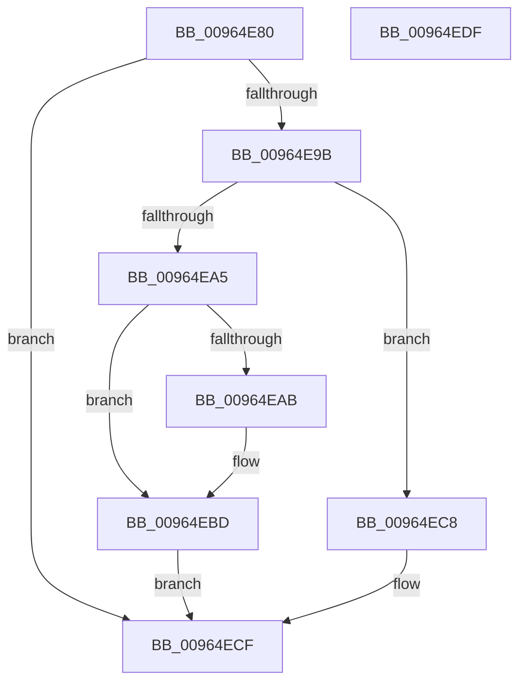

# PiDevCfgFreeVariable

- RVA: `0x00964E80`–`0x00964EE0` (길이 `96` bytes)
- VA: `0x0000000140964E80`
- 실행 섹션: `PAGE`
- PDB 이름 있음: `예`; PDB Function 태그: `아니요`
- unwind 정보 RVA: `0x0005CF00`
- 디코드: `29`개 명령, `96/96` bytes 표시
- 미해석 바이트: `0` (있으면 어셈블리에 `.byte`로 보존)

> 이 문서는 커널 이미지의 기계어와 PDB 기호를 분석해 생성했습니다. 4번과 5번은 함수 원형과 자료형을 바이너리 사용 방식에서 추정한 C 해석이며 원본 소스 복구 결과는 아닙니다.

## 1. Dependencies

- 직접 호출 지점: **5**; 고유 호출 대상: **4**
- 직접 호출자로 확인된 함수: **2**
- RIP 상대 이미지 참조: **1**

### Outgoing calls
- `0x00964E8D` → [RtlFreeAnsiString](../9C/RtlFreeAnsiString_function_009C0800.md) (function, `0x009C0800`)
- `0x00964EB8` → [PnpCtxRegDeleteTree](PnpCtxRegDeleteTree_function_00965CC8.md) (function, `0x00965CC8`)
- `0x00964EC1` → [ZwClose](../../text/6A/ZwClose_function_006AD2B0.md) (function, `0x006AD2B0`)
- `0x00964ECA` → [ExFreePoolWithTag](../../poolcode/B8/ExFreePoolWithTag_function_00B82870.md) (function, `0x00B82870`)
- `0x00964ED4` → [ExFreePoolWithTag](../../poolcode/B8/ExFreePoolWithTag_function_00B82870.md) (function, `0x00B82870`)

### Direct callers
- [PiDevCfgFreeResolveContext](PiDevCfgFreeResolveContext_function_00964E00.md) at `0x00964E6C`
- [sub_00B4387E](../B4/Unknown_function_00B4387E.md) at `0x00B439B2`

### Static image references
- `0x00964EB1` → RVA `0x00E66398` (`.data`; read)

## 2. Other-region calls and transfers

- 다른 실행 섹션으로 향하는 call: **3**
  - `0x00964EC1` → [ZwClose](../../text/6A/ZwClose_function_006AD2B0.md) (`PAGE` → `.text`)
  - `0x00964ECA` → [ExFreePoolWithTag](../../poolcode/B8/ExFreePoolWithTag_function_00B82870.md) (`PAGE` → `POOLCODE`)
  - `0x00964ED4` → [ExFreePoolWithTag](../../poolcode/B8/ExFreePoolWithTag_function_00B82870.md) (`PAGE` → `POOLCODE`)
- 별도 외부 분기/꼬리 이동을 확인하지 못했습니다.

## 3. Assembly (complete function range)

```asm
00964E80  40 53                           push rbx
00964E82  48 83 EC 20                     sub rsp, 0x20
00964E86  48 8B D9                        mov rbx, rcx
00964E89  48 83 C1 10                     add rcx, 0x10
00964E8D  E8 6E B9 05 00                  call 0x1409c0800
00964E92  48 8B 4B 28                     mov rcx, qword ptr [rbx + 0x28]
00964E96  48 85 C9                        test rcx, rcx
00964E99  74 34                           je 0x140964ecf
00964E9B  8B 53 20                        mov edx, dword ptr [rbx + 0x20]
00964E9E  66 81 FA 00 80                  cmp dx, 0x8000
00964EA3  75 23                           jne 0x140964ec8
00964EA5  0F BA E2 14                     bt edx, 0x14
00964EA9  73 12                           jae 0x140964ebd
00964EAB  48 8B D1                        mov rdx, rcx
00964EAE  45 33 C0                        xor r8d, r8d
00964EB1  48 8B 0D E0 14 50 00            mov rcx, qword ptr [rip + 0x5014e0]
00964EB8  E8 0B 0E 00 00                  call 0x140965cc8
00964EBD  48 8B 4B 28                     mov rcx, qword ptr [rbx + 0x28]
00964EC1  E8 EA 83 D4 FF                  call 0x1406ad2b0
00964EC6  EB 07                           jmp 0x140964ecf
00964EC8  33 D2                           xor edx, edx
00964ECA  E8 A1 D9 21 00                  call 0x140b82870
00964ECF  33 D2                           xor edx, edx
00964ED1  48 8B CB                        mov rcx, rbx
00964ED4  E8 97 D9 21 00                  call 0x140b82870
00964ED9  48 83 C4 20                     add rsp, 0x20
00964EDD  5B                              pop rbx
00964EDE  C3                              ret
00964EDF  CC                              int3
```

## 4. C-style interpretation (structured pseudocode)

```c
__int64 __fastcall PiDevCfgFreeVariable(__int64 a1, __int64 a2, int a3)
{
    __int64 result;
    __int64 v_rsp;

    v_rsp = (v_rsp) - (32);
    a1 = (a1) + (16);
    result = RtlFreeAnsiString(a1, a2, a3, a4);
    if (*(unsigned __int64 *)(a1 + 40) == 0) goto loc_00964ECF;
    if (((unsigned __int16)((unsigned int)(*(unsigned int *)(a1 + 32)))) != 0x8000ULL) goto loc_00964EC8;
    if (((unsigned __int16)((unsigned int)(*(unsigned int *)(a1 + 32)))) < 0x8000ULL) {
        a2 = *(unsigned __int64 *)(a1 + 40);
        a3 = 0;
        a1 = *(unsigned __int64 *)(v_rip + 5248224);
        result = PnpCtxRegDeleteTree(a1, a2, a3, a4);
    }
    result = ZwClose(*(unsigned __int64 *)(a1 + 40), a2, a3, a4);
    goto loc_00964ECF;
loc_00964EC8:
    a2 = 0;
    result = ExFreePoolWithTag(*(unsigned __int64 *)(a1 + 40), a2, a3, a4);
loc_00964ECF:
    a2 = 0;
    result = ExFreePoolWithTag(a1, a2, a3, a4);
    v_rsp = (v_rsp) + (32);
    return result;
}
```

## 5. (Beta) C Style

```c
int64_t PiDevCfgFreeVariable(void *Arg1, int64_t Arg2, int32_t Arg3)
{
    uint8_t *arg1 = (uint8_t *)Arg1;

    int64_t result;
    int64_t local_rsp;

    local_rsp = (local_rsp) - (32);
    Arg1 = (Arg1) + (16);
    result = RtlFreeAnsiString(Arg1, Arg2, Arg3, a4);
    if (*(uint64_t *)(arg1 + 0x28) == 0) goto loc_00964ECF;
    if (((uint16_t)((uint32_t)(*(uint32_t *)(arg1 + 0x20)))) != 0x8000ULL) goto loc_00964EC8;
    if (((uint16_t)((uint32_t)(*(uint32_t *)(arg1 + 0x20)))) < 0x8000ULL) {
        Arg2 = *(uint64_t *)(arg1 + 0x28);
        Arg3 = 0;
        Arg1 = *(uint64_t *)(v_rip + 0x5014E0);
        result = PnpCtxRegDeleteTree(Arg1, Arg2, Arg3, a4);
    }
    result = ZwClose(*(uint64_t *)(arg1 + 0x28), Arg2, Arg3, a4);
    goto loc_00964ECF;
loc_00964EC8:
    Arg2 = 0;
    result = ExFreePoolWithTag(*(uint64_t *)(arg1 + 0x28), Arg2, Arg3, a4);
loc_00964ECF:
    Arg2 = 0;
    result = ExFreePoolWithTag(Arg1, Arg2, Arg3, a4);
    local_rsp = (local_rsp) + (32);
    return result;
}
```

### 관측된 메모리 오프셋

구조체 형식이 확인되지 않은 접근은 인자 기준의 오프셋으로만 기록했습니다.

| 기준 인자 | 오프셋 표현 | 폭 (bit) | 접근 |
|---|---:|---:|---|
| `Arg1` | `+ 0x20` | `32` | `R` |
| `Arg1` | `+ 0x28` | `64` | `R` |

## 6. Execution-region graph

[열기: 2D/3D 그래프와 함수 탐색 컨트롤 패널](../../../control-panel.html?section=page&rva=0x00964E80&view=graph)

- 2D 그래프는 위에서 아래로 흐르고, 3D 그래프는 빈 공간을 드래그해 회전합니다. Shift+드래그는 이동, 휠은 확대·축소, 함수 노드 선택은 대상 보고서 이동입니다.

### Static fallback


