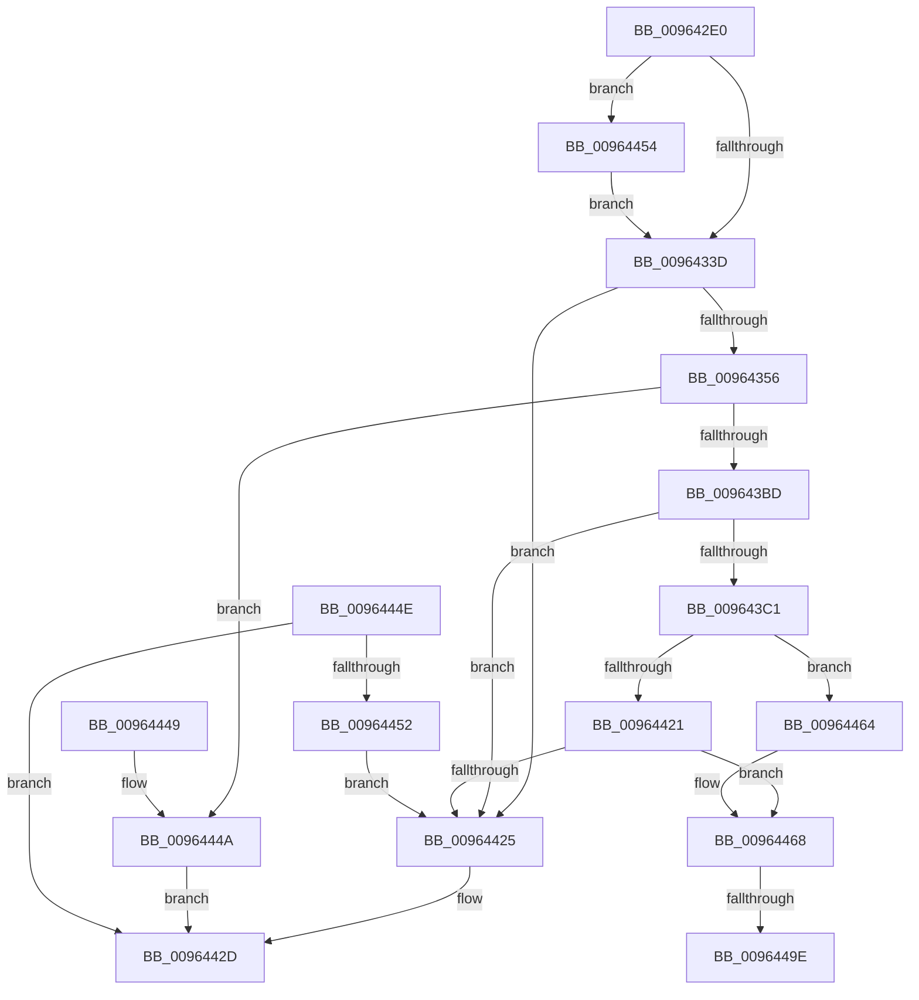

# PiDevCfgInitMigrationContext

- RVA: `0x009642E0`–`0x009644A8` (길이 `456` bytes)
- VA: `0x00000001409642E0`
- 실행 섹션: `PAGE`
- PDB 이름 있음: `예`; PDB Function 태그: `예`
- unwind 정보 RVA: `0x00093628`
- 디코드: `114`개 명령, `456/456` bytes 표시
- 미해석 바이트: `0` (있으면 어셈블리에 `.byte`로 보존)

> 이 문서는 커널 이미지의 기계어와 PDB 기호를 분석해 생성했습니다. 4번과 5번은 함수 원형과 자료형을 바이너리 사용 방식에서 추정한 C 해석이며 원본 소스 복구 결과는 아닙니다.

## 1. Dependencies

- 직접 호출 지점: **5**; 고유 호출 대상: **4**
- 직접 호출자로 확인된 함수: **1**
- RIP 상대 이미지 참조: **4**

### Outgoing calls
- `0x00964347` → [_PnpCtxGetCachedNodeBaseKey](../8E/_PnpCtxGetCachedNodeBaseKey_function_008EF9C0.md) (function, `0x008EF9C0`)
- `0x009643A7` → [ZwOpenKey](../../text/6A/ZwOpenKey_function_006AD310.md) (function, `0x006AD310`)
- `0x00964415` → [ZwOpenKey](../../text/6A/ZwOpenKey_function_006AD310.md) (function, `0x006AD310`)
- `0x00964428` → [PiDevCfgFreeMigrationContext](PiDevCfgFreeMigrationContext_function_009644B0.md) (function, `0x009644B0`)
- `0x0096448E` → [IopOpenRegistryKeyEx](../A5/IopOpenRegistryKeyEx_function_00A51B44.md) (function, `0x00A51B44`)

### Direct callers
- [PiDevCfgMigrateDevice](PiDevCfgMigrateDevice_function_00963E60.md) at `0x00963EDE`

### Static image references
- `0x00964322` → RVA `0x00E66398` (`.data`; read)
- `0x0096435A` → RVA `0x00AFF200` (` ?? ::NNGAKEGL::`string'`; read)
- `0x009643C5` → RVA `0x00AFD740` (` ?? ::NNGAKEGL::`string'`; read)
- `0x0096446B` → RVA `0x00AFF2B0` (` ?? ::NNGAKEGL::`string'`; read)

## 2. Other-region calls and transfers

- 다른 실행 섹션으로 향하는 call: **2**
  - `0x009643A7` → [ZwOpenKey](../../text/6A/ZwOpenKey_function_006AD310.md) (`PAGE` → `.text`)
  - `0x00964415` → [ZwOpenKey](../../text/6A/ZwOpenKey_function_006AD310.md) (`PAGE` → `.text`)
- call이 아닌 외부 분기/꼬리 이동: **2**
  - `0x00964498` → [sub_00B28306](../B2/Unknown_function_00B28306.md) (`tail-transfer`)
  - `0x009644A3` → [sub_00B28306 + 0x8](../B2/Unknown_function_00B28306.md) (`tail-transfer`)

## 3. Assembly (complete function range)

```asm
009642E0  48 89 5C 24 10                  mov qword ptr [rsp + 0x10], rbx
009642E5  48 89 74 24 18                  mov qword ptr [rsp + 0x18], rsi
009642EA  48 89 7C 24 20                  mov qword ptr [rsp + 0x20], rdi
009642EF  55                              push rbp
009642F0  41 55                           push r13
009642F2  41 56                           push r14
009642F4  48 8B EC                        mov rbp, rsp
009642F7  48 83 EC 60                     sub rsp, 0x60
009642FB  48 83 65 20 00                  and qword ptr [rbp + 0x20], 0
00964300  0F 57 C9                        xorps xmm1, xmm1
00964303  41 0F 11 08                     movups xmmword ptr [r8], xmm1
00964307  4C 8B F1                        mov r14, rcx
0096430A  49 8B F8                        mov rdi, r8
0096430D  41 0F 11 48 10                  movups xmmword ptr [r8 + 0x10], xmm1
00964312  41 0F 11 48 20                  movups xmmword ptr [r8 + 0x20], xmm1
00964317  49 89 48 28                     mov qword ptr [r8 + 0x28], rcx
0096431B  49 89 50 30                     mov qword ptr [r8 + 0x30], rdx
0096431F  0F 57 C0                        xorps xmm0, xmm0
00964322  48 8B 0D 6F 20 50 00            mov rcx, qword ptr [rip + 0x50206f]
00964329  0F 11 45 C0                     movups xmmword ptr [rbp - 0x40], xmm0
0096432D  48 8B 91 80 00 00 00            mov rdx, qword ptr [rcx + 0x80]
00964334  48 85 D2                        test rdx, rdx
00964337  0F 84 17 01 00 00               je 0x140964454
0096433D  4C 8D 4D 20                     lea r9, [rbp + 0x20]
00964341  41 B8 04 00 00 00               mov r8d, 4
00964347  E8 74 B6 F8 FF                  call 0x1408ef9c0
0096434C  8B D8                           mov ebx, eax
0096434E  85 C0                           test eax, eax
00964350  0F 88 CF 00 00 00               js 0x140964425
00964356  83 65 EC 00                     and dword ptr [rbp - 0x14], 0
0096435A  48 8D 05 9F AE 19 00            lea rax, [rip + 0x19ae9f]
00964361  48 83 27 00                     and qword ptr [rdi], 0
00964365  4C 8D 45 D0                     lea r8, [rbp - 0x30]
00964369  48 89 45 C8                     mov qword ptr [rbp - 0x38], rax
0096436D  0F 57 C0                        xorps xmm0, xmm0
00964370  48 8B 45 20                     mov rax, qword ptr [rbp + 0x20]
00964374  BA 19 00 02 00                  mov edx, 0x20019
00964379  48 89 45 D8                     mov qword ptr [rbp - 0x28], rax
0096437D  48 8B CF                        mov rcx, rdi
00964380  48 8D 45 C0                     lea rax, [rbp - 0x40]
00964384  48 C7 45 D0 30 00 00 00         mov qword ptr [rbp - 0x30], 0x30
0096438C  83 65 D4 00                     and dword ptr [rbp - 0x2c], 0
00964390  48 89 45 E0                     mov qword ptr [rbp - 0x20], rax
00964394  C7 45 C0 2E 00 30 00            mov dword ptr [rbp - 0x40], 0x30002e
0096439B  C7 45 E8 40 02 00 00            mov dword ptr [rbp - 0x18], 0x240
009643A2  F3 0F 7F 45 F0                  movdqu xmmword ptr [rbp - 0x10], xmm0
009643A7  E8 64 8F D4 FF                  call 0x1406ad310
009643AC  41 BD 34 00 00 C0               mov r13d, 0xc0000034
009643B2  8B D8                           mov ebx, eax
009643B4  41 3B C5                        cmp eax, r13d
009643B7  0F 84 8D 00 00 00               je 0x14096444a
009643BD  85 C0                           test eax, eax
009643BF  78 64                           js 0x140964425
009643C1  83 65 EC 00                     and dword ptr [rbp - 0x14], 0
009643C5  48 8D 05 74 93 19 00            lea rax, [rip + 0x199374]
009643CC  48 89 45 C8                     mov qword ptr [rbp - 0x38], rax
009643D0  48 8D 77 08                     lea rsi, [rdi + 8]
009643D4  48 8B 07                        mov rax, qword ptr [rdi]
009643D7  4C 8D 45 D0                     lea r8, [rbp - 0x30]
009643DB  48 83 26 00                     and qword ptr [rsi], 0
009643DF  0F 57 C0                        xorps xmm0, xmm0
009643E2  48 89 45 D8                     mov qword ptr [rbp - 0x28], rax
009643E6  BA 19 00 02 00                  mov edx, 0x20019
009643EB  48 8D 45 C0                     lea rax, [rbp - 0x40]
009643EF  48 C7 45 D0 30 00 00 00         mov qword ptr [rbp - 0x30], 0x30
009643F7  83 65 D4 00                     and dword ptr [rbp - 0x2c], 0
009643FB  48 8B CE                        mov rcx, rsi
009643FE  48 89 45 E0                     mov qword ptr [rbp - 0x20], rax
00964402  C7 45 C0 0E 00 10 00            mov dword ptr [rbp - 0x40], 0x10000e
00964409  C7 45 E8 40 02 00 00            mov dword ptr [rbp - 0x18], 0x240
00964410  F3 0F 7F 45 F0                  movdqu xmmword ptr [rbp - 0x10], xmm0
00964415  E8 F6 8E D4 FF                  call 0x1406ad310
0096441A  8B D8                           mov ebx, eax
0096441C  41 3B C5                        cmp eax, r13d
0096441F  74 43                           je 0x140964464
00964421  85 C0                           test eax, eax
00964423  79 43                           jns 0x140964468
00964425  48 8B CF                        mov rcx, rdi
00964428  E8 83 00 00 00                  call 0x1409644b0
0096442D  4C 8D 5C 24 60                  lea r11, [rsp + 0x60]
00964432  8B C3                           mov eax, ebx
00964434  49 8B 5B 28                     mov rbx, qword ptr [r11 + 0x28]
00964438  49 8B 73 30                     mov rsi, qword ptr [r11 + 0x30]
0096443C  49 8B 7B 38                     mov rdi, qword ptr [r11 + 0x38]
00964440  49 8B E3                        mov rsp, r11
00964443  41 5E                           pop r14
00964445  41 5D                           pop r13
00964447  5D                              pop rbp
00964448  C3                              ret
00964449  CC                              int3
0096444A  33 DB                           xor ebx, ebx
0096444C  EB DF                           jmp 0x14096442d
0096444E  85 DB                           test ebx, ebx
00964450  79 DB                           jns 0x14096442d
00964452  EB D1                           jmp 0x140964425
00964454  48 8B 51 58                     mov rdx, qword ptr [rcx + 0x58]
00964458  48 89 91 80 00 00 00            mov qword ptr [rcx + 0x80], rdx
0096445F  E9 D9 FE FF FF                  jmp 0x14096433d
00964464  48 83 26 00                     and qword ptr [rsi], 0
00964468  48 8B 17                        mov rdx, qword ptr [rdi]
0096446B  48 8D 05 3E AE 19 00            lea rax, [rip + 0x19ae3e]
00964472  48 8D 77 10                     lea rsi, [rdi + 0x10]
00964476  C7 45 C0 0E 00 10 00            mov dword ptr [rbp - 0x40], 0x10000e
0096447D  48 8B CE                        mov rcx, rsi
00964480  48 89 45 C8                     mov qword ptr [rbp - 0x38], rax
00964484  41 B9 19 00 02 00               mov r9d, 0x20019
0096448A  4C 8D 45 C0                     lea r8, [rbp - 0x40]
0096448E  E8 B1 D6 0E 00                  call 0x140a51b44
00964493  8B D8                           mov ebx, eax
00964495  41 3B C5                        cmp eax, r13d
00964498  0F 85 68 3E 1C 00               jne 0x140b28306
0096449E  33 DB                           xor ebx, ebx
009644A0  48 21 1E                        and qword ptr [rsi], rbx
009644A3  E9 66 3E 1C 00                  jmp 0x140b2830e
```

## 4. C-style interpretation (structured pseudocode)

```c
__int64 __fastcall PiDevCfgInitMigrationContext(__int64 a1, __int64 a2, __int64 a3)
{
    __int64 result;
    __int64 v_rbx;
    __int64 v_rsp;
    unsigned __int64 v_stack_m18;
    unsigned __int64 v_stack_m28;
    unsigned int v_stack_m2C;
    unsigned int v_stack_m30;
    unsigned __int64 v_stack_m38;
    unsigned __int64 v_stack_m40;
    unsigned int v_stack_m44;
    unsigned __int64 v_stack_m48;
    unsigned __int64 v_stack_m50;
    unsigned __int64 v_stack_m58;
    unsigned __int64 v_stack_p10;
    unsigned __int64 v_stack_p18;
    unsigned __int64 v_stack_p20;
    unsigned __int64 v_stack_p8;

    v_stack_p10 = v_rbx;
    v_stack_p18 = v_rsi;
    v_stack_p20 = v_rdi;
    v_rsp = (v_rsp) - (96);
    *(unsigned __int64 *)(a3) = v_xmm1;
    *(unsigned __int64 *)(a3 + 16) = v_xmm1;
    *(unsigned __int64 *)(a3 + 32) = v_xmm1;
    *(unsigned __int64 *)(a3 + 40) = a1;
    *(unsigned __int64 *)(a3 + 48) = a2;
    v_stack_m58 = v_xmm0;
    if (*(unsigned __int64 *)(*(unsigned __int64 *)(v_rip + 5251183) + 128) == 0) goto loc_00964454;
loc_0096433D:
    result = _PnpCtxGetCachedNodeBaseKey(*(unsigned __int64 *)(v_rip + 5251183), *(unsigned __int64 *)(*(unsigned __int64 *)(v_rip + 5251183) + 128), 4, v_stack_p8);
    if (sign_flag) goto loc_00964425;
    v_stack_m50 = v_rip + 1683103;
    v_stack_m40 = v_stack_p8;
    v_stack_m48 = 48;
    v_stack_m38 = v_stack_m58;
    v_stack_m58 = 0x30002EULL;
    v_stack_m30 = 576;
    v_stack_m28 = v_xmm0;
    result = ZwOpenKey(a3, (unsigned int)(0x20019ULL), v_stack_m48, v_stack_p8);
    if (((unsigned int)(result)) == ((unsigned int)((unsigned int)(0xC0000034ULL)))) goto loc_0096444A;
    if (sign_flag) goto loc_00964425;
    v_stack_m50 = v_rip + 1676148;
    v_stack_m40 = *(unsigned __int64 *)(a3);
    v_stack_m48 = 48;
    v_stack_m38 = v_stack_m58;
    v_stack_m58 = 0x10000EULL;
    v_stack_m30 = 576;
    v_stack_m28 = v_xmm0;
    result = ZwOpenKey(a3 + 8, (unsigned int)(0x20019ULL), v_stack_m48, v_stack_p8);
    if (((unsigned int)(result)) == ((unsigned int)((unsigned int)(0xC0000034ULL)))) goto loc_00964464;
    if (!sign_flag) goto loc_00964468;
loc_00964425:
    result = PiDevCfgFreeMigrationContext(a3, (unsigned int)(0x20019ULL), v_stack_m48, v_stack_p8);
loc_0096442D:
    return (unsigned int)((unsigned int)((unsigned int)((unsigned int)(result))));
loc_0096444A:
    v_rbx = 0;
    goto loc_0096442D;
loc_00964454:
    *(unsigned __int64 *)(a3 + 128) = *(unsigned __int64 *)(a3 + 88);
    goto loc_0096433D;
loc_00964464:
loc_00964468:
    v_stack_m58 = 0x10000EULL;
    v_stack_m50 = v_rip + 1683006;
    result = IopOpenRegistryKeyEx(*(unsigned __int64 *)(v_stack_m18 + 56) + 16, *(unsigned __int64 *)(*(unsigned __int64 *)(v_stack_m18 + 56)), v_stack_m58, (unsigned int)(0x20019ULL));
    v_rbx = 0;
}
```

## 5. (Beta) C Style

```c
int64_t PiDevCfgInitMigrationContext(int64_t Arg1, int64_t Arg2, void *Arg3)
{
    uint8_t *arg3 = (uint8_t *)Arg3;

    int64_t result;
    int64_t local_rbx;
    int64_t local_rsp;
    uint64_t v_stack_m18;
    uint64_t v_stack_m28;
    uint32_t v_stack_m2C;
    uint32_t v_stack_m30;
    uint64_t v_stack_m38;
    uint64_t v_stack_m40;
    uint32_t v_stack_m44;
    uint64_t v_stack_m48;
    uint64_t v_stack_m50;
    uint64_t v_stack_m58;
    uint64_t v_stack_p10;
    uint64_t v_stack_p18;
    uint64_t v_stack_p20;
    uint64_t v_stack_p8;

    v_stack_p10 = local_rbx;
    v_stack_p18 = local_rsi;
    v_stack_p20 = local_rdi;
    local_rsp = (local_rsp) - (96);
    *(uint64_t *)(arg3) = v_xmm1;
    *(uint64_t *)(arg3 + 0x10) = v_xmm1;
    *(uint64_t *)(arg3 + 0x20) = v_xmm1;
    *(uint64_t *)(arg3 + 0x28) = Arg1;
    *(uint64_t *)(arg3 + 0x30) = Arg2;
    v_stack_m58 = v_xmm0;
    if (*(uint64_t *)(*(uint64_t *)(v_rip + 0x50206F) + 0x80) == 0) goto loc_00964454;
loc_0096433D:
    result = _PnpCtxGetCachedNodeBaseKey(*(uint64_t *)(v_rip + 0x50206F), *(uint64_t *)(*(uint64_t *)(v_rip + 0x50206F) + 0x80), 4, v_stack_p8);
    if (sign_flag) goto loc_00964425;
    v_stack_m50 = v_rip + 1683103;
    v_stack_m40 = v_stack_p8;
    v_stack_m48 = 48;
    v_stack_m38 = v_stack_m58;
    v_stack_m58 = 0x30002EULL;
    v_stack_m30 = 576;
    v_stack_m28 = v_xmm0;
    result = ZwOpenKey(Arg3, (uint32_t)(0x20019ULL), v_stack_m48, v_stack_p8);
    if (((uint32_t)(result)) == ((uint32_t)((uint32_t)(0xC0000034ULL)))) goto loc_0096444A;
    if (sign_flag) goto loc_00964425;
    v_stack_m50 = v_rip + 1676148;
    v_stack_m40 = *(uint64_t *)(arg3);
    v_stack_m48 = 48;
    v_stack_m38 = v_stack_m58;
    v_stack_m58 = 0x10000EULL;
    v_stack_m30 = 576;
    v_stack_m28 = v_xmm0;
    result = ZwOpenKey(Arg3 + 8, (uint32_t)(0x20019ULL), v_stack_m48, v_stack_p8);
    if (((uint32_t)(result)) == ((uint32_t)((uint32_t)(0xC0000034ULL)))) goto loc_00964464;
    if (!sign_flag) goto loc_00964468;
loc_00964425:
    result = PiDevCfgFreeMigrationContext(Arg3, (uint32_t)(0x20019ULL), v_stack_m48, v_stack_p8);
loc_0096442D:
    return (uint32_t)((uint32_t)((uint32_t)((uint32_t)(result))));
loc_0096444A:
    local_rbx = 0;
    goto loc_0096442D;
loc_00964454:
    *(uint64_t *)(arg3 + 0x80) = *(uint64_t *)(arg3 + 0x58);
    goto loc_0096433D;
loc_00964464:
loc_00964468:
    v_stack_m58 = 0x10000EULL;
    v_stack_m50 = v_rip + 1683006;
    result = IopOpenRegistryKeyEx(*(uint64_t *)(v_stack_m18 + 0x38) + 16, *(uint64_t *)(*(uint64_t *)(v_stack_m18 + 0x38)), v_stack_m58, (uint32_t)(0x20019ULL));
    local_rbx = 0;
}
```

### 관측된 메모리 오프셋

구조체 형식이 확인되지 않은 접근은 인자 기준의 오프셋으로만 기록했습니다.

| 기준 인자 | 오프셋 표현 | 폭 (bit) | 접근 |
|---|---:|---:|---|
| `Arg3` | `+ 0x0` | `64` | `R` |
| `Arg3` | `+ 0x0` | `64` | `R/W` |
| `Arg3` | `+ 0x0` | `128` | `R` |
| `Arg3` | `+ 0x8` | `64` | `R` |
| `Arg3` | `+ 0x10` | `64` | `R` |
| `Arg3` | `+ 0x10` | `128` | `R` |
| `Arg3` | `+ 0x20` | `128` | `R` |
| `Arg3` | `+ 0x28` | `64` | `W` |
| `Arg3` | `+ 0x30` | `64` | `W` |

## 6. Execution-region graph

[열기: 2D/3D 그래프와 함수 탐색 컨트롤 패널](../../../control-panel.html?section=page&rva=0x009642E0&view=graph)

- 2D 그래프는 위에서 아래로 흐르고, 3D 그래프는 빈 공간을 드래그해 회전합니다. Shift+드래그는 이동, 휠은 확대·축소, 함수 노드 선택은 대상 보고서 이동입니다.

### Static fallback


