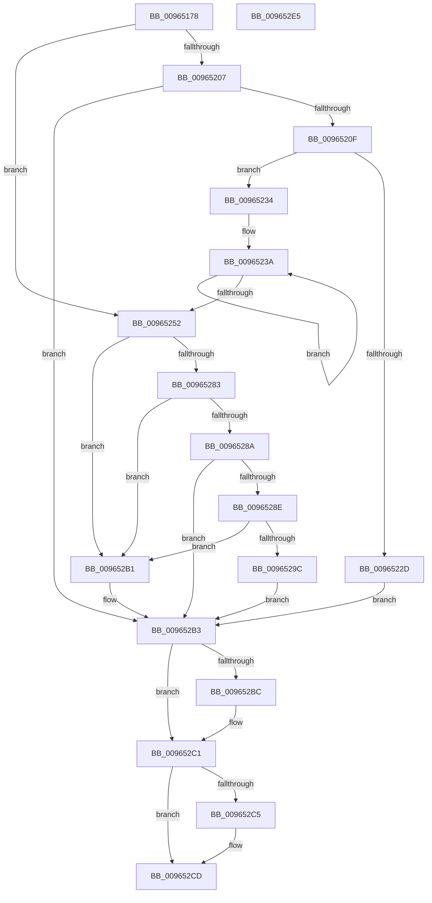

# PiDevCfgInitResolveContext

- RVA: `0x00965178`–`0x009652E6` (길이 `366` bytes)
- VA: `0x0000000140965178`
- 실행 섹션: `PAGE`
- PDB 이름 있음: `예`; PDB Function 태그: `아니요`
- unwind 정보 RVA: `0x00093744`
- 디코드: `96`개 명령, `366/366` bytes 표시
- 미해석 바이트: `0` (있으면 어셈블리에 `.byte`로 보존)

> 이 문서는 커널 이미지의 기계어와 PDB 기호를 분석해 생성했습니다. 4번과 5번은 함수 원형과 자료형을 바이너리 사용 방식에서 추정한 C 해석이며 원본 소스 복구 결과는 아닙니다.

## 1. Dependencies

- 직접 호출 지점: **7**; 고유 호출 대상: **7**
- 직접 호출자로 확인된 함수: **2**
- RIP 상대 이미지 참조: **3**

### Outgoing calls
- `0x009651F9` → [ZwOpenKey](../../text/6A/ZwOpenKey_function_006AD310.md) (function, `0x006AD310`)
- `0x0096521F` → [ExAllocatePool2](../../poolcode/B8/ExAllocatePool2_function_00B820F0.md) (function, `0x00B820F0`)
- `0x00965275` → [IopOpenRegistryKeyEx](../A5/IopOpenRegistryKeyEx_function_00A51B44.md) (function, `0x00A51B44`)
- `0x00965291` → [PiDrvDbResolveKeyFilePaths](../74/PiDrvDbResolveKeyFilePaths_function_0074326C.md) (function, `0x0074326C`)
- `0x009652AA` → [PnpCtxRegDeleteTree](PnpCtxRegDeleteTree_function_00965CC8.md) (function, `0x00965CC8`)
- `0x009652BC` → [ZwClose](../../text/6A/ZwClose_function_006AD2B0.md) (function, `0x006AD2B0`)
- `0x009652C8` → [PiDevCfgFreeResolveContext](PiDevCfgFreeResolveContext_function_00964E00.md) (function, `0x00964E00`)

### Direct callers
- [PiDevCfgConfigureDeviceKeys](PiDevCfgConfigureDeviceKeys_function_00964BA8.md) at `0x00964C10`
- [PiDevCfgVerifyDeviceAllowed](PiDevCfgVerifyDeviceAllowed_function_009664E4.md) at `0x00966574`

### Static image references
- `0x00965194` → RVA `0x00AFF150` (` ?? ::NNGAKEGL::`string'`; read)
- `0x00965252` → RVA `0x00AFF170` (` ?? ::NNGAKEGL::`string'`; read)
- `0x009652A3` → RVA `0x00E66398` (`.data`; read)

## 2. Other-region calls and transfers

- 다른 실행 섹션으로 향하는 call: **3**
  - `0x009651F9` → [ZwOpenKey](../../text/6A/ZwOpenKey_function_006AD310.md) (`PAGE` → `.text`)
  - `0x0096521F` → [ExAllocatePool2](../../poolcode/B8/ExAllocatePool2_function_00B820F0.md) (`PAGE` → `POOLCODE`)
  - `0x009652BC` → [ZwClose](../../text/6A/ZwClose_function_006AD2B0.md) (`PAGE` → `.text`)
- 별도 외부 분기/꼬리 이동을 확인하지 못했습니다.

## 3. Assembly (complete function range)

```asm
00965178  48 89 5C 24 10                  mov qword ptr [rsp + 0x10], rbx
0096517D  48 89 74 24 18                  mov qword ptr [rsp + 0x18], rsi
00965182  48 89 7C 24 20                  mov qword ptr [rsp + 0x20], rdi
00965187  55                              push rbp
00965188  48 8B EC                        mov rbp, rsp
0096518B  48 83 EC 60                     sub rsp, 0x60
0096518F  48 83 65 10 00                  and qword ptr [rbp + 0x10], 0
00965194  48 8D 05 B5 9F 19 00            lea rax, [rip + 0x199fb5]
0096519B  83 65 C4 00                     and dword ptr [rbp - 0x3c], 0
0096519F  49 8B F8                        mov rdi, r8
009651A2  49 83 60 08 00                  and qword ptr [r8 + 8], 0
009651A7  48 8B F2                        mov rsi, rdx
009651AA  49 83 60 18 00                  and qword ptr [r8 + 0x18], 0
009651AF  0F 57 C0                        xorps xmm0, xmm0
009651B2  83 65 EC 00                     and dword ptr [rbp - 0x14], 0
009651B6  49 89 08                        mov qword ptr [r8], rcx
009651B9  49 8D 48 10                     lea rcx, [r8 + 0x10]
009651BD  48 83 21 00                     and qword ptr [rcx], 0
009651C1  4C 8D 45 D0                     lea r8, [rbp - 0x30]
009651C5  48 89 45 C8                     mov qword ptr [rbp - 0x38], rax
009651C9  48 8D 45 C0                     lea rax, [rbp - 0x40]
009651CD  48 89 55 D8                     mov qword ptr [rbp - 0x28], rdx
009651D1  BA 19 00 02 00                  mov edx, 0x20019
009651D6  48 C7 45 D0 30 00 00 00         mov qword ptr [rbp - 0x30], 0x30
009651DE  83 65 D4 00                     and dword ptr [rbp - 0x2c], 0
009651E2  48 89 45 E0                     mov qword ptr [rbp - 0x20], rax
009651E6  C7 45 C0 12 00 14 00            mov dword ptr [rbp - 0x40], 0x140012
009651ED  C7 45 E8 40 02 00 00            mov dword ptr [rbp - 0x18], 0x240
009651F4  F3 0F 7F 45 F0                  movdqu xmmword ptr [rbp - 0x10], xmm0
009651F9  E8 12 81 D4 FF                  call 0x1406ad310
009651FE  8B D8                           mov ebx, eax
00965200  3D 34 00 00 C0                  cmp eax, 0xc0000034
00965205  74 4B                           je 0x140965252
00965207  85 C0                           test eax, eax
00965209  0F 88 A4 00 00 00               js 0x1409652b3
0096520F  BA F0 07 00 00                  mov edx, 0x7f0
00965214  B9 00 01 00 00                  mov ecx, 0x100
00965219  41 B8 50 70 64 63               mov r8d, 0x63647050
0096521F  E8 CC CE 21 00                  call 0x140b820f0
00965224  48 89 47 18                     mov qword ptr [rdi + 0x18], rax
00965228  48 85 C0                        test rax, rax
0096522B  75 07                           jne 0x140965234
0096522D  BB 9A 00 00 C0                  mov ebx, 0xc000009a
00965232  EB 7F                           jmp 0x1409652b3
00965234  33 D2                           xor edx, edx
00965236  44 8D 42 7F                     lea r8d, [rdx + 0x7f]
0096523A  48 8B 4F 18                     mov rcx, qword ptr [rdi + 0x18]
0096523E  48 03 CA                        add rcx, rdx
00965241  48 83 C2 10                     add rdx, 0x10
00965245  48 89 49 08                     mov qword ptr [rcx + 8], rcx
00965249  48 89 09                        mov qword ptr [rcx], rcx
0096524C  49 83 E8 01                     sub r8, 1
00965250  75 E8                           jne 0x14096523a
00965252  48 8D 05 17 9F 19 00            lea rax, [rip + 0x199f17]
00965259  C7 45 C0 2C 00 2E 00            mov dword ptr [rbp - 0x40], 0x2e002c
00965260  41 B9 19 00 02 00               mov r9d, 0x20019
00965266  48 89 45 C8                     mov qword ptr [rbp - 0x38], rax
0096526A  4C 8D 45 C0                     lea r8, [rbp - 0x40]
0096526E  48 8B D6                        mov rdx, rsi
00965271  48 8D 4D 10                     lea rcx, [rbp + 0x10]
00965275  E8 CA C8 0E 00                  call 0x140a51b44
0096527A  8B D8                           mov ebx, eax
0096527C  3D 34 00 00 C0                  cmp eax, 0xc0000034
00965281  74 2E                           je 0x1409652b1
00965283  3D 7C 01 00 C0                  cmp eax, 0xc000017c
00965288  74 27                           je 0x1409652b1
0096528A  85 C0                           test eax, eax
0096528C  78 25                           js 0x1409652b3
0096528E  48 8B CE                        mov rcx, rsi
00965291  E8 D6 DF DD FF                  call 0x14074326c
00965296  8B D8                           mov ebx, eax
00965298  85 C0                           test eax, eax
0096529A  78 15                           js 0x1409652b1
0096529C  48 8B 55 10                     mov rdx, qword ptr [rbp + 0x10]
009652A0  45 33 C0                        xor r8d, r8d
009652A3  48 8B 0D EE 10 50 00            mov rcx, qword ptr [rip + 0x5010ee]
009652AA  E8 19 0A 00 00                  call 0x140965cc8
009652AF  EB 02                           jmp 0x1409652b3
009652B1  33 DB                           xor ebx, ebx
009652B3  48 8B 4D 10                     mov rcx, qword ptr [rbp + 0x10]
009652B7  48 85 C9                        test rcx, rcx
009652BA  74 05                           je 0x1409652c1
009652BC  E8 EF 7F D4 FF                  call 0x1406ad2b0
009652C1  85 DB                           test ebx, ebx
009652C3  79 08                           jns 0x1409652cd
009652C5  48 8B CF                        mov rcx, rdi
009652C8  E8 33 FB FF FF                  call 0x140964e00
009652CD  4C 8D 5C 24 60                  lea r11, [rsp + 0x60]
009652D2  8B C3                           mov eax, ebx
009652D4  49 8B 5B 18                     mov rbx, qword ptr [r11 + 0x18]
009652D8  49 8B 73 20                     mov rsi, qword ptr [r11 + 0x20]
009652DC  49 8B 7B 28                     mov rdi, qword ptr [r11 + 0x28]
009652E0  49 8B E3                        mov rsp, r11
009652E3  5D                              pop rbp
009652E4  C3                              ret
009652E5  CC                              int3
```

## 4. C-style interpretation (structured pseudocode)

```c
__int64 __fastcall PiDevCfgInitResolveContext(__int64 a1, __int64 a2, __int64 a3)
{
    __int64 result;
    __int64 v_rbx;
    __int64 v_rsp;
    unsigned __int64 v_stack_m18;
    unsigned int v_stack_m1C;
    unsigned int v_stack_m20;
    unsigned __int64 v_stack_m28;
    unsigned __int64 v_stack_m30;
    unsigned int v_stack_m34;
    unsigned __int64 v_stack_m38;
    unsigned __int64 v_stack_m40;
    unsigned int v_stack_m44;
    unsigned __int64 v_stack_m48;
    unsigned __int64 v_stack_m8;
    unsigned __int64 v_stack_p10;
    unsigned __int64 v_stack_p18;
    unsigned __int64 v_stack_p20;
    unsigned __int64 v_stack_p8;

    v_stack_p10 = v_rbx;
    v_stack_p18 = v_rsi;
    v_stack_p20 = v_rdi;
    v_rsp = (v_rsp) - (96);
    *(unsigned __int64 *)(a3) = a1;
    v_stack_m40 = v_rip + 1679285;
    v_stack_m30 = a2;
    v_stack_m38 = 48;
    v_stack_m28 = v_stack_m48;
    v_stack_m48 = 0x140012ULL;
    v_stack_m20 = 576;
    v_stack_m18 = v_xmm0;
    result = ZwOpenKey(a3 + 16, (unsigned int)(0x20019ULL), v_stack_m38, a4);
    if (((unsigned int)(result)) == 0xC0000034ULL) goto loc_00965252;
    if (sign_flag) goto loc_009652B3;
    result = ExAllocatePool2(256, (unsigned int)(0x7F0ULL), (unsigned int)(0x63647050ULL), a4);
    *(unsigned __int64 *)(a3 + 24) = result;
    if (result != 0) goto loc_00965234;
    goto loc_009652B3;
loc_00965234:
    a2 = 0;
loc_0096523A:
    a1 = (*(unsigned __int64 *)(a3 + 24)) + (0);
    a2 = (a2) + (16);
    *(unsigned __int64 *)(a1 + 8) = a1;
    *(unsigned __int64 *)(a1) = a1;
    a3 = (a2 + 127) - (1);
    if (condition_is_not_equal) goto loc_0096523A;
loc_00965252:
    v_stack_m48 = 0x2E002CULL;
    v_stack_m40 = v_rip + 1679127;
    result = IopOpenRegistryKeyEx(v_stack_p8, a2, v_stack_m48, (unsigned int)(0x20019ULL));
    if (((unsigned int)(result)) == 0xC0000034ULL) goto loc_009652B1;
    if (((unsigned int)(result)) == 0xC000017CULL) goto loc_009652B1;
    if (sign_flag) goto loc_009652B3;
    result = PiDrvDbResolveKeyFilePaths(a2, a2, v_stack_m48, (unsigned int)(0x20019ULL));
    if (sign_flag) goto loc_009652B1;
    a3 = 0;
    result = PnpCtxRegDeleteTree(*(unsigned __int64 *)(v_rip + 5247214), v_stack_p8, a3, (unsigned int)(0x20019ULL));
    goto loc_009652B3;
loc_009652B1:
    v_rbx = 0;
loc_009652B3:
    if (v_stack_p8 != 0) {
        result = ZwClose(v_stack_p8, v_stack_p8, a3, (unsigned int)(0x20019ULL));
    }
    if (sign_flag) {
        a1 = 0;
        result = PiDevCfgFreeResolveContext(a1, v_stack_p8, a3, (unsigned int)(0x20019ULL));
    }
    return 0;
}
```

## 5. (Beta) C Style

```c
int64_t PiDevCfgInitResolveContext(int64_t Arg1, int64_t Arg2, void *Arg3)
{
    uint8_t *arg3 = (uint8_t *)Arg3;

    int64_t result;
    int64_t local_rbx;
    int64_t local_rsp;
    uint64_t v_stack_m18;
    uint32_t v_stack_m1C;
    uint32_t v_stack_m20;
    uint64_t v_stack_m28;
    uint64_t v_stack_m30;
    uint32_t v_stack_m34;
    uint64_t v_stack_m38;
    uint64_t v_stack_m40;
    uint32_t v_stack_m44;
    uint64_t v_stack_m48;
    uint64_t v_stack_m8;
    uint64_t v_stack_p10;
    uint64_t v_stack_p18;
    uint64_t v_stack_p20;
    uint64_t v_stack_p8;

    v_stack_p10 = local_rbx;
    v_stack_p18 = local_rsi;
    v_stack_p20 = local_rdi;
    local_rsp = (local_rsp) - (96);
    *(uint64_t *)(arg3) = Arg1;
    v_stack_m40 = v_rip + 1679285;
    v_stack_m30 = Arg2;
    v_stack_m38 = 48;
    v_stack_m28 = v_stack_m48;
    v_stack_m48 = 0x140012ULL;
    v_stack_m20 = 576;
    v_stack_m18 = v_xmm0;
    result = ZwOpenKey(Arg3 + 16, (uint32_t)(0x20019ULL), v_stack_m38, a4);
    if (((uint32_t)(result)) == 0xC0000034ULL) goto loc_00965252;
    if (sign_flag) goto loc_009652B3;
    result = ExAllocatePool2(256, (uint32_t)(0x7F0ULL), (uint32_t)(0x63647050ULL), a4);
    *(uint64_t *)(arg3 + 0x18) = result;
    if (result != 0) goto loc_00965234;
    goto loc_009652B3;
loc_00965234:
    Arg2 = 0;
loc_0096523A:
    Arg1 = (*(uint64_t *)(arg3 + 0x18)) + (0);
    Arg2 = (Arg2) + (16);
    *(uint64_t *)(Arg1 + 0x8) = Arg1;
    *(uint64_t *)(Arg1) = Arg1;
    Arg3 = (Arg2 + 127) - (1);
    if (condition_is_not_equal) goto loc_0096523A;
loc_00965252:
    v_stack_m48 = 0x2E002CULL;
    v_stack_m40 = v_rip + 1679127;
    result = IopOpenRegistryKeyEx(v_stack_p8, Arg2, v_stack_m48, (uint32_t)(0x20019ULL));
    if (((uint32_t)(result)) == 0xC0000034ULL) goto loc_009652B1;
    if (((uint32_t)(result)) == 0xC000017CULL) goto loc_009652B1;
    if (sign_flag) goto loc_009652B3;
    result = PiDrvDbResolveKeyFilePaths(Arg2, Arg2, v_stack_m48, (uint32_t)(0x20019ULL));
    if (sign_flag) goto loc_009652B1;
    Arg3 = 0;
    result = PnpCtxRegDeleteTree(*(uint64_t *)(v_rip + 0x5010EE), v_stack_p8, Arg3, (uint32_t)(0x20019ULL));
    goto loc_009652B3;
loc_009652B1:
    local_rbx = 0;
loc_009652B3:
    if (v_stack_p8 != 0) {
        result = ZwClose(v_stack_p8, v_stack_p8, Arg3, (uint32_t)(0x20019ULL));
    }
    if (sign_flag) {
        Arg1 = 0;
        result = PiDevCfgFreeResolveContext(Arg1, v_stack_p8, Arg3, (uint32_t)(0x20019ULL));
    }
    return 0;
}
```

### 관측된 메모리 오프셋

구조체 형식이 확인되지 않은 접근은 인자 기준의 오프셋으로만 기록했습니다.

| 기준 인자 | 오프셋 표현 | 폭 (bit) | 접근 |
|---|---:|---:|---|
| `Arg3` | `+ 0x0` | `64` | `R/W` |
| `Arg3` | `+ 0x0` | `64` | `W` |
| `Arg3` | `+ 0x8` | `64` | `R/W` |
| `Arg3` | `+ 0x10` | `64` | `R` |
| `Arg3` | `+ 0x18` | `64` | `R` |
| `Arg3` | `+ 0x18` | `64` | `R/W` |
| `Arg3` | `+ 0x18` | `64` | `W` |

## 6. Execution-region graph

[열기: 2D/3D 그래프와 함수 탐색 컨트롤 패널](../../../control-panel.html?section=page&rva=0x00965178&view=graph)

- 2D 그래프는 위에서 아래로 흐르고, 3D 그래프는 빈 공간을 드래그해 회전합니다. Shift+드래그는 이동, 휠은 확대·축소, 함수 노드 선택은 대상 보고서 이동입니다.

### Static fallback


