# PiDevCfgMigrateDevice

- RVA: `0x00963E60`–`0x009642D9` (길이 `1,145` bytes)
- VA: `0x0000000140963E60`
- 실행 섹션: `PAGE`
- PDB 이름 있음: `예`; PDB Function 태그: `예`
- unwind 정보 RVA: `0x000935F4`
- 디코드: `271`개 명령, `1,145/1,145` bytes 표시
- 미해석 바이트: `0` (있으면 어셈블리에 `.byte`로 보존)

> 이 문서는 커널 이미지의 기계어와 PDB 기호를 분석해 생성했습니다. 4번과 5번은 함수 원형과 자료형을 바이너리 사용 방식에서 추정한 C 해석이며 원본 소스 복구 결과는 아닙니다.

## 1. Dependencies

- 직접 호출 지점: **18**; 고유 호출 대상: **16**
- 직접 호출자로 확인된 함수: **3**
- RIP 상대 이미지 참조: **5**

### Outgoing calls
- `0x00963EDE` → [PiDevCfgInitMigrationContext](PiDevCfgInitMigrationContext_function_009642E0.md) (function, `0x009642E0`)
- `0x00963F41` → [PnpGetObjectProperty](../8E/PnpGetObjectProperty_function_008E2180.md) (function, `0x008E2180`)
- `0x00963F68` → [CmIsRootEnumeratedDevice](../8F/CmIsRootEnumeratedDevice_function_008F6E08.md) (function, `0x008F6E08`)
- `0x00963FBA` → [IopGetRegistryValue](../99/IopGetRegistryValue_function_009990EC.md) (function, `0x009990EC`)
- `0x00964011` → [PnpGetObjectProperty](../8E/PnpGetObjectProperty_function_008E2180.md) (function, `0x008E2180`)
- `0x0096404B` → [PiDevCfgSetDeviceRegProp](PiDevCfgSetDeviceRegProp_function_009635C0.md) (function, `0x009635C0`)
- `0x00964076` → [PiDevCfgConfigureDeviceDriverConfiguration](PiDevCfgConfigureDeviceDriverConfiguration_function_00964514.md) (function, `0x00964514`)
- `0x0096408F` → [PiDevCfgLogDeviceMigrated](../70/PiDevCfgLogDeviceMigrated_function_00701EC0.md) (function, `0x00701EC0`)
- `0x009640B4` → [wcsicmp](../../text/50/wcsicmp_function_00500080.md) (function, `0x00500080`)
- `0x009640D2` → [PiDevCfgFreeMigrationContext](PiDevCfgFreeMigrationContext_function_009644B0.md) (function, `0x009644B0`)
- `0x0096414A` → [PiPnpRtlSetObjectProperty](../8F/PiPnpRtlSetObjectProperty_function_008F62A0.md) (function, `0x008F62A0`)
- `0x00964195` → [PiDevCfgQueryDeviceMigrationNode](../9B/PiDevCfgQueryDeviceMigrationNode_function_009BD328.md) (function, `0x009BD328`)
- `0x009641E7` → [PnpCtxRegOpenKey](../8E/PnpCtxRegOpenKey_function_008EF7B8.md) (function, `0x008EF7B8`)
- `0x00964222` → [PiDevCfgFindDeviceMigrationNode](../73/PiDevCfgFindDeviceMigrationNode_function_00732920.md) (function, `0x00732920`)
- `0x00964254` → [PiDevCfgClearDeviceMigrationNode](PiDevCfgClearDeviceMigrationNode_function_00965780.md) (function, `0x00965780`)
- `0x00964276` → [PnpValidateRegistryDword](../../text/4D/PnpValidateRegistryDword_function_004D109C.md) (function, `0x004D109C`)
- `0x009642C1` → [PiDevCfgClearDeviceMigrationNode](PiDevCfgClearDeviceMigrationNode_function_00965780.md) (function, `0x00965780`)
- `0x009642CF` → [PiDevCfgFreeDeviceMigrationNode](../9B/PiDevCfgFreeDeviceMigrationNode_function_009BCD54.md) (function, `0x009BCD54`)

### Direct callers
- [PiDevCfgMigrateRootDevice](../73/PiDevCfgMigrateRootDevice_function_00733DF0.md) at `0x00733EAB`
- [PpDevCfgProcessDeviceReset](PpDevCfgProcessDeviceReset_function_00965498.md) at `0x00965628`
- [PiDevCfgConfigureDevice](../97/PiDevCfgConfigureDevice_function_00977BB4.md) at `0x009789A8`

### Static image references
- `0x00963F02` → RVA `0x00E66398` (`.data`; read)
- `0x00963F2C` → RVA `0x000129F0` (`.rdata`; read)
- `0x00963FB0` → RVA `0x00AFEE50` (` ?? ::NNGAKEGL::`string'`; read)
- `0x00963FFD` → RVA `0x00011688` (`.rdata`; read)
- `0x009641D3` → RVA `0x00AFF270` (` ?? ::NNGAKEGL::`string'`; read)

## 2. Other-region calls and transfers

- 다른 실행 섹션으로 향하는 call: **2**
  - `0x009640B4` → [wcsicmp](../../text/50/wcsicmp_function_00500080.md) (`PAGE` → `.text`)
  - `0x00964276` → [PnpValidateRegistryDword](../../text/4D/PnpValidateRegistryDword_function_004D109C.md) (`PAGE` → `.text`)
- call이 아닌 외부 분기/꼬리 이동: **7**
  - `0x009641A1` → [sub_00B2819A](../B2/Unknown_function_00B2819A.md) (`tail-transfer`)
  - `0x009641BE` → [sub_00B2819A + 0x2C](../B2/Unknown_function_00B2819A.md) (`tail-transfer`)
  - `0x009641F4` → [sub_00B2819A + 0x17](../B2/Unknown_function_00B2819A.md) (`tail-transfer`)
  - `0x0096427D` → [sub_00B2819A + 0xE9](../B2/Unknown_function_00B2819A.md) (`tail-transfer`)
  - `0x0096428A` → [sub_00B2819A + 0xE9](../B2/Unknown_function_00B2819A.md) (`tail-transfer`)
  - `0x009642AB` → [sub_00B2819A + 0xF6](../B2/Unknown_function_00B2819A.md) (`tail-transfer`)
  - `0x009642B4` → [sub_00B2819A + 0xF6](../B2/Unknown_function_00B2819A.md) (`tail-transfer`)

## 3. Assembly (complete function range)

```asm
00963E60  48 8B C4                        mov rax, rsp
00963E63  48 89 58 10                     mov qword ptr [rax + 0x10], rbx
00963E67  48 89 70 18                     mov qword ptr [rax + 0x18], rsi
00963E6B  48 89 78 20                     mov qword ptr [rax + 0x20], rdi
00963E6F  48 89 48 08                     mov qword ptr [rax + 8], rcx
00963E73  55                              push rbp
00963E74  41 54                           push r12
00963E76  41 55                           push r13
00963E78  41 56                           push r14
00963E7A  41 57                           push r15
00963E7C  48 8D 68 B1                     lea rbp, [rax - 0x4f]
00963E80  48 81 EC C0 00 00 00            sub rsp, 0xc0
00963E87  4C 8B 75 77                     mov r14, qword ptr [rbp + 0x77]
00963E8B  33 C0                           xor eax, eax
00963E8D  48 89 45 17                     mov qword ptr [rbp + 0x17], rax
00963E91  0F 57 C0                        xorps xmm0, xmm0
00963E94  48 89 45 C7                     mov qword ptr [rbp - 0x39], rax
00963E98  4D 8B F8                        mov r15, r8
00963E9B  48 89 45 D7                     mov qword ptr [rbp - 0x29], rax
00963E9F  48 8B FA                        mov rdi, rdx
00963EA2  48 89 45 DF                     mov qword ptr [rbp - 0x21], rax
00963EA6  48 8B F1                        mov rsi, rcx
00963EA9  89 45 D3                        mov dword ptr [rbp - 0x2d], eax
00963EAC  44 8B E8                        mov r13d, eax
00963EAF  89 45 CF                        mov dword ptr [rbp - 0x31], eax
00963EB2  0F 11 45 E7                     movups xmmword ptr [rbp - 0x19], xmm0
00963EB6  0F 11 45 F7                     movups xmmword ptr [rbp - 9], xmm0
00963EBA  0F 11 45 07                     movups xmmword ptr [rbp + 7], xmm0
00963EBE  4D 85 F6                        test r14, r14
00963EC1  0F 85 8D 02 00 00               jne 0x140964154
00963EC7  4C 8B 65 7F                     mov r12, qword ptr [rbp + 0x7f]
00963ECB  4D 85 E4                        test r12, r12
00963ECE  0F 85 88 02 00 00               jne 0x14096415c
00963ED4  4C 8D 45 E7                     lea r8, [rbp - 0x19]
00963ED8  49 8B D1                        mov rdx, r9
00963EDB  49 8B CF                        mov rcx, r15
00963EDE  E8 FD 03 00 00                  call 0x1409642e0
00963EE3  45 33 C9                        xor r9d, r9d
00963EE6  8B D8                           mov ebx, eax
00963EE8  85 C0                           test eax, eax
00963EEA  0F 88 D1 01 00 00               js 0x1409640c1
00963EF0  4C 39 4D E7                     cmp qword ptr [rbp - 0x19], r9
00963EF4  0F 84 6B 02 00 00               je 0x140964165
00963EFA  48 8B 57 08                     mov rdx, qword ptr [rdi + 8]
00963EFE  48 8D 45 CF                     lea rax, [rbp - 0x31]
00963F02  48 8B 0D 8F 24 50 00            mov rcx, qword ptr [rip + 0x50248f]
00963F09  41 B8 01 00 00 00               mov r8d, 1
00963F0F  44 89 4C 24 50                  mov dword ptr [rsp + 0x50], r9d
00963F14  48 89 44 24 48                  mov qword ptr [rsp + 0x48], rax
00963F19  48 8D 45 D3                     lea rax, [rbp - 0x2d]
00963F1D  44 89 4C 24 40                  mov dword ptr [rsp + 0x40], r9d
00963F22  4C 89 4C 24 38                  mov qword ptr [rsp + 0x38], r9
00963F27  48 89 44 24 30                  mov qword ptr [rsp + 0x30], rax
00963F2C  48 8D 05 BD EA 6A FF            lea rax, [rip - 0x951543]
00963F33  48 89 44 24 28                  mov qword ptr [rsp + 0x28], rax
00963F38  4C 89 4C 24 20                  mov qword ptr [rsp + 0x20], r9
00963F3D  4C 8B 4F 10                     mov r9, qword ptr [rdi + 0x10]
00963F41  E8 3A E2 F7 FF                  call 0x1408e2180
00963F46  3D 23 00 00 C0                  cmp eax, 0xc0000023
00963F4B  0F 84 1C 02 00 00               je 0x14096416d
00963F51  45 33 C9                        xor r9d, r9d
00963F54  4C 39 4D EF                     cmp qword ptr [rbp - 0x11], r9
00963F58  0F 85 2B 02 00 00               jne 0x140964189
00963F5E  4C 39 4D C7                     cmp qword ptr [rbp - 0x39], r9
00963F62  75 28                           jne 0x140963f8c
00963F64  48 8B 4F 08                     mov rcx, qword ptr [rdi + 8]
00963F68  E8 9B 2E F9 FF                  call 0x1408f6e08
00963F6D  45 33 C9                        xor r9d, r9d
00963F70  84 C0                           test al, al
00963F72  0F 85 CA 02 00 00               jne 0x140964242
00963F78  4C 39 4F 50                     cmp qword ptr [rdi + 0x50], r9
00963F7C  0F 85 35 02 00 00               jne 0x1409641b7
00963F82  4C 39 4D C7                     cmp qword ptr [rbp - 0x39], r9
00963F86  0F 84 77 02 00 00               je 0x140964203
00963F8C  48 8B 45 C7                     mov rax, qword ptr [rbp - 0x39]
00963F90  8B 48 10                        mov ecx, dword ptr [rax + 0x10]
00963F93  F6 C1 01                        test cl, 1
00963F96  0F 85 C2 02 00 00               jne 0x14096425e
00963F9C  F6 C1 02                        test cl, 2
00963F9F  0F 85 C3 02 00 00               jne 0x140964268
00963FA5  48 8B C8                        mov rcx, rax
00963FA8  4C 8D 4D DF                     lea r9, [rbp - 0x21]
00963FAC  48 8B 48 28                     mov rcx, qword ptr [rax + 0x28]
00963FB0  48 8D 15 99 AE 19 00            lea rdx, [rip + 0x19ae99]
00963FB7  45 33 C0                        xor r8d, r8d
00963FBA  E8 2D 51 03 00                  call 0x1409990ec
00963FBF  33 DB                           xor ebx, ebx
00963FC1  85 C0                           test eax, eax
00963FC3  0F 89 A9 02 00 00               jns 0x140964272
00963FC9  4C 8B 4F 10                     mov r9, qword ptr [rdi + 0x10]
00963FCD  48 8D 45 CF                     lea rax, [rbp - 0x31]
00963FD1  48 8B 57 08                     mov rdx, qword ptr [rdi + 8]
00963FD5  41 B8 01 00 00 00               mov r8d, 1
00963FDB  48 8B 0D B6 23 50 00            mov rcx, qword ptr [rip + 0x5023b6]
00963FE2  89 5C 24 50                     mov dword ptr [rsp + 0x50], ebx
00963FE6  48 89 44 24 48                  mov qword ptr [rsp + 0x48], rax
00963FEB  48 8D 45 D3                     lea rax, [rbp - 0x2d]
00963FEF  89 5C 24 40                     mov dword ptr [rsp + 0x40], ebx
00963FF3  48 89 5C 24 38                  mov qword ptr [rsp + 0x38], rbx
00963FF8  48 89 44 24 30                  mov qword ptr [rsp + 0x30], rax
00963FFD  48 8D 05 84 D6 6A FF            lea rax, [rip - 0x95297c]
00964004  48 89 44 24 28                  mov qword ptr [rsp + 0x28], rax
00964009  48 89 5C 24 20                  mov qword ptr [rsp + 0x20], rbx
0096400E  89 5D CF                        mov dword ptr [rbp - 0x31], ebx
00964011  E8 6A E1 F7 FF                  call 0x1408e2180
00964016  3D 23 00 00 C0                  cmp eax, 0xc0000023
0096401B  0F 84 6E 02 00 00               je 0x14096428f
00964021  4D 85 FF                        test r15, r15
00964024  0F 84 D1 00 00 00               je 0x1409640fb
0096402A  41 0F B7 07                     movzx eax, word ptr [r15]
0096402E  41 B9 01 00 00 00               mov r9d, 1
00964034  83 C0 02                        add eax, 2
00964037  48 8B D7                        mov rdx, rdi
0096403A  89 44 24 28                     mov dword ptr [rsp + 0x28], eax
0096403E  49 8B 47 08                     mov rax, qword ptr [r15 + 8]
00964042  45 8D 41 08                     lea r8d, [r9 + 8]
00964046  48 89 44 24 20                  mov qword ptr [rsp + 0x20], rax
0096404B  E8 70 F5 FF FF                  call 0x1409635c0
00964050  4C 8B 45 C7                     mov r8, qword ptr [rbp - 0x39]
00964054  41 83 C9 FF                     or r9d, 0xffffffff
00964058  4C 89 64 24 38                  mov qword ptr [rsp + 0x38], r12
0096405D  48 8B D7                        mov rdx, rdi
00964060  4C 89 74 24 30                  mov qword ptr [rsp + 0x30], r14
00964065  48 8B CE                        mov rcx, rsi
00964068  48 89 5C 24 28                  mov qword ptr [rsp + 0x28], rbx
0096406D  4D 8B 40 28                     mov r8, qword ptr [r8 + 0x28]
00964071  48 89 5C 24 20                  mov qword ptr [rsp + 0x20], rbx
00964076  E8 99 04 00 00                  call 0x140964514
0096407B  8B D8                           mov ebx, eax
0096407D  85 C0                           test eax, eax
0096407F  0F 89 23 02 00 00               jns 0x1409642a8
00964085  48 8B 55 C7                     mov rdx, qword ptr [rbp - 0x39]
00964089  44 8B C3                        mov r8d, ebx
0096408C  48 8B CF                        mov rcx, rdi
0096408F  E8 2C DE D9 FF                  call 0x140701ec0
00964094  48 8B 55 C7                     mov rdx, qword ptr [rbp - 0x39]
00964098  8B 42 10                        mov eax, dword ptr [rdx + 0x10]
0096409B  A8 01                           test al, 1
0096409D  0F 84 16 02 00 00               je 0x1409642b9
009640A3  48 85 D2                        test rdx, rdx
009640A6  0F 84 A0 01 00 00               je 0x14096424c
009640AC  48 8B 52 20                     mov rdx, qword ptr [rdx + 0x20]
009640B0  48 8B 4F 08                     mov rcx, qword ptr [rdi + 8]
009640B4  E8 C7 BF B9 FF                  call 0x140500080
009640B9  85 C0                           test eax, eax
009640BB  0F 85 8B 01 00 00               jne 0x14096424c
009640C1  48 8B 4D C7                     mov rcx, qword ptr [rbp - 0x39]
009640C5  48 85 C9                        test rcx, rcx
009640C8  0F 85 01 02 00 00               jne 0x1409642cf
009640CE  48 8D 4D E7                     lea rcx, [rbp - 0x19]
009640D2  E8 D9 03 00 00                  call 0x1409644b0
009640D7  4C 8D 9C 24 C0 00 00 00         lea r11, [rsp + 0xc0]
009640DF  8B C3                           mov eax, ebx
009640E1  49 8B 5B 38                     mov rbx, qword ptr [r11 + 0x38]
009640E5  49 8B 73 40                     mov rsi, qword ptr [r11 + 0x40]
009640E9  49 8B 7B 48                     mov rdi, qword ptr [r11 + 0x48]
009640ED  49 8B E3                        mov rsp, r11
009640F0  41 5F                           pop r15
009640F2  41 5E                           pop r14
009640F4  41 5D                           pop r13
009640F6  41 5C                           pop r12
009640F8  5D                              pop rbp
009640F9  C3                              ret
009640FA  CC                              int3
009640FB  8B 07                           mov eax, dword ptr [rdi]
009640FD  4C 8B 45 C7                     mov r8, qword ptr [rbp - 0x39]
00964101  83 E0 01                        and eax, 1
00964104  4C 8B 4F 10                     mov r9, qword ptr [rdi + 0x10]
00964108  49 83 C0 50                     add r8, 0x50
0096410C  48 8B 57 08                     mov rdx, qword ptr [rdi + 8]
00964110  48 8B 0D 81 22 50 00            mov rcx, qword ptr [rip + 0x502281]
00964117  C1 E0 11                        shl eax, 0x11
0096411A  89 44 24 48                     mov dword ptr [rsp + 0x48], eax
0096411E  48 8D 05 63 D5 6A FF            lea rax, [rip - 0x952a9d]
00964125  C7 44 24 40 10 00 00 00         mov dword ptr [rsp + 0x40], 0x10
0096412D  4C 89 44 24 38                  mov qword ptr [rsp + 0x38], r8
00964132  41 B8 01 00 00 00               mov r8d, 1
00964138  C7 44 24 30 0D 00 00 00         mov dword ptr [rsp + 0x30], 0xd
00964140  48 89 44 24 28                  mov qword ptr [rsp + 0x28], rax
00964145  48 89 5C 24 20                  mov qword ptr [rsp + 0x20], rbx
0096414A  E8 51 21 F9 FF                  call 0x1408f62a0
0096414F  E9 FC FE FF FF                  jmp 0x140964050
00964154  41 89 06                        mov dword ptr [r14], eax
00964157  E9 6B FD FF FF                  jmp 0x140963ec7
0096415C  41 89 04 24                     mov dword ptr [r12], eax
00964160  E9 6F FD FF FF                  jmp 0x140963ed4
00964165  41 8B D9                        mov ebx, r9d
00964168  E9 54 FF FF FF                  jmp 0x1409640c1
0096416D  83 7D D3 09                     cmp dword ptr [rbp - 0x2d], 9
00964171  0F 85 DA FD FF FF               jne 0x140963f51
00964177  83 7D CF 08                     cmp dword ptr [rbp - 0x31], 8
0096417B  0F 85 D0 FD FF FF               jne 0x140963f51
00964181  45 33 C9                        xor r9d, r9d
00964184  E9 B9 00 00 00                  jmp 0x140964242
00964189  48 8B 57 08                     mov rdx, qword ptr [rdi + 8]
0096418D  4C 8D 45 C7                     lea r8, [rbp - 0x39]
00964191  48 8D 4D E7                     lea rcx, [rbp - 0x19]
00964195  E8 8E 91 05 00                  call 0x1409bd328
0096419A  45 33 C9                        xor r9d, r9d
0096419D  8B D8                           mov ebx, eax
0096419F  85 C0                           test eax, eax
009641A1  0F 88 F3 3F 1C 00               js 0x140b2819a
009641A7  48 8B 45 C7                     mov rax, qword ptr [rbp - 0x39]
009641AB  4C 89 88 B8 00 00 00            mov qword ptr [rax + 0xb8], r9
009641B2  E9 A7 FD FF FF                  jmp 0x140963f5e
009641B7  48 8B 55 07                     mov rdx, qword ptr [rbp + 7]
009641BB  48 85 D2                        test rdx, rdx
009641BE  0F 85 02 40 1C 00               jne 0x140b281c6
009641C4  48 8B 55 E7                     mov rdx, qword ptr [rbp - 0x19]
009641C8  48 8D 45 07                     lea rax, [rbp + 7]
009641CC  48 8B 0D C5 21 50 00            mov rcx, qword ptr [rip + 0x5021c5]
009641D3  4C 8D 05 96 B0 19 00            lea r8, [rip + 0x19b096]
009641DA  48 89 44 24 28                  mov qword ptr [rsp + 0x28], rax
009641DF  C7 44 24 20 19 00 02 00         mov dword ptr [rsp + 0x20], 0x20019
009641E7  E8 CC B5 F8 FF                  call 0x1408ef7b8
009641EC  45 33 C9                        xor r9d, r9d
009641EF  3D 34 00 00 C0                  cmp eax, 0xc0000034
009641F4  0F 85 B7 3F 1C 00               jne 0x140b281b1
009641FA  4C 89 4D 07                     mov qword ptr [rbp + 7], r9
009641FE  E9 7F FD FF FF                  jmp 0x140963f82
00964203  4C 8B 45 FF                     mov r8, qword ptr [rbp - 1]
00964207  4D 85 C0                        test r8, r8
0096420A  74 40                           je 0x14096424c
0096420C  48 8D 45 C7                     lea rax, [rbp - 0x39]
00964210  41 B9 21 10 01 00               mov r9d, 0x11021
00964216  48 8B D7                        mov rdx, rdi
00964219  48 89 44 24 20                  mov qword ptr [rsp + 0x20], rax
0096421E  48 8D 4D E7                     lea rcx, [rbp - 0x19]
00964222  E8 F9 E6 DC FF                  call 0x140732920
00964227  45 33 C9                        xor r9d, r9d
0096422A  8B D8                           mov ebx, eax
0096422C  85 C0                           test eax, eax
0096422E  79 12                           jns 0x140964242
00964230  81 FB 25 02 00 C0               cmp ebx, 0xc0000225
00964236  4C 89 4D C7                     mov qword ptr [rbp - 0x39], r9
0096423A  41 8B C1                        mov eax, r9d
0096423D  0F 45 C3                        cmovne eax, ebx
00964240  8B D8                           mov ebx, eax
00964242  4C 39 4D C7                     cmp qword ptr [rbp - 0x39], r9
00964246  0F 85 40 FD FF FF               jne 0x140963f8c
0096424C  48 8B 57 08                     mov rdx, qword ptr [rdi + 8]
00964250  48 8D 4D E7                     lea rcx, [rbp - 0x19]
00964254  E8 27 15 00 00                  call 0x140965780
00964259  E9 63 FE FF FF                  jmp 0x1409640c1
0096425E  BB 19 07 00 C0                  mov ebx, 0xc0000719
00964263  E9 1D FE FF FF                  jmp 0x140964085
00964268  BB 51 04 00 C0                  mov ebx, 0xc0000451
0096426D  E9 13 FE FF FF                  jmp 0x140964085
00964272  48 8B 4D DF                     mov rcx, qword ptr [rbp - 0x21]
00964276  E8 21 CE B6 FF                  call 0x1404d109c
0096427B  84 C0                           test al, al
0096427D  0F 84 00 40 1C 00               je 0x140b28283
00964283  8B 41 08                        mov eax, dword ptr [rcx + 8]
00964286  44 8B 2C 08                     mov r13d, dword ptr [rax + rcx]
0096428A  E9 F4 3F 1C 00                  jmp 0x140b28283
0096428F  83 7D D3 0D                     cmp dword ptr [rbp - 0x2d], 0xd
00964293  0F 85 88 FD FF FF               jne 0x140964021
00964299  83 7D CF 10                     cmp dword ptr [rbp - 0x31], 0x10
0096429D  0F 84 AD FD FF FF               je 0x140964050
009642A3  E9 79 FD FF FF                  jmp 0x140964021
009642A8  4D 85 F6                        test r14, r14
009642AB  0F 84 DF 3F 1C 00               je 0x140b28290
009642B1  45 09 2E                        or dword ptr [r14], r13d
009642B4  E9 D7 3F 1C 00                  jmp 0x140b28290
009642B9  48 8B 52 20                     mov rdx, qword ptr [rdx + 0x20]
009642BD  48 8D 4D E7                     lea rcx, [rbp - 0x19]
009642C1  E8 BA 14 00 00                  call 0x140965780
009642C6  48 8B 55 C7                     mov rdx, qword ptr [rbp - 0x39]
009642CA  E9 D4 FD FF FF                  jmp 0x1409640a3
009642CF  E8 80 8A 05 00                  call 0x1409bcd54
009642D4  E9 F5 FD FF FF                  jmp 0x1409640ce
```

## 4. C-style interpretation (structured pseudocode)

```c
__int64 __fastcall PiDevCfgMigrateDevice(__int64 a1, __int64 a2, __int64 a3, __int64 a4)
{
    __int64 result;
    __int64 v_rbx;
    __int64 v_rsp;
    unsigned __int64 v_stack_m28;
    unsigned int v_stack_m78;
    unsigned int v_stack_m80;
    unsigned __int64 v_stack_m88;
    unsigned int v_stack_m90;
    unsigned int v_stack_m98;
    unsigned __int64 v_stack_mA0;
    unsigned int v_stack_mA8;
    unsigned __int64 v_stack_mB0;
    unsigned __int64 v_stack_mB8;
    unsigned __int64 v_stack_mC0;
    unsigned __int64 v_stack_mC8;

    *(unsigned __int64 *)(v_rsp + 16) = v_rbx;
    *(unsigned __int64 *)(v_rsp + 24) = v_rsi;
    *(unsigned __int64 *)(v_rsp + 32) = v_rdi;
    *(unsigned __int64 *)(v_rsp + 8) = a1;
    v_rsp = (v_rsp) - (192);
    result = 0;
    *(unsigned __int64 *)(v_rsp - 79 + 23) = 0;
    *(unsigned __int64 *)(v_rsp - 79 - 57) = 0;
    *(unsigned __int64 *)(v_rsp - 79 - 41) = 0;
    *(unsigned __int64 *)(v_rsp - 79 - 33) = 0;
    *(unsigned int *)(v_rsp - 79 - 45) = 0;
    *(unsigned int *)(v_rsp - 79 - 49) = 0;
    *(unsigned __int64 *)(v_rsp - 79 - 25) = v_xmm0;
    *(unsigned __int64 *)(v_rsp - 79 - 9) = v_xmm0;
    *(unsigned __int64 *)(v_rsp - 79 + 7) = v_xmm0;
    if (*(unsigned __int64 *)(v_rsp - 79 + 119) != 0) goto loc_00964154;
loc_00963EC7:
    if (*(unsigned __int64 *)(v_rsp - 79 + 127) != 0) goto loc_0096415C;
loc_00963ED4:
    result = PiDevCfgInitMigrationContext(a3, a4, v_rsp - 79 - 25, a4);
    a4 = 0;
    if (sign_flag) goto loc_009640C1;
    if ((*(unsigned __int64 *)(v_rsp - 79 - 25)) == 0) goto loc_00964165;
    v_stack_m98 = 0;
    v_stack_mA0 = v_rsp - 79 - 49;
    v_stack_mA8 = 0;
    v_stack_mB0 = 0;
    v_stack_mB8 = v_rsp - 79 - 45;
    v_stack_mC0 = v_rip - 9770307;
    v_stack_mC8 = 0;
    result = PnpGetObjectProperty(*(unsigned __int64 *)(v_rip + 5252239), *(unsigned __int64 *)(a2 + 8), 1, *(unsigned __int64 *)(a2 + 16));
    if (((unsigned int)(result)) == 0xC0000023ULL) goto loc_0096416D;
loc_00963F51:
    a4 = 0;
    if ((*(unsigned __int64 *)(v_rsp - 79 - 17)) != 0) goto loc_00964189;
loc_00963F5E:
    if ((*(unsigned __int64 *)(v_rsp - 79 - 57)) != 0) goto loc_00963F8C;
    result = CmIsRootEnumeratedDevice(*(unsigned __int64 *)(a2 + 8), *(unsigned __int64 *)(a2 + 8), 1, a4);
    a4 = 0;
    if ((unsigned __int8)(result) != 0) goto loc_00964242;
    if ((*(unsigned __int64 *)(a2 + 80)) != 0) goto loc_009641B7;
loc_00963F82:
    if ((*(unsigned __int64 *)(v_rsp - 79 - 57)) == 0) goto loc_00964203;
loc_00963F8C:
    if ((((unsigned __int8)((unsigned int)(*(unsigned int *)(*(unsigned __int64 *)(v_rsp - 79 - 57) + 16)))) & (1)) != 0) goto loc_0096425E;
    if ((((unsigned __int8)((unsigned int)(*(unsigned int *)(*(unsigned __int64 *)(v_rsp - 79 - 57) + 16)))) & (2)) != 0) goto loc_00964268;
    a3 = 0;
    result = IopGetRegistryValue(*(unsigned __int64 *)(*(unsigned __int64 *)(v_rsp - 79 - 57) + 40), v_rip + 1683097, a3, v_rsp - 79 - 33);
    v_rbx = 0;
    if (!sign_flag) goto loc_00964272;
    v_stack_m98 = 0;
    v_stack_mA0 = v_rsp - 79 - 49;
    v_stack_mA8 = 0;
    v_stack_mB0 = 0;
    v_stack_mB8 = v_rsp - 79 - 45;
    v_stack_mC0 = v_rip - 9775484;
    v_stack_mC8 = 0;
    *(unsigned int *)(v_rsp - 79 - 49) = 0;
    result = PnpGetObjectProperty(*(unsigned __int64 *)(v_rip + 5252022), *(unsigned __int64 *)(a2 + 8), 1, *(unsigned __int64 *)(a2 + 16));
    if (((unsigned int)(result)) == 0xC0000023ULL) goto loc_0096428F;
loc_00964021:
    if (0 == 0) goto loc_009640FB;
    result = (unsigned int)((*(unsigned __int16 *)(a3)) + (2));
    v_stack_mC0 = (unsigned int)(result);
    v_stack_mC8 = *(unsigned __int64 *)(a3 + 8);
    result = PiDevCfgSetDeviceRegProp(*(unsigned __int64 *)(v_rip + 5252022), a2, 1 + 8, 1);
loc_00964050:
    a4 = (unsigned int)((1) | (0xFFFFFFFFULL));
    v_stack_mB0 = *(unsigned __int64 *)(v_rsp - 79 + 127);
    v_stack_mB8 = *(unsigned __int64 *)(v_rsp - 79 + 119);
    v_stack_mC0 = 0;
    v_stack_mC8 = 0;
    result = PiDevCfgConfigureDeviceDriverConfiguration(a1, a2, *(unsigned __int64 *)(*(unsigned __int64 *)(v_rsp - 79 - 57) + 40), a4);
    if (!sign_flag) goto loc_009642A8;
loc_00964085:
    result = PiDevCfgLogDeviceMigrated(a2, *(unsigned __int64 *)(v_rsp - 79 - 57), (unsigned int)((unsigned int)((unsigned int)((unsigned int)(result)))), a4);
    if ((((unsigned __int8)((unsigned int)(*(unsigned int *)(*(unsigned __int64 *)(v_rsp - 79 - 57) + 16)))) & (1)) == 0) goto loc_009642B9;
loc_009640A3:
    if (*(unsigned __int64 *)(v_rsp - 79 - 57) == 0) goto loc_0096424C;
    result = wcsicmp(*(unsigned __int64 *)(a2 + 8), *(unsigned __int64 *)(*(unsigned __int64 *)(v_rsp - 79 - 57) + 32), (unsigned int)((unsigned int)((unsigned int)((unsigned int)(result)))), a4);
    if ((unsigned int)(result) != 0) goto loc_0096424C;
loc_009640C1:
    if (*(unsigned __int64 *)(v_rsp - 79 - 57) != 0) goto loc_009642CF;
loc_009640CE:
    result = PiDevCfgFreeMigrationContext(v_rsp - 79 - 25, *(unsigned __int64 *)(*(unsigned __int64 *)(v_rsp - 79 - 57) + 32), (unsigned int)((unsigned int)((unsigned int)((unsigned int)(result)))), a4);
    return (unsigned int)((unsigned int)((unsigned int)((unsigned int)(result))));
loc_009640FB:
    result = (unsigned int)(((unsigned int)(*(unsigned int *)(*(unsigned __int64 *)(v_stack_m28 + 72)))) & (1));
    a3 = (*(unsigned __int64 *)(v_rsp - 79 - 57)) + (80);
    result = (unsigned int)((result) << (17));
    v_stack_m78 = (unsigned int)(result);
    v_stack_m80 = 16;
    v_stack_m88 = a3;
    v_stack_m90 = 13;
    v_stack_m98 = v_rip - 9775773;
    v_stack_mA0 = *(unsigned __int64 *)(v_stack_m28 + 56);
    result = PiPnpRtlSetObjectProperty(*(unsigned __int64 *)(v_rip + 5251713), *(unsigned __int64 *)(*(unsigned __int64 *)(v_stack_m28 + 72) + 8), 1, *(unsigned __int64 *)(*(unsigned __int64 *)(v_stack_m28 + 72) + 16));
    goto loc_00964050;
loc_00964154:
    *(unsigned int *)(*(unsigned __int64 *)(v_rsp - 79 + 119)) = (unsigned int)(result);
    goto loc_00963EC7;
loc_0096415C:
    *(unsigned int *)(*(unsigned __int64 *)(v_rsp - 79 + 127)) = (unsigned int)(result);
    goto loc_00963ED4;
loc_00964165:
    goto loc_009640C1;
loc_0096416D:
    if ((*(unsigned int *)(v_rsp - 79 - 45)) != 9) goto loc_00963F51;
    if ((*(unsigned int *)(v_rsp - 79 - 49)) != 8) goto loc_00963F51;
    a4 = 0;
    goto loc_00964242;
loc_00964189:
    result = PiDevCfgQueryDeviceMigrationNode(v_rsp - 79 - 25, *(unsigned __int64 *)(*(unsigned __int64 *)(v_stack_m28 + 72) + 8), v_rsp - 79 - 57, a4);
    a4 = 0;
    *(unsigned __int64 *)(*(unsigned __int64 *)(v_rsp - 79 - 57) + 184) = 0;
    goto loc_00963F5E;
loc_009641B7:
    v_stack_m98 = v_rsp - 79 + 7;
    v_stack_mA0 = 0x20019ULL;
    result = PnpCtxRegOpenKey(*(unsigned __int64 *)(v_rip + 5251525), *(unsigned __int64 *)(v_rsp - 79 - 25), v_rip + 1683606, a4);
    a4 = 0;
    *(unsigned __int64 *)(v_rsp - 79 + 7) = 0;
    goto loc_00963F82;
loc_00964203:
    if (*(unsigned __int64 *)(v_rsp - 79 - 1) == 0) goto loc_0096424C;
    v_stack_mA0 = v_rsp - 79 - 57;
    result = PiDevCfgFindDeviceMigrationNode(v_rsp - 79 - 25, *(unsigned __int64 *)(v_stack_m28 + 72), *(unsigned __int64 *)(v_rsp - 79 - 1), (unsigned int)(0x11021ULL));
    a4 = 0;
    v_rbx = (unsigned int)((unsigned int)(result));
    if (sign_flag) {
        *(unsigned __int64 *)(v_rsp - 79 - 57) = 0;
        result = 0;
        if (((unsigned int)((unsigned int)((unsigned int)(result)))) != 0xC0000225ULL) { result = (unsigned int)((unsigned int)((unsigned int)(result))); }
        v_rbx = (unsigned int)(result);
    }
    if ((*(unsigned __int64 *)(v_rsp - 79 - 57)) != 0) goto loc_00963F8C;
loc_0096424C:
    result = PiDevCfgClearDeviceMigrationNode(v_rsp - 79 - 25, *(unsigned __int64 *)(*(unsigned __int64 *)(v_stack_m28 + 72) + 8), *(unsigned __int64 *)(v_rsp - 79 - 1), a4);
    goto loc_009640C1;
loc_0096425E:
    goto loc_00964085;
loc_00964268:
    goto loc_00964085;
loc_00964272:
    result = PnpValidateRegistryDword(*(unsigned __int64 *)(v_rsp - 79 - 33), *(unsigned __int64 *)(*(unsigned __int64 *)(v_stack_m28 + 72) + 8), *(unsigned __int64 *)(v_rsp - 79 - 1), a4);
loc_0096428F:
    if ((*(unsigned int *)(v_rsp - 79 - 45)) != 13) goto loc_00964021;
    if ((*(unsigned int *)(v_rsp - 79 - 49)) == 16) goto loc_00964050;
    goto loc_00964021;
loc_009642A8:
loc_009642B9:
    result = PiDevCfgClearDeviceMigrationNode(v_rsp - 79 - 25, *(unsigned __int64 *)(*(unsigned __int64 *)(*(unsigned __int64 *)(v_stack_m28 + 72) + 8) + 32), *(unsigned __int64 *)(v_rsp - 79 - 1), a4);
    goto loc_009640A3;
loc_009642CF:
    result = PiDevCfgFreeDeviceMigrationNode(v_rsp - 79 - 25, *(unsigned __int64 *)(v_rsp - 79 - 57), *(unsigned __int64 *)(v_rsp - 79 - 1), a4);
    goto loc_009640CE;
}
```

## 5. (Beta) C Style

```c
int64_t PiDevCfgMigrateDevice(int64_t Arg1, void *Arg2, int64_t Arg3, int64_t Arg4)
{
    uint8_t *arg2 = (uint8_t *)Arg2;

    int64_t result;
    int64_t local_rbx;
    int64_t local_rsp;
    uint64_t v_stack_m28;
    uint32_t v_stack_m78;
    uint32_t v_stack_m80;
    uint64_t v_stack_m88;
    uint32_t v_stack_m90;
    uint32_t v_stack_m98;
    uint64_t v_stack_mA0;
    uint32_t v_stack_mA8;
    uint64_t v_stack_mB0;
    uint64_t v_stack_mB8;
    uint64_t v_stack_mC0;
    uint64_t v_stack_mC8;

    *(uint64_t *)(local_rsp + 0x10) = local_rbx;
    *(uint64_t *)(local_rsp + 0x18) = local_rsi;
    *(uint64_t *)(local_rsp + 0x20) = local_rdi;
    *(uint64_t *)(local_rsp + 0x8) = Arg1;
    local_rsp = (local_rsp) - (192);
    result = 0;
    *(uint64_t *)(local_rsp - 0x4F + 0x17) = 0;
    *(uint64_t *)(local_rsp - 0x4F - 0x39) = 0;
    *(uint64_t *)(local_rsp - 0x4F - 0x29) = 0;
    *(uint64_t *)(local_rsp - 0x4F - 0x21) = 0;
    *(uint32_t *)(local_rsp - 0x4F - 0x2D) = 0;
    *(uint32_t *)(local_rsp - 0x4F - 0x31) = 0;
    *(uint64_t *)(local_rsp - 0x4F - 0x19) = v_xmm0;
    *(uint64_t *)(local_rsp - 0x4F - 0x9) = v_xmm0;
    *(uint64_t *)(local_rsp - 0x4F + 0x7) = v_xmm0;
    if (*(uint64_t *)(local_rsp - 0x4F + 0x77) != 0) goto loc_00964154;
loc_00963EC7:
    if (*(uint64_t *)(local_rsp - 0x4F + 0x7F) != 0) goto loc_0096415C;
loc_00963ED4:
    result = PiDevCfgInitMigrationContext(Arg3, Arg4, local_rsp - 79 - 25, Arg4);
    Arg4 = 0;
    if (sign_flag) goto loc_009640C1;
    if ((*(uint64_t *)(local_rsp - 0x4F - 0x19)) == 0) goto loc_00964165;
    v_stack_m98 = 0;
    v_stack_mA0 = local_rsp - 79 - 49;
    v_stack_mA8 = 0;
    v_stack_mB0 = 0;
    v_stack_mB8 = local_rsp - 79 - 45;
    v_stack_mC0 = v_rip - 9770307;
    v_stack_mC8 = 0;
    result = PnpGetObjectProperty(*(uint64_t *)(v_rip + 0x50248F), *(uint64_t *)(arg2 + 0x8), 1, *(uint64_t *)(arg2 + 0x10));
    if (((uint32_t)(result)) == 0xC0000023ULL) goto loc_0096416D;
loc_00963F51:
    Arg4 = 0;
    if ((*(uint64_t *)(local_rsp - 0x4F - 0x11)) != 0) goto loc_00964189;
loc_00963F5E:
    if ((*(uint64_t *)(local_rsp - 0x4F - 0x39)) != 0) goto loc_00963F8C;
    result = CmIsRootEnumeratedDevice(*(uint64_t *)(arg2 + 0x8), *(uint64_t *)(arg2 + 0x8), 1, Arg4);
    Arg4 = 0;
    if ((uint8_t)(result) != 0) goto loc_00964242;
    if ((*(uint64_t *)(arg2 + 0x50)) != 0) goto loc_009641B7;
loc_00963F82:
    if ((*(uint64_t *)(local_rsp - 0x4F - 0x39)) == 0) goto loc_00964203;
loc_00963F8C:
    if ((((uint8_t)((uint32_t)(*(uint32_t *)(*(uint64_t *)(local_rsp - 0x4F - 0x39) + 0x10)))) & (1)) != 0) goto loc_0096425E;
    if ((((uint8_t)((uint32_t)(*(uint32_t *)(*(uint64_t *)(local_rsp - 0x4F - 0x39) + 0x10)))) & (2)) != 0) goto loc_00964268;
    Arg3 = 0;
    result = IopGetRegistryValue(*(uint64_t *)(*(uint64_t *)(local_rsp - 0x4F - 0x39) + 0x28), v_rip + 1683097, Arg3, local_rsp - 79 - 33);
    local_rbx = 0;
    if (!sign_flag) goto loc_00964272;
    v_stack_m98 = 0;
    v_stack_mA0 = local_rsp - 79 - 49;
    v_stack_mA8 = 0;
    v_stack_mB0 = 0;
    v_stack_mB8 = local_rsp - 79 - 45;
    v_stack_mC0 = v_rip - 9775484;
    v_stack_mC8 = 0;
    *(uint32_t *)(local_rsp - 0x4F - 0x31) = 0;
    result = PnpGetObjectProperty(*(uint64_t *)(v_rip + 0x5023B6), *(uint64_t *)(arg2 + 0x8), 1, *(uint64_t *)(arg2 + 0x10));
    if (((uint32_t)(result)) == 0xC0000023ULL) goto loc_0096428F;
loc_00964021:
    if (0 == 0) goto loc_009640FB;
    result = (uint32_t)((*(uint16_t *)(Arg3)) + (2));
    v_stack_mC0 = (uint32_t)(result);
    v_stack_mC8 = *(uint64_t *)(Arg3 + 0x8);
    result = PiDevCfgSetDeviceRegProp(*(uint64_t *)(v_rip + 0x5023B6), Arg2, 1 + 8, 1);
loc_00964050:
    Arg4 = (uint32_t)((1) | (0xFFFFFFFFULL));
    v_stack_mB0 = *(uint64_t *)(local_rsp - 0x4F + 0x7F);
    v_stack_mB8 = *(uint64_t *)(local_rsp - 0x4F + 0x77);
    v_stack_mC0 = 0;
    v_stack_mC8 = 0;
    result = PiDevCfgConfigureDeviceDriverConfiguration(Arg1, Arg2, *(uint64_t *)(*(uint64_t *)(local_rsp - 0x4F - 0x39) + 0x28), Arg4);
    if (!sign_flag) goto loc_009642A8;
loc_00964085:
    result = PiDevCfgLogDeviceMigrated(Arg2, *(uint64_t *)(local_rsp - 0x4F - 0x39), (uint32_t)((uint32_t)((uint32_t)((uint32_t)(result)))), Arg4);
    if ((((uint8_t)((uint32_t)(*(uint32_t *)(*(uint64_t *)(local_rsp - 0x4F - 0x39) + 0x10)))) & (1)) == 0) goto loc_009642B9;
loc_009640A3:
    if (*(uint64_t *)(local_rsp - 0x4F - 0x39) == 0) goto loc_0096424C;
    result = wcsicmp(*(uint64_t *)(arg2 + 0x8), *(uint64_t *)(*(uint64_t *)(local_rsp - 0x4F - 0x39) + 0x20), (uint32_t)((uint32_t)((uint32_t)((uint32_t)(result)))), Arg4);
    if ((uint32_t)(result) != 0) goto loc_0096424C;
loc_009640C1:
    if (*(uint64_t *)(local_rsp - 0x4F - 0x39) != 0) goto loc_009642CF;
loc_009640CE:
    result = PiDevCfgFreeMigrationContext(local_rsp - 79 - 25, *(uint64_t *)(*(uint64_t *)(local_rsp - 0x4F - 0x39) + 0x20), (uint32_t)((uint32_t)((uint32_t)((uint32_t)(result)))), Arg4);
    return (uint32_t)((uint32_t)((uint32_t)((uint32_t)(result))));
loc_009640FB:
    result = (uint32_t)(((uint32_t)(*(uint32_t *)(*(uint64_t *)(v_stack_m28 + 0x48)))) & (1));
    Arg3 = (*(uint64_t *)(local_rsp - 0x4F - 0x39)) + (80);
    result = (uint32_t)((result) << (17));
    v_stack_m78 = (uint32_t)(result);
    v_stack_m80 = 16;
    v_stack_m88 = Arg3;
    v_stack_m90 = 13;
    v_stack_m98 = v_rip - 9775773;
    v_stack_mA0 = *(uint64_t *)(v_stack_m28 + 0x38);
    result = PiPnpRtlSetObjectProperty(*(uint64_t *)(v_rip + 0x502281), *(uint64_t *)(*(uint64_t *)(v_stack_m28 + 0x48) + 0x8), 1, *(uint64_t *)(*(uint64_t *)(v_stack_m28 + 0x48) + 0x10));
    goto loc_00964050;
loc_00964154:
    *(uint32_t *)(*(uint64_t *)(local_rsp - 0x4F + 0x77)) = (uint32_t)(result);
    goto loc_00963EC7;
loc_0096415C:
    *(uint32_t *)(*(uint64_t *)(local_rsp - 0x4F + 0x7F)) = (uint32_t)(result);
    goto loc_00963ED4;
loc_00964165:
    goto loc_009640C1;
loc_0096416D:
    if ((*(uint32_t *)(local_rsp - 0x4F - 0x2D)) != 9) goto loc_00963F51;
    if ((*(uint32_t *)(local_rsp - 0x4F - 0x31)) != 8) goto loc_00963F51;
    Arg4 = 0;
    goto loc_00964242;
loc_00964189:
    result = PiDevCfgQueryDeviceMigrationNode(local_rsp - 79 - 25, *(uint64_t *)(*(uint64_t *)(v_stack_m28 + 0x48) + 0x8), local_rsp - 79 - 57, Arg4);
    Arg4 = 0;
    *(uint64_t *)(*(uint64_t *)(local_rsp - 0x4F - 0x39) + 0xB8) = 0;
    goto loc_00963F5E;
loc_009641B7:
    v_stack_m98 = local_rsp - 79 + 7;
    v_stack_mA0 = 0x20019ULL;
    result = PnpCtxRegOpenKey(*(uint64_t *)(v_rip + 0x5021C5), *(uint64_t *)(local_rsp - 0x4F - 0x19), v_rip + 1683606, Arg4);
    Arg4 = 0;
    *(uint64_t *)(local_rsp - 0x4F + 0x7) = 0;
    goto loc_00963F82;
loc_00964203:
    if (*(uint64_t *)(local_rsp - 0x4F - 0x1) == 0) goto loc_0096424C;
    v_stack_mA0 = local_rsp - 79 - 57;
    result = PiDevCfgFindDeviceMigrationNode(local_rsp - 79 - 25, *(uint64_t *)(v_stack_m28 + 0x48), *(uint64_t *)(local_rsp - 0x4F - 0x1), (uint32_t)(0x11021ULL));
    Arg4 = 0;
    local_rbx = (uint32_t)((uint32_t)(result));
    if (sign_flag) {
        *(uint64_t *)(local_rsp - 0x4F - 0x39) = 0;
        result = 0;
        if (((uint32_t)((uint32_t)((uint32_t)(result)))) != 0xC0000225ULL) { result = (uint32_t)((uint32_t)((uint32_t)(result))); }
        local_rbx = (uint32_t)(result);
    }
    if ((*(uint64_t *)(local_rsp - 0x4F - 0x39)) != 0) goto loc_00963F8C;
loc_0096424C:
    result = PiDevCfgClearDeviceMigrationNode(local_rsp - 79 - 25, *(uint64_t *)(*(uint64_t *)(v_stack_m28 + 0x48) + 0x8), *(uint64_t *)(local_rsp - 0x4F - 0x1), Arg4);
    goto loc_009640C1;
loc_0096425E:
    goto loc_00964085;
loc_00964268:
    goto loc_00964085;
loc_00964272:
    result = PnpValidateRegistryDword(*(uint64_t *)(local_rsp - 0x4F - 0x21), *(uint64_t *)(*(uint64_t *)(v_stack_m28 + 0x48) + 0x8), *(uint64_t *)(local_rsp - 0x4F - 0x1), Arg4);
loc_0096428F:
    if ((*(uint32_t *)(local_rsp - 0x4F - 0x2D)) != 13) goto loc_00964021;
    if ((*(uint32_t *)(local_rsp - 0x4F - 0x31)) == 16) goto loc_00964050;
    goto loc_00964021;
loc_009642A8:
loc_009642B9:
    result = PiDevCfgClearDeviceMigrationNode(local_rsp - 79 - 25, *(uint64_t *)(*(uint64_t *)(*(uint64_t *)(v_stack_m28 + 0x48) + 0x8) + 0x20), *(uint64_t *)(local_rsp - 0x4F - 0x1), Arg4);
    goto loc_009640A3;
loc_009642CF:
    result = PiDevCfgFreeDeviceMigrationNode(local_rsp - 79 - 25, *(uint64_t *)(local_rsp - 0x4F - 0x39), *(uint64_t *)(local_rsp - 0x4F - 0x1), Arg4);
    goto loc_009640CE;
}
```

### 관측된 메모리 오프셋

구조체 형식이 확인되지 않은 접근은 인자 기준의 오프셋으로만 기록했습니다.

| 기준 인자 | 오프셋 표현 | 폭 (bit) | 접근 |
|---|---:|---:|---|
| `Arg2` | `+ 0x0` | `32` | `R` |
| `Arg2` | `+ 0x8` | `64` | `R` |
| `Arg2` | `+ 0x10` | `64` | `R` |
| `Arg2` | `+ 0x50` | `64` | `R` |

## 6. Execution-region graph

[열기: 2D/3D 그래프와 함수 탐색 컨트롤 패널](../../../control-panel.html?section=page&rva=0x00963E60&view=graph)

- 2D 그래프는 위에서 아래로 흐르고, 3D 그래프는 빈 공간을 드래그해 회전합니다. Shift+드래그는 이동, 휠은 확대·축소, 함수 노드 선택은 대상 보고서 이동입니다.

### Static fallback

```mermaid
flowchart TD
  bb_00963E60[BB_00963E60]
  bb_00963EC7[BB_00963EC7]
  bb_00963ED4[BB_00963ED4]
  bb_00963EF0[BB_00963EF0]
  bb_00963EFA[BB_00963EFA]
  bb_00963F51[BB_00963F51]
  bb_00963F5E[BB_00963F5E]
  bb_00963F64[BB_00963F64]
  bb_00963F78[BB_00963F78]
  bb_00963F82[BB_00963F82]
  bb_00963F8C[BB_00963F8C]
  bb_00963F9C[BB_00963F9C]
  bb_00963FA5[BB_00963FA5]
  bb_00963FC9[BB_00963FC9]
  bb_00964021[BB_00964021]
  bb_0096402A[BB_0096402A]
  bb_00964050[BB_00964050]
  bb_00964085[BB_00964085]
  bb_009640A3[BB_009640A3]
  bb_009640AC[BB_009640AC]
  bb_009640C1[BB_009640C1]
  bb_009640CE[BB_009640CE]
  bb_009640FA[BB_009640FA]
  bb_009640FB[BB_009640FB]
  bb_00964154[BB_00964154]
  bb_0096415C[BB_0096415C]
  bb_00964165[BB_00964165]
  bb_0096416D[BB_0096416D]
  bb_00964177[BB_00964177]
  bb_00964181[BB_00964181]
  bb_00964189[BB_00964189]
  bb_009641A7[BB_009641A7]
  bb_009641B7[BB_009641B7]
  bb_009641C4[BB_009641C4]
  bb_009641FA[BB_009641FA]
  bb_00964203[BB_00964203]
  bb_0096420C[BB_0096420C]
  bb_00964230[BB_00964230]
  bb_00964242[BB_00964242]
  bb_0096424C[BB_0096424C]
  bb_0096425E[BB_0096425E]
  bb_00964268[BB_00964268]
  bb_00964272[BB_00964272]
  bb_00964283[BB_00964283]
  bb_0096428F[BB_0096428F]
  bb_00964299[BB_00964299]
  bb_009642A3[BB_009642A3]
  bb_009642A8[BB_009642A8]
  bb_009642B1[BB_009642B1]
  bb_009642B9[BB_009642B9]
  bb_009642CF[BB_009642CF]
  bb_00963E60 -->|branch| bb_00964154
  bb_00963E60 -->|fallthrough| bb_00963EC7
  bb_00963EC7 -->|branch| bb_0096415C
  bb_00963EC7 -->|fallthrough| bb_00963ED4
  bb_00963ED4 -->|branch| bb_009640C1
  bb_00963ED4 -->|fallthrough| bb_00963EF0
  bb_00963EF0 -->|branch| bb_00964165
  bb_00963EF0 -->|fallthrough| bb_00963EFA
  bb_00963EFA -->|branch| bb_0096416D
  bb_00963EFA -->|fallthrough| bb_00963F51
  bb_00963F51 -->|branch| bb_00964189
  bb_00963F51 -->|fallthrough| bb_00963F5E
  bb_00963F5E -->|branch| bb_00963F8C
  bb_00963F5E -->|fallthrough| bb_00963F64
  bb_00963F64 -->|branch| bb_00964242
  bb_00963F64 -->|fallthrough| bb_00963F78
  bb_00963F78 -->|branch| bb_009641B7
  bb_00963F78 -->|fallthrough| bb_00963F82
  bb_00963F82 -->|branch| bb_00964203
  bb_00963F82 -->|fallthrough| bb_00963F8C
  bb_00963F8C -->|branch| bb_0096425E
  bb_00963F8C -->|fallthrough| bb_00963F9C
  bb_00963F9C -->|branch| bb_00964268
  bb_00963F9C -->|fallthrough| bb_00963FA5
  bb_00963FA5 -->|branch| bb_00964272
  bb_00963FA5 -->|fallthrough| bb_00963FC9
  bb_00963FC9 -->|branch| bb_0096428F
  bb_00963FC9 -->|fallthrough| bb_00964021
  bb_00964021 -->|branch| bb_009640FB
  bb_00964021 -->|fallthrough| bb_0096402A
  bb_0096402A -->|flow| bb_00964050
  bb_00964050 -->|branch| bb_009642A8
  bb_00964050 -->|fallthrough| bb_00964085
  bb_00964085 -->|branch| bb_009642B9
  bb_00964085 -->|fallthrough| bb_009640A3
  bb_009640A3 -->|branch| bb_0096424C
  bb_009640A3 -->|fallthrough| bb_009640AC
  bb_009640AC -->|branch| bb_0096424C
  bb_009640AC -->|fallthrough| bb_009640C1
  bb_009640C1 -->|branch| bb_009642CF
  bb_009640C1 -->|fallthrough| bb_009640CE
  bb_009640FA -->|flow| bb_009640FB
  bb_009640FB -->|branch| bb_00964050
  bb_00964154 -->|branch| bb_00963EC7
  bb_0096415C -->|branch| bb_00963ED4
  bb_00964165 -->|branch| bb_009640C1
  bb_0096416D -->|branch| bb_00963F51
  bb_0096416D -->|fallthrough| bb_00964177
  bb_00964177 -->|branch| bb_00963F51
  bb_00964177 -->|fallthrough| bb_00964181
  bb_00964181 -->|branch| bb_00964242
  bb_00964189 -->|fallthrough| bb_009641A7
  bb_009641A7 -->|branch| bb_00963F5E
  bb_009641B7 -->|fallthrough| bb_009641C4
  bb_009641C4 -->|fallthrough| bb_009641FA
  bb_009641FA -->|branch| bb_00963F82
  bb_00964203 -->|branch| bb_0096424C
  bb_00964203 -->|fallthrough| bb_0096420C
  bb_0096420C -->|branch| bb_00964242
  bb_0096420C -->|fallthrough| bb_00964230
  bb_00964230 -->|flow| bb_00964242
  bb_00964242 -->|branch| bb_00963F8C
  bb_00964242 -->|fallthrough| bb_0096424C
  bb_0096424C -->|branch| bb_009640C1
  bb_0096425E -->|branch| bb_00964085
  bb_00964268 -->|branch| bb_00964085
  bb_00964272 -->|fallthrough| bb_00964283
  bb_0096428F -->|branch| bb_00964021
  bb_0096428F -->|fallthrough| bb_00964299
  bb_00964299 -->|branch| bb_00964050
  bb_00964299 -->|fallthrough| bb_009642A3
  bb_009642A3 -->|branch| bb_00964021
  bb_009642A8 -->|fallthrough| bb_009642B1
  bb_009642B9 -->|branch| bb_009640A3
  bb_009642CF -->|branch| bb_009640CE
```


