# PiDevCfgResetDeviceDriverSettings

- RVA: `0x00966168`–`0x009664DE` (길이 `886` bytes)
- VA: `0x0000000140966168`
- 실행 섹션: `PAGE`
- PDB 이름 있음: `예`; PDB Function 태그: `아니요`
- unwind 정보 RVA: `0x00093850`
- 디코드: `242`개 명령, `886/886` bytes 표시
- 미해석 바이트: `0` (있으면 어셈블리에 `.byte`로 보존)

> 이 문서는 커널 이미지의 기계어와 PDB 기호를 분석해 생성했습니다. 4번과 5번은 함수 원형과 자료형을 바이너리 사용 방식에서 추정한 C 해석이며 원본 소스 복구 결과는 아닙니다.

## 1. Dependencies

- 직접 호출 지점: **17**; 고유 호출 대상: **14**
- 직접 호출자로 확인된 함수: **2**
- RIP 상대 이미지 참조: **5**

### Outgoing calls
- `0x0096621B` → [PiPnpRtlSetObjectProperty](../8F/PiPnpRtlSetObjectProperty_function_008F62A0.md) (function, `0x008F62A0`)
- `0x00966277` → [PnpGetObjectProperty](../8E/PnpGetObjectProperty_function_008E2180.md) (function, `0x008E2180`)
- `0x009662EE` → [PnpIsNullGuid](../8D/PnpIsNullGuid_function_008DD9E0.md) (function, `0x008DD9E0`)
- `0x0096634B` → [_CmOpenDeviceRegKey](../8E/_CmOpenDeviceRegKey_function_008EE540.md) (function, `0x008EE540`)
- `0x00966365` → [RtlInitUnicodeString](../../text/42/RtlInitUnicodeString_function_0042A780.md) (function, `0x0042A780`)
- `0x0096637C` → [IopOpenRegistryKeyEx](../A5/IopOpenRegistryKeyEx_function_00A51B44.md) (function, `0x00A51B44`)
- `0x00966387` → [ZwClose](../../text/6A/ZwClose_function_006AD2B0.md) (function, `0x006AD2B0`)
- `0x009663AC` → [PnpCtxRegDeleteValue](../8F/PnpCtxRegDeleteValue_function_008FE5E0.md) (function, `0x008FE5E0`)
- `0x009663C6` → [PnpCtxRegDeleteTree](PnpCtxRegDeleteTree_function_00965CC8.md) (function, `0x00965CC8`)
- `0x009663CF` → [ZwClose](../../text/6A/ZwClose_function_006AD2B0.md) (function, `0x006AD2B0`)
- `0x00966417` → [RtlStringFromGUIDEx](../91/RtlStringFromGUIDEx_function_00915450.md) (function, `0x00915450`)
- `0x0096644A` → [PnpOpenObjectRegKey](../8E/PnpOpenObjectRegKey_function_008E15E8.md) (function, `0x008E15E8`)
- `0x00966461` → [PiDevCfgResetDeviceKeys](../73/PiDevCfgResetDeviceKeys_function_00735924.md) (function, `0x00735924`)
- `0x00966490` → [PiDevCfgResetDeviceKeys](../73/PiDevCfgResetDeviceKeys_function_00735924.md) (function, `0x00735924`)
- `0x009664A0` → [ExFreePool](../../poolcode/B8/ExFreePool_function_00B82850.md) (function, `0x00B82850`)
- `0x009664AE` → [ZwClose](../../text/6A/ZwClose_function_006AD2B0.md) (function, `0x006AD2B0`)
- `0x009664BD` → [_security_check_cookie](../../text/6A/_security_check_cookie_function_006AC640.md) (function, `0x006AC640`)

### Direct callers
- [PpDevCfgProcessDeviceReset](PpDevCfgProcessDeviceReset_function_00965498.md) at `0x0096565B`
- [PiDevCfgConfigureDevice](../97/PiDevCfgConfigureDevice_function_00977BB4.md) at `0x009789F9`

### Static image references
- `0x00966184` → RVA `0x00E0A740` (`.data`; read)
- `0x00966196` → RVA `0x00FD8E20` (`PAGEDATA`; read)
- `0x0096620F` → RVA `0x00E66398` (`.data`; read)
- `0x00966266` → RVA `0x00012C38` (`.rdata`; read)
- `0x00966295` → RVA `0x00B505F8` (`PAGE`; read)

## 2. Other-region calls and transfers

- 다른 실행 섹션으로 향하는 call: **6**
  - `0x00966365` → [RtlInitUnicodeString](../../text/42/RtlInitUnicodeString_function_0042A780.md) (`PAGE` → `.text`)
  - `0x00966387` → [ZwClose](../../text/6A/ZwClose_function_006AD2B0.md) (`PAGE` → `.text`)
  - `0x009663CF` → [ZwClose](../../text/6A/ZwClose_function_006AD2B0.md) (`PAGE` → `.text`)
  - `0x009664A0` → [ExFreePool](../../poolcode/B8/ExFreePool_function_00B82850.md) (`PAGE` → `POOLCODE`)
  - `0x009664AE` → [ZwClose](../../text/6A/ZwClose_function_006AD2B0.md) (`PAGE` → `.text`)
  - `0x009664BD` → [_security_check_cookie](../../text/6A/_security_check_cookie_function_006AC640.md) (`PAGE` → `.text`)
- 별도 외부 분기/꼬리 이동을 확인하지 못했습니다.

## 3. Assembly (complete function range)

```asm
00966168  48 89 5C 24 18                  mov qword ptr [rsp + 0x18], rbx
0096616D  55                              push rbp
0096616E  56                              push rsi
0096616F  57                              push rdi
00966170  41 54                           push r12
00966172  41 55                           push r13
00966174  41 56                           push r14
00966176  41 57                           push r15
00966178  48 8D 6C 24 E1                  lea rbp, [rsp - 0x1f]
0096617D  48 81 EC E0 00 00 00            sub rsp, 0xe0
00966184  48 8B 05 B5 45 4A 00            mov rax, qword ptr [rip + 0x4a45b5]
0096618B  48 33 C4                        xor rax, rsp
0096618E  48 89 45 0F                     mov qword ptr [rbp + 0xf], rax
00966192  48 8B 75 7F                     mov rsi, qword ptr [rbp + 0x7f]
00966196  48 8D 1D 83 2C 67 00            lea rbx, [rip + 0x672c83]
0096619D  45 33 FF                        xor r15d, r15d
009661A0  4C 89 4D E7                     mov qword ptr [rbp - 0x19], r9
009661A4  0F 57 C0                        xorps xmm0, xmm0
009661A7  48 89 4D B7                     mov qword ptr [rbp - 0x49], rcx
009661AB  4D 8B F0                        mov r14, r8
009661AE  4C 89 7D A7                     mov qword ptr [rbp - 0x59], r15
009661B2  4C 8B EA                        mov r13, rdx
009661B5  4C 89 7D DF                     mov qword ptr [rbp - 0x21], r15
009661B9  41 8D 7F 17                     lea edi, [r15 + 0x17]
009661BD  4C 89 7D CF                     mov qword ptr [rbp - 0x31], r15
009661C1  0F 11 45 FF                     movups xmmword ptr [rbp - 1], xmm0
009661C5  45 8B E7                        mov r12d, r15d
009661C8  4C 89 7D D7                     mov qword ptr [rbp - 0x29], r15
009661CC  4C 89 7D C7                     mov qword ptr [rbp - 0x39], r15
009661D0  0F 11 45 EF                     movups xmmword ptr [rbp - 0x11], xmm0
009661D4  44 89 7D AF                     mov dword ptr [rbp - 0x51], r15d
009661D8  44 89 7D BF                     mov dword ptr [rbp - 0x41], r15d
009661DC  48 8B 0B                        mov rcx, qword ptr [rbx]
009661DF  41 B8 01 00 00 00               mov r8d, 1
009661E5  41 8B 45 00                     mov eax, dword ptr [r13]
009661E9  4D 8B 4D 10                     mov r9, qword ptr [r13 + 0x10]
009661ED  83 E0 01                        and eax, 1
009661F0  49 8B 55 08                     mov rdx, qword ptr [r13 + 8]
009661F4  C1 E0 11                        shl eax, 0x11
009661F7  89 44 24 48                     mov dword ptr [rsp + 0x48], eax
009661FB  44 89 7C 24 40                  mov dword ptr [rsp + 0x40], r15d
00966200  4C 89 7C 24 38                  mov qword ptr [rsp + 0x38], r15
00966205  44 89 7C 24 30                  mov dword ptr [rsp + 0x30], r15d
0096620A  48 89 4C 24 28                  mov qword ptr [rsp + 0x28], rcx
0096620F  48 8B 0D 82 01 50 00            mov rcx, qword ptr [rip + 0x500182]
00966216  4C 89 7C 24 20                  mov qword ptr [rsp + 0x20], r15
0096621B  E8 80 00 F9 FF                  call 0x1408f62a0
00966220  48 8D 5B 08                     lea rbx, [rbx + 8]
00966224  48 83 EF 01                     sub rdi, 1
00966228  75 B2                           jne 0x1409661dc
0096622A  4D 8B 4D 10                     mov r9, qword ptr [r13 + 0x10]
0096622E  48 8D 45 BF                     lea rax, [rbp - 0x41]
00966232  49 8B 55 08                     mov rdx, qword ptr [r13 + 8]
00966236  44 8D 47 01                     lea r8d, [rdi + 1]
0096623A  48 8B 0D 57 01 50 00            mov rcx, qword ptr [rip + 0x500157]
00966241  33 DB                           xor ebx, ebx
00966243  89 5C 24 50                     mov dword ptr [rsp + 0x50], ebx
00966247  48 89 44 24 48                  mov qword ptr [rsp + 0x48], rax
0096624C  48 8D 45 FF                     lea rax, [rbp - 1]
00966250  C7 44 24 40 10 00 00 00         mov dword ptr [rsp + 0x40], 0x10
00966258  48 89 44 24 38                  mov qword ptr [rsp + 0x38], rax
0096625D  48 8D 45 AF                     lea rax, [rbp - 0x51]
00966261  48 89 44 24 30                  mov qword ptr [rsp + 0x30], rax
00966266  48 8D 05 CB C9 6A FF            lea rax, [rip - 0x953635]
0096626D  48 89 44 24 28                  mov qword ptr [rsp + 0x28], rax
00966272  48 89 5C 24 20                  mov qword ptr [rsp + 0x20], rbx
00966277  E8 04 BF F7 FF                  call 0x1408e2180
0096627C  44 8B FB                        mov r15d, ebx
0096627F  85 C0                           test eax, eax
00966281  78 06                           js 0x140966289
00966283  83 7D AF 0D                     cmp dword ptr [rbp - 0x51], 0xd
00966287  74 07                           je 0x140966290
00966289  0F 57 C0                        xorps xmm0, xmm0
0096628C  0F 11 45 FF                     movups xmmword ptr [rbp - 1], xmm0
00966290  B8 04 00 00 00                  mov eax, 4
00966295  48 8D 3D 5C A3 1E 00            lea rdi, [rip + 0x1ea35c]
0096629C  48 89 45 9F                     mov qword ptr [rbp - 0x61], rax
009662A0  48 8B 57 F8                     mov rdx, qword ptr [rdi - 8]
009662A4  48 85 D2                        test rdx, rdx
009662A7  74 3C                           je 0x1409662e5
009662A9  4D 85 F6                        test r14, r14
009662AC  74 19                           je 0x1409662c7
009662AE  48 8B 0A                        mov rcx, qword ptr [rdx]
009662B1  49 2B 0E                        sub rcx, qword ptr [r14]
009662B4  75 08                           jne 0x1409662be
009662B6  48 8B 4A 08                     mov rcx, qword ptr [rdx + 8]
009662BA  49 2B 4E 08                     sub rcx, qword ptr [r14 + 8]
009662BE  48 85 C9                        test rcx, rcx
009662C1  74 55                           je 0x140966318
009662C3  48 8B 45 9F                     mov rax, qword ptr [rbp - 0x61]
009662C7  48 85 F6                        test rsi, rsi
009662CA  0F 84 0C 01 00 00               je 0x1409663dc
009662D0  48 8B 0A                        mov rcx, qword ptr [rdx]
009662D3  48 2B 0E                        sub rcx, qword ptr [rsi]
009662D6  75 08                           jne 0x1409662e0
009662D8  48 8B 4A 08                     mov rcx, qword ptr [rdx + 8]
009662DC  48 2B 4E 08                     sub rcx, qword ptr [rsi + 8]
009662E0  48 85 C9                        test rcx, rcx
009662E3  EB 2D                           jmp 0x140966312
009662E5  48 39 1F                        cmp qword ptr [rdi], rbx
009662E8  74 2E                           je 0x140966318
009662EA  48 8D 4D FF                     lea rcx, [rbp - 1]
009662EE  E8 ED 76 F7 FF                  call 0x1408dd9e0
009662F3  84 C0                           test al, al
009662F5  0F 85 DD 00 00 00               jne 0x1409663d8
009662FB  48 8B 0F                        mov rcx, qword ptr [rdi]
009662FE  48 8B 01                        mov rax, qword ptr [rcx]
00966301  48 2B 45 FF                     sub rax, qword ptr [rbp - 1]
00966305  75 08                           jne 0x14096630f
00966307  48 8B 41 08                     mov rax, qword ptr [rcx + 8]
0096630B  48 2B 45 07                     sub rax, qword ptr [rbp + 7]
0096630F  48 85 C0                        test rax, rax
00966312  0F 85 C0 00 00 00               jne 0x1409663d8
00966318  44 8B 47 08                     mov r8d, dword ptr [rdi + 8]
0096631C  48 8D 4D A7                     lea rcx, [rbp - 0x59]
00966320  49 8B 55 08                     mov rdx, qword ptr [r13 + 8]
00966324  41 83 F8 12                     cmp r8d, 0x12
00966328  48 89 5C 24 38                  mov qword ptr [rsp + 0x38], rbx
0096632D  48 89 4C 24 30                  mov qword ptr [rsp + 0x30], rcx
00966332  0F 95 C0                        setne al
00966335  48 8B 0D 5C 00 50 00            mov rcx, qword ptr [rip + 0x50005c]
0096633C  45 33 C9                        xor r9d, r9d
0096633F  88 44 24 28                     mov byte ptr [rsp + 0x28], al
00966343  C7 44 24 20 3F 00 0F 00         mov dword ptr [rsp + 0x20], 0xf003f
0096634B  E8 F0 81 F8 FF                  call 0x1408ee540
00966350  85 C0                           test eax, eax
00966352  0F 88 80 00 00 00               js 0x1409663d8
00966358  48 8B 57 10                     mov rdx, qword ptr [rdi + 0x10]
0096635C  48 85 D2                        test rdx, rdx
0096635F  74 3B                           je 0x14096639c
00966361  48 8D 4D EF                     lea rcx, [rbp - 0x11]
00966365  E8 16 44 AC FF                  call 0x14042a780
0096636A  48 8B 55 A7                     mov rdx, qword ptr [rbp - 0x59]
0096636E  4C 8D 45 EF                     lea r8, [rbp - 0x11]
00966372  41 B9 3F 00 0F 00               mov r9d, 0xf003f
00966378  48 8D 4D DF                     lea rcx, [rbp - 0x21]
0096637C  E8 C3 B7 0E 00                  call 0x140a51b44
00966381  48 8B 4D A7                     mov rcx, qword ptr [rbp - 0x59]
00966385  8B D8                           mov ebx, eax
00966387  E8 24 6F D4 FF                  call 0x1406ad2b0
0096638C  85 DB                           test ebx, ebx
0096638E  78 46                           js 0x1409663d6
00966390  48 8B 4D DF                     mov rcx, qword ptr [rbp - 0x21]
00966394  33 DB                           xor ebx, ebx
00966396  48 89 4D A7                     mov qword ptr [rbp - 0x59], rcx
0096639A  EB 04                           jmp 0x1409663a0
0096639C  48 8B 4D A7                     mov rcx, qword ptr [rbp - 0x59]
009663A0  4C 8B 47 18                     mov r8, qword ptr [rdi + 0x18]
009663A4  4D 85 C0                        test r8, r8
009663A7  74 0A                           je 0x1409663b3
009663A9  48 8B D1                        mov rdx, rcx
009663AC  E8 2F 82 F9 FF                  call 0x1408fe5e0
009663B1  EB 18                           jmp 0x1409663cb
009663B3  48 39 5F 10                     cmp qword ptr [rdi + 0x10], rbx
009663B7  74 16                           je 0x1409663cf
009663B9  48 8B D1                        mov rdx, rcx
009663BC  45 33 C0                        xor r8d, r8d
009663BF  48 8B 0D D2 FF 4F 00            mov rcx, qword ptr [rip + 0x4fffd2]
009663C6  E8 FD F8 FF FF                  call 0x140965cc8
009663CB  48 8B 4D A7                     mov rcx, qword ptr [rbp - 0x59]
009663CF  E8 DC 6E D4 FF                  call 0x1406ad2b0
009663D4  EB 02                           jmp 0x1409663d8
009663D6  33 DB                           xor ebx, ebx
009663D8  48 8B 45 9F                     mov rax, qword ptr [rbp - 0x61]
009663DC  48 83 C7 28                     add rdi, 0x28
009663E0  48 83 E8 01                     sub rax, 1
009663E4  48 89 45 9F                     mov qword ptr [rbp - 0x61], rax
009663E8  0F 85 B2 FE FF FF               jne 0x1409662a0
009663EE  48 85 F6                        test rsi, rsi
009663F1  74 7C                           je 0x14096646f
009663F3  4D 85 F6                        test r14, r14
009663F6  74 15                           je 0x14096640d
009663F8  48 8B 0E                        mov rcx, qword ptr [rsi]
009663FB  49 2B 0E                        sub rcx, qword ptr [r14]
009663FE  75 08                           jne 0x140966408
00966400  48 8B 4E 08                     mov rcx, qword ptr [rsi + 8]
00966404  49 2B 4E 08                     sub rcx, qword ptr [r14 + 8]
00966408  48 85 C9                        test rcx, rcx
0096640B  74 6D                           je 0x14096647a
0096640D  41 B0 01                        mov r8b, 1
00966410  48 8D 55 CF                     lea rdx, [rbp - 0x31]
00966414  48 8B CE                        mov rcx, rsi
00966417  E8 34 F0 FA FF                  call 0x140915450
0096641C  4C 8B 65 D7                     mov r12, qword ptr [rbp - 0x29]
00966420  44 8B F8                        mov r15d, eax
00966423  85 C0                           test eax, eax
00966425  78 71                           js 0x140966498
00966427  48 8B 0D 6A FF 4F 00            mov rcx, qword ptr [rip + 0x4fff6a]
0096642E  48 8D 45 C7                     lea rax, [rbp - 0x39]
00966432  48 89 44 24 28                  mov qword ptr [rsp + 0x28], rax
00966437  41 B9 19 00 02 00               mov r9d, 0x20019
0096643D  41 B8 02 00 00 00               mov r8d, 2
00966443  88 5C 24 20                     mov byte ptr [rsp + 0x20], bl
00966447  49 8B D4                        mov rdx, r12
0096644A  E8 99 B1 F7 FF                  call 0x1408e15e8
0096644F  48 8B 5D B7                     mov rbx, qword ptr [rbp - 0x49]
00966453  85 C0                           test eax, eax
00966455  78 1C                           js 0x140966473
00966457  4C 8B 45 C7                     mov r8, qword ptr [rbp - 0x39]
0096645B  49 8B D5                        mov rdx, r13
0096645E  48 8B CB                        mov rcx, rbx
00966461  E8 BE F4 DC FF                  call 0x140735924
00966466  44 8B F8                        mov r15d, eax
00966469  85 C0                           test eax, eax
0096646B  79 06                           jns 0x140966473
0096646D  EB 29                           jmp 0x140966498
0096646F  48 8B 5D B7                     mov rbx, qword ptr [rbp - 0x49]
00966473  4D 85 F6                        test r14, r14
00966476  75 06                           jne 0x14096647e
00966478  EB 1E                           jmp 0x140966498
0096647A  48 8B 5D B7                     mov rbx, qword ptr [rbp - 0x49]
0096647E  48 8B 45 E7                     mov rax, qword ptr [rbp - 0x19]
00966482  48 85 C0                        test rax, rax
00966485  74 11                           je 0x140966498
00966487  4C 8B C0                        mov r8, rax
0096648A  49 8B D5                        mov rdx, r13
0096648D  48 8B CB                        mov rcx, rbx
00966490  E8 8F F4 DC FF                  call 0x140735924
00966495  44 8B F8                        mov r15d, eax
00966498  4D 85 E4                        test r12, r12
0096649B  74 08                           je 0x1409664a5
0096649D  49 8B CC                        mov rcx, r12
009664A0  E8 AB C3 21 00                  call 0x140b82850
009664A5  48 8B 4D C7                     mov rcx, qword ptr [rbp - 0x39]
009664A9  48 85 C9                        test rcx, rcx
009664AC  74 05                           je 0x1409664b3
009664AE  E8 FD 6D D4 FF                  call 0x1406ad2b0
009664B3  41 8B C7                        mov eax, r15d
009664B6  48 8B 4D 0F                     mov rcx, qword ptr [rbp + 0xf]
009664BA  48 33 CC                        xor rcx, rsp
009664BD  E8 7E 61 D4 FF                  call 0x1406ac640
009664C2  48 8B 9C 24 30 01 00 00         mov rbx, qword ptr [rsp + 0x130]
009664CA  48 81 C4 E0 00 00 00            add rsp, 0xe0
009664D1  41 5F                           pop r15
009664D3  41 5E                           pop r14
009664D5  41 5D                           pop r13
009664D7  41 5C                           pop r12
009664D9  5F                              pop rdi
009664DA  5E                              pop rsi
009664DB  5D                              pop rbp
009664DC  C3                              ret
009664DD  CC                              int3
```

## 4. C-style interpretation (structured pseudocode)

```c
__int64 __fastcall PiDevCfgResetDeviceDriverSettings(__int64 a1, __int64 a2, __int64 a3, __int64 a4, __int64 a5)
{
    __int64 result;
    __int64 v_r15;
    __int64 v_rbx;
    __int64 v_rdi;
    __int64 v_rsp;
    unsigned __int64 v_stack_m48;
    unsigned __int64 v_stack_m50;
    unsigned __int64 v_stack_m57;
    unsigned __int64 v_stack_m58;
    unsigned __int64 v_stack_m68;
    unsigned __int64 v_stack_m70;
    unsigned __int64 v_stack_m78;
    unsigned __int64 v_stack_m80;
    unsigned __int64 v_stack_m88;
    unsigned __int64 v_stack_m90;
    unsigned int v_stack_m98;
    unsigned __int64 v_stack_mA0;
    unsigned int v_stack_mA8;
    unsigned __int64 v_stack_mB0;
    unsigned __int64 v_stack_mB8;
    unsigned int v_stack_mC8;
    unsigned int v_stack_mD0;
    unsigned int v_stack_mD8;
    unsigned __int64 v_stack_mE0;
    unsigned int v_stack_mE8;
    unsigned __int64 v_stack_mF0;
    unsigned __int64 v_stack_mF8;
    unsigned __int64 v_stack_p18;

    v_stack_p18 = v_rbx;
    v_rsp = (v_rsp) - (224);
    result = (*(unsigned __int64 *)(v_rip + 4867509)) ^ (v_rsp);
    v_stack_m48 = result;
    v_r15 = 0;
    v_stack_m70 = a4;
    v_stack_mA0 = a1;
    v_stack_mB0 = 0;
    v_stack_m78 = 0;
    v_stack_m88 = 0;
    v_stack_m58 = v_xmm0;
    v_stack_m80 = 0;
    v_stack_m90 = 0;
    v_stack_m68 = v_xmm0;
    v_stack_mA8 = 0;
    v_stack_m98 = 0;
loc_009661DC:
    result = (unsigned int)(((unsigned int)(*(unsigned int *)(a2))) & (1));
    result = (unsigned int)((result) << (17));
    v_stack_mD0 = (unsigned int)(result);
    v_stack_mD8 = 0;
    v_stack_mE0 = 0;
    v_stack_mE8 = 0;
    v_stack_mF0 = *(unsigned __int64 *)(v_rip + 6761603);
    v_stack_mF8 = 0;
    result = PiPnpRtlSetObjectProperty(*(unsigned __int64 *)(v_rip + 5243266), *(unsigned __int64 *)(a2 + 8), 1, *(unsigned __int64 *)(a2 + 16));
    v_rdi = (v_r15 + 23) - (1);
    if (condition_is_not_equal) goto loc_009661DC;
    v_rbx = 0;
    v_stack_mC8 = 0;
    v_stack_mD0 = v_stack_m98;
    v_stack_mD8 = 16;
    v_stack_mE0 = v_stack_m58;
    v_stack_mE8 = v_stack_mA8;
    v_stack_mF0 = v_rip - 9778741;
    v_stack_mF8 = 0;
    result = PnpGetObjectProperty(*(unsigned __int64 *)(v_rip + 5243223), *(unsigned __int64 *)(a2 + 8), v_rdi + 1, *(unsigned __int64 *)(a2 + 16));
    if (sign_flag) goto loc_00966289;
    if (v_stack_mA8 != 13) {
        v_stack_m58 = v_xmm0;
    }
    v_stack_mB8 = 4;
loc_009662A0:
    if (*(unsigned __int64 *)(v_rip + 2007900 - 8) == 0) goto loc_009662E5;
    if (a3 == 0) goto loc_009662C7;
    a1 = (*(unsigned __int64 *)(*(unsigned __int64 *)(v_rip + 2007900 - 8))) - (*(unsigned __int64 *)(a3));
    if (!(condition_is_not_equal)) {
        a1 = *(unsigned __int64 *)(*(unsigned __int64 *)(v_rip + 2007900 - 8) + 8);
        a1 = (a1) - (*(unsigned __int64 *)(a3 + 8));
    }
    if (a1 == 0) goto loc_00966318;
loc_009662C7:
    if (a5 == 0) goto loc_009663DC;
    a1 = (*(unsigned __int64 *)(*(unsigned __int64 *)(v_rip + 2007900 - 8))) - (*(unsigned __int64 *)(a5));
    if (!(condition_is_not_equal)) {
        a1 = *(unsigned __int64 *)(*(unsigned __int64 *)(v_rip + 2007900 - 8) + 8);
        a1 = (a1) - (*(unsigned __int64 *)(a5 + 8));
    }
    goto loc_00966312;
loc_009662E5:
    if ((*(unsigned __int64 *)(v_rip + 2007900)) == 0) goto loc_00966318;
    result = PnpIsNullGuid(v_stack_m58, *(unsigned __int64 *)(v_rip + 2007900 - 8), v_rdi + 1, *(unsigned __int64 *)(a2 + 16));
    if ((unsigned __int8)(result) != 0) goto loc_009663D8;
    result = (*(unsigned __int64 *)(*(unsigned __int64 *)(v_rip + 2007900))) - (v_stack_m58);
    if (!(condition_is_not_equal)) {
        result = *(unsigned __int64 *)(*(unsigned __int64 *)(v_rip + 2007900) + 8);
        result = (result) - (v_stack_m50);
    }
loc_00966312:
    if (result != 0) goto loc_009663D8;
loc_00966318:
    v_stack_mE0 = 0;
    v_stack_mE8 = v_stack_mB0;
    result = (((unsigned int)((unsigned int)(*(unsigned int *)(v_rip + 2007900 + 8)))) != 18) ? 1 : 0;
    a4 = 0;
    v_stack_mF0 = (unsigned __int8)(result);
    v_stack_mF8 = 0xF003FULL;
    result = _CmOpenDeviceRegKey(*(unsigned __int64 *)(v_rip + 5242972), *(unsigned __int64 *)(a2 + 8), (unsigned int)(*(unsigned int *)(v_rip + 2007900 + 8)), a4);
    if (sign_flag) goto loc_009663D8;
    if (*(unsigned __int64 *)(v_rip + 2007900 + 16) == 0) goto loc_0096639C;
    result = RtlInitUnicodeString(v_stack_m68, *(unsigned __int64 *)(v_rip + 2007900 + 16), (unsigned int)(*(unsigned int *)(v_rip + 2007900 + 8)), a4);
    result = IopOpenRegistryKeyEx(v_stack_m78, v_stack_mB0, v_stack_m68, (unsigned int)(0xF003FULL));
    result = ZwClose(v_stack_mB0, v_stack_mB0, v_stack_m68, (unsigned int)(0xF003FULL));
    if (sign_flag) goto loc_009663D6;
    v_rbx = 0;
    v_stack_mB0 = v_stack_m78;
    goto loc_009663A0;
loc_0096639C:
loc_009663A0:
    if (*(unsigned __int64 *)(v_rip + 2007900 + 24) == 0) goto loc_009663B3;
    result = PnpCtxRegDeleteValue(v_stack_mB0, v_stack_mB0, *(unsigned __int64 *)(v_rip + 2007900 + 24), (unsigned int)(0xF003FULL));
    goto loc_009663CB;
loc_009663B3:
    if ((*(unsigned __int64 *)(v_rip + 2007900 + 16)) == 0) goto loc_009663CF;
    a3 = 0;
    result = PnpCtxRegDeleteTree(*(unsigned __int64 *)(v_rip + 5242834), v_stack_mB0, a3, (unsigned int)(0xF003FULL));
loc_009663CB:
loc_009663CF:
    result = ZwClose(v_stack_mB0, v_stack_mB0, a3, (unsigned int)(0xF003FULL));
    goto loc_009663D8;
loc_009663D6:
    v_rbx = 0;
loc_009663D8:
loc_009663DC:
    v_rdi = (v_rip + 2007900) + (40);
    result = (v_stack_mB8) - (1);
    v_stack_mB8 = result;
    if (condition_is_not_equal) goto loc_009662A0;
    if (a5 == 0) goto loc_0096646F;
    if (0 == 0) goto loc_0096640D;
    a1 = (*(unsigned __int64 *)(a5)) - (*(unsigned __int64 *)(a3));
    if (!(condition_is_not_equal)) {
        a1 = *(unsigned __int64 *)(a5 + 8);
        a1 = (a1) - (*(unsigned __int64 *)(a3 + 8));
    }
    if (a1 == 0) goto loc_0096647A;
loc_0096640D:
    result = RtlStringFromGUIDEx(a5, v_stack_m88, 1, (unsigned int)(0xF003FULL));
    if (sign_flag) goto loc_00966498;
    v_stack_mF0 = v_stack_m90;
    v_stack_mF8 = 0;
    result = PnpOpenObjectRegKey(*(unsigned __int64 *)(v_rip + 5242730), v_stack_m80, 2, (unsigned int)(0x20019ULL));
    if (sign_flag) goto loc_00966473;
    result = PiDevCfgResetDeviceKeys(v_stack_mA0, a2, v_stack_m90, (unsigned int)(0x20019ULL));
    if (!sign_flag) goto loc_00966473;
    goto loc_00966498;
loc_0096646F:
loc_00966473:
    if (0 != 0) goto loc_0096647E;
    goto loc_00966498;
loc_0096647A:
loc_0096647E:
    result = v_stack_m70;
    v_r15 = (unsigned int)((unsigned int)(result));
    if (v_stack_m70 != 0) {
        a3 = v_stack_m70;
        a2 = a2;
        a1 = v_stack_mA0;
        result = PiDevCfgResetDeviceKeys(a1, a2, a3, (unsigned int)(0x20019ULL));
        v_r15 = (unsigned int)(result);
    }
    if (v_stack_m80 != 0) {
        a1 = v_stack_m80;
        result = ExFreePool(a1, a2, a3, (unsigned int)(0x20019ULL));
    }
    if (v_stack_m90 != 0) {
        result = ZwClose(v_stack_m90, a2, a3, (unsigned int)(0x20019ULL));
    }
    a1 = (v_stack_m48) ^ (v_rsp);
    result = _security_check_cookie(a1, a2, a3, (unsigned int)(0x20019ULL));
    v_rsp = (v_rsp) + (224);
    return result;
}
```

## 5. (Beta) C Style

```c
int64_t PiDevCfgResetDeviceDriverSettings(int64_t Arg1, void *Arg2, int64_t Arg3, int64_t Arg4, int64_t Arg5)
{
    uint8_t *arg2 = (uint8_t *)Arg2;

    int64_t result;
    int64_t local_r15;
    int64_t local_rbx;
    int64_t local_rdi;
    int64_t local_rsp;
    uint64_t v_stack_m48;
    uint64_t v_stack_m50;
    uint64_t v_stack_m57;
    uint64_t v_stack_m58;
    uint64_t v_stack_m68;
    uint64_t v_stack_m70;
    uint64_t v_stack_m78;
    uint64_t v_stack_m80;
    uint64_t v_stack_m88;
    uint64_t v_stack_m90;
    uint32_t v_stack_m98;
    uint64_t v_stack_mA0;
    uint32_t v_stack_mA8;
    uint64_t v_stack_mB0;
    uint64_t v_stack_mB8;
    uint32_t v_stack_mC8;
    uint32_t v_stack_mD0;
    uint32_t v_stack_mD8;
    uint64_t v_stack_mE0;
    uint32_t v_stack_mE8;
    uint64_t v_stack_mF0;
    uint64_t v_stack_mF8;
    uint64_t v_stack_p18;

    v_stack_p18 = local_rbx;
    local_rsp = (local_rsp) - (224);
    result = (*(uint64_t *)(v_rip + 0x4A45B5)) ^ (local_rsp);
    v_stack_m48 = result;
    local_r15 = 0;
    v_stack_m70 = Arg4;
    v_stack_mA0 = Arg1;
    v_stack_mB0 = 0;
    v_stack_m78 = 0;
    v_stack_m88 = 0;
    v_stack_m58 = v_xmm0;
    v_stack_m80 = 0;
    v_stack_m90 = 0;
    v_stack_m68 = v_xmm0;
    v_stack_mA8 = 0;
    v_stack_m98 = 0;
loc_009661DC:
    result = (uint32_t)(((uint32_t)(*(uint32_t *)(arg2))) & (1));
    result = (uint32_t)((result) << (17));
    v_stack_mD0 = (uint32_t)(result);
    v_stack_mD8 = 0;
    v_stack_mE0 = 0;
    v_stack_mE8 = 0;
    v_stack_mF0 = *(uint64_t *)(v_rip + 0x672C83);
    v_stack_mF8 = 0;
    result = PiPnpRtlSetObjectProperty(*(uint64_t *)(v_rip + 0x500182), *(uint64_t *)(arg2 + 0x8), 1, *(uint64_t *)(arg2 + 0x10));
    local_rdi = (local_r15 + 23) - (1);
    if (condition_is_not_equal) goto loc_009661DC;
    local_rbx = 0;
    v_stack_mC8 = 0;
    v_stack_mD0 = v_stack_m98;
    v_stack_mD8 = 16;
    v_stack_mE0 = v_stack_m58;
    v_stack_mE8 = v_stack_mA8;
    v_stack_mF0 = v_rip - 9778741;
    v_stack_mF8 = 0;
    result = PnpGetObjectProperty(*(uint64_t *)(v_rip + 0x500157), *(uint64_t *)(arg2 + 0x8), local_rdi + 1, *(uint64_t *)(arg2 + 0x10));
    if (sign_flag) goto loc_00966289;
    if (v_stack_mA8 != 13) {
        v_stack_m58 = v_xmm0;
    }
    v_stack_mB8 = 4;
loc_009662A0:
    if (*(uint64_t *)(v_rip + 0x1EA35C - 0x8) == 0) goto loc_009662E5;
    if (Arg3 == 0) goto loc_009662C7;
    Arg1 = (*(uint64_t *)(*(uint64_t *)(v_rip + 0x1EA35C - 0x8))) - (*(uint64_t *)(Arg3));
    if (!(condition_is_not_equal)) {
        Arg1 = *(uint64_t *)(*(uint64_t *)(v_rip + 0x1EA35C - 0x8) + 0x8);
        Arg1 = (Arg1) - (*(uint64_t *)(Arg3 + 0x8));
    }
    if (Arg1 == 0) goto loc_00966318;
loc_009662C7:
    if (Arg5 == 0) goto loc_009663DC;
    Arg1 = (*(uint64_t *)(*(uint64_t *)(v_rip + 0x1EA35C - 0x8))) - (*(uint64_t *)(Arg5));
    if (!(condition_is_not_equal)) {
        Arg1 = *(uint64_t *)(*(uint64_t *)(v_rip + 0x1EA35C - 0x8) + 0x8);
        Arg1 = (Arg1) - (*(uint64_t *)(Arg5 + 0x8));
    }
    goto loc_00966312;
loc_009662E5:
    if ((*(uint64_t *)(v_rip + 0x1EA35C)) == 0) goto loc_00966318;
    result = PnpIsNullGuid(v_stack_m58, *(uint64_t *)(v_rip + 0x1EA35C - 0x8), local_rdi + 1, *(uint64_t *)(arg2 + 0x10));
    if ((uint8_t)(result) != 0) goto loc_009663D8;
    result = (*(uint64_t *)(*(uint64_t *)(v_rip + 0x1EA35C))) - (v_stack_m58);
    if (!(condition_is_not_equal)) {
        result = *(uint64_t *)(*(uint64_t *)(v_rip + 0x1EA35C) + 0x8);
        result = (result) - (v_stack_m50);
    }
loc_00966312:
    if (result != 0) goto loc_009663D8;
loc_00966318:
    v_stack_mE0 = 0;
    v_stack_mE8 = v_stack_mB0;
    result = (((uint32_t)((uint32_t)(*(uint32_t *)(v_rip + 0x1EA35C + 0x8)))) != 18) ? 1 : 0;
    Arg4 = 0;
    v_stack_mF0 = (uint8_t)(result);
    v_stack_mF8 = 0xF003FULL;
    result = _CmOpenDeviceRegKey(*(uint64_t *)(v_rip + 0x50005C), *(uint64_t *)(arg2 + 0x8), (uint32_t)(*(uint32_t *)(v_rip + 0x1EA35C + 0x8)), Arg4);
    if (sign_flag) goto loc_009663D8;
    if (*(uint64_t *)(v_rip + 0x1EA35C + 0x10) == 0) goto loc_0096639C;
    result = RtlInitUnicodeString(v_stack_m68, *(uint64_t *)(v_rip + 0x1EA35C + 0x10), (uint32_t)(*(uint32_t *)(v_rip + 0x1EA35C + 0x8)), Arg4);
    result = IopOpenRegistryKeyEx(v_stack_m78, v_stack_mB0, v_stack_m68, (uint32_t)(0xF003FULL));
    result = ZwClose(v_stack_mB0, v_stack_mB0, v_stack_m68, (uint32_t)(0xF003FULL));
    if (sign_flag) goto loc_009663D6;
    local_rbx = 0;
    v_stack_mB0 = v_stack_m78;
    goto loc_009663A0;
loc_0096639C:
loc_009663A0:
    if (*(uint64_t *)(v_rip + 0x1EA35C + 0x18) == 0) goto loc_009663B3;
    result = PnpCtxRegDeleteValue(v_stack_mB0, v_stack_mB0, *(uint64_t *)(v_rip + 0x1EA35C + 0x18), (uint32_t)(0xF003FULL));
    goto loc_009663CB;
loc_009663B3:
    if ((*(uint64_t *)(v_rip + 0x1EA35C + 0x10)) == 0) goto loc_009663CF;
    Arg3 = 0;
    result = PnpCtxRegDeleteTree(*(uint64_t *)(v_rip + 0x4FFFD2), v_stack_mB0, Arg3, (uint32_t)(0xF003FULL));
loc_009663CB:
loc_009663CF:
    result = ZwClose(v_stack_mB0, v_stack_mB0, Arg3, (uint32_t)(0xF003FULL));
    goto loc_009663D8;
loc_009663D6:
    local_rbx = 0;
loc_009663D8:
loc_009663DC:
    local_rdi = (v_rip + 2007900) + (40);
    result = (v_stack_mB8) - (1);
    v_stack_mB8 = result;
    if (condition_is_not_equal) goto loc_009662A0;
    if (Arg5 == 0) goto loc_0096646F;
    if (0 == 0) goto loc_0096640D;
    Arg1 = (*(uint64_t *)(Arg5)) - (*(uint64_t *)(Arg3));
    if (!(condition_is_not_equal)) {
        Arg1 = *(uint64_t *)(Arg5 + 0x8);
        Arg1 = (Arg1) - (*(uint64_t *)(Arg3 + 0x8));
    }
    if (Arg1 == 0) goto loc_0096647A;
loc_0096640D:
    result = RtlStringFromGUIDEx(Arg5, v_stack_m88, 1, (uint32_t)(0xF003FULL));
    if (sign_flag) goto loc_00966498;
    v_stack_mF0 = v_stack_m90;
    v_stack_mF8 = 0;
    result = PnpOpenObjectRegKey(*(uint64_t *)(v_rip + 0x4FFF6A), v_stack_m80, 2, (uint32_t)(0x20019ULL));
    if (sign_flag) goto loc_00966473;
    result = PiDevCfgResetDeviceKeys(v_stack_mA0, Arg2, v_stack_m90, (uint32_t)(0x20019ULL));
    if (!sign_flag) goto loc_00966473;
    goto loc_00966498;
loc_0096646F:
loc_00966473:
    if (0 != 0) goto loc_0096647E;
    goto loc_00966498;
loc_0096647A:
loc_0096647E:
    result = v_stack_m70;
    local_r15 = (uint32_t)((uint32_t)(result));
    if (v_stack_m70 != 0) {
        Arg3 = v_stack_m70;
        Arg2 = Arg2;
        Arg1 = v_stack_mA0;
        result = PiDevCfgResetDeviceKeys(Arg1, Arg2, Arg3, (uint32_t)(0x20019ULL));
        local_r15 = (uint32_t)(result);
    }
    if (v_stack_m80 != 0) {
        Arg1 = v_stack_m80;
        result = ExFreePool(Arg1, Arg2, Arg3, (uint32_t)(0x20019ULL));
    }
    if (v_stack_m90 != 0) {
        result = ZwClose(v_stack_m90, Arg2, Arg3, (uint32_t)(0x20019ULL));
    }
    Arg1 = (v_stack_m48) ^ (local_rsp);
    result = _security_check_cookie(Arg1, Arg2, Arg3, (uint32_t)(0x20019ULL));
    local_rsp = (local_rsp) + (224);
    return result;
}
```

### 관측된 메모리 오프셋

구조체 형식이 확인되지 않은 접근은 인자 기준의 오프셋으로만 기록했습니다.

| 기준 인자 | 오프셋 표현 | 폭 (bit) | 접근 |
|---|---:|---:|---|
| `Arg2` | `+ 0x0` | `32` | `R` |
| `Arg2` | `+ 0x8` | `64` | `R` |
| `Arg2` | `+ 0x10` | `64` | `R` |

## 6. Execution-region graph

[열기: 2D/3D 그래프와 함수 탐색 컨트롤 패널](../../../control-panel.html?section=page&rva=0x00966168&view=graph)

- 2D 그래프는 위에서 아래로 흐르고, 3D 그래프는 빈 공간을 드래그해 회전합니다. Shift+드래그는 이동, 휠은 확대·축소, 함수 노드 선택은 대상 보고서 이동입니다.

### Static fallback

```mermaid
flowchart TD
  bb_00966168[BB_00966168]
  bb_009661DC[BB_009661DC]
  bb_0096622A[BB_0096622A]
  bb_00966283[BB_00966283]
  bb_00966289[BB_00966289]
  bb_00966290[BB_00966290]
  bb_009662A0[BB_009662A0]
  bb_009662A9[BB_009662A9]
  bb_009662AE[BB_009662AE]
  bb_009662B6[BB_009662B6]
  bb_009662BE[BB_009662BE]
  bb_009662C3[BB_009662C3]
  bb_009662C7[BB_009662C7]
  bb_009662D0[BB_009662D0]
  bb_009662D8[BB_009662D8]
  bb_009662E0[BB_009662E0]
  bb_009662E5[BB_009662E5]
  bb_009662EA[BB_009662EA]
  bb_009662FB[BB_009662FB]
  bb_00966307[BB_00966307]
  bb_0096630F[BB_0096630F]
  bb_00966312[BB_00966312]
  bb_00966318[BB_00966318]
  bb_00966358[BB_00966358]
  bb_00966361[BB_00966361]
  bb_00966390[BB_00966390]
  bb_0096639C[BB_0096639C]
  bb_009663A0[BB_009663A0]
  bb_009663A9[BB_009663A9]
  bb_009663B3[BB_009663B3]
  bb_009663B9[BB_009663B9]
  bb_009663CB[BB_009663CB]
  bb_009663CF[BB_009663CF]
  bb_009663D6[BB_009663D6]
  bb_009663D8[BB_009663D8]
  bb_009663DC[BB_009663DC]
  bb_009663EE[BB_009663EE]
  bb_009663F3[BB_009663F3]
  bb_009663F8[BB_009663F8]
  bb_00966400[BB_00966400]
  bb_00966408[BB_00966408]
  bb_0096640D[BB_0096640D]
  bb_00966427[BB_00966427]
  bb_00966457[BB_00966457]
  bb_0096646D[BB_0096646D]
  bb_0096646F[BB_0096646F]
  bb_00966473[BB_00966473]
  bb_00966478[BB_00966478]
  bb_0096647A[BB_0096647A]
  bb_0096647E[BB_0096647E]
  bb_00966487[BB_00966487]
  bb_00966498[BB_00966498]
  bb_0096649D[BB_0096649D]
  bb_009664A5[BB_009664A5]
  bb_009664AE[BB_009664AE]
  bb_009664B3[BB_009664B3]
  bb_009664DD[BB_009664DD]
  bb_00966168 -->|flow| bb_009661DC
  bb_009661DC -->|branch| bb_009661DC
  bb_009661DC -->|fallthrough| bb_0096622A
  bb_0096622A -->|branch| bb_00966289
  bb_0096622A -->|fallthrough| bb_00966283
  bb_00966283 -->|branch| bb_00966290
  bb_00966283 -->|fallthrough| bb_00966289
  bb_00966289 -->|flow| bb_00966290
  bb_00966290 -->|flow| bb_009662A0
  bb_009662A0 -->|branch| bb_009662E5
  bb_009662A0 -->|fallthrough| bb_009662A9
  bb_009662A9 -->|branch| bb_009662C7
  bb_009662A9 -->|fallthrough| bb_009662AE
  bb_009662AE -->|branch| bb_009662BE
  bb_009662AE -->|fallthrough| bb_009662B6
  bb_009662B6 -->|flow| bb_009662BE
  bb_009662BE -->|branch| bb_00966318
  bb_009662BE -->|fallthrough| bb_009662C3
  bb_009662C3 -->|flow| bb_009662C7
  bb_009662C7 -->|branch| bb_009663DC
  bb_009662C7 -->|fallthrough| bb_009662D0
  bb_009662D0 -->|branch| bb_009662E0
  bb_009662D0 -->|fallthrough| bb_009662D8
  bb_009662D8 -->|flow| bb_009662E0
  bb_009662E0 -->|branch| bb_00966312
  bb_009662E5 -->|branch| bb_00966318
  bb_009662E5 -->|fallthrough| bb_009662EA
  bb_009662EA -->|branch| bb_009663D8
  bb_009662EA -->|fallthrough| bb_009662FB
  bb_009662FB -->|branch| bb_0096630F
  bb_009662FB -->|fallthrough| bb_00966307
  bb_00966307 -->|flow| bb_0096630F
  bb_0096630F -->|flow| bb_00966312
  bb_00966312 -->|branch| bb_009663D8
  bb_00966312 -->|fallthrough| bb_00966318
  bb_00966318 -->|branch| bb_009663D8
  bb_00966318 -->|fallthrough| bb_00966358
  bb_00966358 -->|branch| bb_0096639C
  bb_00966358 -->|fallthrough| bb_00966361
  bb_00966361 -->|branch| bb_009663D6
  bb_00966361 -->|fallthrough| bb_00966390
  bb_00966390 -->|branch| bb_009663A0
  bb_0096639C -->|flow| bb_009663A0
  bb_009663A0 -->|branch| bb_009663B3
  bb_009663A0 -->|fallthrough| bb_009663A9
  bb_009663A9 -->|branch| bb_009663CB
  bb_009663B3 -->|branch| bb_009663CF
  bb_009663B3 -->|fallthrough| bb_009663B9
  bb_009663B9 -->|flow| bb_009663CB
  bb_009663CB -->|flow| bb_009663CF
  bb_009663CF -->|branch| bb_009663D8
  bb_009663D6 -->|flow| bb_009663D8
  bb_009663D8 -->|flow| bb_009663DC
  bb_009663DC -->|branch| bb_009662A0
  bb_009663DC -->|fallthrough| bb_009663EE
  bb_009663EE -->|branch| bb_0096646F
  bb_009663EE -->|fallthrough| bb_009663F3
  bb_009663F3 -->|branch| bb_0096640D
  bb_009663F3 -->|fallthrough| bb_009663F8
  bb_009663F8 -->|branch| bb_00966408
  bb_009663F8 -->|fallthrough| bb_00966400
  bb_00966400 -->|flow| bb_00966408
  bb_00966408 -->|branch| bb_0096647A
  bb_00966408 -->|fallthrough| bb_0096640D
  bb_0096640D -->|branch| bb_00966498
  bb_0096640D -->|fallthrough| bb_00966427
  bb_00966427 -->|branch| bb_00966473
  bb_00966427 -->|fallthrough| bb_00966457
  bb_00966457 -->|branch| bb_00966473
  bb_00966457 -->|fallthrough| bb_0096646D
  bb_0096646D -->|branch| bb_00966498
  bb_0096646F -->|flow| bb_00966473
  bb_00966473 -->|branch| bb_0096647E
  bb_00966473 -->|fallthrough| bb_00966478
  bb_00966478 -->|branch| bb_00966498
  bb_0096647A -->|flow| bb_0096647E
  bb_0096647E -->|branch| bb_00966498
  bb_0096647E -->|fallthrough| bb_00966487
  bb_00966487 -->|flow| bb_00966498
  bb_00966498 -->|branch| bb_009664A5
  bb_00966498 -->|fallthrough| bb_0096649D
  bb_0096649D -->|flow| bb_009664A5
  bb_009664A5 -->|branch| bb_009664B3
  bb_009664A5 -->|fallthrough| bb_009664AE
  bb_009664AE -->|flow| bb_009664B3
```


