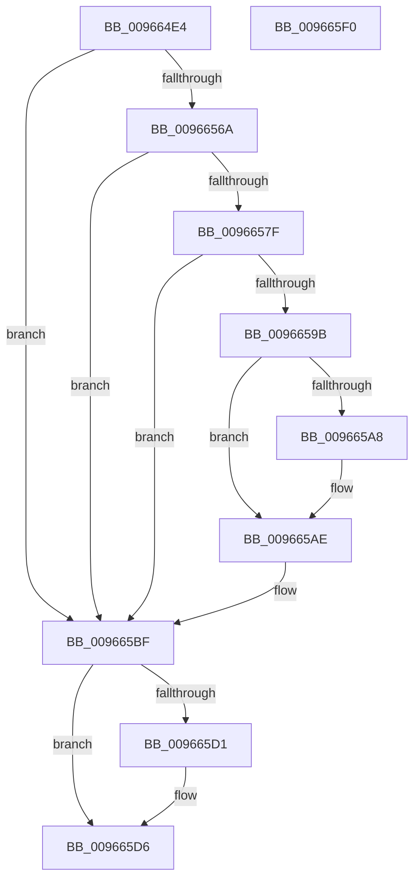

# PiDevCfgVerifyDeviceAllowed

- RVA: `0x009664E4`–`0x009665F1` (길이 `269` bytes)
- VA: `0x00000001409664E4`
- 실행 섹션: `PAGE`
- PDB 이름 있음: `예`; PDB Function 태그: `아니요`
- unwind 정보 RVA: `0x00093878`
- 디코드: `75`개 명령, `269/269` bytes 표시
- 미해석 바이트: `0` (있으면 어셈블리에 `.byte`로 보존)

> 이 문서는 커널 이미지의 기계어와 PDB 기호를 분석해 생성했습니다. 4번과 5번은 함수 원형과 자료형을 바이너리 사용 방식에서 추정한 C 해석이며 원본 소스 복구 결과는 아닙니다.

## 1. Dependencies

- 직접 호출 지점: **7**; 고유 호출 대상: **7**
- 직접 호출자로 확인된 함수: **1**
- RIP 상대 이미지 참조: **2**

### Outgoing calls
- `0x00966561` → [ZwOpenKey](../../text/6A/ZwOpenKey_function_006AD310.md) (function, `0x006AD310`)
- `0x00966574` → [PiDevCfgInitResolveContext](PiDevCfgInitResolveContext_function_00965178.md) (function, `0x00965178`)
- `0x00966592` → [PiDevCfgQueryResolveValue](../../text/5A/PiDevCfgQueryResolveValue_function_005A801C.md) (function, `0x005A801C`)
- `0x0096659F` → [PnpValidateRegistryDword](../../text/4D/PnpValidateRegistryDword_function_004D109C.md) (function, `0x004D109C`)
- `0x009665B0` → [ExFreePoolWithTag](../../poolcode/B8/ExFreePoolWithTag_function_00B82870.md) (function, `0x00B82870`)
- `0x009665C3` → [PiDevCfgFreeResolveContext](PiDevCfgFreeResolveContext_function_00964E00.md) (function, `0x00964E00`)
- `0x009665D1` → [ZwClose](../../text/6A/ZwClose_function_006AD2B0.md) (function, `0x006AD2B0`)

### Direct callers
- [PiDevCfgConfigureDevice](../97/PiDevCfgConfigureDevice_function_00977BB4.md) at `0x00978807`

### Static image references
- `0x00966505` → RVA `0x00AFF2C0` (` ?? ::NNGAKEGL::`string'`; read)
- `0x00966587` → RVA `0x00AFF1F0` (` ?? ::NNGAKEGL::`string'`; read)

## 2. Other-region calls and transfers

- 다른 실행 섹션으로 향하는 call: **5**
  - `0x00966561` → [ZwOpenKey](../../text/6A/ZwOpenKey_function_006AD310.md) (`PAGE` → `.text`)
  - `0x00966592` → [PiDevCfgQueryResolveValue](../../text/5A/PiDevCfgQueryResolveValue_function_005A801C.md) (`PAGE` → `.text`)
  - `0x0096659F` → [PnpValidateRegistryDword](../../text/4D/PnpValidateRegistryDword_function_004D109C.md) (`PAGE` → `.text`)
  - `0x009665B0` → [ExFreePoolWithTag](../../poolcode/B8/ExFreePoolWithTag_function_00B82870.md) (`PAGE` → `POOLCODE`)
  - `0x009665D1` → [ZwClose](../../text/6A/ZwClose_function_006AD2B0.md) (`PAGE` → `.text`)
- 별도 외부 분기/꼬리 이동을 확인하지 못했습니다.

## 3. Assembly (complete function range)

```asm
009664E4  48 89 5C 24 08                  mov qword ptr [rsp + 8], rbx
009664E9  48 89 74 24 20                  mov qword ptr [rsp + 0x20], rsi
009664EE  55                              push rbp
009664EF  57                              push rdi
009664F0  41 56                           push r14
009664F2  48 8B EC                        mov rbp, rsp
009664F5  48 81 EC 80 00 00 00            sub rsp, 0x80
009664FC  33 DB                           xor ebx, ebx
009664FE  48 89 55 D8                     mov qword ptr [rbp - 0x28], rdx
00966502  21 5D A4                        and dword ptr [rbp - 0x5c], ebx
00966505  48 8D 05 B4 8D 19 00            lea rax, [rip + 0x198db4]
0096650C  48 21 5D 30                     and qword ptr [rbp + 0x30], rbx
00966510  4C 8D 45 D0                     lea r8, [rbp - 0x30]
00966514  21 5D EC                        and dword ptr [rbp - 0x14], ebx
00966517  0F 57 C0                        xorps xmm0, xmm0
0096651A  48 21 5D 28                     and qword ptr [rbp + 0x28], rbx
0096651E  48 8B F2                        mov rsi, rdx
00966521  48 89 45 A8                     mov qword ptr [rbp - 0x58], rax
00966525  4C 8B F1                        mov r14, rcx
00966528  48 8D 45 A0                     lea rax, [rbp - 0x60]
0096652C  48 C7 45 D0 30 00 00 00         mov qword ptr [rbp - 0x30], 0x30
00966534  21 5D D4                        and dword ptr [rbp - 0x2c], ebx
00966537  48 8D 4D 28                     lea rcx, [rbp + 0x28]
0096653B  BA 19 00 02 00                  mov edx, 0x20019
00966540  48 89 45 E0                     mov qword ptr [rbp - 0x20], rax
00966544  0F 11 45 B0                     movups xmmword ptr [rbp - 0x50], xmm0
00966548  33 FF                           xor edi, edi
0096654A  C7 45 A0 0C 00 0E 00            mov dword ptr [rbp - 0x60], 0xe000c
00966551  0F 11 45 C0                     movups xmmword ptr [rbp - 0x40], xmm0
00966555  C7 45 E8 40 02 00 00            mov dword ptr [rbp - 0x18], 0x240
0096655C  F3 0F 7F 45 F0                  movdqu xmmword ptr [rbp - 0x10], xmm0
00966561  E8 AA 6D D4 FF                  call 0x1406ad310
00966566  85 C0                           test eax, eax
00966568  78 55                           js 0x1409665bf
0096656A  4C 8D 45 B0                     lea r8, [rbp - 0x50]
0096656E  48 8B D6                        mov rdx, rsi
00966571  49 8B CE                        mov rcx, r14
00966574  E8 FF EB FF FF                  call 0x140965178
00966579  8B D8                           mov ebx, eax
0096657B  85 C0                           test eax, eax
0096657D  78 40                           js 0x1409665bf
0096657F  48 8B 55 28                     mov rdx, qword ptr [rbp + 0x28]
00966583  4C 8D 4D 30                     lea r9, [rbp + 0x30]
00966587  4C 8D 05 62 8C 19 00            lea r8, [rip + 0x198c62]
0096658E  48 8D 4D B0                     lea rcx, [rbp - 0x50]
00966592  E8 85 1A C4 FF                  call 0x1405a801c
00966597  85 C0                           test eax, eax
00966599  78 24                           js 0x1409665bf
0096659B  48 8B 4D 30                     mov rcx, qword ptr [rbp + 0x30]
0096659F  E8 F8 AA B6 FF                  call 0x1404d109c
009665A4  84 C0                           test al, al
009665A6  74 06                           je 0x1409665ae
009665A8  8B 41 08                        mov eax, dword ptr [rcx + 8]
009665AB  8B 3C 08                        mov edi, dword ptr [rax + rcx]
009665AE  33 D2                           xor edx, edx
009665B0  E8 BB C2 21 00                  call 0x140b82870
009665B5  85 FF                           test edi, edi
009665B7  B8 6C 03 00 C0                  mov eax, 0xc000036c
009665BC  0F 45 D8                        cmovne ebx, eax
009665BF  48 8D 4D B0                     lea rcx, [rbp - 0x50]
009665C3  E8 38 E8 FF FF                  call 0x140964e00
009665C8  48 8B 4D 28                     mov rcx, qword ptr [rbp + 0x28]
009665CC  48 85 C9                        test rcx, rcx
009665CF  74 05                           je 0x1409665d6
009665D1  E8 DA 6C D4 FF                  call 0x1406ad2b0
009665D6  4C 8D 9C 24 80 00 00 00         lea r11, [rsp + 0x80]
009665DE  8B C3                           mov eax, ebx
009665E0  49 8B 5B 20                     mov rbx, qword ptr [r11 + 0x20]
009665E4  49 8B 73 38                     mov rsi, qword ptr [r11 + 0x38]
009665E8  49 8B E3                        mov rsp, r11
009665EB  41 5E                           pop r14
009665ED  5F                              pop rdi
009665EE  5D                              pop rbp
009665EF  C3                              ret
009665F0  CC                              int3
```

## 4. C-style interpretation (structured pseudocode)

```c
__int64 __fastcall PiDevCfgVerifyDeviceAllowed(__int64 a1, __int64 a2)
{
    __int64 result;
    __int64 v_rbx;
    __int64 v_rdi;
    __int64 v_rsp;
    unsigned __int64 v_stack_m18;
    unsigned __int64 v_stack_m28;
    unsigned int v_stack_m2C;
    unsigned int v_stack_m30;
    unsigned __int64 v_stack_m38;
    unsigned __int64 v_stack_m40;
    unsigned int v_stack_m44;
    unsigned __int64 v_stack_m48;
    unsigned __int64 v_stack_m58;
    unsigned __int64 v_stack_m68;
    unsigned __int64 v_stack_m70;
    unsigned int v_stack_m74;
    unsigned __int64 v_stack_m78;
    unsigned __int64 v_stack_p10;
    unsigned __int64 v_stack_p18;
    unsigned __int64 v_stack_p20;
    unsigned __int64 v_stack_p8;

    v_stack_p8 = v_rbx;
    v_stack_p20 = v_rsi;
    v_rsp = (v_rsp) - (128);
    v_rbx = 0;
    v_stack_m40 = a2;
    v_stack_m70 = v_rip + 1674676;
    v_stack_m48 = 48;
    v_stack_m38 = v_stack_m78;
    v_stack_m68 = v_xmm0;
    v_rdi = 0;
    v_stack_m78 = 0xE000CULL;
    v_stack_m58 = v_xmm0;
    v_stack_m30 = 576;
    v_stack_m28 = v_xmm0;
    result = ZwOpenKey(v_stack_p10, (unsigned int)(0x20019ULL), v_stack_m48, a4);
    if (sign_flag) goto loc_009665BF;
    result = PiDevCfgInitResolveContext(a1, a2, v_stack_m68, a4);
    if (sign_flag) goto loc_009665BF;
    result = PiDevCfgQueryResolveValue(v_stack_m68, v_stack_p10, v_rip + 1674338, v_stack_p18);
    if (sign_flag) goto loc_009665BF;
    result = PnpValidateRegistryDword(v_stack_p18, v_stack_p10, v_rip + 1674338, v_stack_p18);
    if ((unsigned __int8)(result) != 0) {
        result = *(unsigned int *)(v_stack_p18 + 8);
        v_rdi = *(unsigned int *)(result + v_stack_p18 * 1);
    }
    a2 = 0;
    result = ExFreePoolWithTag(v_stack_p18, a2, v_rip + 1674338, v_stack_p18);
    v_rbx = (unsigned int)((unsigned int)(result));
    if ((unsigned int)(v_rdi) != 0) { v_rbx = (unsigned int)((unsigned int)(0xC000036CULL)); }
loc_009665BF:
    result = PiDevCfgFreeResolveContext(v_stack_m68, a2, v_rip + 1674338, v_stack_p18);
    if (v_stack_p10 != 0) {
        result = ZwClose(v_stack_p10, a2, v_rip + 1674338, v_stack_p18);
    }
    return (unsigned int)((unsigned int)(v_rbx));
}
```

## 5. (Beta) C Style

```c
int64_t PiDevCfgVerifyDeviceAllowed(int64_t Arg1, int64_t Arg2)
{
    int64_t result;
    int64_t local_rbx;
    int64_t local_rdi;
    int64_t local_rsp;
    uint64_t v_stack_m18;
    uint64_t v_stack_m28;
    uint32_t v_stack_m2C;
    uint32_t v_stack_m30;
    uint64_t v_stack_m38;
    uint64_t v_stack_m40;
    uint32_t v_stack_m44;
    uint64_t v_stack_m48;
    uint64_t v_stack_m58;
    uint64_t v_stack_m68;
    uint64_t v_stack_m70;
    uint32_t v_stack_m74;
    uint64_t v_stack_m78;
    uint64_t v_stack_p10;
    uint64_t v_stack_p18;
    uint64_t v_stack_p20;
    uint64_t v_stack_p8;

    v_stack_p8 = local_rbx;
    v_stack_p20 = local_rsi;
    local_rsp = (local_rsp) - (128);
    local_rbx = 0;
    v_stack_m40 = Arg2;
    v_stack_m70 = v_rip + 1674676;
    v_stack_m48 = 48;
    v_stack_m38 = v_stack_m78;
    v_stack_m68 = v_xmm0;
    local_rdi = 0;
    v_stack_m78 = 0xE000CULL;
    v_stack_m58 = v_xmm0;
    v_stack_m30 = 576;
    v_stack_m28 = v_xmm0;
    result = ZwOpenKey(v_stack_p10, (uint32_t)(0x20019ULL), v_stack_m48, a4);
    if (sign_flag) goto loc_009665BF;
    result = PiDevCfgInitResolveContext(Arg1, Arg2, v_stack_m68, a4);
    if (sign_flag) goto loc_009665BF;
    result = PiDevCfgQueryResolveValue(v_stack_m68, v_stack_p10, v_rip + 1674338, v_stack_p18);
    if (sign_flag) goto loc_009665BF;
    result = PnpValidateRegistryDword(v_stack_p18, v_stack_p10, v_rip + 1674338, v_stack_p18);
    if ((uint8_t)(result) != 0) {
        result = *(uint32_t *)(v_stack_p18 + 0x8);
        local_rdi = *(uint32_t *)(result + v_stack_p18 * 1);
    }
    Arg2 = 0;
    result = ExFreePoolWithTag(v_stack_p18, Arg2, v_rip + 1674338, v_stack_p18);
    local_rbx = (uint32_t)((uint32_t)(result));
    if ((uint32_t)(local_rdi) != 0) { local_rbx = (uint32_t)((uint32_t)(0xC000036CULL)); }
loc_009665BF:
    result = PiDevCfgFreeResolveContext(v_stack_m68, Arg2, v_rip + 1674338, v_stack_p18);
    if (v_stack_p10 != 0) {
        result = ZwClose(v_stack_p10, Arg2, v_rip + 1674338, v_stack_p18);
    }
    return (uint32_t)((uint32_t)(local_rbx));
}
```

## 6. Execution-region graph

[열기: 2D/3D 그래프와 함수 탐색 컨트롤 패널](../../../control-panel.html?section=page&rva=0x009664E4&view=graph)

- 2D 그래프는 위에서 아래로 흐르고, 3D 그래프는 빈 공간을 드래그해 회전합니다. Shift+드래그는 이동, 휠은 확대·축소, 함수 노드 선택은 대상 보고서 이동입니다.

### Static fallback


