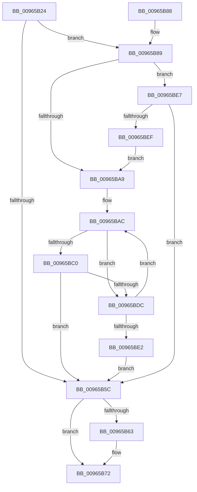

# PiDqDeleteUserObject

- RVA: `0x00965B24`–`0x00965BF6` (길이 `210` bytes)
- VA: `0x0000000140965B24`
- 실행 섹션: `PAGE`
- PDB 이름 있음: `예`; PDB Function 태그: `아니요`
- unwind 정보 RVA: `0x000937D4`
- 디코드: `62`개 명령, `210/210` bytes 표시
- 미해석 바이트: `0` (있으면 어셈블리에 `.byte`로 보존)

> 이 문서는 커널 이미지의 기계어와 PDB 기호를 분석해 생성했습니다. 4번과 5번은 함수 원형과 자료형을 바이너리 사용 방식에서 추정한 C 해석이며 원본 소스 복구 결과는 아닙니다.

## 1. Dependencies

- 직접 호출 지점: **5**; 고유 호출 대상: **5**
- 직접 호출자로 확인된 함수: **1**
- RIP 상대 이미지 참조: **1**

### Outgoing calls
- `0x00965B51` → [PiDqGetRelativeObjectRegPath](../99/PiDqGetRelativeObjectRegPath_function_00990B6C.md) (function, `0x00990B6C`)
- `0x00965B6D` → [ExFreePoolWithTag](../../poolcode/B8/ExFreePoolWithTag_function_00B82870.md) (function, `0x00B82870`)
- `0x00965B98` → [PnpCtxRegDeleteTree](PnpCtxRegDeleteTree_function_00965CC8.md) (function, `0x00965CC8`)
- `0x00965BB6` → [wcsrchr](../../text/50/wcsrchr_function_00501E50.md) (function, `0x00501E50`)
- `0x00965BD3` → [PnpCtxRegDeleteKey](PnpCtxRegDeleteKey_function_00965EC8.md) (function, `0x00965EC8`)

### Direct callers
- [PiDqDeleteUserObjectFromLoadedHives](../AB/PiDqDeleteUserObjectFromLoadedHives_function_00AB957C.md) at `0x00AB9666`

### Static image references
- `0x00965B91` → RVA `0x00E66398` (`.data`; read)

## 2. Other-region calls and transfers

- 다른 실행 섹션으로 향하는 call: **2**
  - `0x00965B6D` → [ExFreePoolWithTag](../../poolcode/B8/ExFreePoolWithTag_function_00B82870.md) (`PAGE` → `POOLCODE`)
  - `0x00965BB6` → [wcsrchr](../../text/50/wcsrchr_function_00501E50.md) (`PAGE` → `.text`)
- 별도 외부 분기/꼬리 이동을 확인하지 못했습니다.

## 3. Assembly (complete function range)

```asm
00965B24  4C 8B DC                        mov r11, rsp
00965B27  49 89 5B 08                     mov qword ptr [r11 + 8], rbx
00965B2B  49 89 6B 10                     mov qword ptr [r11 + 0x10], rbp
00965B2F  57                              push rdi
00965B30  41 56                           push r14
00965B32  41 57                           push r15
00965B34  48 83 EC 20                     sub rsp, 0x20
00965B38  41 8B D8                        mov ebx, r8d
00965B3B  48 8B C2                        mov rax, rdx
00965B3E  4C 8B F1                        mov r14, rcx
00965B41  4D 8D 43 20                     lea r8, [r11 + 0x20]
00965B45  45 33 FF                        xor r15d, r15d
00965B48  8B D3                           mov edx, ebx
00965B4A  48 8B C8                        mov rcx, rax
00965B4D  4D 89 7B 20                     mov qword ptr [r11 + 0x20], r15
00965B51  E8 16 B0 02 00                  call 0x140990b6c
00965B56  8B E8                           mov ebp, eax
00965B58  85 C0                           test eax, eax
00965B5A  79 2D                           jns 0x140965b89
00965B5C  4C 39 7C 24 58                  cmp qword ptr [rsp + 0x58], r15
00965B61  74 0F                           je 0x140965b72
00965B63  48 8B 4C 24 58                  mov rcx, qword ptr [rsp + 0x58]
00965B68  BA 50 6E 70 58                  mov edx, 0x58706e50
00965B6D  E8 FE CC 21 00                  call 0x140b82870
00965B72  48 8B 5C 24 40                  mov rbx, qword ptr [rsp + 0x40]
00965B77  8B C5                           mov eax, ebp
00965B79  48 8B 6C 24 48                  mov rbp, qword ptr [rsp + 0x48]
00965B7E  48 83 C4 20                     add rsp, 0x20
00965B82  41 5F                           pop r15
00965B84  41 5E                           pop r14
00965B86  5F                              pop rdi
00965B87  C3                              ret
00965B88  CC                              int3
00965B89  4C 8B 44 24 58                  mov r8, qword ptr [rsp + 0x58]
00965B8E  49 8B D6                        mov rdx, r14
00965B91  48 8B 0D 00 08 50 00            mov rcx, qword ptr [rip + 0x500800]
00965B98  E8 2B 01 00 00                  call 0x140965cc8
00965B9D  8B E8                           mov ebp, eax
00965B9F  BF 02 00 00 00                  mov edi, 2
00965BA4  83 EB 01                        sub ebx, 1
00965BA7  75 3E                           jne 0x140965be7
00965BA9  41 8B DF                        mov ebx, r15d
00965BAC  48 8B 4C 24 58                  mov rcx, qword ptr [rsp + 0x58]
00965BB1  BA 5C 00 00 00                  mov edx, 0x5c
00965BB6  E8 95 C2 B9 FF                  call 0x140501e50
00965BBB  48 85 C0                        test rax, rax
00965BBE  74 1C                           je 0x140965bdc
00965BC0  4C 8B 44 24 58                  mov r8, qword ptr [rsp + 0x58]
00965BC5  49 8B D6                        mov rdx, r14
00965BC8  66 44 89 38                     mov word ptr [rax], r15w
00965BCC  48 8B 0D C5 07 50 00            mov rcx, qword ptr [rip + 0x5007c5]
00965BD3  E8 F0 02 00 00                  call 0x140965ec8
00965BD8  85 C0                           test eax, eax
00965BDA  78 80                           js 0x140965b5c
00965BDC  FF C3                           inc ebx
00965BDE  3B DF                           cmp ebx, edi
00965BE0  72 CA                           jb 0x140965bac
00965BE2  E9 75 FF FF FF                  jmp 0x140965b5c
00965BE7  3B DF                           cmp ebx, edi
00965BE9  0F 85 6D FF FF FF               jne 0x140965b5c
00965BEF  BF 01 00 00 00                  mov edi, 1
00965BF4  EB B3                           jmp 0x140965ba9
```

## 4. C-style interpretation (structured pseudocode)

```c
__int64 __fastcall PiDqDeleteUserObject(__int64 a1, __int64 a2, int a3)
{
    __int64 result;
    __int64 v_r15;
    __int64 v_rbx;
    __int64 v_rsp;
    unsigned __int64 v_stack_p10;
    unsigned __int64 v_stack_p20;
    unsigned __int64 v_stack_p58;
    unsigned __int64 v_stack_p8;

    *(unsigned __int64 *)(v_rsp + 8) = v_rbx;
    *(unsigned __int64 *)(v_rsp + 16) = v_rbp;
    v_rsp = (v_rsp) - (32);
    v_r15 = 0;
    *(unsigned __int64 *)(v_rsp + 32) = 0;
    result = PiDqGetRelativeObjectRegPath(a2, (unsigned int)((unsigned int)((unsigned int)(a3))), v_rsp + 32, a4);
    if (!sign_flag) goto loc_00965B89;
loc_00965B5C:
    if (v_stack_p20 != 0) {
        a1 = v_stack_p20;
        a2 = 0x58706E50ULL;
        result = ExFreePoolWithTag(a1, a2, v_rsp + 32, a4);
    }
    v_rsp = (v_rsp) + (32);
    return (unsigned int)((unsigned int)((unsigned int)((unsigned int)(result))));
loc_00965B89:
    result = PnpCtxRegDeleteTree(*(unsigned __int64 *)(v_rip + 5244928), a1, v_stack_p58, a4);
    v_rbx = (unsigned int)((v_stack_p8) - (1));
    if (condition_is_not_equal) goto loc_00965BE7;
loc_00965BA9:
loc_00965BAC:
    result = wcsrchr(v_stack_p58, 92, v_stack_p58, a4);
    if (result == 0) goto loc_00965BDC;
    *(unsigned __int16 *)(result) = 0;
    result = PnpCtxRegDeleteKey(*(unsigned __int64 *)(v_rip + 5244869), a1, v_stack_p58, a4);
    if (sign_flag) goto loc_00965B5C;
loc_00965BDC:
    v_rbx = (unsigned int)((0) + 1);
    if (((unsigned int)(v_rbx)) < 2) goto loc_00965BAC;
    goto loc_00965B5C;
loc_00965BE7:
    if (((unsigned int)(v_rbx)) != 2) goto loc_00965B5C;
    goto loc_00965BA9;
}
```

## 5. (Beta) C Style

```c
int64_t PiDqDeleteUserObject(int64_t Arg1, int64_t Arg2, int32_t Arg3)
{
    int64_t result;
    int64_t local_r15;
    int64_t local_rbx;
    int64_t local_rsp;
    uint64_t v_stack_p10;
    uint64_t v_stack_p20;
    uint64_t v_stack_p58;
    uint64_t v_stack_p8;

    *(uint64_t *)(local_rsp + 0x8) = local_rbx;
    *(uint64_t *)(local_rsp + 0x10) = local_rbp;
    local_rsp = (local_rsp) - (32);
    local_r15 = 0;
    *(uint64_t *)(local_rsp + 0x20) = 0;
    result = PiDqGetRelativeObjectRegPath(Arg2, (uint32_t)((uint32_t)((uint32_t)(Arg3))), local_rsp + 32, a4);
    if (!sign_flag) goto loc_00965B89;
loc_00965B5C:
    if (v_stack_p20 != 0) {
        Arg1 = v_stack_p20;
        Arg2 = 0x58706E50ULL;
        result = ExFreePoolWithTag(Arg1, Arg2, local_rsp + 32, a4);
    }
    local_rsp = (local_rsp) + (32);
    return (uint32_t)((uint32_t)((uint32_t)((uint32_t)(result))));
loc_00965B89:
    result = PnpCtxRegDeleteTree(*(uint64_t *)(v_rip + 0x500800), Arg1, v_stack_p58, a4);
    local_rbx = (uint32_t)((v_stack_p8) - (1));
    if (condition_is_not_equal) goto loc_00965BE7;
loc_00965BA9:
loc_00965BAC:
    result = wcsrchr(v_stack_p58, 92, v_stack_p58, a4);
    if (result == 0) goto loc_00965BDC;
    *(uint16_t *)(result) = 0;
    result = PnpCtxRegDeleteKey(*(uint64_t *)(v_rip + 0x5007C5), Arg1, v_stack_p58, a4);
    if (sign_flag) goto loc_00965B5C;
loc_00965BDC:
    local_rbx = (uint32_t)((0) + 1);
    if (((uint32_t)(local_rbx)) < 2) goto loc_00965BAC;
    goto loc_00965B5C;
loc_00965BE7:
    if (((uint32_t)(local_rbx)) != 2) goto loc_00965B5C;
    goto loc_00965BA9;
}
```

## 6. Execution-region graph

[열기: 2D/3D 그래프와 함수 탐색 컨트롤 패널](../../../control-panel.html?section=page&rva=0x00965B24&view=graph)

- 2D 그래프는 위에서 아래로 흐르고, 3D 그래프는 빈 공간을 드래그해 회전합니다. Shift+드래그는 이동, 휠은 확대·축소, 함수 노드 선택은 대상 보고서 이동입니다.

### Static fallback


