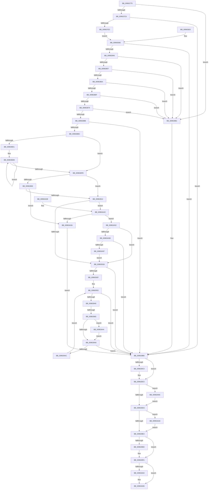

# PiDqIrpPropertySet

- RVA: `0x00963770`–`0x00963AB5` (길이 `837` bytes)
- VA: `0x0000000140963770`
- 실행 섹션: `PAGE`
- PDB 이름 있음: `예`; PDB Function 태그: `예`
- unwind 정보 RVA: `0x00093570`
- 디코드: `200`개 명령, `837/837` bytes 표시
- 미해석 바이트: `0` (있으면 어셈블리에 `.byte`로 보존)

> 이 문서는 커널 이미지의 기계어와 PDB 기호를 분석해 생성했습니다. 4번과 5번은 함수 원형과 자료형을 바이너리 사용 방식에서 추정한 C 해석이며 원본 소스 복구 결과는 아닙니다.

## 1. Dependencies

- 직접 호출 지점: **15**; 고유 호출 대상: **13**
- 직접 호출자로 확인된 함수: **1**
- RIP 상대 이미지 참조: **7**

### Outgoing calls
- `0x009637CD` → `msrpc.sys!MesDecodeBufferHandleCreate` (import, 간접 대상; import `msrpc.sys!MesDecodeBufferHandleCreate`)
- `0x00963812` → `msrpc.sys!NdrMesTypeDecode3` (import, 간접 대상; import `msrpc.sys!NdrMesTypeDecode3`)
- `0x0096387B` → [PiDqGetPnpObjectType](../8D/PiDqGetPnpObjectType_function_008DF790.md) (function, `0x008DF790`)
- `0x009638AD` → [PnpOpenObjectRegKey](../8E/PnpOpenObjectRegKey_function_008E15E8.md) (function, `0x008E15E8`)
- `0x00963905` → [PiAuDoesClientHaveAccess](PiAuDoesClientHaveAccess_function_00962940.md) (function, `0x00962940`)
- `0x00963920` → [PiPnpRtlBeginOperation](../8E/PiPnpRtlBeginOperation_function_008E033C.md) (function, `0x008E033C`)
- `0x00963995` → [PiPnpRtlSetObjectProperty](../8F/PiPnpRtlSetObjectProperty_function_008F62A0.md) (function, `0x008F62A0`)
- `0x009639C0` → [ZwClose](../../text/6A/ZwClose_function_006AD2B0.md) (function, `0x006AD2B0`)
- `0x009639EE` → `msrpc.sys!MesHandleFree` (import, 간접 대상; import `msrpc.sys!MesHandleFree`)
- `0x00963A04` → [PiPnpRtlEndOperation](../8E/PiPnpRtlEndOperation_function_008E0518.md) (function, `0x008E0518`)
- `0x00963A12` → [IofCompleteRequest](../../text/29/IofCompleteRequest_function_0029B5C0.md) (function, `0x0029B5C0`)
- `0x00963A31` → [PiAuDoesClientHaveAccess](PiAuDoesClientHaveAccess_function_00962940.md) (function, `0x00962940`)
- `0x00963A88` → [PiDqOpenObjectRegKey](../98/PiDqOpenObjectRegKey_function_0098FF30.md) (function, `0x0098FF30`)
- `0x00963A9C` → [ZwClose](../../text/6A/ZwClose_function_006AD2B0.md) (function, `0x006AD2B0`)
- `0x00963AAB` → [ExFreePoolWithTag](../../poolcode/B8/ExFreePoolWithTag_function_00B82870.md) (function, `0x00B82870`)

### Direct callers
- [PiDqDispatch](../8D/PiDqDispatch_function_008DC8A0.md) at `0x008DCA64`

### Static image references
- `0x009637CD` → RVA `0x00151700` (`msrpc.sys!MesDecodeBufferHandleCreate (IAT)`; read)
- `0x009637F8` → RVA `0x00E07000` (`.data`; read)
- `0x009637FF` → RVA `0x00001610` (`.rdata`; read)
- `0x00963806` → RVA `0x00011440` (`.rdata`; read)
- `0x00963812` → RVA `0x001516F8` (`msrpc.sys!NdrMesTypeDecode3 (IAT)`; read)
- `0x009638A6` → RVA `0x00E66398` (`.data`; read)
- `0x009639EE` → RVA `0x001516E0` (`msrpc.sys!MesHandleFree (IAT)`; read)

## 2. Other-region calls and transfers

- 다른 실행 섹션으로 향하는 call: **4**
  - `0x009639C0` → [ZwClose](../../text/6A/ZwClose_function_006AD2B0.md) (`PAGE` → `.text`)
  - `0x00963A12` → [IofCompleteRequest](../../text/29/IofCompleteRequest_function_0029B5C0.md) (`PAGE` → `.text`)
  - `0x00963A9C` → [ZwClose](../../text/6A/ZwClose_function_006AD2B0.md) (`PAGE` → `.text`)
  - `0x00963AAB` → [ExFreePoolWithTag](../../poolcode/B8/ExFreePoolWithTag_function_00B82870.md) (`PAGE` → `POOLCODE`)
- call이 아닌 외부 분기/꼬리 이동: **1**
  - `0x0096395F` → [sub_00B2812A](../B2/Unknown_function_00B2812A.md) (`tail-transfer`)

## 3. Assembly (complete function range)

```asm
00963770  48 8B C4                        mov rax, rsp
00963773  48 89 48 08                     mov qword ptr [rax + 8], rcx
00963777  56                              push rsi
00963778  57                              push rdi
00963779  41 54                           push r12
0096377B  41 55                           push r13
0096377D  41 56                           push r14
0096377F  41 57                           push r15
00963781  48 81 EC 98 00 00 00            sub rsp, 0x98
00963788  4C 8B E9                        mov r13, rcx
0096378B  48 8B 91 B8 00 00 00            mov rdx, qword ptr [rcx + 0xb8]
00963792  48 83 60 98 00                  and qword ptr [rax - 0x68], 0
00963797  48 83 60 88 00                  and qword ptr [rax - 0x78], 0
0096379C  48 83 60 90 00                  and qword ptr [rax - 0x70], 0
009637A1  48 83 60 20 00                  and qword ptr [rax + 0x20], 0
009637A6  45 32 FF                        xor r15b, r15b
009637A9  44 88 BC 24 D8 00 00 00         mov byte ptr [rsp + 0xd8], r15b
009637B1  40 32 F6                        xor sil, sil
009637B4  48 83 60 A0 00                  and qword ptr [rax - 0x60], 0
009637B9  48 8B 49 18                     mov rcx, qword ptr [rcx + 0x18]
009637BD  48 85 C9                        test rcx, rcx
009637C0  0F 84 EB 01 00 00               je 0x1409639b1
009637C6  4C 8D 40 98                     lea r8, [rax - 0x68]
009637CA  8B 52 10                        mov edx, dword ptr [rdx + 0x10]
009637CD  48 FF 15 2C DF 7E FF            call qword ptr [rip - 0x8120d4]
009637D4  0F 1F 44 00 00                  nop dword ptr [rax + rax]
009637D9  8B F8                           mov edi, eax
009637DB  85 C0                           test eax, eax
009637DD  0F 88 D3 01 00 00               js 0x1409639b6
009637E3  48 8D 84 24 E8 00 00 00         lea rax, [rsp + 0xe8]
009637EB  48 89 44 24 28                  mov qword ptr [rsp + 0x28], rax
009637F0  C7 44 24 20 02 00 00 00         mov dword ptr [rsp + 0x20], 2
009637F8  4C 8D 0D 01 38 4A 00            lea r9, [rip + 0x4a3801]
009637FF  4C 8D 05 0A DE 69 FF            lea r8, [rip - 0x9621f6]
00963806  48 8D 15 33 DC 6A FF            lea rdx, [rip - 0x9523cd]
0096380D  48 8B 4C 24 60                  mov rcx, qword ptr [rsp + 0x60]
00963812  48 FF 15 DF DE 7E FF            call qword ptr [rip - 0x812121]
00963819  0F 1F 44 00 00                  nop dword ptr [rax + rax]
0096381E  EB 1E                           jmp 0x14096383e
00963820  8B F8                           mov edi, eax
00963822  48 83 A4 24 E8 00 00 00 00      and qword ptr [rsp + 0xe8], 0
0096382B  4C 8B AC 24 D0 00 00 00         mov r13, qword ptr [rsp + 0xd0]
00963833  44 8A BC 24 D8 00 00 00         mov r15b, byte ptr [rsp + 0xd8]
0096383B  41 8A F7                        mov sil, r15b
0096383E  85 FF                           test edi, edi
00963840  0F 88 70 01 00 00               js 0x1409639b6
00963846  48 8B 8C 24 E8 00 00 00         mov rcx, qword ptr [rsp + 0xe8]
0096384E  48 85 C9                        test rcx, rcx
00963851  0F 84 5A 01 00 00               je 0x1409639b1
00963857  4C 8B 51 08                     mov r10, qword ptr [rcx + 8]
0096385B  4D 85 D2                        test r10, r10
0096385E  0F 84 4D 01 00 00               je 0x1409639b1
00963864  48 83 79 18 00                  cmp qword ptr [rcx + 0x18], 0
00963869  0F 84 42 01 00 00               je 0x1409639b1
0096386F  83 79 10 00                     cmp dword ptr [rcx + 0x10], 0
00963873  0F 84 38 01 00 00               je 0x1409639b1
00963879  8B 09                           mov ecx, dword ptr [rcx]
0096387B  E8 10 BF F7 FF                  call 0x1408df790
00963880  44 8B E0                        mov r12d, eax
00963883  85 C0                           test eax, eax
00963885  0F 84 26 01 00 00               je 0x1409639b1
0096388B  48 8D 44 24 50                  lea rax, [rsp + 0x50]
00963890  48 89 44 24 28                  mov qword ptr [rsp + 0x28], rax
00963895  C6 44 24 20 00                  mov byte ptr [rsp + 0x20], 0
0096389A  41 B9 07 00 00 00               mov r9d, 7
009638A0  45 8B C4                        mov r8d, r12d
009638A3  49 8B D2                        mov rdx, r10
009638A6  48 8B 0D EB 2A 50 00            mov rcx, qword ptr [rip + 0x502aeb]
009638AD  E8 36 DD F7 FF                  call 0x1408e15e8
009638B2  8B F8                           mov edi, eax
009638B4  85 C0                           test eax, eax
009638B6  0F 88 FA 00 00 00               js 0x1409639b6
009638BC  48 8B 8C 24 E8 00 00 00         mov rcx, qword ptr [rsp + 0xe8]
009638C4  8B 41 10                        mov eax, dword ptr [rcx + 0x10]
009638C7  41 BE 01 00 00 00               mov r14d, 1
009638CD  85 C0                           test eax, eax
009638CF  74 2A                           je 0x1409638fb
009638D1  48 8B 49 18                     mov rcx, qword ptr [rcx + 0x18]
009638D5  48 83 C1 14                     add rcx, 0x14
009638D9  8B D0                           mov edx, eax
009638DB  8B 01                           mov eax, dword ptr [rcx]
009638DD  45 0F B6 FF                     movzx r15d, r15b
009638E1  85 C0                           test eax, eax
009638E3  45 0F 44 FE                     cmove r15d, r14d
009638E7  40 0F B6 F6                     movzx esi, sil
009638EB  41 3B C6                        cmp eax, r14d
009638EE  41 0F 44 F6                     cmove esi, r14d
009638F2  48 8D 49 30                     lea rcx, [rcx + 0x30]
009638F6  49 2B D6                        sub rdx, r14
009638F9  75 E0                           jne 0x1409638db
009638FB  45 84 FF                        test r15b, r15b
009638FE  74 12                           je 0x140963912
00963900  B9 02 00 00 00                  mov ecx, 2
00963905  E8 36 F0 FF FF                  call 0x140962940
0096390A  84 C0                           test al, al
0096390C  0F 84 28 01 00 00               je 0x140963a3a
00963912  40 84 F6                        test sil, sil
00963915  0F 85 11 01 00 00               jne 0x140963a2c
0096391B  48 8D 4C 24 68                  lea rcx, [rsp + 0x68]
00963920  E8 17 CA F7 FF                  call 0x1408e033c
00963925  8B F8                           mov edi, eax
00963927  85 C0                           test eax, eax
00963929  0F 88 87 00 00 00               js 0x1409639b6
0096392F  45 33 FF                        xor r15d, r15d
00963932  48 8B 8C 24 E8 00 00 00         mov rcx, qword ptr [rsp + 0xe8]
0096393A  44 3B 79 10                     cmp r15d, dword ptr [rcx + 0x10]
0096393E  73 76                           jae 0x1409639b6
00963940  4B 8D 34 7F                     lea rsi, [r15 + r15*2]
00963944  48 C1 E6 04                     shl rsi, 4
00963948  48 03 71 18                     add rsi, qword ptr [rcx + 0x18]
0096394C  8B 46 24                        mov eax, dword ptr [rsi + 0x24]
0096394F  48 8B 56 28                     mov rdx, qword ptr [rsi + 0x28]
00963953  44 8B 46 20                     mov r8d, dword ptr [rsi + 0x20]
00963957  4C 8B 56 18                     mov r10, qword ptr [rsi + 0x18]
0096395B  83 7E 14 00                     cmp dword ptr [rsi + 0x14], 0
0096395F  0F 85 C5 47 1C 00               jne 0x140b2812a
00963965  83 64 24 48 00                  and dword ptr [rsp + 0x48], 0
0096396A  89 44 24 40                     mov dword ptr [rsp + 0x40], eax
0096396E  48 89 54 24 38                  mov qword ptr [rsp + 0x38], rdx
00963973  44 89 44 24 30                  mov dword ptr [rsp + 0x30], r8d
00963978  48 89 74 24 28                  mov qword ptr [rsp + 0x28], rsi
0096397D  4C 89 54 24 20                  mov qword ptr [rsp + 0x20], r10
00963982  4C 8B 4C 24 50                  mov r9, qword ptr [rsp + 0x50]
00963987  45 8B C4                        mov r8d, r12d
0096398A  48 8B 51 08                     mov rdx, qword ptr [rcx + 8]
0096398E  48 8B 0D 03 2A 50 00            mov rcx, qword ptr [rip + 0x502a03]
00963995  E8 06 29 F9 FF                  call 0x1408f62a0
0096399A  8B F8                           mov edi, eax
0096399C  81 FF 25 02 00 C0               cmp edi, 0xc0000225
009639A2  0F 84 9C 00 00 00               je 0x140963a44
009639A8  85 FF                           test edi, edi
009639AA  78 0A                           js 0x1409639b6
009639AC  45 03 FE                        add r15d, r14d
009639AF  EB 81                           jmp 0x140963932
009639B1  BF 0D 00 00 C0                  mov edi, 0xc000000d
009639B6  48 8B 4C 24 50                  mov rcx, qword ptr [rsp + 0x50]
009639BB  48 85 C9                        test rcx, rcx
009639BE  74 05                           je 0x1409639c5
009639C0  E8 EB 98 D4 FF                  call 0x1406ad2b0
009639C5  48 8B 4C 24 58                  mov rcx, qword ptr [rsp + 0x58]
009639CA  48 85 C9                        test rcx, rcx
009639CD  0F 85 C9 00 00 00               jne 0x140963a9c
009639D3  48 8B 8C 24 E8 00 00 00         mov rcx, qword ptr [rsp + 0xe8]
009639DB  48 85 C9                        test rcx, rcx
009639DE  0F 85 C2 00 00 00               jne 0x140963aa6
009639E4  48 8B 4C 24 60                  mov rcx, qword ptr [rsp + 0x60]
009639E9  48 85 C9                        test rcx, rcx
009639EC  74 0C                           je 0x1409639fa
009639EE  48 FF 15 EB DC 7E FF            call qword ptr [rip - 0x812315]
009639F5  0F 1F 44 00 00                  nop dword ptr [rax + rax]
009639FA  48 8B 4C 24 68                  mov rcx, qword ptr [rsp + 0x68]
009639FF  48 85 C9                        test rcx, rcx
00963A02  74 05                           je 0x140963a09
00963A04  E8 0F CB F7 FF                  call 0x1408e0518
00963A09  41 89 7D 30                     mov dword ptr [r13 + 0x30], edi
00963A0D  33 D2                           xor edx, edx
00963A0F  49 8B CD                        mov rcx, r13
00963A12  E8 A9 7B 93 FF                  call 0x14029b5c0
00963A17  8B C7                           mov eax, edi
00963A19  48 81 C4 98 00 00 00            add rsp, 0x98
00963A20  41 5F                           pop r15
00963A22  41 5E                           pop r14
00963A24  41 5D                           pop r13
00963A26  41 5C                           pop r12
00963A28  5F                              pop rdi
00963A29  5E                              pop rsi
00963A2A  C3                              ret
00963A2B  CC                              int3
00963A2C  B9 00 01 00 00                  mov ecx, 0x100
00963A31  E8 0A EF FF FF                  call 0x140962940
00963A36  84 C0                           test al, al
00963A38  75 18                           jne 0x140963a52
00963A3A  BF 22 00 00 C0                  mov edi, 0xc0000022
00963A3F  E9 72 FF FF FF                  jmp 0x1409639b6
00963A44  8B 46 20                        mov eax, dword ptr [rsi + 0x20]
00963A47  F7 D8                           neg eax
00963A49  1B C9                           sbb ecx, ecx
00963A4B  23 F9                           and edi, ecx
00963A4D  E9 56 FF FF FF                  jmp 0x1409639a8
00963A52  40 84 F6                        test sil, sil
00963A55  0F 84 C0 FE FF FF               je 0x14096391b
00963A5B  48 8D 44 24 58                  lea rax, [rsp + 0x58]
00963A60  48 89 44 24 30                  mov qword ptr [rsp + 0x30], rax
00963A65  48 83 64 24 28 00               and qword ptr [rsp + 0x28], 0
00963A6B  44 88 74 24 20                  mov byte ptr [rsp + 0x20], r14b
00963A70  41 B9 07 00 00 00               mov r9d, 7
00963A76  45 8B C4                        mov r8d, r12d
00963A79  48 8B 94 24 E8 00 00 00         mov rdx, qword ptr [rsp + 0xe8]
00963A81  48 8B 52 08                     mov rdx, qword ptr [rdx + 8]
00963A85  41 8B CE                        mov ecx, r14d
00963A88  E8 A3 C4 02 00                  call 0x14098ff30
00963A8D  8B F8                           mov edi, eax
00963A8F  85 C0                           test eax, eax
00963A91  0F 88 1F FF FF FF               js 0x1409639b6
00963A97  E9 7F FE FF FF                  jmp 0x14096391b
00963A9C  E8 0F 98 D4 FF                  call 0x1406ad2b0
00963AA1  E9 2D FF FF FF                  jmp 0x1409639d3
00963AA6  BA 6B 72 70 63                  mov edx, 0x6370726b
00963AAB  E8 C0 ED 21 00                  call 0x140b82870
00963AB0  E9 2F FF FF FF                  jmp 0x1409639e4
```

## 4. C-style interpretation (structured pseudocode)

```c
__int64 __fastcall PiDqIrpPropertySet(__int64 a1)
{
    __int64 result;
    __int64 v_r15;
    __int64 v_rdi;
    __int64 v_rsi;
    __int64 v_rsp;
    unsigned __int64 v_stack_m60;
    unsigned __int64 v_stack_m68;
    unsigned __int64 v_stack_m70;
    unsigned __int64 v_stack_m78;
    unsigned int v_stack_m80;
    unsigned int v_stack_m88;
    unsigned __int64 v_stack_m90;
    unsigned int v_stack_m98;
    unsigned __int64 v_stack_mA0;
    unsigned int v_stack_mA8;
    unsigned __int8 v_stack_p10;
    unsigned __int64 v_stack_p20;
    unsigned __int64 v_stack_p28;
    unsigned __int64 v_stack_p30;
    unsigned __int64 v_stack_p58;
    unsigned __int64 v_stack_p8;
    unsigned __int64 v_stack_pE8;

    *(unsigned __int64 *)(v_rsp + 8) = a1;
    v_rsp = (v_rsp) - (152);
    v_r15 = 0;
    v_stack_p10 = 0;
    v_rsi = 0;
    if (*(unsigned __int64 *)(a1 + 24) == 0) goto loc_009639B1;
    result = msrpc_sys_MesDecodeBufferHandleCreate(*(unsigned __int64 *)(a1 + 24), (unsigned int)(*(unsigned int *)(*(unsigned __int64 *)(a1 + 184) + 16)), v_rsp - 104, a4);
    if (sign_flag) goto loc_009639B6;
    v_stack_mA0 = v_stack_p20;
    v_stack_mA8 = 2;
    result = msrpc_sys_NdrMesTypeDecode3(v_stack_m68, v_rip - 9774029, v_rip - 9839094, v_rip + 4864001);
    goto loc_0096383E;
loc_0096383E:
    if (sign_flag) goto loc_009639B6;
    if (v_stack_p20 == 0) goto loc_009639B1;
    if (*(unsigned __int64 *)(v_stack_p20 + 8) == 0) goto loc_009639B1;
    if ((*(unsigned __int64 *)(v_stack_p20 + 24)) == 0) goto loc_009639B1;
    if ((*(unsigned int *)(v_stack_p20 + 16)) == 0) goto loc_009639B1;
    result = PiDqGetPnpObjectType((unsigned int)(*(unsigned int *)(v_stack_p20)), v_rip - 9774029, v_rip - 9839094, v_rip + 4864001);
    if ((unsigned int)(result) == 0) goto loc_009639B1;
    v_stack_mA0 = v_stack_m78;
    v_stack_mA8 = 0;
    result = PnpOpenObjectRegKey(*(unsigned __int64 *)(v_rip + 5253867), *(unsigned __int64 *)(v_stack_p20 + 8), (unsigned int)((unsigned int)((unsigned int)((unsigned int)(result)))), 7);
    if (sign_flag) goto loc_009639B6;
    if ((unsigned int)((unsigned int)(*(unsigned int *)(v_stack_p20 + 16))) == 0) goto loc_009638FB;
    a1 = (*(unsigned __int64 *)(v_stack_p20 + 24)) + (20);
loc_009638DB:
    v_r15 = 0;
    if ((unsigned int)((unsigned int)(*(unsigned int *)(a1))) == 0) { v_r15 = 1; }
    v_rsi = 0;
    if (((unsigned int)((unsigned int)(*(unsigned int *)(a1)))) == 1) { v_rsi = 1; }
    a2 = ((unsigned int)((unsigned int)((unsigned int)(*(unsigned int *)(v_stack_p20 + 16))))) - (1);
    if (condition_is_not_equal) goto loc_009638DB;
loc_009638FB:
    if ((unsigned __int8)(v_r15) == 0) goto loc_00963912;
    result = PiAuDoesClientHaveAccess(2, a2, (unsigned int)((unsigned int)((unsigned int)((unsigned int)(result)))), 7);
    if ((unsigned __int8)(result) == 0) goto loc_00963A3A;
loc_00963912:
    if ((unsigned __int8)(v_rsi) != 0) goto loc_00963A2C;
loc_0096391B:
    result = PiPnpRtlBeginOperation(v_stack_m60, a2, (unsigned int)((unsigned int)((unsigned int)((unsigned int)(result)))), 7);
    if (sign_flag) goto loc_009639B6;
    v_r15 = 0;
loc_00963932:
    if (0 >= (*(unsigned int *)(v_stack_p20 + 16))) goto loc_009639B6;
    v_rsi = (v_r15 + v_r15 * 2) << (4);
    v_rsi = (v_rsi) + (*(unsigned __int64 *)(v_stack_p20 + 24));
    v_stack_m88 = (unsigned int)((unsigned int)(*(unsigned int *)(v_rsi + 36)));
    v_stack_m90 = *(unsigned __int64 *)(v_rsi + 40);
    v_stack_m98 = (unsigned int)((unsigned int)(*(unsigned int *)(v_rsi + 32)));
    v_stack_mA0 = v_rsi;
    v_stack_mA8 = *(unsigned __int64 *)(v_rsi + 24);
    result = PiPnpRtlSetObjectProperty(*(unsigned __int64 *)(v_rip + 5253635), *(unsigned __int64 *)(v_stack_p20 + 8), (unsigned int)((unsigned int)((unsigned int)((unsigned int)(result)))), v_stack_m78);
    if (((unsigned int)((unsigned int)((unsigned int)(result)))) == 0xC0000225ULL) goto loc_00963A44;
loc_009639A8:
    if (sign_flag) goto loc_009639B6;
    v_r15 = (unsigned int)((v_r15) + (1));
    goto loc_00963932;
loc_009639B1:
loc_009639B6:
    if (v_stack_m78 != 0) {
        result = ZwClose(v_stack_m78, *(unsigned __int64 *)(v_stack_p20 + 8), (unsigned int)((unsigned int)((unsigned int)((unsigned int)(result)))), v_stack_m78);
    }
    if (v_stack_m70 != 0) goto loc_00963A9C;
loc_009639D3:
    if (v_stack_p20 != 0) goto loc_00963AA6;
loc_009639E4:
    if (v_stack_m68 != 0) {
        result = msrpc_sys_MesHandleFree(v_stack_m68, *(unsigned __int64 *)(v_stack_p20 + 8), (unsigned int)((unsigned int)((unsigned int)((unsigned int)(result)))), v_stack_m78);
    }
    if (v_stack_m60 != 0) {
        result = PiPnpRtlEndOperation(v_stack_m60, *(unsigned __int64 *)(v_stack_p20 + 8), (unsigned int)((unsigned int)((unsigned int)((unsigned int)(result)))), v_stack_m78);
    }
    *(unsigned int *)(a1 + 48) = (unsigned int)((unsigned int)(0xC000000DULL));
    a2 = 0;
    result = IofCompleteRequest(a1, a2, (unsigned int)((unsigned int)((unsigned int)((unsigned int)(result)))), v_stack_m78);
    v_rsp = (v_rsp) + (152);
    return (unsigned int)((unsigned int)((unsigned int)(0xC000000DULL)));
loc_00963A2C:
    result = PiAuDoesClientHaveAccess(256, a2, (unsigned int)((unsigned int)((unsigned int)((unsigned int)(result)))), v_stack_m78);
    if ((unsigned __int8)(result) != 0) goto loc_00963A52;
loc_00963A3A:
    goto loc_009639B6;
loc_00963A44:
    result = (unsigned int)(-((unsigned int)(*(unsigned int *)(v_rsi + 32))));
    v_rdi = (unsigned int)(((unsigned int)(0xC0000022ULL)) & (256));
    goto loc_009639A8;
loc_00963A52:
    if ((unsigned __int8)(v_rsi) == 0) goto loc_0096391B;
    v_stack_p30 = v_stack_p58;
    v_stack_p20 = 1;
    result = PiDqOpenObjectRegKey(1, *(unsigned __int64 *)(v_stack_pE8 + 8), (unsigned int)((unsigned int)((unsigned int)((unsigned int)(result)))), 7);
    if (sign_flag) goto loc_009639B6;
    goto loc_0096391B;
loc_00963A9C:
    result = ZwClose(1, *(unsigned __int64 *)(v_stack_pE8 + 8), (unsigned int)((unsigned int)((unsigned int)((unsigned int)(result)))), 7);
    goto loc_009639D3;
loc_00963AA6:
    result = ExFreePoolWithTag(1, (unsigned int)(0x6370726BULL), (unsigned int)((unsigned int)((unsigned int)((unsigned int)(result)))), 7);
    goto loc_009639E4;
}
```

## 5. (Beta) C Style

```c
int64_t PiDqIrpPropertySet(void *Arg1)
{
    uint8_t *arg1 = (uint8_t *)Arg1;

    int64_t result;
    int64_t local_r15;
    int64_t local_rdi;
    int64_t local_rsi;
    int64_t local_rsp;
    uint64_t v_stack_m60;
    uint64_t v_stack_m68;
    uint64_t v_stack_m70;
    uint64_t v_stack_m78;
    uint32_t v_stack_m80;
    uint32_t v_stack_m88;
    uint64_t v_stack_m90;
    uint32_t v_stack_m98;
    uint64_t v_stack_mA0;
    uint32_t v_stack_mA8;
    uint8_t v_stack_p10;
    uint64_t v_stack_p20;
    uint64_t v_stack_p28;
    uint64_t v_stack_p30;
    uint64_t v_stack_p58;
    uint64_t v_stack_p8;
    uint64_t v_stack_pE8;

    *(void **)(local_rsp + 0x8) = Arg1;
    local_rsp = (local_rsp) - (152);
    local_r15 = 0;
    v_stack_p10 = 0;
    local_rsi = 0;
    if (*(uint64_t *)(arg1 + 0x18) == 0) goto loc_009639B1;
    result = kernel_indirect_call(*(uint64_t *)(arg1 + 0x18), (uint32_t)(*(uint32_t *)(*(uint64_t *)(arg1 + 0xB8) + 0x10)), local_rsp - 104, a4);
    if (sign_flag) goto loc_009639B6;
    v_stack_mA0 = v_stack_p20;
    v_stack_mA8 = 2;
    result = kernel_indirect_call(v_stack_m68, v_rip - 9774029, v_rip - 9839094, v_rip + 4864001);
    goto loc_0096383E;
loc_0096383E:
    if (sign_flag) goto loc_009639B6;
    if (v_stack_p20 == 0) goto loc_009639B1;
    if (*(uint64_t *)(v_stack_p20 + 0x8) == 0) goto loc_009639B1;
    if ((*(uint64_t *)(v_stack_p20 + 0x18)) == 0) goto loc_009639B1;
    if ((*(uint32_t *)(v_stack_p20 + 0x10)) == 0) goto loc_009639B1;
    result = PiDqGetPnpObjectType((uint32_t)(*(uint32_t *)(v_stack_p20)), v_rip - 9774029, v_rip - 9839094, v_rip + 4864001);
    if ((uint32_t)(result) == 0) goto loc_009639B1;
    v_stack_mA0 = v_stack_m78;
    v_stack_mA8 = 0;
    result = PnpOpenObjectRegKey(*(uint64_t *)(v_rip + 0x502AEB), *(uint64_t *)(v_stack_p20 + 0x8), (uint32_t)((uint32_t)((uint32_t)((uint32_t)(result)))), 7);
    if (sign_flag) goto loc_009639B6;
    if ((uint32_t)((uint32_t)(*(uint32_t *)(v_stack_p20 + 0x10))) == 0) goto loc_009638FB;
    Arg1 = (*(uint64_t *)(v_stack_p20 + 0x18)) + (20);
loc_009638DB:
    local_r15 = 0;
    if ((uint32_t)((uint32_t)(*(uint32_t *)(arg1))) == 0) { local_r15 = 1; }
    local_rsi = 0;
    if (((uint32_t)((uint32_t)(*(uint32_t *)(arg1)))) == 1) { local_rsi = 1; }
    a2 = ((uint32_t)((uint32_t)((uint32_t)(*(uint32_t *)(v_stack_p20 + 0x10))))) - (1);
    if (condition_is_not_equal) goto loc_009638DB;
loc_009638FB:
    if ((uint8_t)(local_r15) == 0) goto loc_00963912;
    result = PiAuDoesClientHaveAccess(2, a2, (uint32_t)((uint32_t)((uint32_t)((uint32_t)(result)))), 7);
    if ((uint8_t)(result) == 0) goto loc_00963A3A;
loc_00963912:
    if ((uint8_t)(local_rsi) != 0) goto loc_00963A2C;
loc_0096391B:
    result = PiPnpRtlBeginOperation(v_stack_m60, a2, (uint32_t)((uint32_t)((uint32_t)((uint32_t)(result)))), 7);
    if (sign_flag) goto loc_009639B6;
    local_r15 = 0;
loc_00963932:
    if (0 >= (*(uint32_t *)(v_stack_p20 + 0x10))) goto loc_009639B6;
    local_rsi = (local_r15 + local_r15 * 2) << (4);
    local_rsi = (local_rsi) + (*(uint64_t *)(v_stack_p20 + 0x18));
    v_stack_m88 = (uint32_t)((uint32_t)(*(uint32_t *)(local_rsi + 0x24)));
    v_stack_m90 = *(uint64_t *)(local_rsi + 0x28);
    v_stack_m98 = (uint32_t)((uint32_t)(*(uint32_t *)(local_rsi + 0x20)));
    v_stack_mA0 = local_rsi;
    v_stack_mA8 = *(uint64_t *)(local_rsi + 0x18);
    result = PiPnpRtlSetObjectProperty(*(uint64_t *)(v_rip + 0x502A03), *(uint64_t *)(v_stack_p20 + 0x8), (uint32_t)((uint32_t)((uint32_t)((uint32_t)(result)))), v_stack_m78);
    if (((uint32_t)((uint32_t)((uint32_t)(result)))) == 0xC0000225ULL) goto loc_00963A44;
loc_009639A8:
    if (sign_flag) goto loc_009639B6;
    local_r15 = (uint32_t)((local_r15) + (1));
    goto loc_00963932;
loc_009639B1:
loc_009639B6:
    if (v_stack_m78 != 0) {
        result = ZwClose(v_stack_m78, *(uint64_t *)(v_stack_p20 + 0x8), (uint32_t)((uint32_t)((uint32_t)((uint32_t)(result)))), v_stack_m78);
    }
    if (v_stack_m70 != 0) goto loc_00963A9C;
loc_009639D3:
    if (v_stack_p20 != 0) goto loc_00963AA6;
loc_009639E4:
    if (v_stack_m68 != 0) {
        result = kernel_indirect_call(v_stack_m68, *(uint64_t *)(v_stack_p20 + 0x8), (uint32_t)((uint32_t)((uint32_t)((uint32_t)(result)))), v_stack_m78);
    }
    if (v_stack_m60 != 0) {
        result = PiPnpRtlEndOperation(v_stack_m60, *(uint64_t *)(v_stack_p20 + 0x8), (uint32_t)((uint32_t)((uint32_t)((uint32_t)(result)))), v_stack_m78);
    }
    *(uint32_t *)(arg1 + 0x30) = (uint32_t)((uint32_t)(0xC000000DULL));
    a2 = 0;
    result = IofCompleteRequest(Arg1, a2, (uint32_t)((uint32_t)((uint32_t)((uint32_t)(result)))), v_stack_m78);
    local_rsp = (local_rsp) + (152);
    return (uint32_t)((uint32_t)((uint32_t)(0xC000000DULL)));
loc_00963A2C:
    result = PiAuDoesClientHaveAccess(256, a2, (uint32_t)((uint32_t)((uint32_t)((uint32_t)(result)))), v_stack_m78);
    if ((uint8_t)(result) != 0) goto loc_00963A52;
loc_00963A3A:
    goto loc_009639B6;
loc_00963A44:
    result = (uint32_t)(-((uint32_t)(*(uint32_t *)(local_rsi + 0x20))));
    local_rdi = (uint32_t)(((uint32_t)(0xC0000022ULL)) & (256));
    goto loc_009639A8;
loc_00963A52:
    if ((uint8_t)(local_rsi) == 0) goto loc_0096391B;
    v_stack_p30 = v_stack_p58;
    v_stack_p20 = 1;
    result = PiDqOpenObjectRegKey(1, *(uint64_t *)(v_stack_pE8 + 0x8), (uint32_t)((uint32_t)((uint32_t)((uint32_t)(result)))), 7);
    if (sign_flag) goto loc_009639B6;
    goto loc_0096391B;
loc_00963A9C:
    result = ZwClose(1, *(uint64_t *)(v_stack_pE8 + 0x8), (uint32_t)((uint32_t)((uint32_t)((uint32_t)(result)))), 7);
    goto loc_009639D3;
loc_00963AA6:
    result = ExFreePoolWithTag(1, (uint32_t)(0x6370726BULL), (uint32_t)((uint32_t)((uint32_t)((uint32_t)(result)))), 7);
    goto loc_009639E4;
}
```

### 관측된 메모리 오프셋

구조체 형식이 확인되지 않은 접근은 인자 기준의 오프셋으로만 기록했습니다.

| 기준 인자 | 오프셋 표현 | 폭 (bit) | 접근 |
|---|---:|---:|---|
| `Arg1` | `+ 0x18` | `64` | `R` |
| `Arg1` | `+ 0x30` | `32` | `W` |
| `Arg1` | `+ 0xB8` | `64` | `R` |

## 6. Execution-region graph

[열기: 2D/3D 그래프와 함수 탐색 컨트롤 패널](../../../control-panel.html?section=page&rva=0x00963770&view=graph)

- 2D 그래프는 위에서 아래로 흐르고, 3D 그래프는 빈 공간을 드래그해 회전합니다. Shift+드래그는 이동, 휠은 확대·축소, 함수 노드 선택은 대상 보고서 이동입니다.

### Static fallback


