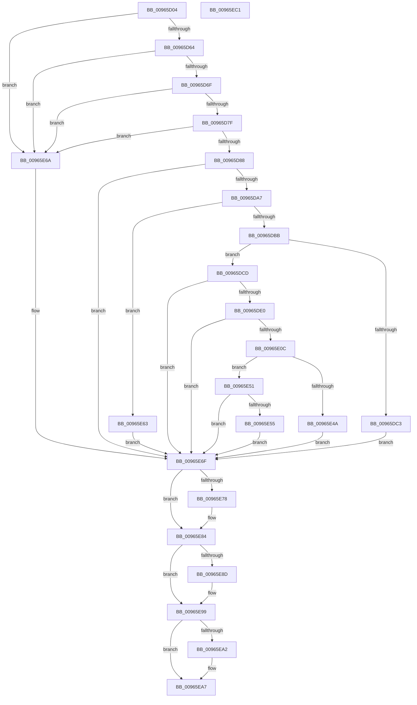

# PiOpenDriverRedirectedStateKey

- RVA: `0x00965D04`–`0x00965EC2` (길이 `446` bytes)
- VA: `0x0000000140965D04`
- 실행 섹션: `PAGE`
- PDB 이름 있음: `예`; PDB Function 태그: `아니요`
- unwind 정보 RVA: `0x00093800`
- 디코드: `119`개 명령, `446/446` bytes 표시
- 미해석 바이트: `0` (있으면 어셈블리에 `.byte`로 보존)

> 이 문서는 커널 이미지의 기계어와 PDB 기호를 분석해 생성했습니다. 4번과 5번은 함수 원형과 자료형을 바이너리 사용 방식에서 추정한 C 해석이며 원본 소스 복구 결과는 아닙니다.

## 1. Dependencies

- 직접 호출 지점: **9**; 고유 호출 대상: **7**
- 직접 호출자로 확인된 함수: **1**
- RIP 상대 이미지 참조: **2**

### Outgoing calls
- `0x00965D4B` → [RtlInitUnicodeString](../../text/42/RtlInitUnicodeString_function_0042A780.md) (function, `0x0042A780`)
- `0x00965D56` → [RtlInitUnicodeString](../../text/42/RtlInitUnicodeString_function_0042A780.md) (function, `0x0042A780`)
- `0x00965D98` → [PiGetStateRootPath](../A6/PiGetStateRootPath_function_00A67A70.md) (function, `0x00A67A70`)
- `0x00965DD1` → [IopAllocateUnicodeString](../95/IopAllocateUnicodeString_function_00951F0C.md) (function, `0x00951F0C`)
- `0x00965E01` → [RtlUnicodeStringPrintfEx](../../text/4A/RtlUnicodeStringPrintfEx_function_004A8FD0.md) (function, `0x004A8FD0`)
- `0x00965E3C` → [ZwOpenKey](../../text/6A/ZwOpenKey_function_006AD310.md) (function, `0x006AD310`)
- `0x00965E78` → [ExFreePool](../../poolcode/B8/ExFreePool_function_00B82850.md) (function, `0x00B82850`)
- `0x00965E8D` → [ExFreePool](../../poolcode/B8/ExFreePool_function_00B82850.md) (function, `0x00B82850`)
- `0x00965EA2` → [ZwClose](../../text/6A/ZwClose_function_006AD2B0.md) (function, `0x006AD2B0`)

### Direct callers
- [PipHardwareConfigActivateService](PipHardwareConfigActivateService_function_00965BFC.md) at `0x00965C3F`

### Static image references
- `0x00965D91` → RVA `0x00AFD690` (` ?? ::NNGAKEGL::`string'`; read)
- `0x00965DE9` → RVA `0x00AFD600` (` ?? ::NNGAKEGL::`string'`; read)

## 2. Other-region calls and transfers

- 다른 실행 섹션으로 향하는 call: **7**
  - `0x00965D4B` → [RtlInitUnicodeString](../../text/42/RtlInitUnicodeString_function_0042A780.md) (`PAGE` → `.text`)
  - `0x00965D56` → [RtlInitUnicodeString](../../text/42/RtlInitUnicodeString_function_0042A780.md) (`PAGE` → `.text`)
  - `0x00965E01` → [RtlUnicodeStringPrintfEx](../../text/4A/RtlUnicodeStringPrintfEx_function_004A8FD0.md) (`PAGE` → `.text`)
  - `0x00965E3C` → [ZwOpenKey](../../text/6A/ZwOpenKey_function_006AD310.md) (`PAGE` → `.text`)
  - `0x00965E78` → [ExFreePool](../../poolcode/B8/ExFreePool_function_00B82850.md) (`PAGE` → `POOLCODE`)
  - `0x00965E8D` → [ExFreePool](../../poolcode/B8/ExFreePool_function_00B82850.md) (`PAGE` → `POOLCODE`)
  - `0x00965EA2` → [ZwClose](../../text/6A/ZwClose_function_006AD2B0.md) (`PAGE` → `.text`)
- 별도 외부 분기/꼬리 이동을 확인하지 못했습니다.

## 3. Assembly (complete function range)

```asm
00965D04  48 89 5C 24 10                  mov qword ptr [rsp + 0x10], rbx
00965D09  48 89 74 24 18                  mov qword ptr [rsp + 0x18], rsi
00965D0E  55                              push rbp
00965D0F  57                              push rdi
00965D10  41 57                           push r15
00965D12  48 8B EC                        mov rbp, rsp
00965D15  48 81 EC 80 00 00 00            sub rsp, 0x80
00965D1C  33 C0                           xor eax, eax
00965D1E  0F 57 C0                        xorps xmm0, xmm0
00965D21  48 21 45 20                     and qword ptr [rbp + 0x20], rax
00965D25  48 8B F9                        mov rdi, rcx
00965D28  0F 57 C9                        xorps xmm1, xmm1
00965D2B  48 89 45 F0                     mov qword ptr [rbp - 0x10], rax
00965D2F  48 8D 4D B0                     lea rcx, [rbp - 0x50]
00965D33  89 45 F8                        mov dword ptr [rbp - 8], eax
00965D36  33 D2                           xor edx, edx
00965D38  49 8B F0                        mov rsi, r8
00965D3B  0F 11 45 D0                     movups xmmword ptr [rbp - 0x30], xmm0
00965D3F  0F 11 45 E0                     movups xmmword ptr [rbp - 0x20], xmm0
00965D43  0F 11 45 C0                     movups xmmword ptr [rbp - 0x40], xmm0
00965D47  0F 11 4D B0                     movups xmmword ptr [rbp - 0x50], xmm1
00965D4B  E8 30 4A AC FF                  call 0x14042a780
00965D50  33 D2                           xor edx, edx
00965D52  48 8D 4D C0                     lea rcx, [rbp - 0x40]
00965D56  E8 25 4A AC FF                  call 0x14042a780
00965D5B  48 85 FF                        test rdi, rdi
00965D5E  0F 84 06 01 00 00               je 0x140965e6a
00965D64  48 83 7F 08 00                  cmp qword ptr [rdi + 8], 0
00965D69  0F 84 FB 00 00 00               je 0x140965e6a
00965D6F  41 BF 02 00 00 00               mov r15d, 2
00965D75  66 44 39 3F                     cmp word ptr [rdi], r15w
00965D79  0F 82 EB 00 00 00               jb 0x140965e6a
00965D7F  48 85 F6                        test rsi, rsi
00965D82  0F 84 E2 00 00 00               je 0x140965e6a
00965D88  4C 8D 4D B0                     lea r9, [rbp - 0x50]
00965D8C  45 33 C0                        xor r8d, r8d
00965D8F  33 D2                           xor edx, edx
00965D91  48 8D 0D F8 78 19 00            lea rcx, [rip + 0x1978f8]
00965D98  E8 D3 1C 10 00                  call 0x140a67a70
00965D9D  8B D8                           mov ebx, eax
00965D9F  85 C0                           test eax, eax
00965DA1  0F 88 C8 00 00 00               js 0x140965e6f
00965DA7  0F B7 0F                        movzx ecx, word ptr [rdi]
00965DAA  0F B7 55 B0                     movzx edx, word ptr [rbp - 0x50]
00965DAE  41 03 CF                        add ecx, r15d
00965DB1  03 D1                           add edx, ecx
00965DB3  3B D1                           cmp edx, ecx
00965DB5  0F 82 A8 00 00 00               jb 0x140965e63
00965DBB  81 FA FE FF 00 00               cmp edx, 0xfffe
00965DC1  76 0A                           jbe 0x140965dcd
00965DC3  BB 05 00 00 80                  mov ebx, 0x80000005
00965DC8  E9 A2 00 00 00                  jmp 0x140965e6f
00965DCD  48 8D 4D C0                     lea rcx, [rbp - 0x40]
00965DD1  E8 36 C1 FE FF                  call 0x140951f0c
00965DD6  8B D8                           mov ebx, eax
00965DD8  85 C0                           test eax, eax
00965DDA  0F 88 8F 00 00 00               js 0x140965e6f
00965DE0  48 8D 45 B0                     lea rax, [rbp - 0x50]
00965DE4  48 89 7C 24 28                  mov qword ptr [rsp + 0x28], rdi
00965DE9  4C 8D 0D 10 78 19 00            lea r9, [rip + 0x197810]
00965DF0  48 89 44 24 20                  mov qword ptr [rsp + 0x20], rax
00965DF5  33 D2                           xor edx, edx
00965DF7  48 8D 4D C0                     lea rcx, [rbp - 0x40]
00965DFB  41 B8 00 08 00 00               mov r8d, 0x800
00965E01  E8 CA 31 B4 FF                  call 0x1404a8fd0
00965E06  8B D8                           mov ebx, eax
00965E08  85 C0                           test eax, eax
00965E0A  78 63                           js 0x140965e6f
00965E0C  48 83 65 D8 00                  and qword ptr [rbp - 0x28], 0
00965E11  48 8D 45 C0                     lea rax, [rbp - 0x40]
00965E15  0F 57 C0                        xorps xmm0, xmm0
00965E18  48 89 45 E0                     mov qword ptr [rbp - 0x20], rax
00965E1C  4C 8D 45 D0                     lea r8, [rbp - 0x30]
00965E20  C7 45 D0 30 00 00 00            mov dword ptr [rbp - 0x30], 0x30
00965E27  BA 06 00 03 00                  mov edx, 0x30006
00965E2C  C7 45 E8 40 02 00 00            mov dword ptr [rbp - 0x18], 0x240
00965E33  48 8D 4D 20                     lea rcx, [rbp + 0x20]
00965E37  F3 0F 7F 45 F0                  movdqu xmmword ptr [rbp - 0x10], xmm0
00965E3C  E8 CF 74 D4 FF                  call 0x1406ad310
00965E41  8B D8                           mov ebx, eax
00965E43  3D 34 00 00 C0                  cmp eax, 0xc0000034
00965E48  75 07                           jne 0x140965e51
00965E4A  BB 25 02 00 C0                  mov ebx, 0xc0000225
00965E4F  EB 1E                           jmp 0x140965e6f
00965E51  85 C0                           test eax, eax
00965E53  78 1A                           js 0x140965e6f
00965E55  48 8B 45 20                     mov rax, qword ptr [rbp + 0x20]
00965E59  48 83 65 20 00                  and qword ptr [rbp + 0x20], 0
00965E5E  48 89 06                        mov qword ptr [rsi], rax
00965E61  EB 0C                           jmp 0x140965e6f
00965E63  BB 95 00 00 C0                  mov ebx, 0xc0000095
00965E68  EB 05                           jmp 0x140965e6f
00965E6A  BB 0D 00 00 C0                  mov ebx, 0xc000000d
00965E6F  48 8B 4D B8                     mov rcx, qword ptr [rbp - 0x48]
00965E73  48 85 C9                        test rcx, rcx
00965E76  74 0C                           je 0x140965e84
00965E78  E8 D3 C9 21 00                  call 0x140b82850
00965E7D  0F 57 C0                        xorps xmm0, xmm0
00965E80  0F 11 45 B0                     movups xmmword ptr [rbp - 0x50], xmm0
00965E84  48 8B 4D C8                     mov rcx, qword ptr [rbp - 0x38]
00965E88  48 85 C9                        test rcx, rcx
00965E8B  74 0C                           je 0x140965e99
00965E8D  E8 BE C9 21 00                  call 0x140b82850
00965E92  0F 57 C0                        xorps xmm0, xmm0
00965E95  0F 11 45 C0                     movups xmmword ptr [rbp - 0x40], xmm0
00965E99  48 8B 4D 20                     mov rcx, qword ptr [rbp + 0x20]
00965E9D  48 85 C9                        test rcx, rcx
00965EA0  74 05                           je 0x140965ea7
00965EA2  E8 09 74 D4 FF                  call 0x1406ad2b0
00965EA7  4C 8D 9C 24 80 00 00 00         lea r11, [rsp + 0x80]
00965EAF  8B C3                           mov eax, ebx
00965EB1  49 8B 5B 28                     mov rbx, qword ptr [r11 + 0x28]
00965EB5  49 8B 73 30                     mov rsi, qword ptr [r11 + 0x30]
00965EB9  49 8B E3                        mov rsp, r11
00965EBC  41 5F                           pop r15
00965EBE  5F                              pop rdi
00965EBF  5D                              pop rbp
00965EC0  C3                              ret
00965EC1  CC                              int3
```

## 4. C-style interpretation (structured pseudocode)

```c
__int64 __fastcall PiOpenDriverRedirectedStateKey(__int64 a1, int a2, __int64 a3)
{
    __int64 result;
    __int64 v_rsp;
    unsigned __int64 v_stack_m18;
    unsigned int v_stack_m20;
    unsigned __int64 v_stack_m28;
    unsigned int v_stack_m30;
    unsigned __int64 v_stack_m38;
    unsigned __int64 v_stack_m40;
    unsigned __int64 v_stack_m48;
    unsigned __int64 v_stack_m50;
    unsigned __int64 v_stack_m58;
    unsigned __int64 v_stack_m60;
    unsigned __int64 v_stack_m68;
    unsigned __int64 v_stack_m70;
    unsigned __int64 v_stack_m78;
    unsigned __int64 v_stack_p10;
    unsigned __int64 v_stack_p18;
    unsigned __int64 v_stack_p8;

    v_stack_p10 = v_rbx;
    v_stack_p18 = v_rsi;
    v_rsp = (v_rsp) - (128);
    result = 0;
    v_stack_m28 = 0;
    v_stack_m20 = 0;
    a2 = 0;
    v_stack_m48 = v_xmm0;
    v_stack_m38 = v_xmm0;
    v_stack_m58 = v_xmm0;
    v_stack_m68 = v_xmm1;
    result = RtlInitUnicodeString(v_stack_m68, a2, a3, a4);
    a2 = 0;
    result = RtlInitUnicodeString(v_stack_m58, a2, a3, a4);
    if (a1 == 0) goto loc_00965E6A;
    if ((*(unsigned __int64 *)(a1 + 8)) == 0) goto loc_00965E6A;
    if ((*(unsigned __int16 *)(a1)) < 2) goto loc_00965E6A;
    if (a3 == 0) goto loc_00965E6A;
    a3 = 0;
    a2 = 0;
    result = PiGetStateRootPath(v_rip + 1669368, a2, a3, v_stack_m68);
    if (sign_flag) goto loc_00965E6F;
    a1 = (unsigned int)((*(unsigned __int16 *)(a1)) + (2));
    a2 = (unsigned int)((v_stack_m68) + ((unsigned int)(a1)));
    if (a2 < ((unsigned int)(a1))) goto loc_00965E63;
    if (a2 <= 0xFFFEULL) goto loc_00965DCD;
    goto loc_00965E6F;
loc_00965DCD:
    result = IopAllocateUnicodeString(v_stack_m58, a2, a3, v_stack_m68);
    if (sign_flag) goto loc_00965E6F;
    v_stack_m70 = a1;
    v_stack_m78 = v_stack_m68;
    a2 = 0;
    result = RtlUnicodeStringPrintfEx(v_stack_m58, a2, (unsigned int)(0x800ULL), v_rip + 1669136);
    if (sign_flag) goto loc_00965E6F;
    v_stack_m38 = v_stack_m58;
    v_stack_m48 = 48;
    v_stack_m30 = 576;
    v_stack_m28 = v_xmm0;
    result = ZwOpenKey(v_stack_p8, (unsigned int)(0x30006ULL), v_stack_m48, v_rip + 1669136);
    if (((unsigned int)(result)) != 0xC0000034ULL) goto loc_00965E51;
    goto loc_00965E6F;
loc_00965E51:
    if (sign_flag) goto loc_00965E6F;
    *(unsigned __int64 *)(a3) = v_stack_p8;
    goto loc_00965E6F;
loc_00965E63:
    goto loc_00965E6F;
loc_00965E6A:
loc_00965E6F:
    result = v_stack_p8;
    if (v_stack_m60 != 0) {
        result = ExFreePool(v_stack_m60, (unsigned int)(0x30006ULL), v_stack_m48, v_rip + 1669136);
        v_stack_m68 = v_xmm0;
    }
    if (v_stack_m50 != 0) {
        result = ExFreePool(v_stack_m50, (unsigned int)(0x30006ULL), v_stack_m48, v_rip + 1669136);
        v_stack_m58 = v_xmm0;
    }
    if (v_stack_p8 != 0) {
        result = ZwClose(v_stack_p8, (unsigned int)(0x30006ULL), v_stack_m48, v_rip + 1669136);
    }
    return (unsigned int)((unsigned int)((unsigned int)(0xC000000DULL)));
}
```

## 5. (Beta) C Style

```c
int64_t PiOpenDriverRedirectedStateKey(int64_t Arg1, int32_t Arg2, int64_t Arg3)
{
    int64_t result;
    int64_t local_rsp;
    uint64_t v_stack_m18;
    uint32_t v_stack_m20;
    uint64_t v_stack_m28;
    uint32_t v_stack_m30;
    uint64_t v_stack_m38;
    uint64_t v_stack_m40;
    uint64_t v_stack_m48;
    uint64_t v_stack_m50;
    uint64_t v_stack_m58;
    uint64_t v_stack_m60;
    uint64_t v_stack_m68;
    uint64_t v_stack_m70;
    uint64_t v_stack_m78;
    uint64_t v_stack_p10;
    uint64_t v_stack_p18;
    uint64_t v_stack_p8;

    v_stack_p10 = local_rbx;
    v_stack_p18 = local_rsi;
    local_rsp = (local_rsp) - (128);
    result = 0;
    v_stack_m28 = 0;
    v_stack_m20 = 0;
    Arg2 = 0;
    v_stack_m48 = v_xmm0;
    v_stack_m38 = v_xmm0;
    v_stack_m58 = v_xmm0;
    v_stack_m68 = v_xmm1;
    result = RtlInitUnicodeString(v_stack_m68, Arg2, Arg3, a4);
    Arg2 = 0;
    result = RtlInitUnicodeString(v_stack_m58, Arg2, Arg3, a4);
    if (Arg1 == 0) goto loc_00965E6A;
    if ((*(uint64_t *)(Arg1 + 0x8)) == 0) goto loc_00965E6A;
    if ((*(uint16_t *)(Arg1)) < 2) goto loc_00965E6A;
    if (Arg3 == 0) goto loc_00965E6A;
    Arg3 = 0;
    Arg2 = 0;
    result = PiGetStateRootPath(v_rip + 1669368, Arg2, Arg3, v_stack_m68);
    if (sign_flag) goto loc_00965E6F;
    Arg1 = (uint32_t)((*(uint16_t *)(Arg1)) + (2));
    Arg2 = (uint32_t)((v_stack_m68) + ((uint32_t)(Arg1)));
    if (Arg2 < ((uint32_t)(Arg1))) goto loc_00965E63;
    if (Arg2 <= 0xFFFEULL) goto loc_00965DCD;
    goto loc_00965E6F;
loc_00965DCD:
    result = IopAllocateUnicodeString(v_stack_m58, Arg2, Arg3, v_stack_m68);
    if (sign_flag) goto loc_00965E6F;
    v_stack_m70 = Arg1;
    v_stack_m78 = v_stack_m68;
    Arg2 = 0;
    result = RtlUnicodeStringPrintfEx(v_stack_m58, Arg2, (uint32_t)(0x800ULL), v_rip + 1669136);
    if (sign_flag) goto loc_00965E6F;
    v_stack_m38 = v_stack_m58;
    v_stack_m48 = 48;
    v_stack_m30 = 576;
    v_stack_m28 = v_xmm0;
    result = ZwOpenKey(v_stack_p8, (uint32_t)(0x30006ULL), v_stack_m48, v_rip + 1669136);
    if (((uint32_t)(result)) != 0xC0000034ULL) goto loc_00965E51;
    goto loc_00965E6F;
loc_00965E51:
    if (sign_flag) goto loc_00965E6F;
    *(uint64_t *)(Arg3) = v_stack_p8;
    goto loc_00965E6F;
loc_00965E63:
    goto loc_00965E6F;
loc_00965E6A:
loc_00965E6F:
    result = v_stack_p8;
    if (v_stack_m60 != 0) {
        result = ExFreePool(v_stack_m60, (uint32_t)(0x30006ULL), v_stack_m48, v_rip + 1669136);
        v_stack_m68 = v_xmm0;
    }
    if (v_stack_m50 != 0) {
        result = ExFreePool(v_stack_m50, (uint32_t)(0x30006ULL), v_stack_m48, v_rip + 1669136);
        v_stack_m58 = v_xmm0;
    }
    if (v_stack_p8 != 0) {
        result = ZwClose(v_stack_p8, (uint32_t)(0x30006ULL), v_stack_m48, v_rip + 1669136);
    }
    return (uint32_t)((uint32_t)((uint32_t)(0xC000000DULL)));
}
```

## 6. Execution-region graph

[열기: 2D/3D 그래프와 함수 탐색 컨트롤 패널](../../../control-panel.html?section=page&rva=0x00965D04&view=graph)

- 2D 그래프는 위에서 아래로 흐르고, 3D 그래프는 빈 공간을 드래그해 회전합니다. Shift+드래그는 이동, 휠은 확대·축소, 함수 노드 선택은 대상 보고서 이동입니다.

### Static fallback


