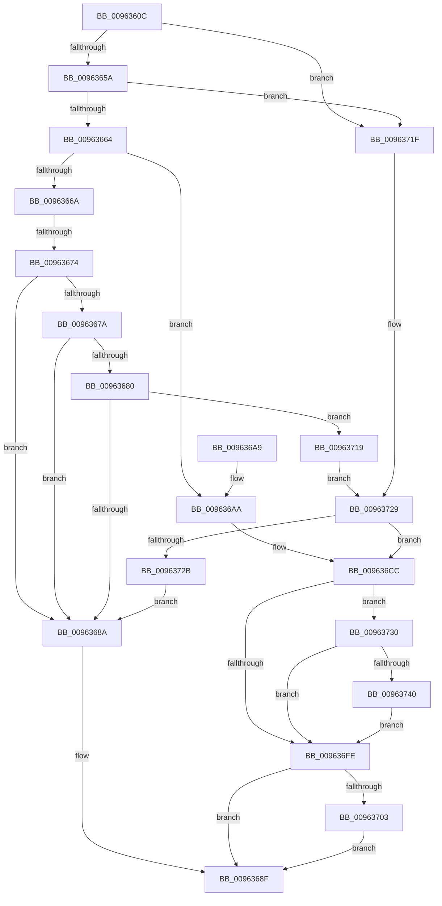

# PiPnpRtlSetDeviceRegProperty

- RVA: `0x0096360C`–`0x00963768` (길이 `348` bytes)
- VA: `0x000000014096360C`
- 실행 섹션: `PAGE`
- PDB 이름 있음: `예`; PDB Function 태그: `예`
- unwind 정보 RVA: `0x00093544`
- 디코드: `101`개 명령, `348/348` bytes 표시
- 미해석 바이트: `0` (있으면 어셈블리에 `.byte`로 보존)

> 이 문서는 커널 이미지의 기계어와 PDB 기호를 분석해 생성했습니다. 4번과 5번은 함수 원형과 자료형을 바이너리 사용 방식에서 추정한 C 해석이며 원본 소스 복구 결과는 아닙니다.

## 1. Dependencies

- 직접 호출 지점: **8**; 고유 호출 대상: **8**
- 직접 호출자로 확인된 함수: **2**
- RIP 상대 이미지 참조: **1**

### Outgoing calls
- `0x009636C4` → [ExAcquireResourceExclusiveLite](../../text/21/ExAcquireResourceExclusiveLite_function_00214E20.md) (function, `0x00214E20`)
- `0x009636F1` → [CmSetDeviceRegProp](../8F/CmSetDeviceRegProp_function_008FD68C.md) (function, `0x008FD68C`)
- `0x0096370A` → [ExReleaseResourceLite](../../text/25/ExReleaseResourceLite_function_0025FA10.md) (function, `0x0025FA10`)
- `0x0096370F` → [KeLeaveCriticalRegion](../../text/25/KeLeaveCriticalRegion_function_0025D8B0.md) (function, `0x0025D8B0`)
- `0x00963722` → [CmIsRootEnumeratedDevice](../8F/CmIsRootEnumeratedDevice_function_008F6E08.md) (function, `0x008F6E08`)
- `0x00963737` → [SeAuditingWithTokenForSubcategory](../90/SeAuditingWithTokenForSubcategory_function_009047D0.md) (function, `0x009047D0`)
- `0x00963747` → [RtlInitUnicodeString](../../text/42/RtlInitUnicodeString_function_0042A780.md) (function, `0x0042A780`)
- `0x00963761` → [PiAuditDeviceEnableDisableRequest](../74/PiAuditDeviceEnableDisableRequest_function_00740AB8.md) (function, `0x00740AB8`)

### Direct callers
- [PiCMSetRegistryProperty](PiCMSetRegistryProperty_function_00963118.md) at `0x00963206`
- [PiDevCfgSetDeviceRegProp](PiDevCfgSetDeviceRegProp_function_009635C0.md) at `0x009635F9`

### Static image references
- `0x009636B3` → RVA `0x00F8C600` (`.data`; read)

## 2. Other-region calls and transfers

- 다른 실행 섹션으로 향하는 call: **4**
  - `0x009636C4` → [ExAcquireResourceExclusiveLite](../../text/21/ExAcquireResourceExclusiveLite_function_00214E20.md) (`PAGE` → `.text`)
  - `0x0096370A` → [ExReleaseResourceLite](../../text/25/ExReleaseResourceLite_function_0025FA10.md) (`PAGE` → `.text`)
  - `0x0096370F` → [KeLeaveCriticalRegion](../../text/25/KeLeaveCriticalRegion_function_0025D8B0.md) (`PAGE` → `.text`)
  - `0x00963747` → [RtlInitUnicodeString](../../text/42/RtlInitUnicodeString_function_0042A780.md) (`PAGE` → `.text`)
- call이 아닌 외부 분기/꼬리 이동: **1**
  - `0x0096366E` → [sub_00B280B0](../B2/Unknown_function_00B280B0.md) (`tail-transfer`)

## 3. Assembly (complete function range)

```asm
0096360C  48 89 5C 24 10                  mov qword ptr [rsp + 0x10], rbx
00963611  48 89 4C 24 08                  mov qword ptr [rsp + 8], rcx
00963616  55                              push rbp
00963617  56                              push rsi
00963618  57                              push rdi
00963619  41 54                           push r12
0096361B  41 55                           push r13
0096361D  41 56                           push r14
0096361F  41 57                           push r15
00963621  48 8B EC                        mov rbp, rsp
00963624  48 83 EC 60                     sub rsp, 0x60
00963628  44 8B 65 70                     mov r12d, dword ptr [rbp + 0x70]
0096362C  33 C9                           xor ecx, ecx
0096362E  48 8B 5D 68                     mov rbx, qword ptr [rbp + 0x68]
00963632  45 8B F9                        mov r15d, r9d
00963635  89 4D 58                        mov dword ptr [rbp + 0x58], ecx
00963638  0F 57 C0                        xorps xmm0, xmm0
0096363B  89 4D E4                        mov dword ptr [rbp - 0x1c], ecx
0096363E  4D 8B E8                        mov r13, r8
00963641  89 4D E0                        mov dword ptr [rbp - 0x20], ecx
00963644  48 8B FA                        mov rdi, rdx
00963647  8B F1                           mov esi, ecx
00963649  44 8A F1                        mov r14b, cl
0096364C  0F 11 45 E8                     movups xmmword ptr [rbp - 0x18], xmm0
00963650  41 83 E9 02                     sub r9d, 2
00963654  0F 84 C5 00 00 00               je 0x14096371f
0096365A  41 83 E9 01                     sub r9d, 1
0096365E  0F 84 BB 00 00 00               je 0x14096371f
00963664  41 83 E9 06                     sub r9d, 6
00963668  74 40                           je 0x1409636aa
0096366A  41 83 E9 02                     sub r9d, 2
0096366E  0F 84 3C 4A 1C 00               je 0x140b280b0
00963674  41 83 E9 05                     sub r9d, 5
00963678  74 10                           je 0x14096368a
0096367A  41 83 E9 01                     sub r9d, 1
0096367E  74 0A                           je 0x14096368a
00963680  41 83 E9 0C                     sub r9d, 0xc
00963684  0F 85 8F 00 00 00               jne 0x140963719
0096368A  BB 22 00 00 C0                  mov ebx, 0xc0000022
0096368F  8B C3                           mov eax, ebx
00963691  48 8B 9C 24 A8 00 00 00         mov rbx, qword ptr [rsp + 0xa8]
00963699  48 83 C4 60                     add rsp, 0x60
0096369D  41 5F                           pop r15
0096369F  41 5E                           pop r14
009636A1  41 5D                           pop r13
009636A3  41 5C                           pop r12
009636A5  5F                              pop rdi
009636A6  5E                              pop rsi
009636A7  5D                              pop rbp
009636A8  C3                              ret
009636A9  CC                              int3
009636AA  65 48 8B 04 25 88 01 00 00      mov rax, qword ptr gs:[0x188]
009636B3  48 8D 0D 46 8F 62 00            lea rcx, [rip + 0x628f46]
009636BA  B2 01                           mov dl, 1
009636BC  66 FF 88 E4 01 00 00            dec word ptr [rax + 0x1e4]
009636C3  90                              nop
009636C4  E8 57 17 8B FF                  call 0x140214e20
009636C9  41 B6 01                        mov r14b, 1
009636CC  8B 45 78                        mov eax, dword ptr [rbp + 0x78]
009636CF  45 8B CF                        mov r9d, r15d
009636D2  48 8B 4D 40                     mov rcx, qword ptr [rbp + 0x40]
009636D6  4D 8B C5                        mov r8, r13
009636D9  89 44 24 38                     mov dword ptr [rsp + 0x38], eax
009636DD  48 8B D7                        mov rdx, rdi
009636E0  8B 45 60                        mov eax, dword ptr [rbp + 0x60]
009636E3  44 89 64 24 30                  mov dword ptr [rsp + 0x30], r12d
009636E8  48 89 5C 24 28                  mov qword ptr [rsp + 0x28], rbx
009636ED  89 44 24 20                     mov dword ptr [rsp + 0x20], eax
009636F1  E8 96 9F F9 FF                  call 0x1408fd68c
009636F6  8B D8                           mov ebx, eax
009636F8  41 83 FF 0B                     cmp r15d, 0xb
009636FC  74 32                           je 0x140963730
009636FE  45 84 F6                        test r14b, r14b
00963701  74 8C                           je 0x14096368f
00963703  48 8D 0D F6 8E 62 00            lea rcx, [rip + 0x628ef6]
0096370A  E8 01 C3 8F FF                  call 0x14025fa10
0096370F  E8 9C A1 8F FF                  call 0x14025d8b0
00963714  E9 76 FF FF FF                  jmp 0x14096368f
00963719  41 83 F9 08                     cmp r9d, 8
0096371D  EB 0A                           jmp 0x140963729
0096371F  48 8B CF                        mov rcx, rdi
00963722  E8 E1 36 F9 FF                  call 0x1408f6e08
00963727  84 C0                           test al, al
00963729  75 A1                           jne 0x1409636cc
0096372B  E9 5A FF FF FF                  jmp 0x14096368a
00963730  33 D2                           xor edx, edx
00963732  B9 8A 00 00 00                  mov ecx, 0x8a
00963737  E8 94 10 FA FF                  call 0x1409047d0
0096373C  84 C0                           test al, al
0096373E  74 BE                           je 0x1409636fe
00963740  48 8B D7                        mov rdx, rdi
00963743  48 8D 4D E8                     lea rcx, [rbp - 0x18]
00963747  E8 34 70 AC FF                  call 0x14042a780
0096374C  8B 55 E0                        mov edx, dword ptr [rbp - 0x20]
0096374F  48 8D 4D E8                     lea rcx, [rbp - 0x18]
00963753  44 8B CB                        mov r9d, ebx
00963756  44 8B C6                        mov r8d, esi
00963759  41 C1 E9 1F                     shr r9d, 0x1f
0096375D  41 80 F1 01                     xor r9b, 1
00963761  E8 52 D3 DD FF                  call 0x140740ab8
00963766  EB 96                           jmp 0x1409636fe
```

## 4. C-style interpretation (structured pseudocode)

```c
__int64 __fastcall PiPnpRtlSetDeviceRegProperty(__int64 a1, __int64 a2, __int64 a3, int a4, unsigned int a5, __int64 a6, unsigned int a7, unsigned int a8)
{
    __int64 result;
    __int64 v_rsp;
    unsigned __int64 v_stack_m50;
    unsigned int v_stack_m54;
    unsigned int v_stack_m58;
    unsigned __int64 v_stack_p10;
    unsigned int v_stack_p20;
    unsigned __int64 v_stack_p28;
    unsigned int v_stack_p30;
    unsigned int v_stack_p38;
    unsigned __int64 v_stack_p8;

    v_stack_p10 = v_rbx;
    v_stack_p8 = a1;
    v_rsp = (v_rsp) - (96);
    a1 = 0;
    v_stack_p20 = 0;
    v_stack_m54 = 0;
    v_stack_m58 = 0;
    v_stack_m50 = v_xmm0;
    a4 = (unsigned int)((a4) - (2));
    if (condition_is_equal) goto loc_0096371F;
    a4 = (unsigned int)((a4) - (1));
    if (condition_is_equal) goto loc_0096371F;
    a4 = (unsigned int)((a4) - (6));
    if (condition_is_equal) goto loc_009636AA;
    a4 = (unsigned int)((a4) - (2));
    a4 = (unsigned int)((a4) - (5));
    if (condition_is_equal) goto loc_0096368A;
    a4 = (unsigned int)((a4) - (1));
    if (condition_is_equal) goto loc_0096368A;
    a4 = (unsigned int)((a4) - (12));
    if (condition_is_not_equal) goto loc_00963719;
loc_0096368A:
loc_0096368F:
    v_rsp = (v_rsp) + (96);
    return (unsigned int)((unsigned int)((unsigned int)(0xC0000022ULL)));
loc_009636AA:
    result = ExAcquireResourceExclusiveLite(v_rip + 6459206, 1, a3, a4);
loc_009636CC:
    v_stack_p38 = (unsigned int)((unsigned int)(a8));
    v_stack_p30 = (unsigned int)((unsigned int)(a7));
    v_stack_p28 = v_stack_p10;
    v_stack_p20 = (unsigned int)((unsigned int)(a5));
    result = CmSetDeviceRegProp(v_stack_p8, a2, a3, (unsigned int)((unsigned int)((unsigned int)(a4))));
    if (((unsigned int)((unsigned int)(a4))) == 11) goto loc_00963730;
loc_009636FE:
    if (1 == 0) goto loc_0096368F;
    result = ExReleaseResourceLite(v_rip + 6459126, a2, a3, (unsigned int)((unsigned int)((unsigned int)(a4))));
    result = KeLeaveCriticalRegion(v_rip + 6459126, a2, a3, (unsigned int)((unsigned int)((unsigned int)(a4))));
    goto loc_0096368F;
loc_00963719:
    goto loc_00963729;
loc_0096371F:
    result = CmIsRootEnumeratedDevice(a2, a2, a3, (unsigned int)((unsigned int)((unsigned int)(a4))));
loc_00963729:
    if ((unsigned __int8)(result) != 0) goto loc_009636CC;
    goto loc_0096368A;
loc_00963730:
    a2 = 0;
    result = SeAuditingWithTokenForSubcategory(138, a2, a3, (unsigned int)((unsigned int)((unsigned int)(a4))));
    if ((unsigned __int8)(result) == 0) goto loc_009636FE;
    result = RtlInitUnicodeString(v_stack_m50, 0, a3, (unsigned int)((unsigned int)((unsigned int)(a4))));
    a4 = (unsigned int)(((unsigned int)((unsigned int)((unsigned int)((unsigned int)(result))))) >> (31));
    a4 = (unsigned __int8)((a4) ^ (1));
    result = PiAuditDeviceEnableDisableRequest(v_stack_m50, (unsigned int)(v_stack_m58), 0, a4);
    goto loc_009636FE;
}
```

## 5. (Beta) C Style

```c
int64_t PiPnpRtlSetDeviceRegProperty(int64_t Arg1, int64_t Arg2, int64_t Arg3, int32_t Arg4, uint32_t Arg5, int64_t Arg6, uint32_t Arg7, uint32_t Arg8)
{
    int64_t result;
    int64_t local_rsp;
    uint64_t v_stack_m50;
    uint32_t v_stack_m54;
    uint32_t v_stack_m58;
    uint64_t v_stack_p10;
    uint32_t v_stack_p20;
    uint64_t v_stack_p28;
    uint32_t v_stack_p30;
    uint32_t v_stack_p38;
    uint64_t v_stack_p8;

    v_stack_p10 = local_rbx;
    v_stack_p8 = Arg1;
    local_rsp = (local_rsp) - (96);
    Arg1 = 0;
    v_stack_p20 = 0;
    v_stack_m54 = 0;
    v_stack_m58 = 0;
    v_stack_m50 = v_xmm0;
    Arg4 = (uint32_t)((Arg4) - (2));
    if (condition_is_equal) goto loc_0096371F;
    Arg4 = (uint32_t)((Arg4) - (1));
    if (condition_is_equal) goto loc_0096371F;
    Arg4 = (uint32_t)((Arg4) - (6));
    if (condition_is_equal) goto loc_009636AA;
    Arg4 = (uint32_t)((Arg4) - (2));
    Arg4 = (uint32_t)((Arg4) - (5));
    if (condition_is_equal) goto loc_0096368A;
    Arg4 = (uint32_t)((Arg4) - (1));
    if (condition_is_equal) goto loc_0096368A;
    Arg4 = (uint32_t)((Arg4) - (12));
    if (condition_is_not_equal) goto loc_00963719;
loc_0096368A:
loc_0096368F:
    local_rsp = (local_rsp) + (96);
    return (uint32_t)((uint32_t)((uint32_t)(0xC0000022ULL)));
loc_009636AA:
    result = ExAcquireResourceExclusiveLite(v_rip + 6459206, 1, Arg3, Arg4);
loc_009636CC:
    v_stack_p38 = (uint32_t)((uint32_t)(Arg8));
    v_stack_p30 = (uint32_t)((uint32_t)(Arg7));
    v_stack_p28 = v_stack_p10;
    v_stack_p20 = (uint32_t)((uint32_t)(Arg5));
    result = CmSetDeviceRegProp(v_stack_p8, Arg2, Arg3, (uint32_t)((uint32_t)((uint32_t)(Arg4))));
    if (((uint32_t)((uint32_t)(Arg4))) == 11) goto loc_00963730;
loc_009636FE:
    if (1 == 0) goto loc_0096368F;
    result = ExReleaseResourceLite(v_rip + 6459126, Arg2, Arg3, (uint32_t)((uint32_t)((uint32_t)(Arg4))));
    result = KeLeaveCriticalRegion(v_rip + 6459126, Arg2, Arg3, (uint32_t)((uint32_t)((uint32_t)(Arg4))));
    goto loc_0096368F;
loc_00963719:
    goto loc_00963729;
loc_0096371F:
    result = CmIsRootEnumeratedDevice(Arg2, Arg2, Arg3, (uint32_t)((uint32_t)((uint32_t)(Arg4))));
loc_00963729:
    if ((uint8_t)(result) != 0) goto loc_009636CC;
    goto loc_0096368A;
loc_00963730:
    Arg2 = 0;
    result = SeAuditingWithTokenForSubcategory(138, Arg2, Arg3, (uint32_t)((uint32_t)((uint32_t)(Arg4))));
    if ((uint8_t)(result) == 0) goto loc_009636FE;
    result = RtlInitUnicodeString(v_stack_m50, 0, Arg3, (uint32_t)((uint32_t)((uint32_t)(Arg4))));
    Arg4 = (uint32_t)(((uint32_t)((uint32_t)((uint32_t)((uint32_t)(result))))) >> (31));
    Arg4 = (uint8_t)((Arg4) ^ (1));
    result = PiAuditDeviceEnableDisableRequest(v_stack_m50, (uint32_t)(v_stack_m58), 0, Arg4);
    goto loc_009636FE;
}
```

## 6. Execution-region graph

[열기: 2D/3D 그래프와 함수 탐색 컨트롤 패널](../../../control-panel.html?section=page&rva=0x0096360C&view=graph)

- 2D 그래프는 위에서 아래로 흐르고, 3D 그래프는 빈 공간을 드래그해 회전합니다. Shift+드래그는 이동, 휠은 확대·축소, 함수 노드 선택은 대상 보고서 이동입니다.

### Static fallback


