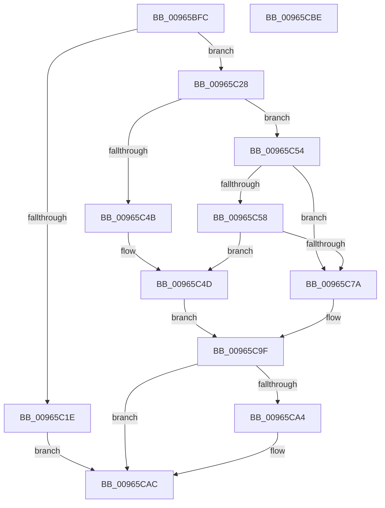

# PipHardwareConfigActivateService

- RVA: `0x00965BFC`–`0x00965CBF` (길이 `195` bytes)
- VA: `0x0000000140965BFC`
- 실행 섹션: `PAGE`
- PDB 이름 있음: `예`; PDB Function 태그: `아니요`
- unwind 정보 RVA: `0x000937EC`
- 디코드: `54`개 명령, `195/195` bytes 표시
- 미해석 바이트: `0` (있으면 어셈블리에 `.byte`로 보존)

> 이 문서는 커널 이미지의 기계어와 PDB 기호를 분석해 생성했습니다. 4번과 5번은 함수 원형과 자료형을 바이너리 사용 방식에서 추정한 C 해석이며 원본 소스 복구 결과는 아닙니다.

## 1. Dependencies

- 직접 호출 지점: **5**; 고유 호출 대상: **5**
- 직접 호출자로 확인된 함수: **1**
- RIP 상대 이미지 참조: **2**

### Outgoing calls
- `0x00965C30` → [RtlInitUnicodeString](../../text/42/RtlInitUnicodeString_function_0042A780.md) (function, `0x0042A780`)
- `0x00965C3F` → [PiOpenDriverRedirectedStateKey](PiOpenDriverRedirectedStateKey_function_00965D04.md) (function, `0x00965D04`)
- `0x00965C6F` → [PipOpenServiceEnumKeys](../99/PipOpenServiceEnumKeys_function_00998E94.md) (function, `0x00998E94`)
- `0x00965C90` → [PnpCtxRegDeleteTree](PnpCtxRegDeleteTree_function_00965CC8.md) (function, `0x00965CC8`)
- `0x00965CA7` → [ZwClose](../../text/6A/ZwClose_function_006AD2B0.md) (function, `0x006AD2B0`)

### Direct callers
- [PiDevCfgConfigureDevice](../97/PiDevCfgConfigureDevice_function_00977BB4.md) at `0x00979FAC`
- [PiDevCfgConfigureDevice](../97/PiDevCfgConfigureDevice_function_00977BB4.md) at `0x00979FC7`
- [PiDevCfgConfigureDevice](../97/PiDevCfgConfigureDevice_function_00977BB4.md) at `0x0097A020`

### Static image references
- `0x00965C7F` → RVA `0x00AFD350` (` ?? ::NNGAKEGL::`string'`; read)
- `0x00965C86` → RVA `0x00E66398` (`.data`; read)

## 2. Other-region calls and transfers

- 다른 실행 섹션으로 향하는 call: **2**
  - `0x00965C30` → [RtlInitUnicodeString](../../text/42/RtlInitUnicodeString_function_0042A780.md) (`PAGE` → `.text`)
  - `0x00965CA7` → [ZwClose](../../text/6A/ZwClose_function_006AD2B0.md) (`PAGE` → `.text`)
- 별도 외부 분기/꼬리 이동을 확인하지 못했습니다.

## 3. Assembly (complete function range)

```asm
00965BFC  48 8B C4                        mov rax, rsp
00965BFF  48 89 58 10                     mov qword ptr [rax + 0x10], rbx
00965C03  48 89 70 18                     mov qword ptr [rax + 0x18], rsi
00965C07  57                              push rdi
00965C08  48 83 EC 40                     sub rsp, 0x40
00965C0C  33 F6                           xor esi, esi
00965C0E  0F 57 C0                        xorps xmm0, xmm0
00965C11  48 89 70 08                     mov qword ptr [rax + 8], rsi
00965C15  0F 11 40 E8                     movups xmmword ptr [rax - 0x18], xmm0
00965C19  48 85 C9                        test rcx, rcx
00965C1C  75 0A                           jne 0x140965c28
00965C1E  BB 0D 00 00 C0                  mov ebx, 0xc000000d
00965C23  E9 84 00 00 00                  jmp 0x140965cac
00965C28  48 8B D1                        mov rdx, rcx
00965C2B  48 8D 4C 24 30                  lea rcx, [rsp + 0x30]
00965C30  E8 4B 4B AC FF                  call 0x14042a780
00965C35  4C 8D 44 24 50                  lea r8, [rsp + 0x50]
00965C3A  48 8D 4C 24 30                  lea rcx, [rsp + 0x30]
00965C3F  E8 C0 00 00 00                  call 0x140965d04
00965C44  3D 25 02 00 C0                  cmp eax, 0xc0000225
00965C49  75 09                           jne 0x140965c54
00965C4B  8B DE                           mov ebx, esi
00965C4D  48 8B 7C 24 50                  mov rdi, qword ptr [rsp + 0x50]
00965C52  EB 4B                           jmp 0x140965c9f
00965C54  85 C0                           test eax, eax
00965C56  79 22                           jns 0x140965c7a
00965C58  45 33 C9                        xor r9d, r9d
00965C5B  40 88 74 24 20                  mov byte ptr [rsp + 0x20], sil
00965C60  4C 8D 44 24 50                  lea r8, [rsp + 0x50]
00965C65  BA 00 00 01 00                  mov edx, 0x10000
00965C6A  48 8D 4C 24 30                  lea rcx, [rsp + 0x30]
00965C6F  E8 20 32 03 00                  call 0x140998e94
00965C74  8B D8                           mov ebx, eax
00965C76  85 C0                           test eax, eax
00965C78  78 D3                           js 0x140965c4d
00965C7A  48 8B 7C 24 50                  mov rdi, qword ptr [rsp + 0x50]
00965C7F  4C 8D 05 CA 76 19 00            lea r8, [rip + 0x1976ca]
00965C86  48 8B 0D 0B 07 50 00            mov rcx, qword ptr [rip + 0x50070b]
00965C8D  48 8B D7                        mov rdx, rdi
00965C90  E8 33 00 00 00                  call 0x140965cc8
00965C95  3D 34 00 00 C0                  cmp eax, 0xc0000034
00965C9A  8B D8                           mov ebx, eax
00965C9C  0F 44 DE                        cmove ebx, esi
00965C9F  48 85 FF                        test rdi, rdi
00965CA2  74 08                           je 0x140965cac
00965CA4  48 8B CF                        mov rcx, rdi
00965CA7  E8 04 76 D4 FF                  call 0x1406ad2b0
00965CAC  48 8B 74 24 60                  mov rsi, qword ptr [rsp + 0x60]
00965CB1  8B C3                           mov eax, ebx
00965CB3  48 8B 5C 24 58                  mov rbx, qword ptr [rsp + 0x58]
00965CB8  48 83 C4 40                     add rsp, 0x40
00965CBC  5F                              pop rdi
00965CBD  C3                              ret
00965CBE  CC                              int3
```

## 4. C-style interpretation (structured pseudocode)

```c
__int64 __fastcall PipHardwareConfigActivateService(__int64 a1, __int64 a2, __int64 a3, int a4)
{
    __int64 result;
    __int64 v_rbx;
    __int64 v_rsi;
    __int64 v_rsp;
    unsigned __int64 v_stack_m18;
    unsigned __int8 v_stack_m28;
    unsigned __int64 v_stack_p10;
    unsigned __int64 v_stack_p18;
    unsigned __int64 v_stack_p8;

    *(unsigned __int64 *)(v_rsp + 16) = v_rbx;
    *(unsigned __int64 *)(v_rsp + 24) = v_rsi;
    v_rsp = (v_rsp) - (64);
    v_rsi = 0;
    *(unsigned __int64 *)(v_rsp + 8) = 0;
    *(unsigned __int64 *)(v_rsp - 24) = v_xmm0;
    if (a1 != 0) goto loc_00965C28;
    goto loc_00965CAC;
loc_00965C28:
    result = RtlInitUnicodeString(v_stack_m18, a1, a3, a4);
    result = PiOpenDriverRedirectedStateKey(v_stack_m18, a1, v_stack_p8, a4);
    if (((unsigned int)(result)) != 0xC0000225ULL) goto loc_00965C54;
loc_00965C4D:
    goto loc_00965C9F;
loc_00965C54:
    if (!sign_flag) goto loc_00965C7A;
    a4 = 0;
    v_stack_m28 = 0;
    result = PipOpenServiceEnumKeys(v_stack_m18, (unsigned int)(0x10000ULL), v_stack_p8, a4);
    if (sign_flag) goto loc_00965C4D;
loc_00965C7A:
    result = PnpCtxRegDeleteTree(*(unsigned __int64 *)(v_rip + 5244683), v_stack_p8, v_rip + 1668810, a4);
    v_rbx = (unsigned int)((unsigned int)(result));
    if (((unsigned int)(result)) == 0xC0000034ULL) { v_rbx = 0; }
loc_00965C9F:
    if (v_stack_p8 != 0) {
        a1 = v_stack_p8;
        result = ZwClose(a1, v_stack_p8, v_rip + 1668810, a4);
    }
    v_rsp = (v_rsp) + (64);
    return (unsigned int)((unsigned int)(v_rbx));
}
```

## 5. (Beta) C Style

```c
int64_t PipHardwareConfigActivateService(int64_t Arg1, int64_t Arg2, int64_t Arg3, int32_t Arg4)
{
    int64_t result;
    int64_t local_rbx;
    int64_t local_rsi;
    int64_t local_rsp;
    uint64_t v_stack_m18;
    uint8_t v_stack_m28;
    uint64_t v_stack_p10;
    uint64_t v_stack_p18;
    uint64_t v_stack_p8;

    *(uint64_t *)(local_rsp + 0x10) = local_rbx;
    *(uint64_t *)(local_rsp + 0x18) = local_rsi;
    local_rsp = (local_rsp) - (64);
    local_rsi = 0;
    *(uint64_t *)(local_rsp + 0x8) = 0;
    *(uint64_t *)(local_rsp - 0x18) = v_xmm0;
    if (Arg1 != 0) goto loc_00965C28;
    goto loc_00965CAC;
loc_00965C28:
    result = RtlInitUnicodeString(v_stack_m18, Arg1, Arg3, Arg4);
    result = PiOpenDriverRedirectedStateKey(v_stack_m18, Arg1, v_stack_p8, Arg4);
    if (((uint32_t)(result)) != 0xC0000225ULL) goto loc_00965C54;
loc_00965C4D:
    goto loc_00965C9F;
loc_00965C54:
    if (!sign_flag) goto loc_00965C7A;
    Arg4 = 0;
    v_stack_m28 = 0;
    result = PipOpenServiceEnumKeys(v_stack_m18, (uint32_t)(0x10000ULL), v_stack_p8, Arg4);
    if (sign_flag) goto loc_00965C4D;
loc_00965C7A:
    result = PnpCtxRegDeleteTree(*(uint64_t *)(v_rip + 0x50070B), v_stack_p8, v_rip + 1668810, Arg4);
    local_rbx = (uint32_t)((uint32_t)(result));
    if (((uint32_t)(result)) == 0xC0000034ULL) { local_rbx = 0; }
loc_00965C9F:
    if (v_stack_p8 != 0) {
        Arg1 = v_stack_p8;
        result = ZwClose(Arg1, v_stack_p8, v_rip + 1668810, Arg4);
    }
    local_rsp = (local_rsp) + (64);
    return (uint32_t)((uint32_t)(local_rbx));
}
```

## 6. Execution-region graph

[열기: 2D/3D 그래프와 함수 탐색 컨트롤 패널](../../../control-panel.html?section=page&rva=0x00965BFC&view=graph)

- 2D 그래프는 위에서 아래로 흐르고, 3D 그래프는 빈 공간을 드래그해 회전합니다. Shift+드래그는 이동, 휠은 확대·축소, 함수 노드 선택은 대상 보고서 이동입니다.

### Static fallback


