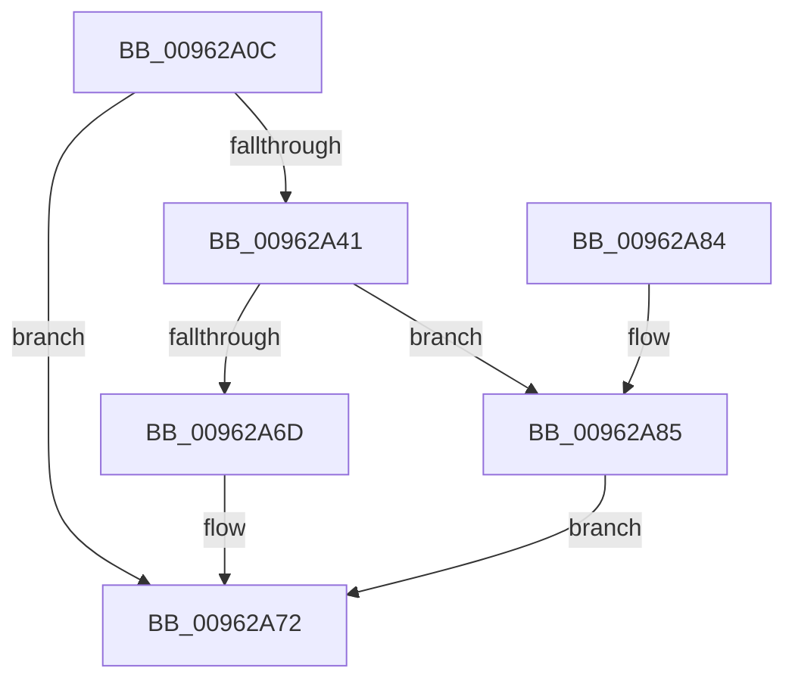

# PnpCtxOpenContextBaseKey

- RVA: `0x00962A0C`–`0x00962A8C` (길이 `128` bytes)
- VA: `0x0000000140962A0C`
- 실행 섹션: `PAGE`
- PDB 이름 있음: `예`; PDB Function 태그: `아니요`
- unwind 정보 RVA: `0x00093494`
- 디코드: `36`개 명령, `128/128` bytes 표시
- 미해석 바이트: `0` (있으면 어셈블리에 `.byte`로 보존)

> 이 문서는 커널 이미지의 기계어와 PDB 기호를 분석해 생성했습니다. 4번과 5번은 함수 원형과 자료형을 바이너리 사용 방식에서 추정한 C 해석이며 원본 소스 복구 결과는 아닙니다.

## 1. Dependencies

- 직접 호출 지점: **2**; 고유 호출 대상: **2**
- 직접 호출자로 확인된 함수: **3**
- RIP 상대 이미지 참조: **2**

### Outgoing calls
- `0x00962A36` → [_PnpCtxGetCachedContextBaseKey](../8E/_PnpCtxGetCachedContextBaseKey_function_008EFB2C.md) (function, `0x008EFB2C`)
- `0x00962A61` → [PnpCtxRegOpenKey](../8E/PnpCtxRegOpenKey_function_008EF7B8.md) (function, `0x008EF7B8`)

### Direct callers
- [PiCMOpenClassKey](PiCMOpenClassKey_function_009617A8.md) at `0x00961987`
- [PiDevCfgEnumDeviceKeys](PiDevCfgEnumDeviceKeys_function_00964EE8.md) at `0x009650FC`
- [PiDevCfgResolveVariableKeyHandle](../AB/PiDevCfgResolveVariableKeyHandle_function_00AB2A24.md) at `0x00AB2BD1`

### Static image references
- `0x00962A20` → RVA `0x00E66398` (`.data`; read)
- `0x00962A46` → RVA `0x00AFCAD0` (` ?? ::NNGAKEGL::`string'`; read)

## 2. Other-region calls and transfers

- 다른 실행 섹션으로 향하는 call: **0**
- 별도 외부 분기/꼬리 이동을 확인하지 못했습니다.

## 3. Assembly (complete function range)

```asm
00962A0C  48 8B C4                        mov rax, rsp
00962A0F  48 89 58 10                     mov qword ptr [rax + 0x10], rbx
00962A13  48 89 70 18                     mov qword ptr [rax + 0x18], rsi
00962A17  48 89 48 08                     mov qword ptr [rax + 8], rcx
00962A1B  57                              push rdi
00962A1C  48 83 EC 30                     sub rsp, 0x30
00962A20  48 8B 3D 71 39 50 00            mov rdi, qword ptr [rip + 0x503971]
00962A27  4C 8D 40 08                     lea r8, [rax + 8]
00962A2B  48 83 60 08 00                  and qword ptr [rax + 8], 0
00962A30  48 8B CF                        mov rcx, rdi
00962A33  41 8B F1                        mov esi, r9d
00962A36  E8 F1 D0 F8 FF                  call 0x1408efb2c
00962A3B  8B D8                           mov ebx, eax
00962A3D  85 C0                           test eax, eax
00962A3F  78 31                           js 0x140962a72
00962A41  48 8B 54 24 60                  mov rdx, qword ptr [rsp + 0x60]
00962A46  4C 8D 05 83 A0 19 00            lea r8, [rip + 0x19a083]
00962A4D  48 89 54 24 28                  mov qword ptr [rsp + 0x28], rdx
00962A52  45 33 C9                        xor r9d, r9d
00962A55  48 8B 54 24 40                  mov rdx, qword ptr [rsp + 0x40]
00962A5A  48 8B CF                        mov rcx, rdi
00962A5D  89 74 24 20                     mov dword ptr [rsp + 0x20], esi
00962A61  E8 52 CD F8 FF                  call 0x1408ef7b8
00962A66  3D 7C 01 00 C0                  cmp eax, 0xc000017c
00962A6B  74 18                           je 0x140962a85
00962A6D  85 C0                           test eax, eax
00962A6F  0F 48 D8                        cmovs ebx, eax
00962A72  48 8B 74 24 50                  mov rsi, qword ptr [rsp + 0x50]
00962A77  8B C3                           mov eax, ebx
00962A79  48 8B 5C 24 48                  mov rbx, qword ptr [rsp + 0x48]
00962A7E  48 83 C4 30                     add rsp, 0x30
00962A82  5F                              pop rdi
00962A83  C3                              ret
00962A84  CC                              int3
00962A85  BB E5 00 00 C0                  mov ebx, 0xc00000e5
00962A8A  EB E6                           jmp 0x140962a72
```

## 4. C-style interpretation (structured pseudocode)

```c
__int64 __fastcall PnpCtxOpenContextBaseKey(__int64 a1, __int64 a2, __int64 a3, int a4, __int64 a5)
{
    __int64 result;
    __int64 v_rbx;
    __int64 v_rsp;
    unsigned __int64 v_stack_m10;
    unsigned int v_stack_m18;
    unsigned __int64 v_stack_p10;
    unsigned __int64 v_stack_p18;
    unsigned __int64 v_stack_p8;

    *(unsigned __int64 *)(v_rsp + 16) = v_rbx;
    *(unsigned __int64 *)(v_rsp + 24) = v_rsi;
    *(unsigned __int64 *)(v_rsp + 8) = a1;
    v_rsp = (v_rsp) - (48);
    result = _PnpCtxGetCachedContextBaseKey(*(unsigned __int64 *)(v_rip + 5257585), a2, v_rsp + 8, a4);
    if (sign_flag) goto loc_00962A72;
    v_stack_m10 = a5;
    a4 = 0;
    v_stack_m18 = (unsigned int)((unsigned int)(a4));
    result = PnpCtxRegOpenKey(*(unsigned __int64 *)(v_rip + 5257585), v_stack_p8, v_rip + 1679491, a4);
    if (((unsigned int)(result)) == 0xC000017CULL) goto loc_00962A85;
    v_rbx = (unsigned int)((unsigned int)(result));
    if (sign_flag) { v_rbx = (unsigned int)(result); }
loc_00962A72:
    v_rsp = (v_rsp) + (48);
    return (unsigned int)((unsigned int)(v_rbx));
loc_00962A85:
    goto loc_00962A72;
}
```

## 5. (Beta) C Style

```c
int64_t PnpCtxOpenContextBaseKey(int64_t Arg1, int64_t Arg2, int64_t Arg3, int32_t Arg4, int64_t Arg5)
{
    int64_t result;
    int64_t local_rbx;
    int64_t local_rsp;
    uint64_t v_stack_m10;
    uint32_t v_stack_m18;
    uint64_t v_stack_p10;
    uint64_t v_stack_p18;
    uint64_t v_stack_p8;

    *(uint64_t *)(local_rsp + 0x10) = local_rbx;
    *(uint64_t *)(local_rsp + 0x18) = local_rsi;
    *(uint64_t *)(local_rsp + 0x8) = Arg1;
    local_rsp = (local_rsp) - (48);
    result = _PnpCtxGetCachedContextBaseKey(*(uint64_t *)(v_rip + 0x503971), Arg2, local_rsp + 8, Arg4);
    if (sign_flag) goto loc_00962A72;
    v_stack_m10 = Arg5;
    Arg4 = 0;
    v_stack_m18 = (uint32_t)((uint32_t)(Arg4));
    result = PnpCtxRegOpenKey(*(uint64_t *)(v_rip + 0x503971), v_stack_p8, v_rip + 1679491, Arg4);
    if (((uint32_t)(result)) == 0xC000017CULL) goto loc_00962A85;
    local_rbx = (uint32_t)((uint32_t)(result));
    if (sign_flag) { local_rbx = (uint32_t)(result); }
loc_00962A72:
    local_rsp = (local_rsp) + (48);
    return (uint32_t)((uint32_t)(local_rbx));
loc_00962A85:
    goto loc_00962A72;
}
```

## 6. Execution-region graph

[열기: 2D/3D 그래프와 함수 탐색 컨트롤 패널](../../../control-panel.html?section=page&rva=0x00962A0C&view=graph)

- 2D 그래프는 위에서 아래로 흐르고, 3D 그래프는 빈 공간을 드래그해 회전합니다. Shift+드래그는 이동, 휠은 확대·축소, 함수 노드 선택은 대상 보고서 이동입니다.

### Static fallback


