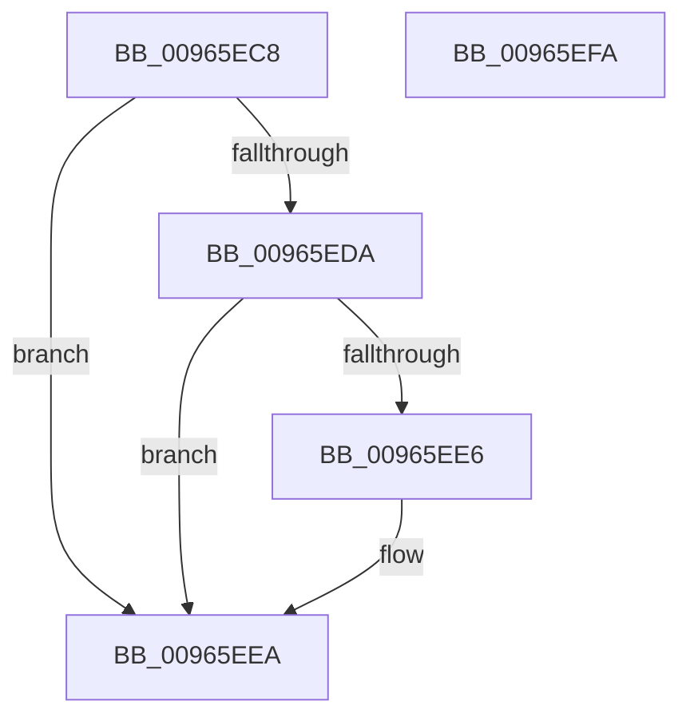

# PnpCtxRegDeleteKey

- RVA: `0x00965EC8`–`0x00965EFB` (길이 `51` bytes)
- VA: `0x0000000140965EC8`
- 실행 섹션: `PAGE`
- PDB 이름 있음: `예`; PDB Function 태그: `아니요`
- unwind 정보 RVA: `0x0005C788`
- 디코드: `16`개 명령, `51/51` bytes 표시
- 미해석 바이트: `0` (있으면 어셈블리에 `.byte`로 보존)

> 이 문서는 커널 이미지의 기계어와 PDB 기호를 분석해 생성했습니다. 4번과 5번은 함수 원형과 자료형을 바이너리 사용 방식에서 추정한 C 해석이며 원본 소스 복구 결과는 아닙니다.

## 1. Dependencies

- 직접 호출 지점: **1**; 고유 호출 대상: **1**
- 직접 호출자로 확인된 함수: **13**
- RIP 상대 이미지 참조: **0**

### Outgoing calls
- `0x00965EF0` → [RegRtlDeleteKeyTransacted](RegRtlDeleteKeyTransacted_function_00966108.md) (function, `0x00966108`)

### Direct callers
- [CmDeleteCommonClassRegKeyWorker](../82/CmDeleteCommonClassRegKeyWorker_function_008298F8.md) at `0x00829AFC`
- [CmDeleteCommonClassRegKeyWorker](../82/CmDeleteCommonClassRegKeyWorker_function_008298F8.md) at `0x00829B4F`
- [CmDeleteDeviceInterfaceRegKeyWorker](../82/CmDeleteDeviceInterfaceRegKeyWorker_function_00829E1C.md) at `0x0082A041`
- [CmDeleteDeviceContainerRegKeyWorker](../82/CmDeleteDeviceContainerRegKeyWorker_function_0082B15C.md) at `0x0082B315`
- [CmAddPanelDeviceWorker](../82/CmAddPanelDeviceWorker_function_0082DF30.md) at `0x0082E022`
- [CmDeleteDevicePanelRegKeyWorker](../82/CmDeleteDevicePanelRegKeyWorker_function_0082E554.md) at `0x0082E710`
- [CmDeleteDevicePanelRegKeyWorker](../82/CmDeleteDevicePanelRegKeyWorker_function_0082E554.md) at `0x0082E752`
- [CmDeleteDevicePanelRegKeyWorker](../82/CmDeleteDevicePanelRegKeyWorker_function_0082E554.md) at `0x0082E77F`
- [DrvDbDeleteObjectSubKey](../83/DrvDbDeleteObjectSubKey_function_00832EEC.md) at `0x0083314B`
- [DrvDbDeleteObjectSubKey](../83/DrvDbDeleteObjectSubKey_function_00832EEC.md) at `0x008331B7`
- [_CmAddDeviceToContainerWorker](../8F/_CmAddDeviceToContainerWorker_function_008FF2EC.md) at `0x008FF6FD`
- [PiDqDeleteUserObject](PiDqDeleteUserObject_function_00965B24.md) at `0x00965BD3`
- [sub_00B1FF8C](../B1/Unknown_function_00B1FF8C.md) at `0x00B1FF9C`
- [sub_00B2BA82](../B2/Unknown_function_00B2BA82.md) at `0x00B2BD6A`
- [sub_00B47098](../B4/Unknown_function_00B47098.md) at `0x00B471BD`
- [sub_00B47098](../B4/Unknown_function_00B47098.md) at `0x00B47227`
- [sub_00B47098](../B4/Unknown_function_00B47098.md) at `0x00B4724C`
- [PipCommitPendingOsExtensionResource](../../init/C3/PipCommitPendingOsExtensionResource_function_00C35960.md) at `0x00C35B09`
- [PipCommitPendingService](../../init/C3/PipCommitPendingService_function_00C35B70.md) at `0x00C35DFA`
- [PipCommitPendingService](../../init/C3/PipCommitPendingService_function_00C35B70.md) at `0x00C35E44`

### Static image references
- 디코드된 RIP-relative 메모리 참조가 없습니다.

## 2. Other-region calls and transfers

- 다른 실행 섹션으로 향하는 call: **0**
- 별도 외부 분기/꼬리 이동을 확인하지 못했습니다.

## 3. Assembly (complete function range)

```asm
00965EC8  48 83 EC 28                     sub rsp, 0x28
00965ECC  4D 8B C8                        mov r9, r8
00965ECF  4C 8B D2                        mov r10, rdx
00965ED2  45 33 C0                        xor r8d, r8d
00965ED5  48 85 C9                        test rcx, rcx
00965ED8  74 10                           je 0x140965eea
00965EDA  48 8B 81 E0 00 00 00            mov rax, qword ptr [rcx + 0xe0]
00965EE1  48 85 C0                        test rax, rax
00965EE4  74 04                           je 0x140965eea
00965EE6  4C 8B 40 08                     mov r8, qword ptr [rax + 8]
00965EEA  49 8B D1                        mov rdx, r9
00965EED  49 8B CA                        mov rcx, r10
00965EF0  E8 13 02 00 00                  call 0x140966108
00965EF5  48 83 C4 28                     add rsp, 0x28
00965EF9  C3                              ret
00965EFA  CC                              int3
```

## 4. C-style interpretation (structured pseudocode)

```c
__int64 __fastcall PnpCtxRegDeleteKey(__int64 a1, __int64 a2, __int64 a3)
{
    __int64 result;
    __int64 v_rsp;

    v_rsp = (v_rsp) - (40);
    a3 = 0;
    if (a1 == 0) goto loc_00965EEA;
    if (*(unsigned __int64 *)(a1 + 224) != 0) {
        a3 = *(unsigned __int64 *)(*(unsigned __int64 *)(a1 + 224) + 8);
    }
    result = RegRtlDeleteKeyTransacted(a2, a3, a3, a3);
    v_rsp = (v_rsp) + (40);
    return result;
}
```

## 5. (Beta) C Style

```c
int64_t PnpCtxRegDeleteKey(int64_t Arg1, int64_t Arg2, int64_t Arg3)
{
    int64_t result;
    int64_t local_rsp;

    local_rsp = (local_rsp) - (40);
    Arg3 = 0;
    if (Arg1 == 0) goto loc_00965EEA;
    if (*(uint64_t *)(Arg1 + 0xE0) != 0) {
        Arg3 = *(uint64_t *)(*(uint64_t *)(Arg1 + 0xE0) + 0x8);
    }
    result = RegRtlDeleteKeyTransacted(Arg2, Arg3, Arg3, Arg3);
    local_rsp = (local_rsp) + (40);
    return result;
}
```

## 6. Execution-region graph

[열기: 2D/3D 그래프와 함수 탐색 컨트롤 패널](../../../control-panel.html?section=page&rva=0x00965EC8&view=graph)

- 2D 그래프는 위에서 아래로 흐르고, 3D 그래프는 빈 공간을 드래그해 회전합니다. Shift+드래그는 이동, 휠은 확대·축소, 함수 노드 선택은 대상 보고서 이동입니다.

### Static fallback


