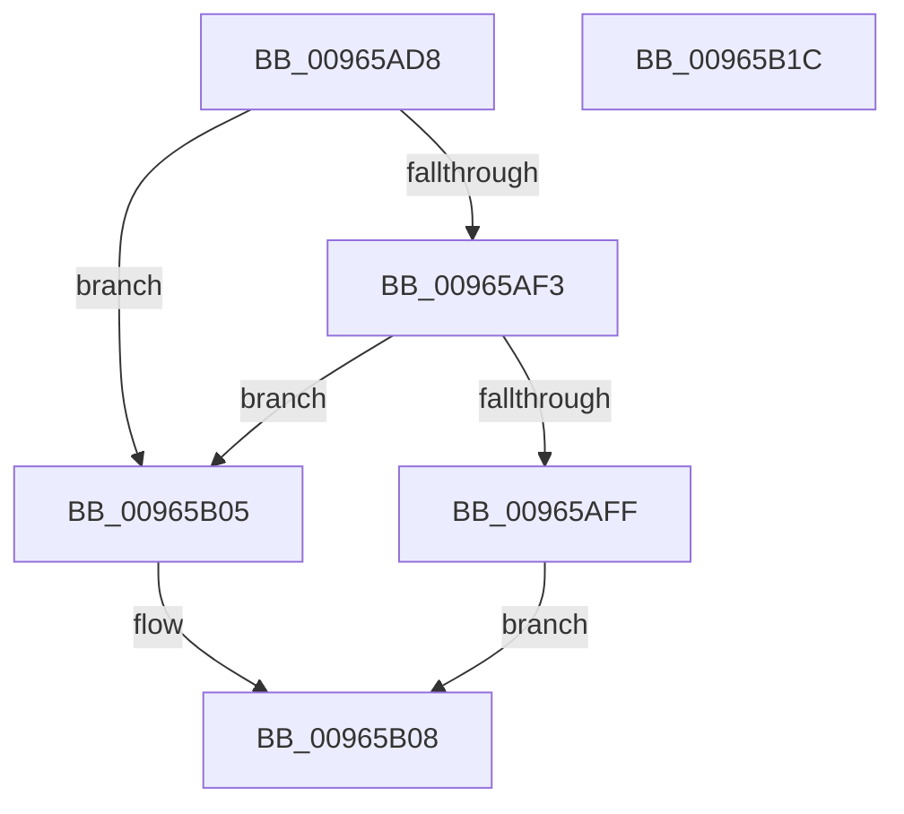

# PnpCtxRegDeletePath

- RVA: `0x00965AD8`–`0x00965B1D` (길이 `69` bytes)
- VA: `0x0000000140965AD8`
- 실행 섹션: `PAGE`
- PDB 이름 있음: `예`; PDB Function 태그: `아니요`
- unwind 정보 RVA: `0x00064C80`
- 디코드: `22`개 명령, `69/69` bytes 표시
- 미해석 바이트: `0` (있으면 어셈블리에 `.byte`로 보존)

> 이 문서는 커널 이미지의 기계어와 PDB 기호를 분석해 생성했습니다. 4번과 5번은 함수 원형과 자료형을 바이너리 사용 방식에서 추정한 C 해석이며 원본 소스 복구 결과는 아닙니다.

## 1. Dependencies

- 직접 호출 지점: **1**; 고유 호출 대상: **1**
- 직접 호출자로 확인된 함수: **2**
- RIP 상대 이미지 참조: **1**

### Outgoing calls
- `0x00965B11` → [_RegRtlDeletePathInternal](_RegRtlDeletePathInternal_function_00965F04.md) (function, `0x00965F04`)

### Direct callers
- [PiDevCfgClearDeviceMigrationNode](PiDevCfgClearDeviceMigrationNode_function_00965780.md) at `0x00965914`
- [PiDevCfgClearDeviceMigrationNode](PiDevCfgClearDeviceMigrationNode_function_00965780.md) at `0x009659A6`
- [sub_00B28770](../B2/Unknown_function_00B28770.md) at `0x00B287D6`

### Static image references
- `0x00965ADE` → RVA `0x00E66398` (`.data`; read)

## 2. Other-region calls and transfers

- 다른 실행 섹션으로 향하는 call: **0**
- 별도 외부 분기/꼬리 이동을 확인하지 못했습니다.

## 3. Assembly (complete function range)

```asm
00965AD8  40 53                           push rbx
00965ADA  48 83 EC 30                     sub rsp, 0x30
00965ADE  48 8B 05 B3 08 50 00            mov rax, qword ptr [rip + 0x5008b3]
00965AE5  45 8A D1                        mov r10b, r9b
00965AE8  4D 8B D8                        mov r11, r8
00965AEB  48 8B DA                        mov rbx, rdx
00965AEE  48 85 C0                        test rax, rax
00965AF1  74 12                           je 0x140965b05
00965AF3  48 8B 80 E0 00 00 00            mov rax, qword ptr [rax + 0xe0]
00965AFA  48 85 C0                        test rax, rax
00965AFD  74 06                           je 0x140965b05
00965AFF  4C 8B 48 08                     mov r9, qword ptr [rax + 8]
00965B03  EB 03                           jmp 0x140965b08
00965B05  45 33 C9                        xor r9d, r9d
00965B08  48 8B CB                        mov rcx, rbx
00965B0B  49 8B D3                        mov rdx, r11
00965B0E  45 8A C2                        mov r8b, r10b
00965B11  E8 EE 03 00 00                  call 0x140965f04
00965B16  48 83 C4 30                     add rsp, 0x30
00965B1A  5B                              pop rbx
00965B1B  C3                              ret
00965B1C  CC                              int3
```

## 4. C-style interpretation (structured pseudocode)

```c
__int64 __fastcall PnpCtxRegDeletePath(__int64 a1, __int64 a2, __int64 a3, unsigned __int8 a4)
{
    __int64 result;
    __int64 v_rsp;

    v_rsp = (v_rsp) - (48);
    if (*(unsigned __int64 *)(v_rip + 5245107) == 0) goto loc_00965B05;
    if (*(unsigned __int64 *)(*(unsigned __int64 *)(v_rip + 5245107) + 224) == 0) goto loc_00965B05;
    goto loc_00965B08;
loc_00965B05:
    a4 = 0;
loc_00965B08:
    result = _RegRtlDeletePathInternal(a2, a3, 0, a4);
    v_rsp = (v_rsp) + (48);
    return result;
}
```

## 5. (Beta) C Style

```c
int64_t PnpCtxRegDeletePath(int64_t Arg1, int64_t Arg2, int64_t Arg3, uint8_t Arg4)
{
    int64_t result;
    int64_t local_rsp;

    local_rsp = (local_rsp) - (48);
    if (*(uint64_t *)(v_rip + 0x5008B3) == 0) goto loc_00965B05;
    if (*(uint64_t *)(*(uint64_t *)(v_rip + 0x5008B3) + 0xE0) == 0) goto loc_00965B05;
    goto loc_00965B08;
loc_00965B05:
    Arg4 = 0;
loc_00965B08:
    result = _RegRtlDeletePathInternal(Arg2, Arg3, 0, Arg4);
    local_rsp = (local_rsp) + (48);
    return result;
}
```

## 6. Execution-region graph

[열기: 2D/3D 그래프와 함수 탐색 컨트롤 패널](../../../control-panel.html?section=page&rva=0x00965AD8&view=graph)

- 2D 그래프는 위에서 아래로 흐르고, 3D 그래프는 빈 공간을 드래그해 회전합니다. Shift+드래그는 이동, 휠은 확대·축소, 함수 노드 선택은 대상 보고서 이동입니다.

### Static fallback


