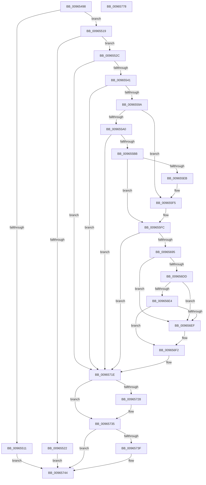

# PpDevCfgProcessDeviceReset

- RVA: `0x00965498`–`0x00965779` (길이 `737` bytes)
- VA: `0x0000000140965498`
- 실행 섹션: `PAGE`
- PDB 이름 있음: `예`; PDB Function 태그: `아니요`
- unwind 정보 RVA: `0x00093774`
- 디코드: `176`개 명령, `737/737` bytes 표시
- 미해석 바이트: `0` (있으면 어셈블리에 `.byte`로 보존)

> 이 문서는 커널 이미지의 기계어와 PDB 기호를 분석해 생성했습니다. 4번과 5번은 함수 원형과 자료형을 바이너리 사용 방식에서 추정한 C 해석이며 원본 소스 복구 결과는 아닙니다.

## 1. Dependencies

- 직접 호출 지점: **16**; 고유 호출 대상: **15**
- 직접 호출자로 확인된 함수: **1**
- RIP 상대 이미지 참조: **6**

### Outgoing calls
- `0x009654D2` → [memset](../../text/6C/memset_function_006C6C40.md) (function, `0x006C6C40`)
- `0x00965532` → [PiDevCfgInitDeviceContext](../97/PiDevCfgInitDeviceContext_function_00977518.md) (function, `0x00977518`)
- `0x0096558B` → [PiDevCfgQueryObjectProperties](../97/PiDevCfgQueryObjectProperties_function_0097776C.md) (function, `0x0097776C`)
- `0x009655AC` → [RtlStringFromGUIDEx](../91/RtlStringFromGUIDEx_function_00915450.md) (function, `0x00915450`)
- `0x009655E2` → [PnpOpenObjectRegKey](../8E/PnpOpenObjectRegKey_function_008E15E8.md) (function, `0x008E15E8`)
- `0x009655F0` → [RtlFreeAnsiString](../9C/RtlFreeAnsiString_function_009C0800.md) (function, `0x009C0800`)
- `0x00965628` → [PiDevCfgMigrateDevice](PiDevCfgMigrateDevice_function_00963E60.md) (function, `0x00963E60`)
- `0x0096565B` → [PiDevCfgResetDeviceDriverSettings](PiDevCfgResetDeviceDriverSettings_function_00966168.md) (function, `0x00966168`)
- `0x00965671` → [PnpCtxRegDeleteTree](PnpCtxRegDeleteTree_function_00965CC8.md) (function, `0x00965CC8`)
- `0x00965687` → [PnpCtxRegDeleteTree](PnpCtxRegDeleteTree_function_00965CC8.md) (function, `0x00965CC8`)
- `0x009656D4` → [CmGetDeviceRegProp](../8E/CmGetDeviceRegProp_function_008ED870.md) (function, `0x008ED870`)
- `0x00965719` → [PiDevCfgSetDeviceRegProp](PiDevCfgSetDeviceRegProp_function_009635C0.md) (function, `0x009635C0`)
- `0x00965728` → [ExFreePool](../../poolcode/B8/ExFreePool_function_00B82850.md) (function, `0x00B82850`)
- `0x0096573F` → [ZwClose](../../text/6A/ZwClose_function_006AD2B0.md) (function, `0x006AD2B0`)
- `0x00965748` → [PiDevCfgFreeDeviceContext](../70/PiDevCfgFreeDeviceContext_function_00704A00.md) (function, `0x00704A00`)
- `0x00965756` → [_security_check_cookie](../../text/6A/_security_check_cookie_function_006AC640.md) (function, `0x006AC640`)

### Direct callers
- [PiConfigureDevice](../72/PiConfigureDevice_function_0072D38C.md) at `0x0072D3F1`

### Static image references
- `0x009654B7` → RVA `0x00E0A740` (`.data`; read)
- `0x009654DD` → RVA `0x00FD8054` (`PAGEDATA`; read)
- `0x00965545` → RVA `0x00011688` (`.rdata`; read)
- `0x009655C5` → RVA `0x00E66398` (`.data`; read)
- `0x00965667` → RVA `0x00AFD740` (` ?? ::NNGAKEGL::`string'`; read)
- `0x0096567D` → RVA `0x00AFE870` (` ?? ::NNGAKEGL::`string'`; read)

## 2. Other-region calls and transfers

- 다른 실행 섹션으로 향하는 call: **4**
  - `0x009654D2` → [memset](../../text/6C/memset_function_006C6C40.md) (`PAGE` → `.text`)
  - `0x00965728` → [ExFreePool](../../poolcode/B8/ExFreePool_function_00B82850.md) (`PAGE` → `POOLCODE`)
  - `0x0096573F` → [ZwClose](../../text/6A/ZwClose_function_006AD2B0.md) (`PAGE` → `.text`)
  - `0x00965756` → [_security_check_cookie](../../text/6A/_security_check_cookie_function_006AC640.md) (`PAGE` → `.text`)
- 별도 외부 분기/꼬리 이동을 확인하지 못했습니다.

## 3. Assembly (complete function range)

```asm
00965498  48 8B C4                        mov rax, rsp
0096549B  48 89 58 10                     mov qword ptr [rax + 0x10], rbx
0096549F  48 89 70 18                     mov qword ptr [rax + 0x18], rsi
009654A3  48 89 78 20                     mov qword ptr [rax + 0x20], rdi
009654A7  55                              push rbp
009654A8  41 56                           push r14
009654AA  41 57                           push r15
009654AC  48 8D 68 D8                     lea rbp, [rax - 0x28]
009654B0  48 81 EC 10 01 00 00            sub rsp, 0x110
009654B7  48 8B 05 82 52 4A 00            mov rax, qword ptr [rip + 0x4a5282]
009654BE  48 33 C4                        xor rax, rsp
009654C1  48 89 45 00                     mov qword ptr [rbp], rax
009654C5  33 D2                           xor edx, edx
009654C7  48 8B F9                        mov rdi, rcx
009654CA  48 8D 4D 90                     lea rcx, [rbp - 0x70]
009654CE  44 8D 42 58                     lea r8d, [rdx + 0x58]
009654D2  E8 69 17 D6 FF                  call 0x1406c6c40
009654D7  45 33 FF                        xor r15d, r15d
009654DA  0F 57 C0                        xorps xmm0, xmm0
009654DD  44 39 3D 70 2B 67 00            cmp dword ptr [rip + 0x672b70], r15d
009654E4  4C 89 7C 24 60                  mov qword ptr [rsp + 0x60], r15
009654E9  0F 11 45 F0                     movups xmmword ptr [rbp - 0x10], xmm0
009654ED  45 8D 77 01                     lea r14d, [r15 + 1]
009654F1  4C 89 7C 24 50                  mov qword ptr [rsp + 0x50], r15
009654F6  44 89 74 24 4C                  mov dword ptr [rsp + 0x4c], r14d
009654FB  4C 89 7C 24 58                  mov qword ptr [rsp + 0x58], r15
00965500  44 89 7C 24 40                  mov dword ptr [rsp + 0x40], r15d
00965505  44 89 7C 24 48                  mov dword ptr [rsp + 0x48], r15d
0096550A  44 89 7C 24 44                  mov dword ptr [rsp + 0x44], r15d
0096550F  75 08                           jne 0x140965519
00965511  41 8B DF                        mov ebx, r15d
00965514  E9 2B 02 00 00                  jmp 0x140965744
00965519  48 8B 4F 30                     mov rcx, qword ptr [rdi + 0x30]
0096551D  48 85 C9                        test rcx, rcx
00965520  75 0A                           jne 0x14096552c
00965522  BB 10 00 00 C0                  mov ebx, 0xc0000010
00965527  E9 18 02 00 00                  jmp 0x140965744
0096552C  4C 8D 45 90                     lea r8, [rbp - 0x70]
00965530  33 D2                           xor edx, edx
00965532  E8 E1 1F 01 00                  call 0x140977518
00965537  8B D8                           mov ebx, eax
00965539  85 C0                           test eax, eax
0096553B  0F 88 DD 01 00 00               js 0x14096571e
00965541  48 8B 75 A0                     mov rsi, qword ptr [rbp - 0x60]
00965545  48 8D 05 3C C1 6A FF            lea rax, [rip - 0x953ec4]
0096554C  48 8B 57 30                     mov rdx, qword ptr [rdi + 0x30]
00965550  4C 8B CE                        mov r9, rsi
00965553  48 89 44 24 68                  mov qword ptr [rsp + 0x68], rax
00965558  45 8B C6                        mov r8d, r14d
0096555B  48 8D 45 F0                     lea rax, [rbp - 0x10]
0096555F  44 89 74 24 28                  mov dword ptr [rsp + 0x28], r14d
00965564  48 89 44 24 78                  mov qword ptr [rsp + 0x78], rax
00965569  48 8D 44 24 68                  lea rax, [rsp + 0x68]
0096556E  48 89 44 24 20                  mov qword ptr [rsp + 0x20], rax
00965573  48 C7 44 24 70 0D 00 00 00      mov qword ptr [rsp + 0x70], 0xd
0096557C  4C 89 7D 84                     mov qword ptr [rbp - 0x7c], r15
00965580  44 89 7D 8C                     mov dword ptr [rbp - 0x74], r15d
00965584  C7 45 80 10 00 00 00            mov dword ptr [rbp - 0x80], 0x10
0096558B  E8 DC 21 01 00                  call 0x14097776c
00965590  8B D8                           mov ebx, eax
00965592  85 C0                           test eax, eax
00965594  0F 88 84 01 00 00               js 0x14096571e
0096559A  44 39 7D 88                     cmp dword ptr [rbp - 0x78], r15d
0096559E  7C 55                           jl 0x1409655f5
009655A0  45 8A C6                        mov r8b, r14b
009655A3  48 8D 54 24 50                  lea rdx, [rsp + 0x50]
009655A8  48 8D 4D F0                     lea rcx, [rbp - 0x10]
009655AC  E8 9F FE FA FF                  call 0x140915450
009655B1  8B D8                           mov ebx, eax
009655B3  85 C0                           test eax, eax
009655B5  0F 88 63 01 00 00               js 0x14096571e
009655BB  48 8B 54 24 58                  mov rdx, qword ptr [rsp + 0x58]
009655C0  48 8D 44 24 60                  lea rax, [rsp + 0x60]
009655C5  48 8B 0D CC 0D 50 00            mov rcx, qword ptr [rip + 0x500dcc]
009655CC  41 B9 19 00 02 00               mov r9d, 0x20019
009655D2  48 89 44 24 28                  mov qword ptr [rsp + 0x28], rax
009655D7  41 B8 02 00 00 00               mov r8d, 2
009655DD  44 88 7C 24 20                  mov byte ptr [rsp + 0x20], r15b
009655E2  E8 01 C0 F7 FF                  call 0x1408e15e8
009655E7  85 C0                           test eax, eax
009655E9  79 11                           jns 0x1409655fc
009655EB  48 8D 4C 24 50                  lea rcx, [rsp + 0x50]
009655F0  E8 0B B2 05 00                  call 0x1409c0800
009655F5  0F 57 C0                        xorps xmm0, xmm0
009655F8  0F 11 45 F0                     movups xmmword ptr [rbp - 0x10], xmm0
009655FC  48 8B 44 24 58                  mov rax, qword ptr [rsp + 0x58]
00965601  48 8D 55 90                     lea rdx, [rbp - 0x70]
00965605  48 F7 D8                        neg rax
00965608  4C 89 7C 24 28                  mov qword ptr [rsp + 0x28], r15
0096560D  48 8D 44 24 50                  lea rax, [rsp + 0x50]
00965612  48 8B CF                        mov rcx, rdi
00965615  4D 1B C0                        sbb r8, r8
00965618  45 33 C9                        xor r9d, r9d
0096561B  4C 23 C0                        and r8, rax
0096561E  48 8D 44 24 48                  lea rax, [rsp + 0x48]
00965623  48 89 44 24 20                  mov qword ptr [rsp + 0x20], rax
00965628  E8 33 E8 FF FF                  call 0x140963e60
0096562D  44 8B 74 24 48                  mov r14d, dword ptr [rsp + 0x48]
00965632  48 8D 55 90                     lea rdx, [rbp - 0x70]
00965636  4C 8B 4C 24 60                  mov r9, qword ptr [rsp + 0x60]
0096563B  85 C0                           test eax, eax
0096563D  48 8B 44 24 58                  mov rax, qword ptr [rsp + 0x58]
00965642  48 8B CF                        mov rcx, rdi
00965645  45 0F 48 F7                     cmovs r14d, r15d
00965649  4C 89 7C 24 20                  mov qword ptr [rsp + 0x20], r15
0096564E  48 F7 D8                        neg rax
00965651  48 8D 45 F0                     lea rax, [rbp - 0x10]
00965655  4D 1B C0                        sbb r8, r8
00965658  4C 23 C0                        and r8, rax
0096565B  E8 08 0B 00 00                  call 0x140966168
00965660  48 8B 0D 31 0D 50 00            mov rcx, qword ptr [rip + 0x500d31]
00965667  4C 8D 05 D2 80 19 00            lea r8, [rip + 0x1980d2]
0096566E  48 8B D6                        mov rdx, rsi
00965671  E8 52 06 00 00                  call 0x140965cc8
00965676  48 8B 0D 1B 0D 50 00            mov rcx, qword ptr [rip + 0x500d1b]
0096567D  4C 8D 05 EC 91 19 00            lea r8, [rip + 0x1991ec]
00965684  48 8B D6                        mov rdx, rsi
00965687  E8 3C 06 00 00                  call 0x140965cc8
0096568C  45 85 F6                        test r14d, r14d
0096568F  0F 84 89 00 00 00               je 0x14096571e
00965695  48 8B 57 30                     mov rdx, qword ptr [rdi + 0x30]
00965699  48 8D 44 24 44                  lea rax, [rsp + 0x44]
0096569E  48 8B 0D F3 0C 50 00            mov rcx, qword ptr [rip + 0x500cf3]
009656A5  41 B9 0B 00 00 00               mov r9d, 0xb
009656AB  44 89 7C 24 38                  mov dword ptr [rsp + 0x38], r15d
009656B0  4C 8B C6                        mov r8, rsi
009656B3  48 89 44 24 30                  mov qword ptr [rsp + 0x30], rax
009656B8  48 8D 44 24 40                  lea rax, [rsp + 0x40]
009656BD  48 89 44 24 28                  mov qword ptr [rsp + 0x28], rax
009656C2  48 8D 44 24 4C                  lea rax, [rsp + 0x4c]
009656C7  48 89 44 24 20                  mov qword ptr [rsp + 0x20], rax
009656CC  C7 44 24 44 04 00 00 00         mov dword ptr [rsp + 0x44], 4
009656D4  E8 97 81 F8 FF                  call 0x1408ed870
009656D9  85 C0                           test eax, eax
009656DB  78 12                           js 0x1409656ef
009656DD  83 7C 24 4C 04                  cmp dword ptr [rsp + 0x4c], 4
009656E2  75 0B                           jne 0x1409656ef
009656E4  83 7C 24 44 04                  cmp dword ptr [rsp + 0x44], 4
009656E9  8B 44 24 40                     mov eax, dword ptr [rsp + 0x40]
009656ED  74 03                           je 0x1409656f2
009656EF  41 8B C7                        mov eax, r15d
009656F2  41 0B C6                        or eax, r14d
009656F5  C7 44 24 28 04 00 00 00         mov dword ptr [rsp + 0x28], 4
009656FD  41 B9 04 00 00 00               mov r9d, 4
00965703  89 44 24 40                     mov dword ptr [rsp + 0x40], eax
00965707  48 8D 44 24 40                  lea rax, [rsp + 0x40]
0096570C  48 8D 55 90                     lea rdx, [rbp - 0x70]
00965710  48 89 44 24 20                  mov qword ptr [rsp + 0x20], rax
00965715  45 8D 41 07                     lea r8d, [r9 + 7]
00965719  E8 A2 DE FF FF                  call 0x1409635c0
0096571E  48 8B 4C 24 58                  mov rcx, qword ptr [rsp + 0x58]
00965723  48 85 C9                        test rcx, rcx
00965726  74 0D                           je 0x140965735
00965728  E8 23 D1 21 00                  call 0x140b82850
0096572D  0F 57 C0                        xorps xmm0, xmm0
00965730  0F 11 44 24 50                  movups xmmword ptr [rsp + 0x50], xmm0
00965735  48 8B 4C 24 60                  mov rcx, qword ptr [rsp + 0x60]
0096573A  48 85 C9                        test rcx, rcx
0096573D  74 05                           je 0x140965744
0096573F  E8 6C 7B D4 FF                  call 0x1406ad2b0
00965744  48 8D 4D 90                     lea rcx, [rbp - 0x70]
00965748  E8 B3 F2 D9 FF                  call 0x140704a00
0096574D  8B C3                           mov eax, ebx
0096574F  48 8B 4D 00                     mov rcx, qword ptr [rbp]
00965753  48 33 CC                        xor rcx, rsp
00965756  E8 E5 6E D4 FF                  call 0x1406ac640
0096575B  4C 8D 9C 24 10 01 00 00         lea r11, [rsp + 0x110]
00965763  49 8B 5B 28                     mov rbx, qword ptr [r11 + 0x28]
00965767  49 8B 73 30                     mov rsi, qword ptr [r11 + 0x30]
0096576B  49 8B 7B 38                     mov rdi, qword ptr [r11 + 0x38]
0096576F  49 8B E3                        mov rsp, r11
00965772  41 5F                           pop r15
00965774  41 5E                           pop r14
00965776  5D                              pop rbp
00965777  C3                              ret
00965778  CC                              int3
```

## 4. C-style interpretation (structured pseudocode)

```c
__int64 __fastcall PpDevCfgProcessDeviceReset(__int64 a1, int a2)
{
    __int64 result;
    __int64 v_r14;
    __int64 v_r15;
    __int64 v_rsp;
    unsigned int v_stack_m100;
    unsigned __int64 v_stack_m108;
    unsigned __int64 v_stack_m18;
    unsigned __int64 v_stack_mB0;
    unsigned __int64 v_stack_mB8;
    unsigned __int64 v_stack_mC0;
    unsigned __int64 v_stack_mC8;
    unsigned __int64 v_stack_mD0;
    unsigned __int64 v_stack_mD8;
    unsigned int v_stack_mDC;
    unsigned int v_stack_mE0;
    unsigned int v_stack_mE4;
    unsigned int v_stack_mE8;
    unsigned int v_stack_mF0;
    unsigned __int64 v_stack_mF8;

    *(unsigned __int64 *)(v_rsp + 16) = v_rbx;
    *(unsigned __int64 *)(v_rsp + 24) = v_rsi;
    *(unsigned __int64 *)(v_rsp + 32) = v_rdi;
    v_rsp = (v_rsp) - (272);
    result = (*(unsigned __int64 *)(v_rip + 4870786)) ^ (v_rsp);
    *(unsigned __int64 *)(v_rsp - 40) = result;
    a2 = 0;
    result = memset(v_rsp - 40 - 112, a2, a2 + 88, a4);
    v_r15 = 0;
    v_stack_mC8 = 0;
    *(unsigned __int64 *)(v_rsp - 40 - 16) = v_xmm0;
    v_stack_mD8 = 0;
    v_stack_mDC = (unsigned int)(v_r15 + 1);
    v_stack_mD0 = 0;
    v_stack_mE8 = 0;
    v_stack_mE0 = 0;
    v_stack_mE4 = 0;
    if ((*(unsigned int *)(v_rip + 6761328)) != 0) goto loc_00965519;
    goto loc_00965744;
loc_00965519:
    if (*(unsigned __int64 *)(a1 + 48) != 0) goto loc_0096552C;
    goto loc_00965744;
loc_0096552C:
    a2 = 0;
    result = PiDevCfgInitDeviceContext(*(unsigned __int64 *)(a1 + 48), a2, v_rsp - 40 - 112, a4);
    if (sign_flag) goto loc_0096571E;
    v_stack_mC0 = v_rip - 9780932;
    v_stack_m100 = (unsigned int)(v_r15 + 1);
    v_stack_mB0 = v_rsp - 40 - 16;
    v_stack_m108 = v_stack_mC0;
    v_stack_mB8 = 13;
    *(unsigned __int64 *)(v_rsp - 40 - 124) = 0;
    *(unsigned int *)(v_rsp - 40 - 116) = 0;
    *(unsigned int *)(v_rsp - 40 - 128) = 16;
    result = PiDevCfgQueryObjectProperties(*(unsigned __int64 *)(a1 + 48), *(unsigned __int64 *)(a1 + 48), (unsigned int)((unsigned int)(v_r15 + 1)), *(unsigned __int64 *)(v_rsp - 40 - 96));
    if (sign_flag) goto loc_0096571E;
    if ((*(unsigned int *)(v_rsp - 40 - 120)) < 0) goto loc_009655F5;
    result = RtlStringFromGUIDEx(v_rsp - 40 - 16, v_stack_mD8, (unsigned __int8)(v_r15 + 1), *(unsigned __int64 *)(v_rsp - 40 - 96));
    if (sign_flag) goto loc_0096571E;
    v_stack_m100 = v_stack_mC8;
    v_stack_m108 = 0;
    result = PnpOpenObjectRegKey(*(unsigned __int64 *)(v_rip + 5246412), v_stack_mD0, 2, (unsigned int)(0x20019ULL));
    if (!sign_flag) goto loc_009655FC;
    result = RtlFreeAnsiString(v_stack_mD8, v_stack_mD0, 2, (unsigned int)(0x20019ULL));
loc_009655F5:
    *(unsigned __int64 *)(v_rsp - 40 - 16) = v_xmm0;
loc_009655FC:
    result = -(v_stack_mD0);
    v_stack_m100 = 0;
    a4 = 0;
    a3 = (2) & (v_stack_mD8);
    v_stack_m108 = v_stack_mE0;
    result = PiDevCfgMigrateDevice(a1, v_rsp - 40 - 112, a3, a4);
    v_r14 = (unsigned int)(v_stack_mE0);
    if (sign_flag) { v_r14 = 0; }
    v_stack_m108 = 0;
    result = -(v_stack_mD0);
    a3 = (a3) & (v_rsp - 40 - 16);
    result = PiDevCfgResetDeviceDriverSettings(a1, v_rsp - 40 - 112, a3, v_stack_mC8);
    result = PnpCtxRegDeleteTree(*(unsigned __int64 *)(v_rip + 5246257), *(unsigned __int64 *)(v_rsp - 40 - 96), v_rip + 1671378, v_stack_mC8);
    result = PnpCtxRegDeleteTree(*(unsigned __int64 *)(v_rip + 5246235), *(unsigned __int64 *)(v_rsp - 40 - 96), v_rip + 1675756, v_stack_mC8);
    if ((unsigned int)(v_r14) == 0) goto loc_0096571E;
    v_stack_mF0 = 0;
    v_stack_mF8 = v_stack_mE4;
    v_stack_m100 = v_stack_mE8;
    v_stack_m108 = v_stack_mDC;
    v_stack_mE4 = 4;
    result = CmGetDeviceRegProp(*(unsigned __int64 *)(v_rip + 5246195), *(unsigned __int64 *)(a1 + 48), *(unsigned __int64 *)(v_rsp - 40 - 96), 11);
    if (sign_flag) goto loc_009656EF;
    if (v_stack_mDC != 4) goto loc_009656EF;
    result = (unsigned int)(v_stack_mE8);
    if (v_stack_mE4 != 4) {
        result = 0;
    }
    result = (unsigned int)((result) | ((unsigned int)(v_r14)));
    v_stack_m100 = 4;
    v_stack_mE8 = (unsigned int)(result);
    v_stack_m108 = v_stack_mE8;
    result = PiDevCfgSetDeviceRegProp(*(unsigned __int64 *)(v_rip + 5246195), v_rsp - 40 - 112, 4 + 7, 4);
loc_0096571E:
    if (v_stack_mD0 != 0) {
        result = ExFreePool(v_stack_mD0, v_rsp - 40 - 112, 4 + 7, 4);
        v_stack_mD8 = v_xmm0;
    }
    if (v_stack_mC8 != 0) {
        result = ZwClose(v_stack_mC8, v_rsp - 40 - 112, 4 + 7, 4);
    }
    result = PiDevCfgFreeDeviceContext(v_rsp - 40 - 112, v_rsp - 40 - 112, 4 + 7, 4);
    a1 = (*(unsigned __int64 *)(v_rsp - 40)) ^ (v_rsp);
    result = _security_check_cookie(a1, v_rsp - 40 - 112, 4 + 7, 4);
    return result;
}
```

## 5. (Beta) C Style

```c
int64_t PpDevCfgProcessDeviceReset(void *Arg1, int32_t Arg2)
{
    uint8_t *arg1 = (uint8_t *)Arg1;

    int64_t result;
    int64_t local_r14;
    int64_t local_r15;
    int64_t local_rsp;
    uint32_t v_stack_m100;
    uint64_t v_stack_m108;
    uint64_t v_stack_m18;
    uint64_t v_stack_mB0;
    uint64_t v_stack_mB8;
    uint64_t v_stack_mC0;
    uint64_t v_stack_mC8;
    uint64_t v_stack_mD0;
    uint64_t v_stack_mD8;
    uint32_t v_stack_mDC;
    uint32_t v_stack_mE0;
    uint32_t v_stack_mE4;
    uint32_t v_stack_mE8;
    uint32_t v_stack_mF0;
    uint64_t v_stack_mF8;

    *(uint64_t *)(local_rsp + 0x10) = local_rbx;
    *(uint64_t *)(local_rsp + 0x18) = local_rsi;
    *(uint64_t *)(local_rsp + 0x20) = local_rdi;
    local_rsp = (local_rsp) - (272);
    result = (*(uint64_t *)(v_rip + 0x4A5282)) ^ (local_rsp);
    *(uint64_t *)(local_rsp - 0x28) = result;
    Arg2 = 0;
    result = memset(local_rsp - 40 - 112, Arg2, Arg2 + 88, a4);
    local_r15 = 0;
    v_stack_mC8 = 0;
    *(uint64_t *)(local_rsp - 0x28 - 0x10) = v_xmm0;
    v_stack_mD8 = 0;
    v_stack_mDC = (uint32_t)(local_r15 + 1);
    v_stack_mD0 = 0;
    v_stack_mE8 = 0;
    v_stack_mE0 = 0;
    v_stack_mE4 = 0;
    if ((*(uint32_t *)(v_rip + 0x672B70)) != 0) goto loc_00965519;
    goto loc_00965744;
loc_00965519:
    if (*(uint64_t *)(arg1 + 0x30) != 0) goto loc_0096552C;
    goto loc_00965744;
loc_0096552C:
    Arg2 = 0;
    result = PiDevCfgInitDeviceContext(*(uint64_t *)(arg1 + 0x30), Arg2, local_rsp - 40 - 112, a4);
    if (sign_flag) goto loc_0096571E;
    v_stack_mC0 = v_rip - 9780932;
    v_stack_m100 = (uint32_t)(local_r15 + 1);
    v_stack_mB0 = local_rsp - 40 - 16;
    v_stack_m108 = v_stack_mC0;
    v_stack_mB8 = 13;
    *(uint64_t *)(local_rsp - 0x28 - 0x7C) = 0;
    *(uint32_t *)(local_rsp - 0x28 - 0x74) = 0;
    *(uint32_t *)(local_rsp - 0x28 - 0x80) = 16;
    result = PiDevCfgQueryObjectProperties(*(uint64_t *)(arg1 + 0x30), *(uint64_t *)(arg1 + 0x30), (uint32_t)((uint32_t)(local_r15 + 1)), *(uint64_t *)(local_rsp - 0x28 - 0x60));
    if (sign_flag) goto loc_0096571E;
    if ((*(uint32_t *)(local_rsp - 0x28 - 0x78)) < 0) goto loc_009655F5;
    result = RtlStringFromGUIDEx(local_rsp - 40 - 16, v_stack_mD8, (uint8_t)(local_r15 + 1), *(uint64_t *)(local_rsp - 0x28 - 0x60));
    if (sign_flag) goto loc_0096571E;
    v_stack_m100 = v_stack_mC8;
    v_stack_m108 = 0;
    result = PnpOpenObjectRegKey(*(uint64_t *)(v_rip + 0x500DCC), v_stack_mD0, 2, (uint32_t)(0x20019ULL));
    if (!sign_flag) goto loc_009655FC;
    result = RtlFreeAnsiString(v_stack_mD8, v_stack_mD0, 2, (uint32_t)(0x20019ULL));
loc_009655F5:
    *(uint64_t *)(local_rsp - 0x28 - 0x10) = v_xmm0;
loc_009655FC:
    result = -(v_stack_mD0);
    v_stack_m100 = 0;
    a4 = 0;
    a3 = (2) & (v_stack_mD8);
    v_stack_m108 = v_stack_mE0;
    result = PiDevCfgMigrateDevice(Arg1, local_rsp - 40 - 112, a3, a4);
    local_r14 = (uint32_t)(v_stack_mE0);
    if (sign_flag) { local_r14 = 0; }
    v_stack_m108 = 0;
    result = -(v_stack_mD0);
    a3 = (a3) & (local_rsp - 40 - 16);
    result = PiDevCfgResetDeviceDriverSettings(Arg1, local_rsp - 40 - 112, a3, v_stack_mC8);
    result = PnpCtxRegDeleteTree(*(uint64_t *)(v_rip + 0x500D31), *(uint64_t *)(local_rsp - 0x28 - 0x60), v_rip + 1671378, v_stack_mC8);
    result = PnpCtxRegDeleteTree(*(uint64_t *)(v_rip + 0x500D1B), *(uint64_t *)(local_rsp - 0x28 - 0x60), v_rip + 1675756, v_stack_mC8);
    if ((uint32_t)(local_r14) == 0) goto loc_0096571E;
    v_stack_mF0 = 0;
    v_stack_mF8 = v_stack_mE4;
    v_stack_m100 = v_stack_mE8;
    v_stack_m108 = v_stack_mDC;
    v_stack_mE4 = 4;
    result = CmGetDeviceRegProp(*(uint64_t *)(v_rip + 0x500CF3), *(uint64_t *)(arg1 + 0x30), *(uint64_t *)(local_rsp - 0x28 - 0x60), 11);
    if (sign_flag) goto loc_009656EF;
    if (v_stack_mDC != 4) goto loc_009656EF;
    result = (uint32_t)(v_stack_mE8);
    if (v_stack_mE4 != 4) {
        result = 0;
    }
    result = (uint32_t)((result) | ((uint32_t)(local_r14)));
    v_stack_m100 = 4;
    v_stack_mE8 = (uint32_t)(result);
    v_stack_m108 = v_stack_mE8;
    result = PiDevCfgSetDeviceRegProp(*(uint64_t *)(v_rip + 0x500CF3), local_rsp - 40 - 112, 4 + 7, 4);
loc_0096571E:
    if (v_stack_mD0 != 0) {
        result = ExFreePool(v_stack_mD0, local_rsp - 40 - 112, 4 + 7, 4);
        v_stack_mD8 = v_xmm0;
    }
    if (v_stack_mC8 != 0) {
        result = ZwClose(v_stack_mC8, local_rsp - 40 - 112, 4 + 7, 4);
    }
    result = PiDevCfgFreeDeviceContext(local_rsp - 40 - 112, local_rsp - 40 - 112, 4 + 7, 4);
    Arg1 = (*(uint64_t *)(local_rsp - 0x28)) ^ (local_rsp);
    result = _security_check_cookie(Arg1, local_rsp - 40 - 112, 4 + 7, 4);
    return result;
}
```

### 관측된 메모리 오프셋

구조체 형식이 확인되지 않은 접근은 인자 기준의 오프셋으로만 기록했습니다.

| 기준 인자 | 오프셋 표현 | 폭 (bit) | 접근 |
|---|---:|---:|---|
| `Arg1` | `+ 0x30` | `64` | `R` |

## 6. Execution-region graph

[열기: 2D/3D 그래프와 함수 탐색 컨트롤 패널](../../../control-panel.html?section=page&rva=0x00965498&view=graph)

- 2D 그래프는 위에서 아래로 흐르고, 3D 그래프는 빈 공간을 드래그해 회전합니다. Shift+드래그는 이동, 휠은 확대·축소, 함수 노드 선택은 대상 보고서 이동입니다.

### Static fallback


