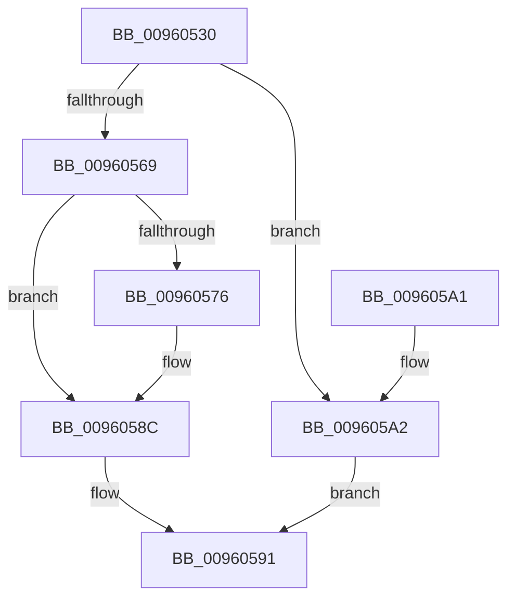

# PsGetAllocatedFullProcessImageName

- RVA: `0x00960530`–`0x009605A9` (길이 `121` bytes)
- VA: `0x0000000140960530`
- 실행 섹션: `PAGE`
- PDB 이름 있음: `예`; PDB Function 태그: `아니요`
- unwind 정보 RVA: `0x0006383C`
- 디코드: `33`개 명령, `121/121` bytes 표시
- 미해석 바이트: `0` (있으면 어셈블리에 `.byte`로 보존)

> 이 문서는 커널 이미지의 기계어와 PDB 기호를 분석해 생성했습니다. 4번과 5번은 함수 원형과 자료형을 바이너리 사용 방식에서 추정한 C 해석이며 원본 소스 복구 결과는 아닙니다.

## 1. Dependencies

- 직접 호출 지점: **2**; 고유 호출 대상: **2**
- 직접 호출자로 확인된 함수: **4**
- RIP 상대 이미지 참조: **0**

### Outgoing calls
- `0x0096055C` → [ExAllocatePool2](../../poolcode/B8/ExAllocatePool2_function_00B820F0.md) (function, `0x00B820F0`)
- `0x00960587` → [memcpy](../../text/6C/memcpy_function_006C6840.md) (function, `0x006C6840`)

### Direct callers
- [PfCalculateProcessHash](PfCalculateProcessHash_function_00960310.md) at `0x00960357`
- [PnpLogVetoInformation](../AB/PnpLogVetoInformation_function_00AB6BE8.md) at `0x00AB6C4F`
- [sub_00B2EDF4](../B2/Unknown_function_00B2EDF4.md) at `0x00B2EE55`
- [ViCreateProcessCallbackInternal](../../pagevrfy/BA/ViCreateProcessCallbackInternal_function_00BA68C0.md) at `0x00BA690B`

### Static image references
- 디코드된 RIP-relative 메모리 참조가 없습니다.

## 2. Other-region calls and transfers

- 다른 실행 섹션으로 향하는 call: **2**
  - `0x0096055C` → [ExAllocatePool2](../../poolcode/B8/ExAllocatePool2_function_00B820F0.md) (`PAGE` → `POOLCODE`)
  - `0x00960587` → [memcpy](../../text/6C/memcpy_function_006C6840.md) (`PAGE` → `.text`)
- 별도 외부 분기/꼬리 이동을 확인하지 못했습니다.

## 3. Assembly (complete function range)

```asm
00960530  48 89 5C 24 08                  mov qword ptr [rsp + 8], rbx
00960535  48 89 74 24 10                  mov qword ptr [rsp + 0x10], rsi
0096053A  57                              push rdi
0096053B  48 83 EC 20                     sub rsp, 0x20
0096053F  48 8B B9 50 03 00 00            mov rdi, qword ptr [rcx + 0x350]
00960546  48 8B F2                        mov rsi, rdx
00960549  B9 40 00 00 00                  mov ecx, 0x40
0096054E  41 B8 50 73 49 6E               mov r8d, 0x6e497350
00960554  0F B7 57 02                     movzx edx, word ptr [rdi + 2]
00960558  48 83 C2 10                     add rdx, 0x10
0096055C  E8 8F 1B 22 00                  call 0x140b820f0
00960561  48 8B D8                        mov rbx, rax
00960564  48 85 C0                        test rax, rax
00960567  74 39                           je 0x1409605a2
00960569  0F 10 07                        movups xmm0, xmmword ptr [rdi]
0096056C  0F 11 00                        movups xmmword ptr [rax], xmm0
0096056F  48 83 78 08 00                  cmp qword ptr [rax + 8], 0
00960574  74 16                           je 0x14096058c
00960576  48 8D 48 10                     lea rcx, [rax + 0x10]
0096057A  48 89 48 08                     mov qword ptr [rax + 8], rcx
0096057E  44 0F B7 47 02                  movzx r8d, word ptr [rdi + 2]
00960583  48 8B 57 08                     mov rdx, qword ptr [rdi + 8]
00960587  E8 B4 62 D6 FF                  call 0x1406c6840
0096058C  48 89 1E                        mov qword ptr [rsi], rbx
0096058F  33 C0                           xor eax, eax
00960591  48 8B 5C 24 30                  mov rbx, qword ptr [rsp + 0x30]
00960596  48 8B 74 24 38                  mov rsi, qword ptr [rsp + 0x38]
0096059B  48 83 C4 20                     add rsp, 0x20
0096059F  5F                              pop rdi
009605A0  C3                              ret
009605A1  CC                              int3
009605A2  B8 17 00 00 C0                  mov eax, 0xc0000017
009605A7  EB E8                           jmp 0x140960591
```

## 4. C-style interpretation (structured pseudocode)

```c
__int64 __fastcall PsGetAllocatedFullProcessImageName(__int64 a1, __int64 a2)
{
    __int64 result;
    __int64 v_rsp;
    unsigned __int64 v_stack_p10;
    unsigned __int64 v_stack_p8;

    v_stack_p8 = v_rbx;
    v_stack_p10 = v_rsi;
    v_rsp = (v_rsp) - (32);
    a2 = (*(unsigned __int16 *)(*(unsigned __int64 *)(a1 + 848) + 2)) + (16);
    result = ExAllocatePool2(64, a2, (unsigned int)(0x6E497350ULL), a4);
    if (result == 0) goto loc_009605A2;
    *(unsigned __int64 *)(result) = v_xmm0;
    if ((*(unsigned __int64 *)(result + 8)) != 0) {
        a1 = result + 16;
        *(unsigned __int64 *)(result + 8) = a1;
        a3 = *(unsigned __int16 *)(*(unsigned __int64 *)(a1 + 848) + 2);
        a2 = *(unsigned __int64 *)(*(unsigned __int64 *)(a1 + 848) + 8);
        result = memcpy(a1, a2, a3, a4);
    }
    *(unsigned __int64 *)(a2) = result;
    result = 0;
loc_00960591:
    v_rsp = (v_rsp) + (32);
    return result;
loc_009605A2:
    goto loc_00960591;
}
```

## 5. (Beta) C Style

```c
int64_t PsGetAllocatedFullProcessImageName(void *Arg1, void *Arg2)
{
    uint8_t *arg1 = (uint8_t *)Arg1;
    uint8_t *arg2 = (uint8_t *)Arg2;

    int64_t result;
    int64_t local_rsp;
    uint64_t v_stack_p10;
    uint64_t v_stack_p8;

    v_stack_p8 = local_rbx;
    v_stack_p10 = local_rsi;
    local_rsp = (local_rsp) - (32);
    Arg2 = (*(uint16_t *)(*(uint64_t *)(arg1 + 0x350) + 0x2)) + (16);
    result = ExAllocatePool2(64, Arg2, (uint32_t)(0x6E497350ULL), a4);
    if (result == 0) goto loc_009605A2;
    *(uint64_t *)(result) = v_xmm0;
    if ((*(uint64_t *)(result + 0x8)) != 0) {
        Arg1 = result + 16;
        *(void **)(result + 0x8) = Arg1;
        a3 = *(uint16_t *)(*(uint64_t *)(arg1 + 0x350) + 0x2);
        Arg2 = *(uint64_t *)(*(uint64_t *)(arg1 + 0x350) + 0x8);
        result = memcpy(Arg1, Arg2, a3, a4);
    }
    *(uint64_t *)(arg2) = result;
    result = 0;
loc_00960591:
    local_rsp = (local_rsp) + (32);
    return result;
loc_009605A2:
    goto loc_00960591;
}
```

### 관측된 메모리 오프셋

구조체 형식이 확인되지 않은 접근은 인자 기준의 오프셋으로만 기록했습니다.

| 기준 인자 | 오프셋 표현 | 폭 (bit) | 접근 |
|---|---:|---:|---|
| `Arg1` | `+ 0x350` | `64` | `R` |
| `Arg2` | `+ 0x0` | `64` | `W` |

## 6. Execution-region graph

[열기: 2D/3D 그래프와 함수 탐색 컨트롤 패널](../../../control-panel.html?section=page&rva=0x00960530&view=graph)

- 2D 그래프는 위에서 아래로 흐르고, 3D 그래프는 빈 공간을 드래그해 회전합니다. Shift+드래그는 이동, 휠은 확대·축소, 함수 노드 선택은 대상 보고서 이동입니다.

### Static fallback


