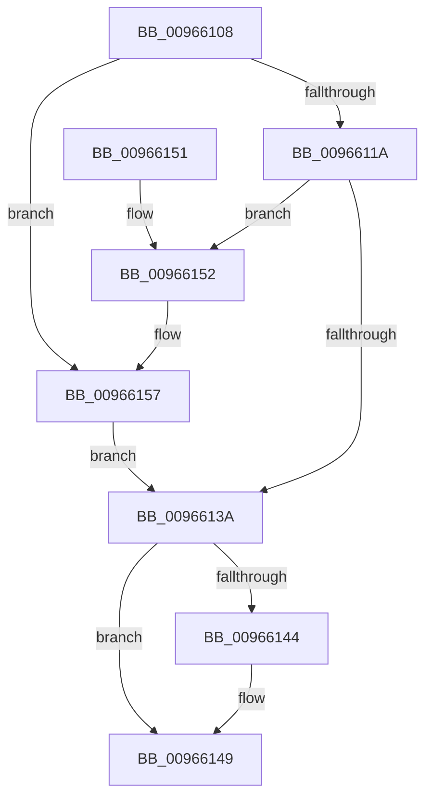

# RegRtlDeleteKeyTransacted

- RVA: `0x00966108`–`0x00966160` (길이 `88` bytes)
- VA: `0x0000000140966108`
- 실행 섹션: `PAGE`
- PDB 이름 있음: `예`; PDB Function 태그: `아니요`
- unwind 정보 RVA: `0x00093844`
- 디코드: `28`개 명령, `88/88` bytes 표시
- 미해석 바이트: `0` (있으면 어셈블리에 `.byte`로 보존)

> 이 문서는 커널 이미지의 기계어와 PDB 기호를 분석해 생성했습니다. 4번과 5번은 함수 원형과 자료형을 바이너리 사용 방식에서 추정한 C 해석이며 원본 소스 복구 결과는 아닙니다.

## 1. Dependencies

- 직접 호출 지점: **3**; 고유 호출 대상: **3**
- 직접 호출자로 확인된 함수: **3**
- RIP 상대 이미지 참조: **0**

### Outgoing calls
- `0x0096612F` → [_RegRtlOpenKeyTransacted](../8E/_RegRtlOpenKeyTransacted_function_008EF810.md) (function, `0x008EF810`)
- `0x00966144` → [ZwClose](../../text/6A/ZwClose_function_006AD2B0.md) (function, `0x006AD2B0`)
- `0x00966157` → [ZwDeleteKey](../../text/6A/ZwDeleteKey_function_006AEC50.md) (function, `0x006AEC50`)

### Direct callers
- [PnpCtxRegDeleteKey](PnpCtxRegDeleteKey_function_00965EC8.md) at `0x00965EF0`
- [_RegRtlDeletePathInternal](_RegRtlDeletePathInternal_function_00965F04.md) at `0x0096603E`
- [RegRtlDeleteTreeInternal](../99/RegRtlDeleteTreeInternal_function_00994700.md) at `0x00994800`

### Static image references
- 디코드된 RIP-relative 메모리 참조가 없습니다.

## 2. Other-region calls and transfers

- 다른 실행 섹션으로 향하는 call: **2**
  - `0x00966144` → [ZwClose](../../text/6A/ZwClose_function_006AD2B0.md) (`PAGE` → `.text`)
  - `0x00966157` → [ZwDeleteKey](../../text/6A/ZwDeleteKey_function_006AEC50.md) (`PAGE` → `.text`)
- 별도 외부 분기/꼬리 이동을 확인하지 못했습니다.

## 3. Assembly (complete function range)

```asm
00966108  4C 8B DC                        mov r11, rsp
0096610B  53                              push rbx
0096610C  48 83 EC 30                     sub rsp, 0x30
00966110  49 83 63 10 00                  and qword ptr [r11 + 0x10], 0
00966115  48 85 D2                        test rdx, rdx
00966118  74 3D                           je 0x140966157
0096611A  4D 89 43 F0                     mov qword ptr [r11 - 0x10], r8
0096611E  49 8D 43 10                     lea rax, [r11 + 0x10]
00966122  45 33 C0                        xor r8d, r8d
00966125  49 89 43 E8                     mov qword ptr [r11 - 0x18], rax
00966129  41 B9 00 00 01 00               mov r9d, 0x10000
0096612F  E8 DC 96 F8 FF                  call 0x1408ef810
00966134  8B D8                           mov ebx, eax
00966136  85 C0                           test eax, eax
00966138  79 18                           jns 0x140966152
0096613A  48 8B 4C 24 48                  mov rcx, qword ptr [rsp + 0x48]
0096613F  48 85 C9                        test rcx, rcx
00966142  74 05                           je 0x140966149
00966144  E8 67 71 D4 FF                  call 0x1406ad2b0
00966149  8B C3                           mov eax, ebx
0096614B  48 83 C4 30                     add rsp, 0x30
0096614F  5B                              pop rbx
00966150  C3                              ret
00966151  CC                              int3
00966152  48 8B 4C 24 48                  mov rcx, qword ptr [rsp + 0x48]
00966157  E8 F4 8A D4 FF                  call 0x1406aec50
0096615C  8B D8                           mov ebx, eax
0096615E  EB DA                           jmp 0x14096613a
```

## 4. C-style interpretation (structured pseudocode)

```c
__int64 __fastcall RegRtlDeleteKeyTransacted(__int64 a1, __int64 a2, __int64 a3)
{
    __int64 result;
    __int64 v_rsp;
    unsigned __int64 v_stack_p10;
    unsigned __int64 v_stack_p48;

    v_rsp = (v_rsp) - (48);
    if (a2 == 0) goto loc_00966157;
    *(unsigned __int64 *)(v_rsp - 16) = a3;
    a3 = 0;
    *(unsigned __int64 *)(v_rsp - 24) = v_rsp + 16;
    result = _RegRtlOpenKeyTransacted(a1, a2, a3, (unsigned int)(0x10000ULL));
    if (!sign_flag) goto loc_00966152;
loc_0096613A:
    if (v_stack_p10 != 0) {
        result = ZwClose(v_stack_p10, a2, a3, (unsigned int)(0x10000ULL));
    }
    v_rsp = (v_rsp) + (48);
    return (unsigned int)((unsigned int)((unsigned int)((unsigned int)(result))));
loc_00966152:
loc_00966157:
    result = ZwDeleteKey(v_stack_p48, a2, a3, (unsigned int)(0x10000ULL));
    goto loc_0096613A;
}
```

## 5. (Beta) C Style

```c
int64_t RegRtlDeleteKeyTransacted(int64_t Arg1, int64_t Arg2, int64_t Arg3)
{
    int64_t result;
    int64_t local_rsp;
    uint64_t v_stack_p10;
    uint64_t v_stack_p48;

    local_rsp = (local_rsp) - (48);
    if (Arg2 == 0) goto loc_00966157;
    *(uint64_t *)(local_rsp - 0x10) = Arg3;
    Arg3 = 0;
    *(uint64_t *)(local_rsp - 0x18) = local_rsp + 16;
    result = _RegRtlOpenKeyTransacted(Arg1, Arg2, Arg3, (uint32_t)(0x10000ULL));
    if (!sign_flag) goto loc_00966152;
loc_0096613A:
    if (v_stack_p10 != 0) {
        result = ZwClose(v_stack_p10, Arg2, Arg3, (uint32_t)(0x10000ULL));
    }
    local_rsp = (local_rsp) + (48);
    return (uint32_t)((uint32_t)((uint32_t)((uint32_t)(result))));
loc_00966152:
loc_00966157:
    result = ZwDeleteKey(v_stack_p48, Arg2, Arg3, (uint32_t)(0x10000ULL));
    goto loc_0096613A;
}
```

## 6. Execution-region graph

[열기: 2D/3D 그래프와 함수 탐색 컨트롤 패널](../../../control-panel.html?section=page&rva=0x00966108&view=graph)

- 2D 그래프는 위에서 아래로 흐르고, 3D 그래프는 빈 공간을 드래그해 회전합니다. Shift+드래그는 이동, 휠은 확대·축소, 함수 노드 선택은 대상 보고서 이동입니다.

### Static fallback


