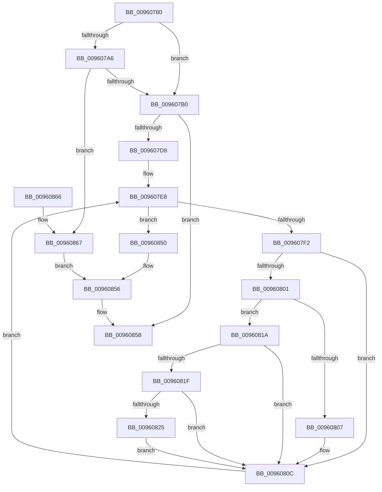

# RtlUpcaseUnicodeString

- RVA: `0x00960780`–`0x00960870` (길이 `240` bytes)
- VA: `0x0000000140960780`
- 실행 섹션: `PAGE`
- PDB 이름 있음: `예`; PDB Function 태그: `아니요`
- unwind 정보 RVA: `0x00093124`
- 디코드: `71`개 명령, `240/240` bytes 표시
- 미해석 바이트: `0` (있으면 어셈블리에 `.byte`로 보존)

> 이 문서는 커널 이미지의 기계어와 PDB 기호를 분석해 생성했습니다. 4번과 5번은 함수 원형과 자료형을 바이너리 사용 방식에서 추정한 C 해석이며 원본 소스 복구 결과는 아닙니다.

## 1. Dependencies

- 직접 호출 지점: **2**; 고유 호출 대상: **2**
- 직접 호출자로 확인된 함수: **15**
- RIP 상대 이미지 참조: **0**

### Outgoing calls
- `0x009607B0` → [PsGetCurrentServerSiloGlobals](../../text/2F/PsGetCurrentServerSiloGlobals_function_002FE1F0.md) (function, `0x002FE1F0`)
- `0x009607CB` → [AllocateOrValidateUnicodeStringBuffer](../../text/43/AllocateOrValidateUnicodeStringBuffer_function_00437A60.md) (function, `0x00437A60`)

### Direct callers
- [RtlDeriveCapabilitySidsFromName](../../text/47/RtlDeriveCapabilitySidsFromName_function_00474DC0.md) at `0x00474E33`
- [DifRtlUpcaseUnicodeStringWrapper](../../text/63/DifRtlUpcaseUnicodeStringWrapper_function_0063CED0.md) at `0x0063CFB5`
- [IoReportDetectedDevice](../72/IoReportDetectedDevice_function_00725CD0.md) at `0x0072619E`
- [IoReportDetectedDevice](../72/IoReportDetectedDevice_function_00725CD0.md) at `0x007261D0`
- [PiDevCfgResolveVariableGenerateGuid](../73/PiDevCfgResolveVariableGenerateGuid_function_00735FD0.md) at `0x0073603C`
- [PiCMGenerateDeviceInstance](../73/PiCMGenerateDeviceInstance_function_0073B69C.md) at `0x0073B77F`
- [AslStringUpcaseToMultiByteN](../95/AslStringUpcaseToMultiByteN_function_0095965C.md) at `0x009596BF`
- [SdbMakeIndexKeyFromStringEx](../95/SdbMakeIndexKeyFromStringEx_function_0095E9F4.md) at `0x0095EA9E`
- [PfCalculateProcessHash](PfCalculateProcessHash_function_00960310.md) at `0x0096037E`
- [PfSnLogStreamCreate](PfSnLogStreamCreate_function_009605B0.md) at `0x00960716`
- [PfSnLogVolumeCreate](PfSnLogVolumeCreate_function_00960AE0.md) at `0x00960BD6`
- [PiCMOpenClassKey](PiCMOpenClassKey_function_009617A8.md) at `0x0096187E`
- [PipMakeGloballyUniqueId](../A6/PipMakeGloballyUniqueId_function_00A6F428.md) at `0x00A6F73B`
- [ViCreateProcessCallbackInternal](../../pagevrfy/BA/ViCreateProcessCallbackInternal_function_00BA68C0.md) at `0x00BA6972`
- [ViFaultsAddAppNoDuplicates](../../pagevrfy/BA/ViFaultsAddAppNoDuplicates_function_00BA69E8.md) at `0x00BA6A5B`
- [PipInitComputerIds](../../init/C7/PipInitComputerIds_function_00C74734.md) at `0x00C7567D`
- [PipInitComputerIds](../../init/C7/PipInitComputerIds_function_00C74734.md) at `0x00C757DC`

### Static image references
- 디코드된 RIP-relative 메모리 참조가 없습니다.

## 2. Other-region calls and transfers

- 다른 실행 섹션으로 향하는 call: **2**
  - `0x009607B0` → [PsGetCurrentServerSiloGlobals](../../text/2F/PsGetCurrentServerSiloGlobals_function_002FE1F0.md) (`PAGE` → `.text`)
  - `0x009607CB` → [AllocateOrValidateUnicodeStringBuffer](../../text/43/AllocateOrValidateUnicodeStringBuffer_function_00437A60.md) (`PAGE` → `.text`)
- 별도 외부 분기/꼬리 이동을 확인하지 못했습니다.

## 3. Assembly (complete function range)

```asm
00960780  48 89 5C 24 10                  mov qword ptr [rsp + 0x10], rbx
00960785  44 88 44 24 18                  mov byte ptr [rsp + 0x18], r8b
0096078A  48 89 4C 24 08                  mov qword ptr [rsp + 8], rcx
0096078F  56                              push rsi
00960790  57                              push rdi
00960791  41 56                           push r14
00960793  48 83 EC 30                     sub rsp, 0x30
00960797  45 0F B6 D0                     movzx r10d, r8b
0096079B  48 8B FA                        mov rdi, rdx
0096079E  48 8B D9                        mov rbx, rcx
009607A1  45 84 C0                        test r8b, r8b
009607A4  75 0A                           jne 0x1409607b0
009607A6  66 83 3A 00                     cmp word ptr [rdx], 0
009607AA  0F 84 B7 00 00 00               je 0x140960867
009607B0  E8 3B DA 99 FF                  call 0x1402fe1f0
009607B5  48 8B B0 B0 04 00 00            mov rsi, qword ptr [rax + 0x4b0]
009607BC  4C 8D 4B 02                     lea r9, [rbx + 2]
009607C0  4C 8D 43 08                     lea r8, [rbx + 8]
009607C4  0F B7 12                        movzx edx, word ptr [rdx]
009607C7  41 0F B6 CA                     movzx ecx, r10b
009607CB  E8 90 72 AD FF                  call 0x140437a60
009607D0  85 C0                           test eax, eax
009607D2  0F 88 80 00 00 00               js 0x140960858
009607D8  44 0F B7 1F                     movzx r11d, word ptr [rdi]
009607DC  41 D1 EB                        shr r11d, 1
009607DF  45 33 C9                        xor r9d, r9d
009607E2  41 BE C0 00 00 00               mov r14d, 0xc0
009607E8  44 89 4C 24 20                  mov dword ptr [rsp + 0x20], r9d
009607ED  45 3B CB                        cmp r9d, r11d
009607F0  73 5E                           jae 0x140960850
009607F2  48 8B 4F 08                     mov rcx, qword ptr [rdi + 8]
009607F6  46 0F B7 14 49                  movzx r10d, word ptr [rcx + r9*2]
009607FB  41 83 FA 61                     cmp r10d, 0x61
009607FF  72 0B                           jb 0x14096080c
00960801  41 83 FA 7A                     cmp r10d, 0x7a
00960805  77 13                           ja 0x14096081a
00960807  66 41 83 EA 20                  sub r10w, 0x20
0096080C  48 8B 4B 08                     mov rcx, qword ptr [rbx + 8]
00960810  66 46 89 14 49                  mov word ptr [rcx + r9*2], r10w
00960815  41 FF C1                        inc r9d
00960818  EB CE                           jmp 0x1409607e8
0096081A  48 85 F6                        test rsi, rsi
0096081D  74 ED                           je 0x14096080c
0096081F  66 45 3B D6                     cmp r10w, r14w
00960823  72 E7                           jb 0x14096080c
00960825  45 8B C2                        mov r8d, r10d
00960828  49 8B CA                        mov rcx, r10
0096082B  48 C1 E9 08                     shr rcx, 8
0096082F  0F B7 14 4E                     movzx edx, word ptr [rsi + rcx*2]
00960833  41 8B CA                        mov ecx, r10d
00960836  C1 E9 04                        shr ecx, 4
00960839  83 E1 0F                        and ecx, 0xf
0096083C  03 D1                           add edx, ecx
0096083E  0F B7 14 56                     movzx edx, word ptr [rsi + rdx*2]
00960842  41 83 E0 0F                     and r8d, 0xf
00960846  41 03 D0                        add edx, r8d
00960849  66 44 03 14 56                  add r10w, word ptr [rsi + rdx*2]
0096084E  EB BC                           jmp 0x14096080c
00960850  0F B7 07                        movzx eax, word ptr [rdi]
00960853  66 89 03                        mov word ptr [rbx], ax
00960856  33 C0                           xor eax, eax
00960858  48 8B 5C 24 58                  mov rbx, qword ptr [rsp + 0x58]
0096085D  48 83 C4 30                     add rsp, 0x30
00960861  41 5E                           pop r14
00960863  5F                              pop rdi
00960864  5E                              pop rsi
00960865  C3                              ret
00960866  CC                              int3
00960867  45 33 C9                        xor r9d, r9d
0096086A  66 44 89 09                     mov word ptr [rcx], r9w
0096086E  EB E6                           jmp 0x140960856
```

## 4. C-style interpretation (structured pseudocode)

```c
__int64 __fastcall RtlUpcaseUnicodeString(__int64 a1, __int64 a2, unsigned __int8 a3)
{
    __int64 result;
    __int64 v_r10;
    __int64 v_r11;
    __int64 v_rsp;
    unsigned int v_stack_m28;
    unsigned __int64 v_stack_p10;
    unsigned __int8 v_stack_p18;
    unsigned __int64 v_stack_p8;

    v_stack_p10 = v_rbx;
    v_stack_p18 = a3;
    v_stack_p8 = a1;
    v_rsp = (v_rsp) - (48);
    if (a3 != 0) goto loc_009607B0;
    if ((*(unsigned __int16 *)(a2)) == 0) goto loc_00960867;
loc_009607B0:
    result = PsGetCurrentServerSiloGlobals(a1, a2, a3, a4);
    result = AllocateOrValidateUnicodeStringBuffer(a3, *(unsigned __int16 *)(a2), a1 + 8, a1 + 2);
    if (sign_flag) goto loc_00960858;
    v_r11 = (unsigned int)((*(unsigned __int16 *)(a2)) >> (1));
    a4 = 0;
loc_009607E8:
    v_stack_m28 = 0;
    if (0 >= ((unsigned int)(v_r11))) goto loc_00960850;
    if (((unsigned int)(*(unsigned __int16 *)(*(unsigned __int64 *)(a2 + 8) + a4 * 2))) < 97) goto loc_0096080C;
    if (((unsigned int)(*(unsigned __int16 *)(*(unsigned __int64 *)(a2 + 8) + a4 * 2))) > 122) goto loc_0096081A;
    v_r10 = (unsigned __int16)((*(unsigned __int16 *)(*(unsigned __int64 *)(a2 + 8) + a4 * 2)) - (32));
loc_0096080C:
    *(unsigned __int16 *)(*(unsigned __int64 *)(a1 + 8) + a4 * 2) = (unsigned __int16)(v_r10);
    a4 = (unsigned int)((a4) + 1);
    goto loc_009607E8;
loc_0096081A:
    if (*(unsigned __int64 *)(result + 1200) == 0) goto loc_0096080C;
    if (((unsigned __int16)(v_r10)) < 192) goto loc_0096080C;
    a1 = (v_r10) >> (8);
    a1 = (unsigned int)(((unsigned int)((unsigned int)(v_r10))) >> (4));
    a1 = (unsigned int)((a1) & (15));
    a2 = (unsigned int)((*(unsigned __int16 *)(*(unsigned __int64 *)(result + 1200) + a1 * 2)) + ((unsigned int)(a1)));
    a3 = (unsigned int)(((unsigned int)((unsigned int)(v_r10))) & (15));
    a2 = (unsigned int)((*(unsigned __int16 *)(*(unsigned __int64 *)(result + 1200) + a2 * 2)) + (a3));
    v_r10 = (unsigned __int16)((v_r10) + (*(unsigned __int16 *)(*(unsigned __int64 *)(result + 1200) + a2 * 2)));
    goto loc_0096080C;
loc_00960850:
    *(unsigned __int16 *)(a1) = (unsigned __int16)(*(unsigned __int16 *)(a2));
loc_00960856:
    result = 0;
loc_00960858:
    v_rsp = (v_rsp) + (48);
    return result;
loc_00960867:
    a4 = 0;
    *(unsigned __int16 *)(a1) = 0;
    goto loc_00960856;
}
```

## 5. (Beta) C Style

```c
int64_t RtlUpcaseUnicodeString(void *Arg1, void *Arg2, uint8_t Arg3)
{
    uint8_t *arg1 = (uint8_t *)Arg1;
    uint8_t *arg2 = (uint8_t *)Arg2;

    int64_t result;
    int64_t local_r10;
    int64_t local_r11;
    int64_t local_rsp;
    uint32_t v_stack_m28;
    uint64_t v_stack_p10;
    uint8_t v_stack_p18;
    uint64_t v_stack_p8;

    v_stack_p10 = local_rbx;
    v_stack_p18 = Arg3;
    v_stack_p8 = Arg1;
    local_rsp = (local_rsp) - (48);
    if (Arg3 != 0) goto loc_009607B0;
    if ((*(uint16_t *)(arg2)) == 0) goto loc_00960867;
loc_009607B0:
    result = PsGetCurrentServerSiloGlobals(Arg1, Arg2, Arg3, a4);
    result = AllocateOrValidateUnicodeStringBuffer(Arg3, *(uint16_t *)(arg2), Arg1 + 8, Arg1 + 2);
    if (sign_flag) goto loc_00960858;
    local_r11 = (uint32_t)((*(uint16_t *)(arg2)) >> (1));
    a4 = 0;
loc_009607E8:
    v_stack_m28 = 0;
    if (0 >= ((uint32_t)(local_r11))) goto loc_00960850;
    if (((uint32_t)(*(uint16_t *)(*(uint64_t *)(arg2 + 0x8) + a4 * 2))) < 97) goto loc_0096080C;
    if (((uint32_t)(*(uint16_t *)(*(uint64_t *)(arg2 + 0x8) + a4 * 2))) > 122) goto loc_0096081A;
    local_r10 = (uint16_t)((*(uint16_t *)(*(uint64_t *)(arg2 + 0x8) + a4 * 2)) - (32));
loc_0096080C:
    *(uint16_t *)(*(uint64_t *)(arg1 + 0x8) + a4 * 2) = (uint16_t)(local_r10);
    a4 = (uint32_t)((a4) + 1);
    goto loc_009607E8;
loc_0096081A:
    if (*(uint64_t *)(result + 0x4B0) == 0) goto loc_0096080C;
    if (((uint16_t)(local_r10)) < 192) goto loc_0096080C;
    Arg1 = (local_r10) >> (8);
    Arg1 = (uint32_t)(((uint32_t)((uint32_t)(local_r10))) >> (4));
    Arg1 = (uint32_t)((Arg1) & (15));
    Arg2 = (uint32_t)((*(uint16_t *)(*(uint64_t *)(result + 0x4B0) + arg1 * 2)) + ((uint32_t)(Arg1)));
    Arg3 = (uint32_t)(((uint32_t)((uint32_t)(local_r10))) & (15));
    Arg2 = (uint32_t)((*(uint16_t *)(*(uint64_t *)(result + 0x4B0) + arg2 * 2)) + (Arg3));
    local_r10 = (uint16_t)((local_r10) + (*(uint16_t *)(*(uint64_t *)(result + 0x4B0) + arg2 * 2)));
    goto loc_0096080C;
loc_00960850:
    *(uint16_t *)(arg1) = (uint16_t)(*(uint16_t *)(arg2));
loc_00960856:
    result = 0;
loc_00960858:
    local_rsp = (local_rsp) + (48);
    return result;
loc_00960867:
    a4 = 0;
    *(uint16_t *)(arg1) = 0;
    goto loc_00960856;
}
```

### 관측된 메모리 오프셋

구조체 형식이 확인되지 않은 접근은 인자 기준의 오프셋으로만 기록했습니다.

| 기준 인자 | 오프셋 표현 | 폭 (bit) | 접근 |
|---|---:|---:|---|
| `Arg1` | `+ 0x0` | `16` | `W` |
| `Arg1` | `+ 0x2` | `64` | `R` |
| `Arg1` | `+ 0x8` | `64` | `R` |
| `Arg2` | `+ 0x0` | `16` | `R` |
| `Arg2` | `+ 0x8` | `64` | `R` |

## 6. Execution-region graph

[열기: 2D/3D 그래프와 함수 탐색 컨트롤 패널](../../../control-panel.html?section=page&rva=0x00960780&view=graph)

- 2D 그래프는 위에서 아래로 흐르고, 3D 그래프는 빈 공간을 드래그해 회전합니다. Shift+드래그는 이동, 휠은 확대·축소, 함수 노드 선택은 대상 보고서 이동입니다.

### Static fallback


