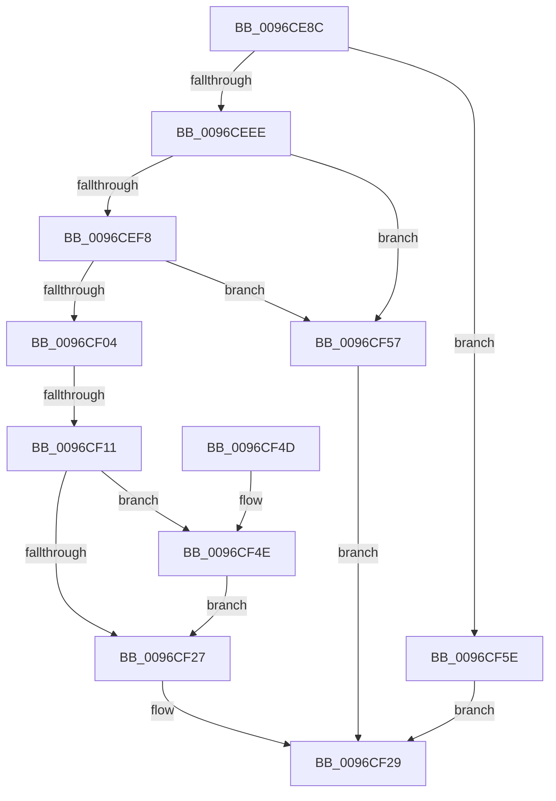

# SeGetTokenDeviceMap

- RVA: `0x0096CE8C`–`0x0096CF65` (길이 `217` bytes)
- VA: `0x000000014096CE8C`
- 실행 섹션: `PAGE`
- PDB 이름 있음: `예`; PDB Function 태그: `예`
- unwind 정보 RVA: `0x00095CD8`
- 디코드: `60`개 명령, `217/217` bytes 표시
- 미해석 바이트: `0` (있으면 어셈블리에 `.byte`로 보존)

> 이 문서는 커널 이미지의 기계어와 PDB 기호를 분석해 생성했습니다. 4번과 5번은 함수 원형과 자료형을 바이너리 사용 방식에서 추정한 C 해석이며 원본 소스 복구 결과는 아닙니다.

## 1. Dependencies

- 직접 호출 지점: **1**; 고유 호출 대상: **1**
- 직접 호출자로 확인된 함수: **3**
- RIP 상대 이미지 참조: **1**

### Outgoing calls
- `0x0096CF30` → [_security_check_cookie](../../text/6A/_security_check_cookie_function_006AC640.md) (function, `0x006AC640`)

### Direct callers
- [ObpLookupObjectName](../89/ObpLookupObjectName_function_0089BE90.md) at `0x0089C251`
- [ObpReferenceCurrentDeviceMap](ObpReferenceCurrentDeviceMap_function_0096CBD0.md) at `0x0096CCC6`
- [ObpSetCurrentProcessDeviceMap](ObpSetCurrentProcessDeviceMap_function_0096CF6C.md) at `0x0096CFE2`

### Static image references
- `0x0096CEA6` → RVA `0x00E0A740` (`.data`; read)

## 2. Other-region calls and transfers

- 다른 실행 섹션으로 향하는 call: **1**
  - `0x0096CF30` → [_security_check_cookie](../../text/6A/_security_check_cookie_function_006AC640.md) (`PAGE` → `.text`)
- call이 아닌 외부 분기/꼬리 이동: **1**
  - `0x0096CF0B` → [sub_00B2884E](../B2/Unknown_function_00B2884E.md) (`tail-transfer`)

## 3. Assembly (complete function range)

```asm
0096CE8C  48 89 5C 24 18                  mov qword ptr [rsp + 0x18], rbx
0096CE91  48 89 74 24 20                  mov qword ptr [rsp + 0x20], rsi
0096CE96  55                              push rbp
0096CE97  57                              push rdi
0096CE98  41 56                           push r14
0096CE9A  48 8D 6C 24 D0                  lea rbp, [rsp - 0x30]
0096CE9F  48 81 EC 30 01 00 00            sub rsp, 0x130
0096CEA6  48 8B 05 93 D8 49 00            mov rax, qword ptr [rip + 0x49d893]
0096CEAD  48 33 C4                        xor rax, rsp
0096CEB0  48 89 45 20                     mov qword ptr [rbp + 0x20], rax
0096CEB4  33 C0                           xor eax, eax
0096CEB6  0F 57 C0                        xorps xmm0, xmm0
0096CEB9  21 44 24 7C                     and dword ptr [rsp + 0x7c], eax
0096CEBD  0F 57 C9                        xorps xmm1, xmm1
0096CEC0  48 21 44 24 40                  and qword ptr [rsp + 0x40], rax
0096CEC5  4C 8B F2                        mov r14, rdx
0096CEC8  48 21 44 24 48                  and qword ptr [rsp + 0x48], rax
0096CECD  48 8B D9                        mov rbx, rcx
0096CED0  48 21 44 24 38                  and qword ptr [rsp + 0x38], rax
0096CED5  48 21 02                        and qword ptr [rdx], rax
0096CED8  89 44 24 64                     mov dword ptr [rsp + 0x64], eax
0096CEDC  21 44 24 64                     and dword ptr [rsp + 0x64], eax
0096CEE0  0F 11 44 24 50                  movups xmmword ptr [rsp + 0x50], xmm0
0096CEE5  0F 11 4D 90                     movups xmmword ptr [rbp - 0x70], xmm1
0096CEE9  48 85 C9                        test rcx, rcx
0096CEEC  74 70                           je 0x14096cf5e
0096CEEE  8B 81 C8 00 00 00               mov eax, dword ptr [rcx + 0xc8]
0096CEF4  A8 20                           test al, 0x20
0096CEF6  75 5F                           jne 0x14096cf57
0096CEF8  48 8B B9 D8 00 00 00            mov rdi, qword ptr [rcx + 0xd8]
0096CEFF  48 85 FF                        test rdi, rdi
0096CF02  74 53                           je 0x14096cf57
0096CF04  48 8B 47 30                     mov rax, qword ptr [rdi + 0x30]
0096CF08  48 85 C0                        test rax, rax
0096CF0B  0F 84 3D B9 1B 00               je 0x140b2884e
0096CF11  48 89 02                        mov qword ptr [rdx], rax
0096CF14  BB 01 00 00 00                  mov ebx, 1
0096CF19  F0 48 0F C1 98 F0 00 00 00      lock xadd qword ptr [rax + 0xf0], rbx
0096CF22  48 85 DB                        test rbx, rbx
0096CF25  7E 27                           jle 0x14096cf4e
0096CF27  33 C0                           xor eax, eax
0096CF29  48 8B 4D 20                     mov rcx, qword ptr [rbp + 0x20]
0096CF2D  48 33 CC                        xor rcx, rsp
0096CF30  E8 0B F7 D3 FF                  call 0x1406ac640
0096CF35  4C 8D 9C 24 30 01 00 00         lea r11, [rsp + 0x130]
0096CF3D  49 8B 5B 30                     mov rbx, qword ptr [r11 + 0x30]
0096CF41  49 8B 73 38                     mov rsi, qword ptr [r11 + 0x38]
0096CF45  49 8B E3                        mov rsp, r11
0096CF48  41 5E                           pop r14
0096CF4A  5F                              pop rdi
0096CF4B  5D                              pop rbp
0096CF4C  C3                              ret
0096CF4D  CC                              int3
0096CF4E  B9 0E 00 00 00                  mov ecx, 0xe
0096CF53  CD 29                           int 0x29
0096CF55  EB D0                           jmp 0x14096cf27
0096CF57  B8 5F 00 00 C0                  mov eax, 0xc000005f
0096CF5C  EB CB                           jmp 0x14096cf29
0096CF5E  B8 0D 00 00 C0                  mov eax, 0xc000000d
0096CF63  EB C4                           jmp 0x14096cf29
```

## 4. C-style interpretation (structured pseudocode)

```c
__int64 __fastcall SeGetTokenDeviceMap(__int64 a1, __int64 a2)
{
    __int64 result;
    __int64 v_rsp;
    unsigned __int64 v_stack_m100;
    unsigned __int64 v_stack_m108;
    unsigned __int64 v_stack_m110;
    unsigned __int64 v_stack_m18;
    unsigned __int64 v_stack_m28;
    unsigned __int64 v_stack_m48;
    unsigned __int64 v_stack_mB8;
    unsigned int v_stack_mCC;
    unsigned int v_stack_mE4;
    unsigned __int64 v_stack_mF8;
    unsigned __int64 v_stack_p18;
    unsigned __int64 v_stack_p20;

    v_stack_p18 = v_rbx;
    v_stack_p20 = v_rsi;
    v_rsp = (v_rsp) - (304);
    result = (*(unsigned __int64 *)(v_rip + 4839571)) ^ (v_rsp);
    v_stack_m28 = result;
    result = 0;
    v_stack_mE4 = 0;
    v_stack_mF8 = v_xmm0;
    v_stack_mB8 = v_xmm1;
    if (a1 == 0) goto loc_0096CF5E;
    if ((((unsigned __int8)((unsigned int)(*(unsigned int *)(a1 + 200)))) & (32)) != 0) goto loc_0096CF57;
    if (*(unsigned __int64 *)(a1 + 216) == 0) goto loc_0096CF57;
    *(unsigned __int64 *)(a2) = *(unsigned __int64 *)(*(unsigned __int64 *)(a1 + 216) + 48);
    if (condition_is_less_or_equal) goto loc_0096CF4E;
loc_0096CF27:
    result = 0;
loc_0096CF29:
    a1 = (v_stack_m28) ^ (v_rsp);
    result = _security_check_cookie(a1, a2, a3, a4);
    return result;
loc_0096CF4E:
    goto loc_0096CF27;
loc_0096CF57:
    goto loc_0096CF29;
loc_0096CF5E:
    goto loc_0096CF29;
}
```

## 5. (Beta) C Style

```c
int64_t SeGetTokenDeviceMap(int64_t Arg1, void *Arg2)
{
    uint8_t *arg2 = (uint8_t *)Arg2;

    int64_t result;
    int64_t local_rsp;
    uint64_t v_stack_m100;
    uint64_t v_stack_m108;
    uint64_t v_stack_m110;
    uint64_t v_stack_m18;
    uint64_t v_stack_m28;
    uint64_t v_stack_m48;
    uint64_t v_stack_mB8;
    uint32_t v_stack_mCC;
    uint32_t v_stack_mE4;
    uint64_t v_stack_mF8;
    uint64_t v_stack_p18;
    uint64_t v_stack_p20;

    v_stack_p18 = local_rbx;
    v_stack_p20 = local_rsi;
    local_rsp = (local_rsp) - (304);
    result = (*(uint64_t *)(v_rip + 0x49D893)) ^ (local_rsp);
    v_stack_m28 = result;
    result = 0;
    v_stack_mE4 = 0;
    v_stack_mF8 = v_xmm0;
    v_stack_mB8 = v_xmm1;
    if (Arg1 == 0) goto loc_0096CF5E;
    if ((((uint8_t)((uint32_t)(*(uint32_t *)(Arg1 + 0xC8)))) & (32)) != 0) goto loc_0096CF57;
    if (*(uint64_t *)(Arg1 + 0xD8) == 0) goto loc_0096CF57;
    *(uint64_t *)(arg2) = *(uint64_t *)(*(uint64_t *)(Arg1 + 0xD8) + 0x30);
    if (condition_is_less_or_equal) goto loc_0096CF4E;
loc_0096CF27:
    result = 0;
loc_0096CF29:
    Arg1 = (v_stack_m28) ^ (local_rsp);
    result = _security_check_cookie(Arg1, Arg2, a3, a4);
    return result;
loc_0096CF4E:
    goto loc_0096CF27;
loc_0096CF57:
    goto loc_0096CF29;
loc_0096CF5E:
    goto loc_0096CF29;
}
```

### 관측된 메모리 오프셋

구조체 형식이 확인되지 않은 접근은 인자 기준의 오프셋으로만 기록했습니다.

| 기준 인자 | 오프셋 표현 | 폭 (bit) | 접근 |
|---|---:|---:|---|
| `Arg2` | `+ 0x0` | `64` | `R/W` |
| `Arg2` | `+ 0x0` | `64` | `W` |

## 6. Execution-region graph

[열기: 2D/3D 그래프와 함수 탐색 컨트롤 패널](../../../control-panel.html?section=page&rva=0x0096CE8C&view=graph)

- 2D 그래프는 위에서 아래로 흐르고, 3D 그래프는 빈 공간을 드래그해 회전합니다. Shift+드래그는 이동, 휠은 확대·축소, 함수 노드 선택은 대상 보고서 이동입니다.

### Static fallback


