# sub_009669C4

- RVA: `0x009669C4`–`0x00966DE2` (길이 `1,054` bytes)
- VA: `0x00000001409669C4`
- 실행 섹션: `PAGE`
- PDB 이름 있음: `아니요`; PDB Function 태그: `아니요`
- unwind 정보 RVA: `0x00094FF0`
- 디코드: `269`개 명령, `1,054/1,054` bytes 표시
- 미해석 바이트: `0` (있으면 어셈블리에 `.byte`로 보존)

> 이 문서는 커널 이미지의 기계어와 PDB 기호를 분석해 생성했습니다. 4번과 5번은 함수 원형과 자료형을 바이너리 사용 방식에서 추정한 C 해석이며 원본 소스 복구 결과는 아닙니다.

## 1. Dependencies

- 직접 호출 지점: **41**; 고유 호출 대상: **19**
- 직접 호출자로 확인된 함수: **2**
- RIP 상대 이미지 참조: **7**

### Outgoing calls
- `0x009669F1` → [PsGetCurrentServerSiloGlobals](../../text/2F/PsGetCurrentServerSiloGlobals_function_002FE1F0.md) (function, `0x002FE1F0`)
- `0x00966A0B` → [PsGetCurrentServerSilo](../../text/22/PsGetCurrentServerSilo_function_00225710.md) (function, `0x00225710`)
- `0x00966A13` → [PsIsHostSilo](../../text/44/PsIsHostSilo_function_00443B30.md) (function, `0x00443B30`)
- `0x00966A1C` → [ClipInitHandles](../../text/65/ClipInitHandles_function_00657600.md) (function, `0x00657600`)
- `0x00966A21` → [sub_00C6D0F8](../../init/C6/Unknown_function_00C6D0F8.md) (function, `0x00C6D0F8`)
- `0x00966A4A` → [KeAbPreAcquire](../../text/21/KeAbPreAcquire_function_00210230.md) (function, `0x00210230`)
- `0x00966A63` → [ExfAcquirePushLockExclusiveEx](../../text/20/ExfAcquirePushLockExclusiveEx_function_0020FC90.md) (function, `0x0020FC90`)
- `0x00966AC2` → [sub_00966DF0](Unknown_function_00966DF0.md) (function, `0x00966DF0`)
- `0x00966AD8` → [ExfTryToWakePushLock](../../text/26/ExfTryToWakePushLock_function_00265DD0.md) (function, `0x00265DD0`)
- `0x00966AE0` → [KeAbPostRelease](../../text/2E/KeAbPostRelease_function_002E1600.md) (function, `0x002E1600`)
- `0x00966AE5` → [KeLeaveCriticalRegion](../../text/25/KeLeaveCriticalRegion_function_0025D8B0.md) (function, `0x0025D8B0`)
- `0x00966B03` → [KeAbPreAcquire](../../text/21/KeAbPreAcquire_function_00210230.md) (function, `0x00210230`)
- `0x00966B1C` → [ExfAcquirePushLockExclusiveEx](../../text/20/ExfAcquirePushLockExclusiveEx_function_0020FC90.md) (function, `0x0020FC90`)
- `0x00966B40` → [ExfTryToWakePushLock](../../text/26/ExfTryToWakePushLock_function_00265DD0.md) (function, `0x00265DD0`)
- `0x00966B48` → [KeAbPostRelease](../../text/2E/KeAbPostRelease_function_002E1600.md) (function, `0x002E1600`)
- `0x00966B4D` → [KeLeaveCriticalRegion](../../text/25/KeLeaveCriticalRegion_function_0025D8B0.md) (function, `0x0025D8B0`)
- `0x00966B74` → [KeAbPreAcquire](../../text/21/KeAbPreAcquire_function_00210230.md) (function, `0x00210230`)
- `0x00966B8D` → [ExfAcquirePushLockExclusiveEx](../../text/20/ExfAcquirePushLockExclusiveEx_function_0020FC90.md) (function, `0x0020FC90`)
- `0x00966B9F` → [sub_007C90A8](../7C/Unknown_function_007C90A8.md) (function, `0x007C90A8`)
- `0x00966BD6` → [ExfTryToWakePushLock](../../text/26/ExfTryToWakePushLock_function_00265DD0.md) (function, `0x00265DD0`)
- `0x00966BDE` → [KeAbPostRelease](../../text/2E/KeAbPostRelease_function_002E1600.md) (function, `0x002E1600`)
- `0x00966BE3` → [KeLeaveCriticalRegion](../../text/25/KeLeaveCriticalRegion_function_0025D8B0.md) (function, `0x0025D8B0`)
- `0x00966BF9` → [sub_007C7F80](../7C/Unknown_function_007C7F80.md) (function, `0x007C7F80`)
- `0x00966C21` → [guard_dispatch_icall](../../text/6B/guard_dispatch_icall_function_006BAAD0.md) (function, `0x006BAAD0`)
- `0x00966C28` → [SLUpdateLicenseDataInternal](../7C/SLUpdateLicenseDataInternal_function_007C9C04.md) (function, `0x007C9C04`)
- `0x00966C68` → [KeAbPreAcquire](../../text/21/KeAbPreAcquire_function_00210230.md) (function, `0x00210230`)
- `0x00966C81` → [ExfAcquirePushLockExclusiveEx](../../text/20/ExfAcquirePushLockExclusiveEx_function_0020FC90.md) (function, `0x0020FC90`)
- `0x00966CB4` → [ExfTryToWakePushLock](../../text/26/ExfTryToWakePushLock_function_00265DD0.md) (function, `0x00265DD0`)
- `0x00966CBC` → [KeAbPostRelease](../../text/2E/KeAbPostRelease_function_002E1600.md) (function, `0x002E1600`)
- `0x00966CC1` → [KeLeaveCriticalRegion](../../text/25/KeLeaveCriticalRegion_function_0025D8B0.md) (function, `0x0025D8B0`)
- `0x00966CE6` → [KeAbPreAcquire](../../text/21/KeAbPreAcquire_function_00210230.md) (function, `0x00210230`)
- `0x00966CFF` → [ExfAcquirePushLockExclusiveEx](../../text/20/ExfAcquirePushLockExclusiveEx_function_0020FC90.md) (function, `0x0020FC90`)
- `0x00966D0D` → [PsGetCurrentServerSilo](../../text/22/PsGetCurrentServerSilo_function_00225710.md) (function, `0x00225710`)
- `0x00966D15` → [PsIsHostSilo](../../text/44/PsIsHostSilo_function_00443B30.md) (function, `0x00443B30`)
- `0x00966D2B` → [ExFreePoolWithTag](../../poolcode/B8/ExFreePoolWithTag_function_00B82870.md) (function, `0x00B82870`)
- `0x00966D53` → [memset](../../text/6C/memset_function_006C6C40.md) (function, `0x006C6C40`)
- `0x00966D77` → [ExfTryToWakePushLock](../../text/26/ExfTryToWakePushLock_function_00265DD0.md) (function, `0x00265DD0`)
- `0x00966D83` → [KeAbPostRelease](../../text/2E/KeAbPostRelease_function_002E1600.md) (function, `0x002E1600`)
- `0x00966D88` → [KeLeaveCriticalRegion](../../text/25/KeLeaveCriticalRegion_function_0025D8B0.md) (function, `0x0025D8B0`)
- `0x00966D9A` → [ExGetExpirationDate](../7C/ExGetExpirationDate_function_007C78C8.md) (function, `0x007C78C8`)
- `0x00966DBE` → [_security_check_cookie](../../text/6A/_security_check_cookie_function_006AC640.md) (function, `0x006AC640`)

### Direct callers
- [sub_006578CC](../../text/65/Unknown_function_006578CC.md) at `0x006579EF`
- [Phase1InitializationIoReady](../../init/C7/Phase1InitializationIoReady_function_00C70458.md) at `0x00C70622`

### Static image references
- `0x009669E3` → RVA `0x00E0A740` (`.data`; read)
- `0x00966A72` → RVA `0x00FC41C4` (`.data`; read)
- `0x00966AA4` → RVA `0x00FC4148` (`.data`; read)
- `0x00966BF2` → RVA `0x00022610` (`.rdata`; read)
- `0x00966C0E` → RVA `0x00FD84B0` (`PAGEDATA`; read)
- `0x00966D8D` → RVA `0x00EF0138` (`.data`; read)
- `0x00966DA5` → RVA `0x00FC5008` (`ALMOSTRO`; read)

## 2. Other-region calls and transfers

- 다른 실행 섹션으로 향하는 call: **36**
  - `0x009669F1` → [PsGetCurrentServerSiloGlobals](../../text/2F/PsGetCurrentServerSiloGlobals_function_002FE1F0.md) (`PAGE` → `.text`)
  - `0x00966A0B` → [PsGetCurrentServerSilo](../../text/22/PsGetCurrentServerSilo_function_00225710.md) (`PAGE` → `.text`)
  - `0x00966A13` → [PsIsHostSilo](../../text/44/PsIsHostSilo_function_00443B30.md) (`PAGE` → `.text`)
  - `0x00966A1C` → [ClipInitHandles](../../text/65/ClipInitHandles_function_00657600.md) (`PAGE` → `.text`)
  - `0x00966A21` → [sub_00C6D0F8](../../init/C6/Unknown_function_00C6D0F8.md) (`PAGE` → `INIT`)
  - `0x00966A4A` → [KeAbPreAcquire](../../text/21/KeAbPreAcquire_function_00210230.md) (`PAGE` → `.text`)
  - `0x00966A63` → [ExfAcquirePushLockExclusiveEx](../../text/20/ExfAcquirePushLockExclusiveEx_function_0020FC90.md) (`PAGE` → `.text`)
  - `0x00966AD8` → [ExfTryToWakePushLock](../../text/26/ExfTryToWakePushLock_function_00265DD0.md) (`PAGE` → `.text`)
  - `0x00966AE0` → [KeAbPostRelease](../../text/2E/KeAbPostRelease_function_002E1600.md) (`PAGE` → `.text`)
  - `0x00966AE5` → [KeLeaveCriticalRegion](../../text/25/KeLeaveCriticalRegion_function_0025D8B0.md) (`PAGE` → `.text`)
  - `0x00966B03` → [KeAbPreAcquire](../../text/21/KeAbPreAcquire_function_00210230.md) (`PAGE` → `.text`)
  - `0x00966B1C` → [ExfAcquirePushLockExclusiveEx](../../text/20/ExfAcquirePushLockExclusiveEx_function_0020FC90.md) (`PAGE` → `.text`)
  - `0x00966B40` → [ExfTryToWakePushLock](../../text/26/ExfTryToWakePushLock_function_00265DD0.md) (`PAGE` → `.text`)
  - `0x00966B48` → [KeAbPostRelease](../../text/2E/KeAbPostRelease_function_002E1600.md) (`PAGE` → `.text`)
  - `0x00966B4D` → [KeLeaveCriticalRegion](../../text/25/KeLeaveCriticalRegion_function_0025D8B0.md) (`PAGE` → `.text`)
  - `0x00966B74` → [KeAbPreAcquire](../../text/21/KeAbPreAcquire_function_00210230.md) (`PAGE` → `.text`)
  - `0x00966B8D` → [ExfAcquirePushLockExclusiveEx](../../text/20/ExfAcquirePushLockExclusiveEx_function_0020FC90.md) (`PAGE` → `.text`)
  - `0x00966BD6` → [ExfTryToWakePushLock](../../text/26/ExfTryToWakePushLock_function_00265DD0.md) (`PAGE` → `.text`)
  - `0x00966BDE` → [KeAbPostRelease](../../text/2E/KeAbPostRelease_function_002E1600.md) (`PAGE` → `.text`)
  - `0x00966BE3` → [KeLeaveCriticalRegion](../../text/25/KeLeaveCriticalRegion_function_0025D8B0.md) (`PAGE` → `.text`)
  - `0x00966C21` → [guard_dispatch_icall](../../text/6B/guard_dispatch_icall_function_006BAAD0.md) (`PAGE` → `.text`)
  - `0x00966C68` → [KeAbPreAcquire](../../text/21/KeAbPreAcquire_function_00210230.md) (`PAGE` → `.text`)
  - `0x00966C81` → [ExfAcquirePushLockExclusiveEx](../../text/20/ExfAcquirePushLockExclusiveEx_function_0020FC90.md) (`PAGE` → `.text`)
  - `0x00966CB4` → [ExfTryToWakePushLock](../../text/26/ExfTryToWakePushLock_function_00265DD0.md) (`PAGE` → `.text`)
  - `0x00966CBC` → [KeAbPostRelease](../../text/2E/KeAbPostRelease_function_002E1600.md) (`PAGE` → `.text`)
  - `0x00966CC1` → [KeLeaveCriticalRegion](../../text/25/KeLeaveCriticalRegion_function_0025D8B0.md) (`PAGE` → `.text`)
  - `0x00966CE6` → [KeAbPreAcquire](../../text/21/KeAbPreAcquire_function_00210230.md) (`PAGE` → `.text`)
  - `0x00966CFF` → [ExfAcquirePushLockExclusiveEx](../../text/20/ExfAcquirePushLockExclusiveEx_function_0020FC90.md) (`PAGE` → `.text`)
  - `0x00966D0D` → [PsGetCurrentServerSilo](../../text/22/PsGetCurrentServerSilo_function_00225710.md) (`PAGE` → `.text`)
  - `0x00966D15` → [PsIsHostSilo](../../text/44/PsIsHostSilo_function_00443B30.md) (`PAGE` → `.text`)
  - `0x00966D2B` → [ExFreePoolWithTag](../../poolcode/B8/ExFreePoolWithTag_function_00B82870.md) (`PAGE` → `POOLCODE`)
  - `0x00966D53` → [memset](../../text/6C/memset_function_006C6C40.md) (`PAGE` → `.text`)
  - `0x00966D77` → [ExfTryToWakePushLock](../../text/26/ExfTryToWakePushLock_function_00265DD0.md) (`PAGE` → `.text`)
  - `0x00966D83` → [KeAbPostRelease](../../text/2E/KeAbPostRelease_function_002E1600.md) (`PAGE` → `.text`)
  - `0x00966D88` → [KeLeaveCriticalRegion](../../text/25/KeLeaveCriticalRegion_function_0025D8B0.md) (`PAGE` → `.text`)
  - `0x00966DBE` → [_security_check_cookie](../../text/6A/_security_check_cookie_function_006AC640.md) (`PAGE` → `.text`)
- 별도 외부 분기/꼬리 이동을 확인하지 못했습니다.

## 3. Assembly (complete function range)

```asm
009669C4  48 89 5C 24 08                  mov qword ptr [rsp + 8], rbx
009669C9  48 89 74 24 10                  mov qword ptr [rsp + 0x10], rsi
009669CE  48 89 7C 24 18                  mov qword ptr [rsp + 0x18], rdi
009669D3  55                              push rbp
009669D4  41 54                           push r12
009669D6  41 55                           push r13
009669D8  41 56                           push r14
009669DA  41 57                           push r15
009669DC  48 8B EC                        mov rbp, rsp
009669DF  48 83 EC 70                     sub rsp, 0x70
009669E3  48 8B 05 56 3D 4A 00            mov rax, qword ptr [rip + 0x4a3d56]
009669EA  48 33 C4                        xor rax, rsp
009669ED  48 89 45 F8                     mov qword ptr [rbp - 8], rax
009669F1  E8 FA 77 99 FF                  call 0x1402fe1f0
009669F6  45 33 ED                        xor r13d, r13d
009669F9  4C 89 6D B0                     mov qword ptr [rbp - 0x50], r13
009669FD  48 8B B8 68 03 00 00            mov rdi, qword ptr [rax + 0x368]
00966A04  44 8A A7 90 B7 00 00            mov r12b, byte ptr [rdi + 0xb790]
00966A0B  E8 00 ED 8B FF                  call 0x140225710
00966A10  48 8B C8                        mov rcx, rax
00966A13  E8 18 D1 AD FF                  call 0x140443b30
00966A18  84 C0                           test al, al
00966A1A  74 0A                           je 0x140966a26
00966A1C  E8 DF 0B CF FF                  call 0x140657600
00966A21  E8 D2 66 30 00                  call 0x140c6d0f8
00966A26  65 48 8B 04 25 88 01 00 00      mov rax, qword ptr gs:[0x188]
00966A2F  48 8D B7 F8 B6 00 00            lea rsi, [rdi + 0xb6f8]
00966A36  48 83 CB FF                     or rbx, 0xffffffffffffffff
00966A3A  45 33 C0                        xor r8d, r8d
00966A3D  33 D2                           xor edx, edx
00966A3F  48 8B CE                        mov rcx, rsi
00966A42  66 01 98 E4 01 00 00            add word ptr [rax + 0x1e4], bx
00966A49  90                              nop
00966A4A  E8 E1 97 8A FF                  call 0x140210230
00966A4F  F0 48 0F BA 2E 00               lock bts qword ptr [rsi], 0
00966A55  4C 8B F0                        mov r14, rax
00966A58  73 0E                           jae 0x140966a68
00966A5A  4C 8B C6                        mov r8, rsi
00966A5D  48 8B D0                        mov rdx, rax
00966A60  48 8B CE                        mov rcx, rsi
00966A63  E8 28 92 8A FF                  call 0x14020fc90
00966A68  4D 85 F6                        test r14, r14
00966A6B  74 05                           je 0x140966a72
00966A6D  41 C6 46 0A 01                  mov byte ptr [r14 + 0xa], 1
00966A72  44 39 2D 4B D7 65 00            cmp dword ptr [rip + 0x65d74b], r13d
00966A79  4C 89 6D C0                     mov qword ptr [rbp - 0x40], r13
00966A7D  44 89 6D E1                     mov dword ptr [rbp - 0x1f], r13d
00966A81  66 44 89 6D E5                  mov word ptr [rbp - 0x1b], r13w
00966A86  44 88 6D E7                     mov byte ptr [rbp - 0x19], r13b
00966A8A  4C 89 6D B8                     mov qword ptr [rbp - 0x48], r13
00966A8E  4C 89 6D C8                     mov qword ptr [rbp - 0x38], r13
00966A92  4C 89 6D D0                     mov qword ptr [rbp - 0x30], r13
00966A96  48 C7 45 D8 30 2A 00 00         mov qword ptr [rbp - 0x28], 0x2a30
00966A9E  C6 45 E0 01                     mov byte ptr [rbp - 0x20], 1
00966AA2  75 09                           jne 0x140966aad
00966AA4  44 38 2D 9D D6 65 00            cmp byte ptr [rip + 0x65d69d], r13b
00966AAB  74 04                           je 0x140966ab1
00966AAD  44 88 6D E0                     mov byte ptr [rbp - 0x20], r13b
00966AB1  41 B9 01 00 00 00               mov r9d, 1
00966AB7  48 8D 55 B8                     lea rdx, [rbp - 0x48]
00966ABB  41 83 C8 FF                     or r8d, 0xffffffff
00966ABF  48 8B CF                        mov rcx, rdi
00966AC2  E8 29 03 00 00                  call 0x140966df0
00966AC7  48 8B C3                        mov rax, rbx
00966ACA  F0 48 0F C1 06                  lock xadd qword ptr [rsi], rax
00966ACF  24 06                           and al, 6
00966AD1  3C 02                           cmp al, 2
00966AD3  75 08                           jne 0x140966add
00966AD5  48 8B CE                        mov rcx, rsi
00966AD8  E8 F3 F2 8F FF                  call 0x140265dd0
00966ADD  48 8B CE                        mov rcx, rsi
00966AE0  E8 1B AB 97 FF                  call 0x1402e1600
00966AE5  E8 C6 6D 8F FF                  call 0x14025d8b0
00966AEA  65 48 8B 04 25 88 01 00 00      mov rax, qword ptr gs:[0x188]
00966AF3  45 33 C0                        xor r8d, r8d
00966AF6  33 D2                           xor edx, edx
00966AF8  48 8B CE                        mov rcx, rsi
00966AFB  66 01 98 E4 01 00 00            add word ptr [rax + 0x1e4], bx
00966B02  90                              nop
00966B03  E8 28 97 8A FF                  call 0x140210230
00966B08  F0 48 0F BA 2E 00               lock bts qword ptr [rsi], 0
00966B0E  4C 8B F0                        mov r14, rax
00966B11  73 0E                           jae 0x140966b21
00966B13  4C 8B C6                        mov r8, rsi
00966B16  48 8B D0                        mov rdx, rax
00966B19  48 8B CE                        mov rcx, rsi
00966B1C  E8 6F 91 8A FF                  call 0x14020fc90
00966B21  4D 85 F6                        test r14, r14
00966B24  74 05                           je 0x140966b2b
00966B26  41 C6 46 0A 01                  mov byte ptr [r14 + 0xa], 1
00966B2B  44 89 6F 08                     mov dword ptr [rdi + 8], r13d
00966B2F  48 8B C3                        mov rax, rbx
00966B32  F0 48 0F C1 06                  lock xadd qword ptr [rsi], rax
00966B37  24 06                           and al, 6
00966B39  3C 02                           cmp al, 2
00966B3B  75 08                           jne 0x140966b45
00966B3D  48 8B CE                        mov rcx, rsi
00966B40  E8 8B F2 8F FF                  call 0x140265dd0
00966B45  48 8B CE                        mov rcx, rsi
00966B48  E8 B3 AA 97 FF                  call 0x1402e1600
00966B4D  E8 5E 6D 8F FF                  call 0x14025d8b0
00966B52  4C 39 2F                        cmp qword ptr [rdi], r13
00966B55  0F 84 32 02 00 00               je 0x140966d8d
00966B5B  65 48 8B 04 25 88 01 00 00      mov rax, qword ptr gs:[0x188]
00966B64  45 33 C0                        xor r8d, r8d
00966B67  33 D2                           xor edx, edx
00966B69  48 8B CE                        mov rcx, rsi
00966B6C  66 01 98 E4 01 00 00            add word ptr [rax + 0x1e4], bx
00966B73  90                              nop
00966B74  E8 B7 96 8A FF                  call 0x140210230
00966B79  F0 48 0F BA 2E 00               lock bts qword ptr [rsi], 0
00966B7F  4C 8B F0                        mov r14, rax
00966B82  73 0E                           jae 0x140966b92
00966B84  4C 8B C6                        mov r8, rsi
00966B87  48 8B D0                        mov rdx, rax
00966B8A  48 8B CE                        mov rcx, rsi
00966B8D  E8 FE 90 8A FF                  call 0x14020fc90
00966B92  4D 85 F6                        test r14, r14
00966B95  74 05                           je 0x140966b9c
00966B97  41 C6 46 0A 01                  mov byte ptr [r14 + 0xa], 1
00966B9C  48 8B CF                        mov rcx, rdi
00966B9F  E8 04 25 E6 FF                  call 0x1407c90a8
00966BA4  44 8B F8                        mov r15d, eax
00966BA7  3D 3E 00 00 C0                  cmp eax, 0xc000003e
00966BAC  75 07                           jne 0x140966bb5
00966BAE  C6 87 90 B7 00 00 01            mov byte ptr [rdi + 0xb790], 1
00966BB5  44 8A B7 90 B7 00 00            mov r14b, byte ptr [rdi + 0xb790]
00966BBC  48 8D B7 F8 B6 00 00            lea rsi, [rdi + 0xb6f8]
00966BC3  48 8B D3                        mov rdx, rbx
00966BC6  F0 48 0F C1 16                  lock xadd qword ptr [rsi], rdx
00966BCB  80 E2 06                        and dl, 6
00966BCE  80 FA 02                        cmp dl, 2
00966BD1  75 08                           jne 0x140966bdb
00966BD3  48 8B CE                        mov rcx, rsi
00966BD6  E8 F5 F1 8F FF                  call 0x140265dd0
00966BDB  48 8B CE                        mov rcx, rsi
00966BDE  E8 1D AA 97 FF                  call 0x1402e1600
00966BE3  E8 C8 6C 8F FF                  call 0x14025d8b0
00966BE8  45 84 E4                        test r12b, r12b
00966BEB  75 11                           jne 0x140966bfe
00966BED  45 84 F6                        test r14b, r14b
00966BF0  74 0C                           je 0x140966bfe
00966BF2  48 8D 0D 17 BA 6B FF            lea rcx, [rip - 0x9445e9]
00966BF9  E8 82 13 E6 FF                  call 0x1407c7f80
00966BFE  45 85 FF                        test r15d, r15d
00966C01  78 2A                           js 0x140966c2d
00966C03  45 84 F6                        test r14b, r14b
00966C06  75 25                           jne 0x140966c2d
00966C08  4C 8B 07                        mov r8, qword ptr [rdi]
00966C0B  48 8B CF                        mov rcx, rdi
00966C0E  48 8B 05 9B 18 67 00            mov rax, qword ptr [rip + 0x67189b]
00966C15  41 8B 90 00 40 01 00            mov edx, dword ptr [r8 + 0x14000]
00966C1C  48 85 C0                        test rax, rax
00966C1F  74 07                           je 0x140966c28
00966C21  E8 AA 3E D5 FF                  call 0x1406baad0
00966C26  EB 05                           jmp 0x140966c2d
00966C28  E8 D7 2F E6 FF                  call 0x1407c9c04
00966C2D  48 8D 4D E8                     lea rcx, [rbp - 0x18]
00966C31  41 B8 10 00 00 00               mov r8d, 0x10
00966C37  0F 31                           rdtsc
00966C39  48 C1 E2 20                     shl rdx, 0x20
00966C3D  48 0B C2                        or rax, rdx
00966C40  88 01                           mov byte ptr [rcx], al
00966C42  48 FF C1                        inc rcx
00966C45  49 83 E8 01                     sub r8, 1
00966C49  75 EC                           jne 0x140966c37
00966C4B  65 48 8B 04 25 88 01 00 00      mov rax, qword ptr gs:[0x188]
00966C54  48 8D B7 F8 B6 00 00            lea rsi, [rdi + 0xb6f8]
00966C5B  33 D2                           xor edx, edx
00966C5D  48 8B CE                        mov rcx, rsi
00966C60  66 01 98 E4 01 00 00            add word ptr [rax + 0x1e4], bx
00966C67  90                              nop
00966C68  E8 C3 95 8A FF                  call 0x140210230
00966C6D  F0 48 0F BA 2E 00               lock bts qword ptr [rsi], 0
00966C73  4C 8B F0                        mov r14, rax
00966C76  73 0E                           jae 0x140966c86
00966C78  4C 8B C6                        mov r8, rsi
00966C7B  48 8B D0                        mov rdx, rax
00966C7E  48 8B CE                        mov rcx, rsi
00966C81  E8 0A 90 8A FF                  call 0x14020fc90
00966C86  4D 85 F6                        test r14, r14
00966C89  74 05                           je 0x140966c90
00966C8B  41 C6 46 0A 01                  mov byte ptr [r14 + 0xa], 1
00966C90  0F 10 45 E8                     movups xmm0, xmmword ptr [rbp - 0x18]
00966C94  48 8D B7 F8 B6 00 00            lea rsi, [rdi + 0xb6f8]
00966C9B  48 8B C3                        mov rax, rbx
00966C9E  F3 0F 7F 87 91 B7 00 00         movdqu xmmword ptr [rdi + 0xb791], xmm0
00966CA6  F0 48 0F C1 06                  lock xadd qword ptr [rsi], rax
00966CAB  24 06                           and al, 6
00966CAD  3C 02                           cmp al, 2
00966CAF  75 08                           jne 0x140966cb9
00966CB1  48 8B CE                        mov rcx, rsi
00966CB4  E8 17 F1 8F FF                  call 0x140265dd0
00966CB9  48 8B CE                        mov rcx, rsi
00966CBC  E8 3F A9 97 FF                  call 0x1402e1600
00966CC1  E8 EA 6B 8F FF                  call 0x14025d8b0
00966CC6  65 48 8B 04 25 88 01 00 00      mov rax, qword ptr gs:[0x188]
00966CCF  4C 8D B7 F8 B6 00 00            lea r14, [rdi + 0xb6f8]
00966CD6  45 33 C0                        xor r8d, r8d
00966CD9  33 D2                           xor edx, edx
00966CDB  49 8B CE                        mov rcx, r14
00966CDE  66 01 98 E4 01 00 00            add word ptr [rax + 0x1e4], bx
00966CE5  90                              nop
00966CE6  E8 45 95 8A FF                  call 0x140210230
00966CEB  F0 49 0F BA 2E 00               lock bts qword ptr [r14], 0
00966CF1  48 8B F0                        mov rsi, rax
00966CF4  73 0E                           jae 0x140966d04
00966CF6  4D 8B C6                        mov r8, r14
00966CF9  48 8B D0                        mov rdx, rax
00966CFC  49 8B CE                        mov rcx, r14
00966CFF  E8 8C 8F 8A FF                  call 0x14020fc90
00966D04  48 85 F6                        test rsi, rsi
00966D07  74 04                           je 0x140966d0d
00966D09  C6 46 0A 01                     mov byte ptr [rsi + 0xa], 1
00966D0D  E8 FE E9 8B FF                  call 0x140225710
00966D12  48 8B C8                        mov rcx, rax
00966D15  E8 16 CE AD FF                  call 0x140443b30
00966D1A  84 C0                           test al, al
00966D1C  75 12                           jne 0x140966d30
00966D1E  48 8B 0F                        mov rcx, qword ptr [rdi]
00966D21  48 85 C9                        test rcx, rcx
00966D24  74 0A                           je 0x140966d30
00966D26  BA 53 4C 53 69                  mov edx, 0x69534c53
00966D2B  E8 40 BB 21 00                  call 0x140b82870
00966D30  4C 89 2F                        mov qword ptr [rdi], r13
00966D33  4C 39 AF F0 B6 00 00            cmp qword ptr [rdi + 0xb6f0], r13
00966D3A  75 23                           jne 0x140966d5f
00966D3C  8B 87 E8 B6 00 00               mov eax, dword ptr [rdi + 0xb6e8]
00966D42  85 C0                           test eax, eax
00966D44  74 19                           je 0x140966d5f
00966D46  44 8B C0                        mov r8d, eax
00966D49  48 8D 4F 18                     lea rcx, [rdi + 0x18]
00966D4D  49 C1 E0 04                     shl r8, 4
00966D51  33 D2                           xor edx, edx
00966D53  E8 E8 FE D5 FF                  call 0x1406c6c40
00966D58  44 89 AF E8 B6 00 00            mov dword ptr [rdi + 0xb6e8], r13d
00966D5F  F0 48 0F C1 9F F8 B6 00 00      lock xadd qword ptr [rdi + 0xb6f8], rbx
00966D68  80 E3 06                        and bl, 6
00966D6B  80 FB 02                        cmp bl, 2
00966D6E  75 0C                           jne 0x140966d7c
00966D70  48 8D 8F F8 B6 00 00            lea rcx, [rdi + 0xb6f8]
00966D77  E8 54 F0 8F FF                  call 0x140265dd0
00966D7C  48 8D 8F F8 B6 00 00            lea rcx, [rdi + 0xb6f8]
00966D83  E8 78 A8 97 FF                  call 0x1402e1600
00966D88  E8 23 6B 8F FF                  call 0x14025d8b0
00966D8D  44 38 2D A4 93 58 00            cmp byte ptr [rip + 0x5893a4], r13b
00966D94  75 21                           jne 0x140966db7
00966D96  48 8D 4D B0                     lea rcx, [rbp - 0x50]
00966D9A  E8 29 0B E6 FF                  call 0x1407c78c8
00966D9F  48 8B 4D B0                     mov rcx, qword ptr [rbp - 0x50]
00966DA3  85 C0                           test eax, eax
00966DA5  48 8B 05 5C E2 65 00            mov rax, qword ptr [rip + 0x65e25c]
00966DAC  49 0F 48 CD                     cmovs rcx, r13
00966DB0  48 89 88 C8 02 00 00            mov qword ptr [rax + 0x2c8], rcx
00966DB7  48 8B 4D F8                     mov rcx, qword ptr [rbp - 8]
00966DBB  48 33 CC                        xor rcx, rsp
00966DBE  E8 7D 58 D4 FF                  call 0x1406ac640
00966DC3  4C 8D 5C 24 70                  lea r11, [rsp + 0x70]
00966DC8  49 8B 5B 30                     mov rbx, qword ptr [r11 + 0x30]
00966DCC  49 8B 73 38                     mov rsi, qword ptr [r11 + 0x38]
00966DD0  49 8B 7B 40                     mov rdi, qword ptr [r11 + 0x40]
00966DD4  49 8B E3                        mov rsp, r11
00966DD7  41 5F                           pop r15
00966DD9  41 5E                           pop r14
00966DDB  41 5D                           pop r13
00966DDD  41 5C                           pop r12
00966DDF  5D                              pop rbp
00966DE0  C3                              ret
00966DE1  CC                              int3
```

## 4. C-style interpretation (structured pseudocode)

```c
__int64 __fastcall sub_009669C4(__int64 a1, int a2, int a3)
{
    __int64 result;
    __int64 v_r13;
    __int64 v_rbx;
    __int64 v_rsp;
    unsigned __int64 v_stack_m28;
    unsigned __int64 v_stack_m30;
    unsigned __int64 v_stack_m40;
    unsigned __int8 v_stack_m41;
    unsigned __int16 v_stack_m43;
    unsigned int v_stack_m47;
    unsigned __int8 v_stack_m48;
    unsigned __int64 v_stack_m50;
    unsigned __int64 v_stack_m58;
    unsigned __int64 v_stack_m60;
    unsigned __int64 v_stack_m68;
    unsigned __int64 v_stack_m70;
    unsigned __int64 v_stack_m78;
    unsigned __int64 v_stack_p10;
    unsigned __int64 v_stack_p18;
    unsigned __int64 v_stack_p8;

    v_stack_p8 = v_rbx;
    v_stack_p10 = v_rsi;
    v_stack_p18 = v_rdi;
    v_rsp = (v_rsp) - (112);
    result = (*(unsigned __int64 *)(v_rip + 4865366)) ^ (v_rsp);
    v_stack_m30 = result;
    result = PsGetCurrentServerSiloGlobals(a1, a2, a3, a4);
    v_r13 = 0;
    v_stack_m78 = 0;
    result = PsGetCurrentServerSilo(a1, a2, a3, a4);
    result = PsIsHostSilo(result, a2, a3, a4);
    if ((unsigned __int8)(result) != 0) {
        result = ClipInitHandles(result, a2, a3, a4);
        result = sub_00C6D0F8(result, a2, a3, a4);
    }
    v_rbx = (v_rbx) | (-1);
    a3 = 0;
    a2 = 0;
    result = KeAbPreAcquire(*(unsigned __int64 *)(result + 872) + 46840, a2, a3, a4);
    if (!(condition_is_above_or_equal)) {
        a3 = *(unsigned __int64 *)(result + 872) + 46840;
        a2 = result;
        a1 = *(unsigned __int64 *)(result + 872) + 46840;
        result = ExfAcquirePushLockExclusiveEx(a1, a2, a3, a4);
    }
    if (result != 0) {
        *(unsigned __int8 *)(result + 10) = 1;
    }
    v_stack_m68 = 0;
    v_stack_m47 = 0;
    v_stack_m43 = 0;
    v_stack_m41 = 0;
    v_stack_m70 = 0;
    v_stack_m60 = 0;
    v_stack_m58 = 0;
    v_stack_m50 = 0x2A30ULL;
    v_stack_m48 = 1;
    if ((*(unsigned int *)(v_rip + 6674251)) != 0) goto loc_00966AAD;
    if ((*(unsigned __int8 *)(v_rip + 6674077)) != 0) {
        v_stack_m48 = 0;
    }
    a3 = (unsigned int)((a3) | (0xFFFFFFFFULL));
    result = sub_00966DF0(*(unsigned __int64 *)(result + 872), v_stack_m70, a3, 1);
    result = (unsigned __int8)((v_rbx) & (6));
    if (((unsigned __int8)(result)) == 2) {
        a1 = *(unsigned __int64 *)(result + 872) + 46840;
        result = ExfTryToWakePushLock(a1, v_stack_m70, a3, 1);
    }
    result = KeAbPostRelease(*(unsigned __int64 *)(result + 872) + 46840, v_stack_m70, a3, 1);
    result = KeLeaveCriticalRegion(*(unsigned __int64 *)(result + 872) + 46840, v_stack_m70, a3, 1);
    a3 = 0;
    a2 = 0;
    result = KeAbPreAcquire(*(unsigned __int64 *)(result + 872) + 46840, a2, a3, 1);
    if (!(condition_is_above_or_equal)) {
        a3 = *(unsigned __int64 *)(result + 872) + 46840;
        a2 = result;
        a1 = *(unsigned __int64 *)(result + 872) + 46840;
        result = ExfAcquirePushLockExclusiveEx(a1, a2, a3, 1);
    }
    if (result != 0) {
        *(unsigned __int8 *)(result + 10) = 1;
    }
    *(unsigned int *)(*(unsigned __int64 *)(result + 872) + 8) = 0;
    result = (unsigned __int8)((v_rbx) & (6));
    if (((unsigned __int8)(result)) == 2) {
        a1 = *(unsigned __int64 *)(result + 872) + 46840;
        result = ExfTryToWakePushLock(a1, a2, a3, 1);
    }
    result = KeAbPostRelease(*(unsigned __int64 *)(result + 872) + 46840, a2, a3, 1);
    result = KeLeaveCriticalRegion(*(unsigned __int64 *)(result + 872) + 46840, a2, a3, 1);
    if ((*(unsigned __int64 *)(*(unsigned __int64 *)(result + 872))) == 0) goto loc_00966D8D;
    a3 = 0;
    a2 = 0;
    result = KeAbPreAcquire(*(unsigned __int64 *)(result + 872) + 46840, a2, a3, 1);
    if (!(condition_is_above_or_equal)) {
        a3 = *(unsigned __int64 *)(result + 872) + 46840;
        a2 = result;
        a1 = *(unsigned __int64 *)(result + 872) + 46840;
        result = ExfAcquirePushLockExclusiveEx(a1, a2, a3, 1);
    }
    if (result != 0) {
        *(unsigned __int8 *)(result + 10) = 1;
    }
    result = sub_007C90A8(*(unsigned __int64 *)(result + 872), a2, a3, 1);
    if (((unsigned int)(result)) == 0xC000003EULL) {
        *(unsigned __int8 *)(*(unsigned __int64 *)(result + 872) + 46992) = 1;
    }
    a2 = (unsigned __int8)((v_rbx) & (6));
    if (((unsigned __int8)(a2)) == 2) {
        a1 = *(unsigned __int64 *)(result + 872) + 46840;
        result = ExfTryToWakePushLock(a1, a2, a3, 1);
    }
    result = KeAbPostRelease(*(unsigned __int64 *)(result + 872) + 46840, a2, a3, 1);
    result = KeLeaveCriticalRegion(*(unsigned __int64 *)(result + 872) + 46840, a2, a3, 1);
    if ((unsigned __int8)(*(unsigned __int8 *)(*(unsigned __int64 *)(result + 872) + 46992)) != 0) goto loc_00966BFE;
    if ((unsigned __int8)(*(unsigned __int8 *)(*(unsigned __int64 *)(result + 872) + 46992)) != 0) {
        a1 = v_rip - 9717225;
        result = sub_007C7F80(a1, a2, a3, 1);
    }
    if (sign_flag) goto loc_00966C2D;
    if ((unsigned __int8)(*(unsigned __int8 *)(*(unsigned __int64 *)(result + 872) + 46992)) != 0) goto loc_00966C2D;
    if (*(unsigned __int64 *)(v_rip + 6756507) == 0) goto loc_00966C28;
    result = guard_dispatch_icall(*(unsigned __int64 *)(result + 872), (unsigned int)(*(unsigned int *)(*(unsigned __int64 *)(*(unsigned __int64 *)(result + 872)) + 81920)), *(unsigned __int64 *)(*(unsigned __int64 *)(result + 872)), 1);
    goto loc_00966C2D;
loc_00966C28:
    result = SLUpdateLicenseDataInternal(*(unsigned __int64 *)(result + 872), (unsigned int)(*(unsigned int *)(*(unsigned __int64 *)(*(unsigned __int64 *)(result + 872)) + 81920)), *(unsigned __int64 *)(*(unsigned __int64 *)(result + 872)), 1);
loc_00966C2D:
loc_00966C37:
    a2 = ((unsigned int)(*(unsigned int *)(*(unsigned __int64 *)(*(unsigned __int64 *)(result + 872)) + 81920))) << (32);
    result = (result) | (a2);
    *(unsigned __int8 *)(v_stack_m40) = (unsigned __int8)(result);
    a1 = (v_stack_m40) + 1;
    a3 = (16) - (1);
    if (condition_is_not_equal) goto loc_00966C37;
    a2 = 0;
    result = KeAbPreAcquire(*(unsigned __int64 *)(result + 872) + 46840, a2, a3, 1);
    if (!(condition_is_above_or_equal)) {
        a3 = *(unsigned __int64 *)(result + 872) + 46840;
        a2 = result;
        a1 = *(unsigned __int64 *)(result + 872) + 46840;
        result = ExfAcquirePushLockExclusiveEx(a1, a2, a3, 1);
    }
    if (result != 0) {
        *(unsigned __int8 *)(result + 10) = 1;
    }
    *(unsigned __int64 *)(*(unsigned __int64 *)(result + 872) + 46993) = v_xmm0;
    result = (unsigned __int8)((v_rbx) & (6));
    if (((unsigned __int8)(result)) == 2) {
        a1 = *(unsigned __int64 *)(result + 872) + 46840;
        result = ExfTryToWakePushLock(a1, a2, a3, 1);
    }
    result = KeAbPostRelease(*(unsigned __int64 *)(result + 872) + 46840, a2, a3, 1);
    result = KeLeaveCriticalRegion(*(unsigned __int64 *)(result + 872) + 46840, a2, a3, 1);
    a3 = 0;
    a2 = 0;
    result = KeAbPreAcquire(*(unsigned __int64 *)(result + 872) + 46840, a2, a3, 1);
    if (!(condition_is_above_or_equal)) {
        a3 = *(unsigned __int64 *)(result + 872) + 46840;
        a2 = result;
        a1 = *(unsigned __int64 *)(result + 872) + 46840;
        result = ExfAcquirePushLockExclusiveEx(a1, a2, a3, 1);
    }
    if (result != 0) {
        *(unsigned __int8 *)(result + 10) = 1;
    }
    result = PsGetCurrentServerSilo(a1, a2, a3, 1);
    result = PsIsHostSilo(result, a2, a3, 1);
    if ((unsigned __int8)(result) != 0) goto loc_00966D30;
    if (*(unsigned __int64 *)(*(unsigned __int64 *)(result + 872)) != 0) {
        a2 = 0x69534C53ULL;
        result = ExFreePoolWithTag(*(unsigned __int64 *)(*(unsigned __int64 *)(result + 872)), a2, a3, 1);
    }
    *(unsigned __int64 *)(*(unsigned __int64 *)(result + 872)) = 0;
    if ((*(unsigned __int64 *)(*(unsigned __int64 *)(result + 872) + 46832)) != 0) goto loc_00966D5F;
    result = (unsigned int)(*(unsigned int *)(*(unsigned __int64 *)(result + 872) + 46824));
    if ((unsigned int)((unsigned int)(*(unsigned int *)(*(unsigned __int64 *)(result + 872) + 46824))) != 0) {
        a3 = (unsigned int)((unsigned int)(*(unsigned int *)(*(unsigned __int64 *)(result + 872) + 46824)));
        a1 = *(unsigned __int64 *)(result + 872) + 24;
        a3 = (a3) << (4);
        a2 = 0;
        result = memset(a1, a2, a3, 1);
        *(unsigned int *)(*(unsigned __int64 *)(result + 872) + 46824) = 0;
    }
    v_rbx = (unsigned __int8)((v_rbx) & (6));
    if (((unsigned __int8)(v_rbx)) == 2) {
        a1 = *(unsigned __int64 *)(result + 872) + 46840;
        result = ExfTryToWakePushLock(a1, a2, a3, 1);
    }
    result = KeAbPostRelease(*(unsigned __int64 *)(result + 872) + 46840, a2, a3, 1);
    result = KeLeaveCriticalRegion(*(unsigned __int64 *)(result + 872) + 46840, a2, a3, 1);
loc_00966D8D:
    if ((*(unsigned __int8 *)(v_rip + 5804964)) == 0) {
        a1 = v_stack_m78;
        result = ExGetExpirationDate(a1, a2, a3, 1);
        a1 = v_stack_m78;
        result = *(unsigned __int64 *)(v_rip + 6677084);
        if (sign_flag) { a1 = 0; }
        *(unsigned __int64 *)(result + 712) = a1;
    }
    a1 = (v_stack_m30) ^ (v_rsp);
    result = _security_check_cookie(a1, a2, a3, 1);
    return result;
}
```

## 5. (Beta) C Style

```c
int64_t sub_009669C4(int64_t Arg1, int32_t Arg2, int32_t Arg3)
{
    int64_t result;
    int64_t local_r13;
    int64_t local_rbx;
    int64_t local_rsp;
    uint64_t v_stack_m28;
    uint64_t v_stack_m30;
    uint64_t v_stack_m40;
    uint8_t v_stack_m41;
    uint16_t v_stack_m43;
    uint32_t v_stack_m47;
    uint8_t v_stack_m48;
    uint64_t v_stack_m50;
    uint64_t v_stack_m58;
    uint64_t v_stack_m60;
    uint64_t v_stack_m68;
    uint64_t v_stack_m70;
    uint64_t v_stack_m78;
    uint64_t v_stack_p10;
    uint64_t v_stack_p18;
    uint64_t v_stack_p8;

    v_stack_p8 = local_rbx;
    v_stack_p10 = local_rsi;
    v_stack_p18 = local_rdi;
    local_rsp = (local_rsp) - (112);
    result = (*(uint64_t *)(v_rip + 0x4A3D56)) ^ (local_rsp);
    v_stack_m30 = result;
    result = PsGetCurrentServerSiloGlobals(Arg1, Arg2, Arg3, a4);
    local_r13 = 0;
    v_stack_m78 = 0;
    result = PsGetCurrentServerSilo(Arg1, Arg2, Arg3, a4);
    result = PsIsHostSilo(result, Arg2, Arg3, a4);
    if ((uint8_t)(result) != 0) {
        result = ClipInitHandles(result, Arg2, Arg3, a4);
        result = sub_00C6D0F8(result, Arg2, Arg3, a4);
    }
    local_rbx = (local_rbx) | (-1);
    Arg3 = 0;
    Arg2 = 0;
    result = KeAbPreAcquire(*(uint64_t *)(result + 0x368) + 46840, Arg2, Arg3, a4);
    if (!(condition_is_above_or_equal)) {
        Arg3 = *(uint64_t *)(result + 0x368) + 46840;
        Arg2 = result;
        Arg1 = *(uint64_t *)(result + 0x368) + 46840;
        result = ExfAcquirePushLockExclusiveEx(Arg1, Arg2, Arg3, a4);
    }
    if (result != 0) {
        *(uint8_t *)(result + 0xA) = 1;
    }
    v_stack_m68 = 0;
    v_stack_m47 = 0;
    v_stack_m43 = 0;
    v_stack_m41 = 0;
    v_stack_m70 = 0;
    v_stack_m60 = 0;
    v_stack_m58 = 0;
    v_stack_m50 = 0x2A30ULL;
    v_stack_m48 = 1;
    if ((*(uint32_t *)(v_rip + 0x65D74B)) != 0) goto loc_00966AAD;
    if ((*(uint8_t *)(v_rip + 0x65D69D)) != 0) {
        v_stack_m48 = 0;
    }
    Arg3 = (uint32_t)((Arg3) | (0xFFFFFFFFULL));
    result = sub_00966DF0(*(uint64_t *)(result + 0x368), v_stack_m70, Arg3, 1);
    result = (uint8_t)((local_rbx) & (6));
    if (((uint8_t)(result)) == 2) {
        Arg1 = *(uint64_t *)(result + 0x368) + 46840;
        result = ExfTryToWakePushLock(Arg1, v_stack_m70, Arg3, 1);
    }
    result = KeAbPostRelease(*(uint64_t *)(result + 0x368) + 46840, v_stack_m70, Arg3, 1);
    result = KeLeaveCriticalRegion(*(uint64_t *)(result + 0x368) + 46840, v_stack_m70, Arg3, 1);
    Arg3 = 0;
    Arg2 = 0;
    result = KeAbPreAcquire(*(uint64_t *)(result + 0x368) + 46840, Arg2, Arg3, 1);
    if (!(condition_is_above_or_equal)) {
        Arg3 = *(uint64_t *)(result + 0x368) + 46840;
        Arg2 = result;
        Arg1 = *(uint64_t *)(result + 0x368) + 46840;
        result = ExfAcquirePushLockExclusiveEx(Arg1, Arg2, Arg3, 1);
    }
    if (result != 0) {
        *(uint8_t *)(result + 0xA) = 1;
    }
    *(uint32_t *)(*(uint64_t *)(result + 0x368) + 0x8) = 0;
    result = (uint8_t)((local_rbx) & (6));
    if (((uint8_t)(result)) == 2) {
        Arg1 = *(uint64_t *)(result + 0x368) + 46840;
        result = ExfTryToWakePushLock(Arg1, Arg2, Arg3, 1);
    }
    result = KeAbPostRelease(*(uint64_t *)(result + 0x368) + 46840, Arg2, Arg3, 1);
    result = KeLeaveCriticalRegion(*(uint64_t *)(result + 0x368) + 46840, Arg2, Arg3, 1);
    if ((*(uint64_t *)(*(uint64_t *)(result + 0x368))) == 0) goto loc_00966D8D;
    Arg3 = 0;
    Arg2 = 0;
    result = KeAbPreAcquire(*(uint64_t *)(result + 0x368) + 46840, Arg2, Arg3, 1);
    if (!(condition_is_above_or_equal)) {
        Arg3 = *(uint64_t *)(result + 0x368) + 46840;
        Arg2 = result;
        Arg1 = *(uint64_t *)(result + 0x368) + 46840;
        result = ExfAcquirePushLockExclusiveEx(Arg1, Arg2, Arg3, 1);
    }
    if (result != 0) {
        *(uint8_t *)(result + 0xA) = 1;
    }
    result = sub_007C90A8(*(uint64_t *)(result + 0x368), Arg2, Arg3, 1);
    if (((uint32_t)(result)) == 0xC000003EULL) {
        *(uint8_t *)(*(uint64_t *)(result + 0x368) + 0xB790) = 1;
    }
    Arg2 = (uint8_t)((local_rbx) & (6));
    if (((uint8_t)(Arg2)) == 2) {
        Arg1 = *(uint64_t *)(result + 0x368) + 46840;
        result = ExfTryToWakePushLock(Arg1, Arg2, Arg3, 1);
    }
    result = KeAbPostRelease(*(uint64_t *)(result + 0x368) + 46840, Arg2, Arg3, 1);
    result = KeLeaveCriticalRegion(*(uint64_t *)(result + 0x368) + 46840, Arg2, Arg3, 1);
    if ((uint8_t)(*(uint8_t *)(*(uint64_t *)(result + 0x368) + 0xB790)) != 0) goto loc_00966BFE;
    if ((uint8_t)(*(uint8_t *)(*(uint64_t *)(result + 0x368) + 0xB790)) != 0) {
        Arg1 = v_rip - 9717225;
        result = sub_007C7F80(Arg1, Arg2, Arg3, 1);
    }
    if (sign_flag) goto loc_00966C2D;
    if ((uint8_t)(*(uint8_t *)(*(uint64_t *)(result + 0x368) + 0xB790)) != 0) goto loc_00966C2D;
    if (*(uint64_t *)(v_rip + 0x67189B) == 0) goto loc_00966C28;
    result = guard_dispatch_icall(*(uint64_t *)(result + 0x368), (uint32_t)(*(uint32_t *)(*(uint64_t *)(*(uint64_t *)(result + 0x368)) + 0x14000)), *(uint64_t *)(*(uint64_t *)(result + 0x368)), 1);
    goto loc_00966C2D;
loc_00966C28:
    result = SLUpdateLicenseDataInternal(*(uint64_t *)(result + 0x368), (uint32_t)(*(uint32_t *)(*(uint64_t *)(*(uint64_t *)(result + 0x368)) + 0x14000)), *(uint64_t *)(*(uint64_t *)(result + 0x368)), 1);
loc_00966C2D:
loc_00966C37:
    Arg2 = ((uint32_t)(*(uint32_t *)(*(uint64_t *)(*(uint64_t *)(result + 0x368)) + 0x14000))) << (32);
    result = (result) | (Arg2);
    *(uint8_t *)(v_stack_m40) = (uint8_t)(result);
    Arg1 = (v_stack_m40) + 1;
    Arg3 = (16) - (1);
    if (condition_is_not_equal) goto loc_00966C37;
    Arg2 = 0;
    result = KeAbPreAcquire(*(uint64_t *)(result + 0x368) + 46840, Arg2, Arg3, 1);
    if (!(condition_is_above_or_equal)) {
        Arg3 = *(uint64_t *)(result + 0x368) + 46840;
        Arg2 = result;
        Arg1 = *(uint64_t *)(result + 0x368) + 46840;
        result = ExfAcquirePushLockExclusiveEx(Arg1, Arg2, Arg3, 1);
    }
    if (result != 0) {
        *(uint8_t *)(result + 0xA) = 1;
    }
    *(uint64_t *)(*(uint64_t *)(result + 0x368) + 0xB791) = v_xmm0;
    result = (uint8_t)((local_rbx) & (6));
    if (((uint8_t)(result)) == 2) {
        Arg1 = *(uint64_t *)(result + 0x368) + 46840;
        result = ExfTryToWakePushLock(Arg1, Arg2, Arg3, 1);
    }
    result = KeAbPostRelease(*(uint64_t *)(result + 0x368) + 46840, Arg2, Arg3, 1);
    result = KeLeaveCriticalRegion(*(uint64_t *)(result + 0x368) + 46840, Arg2, Arg3, 1);
    Arg3 = 0;
    Arg2 = 0;
    result = KeAbPreAcquire(*(uint64_t *)(result + 0x368) + 46840, Arg2, Arg3, 1);
    if (!(condition_is_above_or_equal)) {
        Arg3 = *(uint64_t *)(result + 0x368) + 46840;
        Arg2 = result;
        Arg1 = *(uint64_t *)(result + 0x368) + 46840;
        result = ExfAcquirePushLockExclusiveEx(Arg1, Arg2, Arg3, 1);
    }
    if (result != 0) {
        *(uint8_t *)(result + 0xA) = 1;
    }
    result = PsGetCurrentServerSilo(Arg1, Arg2, Arg3, 1);
    result = PsIsHostSilo(result, Arg2, Arg3, 1);
    if ((uint8_t)(result) != 0) goto loc_00966D30;
    if (*(uint64_t *)(*(uint64_t *)(result + 0x368)) != 0) {
        Arg2 = 0x69534C53ULL;
        result = ExFreePoolWithTag(*(uint64_t *)(*(uint64_t *)(result + 0x368)), Arg2, Arg3, 1);
    }
    *(uint64_t *)(*(uint64_t *)(result + 0x368)) = 0;
    if ((*(uint64_t *)(*(uint64_t *)(result + 0x368) + 0xB6F0)) != 0) goto loc_00966D5F;
    result = (uint32_t)(*(uint32_t *)(*(uint64_t *)(result + 0x368) + 0xB6E8));
    if ((uint32_t)((uint32_t)(*(uint32_t *)(*(uint64_t *)(result + 0x368) + 0xB6E8))) != 0) {
        Arg3 = (uint32_t)((uint32_t)(*(uint32_t *)(*(uint64_t *)(result + 0x368) + 0xB6E8)));
        Arg1 = *(uint64_t *)(result + 0x368) + 24;
        Arg3 = (Arg3) << (4);
        Arg2 = 0;
        result = memset(Arg1, Arg2, Arg3, 1);
        *(uint32_t *)(*(uint64_t *)(result + 0x368) + 0xB6E8) = 0;
    }
    local_rbx = (uint8_t)((local_rbx) & (6));
    if (((uint8_t)(local_rbx)) == 2) {
        Arg1 = *(uint64_t *)(result + 0x368) + 46840;
        result = ExfTryToWakePushLock(Arg1, Arg2, Arg3, 1);
    }
    result = KeAbPostRelease(*(uint64_t *)(result + 0x368) + 46840, Arg2, Arg3, 1);
    result = KeLeaveCriticalRegion(*(uint64_t *)(result + 0x368) + 46840, Arg2, Arg3, 1);
loc_00966D8D:
    if ((*(uint8_t *)(v_rip + 0x5893A4)) == 0) {
        Arg1 = v_stack_m78;
        result = ExGetExpirationDate(Arg1, Arg2, Arg3, 1);
        Arg1 = v_stack_m78;
        result = *(uint64_t *)(v_rip + 0x65E25C);
        if (sign_flag) { Arg1 = 0; }
        *(uint64_t *)(result + 0x2C8) = Arg1;
    }
    Arg1 = (v_stack_m30) ^ (local_rsp);
    result = _security_check_cookie(Arg1, Arg2, Arg3, 1);
    return result;
}
```

## 6. Execution-region graph

[열기: 2D/3D 그래프와 함수 탐색 컨트롤 패널](../../../control-panel.html?section=page&rva=0x009669C4&view=graph)

- 2D 그래프는 위에서 아래로 흐르고, 3D 그래프는 빈 공간을 드래그해 회전합니다. Shift+드래그는 이동, 휠은 확대·축소, 함수 노드 선택은 대상 보고서 이동입니다.

### Static fallback

```mermaid
flowchart TD
  bb_009669C4[BB_009669C4]
  bb_00966A1C[BB_00966A1C]
  bb_00966A26[BB_00966A26]
  bb_00966A5A[BB_00966A5A]
  bb_00966A68[BB_00966A68]
  bb_00966A6D[BB_00966A6D]
  bb_00966A72[BB_00966A72]
  bb_00966AA4[BB_00966AA4]
  bb_00966AAD[BB_00966AAD]
  bb_00966AB1[BB_00966AB1]
  bb_00966AD5[BB_00966AD5]
  bb_00966ADD[BB_00966ADD]
  bb_00966B13[BB_00966B13]
  bb_00966B21[BB_00966B21]
  bb_00966B26[BB_00966B26]
  bb_00966B2B[BB_00966B2B]
  bb_00966B3D[BB_00966B3D]
  bb_00966B45[BB_00966B45]
  bb_00966B5B[BB_00966B5B]
  bb_00966B84[BB_00966B84]
  bb_00966B92[BB_00966B92]
  bb_00966B97[BB_00966B97]
  bb_00966B9C[BB_00966B9C]
  bb_00966BAE[BB_00966BAE]
  bb_00966BB5[BB_00966BB5]
  bb_00966BD3[BB_00966BD3]
  bb_00966BDB[BB_00966BDB]
  bb_00966BED[BB_00966BED]
  bb_00966BF2[BB_00966BF2]
  bb_00966BFE[BB_00966BFE]
  bb_00966C03[BB_00966C03]
  bb_00966C08[BB_00966C08]
  bb_00966C21[BB_00966C21]
  bb_00966C28[BB_00966C28]
  bb_00966C2D[BB_00966C2D]
  bb_00966C37[BB_00966C37]
  bb_00966C4B[BB_00966C4B]
  bb_00966C78[BB_00966C78]
  bb_00966C86[BB_00966C86]
  bb_00966C8B[BB_00966C8B]
  bb_00966C90[BB_00966C90]
  bb_00966CB1[BB_00966CB1]
  bb_00966CB9[BB_00966CB9]
  bb_00966CF6[BB_00966CF6]
  bb_00966D04[BB_00966D04]
  bb_00966D09[BB_00966D09]
  bb_00966D0D[BB_00966D0D]
  bb_00966D1E[BB_00966D1E]
  bb_00966D26[BB_00966D26]
  bb_00966D30[BB_00966D30]
  bb_00966D3C[BB_00966D3C]
  bb_00966D46[BB_00966D46]
  bb_00966D5F[BB_00966D5F]
  bb_00966D70[BB_00966D70]
  bb_00966D7C[BB_00966D7C]
  bb_00966D8D[BB_00966D8D]
  bb_00966D96[BB_00966D96]
  bb_00966DB7[BB_00966DB7]
  bb_00966DE1[BB_00966DE1]
  bb_009669C4 -->|branch| bb_00966A26
  bb_009669C4 -->|fallthrough| bb_00966A1C
  bb_00966A1C -->|flow| bb_00966A26
  bb_00966A26 -->|branch| bb_00966A68
  bb_00966A26 -->|fallthrough| bb_00966A5A
  bb_00966A5A -->|flow| bb_00966A68
  bb_00966A68 -->|branch| bb_00966A72
  bb_00966A68 -->|fallthrough| bb_00966A6D
  bb_00966A6D -->|flow| bb_00966A72
  bb_00966A72 -->|branch| bb_00966AAD
  bb_00966A72 -->|fallthrough| bb_00966AA4
  bb_00966AA4 -->|branch| bb_00966AB1
  bb_00966AA4 -->|fallthrough| bb_00966AAD
  bb_00966AAD -->|flow| bb_00966AB1
  bb_00966AB1 -->|branch| bb_00966ADD
  bb_00966AB1 -->|fallthrough| bb_00966AD5
  bb_00966AD5 -->|flow| bb_00966ADD
  bb_00966ADD -->|branch| bb_00966B21
  bb_00966ADD -->|fallthrough| bb_00966B13
  bb_00966B13 -->|flow| bb_00966B21
  bb_00966B21 -->|branch| bb_00966B2B
  bb_00966B21 -->|fallthrough| bb_00966B26
  bb_00966B26 -->|flow| bb_00966B2B
  bb_00966B2B -->|branch| bb_00966B45
  bb_00966B2B -->|fallthrough| bb_00966B3D
  bb_00966B3D -->|flow| bb_00966B45
  bb_00966B45 -->|branch| bb_00966D8D
  bb_00966B45 -->|fallthrough| bb_00966B5B
  bb_00966B5B -->|branch| bb_00966B92
  bb_00966B5B -->|fallthrough| bb_00966B84
  bb_00966B84 -->|flow| bb_00966B92
  bb_00966B92 -->|branch| bb_00966B9C
  bb_00966B92 -->|fallthrough| bb_00966B97
  bb_00966B97 -->|flow| bb_00966B9C
  bb_00966B9C -->|branch| bb_00966BB5
  bb_00966B9C -->|fallthrough| bb_00966BAE
  bb_00966BAE -->|flow| bb_00966BB5
  bb_00966BB5 -->|branch| bb_00966BDB
  bb_00966BB5 -->|fallthrough| bb_00966BD3
  bb_00966BD3 -->|flow| bb_00966BDB
  bb_00966BDB -->|branch| bb_00966BFE
  bb_00966BDB -->|fallthrough| bb_00966BED
  bb_00966BED -->|branch| bb_00966BFE
  bb_00966BED -->|fallthrough| bb_00966BF2
  bb_00966BF2 -->|flow| bb_00966BFE
  bb_00966BFE -->|branch| bb_00966C2D
  bb_00966BFE -->|fallthrough| bb_00966C03
  bb_00966C03 -->|branch| bb_00966C2D
  bb_00966C03 -->|fallthrough| bb_00966C08
  bb_00966C08 -->|branch| bb_00966C28
  bb_00966C08 -->|fallthrough| bb_00966C21
  bb_00966C21 -->|branch| bb_00966C2D
  bb_00966C28 -->|flow| bb_00966C2D
  bb_00966C2D -->|flow| bb_00966C37
  bb_00966C37 -->|branch| bb_00966C37
  bb_00966C37 -->|fallthrough| bb_00966C4B
  bb_00966C4B -->|branch| bb_00966C86
  bb_00966C4B -->|fallthrough| bb_00966C78
  bb_00966C78 -->|flow| bb_00966C86
  bb_00966C86 -->|branch| bb_00966C90
  bb_00966C86 -->|fallthrough| bb_00966C8B
  bb_00966C8B -->|flow| bb_00966C90
  bb_00966C90 -->|branch| bb_00966CB9
  bb_00966C90 -->|fallthrough| bb_00966CB1
  bb_00966CB1 -->|flow| bb_00966CB9
  bb_00966CB9 -->|branch| bb_00966D04
  bb_00966CB9 -->|fallthrough| bb_00966CF6
  bb_00966CF6 -->|flow| bb_00966D04
  bb_00966D04 -->|branch| bb_00966D0D
  bb_00966D04 -->|fallthrough| bb_00966D09
  bb_00966D09 -->|flow| bb_00966D0D
  bb_00966D0D -->|branch| bb_00966D30
  bb_00966D0D -->|fallthrough| bb_00966D1E
  bb_00966D1E -->|branch| bb_00966D30
  bb_00966D1E -->|fallthrough| bb_00966D26
  bb_00966D26 -->|flow| bb_00966D30
  bb_00966D30 -->|branch| bb_00966D5F
  bb_00966D30 -->|fallthrough| bb_00966D3C
  bb_00966D3C -->|branch| bb_00966D5F
  bb_00966D3C -->|fallthrough| bb_00966D46
  bb_00966D46 -->|flow| bb_00966D5F
  bb_00966D5F -->|branch| bb_00966D7C
  bb_00966D5F -->|fallthrough| bb_00966D70
  bb_00966D70 -->|flow| bb_00966D7C
  bb_00966D7C -->|flow| bb_00966D8D
  bb_00966D8D -->|branch| bb_00966DB7
  bb_00966D8D -->|fallthrough| bb_00966D96
  bb_00966D96 -->|flow| bb_00966DB7
```


