# sub_00966DF0

- RVA: `0x00966DF0`–`0x00967004` (길이 `532` bytes)
- VA: `0x0000000140966DF0`
- 실행 섹션: `PAGE`
- PDB 이름 있음: `아니요`; PDB Function 태그: `아니요`
- unwind 정보 RVA: `0x00095018`
- 디코드: `147`개 명령, `532/532` bytes 표시
- 미해석 바이트: `0` (있으면 어셈블리에 `.byte`로 보존)

> 이 문서는 커널 이미지의 기계어와 PDB 기호를 분석해 생성했습니다. 4번과 5번은 함수 원형과 자료형을 바이너리 사용 방식에서 추정한 C 해석이며 원본 소스 복구 결과는 아닙니다.

## 1. Dependencies

- 직접 호출 지점: **10**; 고유 호출 대상: **8**
- 직접 호출자로 확인된 함수: **6**
- RIP 상대 이미지 참조: **0**

### Outgoing calls
- `0x00966E47` → [KeAbPreAcquire](../../text/21/KeAbPreAcquire_function_00210230.md) (function, `0x00210230`)
- `0x00966E60` → [ExfAcquirePushLockExclusiveEx](../../text/20/ExfAcquirePushLockExclusiveEx_function_0020FC90.md) (function, `0x0020FC90`)
- `0x00966E92` → [sub_009675F8](Unknown_function_009675F8.md) (function, `0x009675F8`)
- `0x00966EBE` → [ExAllocatePool2](../../poolcode/B8/ExAllocatePool2_function_00B820F0.md) (function, `0x00B820F0`)
- `0x00966EEA` → [ExAllocatePool2](../../poolcode/B8/ExAllocatePool2_function_00B820F0.md) (function, `0x00B820F0`)
- `0x00966F25` → [sub_00811B84](../81/Unknown_function_00811B84.md) (function, `0x00811B84`)
- `0x00966FA5` → [KeAbPostRelease](../../text/2E/KeAbPostRelease_function_002E1600.md) (function, `0x002E1600`)
- `0x00966FE1` → [ExfTryToWakePushLock](../../text/26/ExfTryToWakePushLock_function_00265DD0.md) (function, `0x00265DD0`)
- `0x00966FF1` → [ExFreePoolWithTag](../../poolcode/B8/ExFreePoolWithTag_function_00B82870.md) (function, `0x00B82870`)
- `0x00966FFD` → [ExFreePoolWithTag](../../poolcode/B8/ExFreePoolWithTag_function_00B82870.md) (function, `0x00B82870`)

### Direct callers
- [ExpGetLicenseTamperState](../../text/65/ExpGetLicenseTamperState_function_00657740.md) at `0x00657881`
- [ExpSetLicenseTamperState](../../text/65/ExpSetLicenseTamperState_function_00657AC4.md) at `0x00657AEE`
- [ExSetLicenseTamperState](../7C/ExSetLicenseTamperState_function_007C7B60.md) at `0x007C7C36`
- [sub_007C7FB0](../7C/Unknown_function_007C7FB0.md) at `0x007C82B4`
- [sub_007C7FB0](../7C/Unknown_function_007C7FB0.md) at `0x007C8312`
- [SLUpdateLicenseDataInternal](../7C/SLUpdateLicenseDataInternal_function_007C9C04.md) at `0x007CA055`
- [SLUpdateLicenseDataInternal](../7C/SLUpdateLicenseDataInternal_function_007C9C04.md) at `0x007CA6BB`
- [SLUpdateLicenseDataInternal](../7C/SLUpdateLicenseDataInternal_function_007C9C04.md) at `0x007CA946`
- [sub_009669C4](Unknown_function_009669C4.md) at `0x00966AC2`

### Static image references
- 디코드된 RIP-relative 메모리 참조가 없습니다.

## 2. Other-region calls and transfers

- 다른 실행 섹션으로 향하는 call: **8**
  - `0x00966E47` → [KeAbPreAcquire](../../text/21/KeAbPreAcquire_function_00210230.md) (`PAGE` → `.text`)
  - `0x00966E60` → [ExfAcquirePushLockExclusiveEx](../../text/20/ExfAcquirePushLockExclusiveEx_function_0020FC90.md) (`PAGE` → `.text`)
  - `0x00966EBE` → [ExAllocatePool2](../../poolcode/B8/ExAllocatePool2_function_00B820F0.md) (`PAGE` → `POOLCODE`)
  - `0x00966EEA` → [ExAllocatePool2](../../poolcode/B8/ExAllocatePool2_function_00B820F0.md) (`PAGE` → `POOLCODE`)
  - `0x00966FA5` → [KeAbPostRelease](../../text/2E/KeAbPostRelease_function_002E1600.md) (`PAGE` → `.text`)
  - `0x00966FE1` → [ExfTryToWakePushLock](../../text/26/ExfTryToWakePushLock_function_00265DD0.md) (`PAGE` → `.text`)
  - `0x00966FF1` → [ExFreePoolWithTag](../../poolcode/B8/ExFreePoolWithTag_function_00B82870.md) (`PAGE` → `POOLCODE`)
  - `0x00966FFD` → [ExFreePoolWithTag](../../poolcode/B8/ExFreePoolWithTag_function_00B82870.md) (`PAGE` → `POOLCODE`)
- 별도 외부 분기/꼬리 이동을 확인하지 못했습니다.

## 3. Assembly (complete function range)

```asm
00966DF0  48 8B C4                        mov rax, rsp
00966DF3  48 89 58 18                     mov qword ptr [rax + 0x18], rbx
00966DF7  48 89 48 08                     mov qword ptr [rax + 8], rcx
00966DFB  56                              push rsi
00966DFC  57                              push rdi
00966DFD  41 54                           push r12
00966DFF  41 56                           push r14
00966E01  41 57                           push r15
00966E03  48 83 EC 40                     sub rsp, 0x40
00966E07  45 8B F0                        mov r14d, r8d
00966E0A  48 8B FA                        mov rdi, rdx
00966E0D  4C 8B F9                        mov r15, rcx
00966E10  33 C9                           xor ecx, ecx
00966E12  48 89 48 C0                     mov qword ptr [rax - 0x40], rcx
00966E16  33 F6                           xor esi, esi
00966E18  48 89 70 C8                     mov qword ptr [rax - 0x38], rsi
00966E1C  48 85 D2                        test rdx, rdx
00966E1F  0F 84 C3 01 00 00               je 0x140966fe8
00966E25  41 F6 C1 01                     test r9b, 1
00966E29  75 0D                           jne 0x140966e38
00966E2B  49 39 8F F0 B6 00 00            cmp qword ptr [r15 + 0xb6f0], rcx
00966E32  0F 84 A2 01 00 00               je 0x140966fda
00966E38  49 8D B7 B0 B7 00 00            lea rsi, [r15 + 0xb7b0]
00966E3F  45 33 C0                        xor r8d, r8d
00966E42  33 D2                           xor edx, edx
00966E44  48 8B CE                        mov rcx, rsi
00966E47  E8 E4 93 8A FF                  call 0x140210230
00966E4C  48 8B D8                        mov rbx, rax
00966E4F  F0 48 0F BA 2E 00               lock bts qword ptr [rsi], 0
00966E55  73 0E                           jae 0x140966e65
00966E57  4C 8B C6                        mov r8, rsi
00966E5A  48 8B D0                        mov rdx, rax
00966E5D  48 8B CE                        mov rcx, rsi
00966E60  E8 2B 8E 8A FF                  call 0x14020fc90
00966E65  48 85 DB                        test rbx, rbx
00966E68  74 04                           je 0x140966e6e
00966E6A  C6 43 0A 01                     mov byte ptr [rbx + 0xa], 1
00966E6E  49 8B 87 A8 B7 00 00            mov rax, qword ptr [r15 + 0xb7a8]
00966E75  48 85 C0                        test rax, rax
00966E78  74 31                           je 0x140966eab
00966E7A  48 8B 00                        mov rax, qword ptr [rax]
00966E7D  48 89 44 24 38                  mov qword ptr [rsp + 0x38], rax
00966E82  48 83 64 24 78 00               and qword ptr [rsp + 0x78], 0
00966E88  48 89 44 24 78                  mov qword ptr [rsp + 0x78], rax
00966E8D  48 8D 4C 24 78                  lea rcx, [rsp + 0x78]
00966E92  E8 61 07 00 00                  call 0x1409675f8
00966E97  48 8B 5C 24 78                  mov rbx, qword ptr [rsp + 0x78]
00966E9C  48 89 5C 24 38                  mov qword ptr [rsp + 0x38], rbx
00966EA1  83 64 24 20 00                  and dword ptr [rsp + 0x20], 0
00966EA6  E9 9A 00 00 00                  jmp 0x140966f45
00966EAB  41 BC 53 4C 53 20               mov r12d, 0x20534c53
00966EB1  45 8B C4                        mov r8d, r12d
00966EB4  BA 30 00 00 00                  mov edx, 0x30
00966EB9  B9 00 01 00 00                  mov ecx, 0x100
00966EBE  E8 2D B2 21 00                  call 0x140b820f0
00966EC3  48 8B D8                        mov rbx, rax
00966EC6  48 89 44 24 28                  mov qword ptr [rsp + 0x28], rax
00966ECB  48 85 C0                        test rax, rax
00966ECE  75 0D                           jne 0x140966edd
00966ED0  C7 44 24 20 17 00 00 C0         mov dword ptr [rsp + 0x20], 0xc0000017
00966ED8  E9 B6 00 00 00                  jmp 0x140966f93
00966EDD  45 8B C4                        mov r8d, r12d
00966EE0  BA 08 00 00 00                  mov edx, 8
00966EE5  B9 00 01 00 00                  mov ecx, 0x100
00966EEA  E8 01 B2 21 00                  call 0x140b820f0
00966EEF  4C 8B E0                        mov r12, rax
00966EF2  48 89 44 24 30                  mov qword ptr [rsp + 0x30], rax
00966EF7  48 85 C0                        test rax, rax
00966EFA  74 D4                           je 0x140966ed0
00966EFC  48 89 18                        mov qword ptr [rax], rbx
00966EFF  48 89 5C 24 38                  mov qword ptr [rsp + 0x38], rbx
00966F04  48 83 23 00                     and qword ptr [rbx], 0
00966F08  48 83 63 10 00                  and qword ptr [rbx + 0x10], 0
00966F0D  C7 43 08 04 00 00 00            mov dword ptr [rbx + 8], 4
00966F14  48 83 63 18 00                  and qword ptr [rbx + 0x18], 0
00966F19  48 83 63 20 00                  and qword ptr [rbx + 0x20], 0
00966F1E  C6 43 28 01                     mov byte ptr [rbx + 0x28], 1
00966F22  48 8B C8                        mov rcx, rax
00966F25  E8 5A AC EA FF                  call 0x140811b84
00966F2A  89 44 24 20                     mov dword ptr [rsp + 0x20], eax
00966F2E  85 C0                           test eax, eax
00966F30  78 61                           js 0x140966f93
00966F32  4D 89 A7 A8 B7 00 00            mov qword ptr [r15 + 0xb7a8], r12
00966F39  48 83 64 24 28 00               and qword ptr [rsp + 0x28], 0
00966F3F  48 83 64 24 30 00               and qword ptr [rsp + 0x30], 0
00966F45  41 F6 C6 01                     test r14b, 1
00966F49  74 06                           je 0x140966f51
00966F4B  48 8B 07                        mov rax, qword ptr [rdi]
00966F4E  48 89 03                        mov qword ptr [rbx], rax
00966F51  41 F6 C6 02                     test r14b, 2
00966F55  74 06                           je 0x140966f5d
00966F57  8B 47 08                        mov eax, dword ptr [rdi + 8]
00966F5A  89 43 08                        mov dword ptr [rbx + 8], eax
00966F5D  41 F6 C6 04                     test r14b, 4
00966F61  74 08                           je 0x140966f6b
00966F63  48 8B 47 10                     mov rax, qword ptr [rdi + 0x10]
00966F67  48 89 43 10                     mov qword ptr [rbx + 0x10], rax
00966F6B  41 F6 C6 08                     test r14b, 8
00966F6F  74 08                           je 0x140966f79
00966F71  48 8B 47 18                     mov rax, qword ptr [rdi + 0x18]
00966F75  48 89 43 18                     mov qword ptr [rbx + 0x18], rax
00966F79  41 F6 C6 10                     test r14b, 0x10
00966F7D  74 08                           je 0x140966f87
00966F7F  48 8B 47 20                     mov rax, qword ptr [rdi + 0x20]
00966F83  48 89 43 20                     mov qword ptr [rbx + 0x20], rax
00966F87  41 F6 C6 20                     test r14b, 0x20
00966F8B  74 06                           je 0x140966f93
00966F8D  8A 47 28                        mov al, byte ptr [rdi + 0x28]
00966F90  88 43 28                        mov byte ptr [rbx + 0x28], al
00966F93  48 83 C8 FF                     or rax, 0xffffffffffffffff
00966F97  F0 48 0F C1 06                  lock xadd qword ptr [rsi], rax
00966F9C  24 06                           and al, 6
00966F9E  3C 02                           cmp al, 2
00966FA0  74 3C                           je 0x140966fde
00966FA2  48 8B CE                        mov rcx, rsi
00966FA5  E8 56 A6 97 FF                  call 0x1402e1600
00966FAA  8B 5C 24 20                     mov ebx, dword ptr [rsp + 0x20]
00966FAE  48 8B 4C 24 28                  mov rcx, qword ptr [rsp + 0x28]
00966FB3  48 8B 74 24 30                  mov rsi, qword ptr [rsp + 0x30]
00966FB8  48 85 C9                        test rcx, rcx
00966FBB  75 32                           jne 0x140966fef
00966FBD  48 85 F6                        test rsi, rsi
00966FC0  75 36                           jne 0x140966ff8
00966FC2  8B C3                           mov eax, ebx
00966FC4  48 8B 9C 24 80 00 00 00         mov rbx, qword ptr [rsp + 0x80]
00966FCC  48 83 C4 40                     add rsp, 0x40
00966FD0  41 5F                           pop r15
00966FD2  41 5E                           pop r14
00966FD4  41 5C                           pop r12
00966FD6  5F                              pop rdi
00966FD7  5E                              pop rsi
00966FD8  C3                              ret
00966FD9  CC                              int3
00966FDA  33 DB                           xor ebx, ebx
00966FDC  EB DA                           jmp 0x140966fb8
00966FDE  48 8B CE                        mov rcx, rsi
00966FE1  E8 EA ED 8F FF                  call 0x140265dd0
00966FE6  EB BA                           jmp 0x140966fa2
00966FE8  BB 0D 00 00 C0                  mov ebx, 0xc000000d
00966FED  EB C9                           jmp 0x140966fb8
00966FEF  33 D2                           xor edx, edx
00966FF1  E8 7A B8 21 00                  call 0x140b82870
00966FF6  EB C5                           jmp 0x140966fbd
00966FF8  33 D2                           xor edx, edx
00966FFA  48 8B CE                        mov rcx, rsi
00966FFD  E8 6E B8 21 00                  call 0x140b82870
00967002  EB BE                           jmp 0x140966fc2
```

## 4. C-style interpretation (structured pseudocode)

```c
__int64 __fastcall sub_00966DF0(__int64 a1, __int64 a2, int a3, unsigned __int8 a4)
{
    __int64 result;
    __int64 v_rbx;
    __int64 v_rsi;
    __int64 v_rsp;
    unsigned __int64 v_stack_m30;
    unsigned __int64 v_stack_m38;
    unsigned __int64 v_stack_m40;
    unsigned int v_stack_m48;
    unsigned __int64 v_stack_p10;
    unsigned __int64 v_stack_p18;

    *(unsigned __int64 *)(v_rsp + 24) = v_rbx;
    *(unsigned __int64 *)(v_rsp + 8) = a1;
    v_rsp = (v_rsp) - (64);
    a1 = 0;
    *(unsigned __int64 *)(v_rsp - 64) = 0;
    v_rsi = 0;
    *(unsigned __int64 *)(v_rsp - 56) = 0;
    if (a2 == 0) goto loc_00966FE8;
    if (((a4) & (1)) != 0) goto loc_00966E38;
    if ((*(unsigned __int64 *)(a1 + 46832)) == 0) goto loc_00966FDA;
loc_00966E38:
    a3 = 0;
    a2 = 0;
    result = KeAbPreAcquire(a1 + 47024, a2, a3, a4);
    if (!(condition_is_above_or_equal)) {
        a3 = a1 + 47024;
        a2 = result;
        a1 = a1 + 47024;
        result = ExfAcquirePushLockExclusiveEx(a1, a2, a3, a4);
    }
    if (result != 0) {
        *(unsigned __int8 *)(result + 10) = 1;
    }
    if (*(unsigned __int64 *)(a1 + 47016) == 0) goto loc_00966EAB;
    v_stack_m30 = *(unsigned __int64 *)(*(unsigned __int64 *)(a1 + 47016));
    v_stack_p10 = *(unsigned __int64 *)(*(unsigned __int64 *)(a1 + 47016));
    result = sub_009675F8(v_stack_p10, a2, a3, a4);
    v_stack_m30 = v_stack_p10;
    goto loc_00966F45;
loc_00966EAB:
    result = ExAllocatePool2(256, 48, (unsigned int)((unsigned int)((unsigned int)(0x20534C53ULL))), a4);
    v_stack_m40 = result;
    if (result != 0) goto loc_00966EDD;
loc_00966ED0:
    v_stack_m48 = 0xC0000017ULL;
    goto loc_00966F93;
loc_00966EDD:
    result = ExAllocatePool2(256, 8, (unsigned int)((unsigned int)((unsigned int)(0x20534C53ULL))), a4);
    v_stack_m38 = result;
    if (result == 0) goto loc_00966ED0;
    *(unsigned __int64 *)(result) = result;
    v_stack_m30 = result;
    *(unsigned int *)(result + 8) = 4;
    *(unsigned __int8 *)(result + 40) = 1;
    result = sub_00811B84(result, 8, (unsigned int)((unsigned int)((unsigned int)(0x20534C53ULL))), a4);
    v_stack_m48 = (unsigned int)(result);
    if (sign_flag) goto loc_00966F93;
    *(unsigned __int64 *)(a1 + 47016) = result;
loc_00966F45:
    if ((((unsigned __int8)((unsigned int)(a3))) & (1)) != 0) {
        result = *(unsigned __int64 *)(a2);
        *(unsigned __int64 *)(result) = result;
    }
    if ((((unsigned __int8)((unsigned int)(a3))) & (2)) != 0) {
        result = *(unsigned int *)(a2 + 8);
        *(unsigned int *)(result + 8) = (unsigned int)(result);
    }
    if ((((unsigned __int8)((unsigned int)(a3))) & (4)) != 0) {
        result = *(unsigned __int64 *)(a2 + 16);
        *(unsigned __int64 *)(result + 16) = result;
    }
    if ((((unsigned __int8)((unsigned int)(a3))) & (8)) != 0) {
        result = *(unsigned __int64 *)(a2 + 24);
        *(unsigned __int64 *)(result + 24) = result;
    }
    if ((((unsigned __int8)((unsigned int)(a3))) & (16)) != 0) {
        result = *(unsigned __int64 *)(a2 + 32);
        *(unsigned __int64 *)(result + 32) = result;
    }
    if ((((unsigned __int8)((unsigned int)(a3))) & (32)) != 0) {
        result = *(unsigned __int8 *)(a2 + 40);
        *(unsigned __int8 *)(result + 40) = (unsigned __int8)(result);
    }
    result = (result) | (-1);
    result = (unsigned __int8)((result) & (6));
    if (((unsigned __int8)(result)) == 2) goto loc_00966FDE;
loc_00966FA2:
    result = KeAbPostRelease(a1 + 47024, 8, (unsigned int)((unsigned int)((unsigned int)(0x20534C53ULL))), a4);
loc_00966FB8:
    if (v_stack_m40 != 0) goto loc_00966FEF;
loc_00966FBD:
    if (v_stack_m38 != 0) goto loc_00966FF8;
loc_00966FC2:
    v_rsp = (v_rsp) + (64);
    return (unsigned int)((unsigned int)((unsigned int)(v_stack_m48)));
loc_00966FDA:
    v_rbx = 0;
    goto loc_00966FB8;
loc_00966FDE:
    result = ExfTryToWakePushLock(v_stack_m38, 8, (unsigned int)((unsigned int)((unsigned int)(0x20534C53ULL))), a4);
    goto loc_00966FA2;
loc_00966FE8:
    goto loc_00966FB8;
loc_00966FEF:
    a2 = 0;
    result = ExFreePoolWithTag(v_stack_m38, a2, (unsigned int)((unsigned int)((unsigned int)(0x20534C53ULL))), a4);
    goto loc_00966FBD;
loc_00966FF8:
    a2 = 0;
    result = ExFreePoolWithTag(v_stack_m38, a2, (unsigned int)((unsigned int)((unsigned int)(0x20534C53ULL))), a4);
    goto loc_00966FC2;
}
```

## 5. (Beta) C Style

```c
int64_t sub_00966DF0(void *Arg1, void *Arg2, int32_t Arg3, uint8_t Arg4)
{
    uint8_t *arg1 = (uint8_t *)Arg1;
    uint8_t *arg2 = (uint8_t *)Arg2;

    int64_t result;
    int64_t local_rbx;
    int64_t local_rsi;
    int64_t local_rsp;
    uint64_t v_stack_m30;
    uint64_t v_stack_m38;
    uint64_t v_stack_m40;
    uint32_t v_stack_m48;
    uint64_t v_stack_p10;
    uint64_t v_stack_p18;

    *(uint64_t *)(local_rsp + 0x18) = local_rbx;
    *(void **)(local_rsp + 0x8) = Arg1;
    local_rsp = (local_rsp) - (64);
    Arg1 = 0;
    *(uint64_t *)(local_rsp - 0x40) = 0;
    local_rsi = 0;
    *(uint64_t *)(local_rsp - 0x38) = 0;
    if (Arg2 == NULL) goto loc_00966FE8;
    if (((Arg4) & (1)) != 0) goto loc_00966E38;
    if ((*(uint64_t *)(arg1 + 0xB6F0)) == 0) goto loc_00966FDA;
loc_00966E38:
    Arg3 = 0;
    Arg2 = 0;
    result = KeAbPreAcquire(Arg1 + 47024, Arg2, Arg3, Arg4);
    if (!(condition_is_above_or_equal)) {
        Arg3 = Arg1 + 47024;
        Arg2 = result;
        Arg1 = Arg1 + 47024;
        result = ExfAcquirePushLockExclusiveEx(Arg1, Arg2, Arg3, Arg4);
    }
    if (result != 0) {
        *(uint8_t *)(result + 0xA) = 1;
    }
    if (*(uint64_t *)(arg1 + 0xB7A8) == 0) goto loc_00966EAB;
    v_stack_m30 = *(uint64_t *)(*(uint64_t *)(arg1 + 0xB7A8));
    v_stack_p10 = *(uint64_t *)(*(uint64_t *)(arg1 + 0xB7A8));
    result = sub_009675F8(v_stack_p10, Arg2, Arg3, Arg4);
    v_stack_m30 = v_stack_p10;
    goto loc_00966F45;
loc_00966EAB:
    result = ExAllocatePool2(256, 48, (uint32_t)((uint32_t)((uint32_t)(0x20534C53ULL))), Arg4);
    v_stack_m40 = result;
    if (result != 0) goto loc_00966EDD;
loc_00966ED0:
    v_stack_m48 = 0xC0000017ULL;
    goto loc_00966F93;
loc_00966EDD:
    result = ExAllocatePool2(256, 8, (uint32_t)((uint32_t)((uint32_t)(0x20534C53ULL))), Arg4);
    v_stack_m38 = result;
    if (result == 0) goto loc_00966ED0;
    *(uint64_t *)(result) = result;
    v_stack_m30 = result;
    *(uint32_t *)(result + 0x8) = 4;
    *(uint8_t *)(result + 0x28) = 1;
    result = sub_00811B84(result, 8, (uint32_t)((uint32_t)((uint32_t)(0x20534C53ULL))), Arg4);
    v_stack_m48 = (uint32_t)(result);
    if (sign_flag) goto loc_00966F93;
    *(uint64_t *)(arg1 + 0xB7A8) = result;
loc_00966F45:
    if ((((uint8_t)((uint32_t)(Arg3))) & (1)) != 0) {
        result = *(uint64_t *)(arg2);
        *(uint64_t *)(result) = result;
    }
    if ((((uint8_t)((uint32_t)(Arg3))) & (2)) != 0) {
        result = *(uint32_t *)(arg2 + 0x8);
        *(uint32_t *)(result + 0x8) = (uint32_t)(result);
    }
    if ((((uint8_t)((uint32_t)(Arg3))) & (4)) != 0) {
        result = *(uint64_t *)(arg2 + 0x10);
        *(uint64_t *)(result + 0x10) = result;
    }
    if ((((uint8_t)((uint32_t)(Arg3))) & (8)) != 0) {
        result = *(uint64_t *)(arg2 + 0x18);
        *(uint64_t *)(result + 0x18) = result;
    }
    if ((((uint8_t)((uint32_t)(Arg3))) & (16)) != 0) {
        result = *(uint64_t *)(arg2 + 0x20);
        *(uint64_t *)(result + 0x20) = result;
    }
    if ((((uint8_t)((uint32_t)(Arg3))) & (32)) != 0) {
        result = *(uint8_t *)(arg2 + 0x28);
        *(uint8_t *)(result + 0x28) = (uint8_t)(result);
    }
    result = (result) | (-1);
    result = (uint8_t)((result) & (6));
    if (((uint8_t)(result)) == 2) goto loc_00966FDE;
loc_00966FA2:
    result = KeAbPostRelease(Arg1 + 47024, 8, (uint32_t)((uint32_t)((uint32_t)(0x20534C53ULL))), Arg4);
loc_00966FB8:
    if (v_stack_m40 != 0) goto loc_00966FEF;
loc_00966FBD:
    if (v_stack_m38 != 0) goto loc_00966FF8;
loc_00966FC2:
    local_rsp = (local_rsp) + (64);
    return (uint32_t)((uint32_t)((uint32_t)(v_stack_m48)));
loc_00966FDA:
    local_rbx = 0;
    goto loc_00966FB8;
loc_00966FDE:
    result = ExfTryToWakePushLock(v_stack_m38, 8, (uint32_t)((uint32_t)((uint32_t)(0x20534C53ULL))), Arg4);
    goto loc_00966FA2;
loc_00966FE8:
    goto loc_00966FB8;
loc_00966FEF:
    Arg2 = 0;
    result = ExFreePoolWithTag(v_stack_m38, Arg2, (uint32_t)((uint32_t)((uint32_t)(0x20534C53ULL))), Arg4);
    goto loc_00966FBD;
loc_00966FF8:
    Arg2 = 0;
    result = ExFreePoolWithTag(v_stack_m38, Arg2, (uint32_t)((uint32_t)((uint32_t)(0x20534C53ULL))), Arg4);
    goto loc_00966FC2;
}
```

### 관측된 메모리 오프셋

구조체 형식이 확인되지 않은 접근은 인자 기준의 오프셋으로만 기록했습니다.

| 기준 인자 | 오프셋 표현 | 폭 (bit) | 접근 |
|---|---:|---:|---|
| `Arg1` | `+ 0x0` | `64` | `R/W` |
| `Arg1` | `+ 0xB6F0` | `64` | `R` |
| `Arg1` | `+ 0xB7A8` | `64` | `R` |
| `Arg1` | `+ 0xB7A8` | `64` | `W` |
| `Arg1` | `+ 0xB7B0` | `64` | `R` |
| `Arg2` | `+ 0x0` | `64` | `R` |
| `Arg2` | `+ 0x8` | `32` | `R` |
| `Arg2` | `+ 0x10` | `64` | `R` |
| `Arg2` | `+ 0x18` | `64` | `R` |
| `Arg2` | `+ 0x20` | `64` | `R` |
| `Arg2` | `+ 0x28` | `8` | `R` |

## 6. Execution-region graph

[열기: 2D/3D 그래프와 함수 탐색 컨트롤 패널](../../../control-panel.html?section=page&rva=0x00966DF0&view=graph)

- 2D 그래프는 위에서 아래로 흐르고, 3D 그래프는 빈 공간을 드래그해 회전합니다. Shift+드래그는 이동, 휠은 확대·축소, 함수 노드 선택은 대상 보고서 이동입니다.

### Static fallback

```mermaid
flowchart TD
  bb_00966DF0[BB_00966DF0]
  bb_00966E25[BB_00966E25]
  bb_00966E2B[BB_00966E2B]
  bb_00966E38[BB_00966E38]
  bb_00966E57[BB_00966E57]
  bb_00966E65[BB_00966E65]
  bb_00966E6A[BB_00966E6A]
  bb_00966E6E[BB_00966E6E]
  bb_00966E7A[BB_00966E7A]
  bb_00966EAB[BB_00966EAB]
  bb_00966ED0[BB_00966ED0]
  bb_00966EDD[BB_00966EDD]
  bb_00966EFC[BB_00966EFC]
  bb_00966F32[BB_00966F32]
  bb_00966F45[BB_00966F45]
  bb_00966F4B[BB_00966F4B]
  bb_00966F51[BB_00966F51]
  bb_00966F57[BB_00966F57]
  bb_00966F5D[BB_00966F5D]
  bb_00966F63[BB_00966F63]
  bb_00966F6B[BB_00966F6B]
  bb_00966F71[BB_00966F71]
  bb_00966F79[BB_00966F79]
  bb_00966F7F[BB_00966F7F]
  bb_00966F87[BB_00966F87]
  bb_00966F8D[BB_00966F8D]
  bb_00966F93[BB_00966F93]
  bb_00966FA2[BB_00966FA2]
  bb_00966FB8[BB_00966FB8]
  bb_00966FBD[BB_00966FBD]
  bb_00966FC2[BB_00966FC2]
  bb_00966FD9[BB_00966FD9]
  bb_00966FDA[BB_00966FDA]
  bb_00966FDE[BB_00966FDE]
  bb_00966FE8[BB_00966FE8]
  bb_00966FEF[BB_00966FEF]
  bb_00966FF8[BB_00966FF8]
  bb_00966DF0 -->|branch| bb_00966FE8
  bb_00966DF0 -->|fallthrough| bb_00966E25
  bb_00966E25 -->|branch| bb_00966E38
  bb_00966E25 -->|fallthrough| bb_00966E2B
  bb_00966E2B -->|branch| bb_00966FDA
  bb_00966E2B -->|fallthrough| bb_00966E38
  bb_00966E38 -->|branch| bb_00966E65
  bb_00966E38 -->|fallthrough| bb_00966E57
  bb_00966E57 -->|flow| bb_00966E65
  bb_00966E65 -->|branch| bb_00966E6E
  bb_00966E65 -->|fallthrough| bb_00966E6A
  bb_00966E6A -->|flow| bb_00966E6E
  bb_00966E6E -->|branch| bb_00966EAB
  bb_00966E6E -->|fallthrough| bb_00966E7A
  bb_00966E7A -->|branch| bb_00966F45
  bb_00966EAB -->|branch| bb_00966EDD
  bb_00966EAB -->|fallthrough| bb_00966ED0
  bb_00966ED0 -->|branch| bb_00966F93
  bb_00966EDD -->|branch| bb_00966ED0
  bb_00966EDD -->|fallthrough| bb_00966EFC
  bb_00966EFC -->|branch| bb_00966F93
  bb_00966EFC -->|fallthrough| bb_00966F32
  bb_00966F32 -->|flow| bb_00966F45
  bb_00966F45 -->|branch| bb_00966F51
  bb_00966F45 -->|fallthrough| bb_00966F4B
  bb_00966F4B -->|flow| bb_00966F51
  bb_00966F51 -->|branch| bb_00966F5D
  bb_00966F51 -->|fallthrough| bb_00966F57
  bb_00966F57 -->|flow| bb_00966F5D
  bb_00966F5D -->|branch| bb_00966F6B
  bb_00966F5D -->|fallthrough| bb_00966F63
  bb_00966F63 -->|flow| bb_00966F6B
  bb_00966F6B -->|branch| bb_00966F79
  bb_00966F6B -->|fallthrough| bb_00966F71
  bb_00966F71 -->|flow| bb_00966F79
  bb_00966F79 -->|branch| bb_00966F87
  bb_00966F79 -->|fallthrough| bb_00966F7F
  bb_00966F7F -->|flow| bb_00966F87
  bb_00966F87 -->|branch| bb_00966F93
  bb_00966F87 -->|fallthrough| bb_00966F8D
  bb_00966F8D -->|flow| bb_00966F93
  bb_00966F93 -->|branch| bb_00966FDE
  bb_00966F93 -->|fallthrough| bb_00966FA2
  bb_00966FA2 -->|flow| bb_00966FB8
  bb_00966FB8 -->|branch| bb_00966FEF
  bb_00966FB8 -->|fallthrough| bb_00966FBD
  bb_00966FBD -->|branch| bb_00966FF8
  bb_00966FBD -->|fallthrough| bb_00966FC2
  bb_00966FD9 -->|flow| bb_00966FDA
  bb_00966FDA -->|branch| bb_00966FB8
  bb_00966FDE -->|branch| bb_00966FA2
  bb_00966FE8 -->|branch| bb_00966FB8
  bb_00966FEF -->|branch| bb_00966FBD
  bb_00966FF8 -->|branch| bb_00966FC2
```


